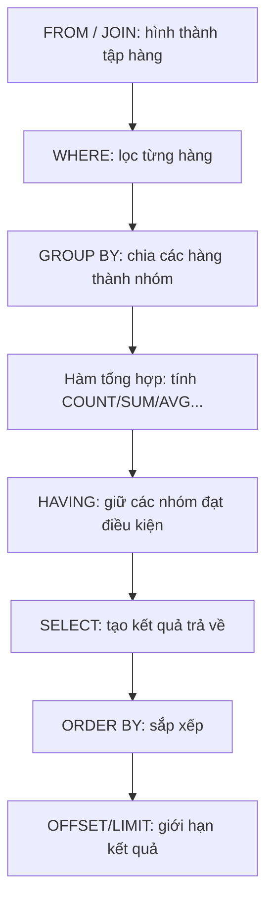

# Nhóm dữ liệu, hàm tổng hợp và điều kiện sau khi nhóm trong HQL

Trong Hibernate, không phải mọi truy vấn đều cần trả về danh sách entity đầy đủ. Khi xây dựng báo cáo, dashboard, thống kê doanh thu, đếm đơn hàng hoặc tìm khách hàng có mức chi tiêu cao, ứng dụng thường chỉ cần **dữ liệu đã được tổng hợp**.

Ví dụ:

- Mỗi khách hàng có bao nhiêu đơn hàng?
- Tổng doanh thu theo tháng là bao nhiêu?
- Trạng thái nào có nhiều đơn hàng nhất?
- Những khách hàng nào có tổng giá trị đơn hàng đã thanh toán từ 10 triệu đồng trở lên?
- Có bao nhiêu khách hàng chưa phát sinh đơn hàng hợp lệ?
- Tại sao một báo cáo có tổng tiền cao gấp nhiều lần số liệu thực tế khi join bảng chi tiết?

Để trả lời, HQL (Hibernate Query Language) cung cấp các công cụ quen thuộc từ SQL: **`GROUP BY`**, các hàm tổng hợp như **`COUNT`, `SUM`, `AVG`, `MIN`, `MAX`**, và **`HAVING`** để lọc kết quả **sau khi nhóm**.

HQL có cú pháp gần SQL nhưng làm việc với **entity, property và association trong mô hình Java** chứ không trực tiếp với tên bảng/cột vật lý. Hibernate chuyển HQL thành SQL thích hợp cho database đang dùng.

Bài học tập trung vào việc hiểu rõ quá trình lọc–nhóm–tính toán–lọc nhóm, viết truy vấn có kiểu trả về đúng, phân biệt các trường hợp dễ nhầm với `JOIN`, xử lý `NULL` và kiểm chứng SQL thực tế.

---

## 1. Phân biệt một truy vấn thông thường và truy vấn tổng hợp

Truy vấn HQL thông thường trả về các entity thỏa điều kiện:

```java
List<SalesOrder> orders = em.createQuery(
    "from SalesOrder o where o.status = :status",
    SalesOrder.class
)
.setParameter("status", OrderStatus.PAID)
.getResultList();
```

Nếu màn hình chỉ cần **số lượng đơn hàng** đã thanh toán, không cần tải toàn bộ entity vào JVM:

```java
Long paidOrderCount = em.createQuery(
    "select count(o) " +
    "from SalesOrder o " +
    "where o.status = :status",
    Long.class
)
.setParameter("status", OrderStatus.PAID)
.getSingleResult();
```

Nếu cần số đơn theo **từng trạng thái**, dùng `GROUP BY`:

```java
List<Object[]> counts = em.createQuery(
    "select o.status, count(o) " +
    "from SalesOrder o " +
    "group by o.status",
    Object[].class
).getResultList();
```

Khi này mỗi hàng kết quả mô tả **một nhóm**, không phải một `SalesOrder` riêng lẻ.

| Loại truy vấn | Trả về | Khi dùng |
| --- | --- | --- |
| `from SalesOrder o` | Các entity `SalesOrder` | Hiển thị/xử lý từng đơn |
| `select count(o) ...` | Một giá trị tổng hợp | Tổng số đơn |
| `group by o.status` | Một hàng tổng hợp cho mỗi trạng thái | Thống kê theo trạng thái |
| `having count(o) >= :n` | Chỉ những nhóm đạt ngưỡng | Lọc nhóm có đủ số lượng |

**Nguyên tắc:** nếu chỉ cần kết quả tổng hợp, hãy để database tính toán thay vì tải hàng nghìn entity về rồi dùng Java `Stream` để đếm.

## 2. Mô hình dữ liệu xuyên suốt bài học

Ta dùng mô hình bán hàng đơn giản gồm khách hàng, đơn hàng và dòng hàng.

### Entity `Customer`

```java
import java.util.ArrayList;
import java.util.List;
import jakarta.persistence.*;

@Entity
@Table(name = "customers")
public class Customer {

    @Id
    private Long id;

    @Column(name = "display_name", nullable = false)
    private String displayName;

    @OneToMany(mappedBy = "customer")
    private List<SalesOrder> orders = new ArrayList<>();

    protected Customer() {}

    public Long getId() { return id; }
    public String getDisplayName() { return displayName; }
    public List<SalesOrder> getOrders() { return orders; }
}
```

### Enum trạng thái

```java
public enum OrderStatus {
    DRAFT,
    PAID,
    CANCELLED
}
```

### Entity `SalesOrder`

```java
import java.math.BigDecimal;
import java.time.LocalDateTime;
import java.util.ArrayList;
import java.util.List;
import jakarta.persistence.*;

@Entity
@Table(name = "sales_orders")
public class SalesOrder {

    @Id
    private Long id;

    @Enumerated(EnumType.STRING)
    @Column(name = "status", nullable = false)
    private OrderStatus status;

    @Column(
        name = "total_amount",
        precision = 19,
        scale = 2,
        nullable = false
    )
    private BigDecimal totalAmount;

    @Column(name = "created_at", nullable = false)
    private LocalDateTime createdAt;

    @ManyToOne(fetch = FetchType.LAZY, optional = false)
    @JoinColumn(name = "customer_id", nullable = false)
    private Customer customer;

    @OneToMany(mappedBy = "order")
    private List<OrderLine> lines = new ArrayList<>();

    protected SalesOrder() {}

    public Long getId() { return id; }
    public OrderStatus getStatus() { return status; }
    public BigDecimal getTotalAmount() { return totalAmount; }
    public LocalDateTime getCreatedAt() { return createdAt; }
    public Customer getCustomer() { return customer; }
    public List<OrderLine> getLines() { return lines; }
}
```

### Entity `OrderLine`

```java
import java.math.BigDecimal;
import jakarta.persistence.*;

@Entity
@Table(name = "order_lines")
public class OrderLine {

    @Id
    private Long id;

    @ManyToOne(fetch = FetchType.LAZY, optional = false)
    @JoinColumn(name = "order_id", nullable = false)
    private SalesOrder order;

    private String sku;
    private int quantity;

    @Column(name = "unit_price", precision = 19, scale = 2)
    private BigDecimal unitPrice;

    protected OrderLine() {}

    public Long getId() { return id; }
    public SalesOrder getOrder() { return order; }
    public String getSku() { return sku; }
    public int getQuantity() { return quantity; }
    public BigDecimal getUnitPrice() { return unitPrice; }
}
```

Các class trên minh họa mapping và truy vấn, không phải toàn bộ ứng dụng chạy độc lập. Một dự án thực cần constructor/domain methods, migration schema và imports tương ứng với Java/Jakarta Persistence/Hibernate version.

### Dữ liệu minh họa

Giả sử có ba khách hàng:

| Customer ID | Tên |
| ---: | --- |
| 1 | An Phát |
| 2 | Bình Minh |
| 3 | Cửu Long |

Bốn đơn hàng:

| Order ID | Customer | Trạng thái | Giá trị |
| ---: | --- | --- | ---: |
| 101 | An Phát | PAID | 120 |
| 102 | An Phát | PAID | 80 |
| 103 | An Phát | CANCELLED | 30 |
| 104 | Bình Minh | PAID | 50 |

Cửu Long chưa có đơn hàng. Các giá trị tiền trong bảng chỉ là số liệu giả định để minh họa phép tính, không đại diện đơn vị tiền tệ thực tế.

Khi lọc chỉ trạng thái `PAID`:

- An Phát có 2 đơn, tổng 200.
- Bình Minh có 1 đơn, tổng 50.
- Cửu Long không có đơn, tổng 0 theo cách trình bày nghiệp vụ; trong SQL, `SUM` trên nhóm không có giá trị phù hợp có thể trả `NULL`.

Chúng ta sẽ dùng chính dữ liệu này để kiểm tra ý nghĩa của `WHERE`, `GROUP BY`, `HAVING` và `LEFT JOIN`.

## 3. HQL dùng tên entity và property, không phải tên bảng SQL

Câu HQL:

```hql
select o.customer.id, count(o)
from SalesOrder o
group by o.customer.id
```

sử dụng:

- `SalesOrder`: entity name, thường là tên Java class nếu không đặt tên riêng bằng `@Entity(name = "...")`.
- `o.customer`: association trong entity.
- `o.customer.id`: đường dẫn property tới identifier của Customer.
- `o.status` hoặc `o.totalAmount`: Java properties được mapping.

Trong khi SQL tương ứng dùng bảng và cột, ví dụ:

```sql
SELECT o.customer_id, COUNT(*)
FROM sales_orders o
GROUP BY o.customer_id;
```

Không viết HQL như sau rồi kỳ vọng Hibernate hiểu tên bảng:

```hql
-- Sai trong ngữ cảnh entity name được khai báo là SalesOrder:
select o.customer_id, count(*)
from sales_orders o
group by o.customer_id
```

Nếu cần dùng tên bảng/cột vật lý, hãy chọn native SQL và API tương ứng. HQL được thiết kế cho mô hình object/association.

## 4. Trình tự tư duy: WHERE → GROUP BY → HAVING

Một truy vấn tổng hợp thường có cấu trúc:

```hql
select <grouping expression>, <aggregate expression>
from <entity> <alias>
join ...
where <condition on individual rows>
group by <grouping expression>
having <condition on aggregated groups>
order by ...
```

Về mặt khái niệm, database xử lý:



Đây là **thứ tự logic để hiểu truy vấn**, không phải thứ tự vật lý mọi database engine bắt buộc thực thi. Optimizer có thể thay đổi kế hoạch thực thi nếu vẫn giữ semantics.

### `WHERE` lọc hàng trước khi nhóm

```hql
select o.customer.id, sum(o.totalAmount)
from SalesOrder o
where o.status = :status
group by o.customer.id
```

Chỉ những đơn hàng có trạng thái được chọn tham gia phép tính.

### `HAVING` lọc nhóm sau khi tổng hợp

```hql
select o.customer.id, sum(o.totalAmount)
from SalesOrder o
where o.status = :status
group by o.customer.id
having sum(o.totalAmount) >= :minTotal
```

Truy vấn tính tổng của từng khách hàng, rồi chỉ giữ nhóm có tổng đạt ngưỡng.

**Ghi nhớ:** `WHERE` trả lời “hàng nào được tham gia?”; `HAVING` trả lời “nhóm nào được trả về?”.

## 5. `GROUP BY` một thuộc tính

Đếm số đơn theo trạng thái:

```java
List<Object[]> rows = em.createQuery(
    "select o.status, count(o) " +
    "from SalesOrder o " +
    "group by o.status",
    Object[].class
).getResultList();

for (Object[] row : rows) {
    OrderStatus status = (OrderStatus) row[0];
    Long count = (Long) row[1];
    System.out.println(status + " -> " + count);
}
```

Dữ liệu minh họa:

```text
PAID      -> 3
CANCELLED -> 1
```

Không có đơn `DRAFT` trong dữ liệu mẫu nên không có nhóm DRAFT. `GROUP BY` không tự tạo các nhóm có số lượng 0 cho mọi giá trị enum.

### Grouping expression là khóa phân nhóm

Các hàng có cùng `o.status` vào cùng một nhóm. Mỗi nhóm tạo một hàng kết quả. Nếu chọn `o.status` cùng `count(o)`, truy vấn có ý nghĩa rõ: “với mỗi trạng thái, đếm số đơn”.

### Không nhất thiết phải có GROUP BY để dùng hàm tổng hợp

Tổng số đơn:

```hql
select count(o) from SalesOrder o
```

Đây là truy vấn aggregate toàn bộ tập hàng thành **một kết quả**, không chia nhiều nhóm.

Ngược lại, nếu muốn kết quả theo từng trạng thái, phải đưa thuộc tính chia nhóm vào `GROUP BY`.

## 6. `GROUP BY` nhiều thuộc tính

Có khi một thuộc tính không đủ để tạo nhóm.

Ví dụ đếm đơn theo **năm và tháng**:

```hql
select
    year(o.createdAt),
    month(o.createdAt),
    count(o)
from SalesOrder o
group by
    year(o.createdAt),
    month(o.createdAt)
order by
    year(o.createdAt),
    month(o.createdAt)
```

Một nhóm được xác định bằng cặp:

```text
(year, month)
```

Không chỉ nhóm theo tháng vì tháng 1 của nhiều năm khác nhau không phải cùng kỳ.

Các hàm trích xuất ngày/thời gian như `year()`, `month()` được Hibernate HQL hỗ trợ trong các phiên bản hiện đại; SQL thực tế và khả năng xử lý phụ thuộc dialect. Với yêu cầu portable Jakarta Persistence, có thể dùng `EXTRACT` theo phiên bản JPA/provider hoặc cấu trúc truy vấn khác được hỗ trợ.

### Nhóm theo nhiều field của entity

```hql
select
    o.customer.id,
    o.status,
    count(o),
    sum(o.totalAmount)
from SalesOrder o
group by
    o.customer.id,
    o.status
order by
    o.customer.id,
    o.status
```

Kết quả có thể là:

| Customer ID | Status | COUNT | SUM |
| ---: | --- | ---: | ---: |
| 1 | PAID | 2 | 200 |
| 1 | CANCELLED | 1 | 30 |
| 2 | PAID | 1 | 50 |

Không có nhóm cho Customer 3 vì truy vấn bắt đầu từ `SalesOrder` và khách hàng đó chưa có đơn hàng.

## 7. Quy tắc quan trọng về biểu thức SELECT và GROUP BY

Một truy vấn có GROUP BY thường chỉ nên chọn:

1. Những biểu thức được đưa vào khóa nhóm.
2. Những giá trị tính bằng hàm tổng hợp trên hàng trong mỗi nhóm.
3. Những biểu thức mà SQL dialect xác định được từ khóa nhóm theo quy tắc phù hợp.

Ví dụ đúng và dễ portable:

```hql
select c.id, c.displayName, count(o.id)
from Customer c
left join c.orders o
group by c.id, c.displayName
```

Cả `c.id` và `c.displayName` đều xuất hiện trong `GROUP BY`.

Ví dụ dễ sai:

```hql
select c.id, c.displayName, count(o.id)
from Customer c
left join c.orders o
group by c.id
```

Một số DBMS cho phép chọn `c.displayName` nếu xác định được phụ thuộc hàm vào `c.id`, nhưng các dialect/JPQL provider có thể khác nhau. Để tránh lỗi và tăng tính rõ ràng, đưa các biểu thức scalar không aggregate cần trả về vào `GROUP BY`.

### Không lấy đại một giá trị từ trong nhóm

```hql
select o.customer.id, o.totalAmount, count(o)
from SalesOrder o
group by o.customer.id
```

Mỗi khách hàng có thể có nhiều đơn với `totalAmount` khác nhau. Database không có một giá trị `o.totalAmount` duy nhất để trả về cho nhóm. Hãy dùng `sum(o.totalAmount)`, `max(o.totalAmount)` hoặc nhóm thêm theo amount nếu đó thực sự là ý định.

### Nhóm theo entity

Hibernate HQL có hỗ trợ nhóm theo một số entity-valued expression, nhưng SQL sinh ra và mức portable có thể phụ thuộc provider/dialect và mapping. Với báo cáo cần chạy ổn định trên nhiều database, nhóm theo identifier và các field hiển thị cần thiết thường dễ kiểm soát hơn.

## 8. `COUNT`: đếm hàng, giá trị và giá trị phân biệt

`COUNT` là hàm tổng hợp được dùng rất nhiều trong báo cáo.

### Đếm entity

```hql
select count(o)
from SalesOrder o
where o.status = :status
```

`count(o)` đếm những entity thuộc tập kết quả sau điều kiện lọc. Kiểu giá trị trả về trong JPQL/HQL thông thường là `Long`:

```java
Long count = em.createQuery(
    "select count(o) from SalesOrder o",
    Long.class
).getSingleResult();
```

### `count(*)`

Hibernate HQL hỗ trợ dạng `count(*)` trong nhiều ngữ cảnh giống SQL:

```hql
select count(*) from SalesOrder o
```

Khi dùng JPA hoặc các provider/version khác, kiểm tra cú pháp được hỗ trợ. `count(o)` hoặc `count(o.id)` thường giúp biểu đạt rõ entity/property đang được đếm.

### `COUNT(expression)` bỏ qua giá trị NULL

```hql
select count(o.someOptionalProperty)
from SalesOrder o
```

Câu này đếm những hàng mà expression không null, không nhất thiết bằng số entity.

Trong mapping mẫu `SalesOrder` không có `someOptionalProperty`; đây là cú pháp minh họa cho một property nullable ở entity phù hợp.

### `COUNT(DISTINCT ...)`

Đếm số khách hàng phân biệt đã có đơn:

```hql
select count(distinct o.customer.id)
from SalesOrder o
```

Với dữ liệu mẫu, kết quả là 2, không phải 4, vì hai khách hàng đã có đơn là An Phát và Bình Minh.

### `COUNT` thường trả 0 thay vì NULL

Với truy vấn aggregate không GROUP BY trên tập rỗng, `COUNT` trả 0. Ngược lại, các hàm như `SUM` hay `AVG` thường trả NULL khi không có giá trị phù hợp.

Điều này quan trọng khi xử lý DTO hoặc `getSingleResult()`.

## 9. `SUM`: tính tổng

Tổng doanh thu các đơn đã thanh toán:

```java
BigDecimal paidTotal = em.createQuery(
    "select sum(o.totalAmount) " +
    "from SalesOrder o " +
    "where o.status = :status",
    BigDecimal.class
)
.setParameter("status", OrderStatus.PAID)
.getSingleResult();
```

Trong mô hình mẫu: `120 + 80 + 50 = 250`.

### SUM theo khách hàng

```hql
select o.customer.id, sum(o.totalAmount)
from SalesOrder o
where o.status = :status
group by o.customer.id
```

Kết quả:

| Customer ID | Tổng PAID |
| ---: | ---: |
| 1 | 200 |
| 2 | 50 |

Customer 3 không có hàng trong kết quả vì không có đơn PAID.

### Kiểu số của SUM

Theo quy tắc aggregate của JPQL/Hibernate, kiểu kết quả phụ thuộc kiểu property và provider:

- Tổng các giá trị nguyên nhỏ thường cho `Long`.
- `BigInteger` thường giữ kiểu `BigInteger`.
- `BigDecimal` thường giữ kiểu `BigDecimal`.
- Các kiểu số thực có thể cho `Double`.

Không ép kiểu kết quả thành `Integer` chỉ vì column database có kiểu INTEGER. Với số lượng lớn, `Long` cũng có giới hạn; kiểm tra kiểu và độ lớn dữ liệu cần tổng hợp.

### SUM trên tập rỗng

```hql
select sum(o.totalAmount)
from SalesOrder o
where o.status = :status
```

Nếu không có đơn nào thỏa điều kiện, kết quả thường là `NULL`, không phải `BigDecimal.ZERO`.

Trong Java:

```java
BigDecimal total = query.getSingleResult();

if (total == null) {
    total = BigDecimal.ZERO;
}
```

Hoặc dùng `coalesce` trong HQL với hằng số/parameter **tương thích kiểu** với biểu thức SUM:

```hql
select coalesce(sum(o.totalAmount), :zeroAmount)
from SalesOrder o
where o.status = :status
```

```java
query.setParameter("zeroAmount", BigDecimal.ZERO);
```

Việc suy luận kiểu của `coalesce` phụ thuộc ngữ cảnh HQL/provider; nên dùng kiểu số phù hợp với property.

## 10. `AVG`: tính trung bình

Giá trị trung bình của đơn đã thanh toán:

```hql
select avg(o.totalAmount)
from SalesOrder o
where o.status = :status
```

Với dữ liệu mẫu: `(120 + 80 + 50) / 3 ≈ 83.333...`.

Trong JPQL/HQL, `AVG` trên biểu thức số thường trả `Double`:

```java
Double average = em.createQuery(
    "select avg(o.totalAmount) " +
    "from SalesOrder o " +
    "where o.status = :status",
    Double.class
)
.setParameter("status", OrderStatus.PAID)
.getSingleResult();
```

### AVG và tiền tệ

`BigDecimal` thích hợp khi lưu tiền; nhưng kết quả `AVG` theo JPQL có thể là `Double`. Không nên dùng kết quả Double một cách mù quáng cho quy tắc kế toán yêu cầu làm tròn chính xác hoặc kiểm toán.

Nếu cần độ chính xác thập phân cụ thể, có thể:

- Tổng hợp `SUM` và `COUNT`, rồi dùng `BigDecimal.divide` với `RoundingMode` rõ ràng trong Java.
- Dùng native SQL với phép `CAST`/hàm số học chính xác của database.
- Kiểm tra cách Hibernate/dialect trả kiểu và scale thực tế.

Ví dụ tính trung bình chính xác hơn ở Java:

```java
BigDecimal sum = totals.sum();
long count = totals.count();

BigDecimal average = count == 0
    ? BigDecimal.ZERO
    : sum.divide(
        BigDecimal.valueOf(count),
        2,
        RoundingMode.HALF_UP
    );
```

Ở đây `totals` là DTO hoặc record ứng dụng định nghĩa chứa `sum` và `count`; chính sách làm tròn chỉ mang tính minh họa.

## 11. `MIN` và `MAX`: lấy giá trị nhỏ nhất, lớn nhất

Giá trị đơn hàng nhỏ nhất và lớn nhất trong trạng thái PAID:

```hql
select
    min(o.totalAmount),
    max(o.totalAmount)
from SalesOrder o
where o.status = :status
```

Với dữ liệu mẫu: min = 50, max = 120.

Ví dụ theo khách hàng:

```hql
select
    o.customer.id,
    min(o.totalAmount),
    max(o.totalAmount)
from SalesOrder o
where o.status = :status
group by o.customer.id
```

### Min/max không trả về cả entity

Nếu tìm đơn hàng có tổng tiền cao nhất, truy vấn:

```hql
select max(o.totalAmount) from SalesOrder o
```

chỉ trả về giá trị maximum, không tự trả `SalesOrder` tương ứng.

Không viết:

```hql
select o, max(o.totalAmount)
from SalesOrder o
```

và kỳ vọng database tự chọn entity đúng giá trị lớn nhất. Nếu cần entity, có thể dùng thứ tự giảm dần cùng giới hạn kết quả:

```java
List<SalesOrder> highestOrders = em.createQuery(
    "from SalesOrder o " +
    "order by o.totalAmount desc, o.id asc",
    SalesOrder.class
)
.setMaxResults(1)
.getResultList();
```

Cách này chọn một order có total lớn nhất, với tie-breaker theo ID. Nếu cần **tất cả** đơn đồng hạng, có thể dùng subquery hoặc cơ chế truy vấn phù hợp.

### Min/max với ngày tháng

`MIN` và `MAX` cũng hữu ích với property thời gian:

```hql
select
    o.customer.id,
    min(o.createdAt),
    max(o.createdAt)
from SalesOrder o
group by o.customer.id
```

Đây là thời điểm đặt đơn sớm nhất và muộn nhất theo từng khách hàng; loại ngày/thời gian trả về tương ứng với property và provider mapping.

## 12. Bảng so sánh các hàm tổng hợp

| Hàm | Ý nghĩa | Xử lý NULL | Khi không có hàng phù hợp |
| --- | --- | --- | --- |
| `count(o)` | Đếm entity/biểu thức khác null | Bỏ qua NULL của expression | 0 với aggregate toàn tập |
| `count(distinct x)` | Đếm giá trị phân biệt khác null | Bỏ qua NULL | 0 |
| `sum(x)` | Tổng các giá trị số | Bỏ qua NULL | Thường NULL |
| `avg(x)` | Trung bình các giá trị số | Bỏ qua NULL | Thường NULL |
| `min(x)` | Giá trị nhỏ nhất | Bỏ qua NULL | Thường NULL |
| `max(x)` | Giá trị lớn nhất | Bỏ qua NULL | Thường NULL |

Một điểm dễ nhầm: khi `GROUP BY` trên tập hàng không có bất kỳ dòng nào, truy vấn có thể **không trả hàng nào**. Trong khi đó, truy vấn aggregate **không có GROUP BY** trên tập rỗng thường vẫn trả một hàng với `COUNT = 0`, `SUM/AVG/MIN/MAX = NULL`.

Hãy phân biệt “không có nhóm” với “có nhóm đại diện một thực thể bên trái của LEFT JOIN, nhưng không có hàng bên phải”.

## 13. `HAVING`: điều kiện sau khi nhóm

Giả sử muốn lấy những khách hàng có **ít nhất hai đơn đã thanh toán**.

```hql
select
    o.customer.id,
    count(o)
from SalesOrder o
where o.status = :status
group by o.customer.id
having count(o) >= :minOrders
```

Ví dụ Java:

```java
List<Object[]> rows = em.createQuery(
    "select o.customer.id, count(o) " +
    "from SalesOrder o " +
    "where o.status = :status " +
    "group by o.customer.id " +
    "having count(o) >= :minOrders",
    Object[].class
)
.setParameter("status", OrderStatus.PAID)
.setParameter("minOrders", 2L)
.getResultList();
```

Với dữ liệu mẫu, chỉ An Phát có hai đơn PAID.

### Lọc theo tổng doanh thu

```hql
select
    o.customer.id,
    sum(o.totalAmount)
from SalesOrder o
where o.status = :status
group by o.customer.id
having sum(o.totalAmount) >= :minimumAmount
```

Nếu minimumAmount = 100, chỉ Customer 1 đạt ngưỡng.

### HAVING với nhiều điều kiện

```hql
select
    o.customer.id,
    count(o),
    sum(o.totalAmount)
from SalesOrder o
where o.status = :status
group by o.customer.id
having count(o) >= :minOrders
   and sum(o.totalAmount) >= :minAmount
```

Mỗi nhóm phải thỏa cả hai điều kiện.

### Tại sao không đặt SUM trong WHERE?

Ví dụ sai về tư duy:

```hql
-- Sai: hàm aggregate không dùng trực tiếp trong WHERE thường.
select o.customer.id, sum(o.totalAmount)
from SalesOrder o
where sum(o.totalAmount) >= :minimumAmount
group by o.customer.id
```

`WHERE` được áp dụng trước khi tạo nhóm, nên lúc đó chưa có giá trị tổng theo từng khách hàng. Hãy chuyển điều kiện tổng sang `HAVING`.

## 14. `WHERE` và `HAVING` không thay thế nhau

Giả sử muốn tổng giá trị đơn PAID từ ngày 01/01 đến trước ngày 01/02 và chỉ lấy khách có tổng từ 100 trở lên.

```hql
select
    o.customer.id,
    count(o),
    sum(o.totalAmount)
from SalesOrder o
where o.status = :paidStatus
  and o.createdAt >= :fromTime
  and o.createdAt < :toTime
group by o.customer.id
having sum(o.totalAmount) >= :minimumTotal
```

- `WHERE o.status = :paidStatus` loại đơn không được thanh toán.
- Điều kiện thời gian loại đơn ngoài kỳ báo cáo.
- `GROUP BY` gom đơn còn lại theo khách hàng.
- `SUM` tính tổng từng nhóm.
- `HAVING` loại nhóm có tổng dưới ngưỡng.

### Vì sao điều kiện thời gian nên ở WHERE?

Nếu chỉ cần dữ liệu trong tháng, lọc ngay trước khi nhóm giúp giảm số hàng phải tổng hợp. Đưa một điều kiện row-level vào HAVING không đúng mục đích và có thể không hợp lệ khi expression không nằm trong GROUP BY.

### Điều kiện thời gian kiểu nửa mở

Thường nên dùng:

```hql
where o.createdAt >= :fromTime
  and o.createdAt < :toTime
```

thay vì tự ghép thời điểm cuối ngày `23:59:59.999`, vì độ chính xác timestamp khác nhau giữa database. Truy vấn nửa mở dễ ghép những khoảng ngày liên tiếp mà không trùng biên.

Nếu dữ liệu lưu `Instant` hoặc thời gian có timezone, application phải quy định rõ cách quy đổi khoảng ngày theo timezone nghiệp vụ.

## 15. `LEFT JOIN`: giữ cả nhóm không có bản ghi bên phải

Đây là một trong những chủ đề quan trọng nhất khi làm báo cáo bằng HQL.

Truy vấn bắt đầu từ SalesOrder:

```hql
select o.customer.id, count(o)
from SalesOrder o
group by o.customer.id
```

sẽ **không có Customer 3**, vì khách hàng đó không có row SalesOrder.

Nếu muốn thống kê **mọi khách hàng**, kể cả người chưa có đơn, bắt đầu từ `Customer` và dùng `LEFT JOIN`:

```hql
select
    c.id,
    c.displayName,
    count(o.id)
from Customer c
left join c.orders o
group by c.id, c.displayName
order by c.id
```

Kết quả:

| Khách hàng | COUNT(o.id) |
| --- | ---: |
| An Phát | 3 |
| Bình Minh | 1 |
| Cửu Long | 0 |

### Vì sao dùng `count(o.id)` thay vì `count(*)`?

Với LEFT JOIN, khách không có đơn vẫn tạo **một hàng kết quả trung gian** ở phía Customer, còn các cột của Order phía phải là NULL.

- `count(*)` đếm hàng trung gian này, nên nhóm Customer 3 có thể cho 1.
- `count(o.id)` chỉ đếm giá trị ID không NULL ở phía Order, nên cho 0.

Ví dụ SQL tương ứng:

```sql
SELECT c.id, c.display_name, COUNT(o.id)
FROM customers c
LEFT JOIN sales_orders o
    ON o.customer_id = c.id
GROUP BY c.id, c.display_name;
```

**Khi muốn đếm phần tử ở phía quan hệ tùy chọn, `count(rightAlias.id)` thường rõ nghĩa hơn `count(*)`.**

## 16. Cạm bẫy: điều kiện WHERE có thể làm LEFT JOIN mất nhóm rỗng

Muốn đếm đơn PAID của **mọi** khách hàng. Một câu HQL dễ viết là:

```hql
select c.id, c.displayName, count(o.id)
from Customer c
left join c.orders o
where o.status = :paidStatus
group by c.id, c.displayName
```

Tuy đã viết `LEFT JOIN`, điều kiện `WHERE o.status = :paidStatus` sẽ loại hàng mà `o` là NULL. Kết quả là Customer 3 biến mất, và customer chỉ có đơn không phải PAID cũng biến mất.

### Đưa điều kiện thuộc phía join vào ON

```hql
select
    c.id,
    c.displayName,
    count(o.id)
from Customer c
left join c.orders o
    on o.status = :paidStatus
group by c.id, c.displayName
order by c.id
```

Trong HQL hiện đại và JPQL hỗ trợ `ON`, phần `on o.status = :paidStatus` bổ sung điều kiện lên association join.

Kết quả:

| Khách hàng | Số đơn PAID |
| --- | ---: |
| An Phát | 2 |
| Bình Minh | 1 |
| Cửu Long | 0 |

### Khác biệt WHERE và ON

```text
LEFT JOIN ... WHERE o.status = PAID
    -> loại những Customer không có Order PAID.

LEFT JOIN ... ON o.status = PAID
    -> vẫn giữ mỗi Customer,
       nhưng chỉ join những Order có trạng thái PAID.
```

Đây không chỉ là tối ưu; **hai truy vấn có ngữ nghĩa khác nhau**.

Hibernate HQL cũng có cú pháp `with` trong một số ngữ cảnh/phiên bản, nhưng `on` thường dễ nhận diện hơn khi so sánh với SQL/JPQL hiện đại.

## 17. `COUNT`, `SUM` trong nhóm LEFT JOIN rỗng

Sử dụng:

```hql
select
    c.id,
    c.displayName,
    count(o.id),
    sum(o.totalAmount)
from Customer c
left join c.orders o
    on o.status = :paidStatus
group by c.id, c.displayName
```

Với Customer không có đơn PAID:

- `count(o.id)` trả 0.
- `sum(o.totalAmount)` trả NULL, không phải 0.

Vì vậy khi dựng DTO báo cáo:

```java
BigDecimal total = (BigDecimal) row[3];
if (total == null) {
    total = BigDecimal.ZERO;
}
```

Hoặc dùng `coalesce` trong HQL với kiểu phù hợp:

```hql
select
    c.id,
    count(o.id),
    coalesce(sum(o.totalAmount), :zeroAmount)
from Customer c
left join c.orders o
    on o.status = :paidStatus
group by c.id
```

```java
query.setParameter("zeroAmount", BigDecimal.ZERO);
```

### Tìm khách hàng chưa có đơn PAID

Khi đã dùng `LEFT JOIN ... ON ...`:

```hql
select c.id, c.displayName
from Customer c
left join c.orders o
    on o.status = :paidStatus
group by c.id, c.displayName
having count(o.id) = 0
```

Truy vấn giữ những khách hàng không có đơn PAID. Điều này bao gồm khách không có đơn nào và khách chỉ có đơn ở trạng thái khác PAID.

Nếu chỉ cần kiểm tra không tồn tại đơn, một truy vấn `NOT EXISTS` tương quan cũng có thể phù hợp; không bắt buộc phải dùng GROUP BY cho mọi bài toán tồn tại.

## 18. JOIN có thể nhân số hàng trước khi tổng hợp

Giả sử Order#101 trị giá 120 và có **2 dòng hàng**; Order#102 trị giá 80 có **1 dòng hàng**.

HQL:

```hql
select
    o.customer.id,
    count(o.id),
    sum(o.totalAmount)
from SalesOrder o
join o.lines l
where o.status = :paidStatus
group by o.customer.id
```

Trước khi nhóm, JOIN tạo các hàng:

| Order | Line | Order total |
| --- | --- | ---: |
| 101 | L1 | 120 |
| 101 | L2 | 120 |
| 102 | L3 | 80 |

Nếu group theo Customer 1:

- `count(o.id)` = 3, **không phải 2**.
- `sum(o.totalAmount)` = 320, **không phải 200**.

Lý do: mỗi row Order bị lặp lại theo số dòng chi tiết.

### `COUNT(DISTINCT o.id)` sửa được phép đếm

```hql
select
    o.customer.id,
    count(distinct o.id)
from SalesOrder o
join o.lines l
where o.status = :paidStatus
group by o.customer.id
```

Với Customer 1, `count(distinct o.id)` trả 2.

### Nhưng `SUM(DISTINCT o.totalAmount)` không phải lời giải tổng quát

Một mẹo sai thường thấy:

```hql
sum(distinct o.totalAmount)
```

Nó chỉ cộng các **giá trị amount khác nhau**, không phải mỗi Order đúng một lần.

Nếu hai đơn khác nhau đều có giá trị 120, `sum(distinct o.totalAmount)` chỉ tính 120 một lần, khiến tổng bị thiếu.

**DISTINCT theo giá trị tiền không tương đương DISTINCT theo Order ID.**

### Cách thiết kế đúng

Nếu muốn tổng từ trường `SalesOrder.totalAmount`, tổng hợp ở mức Order mà không join collection lines:

```hql
select
    o.customer.id,
    count(o.id),
    sum(o.totalAmount)
from SalesOrder o
where o.status = :paidStatus
group by o.customer.id
```

Nếu muốn tổng giá trị **thực sự từ các dòng hàng**, phép tính có thể dựa trên dòng:

```hql
select
    o.customer.id,
    count(distinct o.id),
    sum(l.unitPrice * l.quantity)
from SalesOrder o
join o.lines l
where o.status = :paidStatus
group by o.customer.id
```

Cách thứ hai chỉ đúng khi quy tắc doanh thu của bài toán được định nghĩa bằng tổng `unitPrice × quantity`, không có giảm giá, thuế, phí vận chuyển hoặc những yếu tố không nằm ở OrderLine. Mô hình tiền tệ phải xác định nguồn dữ liệu nào là chuẩn.

## 19. Nhiều collection JOIN có thể tạo tích Descartes

Giả sử một `SalesOrder` có:

- 3 `OrderLine`.
- 2 `Payment`.

Nếu cùng join cả hai collection:

```hql
select o.id, count(l.id), count(p.id)
from SalesOrder o
join o.lines l
join o.payments p
group by o.id
```

Với association `payments` giả định có trong phiên bản mở rộng của entity, tập trung gian có thể có `3 × 2 = 6` hàng.

Kết quả:

- `count(l.id)` = 6 thay vì 3.
- `count(p.id)` = 6 thay vì 2.

`count(distinct l.id)` và `count(distinct p.id)` có thể sửa hai phép đếm, nhưng việc join nhiều collection vẫn làm tăng kích thước tập kết quả và chi phí.

Nếu cần nhiều aggregate độc lập, đôi khi tốt hơn:

1. Tính từng aggregate trong truy vấn riêng.
2. Dùng subquery/derived table nếu phiên bản HQL/dialect hỗ trợ.
3. Tổng hợp ở database theo cấu trúc phù hợp.
4. Dùng projection/CTE/native SQL khi cần truy vấn báo cáo phức tạp.

Tránh join mọi association chỉ vì entity có quan hệ. **JOIN quyết định số hàng trước khi GROUP BY**, nên phải hiểu cardinality của nó.

## 20. Truy vấn trả nhiều giá trị: `Object[]`, `Tuple` và DTO

Kết quả:

```hql
select c.id, c.displayName, count(o.id), sum(o.totalAmount)
from Customer c
left join c.orders o
group by c.id, c.displayName
```

không phải danh sách Customer entity. Mỗi hàng chứa 4 cột tổng hợp.

### Cách 1: dùng `Object[]`

```java
List<Object[]> rows = em.createQuery(
    "select c.id, c.displayName, " +
    "count(o.id), sum(o.totalAmount) " +
    "from Customer c left join c.orders o " +
    "group by c.id, c.displayName",
    Object[].class
).getResultList();

for (Object[] row : rows) {
    Long customerId = (Long) row[0];
    String name = (String) row[1];
    Long count = (Long) row[2];
    BigDecimal total = (BigDecimal) row[3];
}
```

Ưu điểm: đơn giản khi thử nghiệm. Nhược điểm: phải nhớ index/cast, khó refactor, dễ nhầm khi thay thứ tự SELECT.

### Cách 2: JPA `Tuple`

```java
List<Tuple> rows = em.createQuery(
    "select c.id as customerId, " +
    "c.displayName as customerName, " +
    "count(o.id) as orderCount, " +
    "sum(o.totalAmount) as totalAmount " +
    "from Customer c left join c.orders o " +
    "group by c.id, c.displayName",
    Tuple.class
).getResultList();

for (Tuple row : rows) {
    Long id = row.get("customerId", Long.class);
    Long count = row.get("orderCount", Long.class);
    BigDecimal total =
        row.get("totalAmount", BigDecimal.class);
}
```

`Tuple` cho phép đọc cột bằng alias, giảm sự phụ thuộc vào index. Tuy nhiên, alias vẫn là chuỗi và DTO typed thường dễ bảo trì hơn.

### Cách 3: constructor expression trả DTO

Java record:

```java
package com.example.report;

import java.math.BigDecimal;

public record CustomerSalesSummary(
    Long customerId,
    String customerName,
    Long orderCount,
    BigDecimal totalAmount
) {}
```

HQL:

```java
List<CustomerSalesSummary> summaries = em.createQuery(
    "select new com.example.report.CustomerSalesSummary(" +
    "c.id, c.displayName, count(o.id), sum(o.totalAmount)) " +
    "from Customer c left join c.orders o " +
    "group by c.id, c.displayName",
    CustomerSalesSummary.class
).getResultList();
```

Constructor phải có kiểu tham số và thứ tự phù hợp với các biểu thức SELECT. Với record Java, canonical constructor thường đáp ứng yêu cầu này.

Đối với khách không có Order, `totalAmount` có thể null. Có thể định nghĩa DTO/business layer chuẩn hóa về `BigDecimal.ZERO` nếu phù hợp.

**Lưu ý:** Hibernate 6 có các dạng projection/dynamic instantiation mở rộng, nhưng constructor expression `select new ...` là cách dễ nhận diện và có tính portable theo JPQL.

## 21. GROUP BY và `ORDER BY`

Nếu nhóm theo trạng thái, kết quả **không được mặc định có thứ tự**:

```hql
select o.status, count(o)
from SalesOrder o
group by o.status
```

Muốn hiển thị nhóm đông nhất trước:

```hql
select o.status, count(o)
from SalesOrder o
group by o.status
order by count(o) desc, o.status asc
```

Muốn khách hàng có doanh thu cao nhất trước:

```hql
select
    c.id,
    c.displayName,
    sum(o.totalAmount)
from Customer c
join c.orders o
where o.status = :paidStatus
group by c.id, c.displayName
order by sum(o.totalAmount) desc, c.id asc
```

Trong truy vấn sau, `c.id asc` là tie-breaker giúp thứ tự ổn định khi hai khách hàng có cùng tổng tiền.

### Có thể ORDER BY alias không?

Nhiều phiên bản HQL/JPQL/SQL cho phép tham chiếu select alias trong ORDER BY. Tuy nhiên, mức hỗ trợ có khác biệt theo cú pháp/provider, nên lặp lại biểu thức aggregate trong ORDER BY thường dễ hiểu và portable hơn.

### HAVING và ORDER BY làm hai việc khác nhau

- `HAVING sum(...) >= :min` **loại nhóm không đạt ngưỡng**.
- `ORDER BY sum(...) desc` **xếp thứ tự các nhóm còn lại**.

Sắp xếp không thay thế lọc nhóm.

## 22. Phân trang kết quả tổng hợp

Khi dashboard có nhiều nhóm (ví dụ hàng chục nghìn người bán), có thể phân trang:

```java
List<CustomerSalesSummary> page = em.createQuery(
    "select new com.example.report.CustomerSalesSummary(" +
    "c.id, c.displayName, count(o.id), sum(o.totalAmount)) " +
    "from Customer c left join c.orders o " +
    "group by c.id, c.displayName " +
    "order by sum(o.totalAmount) desc, c.id asc",
    CustomerSalesSummary.class
)
.setFirstResult(0)
.setMaxResults(20)
.getResultList();
```

Ở đây pagination áp dụng lên **các hàng kết quả sau GROUP BY**, không trực tiếp lên từng đơn hàng. Tuy nhiên, chi phí tổng hợp vẫn có thể lớn vì database phải xử lý hàng trước khi tìm nhóm đứng đầu.

### Tổng số nhóm để tính số trang

Đếm tổng số đơn hàng:

```hql
select count(o) from SalesOrder o
```

**không** bằng số nhóm khách hàng. Để tính tổng số nhóm, có thể dùng:

```hql
select count(distinct o.customer.id)
from SalesOrder o
where o.status = :status
```

nếu nhóm đúng theo Customer ID và các điều kiện giống truy vấn gốc.

Nếu query có `HAVING` phức tạp, việc đếm số nhóm sau HAVING cần truy vấn tương đương (có thể dùng subquery/derived table/native SQL tùy khả năng HQL/dialect), không thể thay một cách máy móc bằng `count(distinct id)`.

### Pagination ổn định

Khi nhiều nhóm có cùng COUNT/SUM, thêm khóa phụ như Customer ID vào ORDER BY. Nếu không, hai lượt phân trang có thể trả kết quả chồng lặp hoặc bỏ sót khi thứ tự các nhóm bằng nhau thay đổi.

Với báo cáo dữ liệu thay đổi liên tục, pagination vẫn có thể dịch chuyển khi dữ liệu mới được commit. Nếu yêu cầu snapshot, cần thiết kế transaction/report snapshot cụ thể.

## 23. Điều kiện tổng hợp theo nhiều trạng thái

Có lúc cần một dòng báo cáo cho mỗi khách hàng, đồng thời hiển thị:

- Tổng số đơn.
- Số đơn PAID.
- Tổng tiền PAID.
- Số đơn CANCELLED.

Thực hiện bốn query riêng có thể đơn giản nhưng tốn round-trip. Một cách khác là **conditional aggregation**.

### Dùng CASE trong aggregate

```hql
select
    c.id,
    count(o.id),
    count(case
        when o.status = :paidStatus then o.id
        else null
    end),
    sum(case
        when o.status = :paidStatus then o.totalAmount
        else null
    end),
    count(case
        when o.status = :cancelledStatus then o.id
        else null
    end)
from Customer c
left join c.orders o
group by c.id
```

Vì `COUNT(expression)` bỏ qua NULL, `CASE` chỉ trả ID đối với những trạng thái cần đếm. `SUM` chỉ cộng amount của trạng thái PAID; các trường hợp còn lại trả null.

Với khách không có đơn PAID, tổng SUM vẫn có thể null. DTO cần chuẩn hóa nếu UI muốn hiển thị 0.

### Vì sao không đặt trạng thái PAID trong WHERE?

Nếu dùng `where o.status = :paidStatus`, tập hàng CANCELLED bị loại trước khi GROUP BY, nên không thể đồng thời đếm CANCELLED trong cùng phép tổng hợp từ tập dữ liệu đã lọc.

Conditional aggregate giúp giữ tất cả hàng liên quan và áp dụng điều kiện **bên trong từng phép tổng hợp**.

### HQL aggregate filter trong Hibernate hiện đại

Các phiên bản HQL hiện đại của Hibernate có hỗ trợ cú pháp SQL-style `filter (where ...)` cho aggregate khi truy vấn/dialect phù hợp:

```hql
select
    c.id,
    count(o.id),
    count(o.id) filter (where o.status = :paidStatus),
    sum(o.totalAmount) filter (where o.status = :paidStatus)
from Customer c
left join c.orders o
group by c.id
```

`filter` giúp diễn đạt điều kiện của từng aggregate gọn hơn. Đây là cú pháp HQL/Hibernate nâng cao; nếu dự án cần portable JPQL hoặc chạy Hibernate version cũ, dùng `CASE` hoặc kiểm tra khả năng hỗ trợ trước.

Không nhầm `filter (where ...)` của aggregate với `WHERE` toàn truy vấn: filter chỉ điều chỉnh **phần tử tham gia phép tính được gắn filter**, không tự loại hàng khỏi các aggregate khác.

## 24. `COUNT(DISTINCT ...)` khi JOIN nhiều association

Ví dụ Customer có nhiều Order, mỗi Order có nhiều OrderLine:

```hql
select
    c.id,
    count(o.id),
    count(l.id)
from Customer c
left join c.orders o
left join o.lines l
group by c.id
```

Khi Order có nhiều lines, `count(o.id)` đếm mỗi Order nhiều lần.

Muốn đếm số **Order khác nhau**:

```hql
select
    c.id,
    count(distinct o.id),
    count(l.id)
from Customer c
left join c.orders o
left join o.lines l
group by c.id
```

Truy vấn này đếm Order phân biệt và số line (nếu không có join khác nhân line). Khi có nhiều collection join cùng lúc, ngay cả `count(l.id)` cũng có thể bị nhân và phải xem lại cardinality.

### DISTINCT trong SELECT khác DISTINCT trong COUNT

```hql
select distinct o.customer.id
from SalesOrder o
```

trả danh sách ID khách hàng không trùng.

```hql
select count(distinct o.customer.id)
from SalesOrder o
```

trả **một số lượng** khách hàng không trùng.

Hai truy vấn phục vụ mục tiêu khác nhau. `DISTINCT` trên toàn kết quả SELECT không tự sửa mọi phép SUM đã sai do join nhân row.

## 25. GROUP BY trên ngày và thời gian

Báo cáo thường nhóm theo ngày, tháng, quý hoặc năm.

Ví dụ theo năm và tháng:

```hql
select
    year(o.createdAt),
    month(o.createdAt),
    count(o),
    sum(o.totalAmount)
from SalesOrder o
where o.status = :paidStatus
group by
    year(o.createdAt),
    month(o.createdAt)
order by
    year(o.createdAt),
    month(o.createdAt)
```

### Vì sao không chỉ GROUP BY month?

Nếu dữ liệu có tháng 1 năm 2025 và tháng 1 năm 2026, nhóm theo tháng sẽ cộng cả hai năm vào một nhóm. Đưa năm vào khóa nhóm hoặc dùng một khóa khoảng thời gian chuẩn hóa đầy đủ.

### Timezone

Nếu lưu `LocalDateTime`, ý nghĩa “ngày” phụ thuộc quy ước dữ liệu đó là giờ nào. Nếu lưu UTC `Instant`, nhóm theo ngày UTC khác nhóm theo ngày địa phương của doanh nghiệp.

Với báo cáo doanh thu theo múi giờ nghiệp vụ:

1. Xác định timezone của kỳ báo cáo.
2. Quy đổi khoảng thời gian sang định dạng lưu trữ.
3. Lọc bằng cặp thời điểm `fromInclusive` và `toExclusive`.
4. Nhóm theo ngày/tháng tương ứng timezone báo cáo, có thể dùng chức năng SQL/dialect hoặc bảng ngày.
5. Kiểm tra trường hợp DST nếu báo cáo theo vùng có chuyển giờ.

Không mặc định `month(timestamp)` trong database luôn dùng đúng timezone mà UI mong muốn.

### Hàm database-specific

Khi cần nhóm theo tuần ISO, fiscal quarter hoặc ngày địa phương, có thể cần hàm/dialect riêng, ví dụ dùng `function(...)` trong JPQL hoặc native SQL. Điều đó giảm tính portable và cần test trên DB thực tế.

## 26. HQL nâng cao: subtotal và nhiều cấp nhóm

Báo cáo phân cấp đôi khi cần:

- Tổng theo `(year, month)`.
- Tổng theo `year`.
- Tổng cộng toàn bộ.

Một số database hỗ trợ `ROLLUP`, `CUBE` và `GROUPING SETS`. HQL hiện đại của Hibernate hỗ trợ những cấu trúc grouping nâng cao tùy khả năng của phiên bản và SQL dialect.

Ví dụ ý tưởng:

```hql
select
    year(o.createdAt),
    month(o.createdAt),
    sum(o.totalAmount)
from SalesOrder o
group by rollup(
    year(o.createdAt),
    month(o.createdAt)
)
```

`ROLLUP` có thể tạo thêm subtotal theo năm và grand total. Các dòng subtotal có thể có NULL ở grouping key; cần phân biệt NULL đại diện subtotal với NULL thật của dữ liệu, có thể dựa trên hàm/grouping indicator nếu dialect hỗ trợ.

Không coi đây là cú pháp portable cho mọi Hibernate/JPQL version. Với báo cáo đơn giản, có thể chạy các truy vấn GROUP BY riêng hoặc dùng native SQL được kiểm soát.

## 27. HQL aggregate và subquery

Một yêu cầu thường gặp là tìm đơn hàng lớn hơn **giá trị trung bình toàn hệ thống**:

```hql
select o
from SalesOrder o
where o.totalAmount > (
    select avg(other.totalAmount)
    from SalesOrder other
)
```

Đây là **subquery aggregate**, nhưng không phải truy vấn nhóm theo Customer. `AVG` bên trong tạo một giá trị dùng để lọc từng Order ở truy vấn ngoài.

Tìm khách hàng có hơn hai đơn PAID có thể viết bằng `GROUP BY/HAVING`, hoặc bằng correlated subquery:

```hql
select c
from Customer c
where (
    select count(o)
    from SalesOrder o
    where o.customer = c
      and o.status = :paidStatus
) > :minimumCount
```

Hai cách có thể có SQL execution plan khác nhau. Chọn dựa trên mục tiêu và thực nghiệm với database/dialect thật, không chỉ độ ngắn của HQL.

### Khi nào subquery có lợi?

- Cần trả về **entity** Customer thay vì một DTO nhóm.
- Điều kiện tổng hợp chỉ là một phần của bộ lọc entity.
- Muốn tránh nhân row do join collection ở truy vấn ngoài.
- Cần diễn đạt aggregate phụ thuộc entity ngoài.

Không giả định subquery luôn nhanh hơn JOIN/GROUP BY; optimizer và index quyết định hiệu năng.

## 28. Kiểu trả về và lỗi cast thường gặp

Khi dùng `Object[]` hoặc constructor projection, phải phân biệt kiểu dữ liệu Java.

| Biểu thức | Kiểu thường gặp |
| --- | --- |
| `count(o)` | `Long` |
| `count(distinct o.id)` | `Long` |
| `sum(o.totalAmount)` với `BigDecimal` | `BigDecimal` |
| `avg(o.totalAmount)` | `Double` theo JPQL |
| `min(o.createdAt)` | `LocalDateTime` theo mapping |
| `max(o.totalAmount)` | `BigDecimal` |
| `o.status` | `OrderStatus` |
| `o.customer.id` | `Long` nếu ID khai báo Long |

Ví dụ dễ sai:

```java
Integer count = (Integer) row[1]; // Sai nếu COUNT trả Long.
```

Đúng:

```java
Long count = (Long) row[1];
```

Khi dùng native SQL, kiểu scalar có thể khác dựa trên JDBC driver/dialect; không mang nguyên giả định kiểu JPQL sang mọi native query.

### Decimal precision

`SUM(BigDecimal)` có thể trả giá trị vượt phạm vi column ban đầu nếu nhiều row cộng dồn. Cần kiểm tra kiểu số và độ chính xác trong DB/reporting pipeline. Nếu use case dùng số tiền có đơn vị tiền tệ khác nhau, **không được cộng chung các loại currency** mà không có quy tắc chuyển đổi; group theo currency hoặc chuẩn hóa tỷ giá trước.

## 29. Aggregate có NULL: cách đọc chính xác

Giả sử một số entity có property `discountAmount` nullable. Các hàm tổng hợp không coi NULL là số 0 trong mọi ngữ cảnh.

```hql
select
    count(o.discountAmount),
    sum(o.discountAmount),
    avg(o.discountAmount)
from SalesOrder o
```

Ở đây:

- `count(o.discountAmount)` chỉ đếm đơn có discountAmount khác NULL.
- `sum(o.discountAmount)` cộng những giá trị không NULL.
- `avg(o.discountAmount)` chia tổng cho **số giá trị khác NULL**, không chia cho tổng số đơn.

Nếu muốn coi NULL là 0 và tính trung bình trên **mọi đơn**, có thể dùng:

```hql
select avg(coalesce(o.discountAmount, :zeroDiscount))
from SalesOrder o
```

với parameter `zeroDiscount` có kiểu số tương thích. Ý nghĩa này khác `avg(o.discountAmount)` khi có NULL.

### Ví dụ số học

Có ba đơn với discount lần lượt 10, NULL và 20:

- `count(discountAmount)` = 2.
- `sum(discountAmount)` = 30.
- `avg(discountAmount)` = 15.
- `avg(coalesce(discountAmount, 0))` = 10.

Không chọn một trong hai chỉ vì “đẹp số”; chọn đúng ý nghĩa nghiệp vụ của NULL: chưa biết, không áp dụng, hay bằng không.

## 30. Query parameter và bảo vệ truy vấn báo cáo

Không nối chuỗi đầu vào trực tiếp vào HQL:

```java
String hql = "from SalesOrder o where o.status = '"
    + statusFromClient + "'";
```

Thay vào đó, bind parameter:

```java
List<Object[]> rows = em.createQuery(
    "select o.customer.id, count(o), sum(o.totalAmount) " +
    "from SalesOrder o " +
    "where o.status = :status " +
    "and o.createdAt >= :fromTime " +
    "and o.createdAt < :toTime " +
    "group by o.customer.id",
    Object[].class
)
.setParameter("status", OrderStatus.PAID)
.setParameter("fromTime", start)
.setParameter("toTime", endExclusive)
.getResultList();
```

Lợi ích:

- Không tự chèn dữ liệu vào cú pháp query.
- Giữ kiểu enum, ngày giờ và số tiền đúng cách.
- Giảm rủi ro HQL/SQL injection.
- Hỗ trợ quản lý execution plan tốt hơn theo database/driver.

Nếu người dùng chọn field sắp xếp động, không thể luôn bind tên field bằng parameter như một giá trị thông thường. Hãy whitelist các lựa chọn đã biết (ví dụ total, orderCount, name) và ánh xạ sang biểu thức HQL cố định, không đưa nguyên text client vào ORDER BY.

## 31. Grouping và phân vùng dữ liệu theo tenant

Trong hệ thống multi-tenant, một báo cáo phải giới hạn đúng tenant/organization.

Ví dụ:

```hql
select
    o.customer.id,
    count(o),
    sum(o.totalAmount)
from SalesOrder o
where o.tenantId = :tenantId
  and o.status = :paidStatus
group by o.customer.id
```

Đoạn này giả định entity SalesOrder mở rộng có property `tenantId`; nếu hệ thống dùng schema/database riêng từng tenant, tenant isolation có thể nằm ở cấu hình Hibernate thay vì field.

Cần phân biệt:

- **Giới hạn dữ liệu:** `WHERE tenantId = :tenantId` hoặc cơ chế multi-tenancy.
- **Khóa nhóm:** `GROUP BY customerId` bên trong một tenant.
- **Báo cáo xuyên tenant:** nếu được phép, khóa nhóm phải có tenant để không gộp các Customer ID cục bộ trùng nhau.

Đừng group theo một identifier chỉ duy nhất trong tenant nếu truy vấn đang trộn dữ liệu từ nhiều tenant.

### Quyền truy cập

Một truy vấn aggregate không tải từng entity Java không có nghĩa nó được phép bỏ qua authorization. Báo cáo tổng doanh thu vẫn có thể làm lộ dữ liệu nhạy cảm; phải áp dụng row-level access/tenant filter theo policy.

## 32. Transaction và dữ liệu thống kê thay đổi liên tục

Báo cáo được chạy trong một transaction, nhưng kết quả có thể thay đổi giữa các lượt truy vấn do các transaction khác ghi dữ liệu.

Ví dụ UI cần:

1. Tổng số nhóm để phân trang.
2. Danh sách top 20 nhóm.
3. Tổng doanh thu toàn hệ thống.

Nếu ba query chạy ở các thời điểm khác nhau với isolation READ COMMITTED, dữ liệu có thể không phản ánh cùng một snapshot. Đây là vấn đề **transaction isolation/consistency**, không phải lỗi GROUP BY.

Nếu báo cáo yêu cầu số liệu đồng nhất:

- Xác định mức nhất quán cần thiết.
- Dùng transaction/isolation phù hợp với DBMS.
- Hoặc dùng bảng báo cáo/materialized view được cập nhật theo kỳ, cùng timestamp dữ liệu.
- Gắn thời điểm chốt số liệu vào response để người dùng hiểu độ mới.

`@Transactional(readOnly = true)` trong Spring có thể hữu ích về ranh giới và hint tối ưu, nhưng không tự đảm bảo snapshot thống nhất giữa nhiều SELECT trên mọi isolation level.

## 33. Performance: GROUP BY có thể tốn tài nguyên

Database thường phải quét, lọc, join, sort/hash aggregate và trả dữ liệu nhóm.

Các yếu tố ảnh hưởng:

- Số hàng đầu vào.
- Mức chọn lọc của `WHERE`.
- Số nhóm phân biệt.
- Số JOIN và khả năng nhân row.
- `COUNT(DISTINCT)` và các aggregate phức tạp.
- Loại cột dùng làm group key.
- Index trên trường lọc và khóa join.
- Database statistics và memory dành cho aggregate.
- Pagination/sorting theo aggregate.

### Lọc càng đúng mục tiêu càng tốt

Nếu báo cáo chỉ tính tháng 11 và trạng thái PAID, lọc trong `WHERE` trước khi group:

```hql
where o.status = :paidStatus
  and o.createdAt >= :start
  and o.createdAt < :endExclusive
```

Không group tất cả lịch sử rồi mới tìm cách loại tháng không cần dùng.

### Index

Với SQL tương ứng:

```sql
WHERE status = ?
  AND created_at >= ?
  AND created_at < ?
GROUP BY customer_id
```

có thể cân nhắc index trên các cột lọc/join/group theo workload thực tế, ví dụ tổ hợp `(status, created_at, customer_id)` hoặc index khác phù hợp. Thứ tự cột index không có một quy tắc đúng chung; hãy kiểm tra độ chọn lọc, cardinality, query plan và database dialect.

### Dùng EXPLAIN

Một cách điều tra:

1. Bật SQL logging để biết SQL Hibernate sinh.
2. Thu thập tham số ở môi trường an toàn.
3. Chạy `EXPLAIN` hoặc `EXPLAIN ANALYZE` theo database tương ứng.
4. Xem scan, join, aggregate, sort, temporary storage.
5. Đo lại sau khi thay đổi index hoặc HQL.

Không kết luận truy vấn tối ưu chỉ vì HQL ngắn; SQL execution plan mới phản ánh cách DB xử lý.

### Aggregate không cần load entity

`select count(o)` hay `select sum(o.totalAmount)` thường cho phép DB tính scalar result mà không materialize toàn bộ SalesOrder entity trong JVM. Đây là lợi thế lớn so với tải danh sách rồi dùng Java Stream.

Tuy nhiên, nếu query projection vô tình chọn cả entity hoặc fetch collection, nó có thể tạo dữ liệu thừa.

## 34. HQL, JPQL và native SQL: chọn đúng công cụ

| Nhu cầu | HQL/JPQL | Native SQL |
| --- | --- | --- |
| `GROUP BY`, `COUNT/SUM/AVG/MIN/MAX` cơ bản | Phù hợp, rõ với entity model | Cũng phù hợp |
| `HAVING` theo nhóm | Hỗ trợ | Hỗ trợ |
| Join association `customer.orders` | Tiện, dựa mapping | Phải viết bảng/khóa |
| DTO constructor projection | Hỗ trợ trong JPQL/HQL | Cần result mapping/transform |
| Chức năng DB đặc thù | Tùy Hibernate/dialect/function | Linh hoạt |
| ROLLUP/CUBE/GROUPING SETS | Tùy phiên bản Hibernate/dialect | Phụ thuộc DBMS, thường dễ dùng trực tiếp |
| Window function báo cáo nâng cao | Hibernate hiện đại có khả năng hỗ trợ, cần kiểm tra | Linh hoạt hơn trên DB hỗ trợ |
| Tính portable giữa DB | Tốt với subset chuẩn | Thường thấp hơn |

Không phải mọi SQL aggregate/analytic construct đều diễn đạt portable trong mọi phiên bản HQL. Nếu báo cáo dùng nhiều window functions, percentile, recursive CTE, grouping sets đặc thù, native SQL có thể hợp lý hơn. Đổi lại, cần tự quản lý schema naming và mapping kết quả.

## 35. Các lỗi thường gặp

### Lỗi 1: dùng `WHERE SUM(...)` thay vì `HAVING`

`WHERE` lọc hàng trước grouping, còn SUM là kết quả sau grouping.

**Khắc phục:** chuyển điều kiện trên tổng, đếm hoặc trung bình sang `HAVING`.

### Lỗi 2: quên GROUP BY khi SELECT cả field và aggregate

`select o.status, count(o)` không có nhóm rõ ràng.

**Khắc phục:** `group by o.status` hoặc bỏ field không aggregate nếu chỉ cần tổng toàn bộ.

### Lỗi 3: chọn field không nằm trong group key

`select c.id, c.name, count(o) ... group by c.id` có thể không portable.

**Khắc phục:** group theo mọi scalar expression cần trả về nếu không nằm trong aggregate.

### Lỗi 4: nghĩ GROUP BY trả cả các nhóm có số lượng 0

Truy vấn bắt đầu từ Order sẽ không có Customer chưa từng có Order.

**Khắc phục:** bắt đầu từ Customer và LEFT JOIN nếu phải hiển thị các nhóm rỗng.

### Lỗi 5: dùng LEFT JOIN rồi lọc bảng phải trong WHERE

`where o.status = :paid` loại nhóm có `o = NULL`.

**Khắc phục:** dùng điều kiện trong `ON` hoặc conditional aggregation nếu cần giữ Customer không có đơn phù hợp.

### Lỗi 6: dùng `COUNT(*)` trên LEFT JOIN để đếm child

Hàng Customer không có Order vẫn xuất hiện một lần trong kết quả join.

**Khắc phục:** dùng `count(o.id)` để đếm child không null.

### Lỗi 7: SUM bị nhân đôi sau join collection

Một Order có nhiều lines nên `o.totalAmount` bị lặp theo mỗi line.

**Khắc phục:** tổng hợp Order ở mức Order, hoặc tính từ line với định nghĩa nghiệp vụ đúng.

### Lỗi 8: dùng `SUM(DISTINCT amount)` để sửa tổng bị lặp

Hai Order khác nhau có cùng amount sẽ bị gộp thành một giá trị.

**Khắc phục:** không dùng DISTINCT theo amount để đại diện cho DISTINCT theo Order ID.

### Lỗi 9: cast COUNT thành Integer

`COUNT` trong JPQL/HQL thường trả `Long`.

**Khắc phục:** dùng `Long` hoặc DTO constructor kiểu phù hợp.

### Lỗi 10: giả định SUM luôn trả 0

`SUM` trên tập không có giá trị phù hợp thường trả NULL.

**Khắc phục:** xử lý null hoặc `coalesce` với kiểu số đúng.

### Lỗi 11: nhầm AVG cho tiền là BigDecimal

`AVG` theo JPQL thường trả `Double`, có thể có sai số biểu diễn.

**Khắc phục:** dùng phép chia BigDecimal có policy làm tròn nếu yêu cầu tiền tệ chính xác.

### Lỗi 12: lấy entity từ MAX(amount)

`max(o.totalAmount)` chỉ trả scalar amount.

**Khắc phục:** truy vấn entity bằng ORDER BY/LIMIT hoặc subquery phù hợp.

### Lỗi 13: nhóm tháng mà quên năm

Tháng 1 của nhiều năm bị gộp.

**Khắc phục:** group theo `year` và `month` hoặc khóa thời gian đầy đủ.

### Lỗi 14: quên timezone của kỳ báo cáo

Ngày theo UTC có thể khác ngày theo múi giờ nghiệp vụ.

**Khắc phục:** xác định timezone, dùng khoảng thời gian chuẩn hóa và chức năng grouping phù hợp.

### Lỗi 15: dùng COUNT(DISTINCT) nhưng không xem các aggregate khác

Đếm Order đã đúng nhưng SUM vẫn bị nhân do join lines.

**Khắc phục:** kiểm tra mọi biểu thức aggregate theo cardinality trước grouping.

### Lỗi 16: trả `Object[]` cho nhiều tầng ứng dụng

Index và cast dễ sai khi thay SELECT.

**Khắc phục:** dùng DTO/record projection hoặc Tuple với alias rõ ràng.

### Lỗi 17: phân trang mà không có ORDER BY ổn định

Những nhóm có tổng bằng nhau có thể đổi vị trí giữa các lượt.

**Khắc phục:** thêm tie-breaker như Customer ID.

### Lỗi 18: đếm số Order để tính số trang của Customer groups

`count(o)` khác số nhóm Customer sau HAVING.

**Khắc phục:** thiết kế query đếm nhóm theo cùng điều kiện báo cáo.

### Lỗi 19: dùng GROUP BY thay cho mọi truy vấn EXISTS

Nếu chỉ cần biết có bản ghi hay không, GROUP BY/HAVING đôi khi phức tạp không cần thiết.

**Khắc phục:** cân nhắc `exists`/`not exists` hoặc query đơn giản theo mục tiêu.

### Lỗi 20: dùng filter/rollup HQL nâng cao mà không xét phiên bản

Cú pháp HQL Hibernate mới có thể không hoạt động trong JPQL/provider/dialect cũ.

**Khắc phục:** kiểm tra phiên bản, database, dùng subset chuẩn hoặc native SQL khi cần.

### Lỗi 21: dùng String concatenation cho tham số báo cáo

Dễ lỗi enum/time và có nguy cơ injection.

**Khắc phục:** dùng named parameters và whitelist field sắp xếp.

### Lỗi 22: tính báo cáo xuyên tenant mà quên tenant scope

Nhóm có thể gộp các bản ghi thuộc tenant khác nhau hoặc làm lộ dữ liệu.

**Khắc phục:** áp dụng tenant filter/authorization và group key đúng phạm vi.

### Lỗi 23: giả định query trả group theo thứ tự bất kỳ là ổn định

SQL không đảm bảo thứ tự khi thiếu ORDER BY.

**Khắc phục:** khai báo ORDER BY theo tiêu chí báo cáo.

### Lỗi 24: tối ưu bằng cách tải entity rồi aggregate trong Java

Tải nhiều row, tăng memory, network và chi phí ORM không cần thiết.

**Khắc phục:** ưu tiên database aggregation/projection và đo query plan.

## 36. Bài thực hành: từ yêu cầu đến HQL

### Bài 1: đếm số đơn theo trạng thái

Yêu cầu: số đơn PAID, CANCELLED, DRAFT đang có dữ liệu.

```hql
select o.status, count(o)
from SalesOrder o
group by o.status
order by o.status
```

Kết quả chỉ có nhóm tồn tại trong dữ liệu. Nếu UI cần cả trạng thái có count 0, ứng dụng có thể điền thiếu dựa trên enum hoặc truy vấn bảng danh mục trạng thái nếu có.

### Bài 2: tổng doanh thu PAID theo khách hàng

```hql
select
    o.customer.id,
    sum(o.totalAmount)
from SalesOrder o
where o.status = :paidStatus
group by o.customer.id
```

Đây là tổng từ trường Order, không cần join OrderLine.

### Bài 3: khách hàng có từ hai đơn PAID trở lên

```hql
select o.customer.id, count(o)
from SalesOrder o
where o.status = :paidStatus
group by o.customer.id
having count(o) >= :minCount
```

`minCount` là named parameter, ví dụ `2L`.

### Bài 4: mọi khách hàng và số đơn PAID, kể cả 0

```hql
select
    c.id,
    c.displayName,
    count(o.id)
from Customer c
left join c.orders o on o.status = :paidStatus
group by c.id, c.displayName
order by c.id
```

Bắt đầu từ Customer, dùng LEFT JOIN và đặt điều kiện PAID trong ON.

### Bài 5: khách hàng chưa có đơn PAID

```hql
select c.id, c.displayName
from Customer c
left join c.orders o on o.status = :paidStatus
group by c.id, c.displayName
having count(o.id) = 0
```

Bao gồm khách không có đơn hoặc chỉ có đơn trạng thái khác PAID.

### Bài 6: báo cáo theo năm và tháng

```hql
select
    year(o.createdAt),
    month(o.createdAt),
    count(o),
    sum(o.totalAmount)
from SalesOrder o
where o.status = :paidStatus
group by year(o.createdAt), month(o.createdAt)
order by year(o.createdAt), month(o.createdAt)
```

Khi chạy production, kiểm tra timezone và khả năng dialect.

### Bài 7: tổng tiền theo từng khách và trạng thái

```hql
select
    o.customer.id,
    o.status,
    count(o),
    sum(o.totalAmount)
from SalesOrder o
group by o.customer.id, o.status
order by o.customer.id, o.status
```

Một khách có thể tạo nhiều nhóm, mỗi nhóm đại diện một trạng thái.

### Bài 8: đơn hàng có nhiều dòng nhất

```hql
select o.id, count(l.id)
from SalesOrder o
left join o.lines l
group by o.id
order by count(l.id) desc, o.id asc
```

Dùng `setMaxResults(1)` để lấy một kết quả đứng đầu; nếu nhiều đơn đồng hạng và cần tất cả, cần truy vấn riêng.

### Bài 9: kiểm tra JOIN nhân số tiền

Đầu tiên so sánh:

```hql
select sum(o.totalAmount)
from SalesOrder o
where o.status = :paidStatus
```

và:

```hql
select sum(o.totalAmount)
from SalesOrder o
join o.lines l
where o.status = :paidStatus
```

Nếu kết quả khác nhau, giải thích bằng số dòng OrderLine của từng Order. Đừng sửa bằng `sum(distinct o.totalAmount)` mà chưa chứng minh semantics.

### Bài 10: trung bình đơn hàng với độ chính xác kế toán

Chạy aggregate `sum(o.totalAmount)` và `count(o)` trong cùng query:

```hql
select sum(o.totalAmount), count(o)
from SalesOrder o
where o.status = :paidStatus
```

Đưa kết quả `BigDecimal` và `Long` về Java, xử lý count = 0 và dùng `BigDecimal.divide` với scale/rounding policy nghiệp vụ.

## 37. Câu hỏi tự kiểm tra

**1. `WHERE` khác `HAVING` ở đâu?**

`WHERE` lọc các hàng trước khi nhóm; `HAVING` lọc các nhóm sau khi hàm aggregate được tính.

**2. Vì sao `select o.status, count(o)` thường cần `group by o.status`?**

Vì `status` là giá trị không aggregate được trả về cho từng nhóm; GROUP BY xác định nhóm nào có cùng status.

**3. `count(o)` trả kiểu Java nào trong JPQL/HQL?**

Thường là `Long`.

**4. `SUM` trên một tập không có hàng phù hợp trả gì?**

Thường NULL, trong khi COUNT trả 0 với truy vấn aggregate toàn tập.

**5. Vì sao LEFT JOIN và `count(o.id)` giúp hiển thị khách không có đơn?**

LEFT JOIN giữ hàng Customer; count trên ID phía phải bỏ qua NULL nên cho 0.

**6. Vì sao đặt `o.status = PAID` trong WHERE sau LEFT JOIN có thể làm mất khách không có đơn PAID?**

Vì hàng phía phải NULL không thỏa điều kiện WHERE; để giữ Customer, đặt điều kiện trong ON hoặc dùng conditional aggregation.

**7. COUNT(DISTINCT o.id) có giải quyết SUM(o.totalAmount) bị nhân khi join lines không?**

Không. Nó chỉ sửa phép đếm order, còn SUM vẫn cộng amount lặp theo mỗi line.

**8. Vì sao `sum(distinct o.totalAmount)` không phải lời giải?**

Vì DISTINCT áp dụng lên giá trị amount, khiến các đơn khác nhau có cùng amount bị tính một lần.

**9. Khi nào dùng constructor expression?**

Khi muốn kết quả tổng hợp được map trực tiếp vào DTO/record có constructor và kiểu tham số phù hợp.

**10. `AVG` trên số tiền BigDecimal nên lưu ý gì?**

Theo JPQL, AVG thường trả Double; với yêu cầu tiền tệ chính xác, cân nhắc SUM/COUNT và phép chia BigDecimal cùng policy làm tròn.

**11. Nếu chỉ muốn đơn hàng có amount cao nhất, `max(amount)` trả luôn entity không?**

Không. Nó trả giá trị amount. Muốn entity, dùng query ORDER BY/giới hạn hoặc subquery phù hợp.

**12. Vì sao nhóm theo month mà không theo year có thể sai?**

Dữ liệu các tháng trùng số ở nhiều năm khác nhau bị gộp chung.

**13. `HAVING count(o) >= 2` có thể thay bằng `WHERE count(o) >= 2` không?**

Không. COUNT là kết quả aggregate, phải được sử dụng ở bước lọc nhóm.

**14. Pagination truy vấn GROUP BY cần lưu ý gì?**

Giới hạn trên kết quả nhóm, cần ORDER BY ổn định và query đếm số nhóm đúng theo cùng điều kiện/HAVING.

**15. Có nên bật EAGER cho toàn bộ association để query tổng hợp nhanh hơn không?**

Không. Aggregate thường chỉ cần scalar/projection, không cần materialize entity graph. EAGER có thể làm truy vấn phức tạp và tải thừa.

**16. Vì sao HQL dùng `o.customer.id` thay vì `customer_id`?**

HQL tham chiếu property/association trong entity model; Hibernate chuyển sang tên cột SQL tương ứng.

**17. Nếu các giá trị nullable được AVG, mẫu số là gì?**

Số giá trị khác NULL, không nhất thiết là tổng số row.

**18. Vì sao query aggregate có thể cho số khác giữa hai lần chạy?**

Dữ liệu thay đổi do transaction khác, khác biệt isolation/snapshot, cache hoặc điều kiện thời gian; phải xác định tính nhất quán báo cáo.

## 38. Ghi nhớ cốt lõi

- **`GROUP BY` chia các hàng đã qua `FROM/JOIN/WHERE` thành nhóm** theo một hoặc nhiều biểu thức.
- **`COUNT`, `SUM`, `AVG`, `MIN`, `MAX`** tính giá trị trên từng nhóm hoặc trên toàn tập khi không có GROUP BY.
- **`WHERE` lọc từng hàng trước khi nhóm; `HAVING` lọc nhóm sau khi tính aggregate.**
- **Các biểu thức SELECT không aggregate nên nằm trong GROUP BY** để truy vấn rõ ràng, portable.
- **`COUNT` thường trả Long; `SUM` có kiểu phụ thuộc property; `AVG` thường trả Double.**
- **`COUNT` và `SUM` khác nhau khi nhóm rỗng:** COUNT = 0, SUM có thể NULL; cần xử lý `coalesce`/default phù hợp.
- **Nếu muốn hiển thị nhóm không có dữ liệu con, bắt đầu từ bảng/entity phía cha và dùng LEFT JOIN.**
- **Điều kiện trên phía phải của LEFT JOIN đặt trong WHERE có thể loại nhóm 0; ON giữ nhóm cha.**
- **JOIN collection có thể nhân số hàng trước GROUP BY.** Dùng `COUNT(DISTINCT id)` khi cần, nhưng không dùng `SUM(DISTINCT amount)` để sửa mọi phép cộng.
- **DTO/record projection** thường phù hợp hơn tải entity hoặc chuyển `Object[]` qua nhiều tầng.
- **ORDER BY và pagination** phải hoạt động trên kết quả nhóm, với tie-breaker và cách đếm số nhóm đúng.
- **Lọc theo tenant, thời gian và status trước grouping**, xác định timezone và chính sách nghiệp vụ.
- **SQL log và EXPLAIN** giúp kiểm tra SQL thực tế và chi phí aggregate; HQL chỉ là lớp biểu diễn trên entity model.

Một truy vấn tổng hợp HQL đúng không chỉ cần viết chính xác `GROUP BY` và `HAVING`. Nó còn phải trả lời đúng câu hỏi: **hàng nào được tham gia phép tính, khóa nào tạo nhóm, những JOIN nào làm nhân dữ liệu, NULL có ý nghĩa gì và người dùng cần xem những nhóm nào**. Khi làm rõ các điểm đó, việc dùng COUNT, SUM, AVG, MIN, MAX và HAVING trở nên dễ kiểm chứng, dễ mở rộng và ổn định hơn trong các báo cáo Hibernate thực tế.
