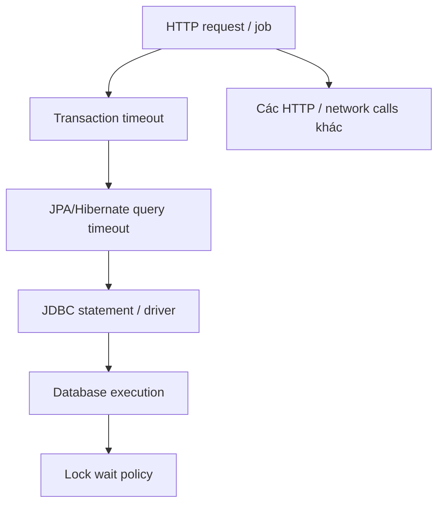

# Named query, hint, timeout và chế độ chỉ đọc trong HQL/Hibernate

Khi ứng dụng có nhiều màn hình cùng sử dụng một truy vấn HQL, lập trình viên cần kiểm soát không chỉ **nội dung truy vấn** mà còn **cách truy vấn được thực thi**. Một danh sách đơn hàng dùng trong nghiệp vụ có thể cần quản lý entity để sửa dữ liệu, trong khi một báo cáo tra cứu cùng dữ liệu chỉ muốn đọc nhanh, không cần dirty checking. Một truy vấn khác phải có thời gian chờ tối đa rõ ràng để tránh chiếm tài nguyên quá lâu.

Hibernate và Jakarta Persistence cung cấp các công cụ phục vụ những yêu cầu này:

- **Named query:** khai báo một truy vấn có tên ổn định, có thể tái sử dụng từ nhiều nơi.
- **Query hint:** truyền các chỉ dẫn thực thi cho provider, chẳng hạn timeout, cache, read-only hoặc fetch behavior.
- **Timeout:** giới hạn thời gian thực hiện truy vấn/đợi khóa theo loại timeout đang dùng, đồng thời xác định cách xử lý khi vượt giới hạn.
- **Chế độ chỉ đọc (read-only):** yêu cầu Hibernate không thực hiện dirty checking thông thường với những entity được tải dưới chế độ đó, khi phù hợp; **không phải** cơ chế bảo mật hay một lời bảo đảm toàn bộ transaction không thể ghi.

Bốn khái niệm có liên quan, nhưng không đồng nghĩa: **named query xác định cái gì được truy vấn; hint và timeout ảnh hưởng cách thực thi; read-only ảnh hưởng cách Hibernate quản lý các entity trả về**.

Bài học sử dụng namespace `jakarta.persistence` và API Hibernate hiện đại (thường thấy trong hệ thống dùng Hibernate 6). Với dự án cũ dùng `javax.persistence`, tên import và chuỗi property cần điều chỉnh theo phiên bản.

---

## 1. Bài toán thực tế: một truy vấn, nhiều ngữ cảnh sử dụng

Giả sử hệ thống quản lý đơn hàng cần những chức năng:

1. Liệt kê đơn đã thanh toán của một khách hàng.
2. Hiển thị báo cáo đơn hàng theo khoảng thời gian.
3. Kiểm tra một đơn để chỉnh sửa trạng thái.
4. Chạy báo cáo có thể mất nhiều thời gian nhưng không được chiếm connection vô hạn.

Một phương thức dùng HQL được tạo trực tiếp:

```java
List<SalesOrder> orders = em.createQuery(
    "select o from SalesOrder o " +
    "where o.customer.id = :customerId " +
    "and o.status = :status " +
    "order by o.createdAt desc, o.id desc",
    SalesOrder.class
)
.setParameter("customerId", customerId)
.setParameter("status", OrderStatus.PAID)
.setMaxResults(100)
.getResultList();
```

Nếu cùng truy vấn được sao chép vào nhiều service, dễ xuất hiện những khác biệt không chủ đích: một nơi bỏ điều kiện status, nơi khác thiếu ORDER BY ổn định, nơi khác dùng tên thuộc tính đã đổi.

**Named query** giúp đặt tên cho một truy vấn dùng chung. **Hint** cho phép cấu hình một số đặc tính thực thi. **Timeout** tránh việc một yêu cầu chiếm tài nguyên vô thời hạn theo chính sách phù hợp. **Read-only** giúp tối ưu các use case chỉ đọc entity.

Tuy nhiên, không phải lúc nào cũng cần cả bốn. Một truy vấn động duy nhất vẫn có thể dùng `createQuery`. Một báo cáo chỉ trả DTO aggregate có thể không hưởng lợi từ entity read-only hint vì không có entity managed nào cần dirty checking.

## 2. Mô hình entity dùng trong ví dụ

Để HQL rõ nghĩa, giả sử một hệ thống bán hàng có hai entity.

### `Customer`

```java
package com.example.sales;

import jakarta.persistence.Entity;
import jakarta.persistence.Id;
import jakarta.persistence.Table;

@Entity
@Table(name = "customers")
public class Customer {

    @Id
    private Long id;

    private String displayName;

    protected Customer() {}

    public Long getId() {
        return id;
    }

    public String getDisplayName() {
        return displayName;
    }
}
```

### `SalesOrder`

```java
package com.example.sales;

import java.math.BigDecimal;
import java.time.LocalDateTime;
import jakarta.persistence.*;

@Entity
@Table(name = "sales_orders")
public class SalesOrder {

    @Id
    private Long id;

    @ManyToOne(fetch = FetchType.LAZY, optional = false)
    @JoinColumn(name = "customer_id")
    private Customer customer;

    @Enumerated(EnumType.STRING)
    private OrderStatus status;

    private BigDecimal totalAmount;
    private LocalDateTime createdAt;

    @Version
    private Long version;

    protected SalesOrder() {}

    public Long getId() {
        return id;
    }

    public Customer getCustomer() {
        return customer;
    }

    public OrderStatus getStatus() {
        return status;
    }

    public BigDecimal getTotalAmount() {
        return totalAmount;
    }

    public LocalDateTime getCreatedAt() {
        return createdAt;
    }

    public Long getVersion() {
        return version;
    }

    public void markCancelled() {
        this.status = OrderStatus.CANCELLED;
    }
}
```

Enum:

```java
package com.example.sales;

public enum OrderStatus {
    NEW,
    PAID,
    CANCELLED
}
```

Ví dụ không định nghĩa đầy đủ constructor, DDL, migration hoặc repository; trọng tâm là cách khai báo và thực thi HQL. Đối với code production, cần bảo đảm các property, schema và cơ chế sinh ID phù hợp.

## 3. Named query là gì?

**Named query** là một truy vấn được khai báo sẵn với **tên định danh**. Ứng dụng gọi truy vấn thông qua tên thay vì phải tạo lại HQL string ở mọi nơi.

Jakarta Persistence hỗ trợ annotation `@NamedQuery`:

```java
import jakarta.persistence.NamedQuery;

@NamedQuery(
    name = "SalesOrder.findPaidByCustomer",
    query = """
        select o
        from SalesOrder o
        where o.customer.id = :customerId
          and o.status = :status
        order by o.createdAt desc, o.id desc
        """
)
@Entity
public class SalesOrder {
    // Các field được mapping.
}
```

Đây là ví dụ rút gọn: annotation cần đặt trên entity phù hợp cùng phần mapping đã trình bày ở trên. Java text block yêu cầu phiên bản Java hỗ trợ; có thể dùng chuỗi nối nếu project đang ở Java cũ hơn.

Các thành phần:

- `name`: tên để ứng dụng tra cứu.
- `query`: câu HQL/JPQL thao tác trên entity và property.
- `:customerId`, `:status`: named parameters được gán khi thực thi.
- `order by`: sắp xếp kết quả để màn hình có thứ tự rõ ràng.

Khi gọi named query, Hibernate dùng định nghĩa đã đăng ký trong persistence unit.

### Cách gọi

```java
TypedQuery<SalesOrder> query = em.createNamedQuery(
    "SalesOrder.findPaidByCustomer",
    SalesOrder.class
);

List<SalesOrder> orders = query
    .setParameter("customerId", customerId)
    .setParameter("status", OrderStatus.PAID)
    .setMaxResults(100)
    .getResultList();
```

Về mục đích truy vấn, kết quả tương tự một `createQuery(...)` có cùng nội dung và parameters, nhưng câu HQL được đặt tại một vị trí khai báo tập trung.

### Vì sao named query hữu ích?

- Dễ tái sử dụng truy vấn có ý nghĩa nghiệp vụ rõ.
- Giảm việc copy-paste HQL vào nhiều lớp.
- Giúp khám phá/query review dễ hơn nhờ tên.
- Hibernate thường có thể kiểm tra hoặc biên dịch named HQL tại thời điểm khởi tạo persistence unit, giúp phát hiện một số lỗi sớm.
- Có thể khai báo các hint mặc định tại định nghĩa truy vấn.

Named query **không tự động nhanh hơn mọi dynamic query**. Hiệu năng phụ thuộc SQL sinh ra, query plan của database, dữ liệu, index, cache và fetch plan.

## 4. `@NamedQueries`: khai báo nhiều truy vấn trên một entity

Nếu entity có nhiều named queries, dùng annotation container `@NamedQueries` để nhóm.

```java
import jakarta.persistence.NamedQueries;
import jakarta.persistence.NamedQuery;

@NamedQueries({
    @NamedQuery(
        name = "SalesOrder.findByCustomer",
        query = """
            select o
            from SalesOrder o
            where o.customer.id = :customerId
            order by o.createdAt desc
            """
    ),
    @NamedQuery(
        name = "SalesOrder.countByStatus",
        query = """
            select o.status, count(o)
            from SalesOrder o
            group by o.status
            """
    ),
    @NamedQuery(
        name = "SalesOrder.totalPaid",
        query = """
            select sum(o.totalAmount)
            from SalesOrder o
            where o.status = :status
            """
    )
})
@Entity
public class SalesOrder {
    // ...
}
```

Các named queries có thể trả **entity**, **scalar** hoặc **tuple/DTO** tùy biểu thức SELECT. Tên truy vấn không quyết định loại kết quả; nội dung SELECT và overload `createNamedQuery` quyết định cách sử dụng.

Ví dụ đếm theo trạng thái:

```java
List<Object[]> rows = em.createNamedQuery(
    "SalesOrder.countByStatus",
    Object[].class
).getResultList();

for (Object[] row : rows) {
    OrderStatus status = (OrderStatus) row[0];
    Long count = (Long) row[1];
}
```

Ví dụ tổng tiền:

```java
BigDecimal total = em.createNamedQuery(
    "SalesOrder.totalPaid",
    BigDecimal.class
)
.setParameter("status", OrderStatus.PAID)
.getSingleResult();
```

Nếu không có đơn PAID, `SUM` thường trả `null`. Named query không thay đổi semantics của hàm tổng hợp.

## 5. Quy ước tên và phạm vi của named query

Named query được đăng ký theo **tên trong phạm vi persistence unit**, không phải phương thức Java gắn cứng vào entity nơi annotation xuất hiện.

Ví dụ:

```java
em.createNamedQuery(
    "SalesOrder.findByCustomer",
    SalesOrder.class
);
```

Có thể được gọi từ service/repository khác, miễn EntityManager đang dùng cùng persistence unit chứa định nghĩa đó.

### Tên nên tránh va chạm

Một quy ước hữu ích:

```text
<EntityName>.<UseCaseName>
SalesOrder.findByCustomer
SalesOrder.findRecentPaid
SalesOrder.countByStatus
Customer.findInactive
```

Nếu hai nơi khai báo cùng tên named query trong cùng persistence unit, việc đăng ký có thể xung đột hoặc gây hành vi không mong muốn tùy provider. Hãy giữ tên duy nhất và đặt theo nghiệp vụ/query intent.

### Named query không được gắn với instance entity

Không cần tạo một `SalesOrder` mới để gọi query:

```java
// Không phải cách dùng:
SalesOrder order = new SalesOrder();
// order.findByCustomer(...); // Named query không phải instance method.
```

Thay vào đó, gọi trên `EntityManager`, `Session` hoặc qua repository integration.

### Named query cũng có thể khai báo qua XML

Jakarta Persistence cho phép khai báo named query trong metadata mapping XML tùy cấu hình. Điều này hữu ích khi ứng dụng cần quản lý mapping/query bên ngoài annotation hoặc đang có dự án legacy. Tuy nhiên, không nên đồng thời định nghĩa cùng tên trong XML và annotation mà không nắm quy tắc override/metadata của persistence unit.

## 6. Named HQL/JPQL khác `@NamedNativeQuery`

Hai annotation dễ bị nhầm:

| API | Ngôn ngữ | Tên được viết theo |
| --- | --- | --- |
| `@NamedQuery` | JPQL/HQL | Entity và Java property/association |
| `@NamedNativeQuery` | SQL native | Bảng và cột vật lý của database |

Named HQL:

```java
@NamedQuery(
    name = "SalesOrder.findByStatus",
    query = "select o from SalesOrder o where o.status = :status"
)
```

Named native query:

```java
@NamedNativeQuery(
    name = "SalesOrder.nativeStatusCount",
    query = """
        select status, count(*)
        from sales_orders
        group by status
        """
)
```

Với native query trả entity hoặc projection phức tạp, có thể cần `resultClass`, `@SqlResultSetMapping` hoặc phương thức mapping tương ứng, tùy SQL và provider.

Không sao chép tên bảng `sales_orders` vào `@NamedQuery` HQL nếu entity được đặt tên `SalesOrder`. Ngược lại, SQL native không tự hiểu `o.customer.id` theo cú pháp đường dẫn entity.

## 7. Định nghĩa tĩnh, parameter động

Named query có tên và cấu trúc truy vấn được khai báo trước, nhưng **giá trị lọc vẫn động**.

```java
List<SalesOrder> orders = em.createNamedQuery(
    "SalesOrder.findPaidByCustomer",
    SalesOrder.class
)
.setParameter("customerId", 42L)
.setParameter("status", OrderStatus.PAID)
.getResultList();
```

Lần gọi tiếp theo có thể dùng customer ID khác:

```java
List<SalesOrder> otherOrders = em.createNamedQuery(
    "SalesOrder.findPaidByCustomer",
    SalesOrder.class
)
.setParameter("customerId", 99L)
.setParameter("status", OrderStatus.PAID)
.getResultList();
```

Giá trị parameter không được nối trực tiếp vào HQL. Hibernate/JDBC bind tham số với kiểu phù hợp và giảm nguy cơ injection.

### Tên field hay ORDER BY không phải giá trị parameter

Không thể dùng:

```hql
order by :sortField
```

rồi mong parameter `sortField` trở thành tên Java property. Parameter đại diện **giá trị**, không thay thế cấu trúc câu HQL.

Nếu màn hình cần sắp xếp động theo ngày, giá trị hoặc trạng thái, nên:

1. Whitelist các trường sắp xếp được phép.
2. Chọn một số named query có ORDER BY cố định; hoặc
3. Sinh dynamic HQL/Criteria API từ các lựa chọn được phép.

Không đưa nguyên tên field do client truyền vào HQL như một chuỗi tùy ý.

### Named query không phù hợp mọi truy vấn động

Nếu tổ hợp điều kiện lọc có hàng chục biến thể, HQL động được xây dựng an toàn hoặc Criteria API/Specification có thể dễ bảo trì hơn việc tạo hàng chục named queries. Dùng named query cho các truy vấn **ổn định, lặp lại và có ý nghĩa rõ**.

## 8. Tạo named query dưới dạng typed và untyped

Nên ưu tiên `TypedQuery<T>` khi biết kiểu kết quả:

```java
TypedQuery<SalesOrder> query = em.createNamedQuery(
    "SalesOrder.findByCustomer",
    SalesOrder.class
);
```

Khi dùng dạng không chỉ định result class:

```java
Query query = em.createNamedQuery(
    "SalesOrder.findByCustomer"
);
```

kết quả có thể cần cast thủ công.

### Named query trả nhiều cột

Ví dụ định nghĩa:

```java
@NamedQuery(
    name = "SalesOrder.statusSummary",
    query = """
        select o.status, count(o), sum(o.totalAmount)
        from SalesOrder o
        group by o.status
        """
)
```

Gọi:

```java
List<Object[]> result = em.createNamedQuery(
    "SalesOrder.statusSummary",
    Object[].class
).getResultList();
```

Hoặc dùng constructor expression với DTO được định nghĩa sẵn:

```java
package com.example.sales;

import java.math.BigDecimal;

public record StatusSummary(
    OrderStatus status,
    Long orderCount,
    BigDecimal totalAmount
) {}
```

```java
@NamedQuery(
    name = "SalesOrder.statusSummaryDto",
    query = """
        select new com.example.sales.StatusSummary(
            o.status, count(o), sum(o.totalAmount)
        )
        from SalesOrder o
        group by o.status
        """
)
```

```java
List<StatusSummary> summaries = em.createNamedQuery(
    "SalesOrder.statusSummaryDto",
    StatusSummary.class
).getResultList();
```

Read-only entity hint ít ý nghĩa với DTO/scalar query vì kết quả **không phải những SalesOrder managed**. Đây là phân biệt quan trọng: tối ưu read-only nên được chọn theo loại dữ liệu truy vấn trả về.

## 9. Giới hạn và phân trang named query

Một named query vẫn là đối tượng Query thông thường; các tham số execution như pagination được đặt lúc gọi.

```java
List<SalesOrder> page = em.createNamedQuery(
    "SalesOrder.findByCustomer",
    SalesOrder.class
)
.setParameter("customerId", customerId)
.setFirstResult(20)
.setMaxResults(20)
.getResultList();
```

Trong ví dụ:

- `setFirstResult(20)` bỏ qua 20 kết quả đầu (zero-based offset).
- `setMaxResults(20)` giới hạn số kết quả tối đa trả về.
- Cần ORDER BY ổn định, chẳng hạn `createdAt desc, id desc`, để phân trang có ý nghĩa.

Một query đặt tên không tự chứa pagination mặc định trừ khi ứng dụng thiết kế API/metadata riêng. Đừng nhầm `setMaxResults` với timeout: chúng kiểm soát **số lượng kết quả**, không kiểm soát thời gian.

### Nếu chỉ cần một kết quả

`getSingleResult()` dùng khi kỳ vọng đúng một kết quả:

```java
SalesOrder order = em.createNamedQuery(
    "SalesOrder.findByIdAndStatus",
    SalesOrder.class
)
.setParameter("id", orderId)
.setParameter("status", OrderStatus.PAID)
.getSingleResult();
```

Giả sử named query tương ứng đã khai báo. Với một truy vấn entity:

- Không có kết quả: `NoResultException` theo JPA.
- Có nhiều kết quả khi chỉ cho phép một: `NonUniqueResultException`.
- Với aggregate không GROUP BY như `COUNT`, truy vấn thường trả một scalar ngay cả khi tập dữ liệu rỗng.

Không bắt `NoResultException` rồi coi là timeout hoặc lỗi database; đó là một trường hợp kết quả truy vấn khác.

## 10. Query hint là gì?

**Query hint** là một cặp tên/giá trị được gắn vào query để yêu cầu provider thay đổi một khía cạnh thực thi.

JPA cung cấp:

```java
query.setHint("jakarta.persistence.query.timeout", 2000);
```

Trong khai báo named query:

```java
@NamedQuery(
    name = "SalesOrder.findByCustomer",
    query = """
        select o
        from SalesOrder o
        where o.customer.id = :customerId
        """,
    hints = {
        @QueryHint(
            name = "jakarta.persistence.query.timeout",
            value = "2000"
        )
    }
)
```

Đây là **hai cách thiết lập hint**:

- `@QueryHint` ở annotation: giá trị là chuỗi vì annotation member `value` có kiểu `String`.
- `query.setHint(...)` khi chạy: giá trị là object phù hợp, ví dụ `Integer` cho timeout.

### Hint không phải luôn là mệnh lệnh tuyệt đối

Jakarta Persistence cho phép provider **bỏ qua các hint không nhận biết hoặc không hỗ trợ**. Ngay cả hint được nhận biết, hiệu quả thực tế có thể phụ thuộc JDBC driver, database, kết nối, transaction manager và phiên bản Hibernate.

Vì thế:

- Không coi việc `setHint` không ném exception là bằng chứng hint đã có hiệu lực.
- Không dùng hint để thay thế kiểm thử tải và quan sát SQL.
- Không dựa vào hint read-only cho chính sách bảo mật/chống ghi dữ liệu.
- Không dựa vào timeout query như cơ chế giới hạn tổng thời gian request end-to-end.

## 11. Các nhóm query hint thường gặp

| Nhóm | Ví dụ | Mục đích |
| --- | --- | --- |
| Query timeout | `jakarta.persistence.query.timeout` | Giới hạn thời gian query theo hỗ trợ provider |
| Lock timeout | `jakarta.persistence.lock.timeout` | Điều chỉnh thời gian đợi khóa theo khả năng DB |
| Cache retrieve | `jakarta.persistence.cache.retrieveMode` | Kiểm soát đọc từ second-level cache |
| Cache store | `jakarta.persistence.cache.storeMode` | Kiểm soát cập nhật second-level cache |
| Hibernate read-only | `HibernateHints.HINT_READ_ONLY` | Tối ưu quản lý entity được tải |
| Hibernate query timeout | `HibernateHints.HINT_TIMEOUT` | Query timeout theo đơn vị giây trong Hibernate |
| Hibernate fetch size | `HibernateHints.HINT_FETCH_SIZE` | Gợi ý JDBC fetch size |
| Hibernate query cache | `HibernateHints.HINT_CACHEABLE` | Cho phép query tham gia query cache nếu cấu hình |
| Hibernate cache region | `HibernateHints.HINT_CACHE_REGION` | Chọn query cache region |
| Hibernate SQL comment | `HibernateHints.HINT_COMMENT` | Gắn comment vào SQL để quan sát |
| Hibernate flush mode | `HibernateHints.HINT_FLUSH_MODE` | Điều chỉnh flush behavior của query |

`HibernateHints` thuộc `org.hibernate.jpa.HibernateHints` trong Hibernate 6. Tên hằng và API có thể thay đổi theo phiên bản; khi dùng Hibernate 5 hoặc một provider JPA khác cần tra cứu namespace/version tương ứng.

Các hint không phải công cụ thay thế cho các tính năng chuẩn như `setFirstResult`, `setMaxResults`, `setParameter`, `setLockMode` hoặc transaction propagation. Dùng API rõ nghĩa nhất cho từng yêu cầu.

## 12. Query timeout theo chuẩn Jakarta Persistence

Một hint chuẩn thường dùng là:

```java
query.setHint(
    "jakarta.persistence.query.timeout",
    2000
);
```

**Đơn vị: mili giây (milliseconds).** Trong ví dụ này, giá trị `2000` yêu cầu timeout khoảng 2 giây cho hoạt động query theo hỗ trợ provider.

Đối với named query:

```java
@NamedQuery(
    name = "SalesOrder.findRecentPaid",
    query = """
        select o
        from SalesOrder o
        where o.status = :status
        order by o.createdAt desc, o.id desc
        """,
    hints = {
        @QueryHint(
            name = "jakarta.persistence.query.timeout",
            value = "2000"
        )
    }
)
```

Lúc sử dụng:

```java
List<SalesOrder> orders = em.createNamedQuery(
    "SalesOrder.findRecentPaid",
    SalesOrder.class
)
.setParameter("status", OrderStatus.PAID)
.getResultList();
```

Truy vấn sẽ có hint mặc định khai báo ở named query.

### Timeout không phải một đồng hồ chính xác tuyệt đối

Việc provider chuyển timeout xuống JDBC/database phụ thuộc khả năng hỗ trợ. JDBC có `Statement.setQueryTimeout(int seconds)`, vì vậy khi nhận timeout mili giây provider có thể phải chuyển đổi/rounding theo khả năng của driver.

Một vài hệ quả:

- Timeout có thể không được hỗ trợ cho mọi loại SQL.
- Một số database chỉ kiểm tra timeout ở những điểm nhất định.
- Driver có thể báo lỗi/cancel muộn hơn ngưỡng cấu hình.
- Truy vấn bị cancel không có nghĩa socket/connection được giải phóng tức thời trong mọi trường hợp.
- Timeout query không tự giới hạn thời gian ứng dụng serialize JSON, chờ HTTP API khác hay giữ transaction mở.

Vì vậy giá trị “2 giây” là **yêu cầu hành vi**, không phải bảo đảm request luôn kết thúc trong 2.000 ms.

## 13. Hibernate timeout: đơn vị giây

Hibernate cung cấp API/hint riêng để đặt query timeout, thường dùng **giây**.

### Qua Hibernate `Query.setTimeout`

```java
TypedQuery<SalesOrder> jpaQuery = em.createNamedQuery(
    "SalesOrder.findRecentPaid",
    SalesOrder.class
);

org.hibernate.query.Query<?> hibernateQuery =
    jpaQuery.unwrap(org.hibernate.query.Query.class);

hibernateQuery.setTimeout(5); // 5 giây.
```

Sau đó gọi `jpaQuery.getResultList()` hoặc `hibernateQuery.getResultList()` theo API và kiểu kết quả cần dùng.

### Qua Hibernate hint

```java
import org.hibernate.jpa.HibernateHints;

TypedQuery<SalesOrder> query = em.createNamedQuery(
    "SalesOrder.findRecentPaid",
    SalesOrder.class
);

query.setHint(HibernateHints.HINT_TIMEOUT, 5);
```

Với Hibernate 6, `HINT_TIMEOUT` thể hiện query timeout tính bằng giây.

### Bảng đơn vị cực kỳ quan trọng

| API | Ví dụ | Đơn vị |
| --- | --- | --- |
| `jakarta.persistence.query.timeout` | `2000` | Milliseconds |
| `HibernateHints.HINT_TIMEOUT` | `2` | Seconds |
| Hibernate `Query.setTimeout(2)` | `2` | Seconds |
| Spring `@Transactional(timeout = 2)` | `2` | Seconds |
| JPA `jakarta.persistence.lock.timeout` | `2000` | Milliseconds cho lock timeout theo support |

Sai lầm phổ biến:

```java
// Sai mục đích nếu muốn 2 giây:
query.setHint(HibernateHints.HINT_TIMEOUT, 2000);
// Yêu cầu 2000 giây, không phải 2000 ms.
```

Ngược lại:

```java
query.setHint("jakarta.persistence.query.timeout", 2);
// 2 milliseconds, không phải 2 giây.
```

Khi cấu hình timeout, luôn ghi rõ **đơn vị trong tên biến hoặc comment**, ví dụ `timeoutMillis` hay `timeoutSeconds`.

## 14. Timeout ở các tầng không giống nhau

Một hệ thống có thể có nhiều giới hạn thời gian:



| Loại timeout | Phạm vi điển hình | Điều không được suy ra |
| --- | --- | --- |
| HTTP request timeout | Thời gian server/client chờ request | Không chắc JDBC statement bị cancel |
| Transaction timeout | Đơn vị công việc transaction | Không chắc mọi câu query có cùng ngưỡng độc lập |
| Query timeout | Statement/query execution theo provider | Không bao gồm mọi phần xử lý bên ngoài DB |
| Lock timeout | Thời gian đợi lock | Không phải tổng runtime của truy vấn |
| Connection acquisition timeout | Chờ lấy connection từ pool | Không giới hạn câu SQL sau khi đã có connection |
| Socket/network timeout | Thời gian chờ I/O của kết nối | Không đồng nghĩa timeout nghiệp vụ |

Một query chạy quá lâu có thể do scan dữ liệu, lock contention, network latency hoặc chờ connection. Chọn timeout đúng loại và đo nguyên nhân thay vì chỉ giảm một con số.

## 15. Lock timeout khác query timeout

JPA có hint:

```java
query.setHint(
    "jakarta.persistence.lock.timeout",
    1000
);
```

Nó liên quan thời gian **đợi khóa** theo provider/database hỗ trợ, không phải tổng thời gian thực thi toàn bộ query.

Ví dụ với pessimistic lock:

```java
TypedQuery<SalesOrder> query = em.createQuery(
    "select o from SalesOrder o where o.id = :id",
    SalesOrder.class
);

SalesOrder order = query
    .setParameter("id", orderId)
    .setLockMode(LockModeType.PESSIMISTIC_WRITE)
    .setHint("jakarta.persistence.lock.timeout", 1000)
    .getSingleResult();
```

Ý định là tránh chờ khóa quá lâu nếu row đang được transaction khác giữ.

### Cảnh báo về hỗ trợ

Database/dialect có thể có những mức hỗ trợ khác nhau:

- Một số hỗ trợ `NOWAIT` hoặc `SKIP LOCKED`.
- Một số dùng session/statement lock timeout.
- Một số không thể thực hiện chính xác mức timeout yêu cầu.
- Một số hint bị provider bỏ qua theo hợp đồng JPA.

Trong Hibernate, các chế độ NO_WAIT/SKIP_LOCKED và các hint tương ứng cần được xem theo phiên bản và dialect. Không hứa rằng thiết lập lock timeout 1.000 ms luôn ném exception sau đúng một giây.

### Khi nào cần cả hai?

Nếu query phải lấy pessimistic lock rồi xử lý nhiều dữ liệu, có thể cần chính sách cho **thời gian đợi lock** và chính sách cho **thời gian chạy query**. Nhưng hai cơ chế không nhất thiết cộng/trừ theo cách đơn giản; hãy kiểm tra provider và database thực tế.

## 16. Xử lý exception do timeout

Timeout có thể xuất hiện khi gọi `getResultList`, `getSingleResult`, `executeUpdate`, `flush` hoặc tại boundary transaction tùy câu SQL và cơ chế thực thi.

Jakarta Persistence có `jakarta.persistence.QueryTimeoutException` cho một số trường hợp statement timeout. Provider/transaction manager cũng có thể ném `PersistenceException` hoặc exception được Spring chuyển đổi, chẳng hạn loại lỗi timeout/data access tương ứng.

### Không dựa vào đúng một loại exception cho mọi database

Một trường hợp có thể là:

```java
try {
    return query.getResultList();
} catch (QueryTimeoutException ex) {
    throw new ReportTimeoutException(
        "Báo cáo vượt thời gian cho phép", ex
    );
}
```

Ở đây `ReportTimeoutException` là unchecked exception do ứng dụng định nghĩa, có thể được xử lý tại API boundary. Ví dụ không bắt tất cả các loại lỗi timeout/transaction mà driver có thể phát sinh.

### Transaction có còn dùng được không?

Theo semantics JPA, `QueryTimeoutException` có thể biểu thị việc chỉ statement bị rollback mà transaction chưa nhất thiết bị đánh dấu rollback-only; những lỗi persistence khác có thể khiến transaction không còn hợp lệ. Trạng thái thực tế phụ thuộc provider/DBMS.

**Quy tắc an toàn cho use case:** nếu query quan trọng đã timeout, không tự động tiếp tục ghi rồi commit như chưa có lỗi. Xác định trạng thái transaction, để transaction manager rollback khi use case thất bại, và nếu cần retry thì làm trong transaction/Persistence Context mới.

Một số DBMS chuyển transaction sang trạng thái failed sau lỗi SQL và bắt buộc rollback trước khi tiếp tục. Không coi mọi timeout đều có thể “thử lại trong cùng transaction”.

### Timeout xảy ra sau khi đã thực hiện một phần công việc

Giả sử service:

```java
@Transactional
public void rebuildReport() {
    updateReportHeader();
    runLargeAggregateQuery(); // Timeout.
    updateReportLines();
}
```

Nếu timeout làm use case thất bại, toàn bộ transaction cần được rollback. Không bắt timeout rồi commit header mà bỏ lines, trừ khi trạng thái trung gian đó là một phần hợp lệ và đã được thiết kế rõ.

## 17. Transaction timeout trong Spring

Spring cung cấp:

```java
@Transactional(timeout = 30)
public void rebuildSummary() {
    // Các thao tác thuộc transaction này.
}
```

Trong trường hợp thông thường, `timeout = 30` mang nghĩa **30 giây**. Transaction manager cố gắng thực thi giới hạn theo khả năng và có thể truyền deadline xuống JDBC/query khi tích hợp hỗ trợ.

### Read-only transaction và timeout cùng xuất hiện

```java
@Transactional(
    readOnly = true,
    timeout = 10
)
public List<StatusSummary> loadSummary() {
    return repository.loadStatusSummary();
}
```

Đây là chính sách ở **transaction boundary**, không đồng nghĩa một named query có `readOnly` và `timeout` riêng.

- `readOnly = true` thường là hint/tối ưu transaction và Hibernate integration.
- `timeout = 10` áp dụng cho transaction theo manager.
- Query có thể có timeout riêng với phạm vi và đơn vị khác.

Không giả định giá trị nhỏ nhất hay lớn nhất luôn thắng trong mọi tích hợp; cần hiểu manager/provider xử lý các deadline thế nào và kiểm thử điều kiện thực tế.

### Transaction phải được áp dụng thật

Trong cấu hình Spring proxy thông thường, `@Transactional` trên một method gọi nội bộ qua `this.method()` có thể không đi qua proxy. Nếu vậy, timeout và read-only policy có thể **không được áp dụng** như kỳ vọng.

## 18. Chế độ chỉ đọc của Hibernate: ý nghĩa thực sự

Hibernate có tùy chọn **read-only entity** cho những entity được quản lý trong Session. Khi một entity được đánh dấu read-only, Hibernate có thể tránh dirty checking của các thuộc tính đơn giản và một số association, giảm chi phí snapshot/dirty checking.

Ví dụ mục tiêu là hiển thị 10.000 đơn hàng để xuất báo cáo; ứng dụng không cần thay đổi chúng. Nếu dùng entity query, chế độ read-only có thể giảm overhead theo dõi state.

**Quan trọng:** “read-only” ở đây chủ yếu là **cách Hibernate quản lý entity state**, không phải “database không cho phép UPDATE/DELETE”.

Không được dùng read-only hint thay cho:

- Quyền truy cập/authorization.
- Database read-only user.
- Transaction isolation.
- Business validation.
- Việc bảo vệ dữ liệu không được sửa.

### Một entity read-only vẫn có thể là managed

`readOnly` trong Hibernate không tự biến entity thành DTO hoặc detached object. Entity vẫn thuộc Persistence Context, có identity và association, có thể tham gia các cơ chế loading/lifecycle theo mapping.

Khác biệt nằm ở cách provider dirty-check và đồng bộ một số thay đổi.

## 19. Đặt read-only cho một truy vấn HQL

### Cách 1: Hibernate hint trên JPA query

```java
import jakarta.persistence.TypedQuery;
import org.hibernate.jpa.HibernateHints;

TypedQuery<SalesOrder> query = em.createQuery(
    "select o from SalesOrder o " +
    "where o.status = :status",
    SalesOrder.class
);

query.setParameter("status", OrderStatus.PAID);
query.setHint(HibernateHints.HINT_READ_ONLY, true);

List<SalesOrder> orders = query.getResultList();
```

Đối với entity mới được materialize trong query và chưa managed, hint read-only yêu cầu Hibernate tải chúng theo chế độ chỉ đọc. Đây là Hibernate-specific behavior, không phải một phần portable của JPA.

### Cách 2: unwrap thành Hibernate Query

```java
TypedQuery<SalesOrder> query = em.createNamedQuery(
    "SalesOrder.findRecentPaid",
    SalesOrder.class
);

org.hibernate.query.Query<?> hibernateQuery =
    query.unwrap(org.hibernate.query.Query.class);

hibernateQuery.setReadOnly(true);

List<SalesOrder> orders = query
    .setParameter("status", OrderStatus.PAID)
    .getResultList();
```

`setReadOnly(true)` là API native Hibernate. Nó ảnh hưởng cách những entity được query tải vào Session được quản lý.

### Cách 3: khai báo hint trong `@NamedQuery`

```java
import jakarta.persistence.NamedQuery;
import jakarta.persistence.QueryHint;
import org.hibernate.jpa.HibernateHints;

@NamedQuery(
    name = "SalesOrder.readOnlyPaidOrders",
    query = """
        select o
        from SalesOrder o
        where o.status = :status
        order by o.createdAt desc
        """,
    hints = {
        @QueryHint(
            name = HibernateHints.HINT_READ_ONLY,
            value = "true"
        )
    }
)
```

Lúc này mỗi lần tạo named query sẽ nhận hint mặc định theo metadata, trừ khi code có thao tác override được provider hỗ trợ.

Với projection trả `StatusSummary` hoặc `Object[]`, không có `SalesOrder` managed nào cần theo dõi trực tiếp nên hint read-only không đem lại cùng lợi ích.

## 20. Read-only query không thay đổi entity đã managed từ trước

Đây là một cạm bẫy rất thường gặp.

Giả sử cùng Persistence Context đã tải entity theo chế độ bình thường:

```java
SalesOrder order = em.find(SalesOrder.class, orderId);
// order hiện managed, mặc định read-write.

List<SalesOrder> results = em.createQuery(
    "select o from SalesOrder o where o.id = :id",
    SalesOrder.class
)
.setParameter("id", orderId)
.setHint(HibernateHints.HINT_READ_ONLY, true)
.getResultList();
```

Vì Hibernate có identity map ở L1, nó có thể trả lại **chính instance `order` đang managed**. Query read-only hint **không mặc nhiên chuyển trạng thái read-write của entity đã có sẵn trong Session** sang read-only.

Kết quả là:

- Entity đã có trong Session trước query giữ chế độ quản lý hiện tại.
- Các entity mới được tải bởi query có thể nhận read-only setting.
- Không dùng một query read-only chạy sau để “đóng băng” toàn bộ những entity đã managed.

### Nếu muốn thay trạng thái entity đã managed

Hibernate Session có API riêng:

```java
Session session = em.unwrap(Session.class);

SalesOrder managed = em.find(
    SalesOrder.class,
    orderId
);

session.setReadOnly(managed, true);
```

Lệnh này đặt read-only flag cho managed entity theo Hibernate semantics. Nó khác `query.setReadOnly(true)` áp dụng khi tải entity.

Nếu muốn chuyển một entity read-only về read-write, Hibernate cũng có `session.setReadOnly(entity, false)`; tuy nhiên việc thay đổi trạng thái dirty checking/snapshot cần xử lý cẩn thận, đặc biệt nếu entity đã bị chỉnh sửa khi read-only. Với use case ghi dữ liệu, nên nạp entity trong một Persistence Context thích hợp cho thao tác cập nhật thay vì dựa vào việc bật/tắt flag tùy tiện.

## 21. Read-only entity có thể vẫn phát SQL khi sửa collection

Một ngộ nhận nguy hiểm: “Entity read-only thì mọi thao tác trên object graph đều không thể ghi”.

Hibernate documentation phân biệt thay đổi:

- Các thuộc tính simple của một read-only entity.
- Quan hệ single-ended như many-to-one/one-to-one.
- Persistent collections và những entity liên quan có lifecycle riêng.

Việc đánh dấu parent read-only **không bảo đảm** thay đổi collection của nó sẽ bị bỏ qua hoàn toàn. Tùy mapping, cascade, orphan removal và cách thay đổi collection, Hibernate vẫn có thể thực hiện SQL liên quan tới collection hoặc entity con.

Ví dụ:

```java
SalesOrder order = loadReadOnlyOrder();

order.markCancelled(); // Có thể không được dirty-check như bình thường.

// Nhưng nếu chỉnh sửa một persistent collection,
// các thao tác liên quan có thể vẫn dẫn tới SQL
// tùy mapping và Hibernate lifecycle.
```

Đây là lý do read-only không được sử dụng như cơ chế bảo vệ bất biến nghiệp vụ. Nếu code tuyệt đối không được sửa dữ liệu, hãy phân tách luồng đọc/ghi, dùng DTO, ranh giới transaction phù hợp và quyền database theo mức yêu cầu.

## 22. Query-level, Session-level, transaction-level và entity-level read-only

Có nhiều khái niệm mang tên “read-only”, cần phân biệt rõ.

| Cấp độ | Công cụ | Phạm vi chính | Có cấm ghi ở DB tuyệt đối không? |
| --- | --- | --- | --- |
| Query | `HINT_READ_ONLY` / `Query.setReadOnly(true)` | Entity mới tải bởi query | Không |
| Session default | `Session.setDefaultReadOnly(true)` | Entity được tải sau đó trong Session theo quy tắc Hibernate | Không |
| Một managed entity | `Session.setReadOnly(entity, true)` | Entity cụ thể trong Session | Không |
| Mapping entity | `@Immutable` (Hibernate) | Entity mapping được xem bất biến | Không phải cơ chế phân quyền DB |
| Spring transaction | `@Transactional(readOnly = true)` | Transaction do Spring quản lý | Thường là hint/tối ưu, không bảo đảm tuyệt đối |
| Database account | Quyền SELECT-only | Quyền truy cập của DB user | Có thể chặn DML theo quyền DB |
| DTO/record | Giá trị đọc độc lập | Object trả về tầng ứng dụng | Không chứa lifecycle ORM |

### Vì sao cần nhiều loại?

- Query-level phù hợp một truy vấn thống kê nhưng Session còn dùng để ghi entity khác.
- Session-level phù hợp một đơn vị công việc chỉ đọc nhiều entity queries.
- `@Immutable` phù hợp domain mapping thực sự không được cập nhật theo Hibernate.
- `@Transactional(readOnly=true)` biểu đạt một use case đọc trong Spring.
- Database permission giúp bảo vệ dữ liệu ở cấp truy cập, vượt khỏi cách ORM quản lý object.

Không chọn một cơ chế rồi suy rằng các cơ chế còn lại tự có hiệu lực.

## 23. `Session.setDefaultReadOnly(true)`

Hibernate hỗ trợ đặt mặc định read-only cho entity được tải trong một Session:

```java
import org.hibernate.Session;

Session session = em.unwrap(Session.class);

session.setDefaultReadOnly(true);

SalesOrder order = session.find(
    SalesOrder.class,
    orderId
);
```

Với entity được tải sau đó theo cơ chế phù hợp, Session có thể áp dụng read-only default.

### Cẩn trọng khi đổi mặc định trong Session đang dùng chung

`setDefaultReadOnly(true)` không phải lời gọi “đặt tất cả managed entities hiện có thành read-only”. Nó tác động tới các entity được tải sau đó theo quy tắc của Hibernate, trong khi entity đã managed vẫn giữ trạng thái quản lý của mình.

Nếu ứng dụng dùng một Session trong nhiều bước, thay đổi mặc định rồi quên khôi phục có thể khiến bước sau tải entity dưới chế độ ngoài dự kiến.

Trong các luồng code tự quản lý Session và cần thay đổi tạm thời:

```java
boolean oldDefault = session.isDefaultReadOnly();

try {
    session.setDefaultReadOnly(true);
    // Chạy các query chỉ đọc được kiểm soát.
} finally {
    session.setDefaultReadOnly(oldDefault);
}
```

Phải hiểu rằng việc khôi phục default **không tự biến các entity đã tải read-only thành read-write**.

Trong Spring, thay vì thay đổi Session default thủ công trong service dùng chung, cân nhắc ranh giới transaction và query hint cụ thể.

## 24. `@Immutable` không phải read-only query

Hibernate có annotation:

```java
import org.hibernate.annotations.Immutable;

@Entity
@Immutable
public class ReferenceCountry {

    @Id
    private String code;

    private String displayName;
}
```

`@Immutable` biểu đạt entity mapping được xem là bất biến theo Hibernate. Hibernate không theo dõi các thay đổi thông thường của entity bất biến để phát UPDATE như entity mutable.

Nó phù hợp với dữ liệu tham chiếu ít hoặc không bao giờ thay đổi qua ORM, ví dụ bảng mã quốc gia được quản lý bởi migration.

Khác biệt:

- `@Immutable` là **quyết định ở cấp mapping**.
- Query read-only là **quyết định ở cấp lượt tải/query**.
- `@Transactional(readOnly=true)` là **quyết định ở cấp transaction boundary**.

Cần lưu ý `@Immutable` không cấm một process khác chạy native SQL cập nhật row hoặc user có quyền database thay đổi dữ liệu. Nếu yêu cầu dữ liệu bất biến về mặt hệ thống, cần governance và quyền DB phù hợp.

## 25. Spring `@Transactional(readOnly = true)` và Hibernate

Trong Spring:

```java
@Service
public class SalesReportService {

    @PersistenceContext
    private EntityManager em;

    @Transactional(readOnly = true)
    public List<StatusSummary> getStatusSummaries() {
        return em.createNamedQuery(
            "SalesOrder.statusSummaryDto",
            StatusSummary.class
        ).getResultList();
    }
}
```

`readOnly = true` thường là hint được transaction manager và Hibernate integration sử dụng để tối ưu phiên làm việc chỉ đọc, chẳng hạn điều chỉnh flush behavior hoặc read-only handling theo phiên bản/configuration.

**Không được hiểu** rằng:

- Mọi câu `UPDATE`/`DELETE` đều bị cấm ở tầng database.
- Mọi entity tải từ trước tự chuyển thành read-only.
- Transaction đảm bảo snapshot isolation ở mọi DBMS.
- Không cần thiết kế fetch plan hoặc tránh N+1.

### Spring transaction và query hint là hai cấp độ khác nhau

Có thể viết:

```java
@Transactional(readOnly = true)
public List<SalesOrder> listPaid() {
    return em.createNamedQuery(
        "SalesOrder.findRecentPaid",
        SalesOrder.class
    )
    .setParameter("status", OrderStatus.PAID)
    .setHint(HibernateHints.HINT_READ_ONLY, true)
    .getResultList();
}
```

Ở đây transaction read-only và query read-only đều diễn đạt ý định đọc. Một số cấu hình Spring/Hibernate đã tối ưu Session tương ứng, nên hint bổ sung có thể trùng lặp hoặc chỉ có tác dụng trong trường hợp cụ thể.

Để tránh cấu hình dư thừa, hãy xác định framework version và đo chi phí thực tế; đừng gắn tất cả hint vào mọi query chỉ vì “càng nhiều càng tốt”.

## 26. Read-only không thay thế `FlushMode`

Hibernate có **flush mode**, quyết định khi nào thay đổi pending được đồng bộ xuống database.

Khái quát:

- JPA `FlushModeType.AUTO`: provider có thể flush trước query khi cần bảo đảm ngữ nghĩa.
- JPA `FlushModeType.COMMIT`: tập trung đồng bộ tại commit, với một số semantics query trước commit phụ thuộc provider/spec.
- Hibernate native còn có thêm các flush mode như `MANUAL` theo API/version.

Một query hoặc transaction đọc có thể dùng flush mode phù hợp để tránh flush ngoài ý muốn. Nhưng:

- Flush mode **không** phải quyền read-only của database.
- Query read-only **không** tự ngăn mọi SQL DML từ entity khác trong Session.
- Một Session có entity read-write đã dirty có thể vẫn flush nếu cơ chế/transaction yêu cầu.

Ví dụ:

```java
SalesOrder order = em.find(SalesOrder.class, id);
order.markCancelled(); // Entity managed, read-write.

List<SalesOrder> paid = em.createQuery(
    "from SalesOrder o where o.status = :status",
    SalesOrder.class
)
.setParameter("status", OrderStatus.PAID)
.setHint(HibernateHints.HINT_READ_ONLY, true)
.getResultList();
```

Read-only hint của query không đảm bảo thay đổi `order` đã dirty trước đó không được flush. Muốn transaction không có ghi, hãy thiết kế service đọc riêng và đừng sửa managed entity.

## 27. Cache hints của JPA: retrieve và store

Ngoài read-only, JPA có các hint về second-level cache.

Ví dụ:

```java
import jakarta.persistence.CacheRetrieveMode;
import jakarta.persistence.CacheStoreMode;

TypedQuery<SalesOrder> query = em.createNamedQuery(
    "SalesOrder.findRecentPaid",
    SalesOrder.class
);

query.setHint(
    "jakarta.persistence.cache.retrieveMode",
    CacheRetrieveMode.BYPASS
);

query.setHint(
    "jakarta.persistence.cache.storeMode",
    CacheStoreMode.REFRESH
);
```

Ý nghĩa khái quát:

- `CacheRetrieveMode.USE`: cho phép lấy dữ liệu từ L2 theo chính sách cache.
- `CacheRetrieveMode.BYPASS`: yêu cầu bỏ qua L2 cho lượt truy cập phù hợp.
- `CacheStoreMode.USE`: dùng L2 theo policy bình thường.
- `CacheStoreMode.BYPASS`: không đưa dữ liệu vào L2 theo semantics provider.
- `CacheStoreMode.REFRESH`: yêu cầu refresh dữ liệu cache theo quy tắc provider.

### Cache hint không xóa Persistence Context

Nếu entity đã managed trong L1, query/JPA access vẫn có thể trả cùng Java instance. Bypass L2 không tương đương gọi `EntityManager.refresh(entity)` hoặc `EntityManager.clear()`.

Đây là giới hạn thường bị bỏ qua khi muốn “dữ liệu mới nhất”.

### Cache hint khác query cache

Second-level entity cache lưu entity/collection state theo key/region. Hibernate **query cache** có cơ chế riêng lưu kết quả hoặc danh tính kết quả query để tái sử dụng.

Không nhầm `jakarta.persistence.cache.retrieveMode` với `HibernateHints.HINT_CACHEABLE`; hai hint không kiểm soát cùng một tính năng.

## 28. Hibernate query cache: `HINT_CACHEABLE` và cache region

Hibernate có thể cache một số kết quả truy vấn nếu được cấu hình.

Ví dụ:

```java
TypedQuery<StatusSummary> query = em.createNamedQuery(
    "SalesOrder.statusSummaryDto",
    StatusSummary.class
);

query.setHint(HibernateHints.HINT_CACHEABLE, true);

query.setHint(
    HibernateHints.HINT_CACHE_REGION,
    "reports.status-summary"
);
```

Điều kiện:

1. Query cache phải được bật và có provider/cấu hình phù hợp, ví dụ property Hibernate `hibernate.cache.use_query_cache`.
2. Query/result phải tương thích với việc cache.
3. Cơ chế invalidation phải phù hợp với các bảng/entity có dữ liệu đổi.
4. Kích thước, hit rate và tính stale của cache phải được đo.

Không nên tuyên bố `HINT_CACHEABLE = true` luôn tạo cache hit. Provider có thể không cache do chưa cấu hình hoặc dữ liệu không phù hợp.

### Read-only không phải cacheable

Hai thuộc tính này độc lập:

- `readOnly=true`: tối ưu Hibernate quản lý entity đã tải.
- `cacheable=true`: cho phép query tham gia query cache.

Một query read-only không tự động được cache. Một query cacheable cũng không nhất thiết trả những entity ở read-only mode.

### Rủi ro báo cáo stale

Nếu dữ liệu được cập nhật bởi native SQL hoặc job ngoài Hibernate, cache invalidation có thể không tự nhận biết toàn bộ tác động. Báo cáo tổng hợp có thể cho số cũ.

Vì vậy, chỉ cache query khi có chiến lược freshness phù hợp; cân nhắc TTL/invalidation theo provider, nguồn ghi, tenant scope và độ chấp nhận stale của nghiệp vụ.

## 29. Fetch size hint: không phải giới hạn số hàng

Hibernate có hint:

```java
query.setHint(HibernateHints.HINT_FETCH_SIZE, 100);
```

Nó truyền **gợi ý JDBC fetch size** cho việc lấy dữ liệu theo driver và database.

So sánh:

| Cấu hình | Ý nghĩa |
| --- | --- |
| `setMaxResults(100)` | Giới hạn số result rows/entities tối đa trả về theo query |
| `setFirstResult(100)` | Bỏ qua phần đầu kết quả |
| `HINT_FETCH_SIZE = 100` | Gợi ý kích thước một lần driver fetch dữ liệu |
| `HINT_TIMEOUT = 5` | Yêu cầu query timeout khoảng 5 giây |
| `HINT_READ_ONLY = true` | Quản lý entity kết quả ở chế độ read-only |

`fetchSize` không tự đổi SQL thành `LIMIT 100`. Nó cũng không bảo đảm chỉ dùng bộ nhớ cho 100 entity; nếu `getResultList` materialize 100.000 entity, Hibernate vẫn có thể giữ nhiều managed instances trong Persistence Context.

Khi xử lý báo cáo lớn, cân nhắc projection, streaming/scrolling theo API phù hợp và transaction/Session lifecycle. Các mode cursor/streaming khác nhau theo driver; không coi fetch size là thay thế cho pagination hoặc giới hạn bộ nhớ.

## 30. SQL comment hint: hỗ trợ observability

Trong quá trình điều tra performance, việc biết SQL đến từ use case nào rất hữu ích.

Hibernate hỗ trợ comment hint:

```java
query.setHint(
    HibernateHints.HINT_COMMENT,
    "SalesOrder recent paid report"
);
```

Hoặc native API:

```java
org.hibernate.query.Query<?> hQuery =
    query.unwrap(org.hibernate.query.Query.class);

hQuery.setComment("SalesOrder recent paid report");
```

Tùy cấu hình, Hibernate có thể thêm comment vào SQL sinh ra. Ví dụ:

```sql
/* SalesOrder recent paid report */
select ...
from sales_orders ...
```

SQL comment giúp liên kết SQL log/APM với code path.

Cần lưu ý:

- Comment không phải một thay đổi nghiệp vụ.
- Tên comment nên ổn định, không chứa PII/token hoặc input tùy ý từ user.
- Việc comment có xuất hiện hay không phụ thuộc cấu hình Hibernate, ví dụ `hibernate.use_sql_comments` và các API/version tương ứng.
- Comment không tự tăng tốc query; dùng SQL plan, metrics, index và fetch strategy để tối ưu.

## 31. Hint mặc định trong named query và override khi chạy

Một named query có thể gắn hint mặc định:

```java
@NamedQuery(
    name = "SalesOrder.readOnlyRecentPaid",
    query = """
        select o
        from SalesOrder o
        where o.status = :status
        order by o.createdAt desc, o.id desc
        """,
    hints = {
        @QueryHint(
            name = HibernateHints.HINT_READ_ONLY,
            value = "true"
        ),
        @QueryHint(
            name = "jakarta.persistence.query.timeout",
            value = "3000"
        )
    }
)
```

Mặc định:

- Entity mới tải qua query được yêu cầu read-only.
- Query được yêu cầu timeout 3.000 ms theo JPA.

Lúc dùng, ứng dụng có thể đặt lại hint:

```java
TypedQuery<SalesOrder> query = em.createNamedQuery(
    "SalesOrder.readOnlyRecentPaid",
    SalesOrder.class
);

query.setParameter("status", OrderStatus.PAID);
query.setHint("jakarta.persistence.query.timeout", 1000);

List<SalesOrder> rows = query.getResultList();
```

Cách đặt ở lượt gọi cho phép điều chỉnh deadline theo use case cụ thể khi provider hỗ trợ override.

### Chọn nơi đặt policy

- **Trong named query:** phù hợp với policy ổn định của truy vấn, ví dụ chỉ đọc và timeout mặc định.
- **Ở service/application boundary:** phù hợp khi deadline khác nhau theo request.
- **Ở transaction manager:** phù hợp với timeout/toàn bộ unit of work.
- **Ở DataSource/DBMS:** phù hợp với giới hạn vận hành toàn hệ thống.

Không nhồi mọi policy vào annotation named query nếu chúng thực chất phụ thuộc request hoặc SLA khác nhau.

## 32. Spring Data JPA và named query

Spring Data JPA có thể tìm named queries theo quy ước đặt tên hoặc sử dụng định nghĩa được chỉ định theo cơ chế repository query.

Ví dụ trên entity:

```java
@NamedQuery(
    name = "SalesOrder.findByStatus",
    query = """
        select o
        from SalesOrder o
        where o.status = :status
        order by o.createdAt desc
        """
)
```

Repository:

```java
public interface SalesOrderRepository
        extends JpaRepository<SalesOrder, Long> {

    List<SalesOrder> findByStatus(OrderStatus status);
}
```

Spring Data JPA có convention tìm named query dạng `EntityName.methodName` ở những trường hợp phù hợp. Nếu có named query trùng tên và một derived query method, cần hiểu thứ tự resolution và cấu hình project; không nên giả định annotation định nghĩa nhưng repository luôn tự chọn nó nếu tên không khớp.

### Khi muốn điều khiển query rõ ràng

Có thể đặt named query cho repository theo cơ chế cấu hình `@Query(name = "...")` tùy Spring Data JPA version, hoặc dùng `EntityManager.createNamedQuery` trực tiếp từ custom repository/service.

Khi chọn một hướng, hãy giữ nhất quán để developer biết query nào thực sự được thực thi. Một method repository nhìn giống derived query nhưng sau đó bị named query override có thể gây khó khăn khi điều tra SQL.

## 33. Spring Data JPA `@QueryHints`

Spring Data JPA có annotation:

```java
import jakarta.persistence.QueryHint;
import org.hibernate.jpa.HibernateHints;
import org.springframework.data.jpa.repository.Query;
import org.springframework.data.jpa.repository.QueryHints;

public interface SalesOrderRepository
        extends JpaRepository<SalesOrder, Long> {

    @QueryHints(value = {
        @QueryHint(
            name = HibernateHints.HINT_READ_ONLY,
            value = "true"
        ),
        @QueryHint(
            name = "jakarta.persistence.query.timeout",
            value = "2000"
        )
    })
    @Query(
        "select o from SalesOrder o " +
        "where o.status = :status"
    )
    List<SalesOrder> findForReadOnlyReport(
        @Param("status") OrderStatus status
    );
}
```

`@QueryHints` đặt hint cho query do Spring Data tạo. `@Query` ở đây khai báo JPQL/HQL trực tiếp, không phải named query, để minh họa rằng **hint có thể áp dụng cả named và dynamic queries**.

### `forCounting = false` với pagination

Spring Data JPA có thể phát query đếm riêng khi trả `Page<T>`. Không phải hint nào cũng phù hợp cho count query.

```java
@QueryHints(
    value = {
        @QueryHint(
            name = HibernateHints.HINT_READ_ONLY,
            value = "true"
        )
    },
    forCounting = false
)
@Query(
    value = """
        select o from SalesOrder o
        where o.status = :status
        """,
    countQuery = """
        select count(o) from SalesOrder o
        where o.status = :status
        """
)
Page<SalesOrder> findPageForReport(
    @Param("status") OrderStatus status,
    Pageable pageable
);
```

`forCounting = false` yêu cầu không tự áp dụng bộ hint tương ứng cho count query. Tùy yêu cầu, một số timeout vẫn có thể hữu ích cho count query, nhưng read-only entity hint không có nhiều ý nghĩa với kết quả `Long`.

### `Page<T>` khác `Slice<T>`

- `Page<T>` thường cần biết tổng số phần tử, có thể phát count query.
- `Slice<T>` chỉ cần biết có trang kế tiếp hay không, có thể tránh count query tùy implementation.
- `List<T>` hoặc projection phù hợp nếu không cần metadata phân trang.

Hint không thay thế thiết kế truy vấn/count query.

## 34. Read-only trong một repository method không làm cả service chỉ đọc

Một Spring Data repository method có thể khai báo HINT_READ_ONLY, trong khi service bên ngoài thực hiện cập nhật entity khác:

```java
@Transactional
public void inspectAndUpdate(Long orderId) {
    List<SalesOrder> reportRows =
        repository.findForReadOnlyReport(OrderStatus.PAID);

    SalesOrder order = em.find(
        SalesOrder.class,
        orderId
    );

    order.markCancelled();
}
```

Nếu một SalesOrder trùng giữa `reportRows` và `order`, trạng thái entity trong Persistence Context có thể phụ thuộc **lượt tải đầu tiên** và read-only flag hiện có. Không nên dùng một entity instance vừa làm read-only report vừa chỉnh sửa trong cùng Session mà không hiểu identity map.

**Thiết kế dễ bảo trì hơn:**

- Dùng DTO/projection cho báo cáo.
- Dùng một application service read-only riêng cho query thống kê.
- Dùng một transaction/context ghi riêng khi thực hiện command.

Điều này tránh việc một entity bị đưa vào Session ở trạng thái ngoài dự kiến.

## 35. Query read-only, second-level cache và dữ liệu stale

Read-only flag không mặc nhiên cho biết dữ liệu mới nhất.

Giả sử Customer được tải từ cache cũ:

```java
query.setHint(HibernateHints.HINT_READ_ONLY, true);
```

Hibernate có thể giảm dirty checking nhưng vẫn trả dữ liệu theo fetch/cache/transaction semantics. Nếu cache có stale entry do writer ngoài ORM, read-only **không làm refresh nó**.

Để xử lý dữ liệu stale, cần xác định nguyên nhân:

- L1 Persistence Context.
- L2 entity cache.
- Query cache.
- Transaction snapshot/isolation.
- Read replica lag.
- Writer native SQL/batch job.
- DTO/client cache.

Các cơ chế refresh/evict/bypass cache khác với read-only. Không dùng HINT_READ_ONLY như một “hint luôn truy vấn DB”.

## 36. Query hint không thay thế fetch plan

Một query đặt read-only và timeout có thể vẫn tạo N+1:

```java
List<SalesOrder> orders = em.createQuery(
    "from SalesOrder o where o.status = :status",
    SalesOrder.class
)
.setParameter("status", OrderStatus.PAID)
.setHint(HibernateHints.HINT_READ_ONLY, true)
.setHint("jakarta.persistence.query.timeout", 2000)
.getResultList();

for (SalesOrder order : orders) {
    System.out.println(
        order.getCustomer().getDisplayName()
    );
}
```

Nếu `customer` là LAZY và mỗi Order liên quan Customer khác nhau, vòng lặp có thể phát thêm nhiều SELECT dù query chính có hint read-only.

Cách cải thiện theo use case:

```hql
select o
from SalesOrder o
join fetch o.customer
where o.status = :status
```

Hoặc dùng `EntityGraph`, DTO projection, batch fetching theo nhu cầu.

### Query timeout và N+1

Timeout thường gắn với từng statement/query; một request có 100 câu SQL rất nhanh vẫn có thể mất tổng thời gian lớn hơn timeout của từng câu. Không dùng query timeout như giải pháp duy nhất cho N+1; cần đo số statement và thiết kế fetch plan.

## 37. Named query và startup validation

Với Hibernate, các named HQL/JPQL thường được đăng ký khi khởi tạo `SessionFactory`/`EntityManagerFactory` và nhiều lỗi cú pháp/semantic có thể được phát hiện ngay ở bootstrap.

Ví dụ sai:

```java
@NamedQuery(
    name = "SalesOrder.invalidProperty",
    query = """
        select o from SalesOrder o
        where o.unknownField = :value
        """
)
```

Nếu `SalesOrder` không có property `unknownField`, Hibernate có thể báo lỗi khi xây dựng metadata/query definitions, giúp phát hiện sớm trước khi request đầu tiên gọi query.

Tuy nhiên:

- Thời điểm và mức độ validation phụ thuộc Hibernate/provider/version và cấu hình.
- Named native SQL có thể không được xác thực đầy đủ cho tới runtime vì provider không nhất thiết parse SQL của từng dialect như DB.
- Lỗi bind parameter, kiểu giá trị, quyền database, migration thiếu cột hoặc timeout chỉ có thể xuất hiện khi query thật sự chạy.
- Kiểm tra startup không chứng minh query trả dữ liệu đúng hoặc chạy đủ nhanh.

Vì vậy, named query giúp **phát hiện một số lỗi sớm**, không thay thế integration test.

## 38. Quan sát hint và SQL thực tế

Để điều tra Hibernate tạo SQL nào, bật logging trong môi trường phát triển.

Với Hibernate 6/Spring Boot:

```properties
logging.level.org.hibernate.SQL=DEBUG
logging.level.org.hibernate.orm.jdbc.bind=TRACE
```

Có thể bật Hibernate Statistics theo cấu hình:

```properties
spring.jpa.properties.hibernate.generate_statistics=true
```

Một kịch bản đo:

1. Tạo dữ liệu test trong transaction riêng.
2. Mở Persistence Context mới để tránh L1 đã nóng.
3. Thực thi named query không hint.
4. Đo query count, thời gian và SQL.
5. Thực thi phiên bản có hint cần kiểm tra.
6. So sánh kết quả, SQL, thời gian và trạng thái entity.
7. Lặp trong điều kiện cache warm/cold nếu cache có liên quan.

Không reset Statistics toàn SessionFactory trong production chỉ để đo một request, vì số liệu có thể dùng chung giữa nhiều luồng.

### SQL log không chứng minh timeout hay read-only có hiệu lực

- Read-only thay đổi cách Hibernate theo dõi entity; SQL SELECT có thể vẫn giống hệt.
- Query timeout có thể được truyền qua JDBC statement configuration, không nhất thiết in vào SQL text.
- Fetch size là JDBC hint, không phải SQL `LIMIT`.
- Query cache hit có thể làm một lần query không phát SQL, nhưng cần xác định cache nào.

Muốn kiểm chứng hiệu lực, quan sát đúng tầng: JDBC statement config/driver, Hibernate Statistics, execution metrics, và database behavior.

### Không bật bind TRACE tùy tiện trong production

Logger bind có thể ghi ID khách hàng, email, giá tiền và dữ liệu riêng tư. Chỉ bật ở môi trường được kiểm soát; mask hoặc tránh thu thập thông tin nhạy cảm.

## 39. Kiểm thử named query trả đúng kết quả

Một integration test có thể:

```java
@Test
void namedQueryReturnsPaidOrdersForCustomer() {
    Long customerId = seedCustomerAndOrders();

    List<SalesOrder> result = em.createNamedQuery(
        "SalesOrder.findPaidByCustomer",
        SalesOrder.class
    )
    .setParameter("customerId", customerId)
    .setParameter("status", OrderStatus.PAID)
    .getResultList();

    assertTrue(
        result.stream().allMatch(
            o -> o.getStatus() == OrderStatus.PAID
        )
    );
}
```

Đây là ví dụ test ý tưởng. `seedCustomerAndOrders` là helper được ứng dụng/test định nghĩa; dữ liệu fixture phải chứa cả PAID và non-PAID để test có giá trị.

Cần kiểm tra thêm:

- Query nhận đúng tên và parameter.
- Không có dữ liệu sai customer/tenant.
- Thứ tự ORDER BY ổn định.
- Pagination trả đúng giới hạn.
- Query DTO trả đúng kiểu `Long`, `BigDecimal`, enum.
- Query aggregate xử lý tập rỗng đúng.

## 40. Kiểm thử read-only semantics

Một phép thử quan trọng là **đặt query trong Persistence Context mới**:

```java
EntityManager em = emf.createEntityManager();

try {
    em.getTransaction().begin();

    TypedQuery<SalesOrder> query = em.createNamedQuery(
        "SalesOrder.findRecentPaid",
        SalesOrder.class
    );

    query.setParameter("status", OrderStatus.PAID);
    query.setHint(HibernateHints.HINT_READ_ONLY, true);

    SalesOrder order = query
        .setMaxResults(1)
        .getSingleResult();

    Session session = em.unwrap(Session.class);
    boolean readOnly = session.isReadOnly(order);

    System.out.println(readOnly); // Kỳ vọng true theo Hibernate API.

    em.getTransaction().rollback();
} finally {
    em.close();
}
```

Ví dụ giả định EntityManager resource-local; trong Spring/container-managed transaction không tự gọi `getTransaction().begin()`.

Nếu query không có Order PAID, `getSingleResult` có thể ném NoResultException, nên test cần seed dữ liệu phù hợp.

### Test entity đã managed trước query

Một test thứ hai:

1. Tải Order bằng `em.find` trong context mới.
2. Kiểm tra `session.isReadOnly(order)`.
3. Chạy query với HINT_READ_ONLY=true trả cùng Order ID.
4. Kiểm tra flag của Order đã managed.

Ý tưởng là xác nhận query hint không tự biến toàn bộ entity đang managed trước đó thành read-only.

### Read-only test không nên xóa dữ liệu thật

Nếu muốn kiểm tra dirty checking không ghi một property, dùng database test riêng và transaction/resource ownership rõ. Không thử bằng cách sửa dữ liệu production rồi hy vọng hint read-only luôn ngăn UPDATE.

## 41. Kiểm thử timeout: cần tránh giả định cố định

Timeout phụ thuộc driver/database. Một integration test có thể dùng câu SQL/database function cố tình chậm, nhưng function tương ứng khác nhau theo DBMS.

Ví dụ ở PostgreSQL có thể dùng `pg_sleep(...)` trong native SQL test được kiểm soát. Tuy nhiên, không đưa hàm này vào HQL rồi giả định portable.

Một test timeout tốt nên:

- Chạy trên database/dialect mục tiêu hoặc môi trường tương thích.
- Có transaction boundary và cleanup rõ.
- Đặt ngưỡng lớn hơn sai số scheduling/JDBC conversion hợp lý.
- Kiểm tra exception/transaction outcome mà provider thực tế trả về.
- Không khẳng định timeout chính xác đến mili giây.
- Không chạy các truy vấn cố tình gây tải trên production.

Nếu mục tiêu là đảm bảo SLA request, thêm deadline ở tầng application/gateway và khả năng cancellation phù hợp, thay vì chỉ dựa vào JPA query hint.

## 42. Tình huống sử dụng: báo cáo danh sách lớn

Một service đọc 20.000 order để xuất CSV:

```java
@Transactional(
    readOnly = true,
    timeout = 60
)
public void exportPaidOrders(Writer output) {
    // Truy vấn với pagination/scrolling phù hợp.
    // DTO projection để tránh entity graph lớn.
    // Không giữ toàn bộ 20.000 managed entities nếu không cần.
}
```

Các lựa chọn:

- Nếu chỉ cần ID, status, amount, customer name: **DTO projection** thường hợp lý hơn entity query read-only.
- Nếu bắt buộc load entity: cân nhắc HINT_READ_ONLY, fetch plan, `fetchSize`, streaming/scroll API.
- Nếu export có thể kéo dài vượt transaction timeout: thiết kế xử lý theo lô hoặc snapshot/report pipeline thay vì giữ một transaction duy nhất rất dài.
- Dùng timeout tổng thể theo SLA và theo khả năng DB.
- Không nhầm fetch size 100 với “chỉ tải tối đa 100 entity”.

Đối với xuất file rất lớn, transaction dài cũng có thể giữ snapshot/connection và gây tác động vận hành. Ranh giới theo lô, keyset pagination hoặc báo cáo snapshot có thể phù hợp hơn.

## 43. Tình huống sử dụng: màn hình tìm kiếm động

Một màn hình lọc đơn theo:

- Trạng thái.
- Khoảng thời gian.
- Khách hàng.
- Giá trị tối thiểu.
- Trường sắp xếp do người dùng chọn.

Nếu số tổ hợp điều kiện lớn, một named query cố định với nhiều mệnh đề kiểu `(:param is null or ...)` có thể làm query khó tối ưu trên một số DBMS.

Trong trường hợp đó:

- Dùng Criteria API, Specification hoặc builder HQL an toàn cho predicate động.
- Giữ whitelist cho ORDER BY.
- Áp dụng timeout/read-only hint khi tạo Query.
- Dùng DTO projection khi chỉ cần hiển thị.

Named query không phải yêu cầu bắt buộc cho mọi HQL. Nó mạnh nhất khi query shape được xác định trước và được dùng nhiều lần.

## 44. Tình huống sử dụng: dashboard chạy định kỳ

Dashboard tổng hợp số đơn theo trạng thái:

```java
@NamedQuery(
    name = "SalesOrder.summaryByStatus",
    query = """
        select new com.example.sales.StatusSummary(
            o.status, count(o), sum(o.totalAmount)
        )
        from SalesOrder o
        group by o.status
        """
)
```

Có thể chạy theo lịch và lưu kết quả ở một bảng tổng hợp riêng nếu dữ liệu lớn.

Các quyết định cần làm rõ:

- Báo cáo cần dữ liệu real-time hay chấp nhận trễ vài phút?
- Có cần cache query không, và invalidation theo quy tắc nào?
- Timeout của một lượt tổng hợp là bao nhiêu?
- Nếu query timeout, job có retry không?
- Nếu nhiều instance cùng chạy job, có cơ chế chống ghi chồng không?
- Projection DTO có giúp tránh entity dirty checking hoàn toàn không?

Không nên bật query cache cho mọi dashboard một cách mặc định. Query cache phù hợp khi dữ liệu thay đổi ít hoặc invalidation tin cậy; với aggregate trên bảng ghi liên tục, có thể cache miss/invalidation thường xuyên và ít lợi ích.

## 45. Tình huống sử dụng: đọc rồi cập nhật trong một transaction

Một lỗi thiết kế:

```java
@Transactional
public void cancel(Long orderId) {
    SalesOrder order = em.createQuery(
        "select o from SalesOrder o where o.id = :id",
        SalesOrder.class
    )
    .setParameter("id", orderId)
    .setHint(HibernateHints.HINT_READ_ONLY, true)
    .getSingleResult();

    order.markCancelled();

    // Kỳ vọng Hibernate tự UPDATE status ở commit.
}
```

Nếu entity được tải read-only, Hibernate có thể không dirty-check/flush thay đổi simple property `status` theo cách bình thường. Vì vậy, phương thức nghiệp vụ có thể **không thực hiện cập nhật như kỳ vọng**.

Đúng với command use case:

```java
@Transactional
public void cancel(Long orderId) {
    SalesOrder order = em.find(
        SalesOrder.class,
        orderId
    );

    if (order == null) {
        throw new IllegalArgumentException(
            "Không tìm thấy đơn hàng"
        );
    }

    order.markCancelled();
}
```

Ở đây entity managed read-write cho Hibernate dirty checking; nếu sử dụng `@Version`, provider có thể kiểm tra concurrency ở flush/commit.

**Không dùng query read-only để tải entity rồi mong các setter được lưu.**

## 46. Timeout và retry: không lặp lại trong context đã lỗi

Một report query timeout có thể được retry khi nguyên nhân là lỗi tạm thời, nhưng phải tôn trọng transaction/Session state.

Sai về ý tưởng:

```java
@Transactional
public void report() {
    try {
        runLargeQuery();
    } catch (RuntimeException ex) {
        runLargeQuery(); // Có thể dùng lại transaction bị lỗi.
    }
}
```

Một số database yêu cầu rollback sau statement error. Trong Spring, transaction cũng có thể bị đánh dấu rollback-only. Thử lại trong cùng transaction có thể ném lỗi khác hoặc tạo trạng thái khó dự đoán.

Một hướng an toàn:

```text
Application coordinator
    -> transaction attempt 1: query timeout -> rollback
    -> đợi/backoff theo policy
    -> transaction attempt 2: query mới -> thành công
```

Không retry vô hạn. Nếu query luôn quá chậm do thiếu index hoặc JOIN sai, retry chỉ tăng tải. Cần theo dõi SQL plan, lock contention, index và kích thước dữ liệu.

## 47. Những lỗi thường gặp

### Lỗi 1: đặt tên named query trùng trong persistence unit

Hai khai báo cùng tên có thể gây xung đột/ghi đè không mong muốn theo provider.

**Khắc phục:** dùng quy ước `Entity.UseCase` và giữ tên duy nhất.

### Lỗi 2: nhầm HQL với SQL trong `@NamedQuery`

Dùng `sales_orders` hoặc `customer_id` thay vì entity/property mapping.

**Khắc phục:** `@NamedQuery` dùng HQL/JPQL; SQL native dùng `@NamedNativeQuery`.

### Lỗi 3: tưởng named query là phương thức instance của entity

Named query được gọi trên EntityManager hoặc API/query integration.

**Khắc phục:** gọi `em.createNamedQuery("...")`, không gọi `order.find...`.

### Lỗi 4: không bind parameter

Query chứa `:customerId` nhưng ứng dụng không gọi `setParameter`.

**Khắc phục:** gán tất cả parameter cần thiết với kiểu phù hợp trước execution.

### Lỗi 5: dùng parameter làm tên trường ORDER BY

`order by :sortField` không thay thế được tên thuộc tính.

**Khắc phục:** whitelist trường sắp xếp hoặc query/Criteria động an toàn.

### Lỗi 6: nghĩ named query lúc bootstrap đảm bảo không lỗi runtime

Một số lỗi validation được phát hiện sớm, nhưng schema/DB, parameter, timeout và kết quả thực tế vẫn có thể lỗi khi chạy.

**Khắc phục:** integration test trên DB/version mục tiêu.

### Lỗi 7: nhầm đơn vị timeout

`jakarta.persistence.query.timeout = 2000` là mili giây; `HibernateHints.HINT_TIMEOUT = 2000` là giây.

**Khắc phục:** đặt tên biến rõ `timeoutMillis`/`timeoutSeconds` và ghi đơn vị trong cấu hình.

### Lỗi 8: coi timeout là hard deadline chính xác tuyệt đối

Driver/database có thể áp dụng timeout theo khả năng và kiểm tra chậm hơn ngưỡng.

**Khắc phục:** dùng thêm deadline application/transaction khi cần và kiểm thử trên hệ thực tế.

### Lỗi 9: nhầm lock timeout với query timeout

Lock timeout giới hạn chờ khóa, không phải thời gian truy vấn tổng thể.

**Khắc phục:** xác định query đang chậm do lock hay do execution.

### Lỗi 10: bắt timeout rồi tiếp tục transaction như bình thường

Transaction/Session có thể rollback-only hoặc database ở trạng thái failed.

**Khắc phục:** rollback unit of work khi thất bại, retry trong transaction mới nếu policy cho phép.

### Lỗi 11: dùng read-only hint để chống ghi dữ liệu

Hibernate read-only không phải cơ chế authorization hoặc DB read-only permission.

**Khắc phục:** dùng quyền DB, ranh giới service, validation và DTO theo yêu cầu.

### Lỗi 12: tải entity read-only rồi sửa setter chờ UPDATE

Hibernate có thể bỏ qua dirty checking của simple property.

**Khắc phục:** command service phải tải managed entity read-write phù hợp.

### Lỗi 13: tưởng query read-only chuyển entity đã managed thành read-only

Identity map trong L1 có thể trả entity đã tồn tại với read-only flag cũ.

**Khắc phục:** hiểu Session state; dùng context riêng hoặc API `Session.setReadOnly` khi thật sự cần.

### Lỗi 14: nghĩ parent read-only thì chỉnh collection cũng không thể ghi

Collection/child lifecycle có thể vẫn gây SQL.

**Khắc phục:** không dùng read-only flag để bảo vệ object graph khỏi mọi mutation.

### Lỗi 15: nhầm `@Immutable` với query hint

`@Immutable` là mapping-level policy, HINT_READ_ONLY là query loading policy.

**Khắc phục:** chọn đúng cấp độ theo dữ liệu và use case.

### Lỗi 16: nhầm Spring `@Transactional(readOnly=true)` với query read-only

Chúng tác động ở những phạm vi khác nhau; không bảo đảm SQL DML bị database từ chối.

**Khắc phục:** xác định transaction manager/Hibernate integration và kiểm thử.

### Lỗi 17: dùng HINT_FETCH_SIZE như LIMIT

Fetch size là JDBC suggestion, không hạn chế tổng result rows.

**Khắc phục:** dùng `setMaxResults`/pagination nếu muốn giới hạn dữ liệu.

### Lỗi 18: bật query cache nhưng chưa cấu hình provider

`HINT_CACHEABLE=true` không tự cung cấp L2/query cache.

**Khắc phục:** cấu hình cache và đo hit/invalidation.

### Lỗi 19: coi read-only cũng đồng nghĩa cache bypass

Read-only không đảm bảo lấy dữ liệu mới nhất từ DB.

**Khắc phục:** phân biệt L1/L2/query cache và policy retrieve/store.

### Lỗi 20: bỏ qua N+1 chỉ vì query có timeout và read-only

Các association lazy vẫn có thể tạo nhiều SELECT ngoài truy vấn chính.

**Khắc phục:** thiết kế fetch plan và đo tổng số SQL.

### Lỗi 21: áp dụng hint cho count query không phù hợp

Spring Data `Page<T>` có thể chạy count query với loại kết quả scalar.

**Khắc phục:** dùng `forCounting=false` khi phù hợp, và cấu hình timeout/count riêng nếu cần.

### Lỗi 22: dùng named query cố định cho bộ lọc cực kỳ động

Hàng chục biến thể query khó bảo trì và có thể làm SQL khó tối ưu.

**Khắc phục:** dùng Criteria/Specification hoặc dynamic HQL có whitelist.

### Lỗi 23: chuyển mọi kết quả aggregate thành entity read-only

Aggregate/DTO query không cần managed entity; read-only hint có thể không đem lại lợi ích.

**Khắc phục:** chọn projection thay vì materialize entity nếu chỉ cần scalar.

### Lỗi 24: log đầy đủ bind parameter khi điều tra timeout

Có thể làm lộ thông tin nhạy cảm.

**Khắc phục:** mask giá trị và bật TRACE chỉ trong môi trường an toàn.

## 48. Bài thực hành

### Bài 1: tạo một named query đơn giản

Khai báo `SalesOrder.findPaid` với HQL lọc trạng thái, sắp xếp theo thời gian rồi ID. Gọi bằng `createNamedQuery` và bind `OrderStatus.PAID`.

Đáp án tham khảo:

```java
@NamedQuery(
    name = "SalesOrder.findPaid",
    query = """
        select o from SalesOrder o
        where o.status = :status
        order by o.createdAt desc, o.id desc
        """
)
```

### Bài 2: thêm timeout chuẩn JPA

Yêu cầu truy vấn có timeout 2 giây theo đơn vị JPA.

```java
query.setHint(
    "jakarta.persistence.query.timeout",
    2000
);
```

### Bài 3: thêm timeout Hibernate

Yêu cầu timeout 2 giây theo Hibernate:

```java
query.setHint(HibernateHints.HINT_TIMEOUT, 2);
```

Hai hint cùng ý nghĩa thời gian định hướng nhưng dùng đơn vị khác. Không gắn hai timeout trái nhau rồi giả định rõ ràng precedence nếu chưa kiểm tra provider.

### Bài 4: entity query chỉ đọc

```java
List<SalesOrder> rows = em.createNamedQuery(
    "SalesOrder.findPaid",
    SalesOrder.class
)
.setParameter("status", OrderStatus.PAID)
.setHint(HibernateHints.HINT_READ_ONLY, true)
.getResultList();
```

Giải thích vì sao không nên sửa các entity này rồi mong Hibernate tự ghi tại commit.

### Bài 5: kiểm tra read-only flag

Trong Session Hibernate:

```java
Session session = em.unwrap(Session.class);
boolean readOnly = session.isReadOnly(order);
```

Thử hai tình huống: entity mới tải bằng read-only query và entity đã managed trước query.

### Bài 6: phân biệt fetch size và max results

```java
query.setMaxResults(200);
query.setHint(HibernateHints.HINT_FETCH_SIZE, 50);
```

Giải thích rằng max results giới hạn tối đa 200 kết quả, còn fetch size 50 là gợi ý cho driver, không phải “chỉ đọc 50 row”.

### Bài 7: named aggregate query

Tạo `SalesOrder.statusSummaryDto` trả `StatusSummary` gồm status, count và sum. Giải thích vì sao HINT_READ_ONLY ít tác dụng với projection DTO.

### Bài 8: ứng dụng phân trang

Dùng `@QueryHints(forCounting=false)` ở repository trả Page và kiểm tra query count có thực thi hay không; nếu cần timeout cho count, thiết kế policy riêng.

### Bài 9: xử lý timeout

Mô tả đường đi exception: query timeout -> transaction rollback -> response lỗi có kiểm soát -> retry transaction mới nếu thích hợp. Không retry ngay trong Session lỗi.

### Bài 10: cache

Bật `HINT_CACHEABLE` cho một named query, sau đó giải thích vì sao query cache còn cần cấu hình provider và chiến lược invalidation. So sánh với HINT_READ_ONLY.

## 49. Câu hỏi tự kiểm tra

**1. Named query khác dynamic `createQuery` ở điểm nào?**

Named query có tên và nội dung truy vấn được khai báo trước trong metadata; dynamic query nhận chuỗi HQL ở thời điểm gọi. Cả hai đều có thể bind parameter, set hints và pagination.

**2. `@NamedQuery` có phải native SQL không?**

Không. `@NamedQuery` biểu diễn JPQL/HQL trên entity/property. Native SQL dùng `@NamedNativeQuery` hoặc native query API.

**3. Named query được tra cứu bằng gì?**

Bằng tên duy nhất trong phạm vi persistence unit, ví dụ `"SalesOrder.findPaid"`.

**4. Named query có thể trả DTO không?**

Có, dùng constructor expression `select new ...` và typed `createNamedQuery` phù hợp.

**5. Query hint có bắt buộc mọi JPA provider phải thực hiện không?**

Không. Provider có thể bỏ qua hint không nhận biết/không hỗ trợ; hiệu lực còn phụ thuộc tích hợp JDBC/DBMS.

**6. `jakarta.persistence.query.timeout = 3000` nghĩa là gì?**

Timeout được yêu cầu khoảng 3.000 milliseconds, tức 3 giây, nếu provider hỗ trợ.

**7. `HibernateHints.HINT_TIMEOUT = 3` nghĩa là gì?**

Timeout được yêu cầu khoảng 3 giây theo Hibernate API.

**8. `jakarta.persistence.lock.timeout` khác query timeout thế nào?**

Lock timeout liên quan thời gian đợi khóa, thường khi dùng pessimistic locking; query timeout liên quan thời gian thực thi statement/query theo provider.

**9. Query timeout có bảo đảm request HTTP luôn kết thúc đúng ngưỡng không?**

Không. Nó không bao trùm mọi thao tác ngoài query và còn phụ thuộc driver/database.

**10. Read-only query có đồng nghĩa entity detached không?**

Không. Entity được tải read-only có thể vẫn managed trong Persistence Context.

**11. Hibernate read-only có ngăn mọi cập nhật database không?**

Không. Nó là cơ chế quản lý entity/dirty checking, không phải quyền truy cập hay DB read-only enforcement.

**12. Query read-only có tự đổi trạng thái entity đã managed trước đó không?**

Không mặc nhiên. L1 có thể trả entity sẵn có với read-only flag hiện tại.

**13. Read-only parent có bảo đảm persistent collection không phát SQL không?**

Không. Thay đổi collection/child có thể vẫn gây SQL theo mapping.

**14. `@Immutable` khác HINT_READ_ONLY ở đâu?**

`@Immutable` là mapping-level policy; HINT_READ_ONLY là policy khi tải entity bằng query.

**15. `@Transactional(readOnly=true)` có phải lệnh SQL cấm ghi không?**

Không nhất thiết. Nó chủ yếu là hint/tối ưu của transaction manager/integration; không thay quyền DB.

**16. `HINT_FETCH_SIZE = 100` có giới hạn query chỉ trả tối đa 100 entity không?**

Không. Dùng `setMaxResults(100)` để giới hạn số kết quả; fetch size là gợi ý JDBC.

**17. Query read-only có tự bật query cache không?**

Không. Query cache có cấu hình và hint riêng.

**18. Nếu DTO projection không materialize entity, HINT_READ_ONLY có tác dụng chính nào?**

Lợi ích dirty checking cho entity có thể không xuất hiện, vì kết quả chỉ là DTO/scalar.

**19. Một named query có HQL đúng cú pháp thì đã chắc đúng nghiệp vụ và chạy nhanh chưa?**

Chưa. Cần test dữ liệu/parameter, schema, SQL plan và workload thực tế.

**20. Vì sao có thể vẫn N+1 dù query đã read-only?**

Read-only không thay fetch plan; vòng lặp truy cập association lazy vẫn có thể phát nhiều SELECT.

**21. Khi query timeout, có nên tiếp tục ghi trên transaction hiện tại?**

Không nên giả định an toàn. Xác định transaction outcome; thường rollback use case thất bại và retry trong transaction mới nếu phù hợp.

**22. `Page<T>` của Spring Data JPA có thể chạy thêm SQL nào?**

Count query để tính tổng số phần tử; query hints và thời gian của query count cần được cân nhắc riêng.

**23. Vì sao không nên nối field sắp xếp do client gửi thẳng vào named query?**

Field name không phải query parameter value; nối tùy ý có nguy cơ injection/lỗi cú pháp. Dùng whitelist hoặc Criteria.

**24. Query timeout có sửa được một truy vấn thiếu index không?**

Không. Nó chỉ giới hạn thời gian theo policy; cần tối ưu SQL plan, index, join và dữ liệu.

## 50. Ghi nhớ cốt lõi

- **`@NamedQuery`** đặt tên cho HQL/JPQL tĩnh, tái sử dụng qua `EntityManager.createNamedQuery(...)`.
- **`@NamedQueries`** nhóm nhiều named queries; tên nên duy nhất trong persistence unit.
- **Named query khác native query**: HQL tham chiếu entity/property, SQL native tham chiếu bảng/cột.
- **Named parameters vẫn động**; named query không buộc giá trị lọc phải cố định.
- **`@QueryHint` và `setHint`** đưa chỉ dẫn thực thi vào query; provider có thể bỏ qua hint không hỗ trợ.
- **Đơn vị timeout phải rõ**: JPA `jakarta.persistence.query.timeout` dùng milliseconds; Hibernate `HINT_TIMEOUT`/`Query.setTimeout` dùng seconds.
- **Query timeout, lock timeout và transaction timeout** là ba phạm vi khác nhau; không dùng một để thay thế cả hệ thống deadline.
- **Hibernate HINT_READ_ONLY** ảnh hưởng dirty checking cho entity mới được tải theo query; không phải DB permission và không tự chuyển entity đã managed trước đó thành read-only.
- **`@Transactional(readOnly=true)`, `@Immutable`, `Session.setDefaultReadOnly`** hoạt động ở các cấp độ khác nhau.
- **Read-only không tự ngăn mọi SQL của collection/entity khác** và không thay thế fetch planning.
- **Fetch size không phải max results**; query cache không tự bật vì read-only.
- **Dùng projection DTO** khi chỉ cần dữ liệu đọc, đặc biệt báo cáo aggregate.
- **Kiểm tra SQL, Hibernate Statistics và integration test** để biết hint có hiệu quả trong provider/DB thực tế.
- **Sau timeout/lỗi persistence**, không retry mù trong một transaction có thể đã lỗi; xác định rollback và mở unit of work mới khi cần.

Trong Hibernate, named query giúp duy trì **truy vấn ổn định và có tên**, query hint giúp **tinh chỉnh cách thực thi**, timeout giúp **giới hạn rủi ro chiếm tài nguyên**, còn read-only giúp **tránh phần chi phí quản lý entity không cần thiết ở luồng đọc**. Chúng phát huy giá trị khi được dùng đúng phạm vi, đúng đơn vị, đúng phiên bản và được kiểm chứng bằng SQL/transaction behavior thực tế, thay vì chỉ nhìn vào annotation hoặc tên method.
