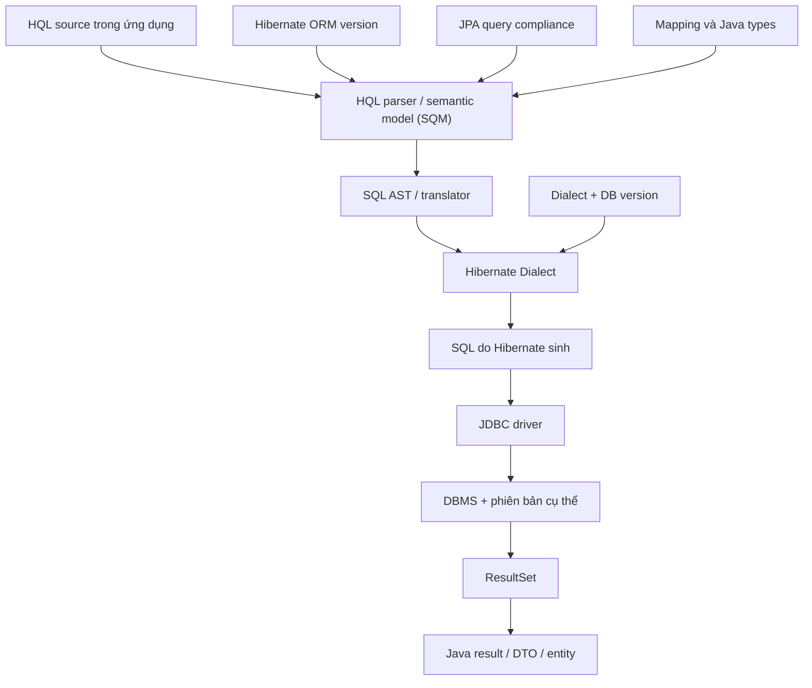

# Xác nhận tính năng HQL theo phiên bản Hibernate và khả năng của Dialect

Hibernate Query Language (**HQL**) là ngôn ngữ truy vấn hướng mô hình entity, được Hibernate chuyển thành SQL để thực thi trên cơ sở dữ liệu. HQL hiện đại hỗ trợ nhiều cấu trúc vượt ngoài JPQL cơ bản: truy vấn con trong `from`, common table expressions (CTE), recursive queries, window functions, set operations, lateral joins, một số hàm tập hợp nâng cao và nhiều dạng phân trang.

Tuy nhiên, **cú pháp xuất hiện trong một tài liệu HQL không tự bảo đảm ứng dụng hiện tại sẽ thực thi thành công trên mọi database**. Một tính năng chỉ thật sự sử dụng được khi các tầng sau phù hợp:

1. Phiên bản **Hibernate ORM đang chạy** biết cú pháp và semantics HQL đó.
2. Chế độ **tuân thủ Jakarta Persistence** không cấm extension đang dùng.
3. `Dialect` Hibernate được chọn có khả năng dịch, mô phỏng hoặc biểu diễn cấu trúc đó thành SQL.
4. **DBMS và phiên bản database** thực tế hỗ trợ SQL được tạo ra.
5. JDBC driver, kiểu dữ liệu, mapping và tham số không gây lỗi tại runtime.
6. Truy vấn cho kết quả **đúng nghiệp vụ** và có hiệu năng chấp nhận được trên dữ liệu thật.

Bài này trình bày một quy trình xác nhận tính năng HQL theo **đúng phiên bản thư viện, đúng Dialect, đúng database và đúng workload**, thay vì sao chép ví dụ HQL từ phiên bản mới nhất rồi giả định nó sẽ chạy ở mọi hệ thống.

## 1. Vì sao cùng một câu HQL có thể chạy ở hệ thống A nhưng lỗi ở hệ thống B?

Hãy xét một câu HQL dùng window function:

```hql
select
    o.customer.id,
    o.id,
    row_number() over (
        partition by o.customer.id
        order by o.createdAt desc, o.id desc
    )
from PurchaseOrder o
```

Một ứng dụng có thể chạy câu trên, trong khi ứng dụng khác báo lỗi. Một số nguyên nhân có thể là:

- Hibernate version cũ chưa hỗ trợ cú pháp window function ở HQL.
- Chế độ strict JPQL compliance từ chối extension không nằm trong JPQL được áp dụng.
- Dialect nhận diện database khác hoặc khác phiên bản.
- DBMS không hỗ trợ cú pháp SQL tương ứng, hoặc chỉ hỗ trợ một phần.
- Query được viết bằng tên bảng/cột SQL thay vì tên entity/attribute Java.
- Kiểu dữ liệu trong phép tính hoặc hàm không tương thích.
- SQL được Hibernate tạo ra có hình dạng database không chấp nhận.
- Một SQL shape được mô phỏng bằng truy vấn khác có kết quả/chi phí ngoài dự tính.

**Cần xác định lỗi xuất hiện ở tầng nào**, thay vì kết luận ngay rằng “Hibernate không hỗ trợ window function”.

### 1.1. Bức tranh tổng thể



Một query HQL được parser chấp nhận **chưa chứng minh** SQL sinh ra hợp lệ, thực thi được hoặc trả kết quả đúng.

## 2. HQL khác SQL và JPQL như thế nào?

**SQL** truy vấn bảng/cột của database:

```sql
SELECT id, total_amount
FROM purchase_order
WHERE status = 'PAID';
```

**HQL** truy vấn entity và thuộc tính Java đã ánh xạ:

```hql
select o.id, o.totalAmount
from PurchaseOrder o
where o.status = :status
```

Ở đây:

- `PurchaseOrder` là entity name, không nhất thiết là tên bảng.
- `totalAmount` là Java persistent attribute, không nhất thiết là tên cột.
- `:status` là named parameter cần bind bằng API query.
- Hibernate quyết định SQL cuối cùng từ mapping và Dialect.

**JPQL** là ngôn ngữ truy vấn chuẩn của Jakarta Persistence. HQL bao gồm khả năng tương thích với phần lớn các truy vấn JPQL thông dụng nhưng có các extension riêng mà chuẩn JPQL hoặc JPA version được ứng dụng dùng có thể không cho phép.

Không nên gom cả ba thành một tên “SQL” khi báo lỗi. Một `SyntaxException` lúc parse HQL khác về bản chất với lỗi syntax do PostgreSQL, MySQL hoặc Oracle trả từ JDBC.

## 3. Chốt chính xác Hibernate ORM version tại runtime

Phiên bản ghi trong `pom.xml` hoặc `build.gradle` chưa chắc là phiên bản thực tế nếu dependency management, BOM hoặc framework đã override.

Ví dụ ứng dụng Spring Boot có thể dùng phiên bản Hibernate được quản lý qua dependency management. Một thư viện thứ ba cũng có thể kéo dependency khác hoặc làm xuất hiện version conflict.

### 3.1. Đọc version đang chạy

Hibernate cung cấp tiện ích công khai để xác định version:

```java
import org.hibernate.Version;

System.out.println(
    "Hibernate ORM = " + Version.getVersionString()
);
```

Đặt log ở bootstrap/integration test, ghi nhận cùng database và Dialect. Nếu có nhiều module hoặc nhiều persistence unit, cần xác nhận runtime classpath thực tế mà mỗi module sử dụng.

### 3.2. Xem resolved dependency, không chỉ source declaration

Với Maven:

```shell
mvn dependency:tree
```

Với Gradle:

```shell
./gradlew dependencyInsight --dependency hibernate-core --configuration runtimeClasspath
```

Các lệnh này là hướng dẫn dành cho dự án khi xác minh dependency; không cần chạy trong bước soạn bài.

Với ứng dụng sử dụng Gradle Windows, wrapper có thể là `gradlew.bat`. Với multi-module build, cần chọn module/configuration chứa application runtime.

Cần lưu:

| Thuộc tính | Ví dụ ghi vào báo cáo |
|---|---|
| Hibernate ORM version | Giá trị `Version.getVersionString()` |
| Jakarta Persistence API version | Version của API runtime |
| Framework/BOM | Spring Boot hoặc nền tảng quản lý dependency |
| JDK | Phiên bản Java chạy ứng dụng |
| Hibernate core artifact | Tọa độ và resolved version |
| JDBC driver | Tên + version |
| DBMS version | Tên + phiên bản trả từ metadata |
| Dialect thực tế | Tên class Dialect được khởi tạo |

**Phiên bản lớn của Hibernate có thể khác cả cú pháp, API, SQL renderer và default behavior.** Đừng lấy ví dụ của Hibernate 7 rồi áp dụng nguyên xi cho một ứng dụng Hibernate 5.x.

## 4. Đọc tài liệu đúng phiên bản, tránh nhầm trang `current`

Tài liệu chính thức được chia theo các series/version. Khi tra một chức năng HQL nâng cao, cần ưu tiên:

1. **HQL Query Language Guide** của series đang dùng.
2. **User Guide** của cùng series.
3. **Javadoc** của cùng series nếu kiểm tra capability/API.
4. **Dialect report** hoặc compatibility matrix của cùng series.
5. **Migration guide / What's New** nếu vừa nâng cấp.
6. Tài liệu DBMS cho phiên bản database đích.

Ví dụ các địa chỉ tham khảo phiên bản cụ thể:

- Tài liệu theo series: https://hibernate.org/orm/documentation/
- HQL guide cho 7.4: https://docs.hibernate.org/orm/7.4/querylanguage/html_single/
- Dialect Javadoc cho 7.4: https://docs.hibernate.org/orm/7.4/javadocs/org/hibernate/dialect/Dialect.html
- Danh sách Dialect/DB version cho 7.4: https://docs.hibernate.org/orm/7.4/dialect/

Các đường dẫn `7.4` là **ví dụ tài liệu được ghim version**, không phải quy tắc rằng mọi dự án đều đang sử dụng 7.4. Nếu ứng dụng dùng 6.6, hãy mở tài liệu 6.6; nếu ứng dụng dùng series khác, kiểm tra đúng series ấy.

### 4.1. Một feature có thể thay đổi mà cú pháp nhìn gần như giống nhau

Tài liệu HQL 7.4 mô tả cải tiến xử lý `limit`/pagination khi kết hợp fetch join đa trị trên những database hỗ trợ limit và offset trong subquery. Các series trước đó có những giới hạn khác; trên một số DBMS không hỗ trợ, vẫn có thể phải phân trang trong bộ nhớ.

Đây là ví dụ tiêu biểu cho yêu cầu **xác minh cả Hibernate version lẫn Dialect/DBMS**, thay vì dùng quy tắc tuyệt đối kiểu “pagination với fetch join collection lúc nào cũng lỗi” hoặc “lúc nào cũng an toàn”.

## 5. Xác định Dialect Hibernate đang sử dụng

`Dialect` mô tả đặc điểm SQL của một DBMS và hỗ trợ quá trình dịch SQL của Hibernate. Các Dialect có thể khác nhau về:

- Cú pháp phân trang/limit/offset.
- Hàm ngày giờ, xử lý chuỗi và kiểu dữ liệu.
- Khả năng dùng CTE và recursive CTE.
- Window functions, lateral joins, row-value constructors.
- SQL locking và các biến thể cú pháp.
- Phép so sánh NULL, Boolean, JSON/array và các kiểu đặc thù.
- Chiến lược mô phỏng khi DBMS không hỗ trợ trực tiếp một biểu thức.

### 5.1. Không suy từ tên JDBC URL

Ví dụ JDBC URL bắt đầu bằng `jdbc:postgresql:` giúp nhận biết driver/database family, nhưng vẫn cần xác nhận:

- Version server thực tế.
- Dialect mà Hibernate đã chọn.
- Database compatibility mode.
- Có custom Dialect hay không.
- Có property override `hibernate.dialect` hay không.

Trong nhiều cấu hình hiện đại, Hibernate có thể tự nhận diện Dialect dựa trên metadata; không cần đặt `hibernate.dialect` thủ công nếu nền tảng hỗ trợ. Tuy nhiên, ứng dụng legacy có thể override Dialect hoặc dùng class tùy biến.

### 5.2. Kiểm tra qua runtime SPI khi cần chẩn đoán

Trong môi trường Hibernate 6/7, một đường introspection thường dùng là:

```java
import org.hibernate.dialect.Dialect;
import org.hibernate.engine.spi.SessionFactoryImplementor;

SessionFactoryImplementor sessionFactory =
    entityManagerFactory.unwrap(SessionFactoryImplementor.class);

Dialect dialect =
    sessionFactory.getJdbcServices().getDialect();

System.out.println(dialect.getClass().getName());
```

**Lưu ý:** `SessionFactoryImplementor` nằm trong SPI Hibernate, không phải hợp đồng ổn định của Jakarta Persistence. Đoạn mã là công cụ chẩn đoán version cụ thể; khi nâng Hibernate phải kiểm tra lại Javadoc và API. Không nên biến SPI này thành dependency lan khắp domain/service.

### 5.3. Kiểm tra DBMS/driver qua JDBC metadata

```java
import java.sql.DatabaseMetaData;
import org.hibernate.Session;

Session session = entityManager.unwrap(Session.class);

session.doWork(connection -> {
    DatabaseMetaData meta = connection.getMetaData();

    System.out.println(meta.getDatabaseProductName());
    System.out.println(meta.getDatabaseProductVersion());
    System.out.println(meta.getDriverName());
    System.out.println(meta.getDriverVersion());
});
```

Nên chạy trong môi trường test/runtime được quản lý transaction phù hợp. Không giữ `Connection` sau khi callback kết thúc.

Thông tin này giúp xác định liệu database thực sự đáp ứng phiên bản tối thiểu của Dialect, thay vì mặc định “môi trường dùng MySQL/PostgreSQL” là đã đủ.

## 6. Hiểu đúng các method `supports...` của Dialect

Dialect có những method mô tả khả năng hỗ trợ cấu trúc SQL. Tên khả năng thường gặp trong Hibernate 6/7 gồm:

- `supportsWindowFunctions()`.
- `supportsLateral()`.
- `supportsRecursiveCTE()`.
- `supportsRowValueConstructorSyntax()`.
- `supportsRowValueConstructorGtLtSyntax()`.
- `supportsFetchClause(...)`.
- Một số capability riêng về CTE `search`, `cycle`, `materialization` hoặc SQL dialect đặc thù.

Ví dụ minh họa với Dialect tương thích:

```java
System.out.println(
    "Windows: " + dialect.supportsWindowFunctions()
);
System.out.println(
    "Lateral: " + dialect.supportsLateral()
);
System.out.println(
    "Recursive CTE: " + dialect.supportsRecursiveCTE()
);
System.out.println(
    "Row value constructor: "
        + dialect.supportsRowValueConstructorSyntax()
);
```

**Phải kiểm tra sự tồn tại/chữ ký method trên Javadoc đúng Hibernate version.** Một số capability có thể xuất hiện, đổi tên, bị deprecated hoặc được chuyển sang component hỗ trợ khác theo thời gian.

### 6.1. Capability flag không phải chứng nhận end-to-end

Nếu `supportsWindowFunctions()` trả về `true`, điều đó cho biết Dialect có khả năng hỗ trợ nhóm SQL window functions theo mức mà API mô tả. Nó **không bảo đảm** mọi hàm/window frame trong mọi query đều hoạt động.

Ví dụ:

- DBMS có `row_number() over (...)` nhưng không hỗ trợ một kiểu frame exclusion.
- DBMS hỗ trợ CTE đệ quy nhưng không có cú pháp `cycle` giống ANSI SQL.
- Dialect hỗ trợ `lateral` nhưng một dạng correlated subquery phức tạp vẫn không dịch được.
- Hàm tổng hợp có `filter` hoặc `within group` có khả năng hỗ trợ khác nhau.
- Dialect có thể mô phỏng một phần tính năng bằng SQL khác với SQL trực tiếp.

**Kiểm tra Dialect là bước định hướng; integration test trên database đích mới là bước xác nhận.**

## 7. Phân loại tính năng theo mức độ phụ thuộc platform

Khi quyết định dùng một câu query, hãy xếp nó vào nhóm phù hợp.

| Nhóm | Ví dụ | Cách xác minh |
|---|---|---|
| JPQL phổ biến | `select`, `where`, `join`, `group by` | Chuẩn JPA version + mapping |
| HQL extension | CTE, lateral join, set operations, window functions | HQL guide đúng Hibernate version |
| HQL phụ thuộc SQL capability | Recursive CTE, window frame nâng cao, lateral | Dialect + DBMS version + test |
| Hàm phụ thuộc database | JSON, array, regex, spatial, custom function | Function registry, Dialect, DBMS docs |
| Native SQL | SQL vendor-specific, optimizer hint, proprietary syntax | DBMS trực tiếp + mapping kết quả |

Không đồng nhất “được HQL parser chấp nhận” với “portable trên mọi database”. HQL thường giúp ẩn đi khác biệt dialect, nhưng một số tính năng không thể được mô phỏng hoặc chỉ có thể mô phỏng có giới hạn.

## 8. Strict JPQL compliance có thể chặn HQL extension

Hibernate cung cấp property:

```properties
hibernate.jpa.compliance.query=true
```

Khi bật chế độ này, Hibernate yêu cầu xử lý query tuân thủ chặt hơn ngữ nghĩa Jakarta Persistence, có thể từ chối cú pháp HQL mở rộng ngoài tập JPQL tương ứng.

Điểm dễ nhầm: dùng `EntityManager.createQuery(...)` **không mặc nhiên có nghĩa** chỉ dùng JPQL subset. Hibernate là provider thực hiện parse query; chế độ compliance có thể làm sự khác biệt rõ rệt.

Ví dụ một câu HQL window function có thể được ứng dụng chấp nhận với cấu hình mặc định của Hibernate nhưng bị từ chối trong strict JPQL compliance nếu tính năng nằm ngoài JPQL version đang dùng.

### 8.1. Cách kiểm tra

Ghi nhận trong test:

- Value của `hibernate.jpa.compliance.query`.
- Version Jakarta Persistence API thực tế.
- Câu HQL cụ thể.
- Exception nếu query bị từ chối ở tầng parser/semantic validation.
- Có hay không SQL JDBC được gửi.

**Không tắt strict mode một cách vô điều kiện** chỉ để một câu query biên dịch được. Nếu dự án cam kết portability JPA provider, phải đánh giá tác động kiến trúc của việc dùng HQL extension.

## 9. Feature A: window functions

Window functions dùng `over (...)` để tính giá trị trên một nhóm hàng mà không gom toàn bộ nhóm thành một hàng như `group by`.

Ví dụ đánh số đơn hàng trong từng customer:

```hql
select
    o.customer.id,
    o.id,
    row_number() over (
        partition by o.customer.id
        order by o.createdAt desc, o.id desc
    )
from PurchaseOrder o
```

Ứng dụng có thể dùng kết quả để xếp hạng các đơn theo thời điểm trong từng customer.

### 9.1. Những bước xác nhận riêng

1. HQL guide của Hibernate version hiện tại có hỗ trợ `row_number() over (...)` không?
2. Dialect có `supportsWindowFunctions()` hay khả năng tương đương không?
3. DBMS/DB version hỗ trợ `row_number` và kiểu `over` đang dùng không?
4. SQL được tạo có đúng `partition by` và `order by` không?
5. Kiểu kết quả trả về qua JDBC có được mapping đúng sang Java không?
6. Thứ tự có xác định không? Nếu `createdAt` trùng nhau, nên thêm `id` để làm tie-breaker.
7. Index và execution plan có đáp ứng được tập dữ liệu lớn không?

### 9.2. Không suy diễn mọi window frame đều được hỗ trợ

Những cú pháp như `rows between ...`, `range ...`, `groups ...` và `exclude current row` không có mức hỗ trợ như nhau ở mọi DBMS. Việc `row_number()` chạy được không chứng minh mọi frame clause khác cũng chạy.

Tài liệu HQL hiện đại mô tả window functions, nhưng đồng thời nhấn mạnh các hạn chế tùy dialect cho từng chức năng. Hãy viết test cho **chính câu query và frame** dự kiến sử dụng.

## 10. Feature B: Common Table Expressions (CTE)

CTE cho phép đặt tên một truy vấn phụ để sử dụng trong truy vấn chính.

Ví dụ HQL:

```hql
with costlyOrders as (
    select o.id as orderId, o.totalAmount as amount
    from PurchaseOrder o
    where o.totalAmount >= :threshold
)
select c.orderId, c.amount
from costlyOrders c
order by c.amount desc
```

CTE dùng tên `costlyOrders` trong HQL, còn Hibernate chuyển cấu trúc đó sang SQL phù hợp.

### 10.1. Không phải CTE nào cũng cần DBMS hỗ trợ native CTE

Với CTE **không đệ quy**, Hibernate có thể mô phỏng bằng derived table/subquery trên những database không hỗ trợ CTE trực tiếp, tùy query shape và phiên bản.

Vì vậy, khi thấy DBMS không có `WITH` trong dạng cần thiết, không nhất thiết kết luận mọi HQL CTE đều thất bại. Có thể Hibernate viết lại query.

Cần kiểm tra:

- Truy vấn HQL có được parser chấp nhận?
- SQL sinh ra dùng `WITH` hay subquery?
- Semantics có giữ nguyên?
- Query có lặp lại CTE và dẫn tới work tăng nhiều lần?
- Execution plan của SQL được mô phỏng có chấp nhận được?

### 10.2. Materialization hints

Các hint `materialized` và `not materialized` có thể ảnh hưởng việc database thực thi/tối ưu CTE. Mức hỗ trợ và tác động của chúng rất phụ thuộc platform.

Không dùng hint chỉ vì muốn “CTE chắc chắn nhanh hơn”. Hãy kiểm tra SQL và execution plan, và cân nhắc liệu hint chỉ được chấp nhận, bị bỏ qua hay được mô phỏng.

## 11. Feature C: Recursive CTE

Recursive CTE dùng một phần base và phần đệ quy để đi qua cấu trúc cây/đồ thị.

Giả sử entity:

```java
@Entity
public class OrgNode {

    @Id
    private Long id;

    private String label;

    @ManyToOne(fetch = FetchType.LAZY)
    private OrgNode parent;
}
```

HQL theo mô hình tài liệu Hibernate:

```hql
with Tree as (
    select n.id as nodeId, n.label as label, 0 as level
    from OrgNode n
    where n.parent is null

    union all

    select child.id as nodeId,
           child.label as label,
           parent.level + 1 as level
    from Tree parent
    join OrgNode child on child.parent.id = parent.nodeId
)
select t.nodeId, t.label, t.level
from Tree t
```

Đây là ví dụ mô hình; cần kiểm tra cách Hibernate version cụ thể diễn giải alias, kiểu dữ liệu, recursion và kết quả trên DBMS đích.

### 11.1. Điểm giới hạn quan trọng

Hibernate không thể mô phỏng recursive CTE trên database hoàn toàn không hỗ trợ khả năng recursive cần thiết. Đây là khác biệt căn bản với một số CTE không đệ quy có thể được viết lại.

Kiểm tra:

- Dialect có `supportsRecursiveCTE()` không?
- DBMS và version có recursive CTE không?
- Cấu trúc base/recursive branch có khớp kiểu cột không?
- SQL do Hibernate sinh ra có cần từ khóa `WITH RECURSIVE` hay cú pháp khác?
- Query có thể bị vòng lặp vô hạn khi dữ liệu chứa cycle?
- Có giới hạn recursion depth/max recursion, timeout hoặc memory do DBMS quy định không?

### 11.2. Cycle và search clauses là những capability riêng

Một DBMS hỗ trợ recursive CTE **không đồng nghĩa** hỗ trợ `cycle` hoặc `search depth/breadth first` bằng cú pháp nguyên bản.

Hibernate có thể mô phỏng một số clause trên các database không có cú pháp trực tiếp, nhưng cách làm và giới hạn tùy dialect. Kiểm tra riêng các capability và integration test cho dữ liệu có cycle.

**Không đưa dữ liệu đồ thị có vòng vào recursive query production mà chưa có chính sách ngăn/giới hạn chu trình.**

## 12. Feature D: lateral join

Lateral join cho phép truy vấn con trong `JOIN` tham chiếu đến root đã khai báo trước đó.

Ví dụ tìm đơn hàng gần nhất của mỗi customer:

```hql
select c.id, recent.amount
from Customer c
left join lateral (
    select o.totalAmount as amount
    from c.orders o
    order by o.createdAt desc, o.id desc
    limit 1
) recent
```

Ý tưởng là chạy một truy vấn top-1 có tương quan cho từng customer, thay vì tải mọi order rồi cắt ở Java.

### 12.1. Lateral không được viết giống nhau trên mọi DBMS

Một số DBMS dùng `LATERAL`, một số hỗ trợ cơ chế tương tự qua `APPLY` hoặc biểu thức khác. Hibernate có thể dịch hoặc mô phỏng lateral join.

Tuy nhiên, **emulation có thể chậm và không hỗ trợ mọi hình dạng query**. Một query lateral chạy tốt trên DBMS A không chứng minh nó portable và nhanh trên DBMS B.

Kiểm tra:

- HQL guide của version đang dùng có hỗ trợ lateral join không?
- Dialect có `supportsLateral()` không?
- Hibernate dùng native lateral/apply hay emulation?
- Dữ liệu có customer chưa có order không? `left join` phải giữ row cha.
- Có nhiều order cùng timestamp không? Query có tie-breaker deterministic không?
- Execution plan có subquery chạy theo từng row hay được tối ưu tốt không?
- Có pagination/root limit và join collection kết hợp gây nhân rows không?

## 13. Feature E: `union`, `intersect`, `except`

HQL hiện đại hỗ trợ những phép kết hợp tập kết quả theo dạng gần với SQL.

Ví dụ:

```hql
select c.id
from Customer c
where c.status = :active

union all

select c.id
from Customer c
where c.status = :priority
```

Kết quả có thể lặp ID nếu một customer thỏa cả hai điều kiện, vì `union all` không loại duplicate. Với `union` không có `all`, duplicate elimination có thể xảy ra tùy semantics.

Cần xác nhận:

- Hibernate version có parser/semantic support cho set operation cần dùng không?
- Các nhánh có cùng số cột và kiểu dữ liệu tương thích không?
- Dialect/DBMS hỗ trợ toán tử tương ứng, kể cả biến thể `all`?
- Hibernate có mô phỏng bằng SQL khác không?
- `order by`/`limit` đặt trên toàn tập hay từng nhánh?
- Kết quả có cần thứ tự cố định không?
- Java result type có khớp projection không?

Không giả định một phép `union` chạy được thì `intersect all` và `except all` sẽ được dịch như nhau trên mọi DBMS.

## 14. Feature F: ordered-set aggregate và window frame

Một số hàm như `listagg`, `percentile_cont` hoặc aggregate có `within group` cần hỗ trợ của cả HQL và SQL dialect.

Ví dụ HQL:

```hql
select listagg(c.name, ', ')
    within group (order by c.name)
from Customer c
```

Để dùng, hãy kiểm tra:

1. HQL guide của series hỗ trợ syntax/function đó.
2. Dialect có đăng ký function descriptor phù hợp.
3. Database có hàm nguyên bản hoặc Hibernate có mô phỏng tương đương.
4. Giới hạn kích thước chuỗi kết quả, NULL handling và collation.
5. Thứ tự trong `within group` có xác định.
6. Kiểu kết quả JDBC/Java và trường hợp không có hàng.
7. Chi phí sort/aggregate trên dữ liệu lớn.

Một hàm có tên giống nhau ở nhiều DBMS vẫn có thể khác nhau về separator, overflow behavior và xử lý NULL. Không chỉ nhìn tên function để khẳng định portability.

## 15. Feature G: row-value constructors và tuple comparison

Một số HQL query sử dụng tuple/row-value constructor:

```hql
select c.id
from Customer c
where (c.countryCode, c.customerNumber) = (:country, :number)
```

Hoặc phép so sánh thứ tự tuple trong keyset pagination:

```hql
select o.id
from PurchaseOrder o
where (o.createdAt, o.id) < (:lastCreatedAt, :lastId)
order by o.createdAt desc, o.id desc
```

Việc parser hỗ trợ biểu thức tuple không bảo đảm database hỗ trợ mọi toán tử trên tuple.

Dialects có thể phân biệt:

- Hỗ trợ `(a, b) = (x, y)`.
- Hỗ trợ `(a, b) < (x, y)`.
- Hỗ trợ tuple trong `IN` subquery.
- Khả năng mô phỏng predicate bằng tổ hợp `AND`/`OR`.
- Cách NULL được xử lý.

Nếu pagination dựa trên tuple, kiểm tra correctness khi trùng sort key, có NULL hoặc DBMS dùng collation khác. Nếu cần an toàn trên nhiều DBMS, có thể viết điều kiện tương đương tường minh:

```hql
where o.createdAt < :lastCreatedAt
   or (o.createdAt = :lastCreatedAt and o.id < :lastId)
```

Dạng tường minh cũng cần index/order phù hợp và integration test. Không mặc định một cách luôn nhanh hơn.

## 16. Feature H: `limit`, `offset`, `fetch` và phân trang

HQL có thể có các cấu trúc phân trang như:

```hql
select o
from PurchaseOrder o
order by o.createdAt desc, o.id desc
limit 20
```

JPA API cũng cung cấp:

```java
List<PurchaseOrder> page = entityManager.createQuery(
    "select o from PurchaseOrder o " +
    "order by o.createdAt desc, o.id desc",
    PurchaseOrder.class
)
.setFirstResult(0)
.setMaxResults(20)
.getResultList();
```

Phân trang là tính năng nhiều ứng dụng cần, nhưng SQL được tạo ra có thể dùng `LIMIT`, `OFFSET FETCH`, `ROWNUM` hoặc cơ chế khác theo Dialect.

### 16.1. Đặc biệt cẩn thận với collection fetch join

```hql
select c
from Customer c
left join fetch c.orders
order by c.id
```

Nếu dùng `setMaxResults(20)` với query fetch một collection, câu chuyện phức tạp hơn vì một customer có thể tạo nhiều SQL rows.

Một số Hibernate series phải xử lý phân trang trong bộ nhớ hoặc báo warning/error ở kịch bản này. Các series mới có thể có cải tiến khi database hỗ trợ subquery limit/offset, nhưng **mức an toàn phụ thuộc phiên bản và Dialect**.

Khi áp dụng, phải kiểm tra:

- Số root entity có thực sự đúng limit không?
- SQL có giới hạn trong DB hay Hibernate cắt sau khi fetch?
- Bao nhiêu rows được JDBC nhận về?
- Có cảnh báo pagination over collection fetch không?
- Có nhiều collection fetch hoặc graph phức tạp không?
- Tính đúng của thứ tự và tổng số trang?

Không kết luận bằng cách chỉ nhìn thấy `LIMIT 20` trong HQL.

### 16.2. Cách fallback phổ biến

Nếu môi trường không hỗ trợ fetch join collection có pagination đúng/hiệu quả:

1. Query trang ID của root trước.
2. Query fetch association cho đúng nhóm ID đó.
3. Sắp xếp lại root theo thứ tự trang ban đầu nếu cần.
4. Nếu collection quá lớn, phân trang child riêng.

Đây là thiết kế có chủ đích, không phải một thủ thuật để vượt qua tất cả giới hạn database.

## 17. Feature I: JSON, array, SQL functions và custom function

HQL hiện đại có nhiều hàm built-in, nhưng những function gắn với JSON, array, regex, spatial, full-text hoặc datatype đặc thù có thể phụ thuộc:

- Hibernate version.
- Đăng ký function trong Hibernate function registry.
- Dialect và SQL translator.
- DBMS extension/module đã cài.
- Kiểu SQL và Java mapping.
- Cú pháp vendor-specific.

Ví dụ một hàm database chưa được HQL chuẩn hóa có thể được gọi qua `function(...)`:

```hql
select function('my_normalize', c.name)
from Customer c
```

Đây là ví dụ cú pháp invocation, **không khẳng định database nào cũng có hàm `my_normalize`**.

Nếu cần function phổ biến trên nhiều DBMS, có thể đăng ký translation hoặc function descriptor qua extension API Hibernate tương ứng, chẳng hạn `FunctionContributor` ở các series hỗ trợ. Nhưng custom function có thể cần return type inference và argument validation; “SQL có hàm này” chưa có nghĩa HQL tự biết kiểu trả về.

### 17.1. Khi nào dùng native SQL?

Nếu một feature vendor-specific không thể diễn đạt đáng tin cậy qua HQL, native SQL có thể là lựa chọn phù hợp. Nhưng khi đó ứng dụng nhận thêm trách nhiệm:

- Query gắn với DBMS cụ thể.
- Result mapping về entity/DTO cần rõ ràng.
- Portability giảm.
- SQL injection phải được phòng tránh bằng bind parameters.
- SQL tests phải chạy trên đúng DBMS.
- Bulk native SQL có thể để lại managed entity stale.

Dùng native SQL là quyết định kiến trúc có thể hợp lý; không coi nó là bằng chứng Hibernate “kém” chỉ vì HQL không hỗ trợ mọi extension SQL.

## 18. Năm tầng xác nhận một HQL feature

Để tránh thiếu sót, có thể chia quy trình xác minh thành năm tầng.

| Tầng | Câu hỏi | Cách kiểm tra |
|---|---|---|
| 1. Version/API | Runtime Hibernate nào? JPA nào? | `Version.getVersionString()`, resolved dependencies |
| 2. HQL grammar/semantics | Query có parse và type-check? | HQL guide đúng version, tạo query, integration test |
| 3. Dialect/translation | SQL AST được render ra gì? Có emulation? | Dialect class, `supports...`, SQL logging |
| 4. DBMS execution | Database có chạy SQL và bind đúng types? | Test trên DBMS/version thực tế |
| 5. Correctness/performance | Kết quả có đúng? Query có đủ nhanh? | Fixture, assertions, EXPLAIN, rows/bytes/latency |

Nếu tầng 1 hoặc 2 lỗi, việc nâng database không tự sửa parser cũ. Nếu tầng 4 lỗi, việc đổi cú pháp HQL mà không xem SQL dialect cũng có thể không giải quyết được.

## 19. Xác nhận query parse khác với xác nhận query chạy

Ví dụ:

```java
TypedQuery<Object[]> query = entityManager.createQuery(
    "select o.id, row_number() over (" +
    "order by o.createdAt desc, o.id desc) " +
    "from PurchaseOrder o",
    Object[].class
);
```

Việc tạo query thành công có thể cho thấy parser/semantic analysis chấp nhận một phần cấu trúc. Nhưng tùy version, một số bước biên dịch SQL hoặc kiểm tra kiểu có thể xảy ra muộn hơn.

Chỉ khi gọi `getResultList()`, database mới thực sự thực thi SQL tương ứng. Ngay cả thế, test trên bảng trống có thể không kiểm tra được semantics dữ liệu phức tạp.

### 19.1. Thiết kế fixture có khả năng phát hiện lỗi

Với window function, fixture nên có:

- Nhiều customer.
- Nhiều order của cùng customer.
- Order cùng timestamp để kiểm tra tie-breaker.
- Giá trị NULL nếu query cho phép.
- Nhiều partition để kiểm tra reset row number.

Với CTE recursive:

- Cây nhiều cấp.
- Một node không có child.
- Nhiều root.
- Cycle nếu feature hỗ trợ xử lý cycle.
- Giới hạn depth/max recursion.

Với lateral join:

- Customer không có order.
- Customer có một order.
- Customer có nhiều order và ngày trùng nhau.
- Bộ dữ liệu đủ lớn để đo performance.

Không chỉ assertion “query không ném exception”; phải kiểm tra **giá trị và thứ tự kết quả**.

## 20. Integration test với DBMS thật

Một integration test có thể chạy với Testcontainers hoặc database test được quản lý, miễn là nó dùng **cùng DBMS family và version tương thích production**.

Ví dụ minh họa JUnit 5:

```java
@Test
void windowFunctionWorksOnTargetDialect() {
    List<Object[]> rows = entityManager.createQuery(
        "select o.customer.id, o.id, " +
        "row_number() over (" +
        "partition by o.customer.id " +
        "order by o.createdAt desc, o.id desc) " +
        "from PurchaseOrder o",
        Object[].class
    ).getResultList();

    assertFalse(rows.isEmpty());
    // Kiểm tra row numbers theo fixture xác định.
}
```

Ví dụ cần entity mapping, fixture và transaction setup thích hợp. Nó minh họa cấu trúc test, không phải đoạn mã tự chạy độc lập khi chưa thiết lập dự án.

### 20.1. Testcontainers giúp gì?

Testcontainers có thể khởi động DBMS thật trong môi trường kiểm thử. Nó tốt hơn việc dùng một database in-memory khác hẳn production để suy luận về:

- Cú pháp CTE/window/lateral.
- SQL dialect.
- Kiểu dữ liệu.
- Collation và NULL semantics.
- Execution plan.
- Recursive CTE behavior.

Nhưng test container cũng phải dùng đúng version/mode/schema. PostgreSQL 13, 16 và một bản development không nhất thiết có cùng capability hoặc optimizer. Không lấy kết quả từ một tag `latest` thay cho version pin có kiểm soát.

### 20.2. Matrix kiểm thử nhiều database

Nếu sản phẩm hỗ trợ nhiều DBMS, xây một ma trận:

| Feature | PostgreSQL mục tiêu | MySQL mục tiêu | Oracle mục tiêu |
|---|---|---|---|
| Window function cơ bản | Chạy test | Chạy test | Chạy test |
| Recursive CTE | Chạy test | Chạy test | Chạy test |
| Lateral top-1 | Chạy test | Chạy test | Chạy test |
| Set operation | Chạy test | Chạy test | Chạy test |
| JSON/custom function | Chạy test | Chạy test | Chạy test |
| Pagination với collection fetch | Chạy test | Chạy test | Chạy test |

Không điền `SUPPORTED` dựa trên tên DBMS. Chỉ ghi `PASS/FAIL/EMULATED/LIMITED` sau khi xác nhận query và runtime thực tế. Nếu môi trường không được hỗ trợ chính thức, ghi rõ là `UNVERIFIED`.

## 21. Bật SQL logging để biết Dialect dịch ra gì

Có thể bật SQL logging ở môi trường dev/test:

```properties
hibernate.show_sql=true
hibernate.format_sql=true
hibernate.generate_statistics=true
```

Hoặc dùng logging category, JDBC proxy, `StatementInspector` hay tracing/APM để xem SQL theo request.

Cần lưu:

1. Nguyên văn HQL và parameter types.
2. SQL do Hibernate sinh ra.
3. Dialect/DB version.
4. Bind types (ẩn dữ liệu nhạy cảm).
5. Số SQL statements.
6. Số hàng returned/affected.
7. Thời gian execute và fetch ResultSet.
8. Exception SQLState/error code nếu có.

**Một query không ném exception nhưng tạo N+1 hoặc phân trang trong bộ nhớ vẫn có thể là một implementation không chấp nhận được.**

### 21.1. Không để logging làm lộ dữ liệu

Bind parameters có thể chứa email, token, nội dung cá nhân và thông tin nhạy cảm. Chỉ bật logging chi tiết ở môi trường phù hợp, masking dữ liệu và bảo đảm quyền truy cập/retention.

## 22. EXPLAIN và hiệu năng của emulation

Hibernate có thể mô phỏng một cấu trúc HQL bằng SQL khác khi database không hỗ trợ syntax nguyên bản. Điều này thường tốt cho portability, nhưng có thể đổi hoàn toàn chi phí query.

Ví dụ lateral emulation có thể thành correlated subquery phức tạp; CTE có thể được inline thành derived table; một toán tử tập hợp có thể được dịch thành cấu trúc khác.

Đánh giá:

- Số hàng database phải quét.
- Index và join order.
- Nested loop chạy lại bao nhiêu lần.
- Có sort/hash/materialization không.
- Có disk spill không.
- Số SQL statement và số hàng JDBC nhận về.
- Latency p50/p95 trên dữ liệu đại diện.
- Khả năng tải tăng theo số root (10, 1.000, 100.000).

Công cụ DBMS thường gồm `EXPLAIN`/`EXPLAIN ANALYZE`, execution plan viewer, Query Store hoặc monitoring tương ứng. Một số lệnh `ANALYZE` thật sự thực thi query; thận trọng với DML hoặc query rất nặng.

### 22.1. Không cố tối ưu một query trước khi biết SQL thật

Nếu Hibernate đã emulation, tối ưu bằng suy đoán từ HQL có thể sai. Xem SQL và plan trước khi đổi index hoặc thêm hint.

Một tính năng được đánh giá `SUPPORTED` theo nghĩa chạy đúng vẫn có thể bị đánh giá `NOT RECOMMENDED` cho một workload cụ thể vì hiệu năng.

## 23. Lỗi thường gặp và cách khoanh vùng

| Triệu chứng | Tầng nghi vấn | Hướng xử lý |
|---|---|---|
| Parser không nhận `with` hoặc `over` | HQL version/compliance | Xem HQL guide đúng version, strict JPQL |
| `Could not resolve attribute` | Mapping/semantic analysis | Sử dụng tên Java property/entity |
| Function không được nhận diện | Function registry/version | Kiểm tra hàm built-in và FunctionContributor |
| SQL syntax error từ DBMS | Dialect/DB version | Xem SQL sinh ra, metadata, capability |
| Query parse được nhưng chạy lỗi | SQL generation/binding/DB | Integration test, SQLState, bind types |
| Recursive query bị từ chối | Dialect/DB không hỗ trợ recursion | Kiểm tra `supportsRecursiveCTE` và DB docs |
| Lateral query rất chậm | Emulation/optimizer | EXPLAIN, query rewrite, index |
| Kết quả `row_number` không ổn định | Sort chưa deterministic | Thêm tie-breaker duy nhất |
| Pagination fetch join sai số root | Hibernate version/Dialect/SQL shape | Kiểm tra SQL, two-phase pagination |
| Null sort khác giữa DBMS | Dialect/collation/default null ordering | Khai báo `nulls first/last` và test |
| Type mismatch khi nhận DTO | HQL result type/JDBC mapping | Kiểm tra type inference, projection constructor |
| Chạy trên H2 nhưng lỗi production | DBMS khác nhau | Test trên đúng database family/version |
| Sau upgrade query đổi kết quả | Hibernate semantics/SQL generation | Đọc migration guide, regression test |
| Query có thể chạy nhưng quá nhiều rows | Fetch plan/cardinality | EXPLAIN, projection, giới hạn dữ liệu |

### 23.1. Phân loại lỗi trước khi sửa

- **Lỗi parse/semantic:** thường xuất hiện trước khi SQL được gửi. Xem entity names, attributes, HQL syntax, version, strict compliance.
- **Lỗi SQL generation/translation:** HQL được chấp nhận nhưng renderer không tạo được SQL hợp lệ cho Dialect.
- **Lỗi JDBC/DBMS:** SQL được gửi nhưng DBMS từ chối do syntax, function, type, privilege hoặc feature không hỗ trợ.
- **Lỗi dữ liệu/semantics:** query chạy nhưng trả kết quả sai hoặc không deterministic.
- **Lỗi hiệu năng:** query chạy đúng nhưng emulation, join hoặc sort gây tải không chấp nhận được.

Không sửa cả query, Dialect và schema cùng lúc khi chưa khoanh vùng tầng lỗi.

## 24. Nâng cấp Hibernate: regression matrix cho HQL nâng cao

Một dự án nâng Hibernate 6.x lên 7.x hoặc giữa các minor series cần có danh sách truy vấn có rủi ro:

- HQL CTE/recursive CTE.
- Window functions và frame clauses.
- Lateral joins.
- Set operations.
- Ordered-set aggregates.
- JSON/array/SQL functions.
- Row-value constructors.
- Pagination có fetch join collection.
- Custom function/Dialect.
- Native query kết hợp entity mapping.
- Strict JPQL compliance.

Với mỗi query:

1. Ghi Hibernate version trước/sau.
2. Ghi DBMS/driver/Dialect trước/sau.
3. Đọc migration guide, breaking changes và deprecation.
4. Chạy integration test với fixture có edge cases.
5. Ghi SQL trước/sau.
6. Đối chiếu số hàng và kết quả Java.
7. Chạy EXPLAIN trên query nặng.
8. So sánh statement count, rows, latency.
9. Ghi quyết định giữ HQL, rewrite, feature flag hoặc native SQL fallback.
10. Không rollout nếu thiếu test trên DBMS production mục tiêu cho feature trọng yếu.

HQL được Hibernate dịch thành SQL; khi compiler/renderer cải tiến, cùng query text có thể sinh SQL khác. Đây có thể là tối ưu tích cực, nhưng một câu query production cần được đánh giá cả correctness và performance.

## 25. Checklist xác nhận trước khi dùng feature mới

Có thể sử dụng checklist sau trong pull request hoặc design review:

- [ ] Đã xác định `Version.getVersionString()` ở runtime.
- [ ] Đã kiểm tra resolved dependency/BOM và phiên bản Jakarta Persistence.
- [ ] Đã mở HQL guide/Javadoc **cùng series** với Hibernate đang chạy.
- [ ] Đã biết `hibernate.jpa.compliance.query` có bật không.
- [ ] Đã ghi Dialect class được chọn thực tế.
- [ ] Đã ghi DBMS version và JDBC driver version.
- [ ] Đã kiểm tra capability `supports...` liên quan, nếu API version cung cấp.
- [ ] Đã phân biệt native support và Hibernate emulation.
- [ ] Đã chạy query trên DBMS mục tiêu, không chỉ trên H2.
- [ ] Đã kiểm tra edge cases về NULL, duplicate, sorting, recursion hoặc empty groups.
- [ ] Đã xác nhận SQL sinh ra và result type.
- [ ] Đã đo statement count, returned/scanned rows và latency cho query quan trọng.
- [ ] Đã có fallback hoặc ràng buộc platform rõ ràng nếu feature không portable.
- [ ] Đã đưa integration test vào CI và migration regression suite.

Checklist là công cụ quyết định kỹ thuật, không phải một thay thế cho test thực tế.

## 26. Bài thực hành A: một câu HQL window function

Dự án cần hiển thị số thứ tự đơn hàng trong từng customer. Developer lấy ví dụ HQL từ tài liệu phiên bản mới và viết:

```hql
select
    o.customer.id,
    o.id,
    row_number() over (
        partition by o.customer.id
        order by o.createdAt desc, o.id desc
    )
from PurchaseOrder o
```

**Câu hỏi:**

1. Phải kiểm tra những version nào trước khi chạy?
2. Nếu query được parse nhưng DBMS báo syntax error, kiểm tra điều gì tiếp theo?
3. Nếu query chạy nhưng số thứ tự giữa hai order có cùng thời điểm thay đổi qua các lần chạy, sửa gì?
4. Có thể khẳng định mọi window frame phức tạp được hỗ trợ chỉ vì `row_number()` chạy được không?

**Gợi ý trả lời:**

1. Hibernate ORM runtime, Jakarta Persistence/compliance, DBMS/driver và Dialect.
2. Xem SQL sinh ra, capability và hỗ trợ window functions của DBMS.
3. Thêm tie-breaker duy nhất trong `order by`, ví dụ `o.id`.
4. Không. Frame modes và exclusion khác nhau theo Dialect/DBMS.

## 27. Bài thực hành B: recursive CTE trên database không hỗ trợ

Một hệ thống dùng HQL recursive CTE để duyệt cây đơn vị. Truy vấn chạy trên PostgreSQL mục tiêu A nhưng lỗi trên một DBMS khác.

**Câu hỏi:**

1. Vì sao HQL parser vẫn có thể chấp nhận query?
2. Tại sao Hibernate không nhất thiết mô phỏng được recursion?
3. Ngoài cú pháp recursion, cần kiểm tra dữ liệu nào?
4. Cách thiết kế fallback là gì?

**Gợi ý trả lời:**

1. HQL grammar có thể biết cấu trúc recursive CTE; lỗi xảy ra ở tầng SQL/DBMS.
2. Recursion cần khả năng thực thi lặp ở database; không thể luôn viết lại thành một subquery hữu hạn đơn giản.
3. Kiểm tra cycle, max depth, lượng dữ liệu và loại ID/column.
4. Dùng strategy khác theo DBMS được hỗ trợ, truy vấn theo từng cấp với giới hạn rõ, hoặc yêu cầu DBMS có recursive CTE. Fallback phải có integration test và tradeoff hiệu năng.

## 28. Bài thực hành C: lateral join bị emulation

Một endpoint dùng lateral top-1 để lấy đơn gần nhất của từng customer. Query trả đúng nhưng trên DBMS B mất nhiều giây.

**Câu hỏi:**

1. `supportsLateral()` là thông tin gì?
2. Hibernate emulation có thể ảnh hưởng gì?
3. Cần đo những chỉ số nào?
4. Có thể cân nhắc hướng thay thế nào?

**Gợi ý trả lời:**

1. Capability SQL lateral của Dialect, không phải chứng nhận toàn bộ query hiệu quả.
2. Query được rewrite thành SQL khác, có thể thực hiện correlated work nhiều lần.
3. EXPLAIN, rows scanned, join loops, index, p95 và số root.
4. Window function/derived table/aggregate hoặc two-query approach nếu tương thích DBMS và workload.

## 29. Bài thực hành D: giới hạn và collection fetch join

Một developer thay đổi query:

```java
List<Customer> customers = entityManager.createQuery(
    "select c from Customer c " +
    "left join fetch c.orders " +
    "order by c.id",
    Customer.class
).setMaxResults(20).getResultList();
```

**Câu hỏi:**

1. `setMaxResults(20)` có bảo đảm database chỉ trả 20 SQL rows không?
2. Vì sao Hibernate version mới và cũ có thể có behavior khác nhau?
3. Nếu Dialect không hỗ trợ dạng giới hạn trong subquery cần dùng, chuyện gì có thể xảy ra?
4. Cần ghi nhận điều gì trong regression test?

**Gợi ý trả lời:**

1. Không thể suy ra chỉ từ API, vì collection join có thể tạo nhiều SQL rows trên mỗi root.
2. SQL renderer và cơ chế phân trang fetch collection thay đổi theo series.
3. Có thể phải phân trang trong memory hoặc có giới hạn/exception tùy cấu hình.
4. Số root, order, SQL shape, rows returned, warnings và latency với cardinality lớn.

## 30. Tổng kết

**Một HQL feature không được xác nhận chỉ bằng việc cú pháp có trong tài liệu hoặc một câu query parse thành công.** Cần xác nhận trên chuỗi thực tế: Hibernate version → HQL parser/semantic model → Dialect/SQL translation → DBMS/driver → kết quả nghiệp vụ → hiệu năng.

Những điểm cần ghi nhớ:

1. **Ghim tài liệu theo Hibernate version thực tế**, không chỉ dùng trang `current`.
2. **Đọc runtime dependency và Dialect**, không suy từ một dòng build config hoặc JDBC URL.
3. **HQL mở rộng hơn JPQL**, và strict JPA query compliance có thể giới hạn những extension.
4. **Capability `supports...` chỉ là tín hiệu**, không phải bằng chứng rằng mọi biến thể HQL đều chạy.
5. **Emulation có giới hạn**: nonrecursive CTE hoặc lateral có thể được dịch lại, trong khi recursive CTE cần năng lực đệ quy của DBMS.
6. **Đánh giá SQL được sinh và result semantics**, đặc biệt với NULL, sort, tuple, recursion và set operations.
7. **Xem performance trên đúng DBMS mục tiêu**; query chạy được chưa chắc phù hợp cho production.
8. **Kiểm thử lại sau mỗi lần nâng Hibernate, Dialect, database hoặc JDBC driver**.
9. **Có fallback rõ ràng** cho feature phụ thuộc platform, thay vì giả định mọi DBMS tương đương.
10. **Ưu tiên correctness, sau đó mới tối ưu** bằng fetch plan, index, projection và execution plan.

Hãy coi việc xác minh HQL nâng cao là một quyết định tương thích có thể kiểm thử và ghi lại bằng chứng. Khi biết chính xác phiên bản Hibernate, khả năng Dialect và giới hạn DBMS, ứng dụng có thể tận dụng những cấu trúc HQL mạnh mà vẫn giữ truy vấn dễ dự đoán, bảo trì và nâng cấp.
