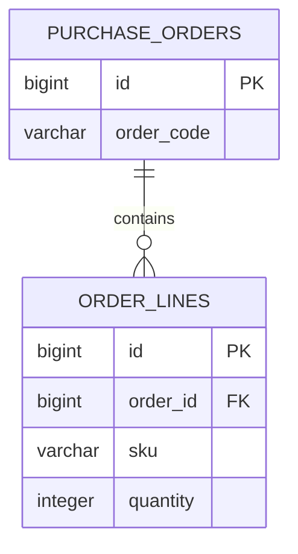
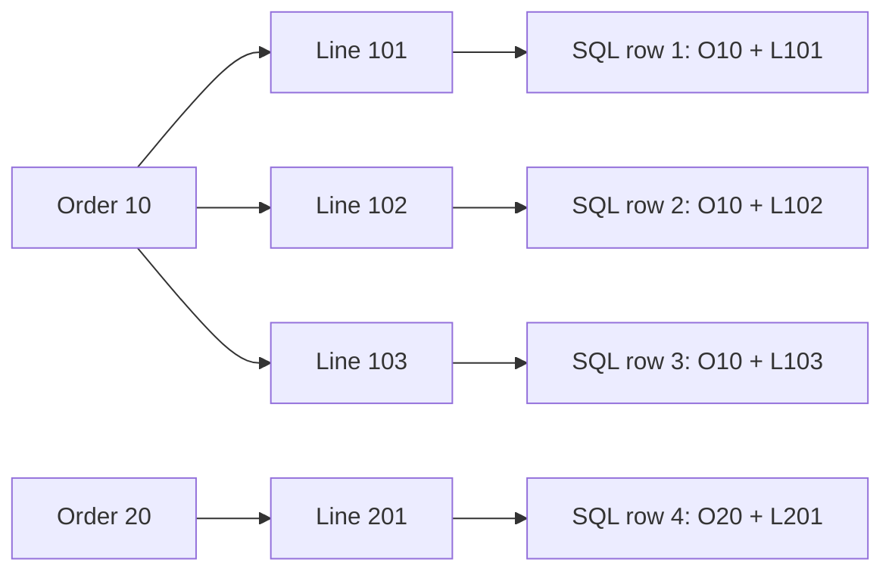

# Phân biệt hàng SQL trùng với thực thể trùng trong kết quả truy vấn HQL

Khi viết HQL (Hibernate Query Language) hoặc JPQL, ta thường chọn entity bằng một câu truy vấn như sau:

```java
List<PurchaseOrder> orders = entityManager.createQuery(
    """
    select o
    from PurchaseOrder o
    join o.lines l
    where l.quantity >= :minimum
    """,
    PurchaseOrder.class
)
.setParameter("minimum", 2)
.getResultList();
```

Nếu một đơn hàng có ba dòng thỏa điều kiện, **SQL JOIN có thể tạo ba hàng kết quả chứa cùng khóa chính của đơn hàng**. Nhưng ba hàng SQL đó không nhất thiết là **ba entity Java khác nhau**. Trong một persistence context, Hibernate thường duy trì **một managed instance cho mỗi entity type và primary key**.

Vấn đề còn phức tạp hơn ở bước cuối: một danh sách kết quả HQL có thể chứa **cùng một tham chiếu entity nhiều lần**, hoặc được Hibernate loại trùng ở mức root entity tùy loại truy vấn và phiên bản ORM. Từ Hibernate 6, đặc biệt với **collection `join fetch`**, Hibernate tự loại các bản sao root entity xuất hiện do fetch join trong kết quả Java sau khi đọc các hàng SQL. Điều này **không có nghĩa SQL JOIN thôi nhân hàng**, và cũng **không có nghĩa mọi kiểu projection đều được loại trùng tự động**.

Bài học này tách bạch ba lớp:

1. **Hàng kết quả SQL**: mỗi tổ hợp hàng phù hợp với phép JOIN là một hàng của result set.
2. **Danh tính entity trong persistence context**: cùng một entity type và ID thường trỏ tới cùng một managed object.
3. **Số phần tử trong kết quả HQL**: phụ thuộc select clause, fetch join, `distinct`, projection và hành vi phiên bản Hibernate.

Hiểu đúng ba lớp giúp tránh các lỗi về `JOIN FETCH`, `DISTINCT`, phân trang, đếm bản ghi, collection bags, DTO projection và hiệu năng.

---

## 1. Một ví dụ dữ liệu: hai đơn hàng, bốn dòng hàng

Giả sử có hai bảng:

```sql
CREATE TABLE purchase_orders (
    id BIGINT PRIMARY KEY,
    order_code VARCHAR(40) NOT NULL
);

CREATE TABLE order_lines (
    id BIGINT PRIMARY KEY,
    order_id BIGINT NOT NULL REFERENCES purchase_orders(id),
    sku VARCHAR(40) NOT NULL,
    quantity INTEGER NOT NULL
);
```

Dữ liệu mẫu:

**purchase_orders**

| id | order_code |
|---:|---|
| 10 | PO-10 |
| 20 | PO-20 |

**order_lines**

| id | order_id | sku | quantity |
|---:|---:|---|---:|
| 101 | 10 | A | 2 |
| 102 | 10 | B | 3 |
| 103 | 10 | C | 1 |
| 201 | 20 | D | 4 |

Quan hệ: một `PurchaseOrder` có nhiều `OrderLine`.



Bây giờ thực hiện:

```sql
SELECT
    o.id AS order_id,
    o.order_code,
    l.id AS line_id,
    l.sku
FROM purchase_orders o
JOIN order_lines l ON l.order_id = o.id
ORDER BY o.id, l.id;
```

Kết quả SQL:

| Hàng SQL | order_id | order_code | line_id | sku |
|---:|---:|---|---:|---|
| 1 | 10 | PO-10 | 101 | A |
| 2 | 10 | PO-10 | 102 | B |
| 3 | 10 | PO-10 | 103 | C |
| 4 | 20 | PO-20 | 201 | D |

Ở đây:

- **4 hàng SQL** vì có 4 cặp order–line phù hợp.
- **2 khóa chính order khác nhau**: 10 và 20.
- **4 khóa chính line khác nhau**: 101, 102, 103, 201.

Ba hàng đầu cùng chứa `order_id = 10`, nhưng **không phải ba bản ghi order trùng nhau trong bảng `purchase_orders`**. Chúng là ba tổ hợp JOIN khác nhau.

Đây chính là sự khác biệt cơ bản: **trùng giá trị các cột của root entity trong result set không đồng nghĩa database có nhiều bản ghi root trùng ID**.

## 2. Vì sao JOIN làm lặp cột của entity cha?

Một JOIN nối các hàng theo điều kiện quan hệ. Với quan hệ one-to-many, mỗi hàng con phù hợp tạo thêm một tổ hợp với cùng hàng cha.



Một quy tắc gần đúng với `INNER JOIN` một quan hệ one-to-many:

\[
\text{số hàng JOIN}
=
\sum_{\text{mỗi parent}} \text{số child khớp điều kiện}
\]

Nếu một parent không có child khớp, `INNER JOIN` có thể loại parent đó khỏi kết quả. Với `LEFT JOIN`, parent không có child vẫn có thể tạo một hàng SQL với các cột child `NULL`.

### 2.1. JOIN nhiều collection có thể nhân theo tích

Nếu mỗi order có cả `lines` và `payments`:

```sql
SELECT ...
FROM purchase_orders o
LEFT JOIN order_lines l ON l.order_id = o.id
LEFT JOIN payments p ON p.order_id = o.id;
```

Giả sử một order có 3 lines và 2 payments, phép JOIN có thể tạo **3 × 2 = 6 hàng** cho một order.

```text
Order 10
  Lines:    L1, L2, L3
  Payments: P1, P2

JOIN combinations:
  (L1, P1), (L1, P2)
  (L2, P1), (L2, P2)
  (L3, P1), (L3, P2)
```

Không có 6 orders trong database. Có 6 tổ hợp hàng của hai association. Tình trạng này thường được gọi là **Cartesian product expansion** hoặc sự nhân hàng do join nhiều collection.

Đây là lý do giảm số câu SQL bằng cách JOIN tất cả association đôi khi làm hệ thống **chậm hơn**, dù chỉ còn một query.

## 3. Entity identity trong Hibernate không phải số hàng SQL

Trong cùng một persistence context, Hibernate quản lý entity theo khóa danh tính gồm entity type và identifier. Nếu các hàng SQL cùng trỏ tới `PurchaseOrder` với ID 10, Hibernate thường dùng cùng **managed instance** đại diện cho order 10.

```java
PurchaseOrder a =
    entityManager.find(PurchaseOrder.class, 10L);

PurchaseOrder b =
    entityManager.find(PurchaseOrder.class, 10L);

System.out.println(a == b); // true trong cùng persistence context
```

Một query join trả nhiều hàng có cùng `o.id` có thể dùng lại đúng instance `a` trong quá trình materialize các hàng. Điều này giúp:

- Duy trì một bản trạng thái managed nhất quán cho mỗi entity identity.
- Dirty checking không phải theo dõi nhiều object managed cạnh tranh cùng ID trong một context.
- Quan hệ Java có thể trỏ tới cùng object thay vì nhân bản entity tùy số hàng JOIN.

### 3.1. Cùng entity instance có thể xuất hiện nhiều vị trí trong List

Danh sách Java có thể chứa cùng reference nhiều lần:

```java
PurchaseOrder order10 = ...;
PurchaseOrder order20 = ...;

List<PurchaseOrder> rows = List.of(
    order10,
    order10,
    order10,
    order20
);

System.out.println(rows.size());      // 4
System.out.println(rows.get(0) == rows.get(1)); // true
```

Có **4 phần tử List** nhưng chỉ **2 instance distinct theo tham chiếu**.

HQL entity query có JOIN thông thường (không fetch) có thể cho kết quả tương tự khi nhiều hàng JOIN khớp cùng root, nếu không dùng `DISTINCT` hoặc một hình thức loại trùng phù hợp.

**Danh tính entity** và **số vị trí trong List kết quả** là hai câu hỏi khác nhau.

### 3.2. So sánh reference, identity và equals/hashCode

Ba kiểu so sánh cần phân biệt:

| Kiểu | Câu hỏi | Ví dụ |
|---|---|---|
| Reference identity | Hai biến có trỏ cùng object không? | `a == b` |
| Persistence identity | Hai object đại diện cùng entity type + ID không? | `a.getId().equals(b.getId())`, kèm type |
| Business equality | Domain định nghĩa hai value/entity bằng nhau ra sao? | `a.equals(b)` |

Trong cùng persistence context, cùng managed entity identity thường dẫn đến cùng reference. Nhưng **ở hai persistence context khác nhau**, hai object có cùng type + ID có thể là hai reference khác nhau:

```java
// EntityManager A
PurchaseOrder fromA = emA.find(PurchaseOrder.class, 10L);

// EntityManager B
PurchaseOrder fromB = emB.find(PurchaseOrder.class, 10L);

System.out.println(fromA == fromB); // thường false
```

Đừng dùng `==` trên entities từ nhiều contexts để quyết định chúng đại diện cùng bản ghi hay không. Cũng đừng viết `equals/hashCode` chỉ để làm mất phần tử trùng trong một query mà không hiểu domain và lifecycle của ID sinh sau persist.

## 4. HQL JOIN thông thường: chọn root entity nhưng có thể thấy root lặp

Mapping minh họa:

```java
@Entity
@Table(name = "purchase_orders")
public class PurchaseOrder {
    @Id
    private Long id;

    @Column(name = "order_code")
    private String orderCode;

    @OneToMany(mappedBy = "order", fetch = FetchType.LAZY)
    private List<OrderLine> lines = new ArrayList<>();

    public Long getId() { return id; }
    public String getOrderCode() { return orderCode; }
    public List<OrderLine> getLines() { return lines; }
}

@Entity
@Table(name = "order_lines")
public class OrderLine {
    @Id
    private Long id;

    @ManyToOne(fetch = FetchType.LAZY)
    @JoinColumn(name = "order_id")
    private PurchaseOrder order;

    private String sku;
    private int quantity;
}
```

Truy vấn:

```java
List<PurchaseOrder> result =
    entityManager.createQuery(
        """
        select o
        from PurchaseOrder o
        join o.lines l
        where l.quantity > 0
        order by o.id
        """,
        PurchaseOrder.class
    ).getResultList();
```

Với dữ liệu ví dụ, Hibernate có thể nhận các hàng SQL tương ứng ba line của order 10 và một line của order 20.

**JOIN ở đây không có `FETCH`**: nó được dùng để lọc hoặc kết hợp các hàng, không yêu cầu nạp sẵn `o.lines`. Nếu query không loại trùng, kết quả root có thể xuất hiện nhiều lần dù reference tới order 10 là cùng managed object.

Vì vậy, khi người dùng hỏi “sao query trả bốn order mà DB chỉ có hai?”, cần xem:

1. Câu query có JOIN one-to-many/many-to-many không?
2. Query chọn `o` hay chọn nhiều phần tử trong tuple?
3. Có `DISTINCT` không?
4. Có `JOIN FETCH` collection không và Hibernate version là gì?
5. Dữ liệu lặp là **root object trong List** hay **hàng SQL** được log?

## 5. JOIN FETCH: một mục đích khác với JOIN thông thường

`JOIN FETCH` không chỉ nối bảng để lọc. Nó yêu cầu Hibernate tải association trong cùng truy vấn như một phần của fetch plan.

```java
List<PurchaseOrder> result =
    entityManager.createQuery(
        """
        select o
        from PurchaseOrder o
        left join fetch o.lines
        order by o.id
        """,
        PurchaseOrder.class
    ).getResultList();
```

SQL vẫn có thể trả 4 hàng do các line. Nhưng Hibernate cần dùng các hàng này để:

1. Tạo hoặc tìm managed `PurchaseOrder` tương ứng.
2. Tạo hoặc tìm `OrderLine`.
3. Gắn các line vào collection của order theo mapping.
4. Trả kết quả entity root cho query.

### 5.1. Hibernate 6 tự loại root entity lặp do JOIN FETCH

Trong Hibernate 6, các **duplicate root entity results phát sinh từ `join fetch`** được Hibernate loại bỏ tự động ở bước xử lý kết quả sau khi đọc các hàng SQL.

Với hai orders ở ví dụ, query fetch join một collection có thể trả:

```text
SQL result set: 4 rows
  (Order10, Line101)
  (Order10, Line102)
  (Order10, Line103)
  (Order20, Line201)

HQL List<PurchaseOrder>: 2 entries
  [Order10, Order20]
```

Không cần thêm `distinct` chỉ để yêu cầu Hibernate 6 loại root duplicate do fetch join. Đây là behavior riêng cần đối chiếu với Hibernate version đang dùng; không nên áp dụng nguyên xi cho Hibernate 5 hoặc cho mọi loại HQL projection.

**Tự loại kết quả entity trùng không làm database trả ít hàng JOIN hơn.** ORM vẫn có thể phải đọc tất cả các hàng để dựng collection.

### 5.2. Hibernate 5 và ví dụ cũ trên Internet

Ở Hibernate 5 và các phiên bản cũ hơn, nhiều ví dụ dùng:

```java
select distinct o
from PurchaseOrder o
left join fetch o.lines
```

để bảo đảm root entities không bị lặp trong kết quả. Một số phiên bản có cơ chế hint `passDistinctThrough` để kiểm soát việc đẩy `DISTINCT` xuống SQL trong bối cảnh đó.

Với Hibernate 6, kết quả root fetch join đã được loại trùng tự động, `distinct` trong HQL được xử lý/push xuống SQL theo semantics hiện tại và hint cũ không nên được sao chép máy móc. Khi nâng cấp từ Hibernate 5 sang 6, cần cập nhật cách hiểu và đo SQL thực tế, thay vì dùng một mẹo từ bài viết cũ.

### 5.3. JOIN FETCH có làm collection chính nó trùng phần tử không?

Cần phân biệt **duplicate root entity trong result List** với **duplicate element trong collection**.

Với một association collection, Hibernate dùng metadata collection (List/bag, Set, indexed List, map...) để lắp các phần tử từ hàng SQL. Một query join nhiều collection có thể tạo các tổ hợp lặp khiến việc khôi phục collection trở nên phức tạp.

Hibernate có thể từ chối fetch nhiều bag collections cùng lúc bằng `MultipleBagFetchException`. Lỗi này không được chữa bằng việc loại trùng List root sau query: **vấn đề nằm ở cách tái dựng collection từ các tổ hợp hàng**.

Nếu một bag cho phép phần tử lặp theo mapping, không được mặc định xóa phần tử lặp bằng `Set` chỉ để làm SQL trông gọn hơn. Collection semantics phải phù hợp domain.

## 6. Ba con số có thể khác nhau trong cùng một query

Giả sử:

```java
List<PurchaseOrder> orders = ...;
```

Có ba phép đếm độc lập:

| Câu hỏi | Ý nghĩa | Kết quả ví dụ |
|---|---|---:|
| SQL trả bao nhiêu hàng? | Số tổ hợp JOIN từ JDBC ResultSet | 4 |
| Có bao nhiêu order ID khác nhau trong SQL? | Số khóa root entity phân biệt | 2 |
| `orders.size()` là bao nhiêu? | Số phần tử trong kết quả HQL sau xử lý | Có thể 4 hoặc 2 tùy query/version |

Nếu HQL chỉ chọn `o` với JOIN thông thường và không có `distinct`, List có thể có 4 phần tử. Nếu Hibernate 6 xử lý root duplicate của collection `join fetch`, List có thể có 2 phần tử. Nếu query là `select o, l`, List có thể có 4 tuple đúng với bốn cặp.

Đây là lý do **không thể nhìn duy nhất log “4 rows returned” rồi kết luận code có bốn managed PurchaseOrder khác nhau**.

## 7. DISTINCT trong SQL: loại hàng theo toàn bộ biểu thức SELECT

SQL `DISTINCT` loại các hàng trùng theo **toàn bộ bộ giá trị được chọn**, không theo “entity cha mà người lập trình muốn xem là duy nhất”.

Ví dụ:

```sql
SELECT DISTINCT
    o.id,
    o.order_code
FROM purchase_orders o
JOIN order_lines l ON l.order_id = o.id;
```

Các hàng sau khi chọn chỉ chứa cột order:

```text
(10, PO-10)
(10, PO-10)
(10, PO-10)
(20, PO-20)
```

SQL DISTINCT có thể trả còn:

```text
(10, PO-10)
(20, PO-20)
```

Nhưng nếu chọn cả line ID:

```sql
SELECT DISTINCT
    o.id,
    o.order_code,
    l.id
FROM purchase_orders o
JOIN order_lines l ON l.order_id = o.id;
```

các hàng:

```text
(10, PO-10, 101)
(10, PO-10, 102)
(10, PO-10, 103)
(20, PO-20, 201)
```

khác nhau ở `l.id`, vì vậy DISTINCT vẫn giữ bốn hàng.

### 7.1. Vì sao SQL DISTINCT có thể không giảm nhiều hàng của fetch join?

Để materialize collection, ORM thường cần chọn các cột của child, ví dụ `l.id`, `l.sku`. Kể cả SQL có `DISTINCT`, các hàng JOIN vẫn khác nhau ở cột child. DISTINCT không thể biến ba line thành một mà vẫn giữ đủ dữ liệu của cả ba phần tử.

Khi Hibernate 6 tự loại duplicate root entity sau fetch join, đó là một bước ở **mức kết quả entity**, không phải bằng chứng DB đã loại hết hàng JOIN.

### 7.2. DISTINCT có chi phí

Tùy DBMS và query plan, SQL DISTINCT có thể cần sort hoặc hash để loại hàng trùng. Nếu result set rộng hoặc hàng JOIN nhiều, chi phí CPU, memory và temporary storage có thể tăng.

Không dùng `distinct` như một “miếng vá luôn tốt” cho mọi truy vấn. Trước tiên cần xác định:

- Trùng do JOIN nào?
- Trùng cần loại là root entity hay tuple?
- SQL DISTINCT có thật sự giảm số hàng được truyền không?
- Có thể thay JOIN bằng `EXISTS` hoặc query khác không?
- Hibernate version đã tự loại root duplicate trong trường hợp fetch join chưa?

## 8. DISTINCT trong HQL: tùy kiểu SELECT

HQL:

```java
List<PurchaseOrder> uniqueOrders =
    entityManager.createQuery(
        """
        select distinct o
        from PurchaseOrder o
        join o.lines l
        where l.quantity > 0
        """,
        PurchaseOrder.class
    ).getResultList();
```

Với non-fetch join và chỉ chọn root `o`, `distinct` mô tả rõ rằng muốn kết quả order duy nhất. Hibernate dịch nó sang SQL phù hợp, thường có SQL `DISTINCT`, để tránh các root lặp do nhiều line.

Nhưng với query trả tuple:

```java
List<Object[]> tuples =
    entityManager.createQuery(
        """
        select distinct o, l
        from PurchaseOrder o
        join o.lines l
        """,
        Object[].class
    ).getResultList();
```

`distinct` áp dụng cho tổ hợp giá trị `(o, l)`. Ba tuple `(Order10, Line101)`, `(Order10, Line102)`, `(Order10, Line103)` là khác nhau. Kết quả có thể vẫn gồm nhiều tuple chứa cùng `o`.

**DISTINCT không có ý nghĩa “mỗi root order chỉ xuất hiện một lần” cho mọi kiểu select**. Nó được định nghĩa theo **đơn vị kết quả được chọn**.

### 8.1. Truy vấn một entity so với tuple

| HQL | Kiểu kết quả | Đơn vị kết quả cần phân biệt |
|---|---|---|
| `select o from PurchaseOrder o` | `PurchaseOrder` | Một root entity |
| `select o from PurchaseOrder o join o.lines l` | `PurchaseOrder` | Root entity được lặp theo số dòng JOIN nếu không loại trùng |
| `select distinct o ...` | `PurchaseOrder` | Root entity duy nhất |
| `select o, l from PurchaseOrder o join o.lines l` | `Object[]`/Tuple | Cặp (order, line) |
| `select distinct o, l ...` | `Object[]`/Tuple | Cặp (order, line) phân biệt |
| `select l.sku ...` | `String` | Một giá trị SKU |
| `select distinct l.sku ...` | `String` | SKU khác nhau |
| `select new Dto(o.id, l.sku) ...` | DTO | Một DTO cho mỗi tổ hợp giá trị được chọn |

### 8.2. DISTINCT của scalar có thể loại giá trị thuộc entity khác nhau

Giả sử hai line thuộc hai orders khác nhau cùng SKU `"A"`. Truy vấn:

```java
select distinct l.sku
from OrderLine l
```

chỉ trả một chuỗi `"A"` cho cả hai line. Điều đó đúng theo yêu cầu lấy **SKU khác nhau**, nhưng không có nghĩa hai OrderLine entities là một.

Nếu DTO cần phân biệt từng line, phải chọn ID hoặc các thông tin định danh thích hợp. Nếu chỉ chọn tên/mã trùng, `distinct` có thể loại những bản ghi nghiệp vụ mà UI muốn giữ riêng.

## 9. DTO projection: trùng DTO không đồng nghĩa trùng entity

Xét một DTO:

```java
public record OrderLineRow(
    Long orderId,
    String orderCode,
    String sku
) {}
```

Query:

```java
List<OrderLineRow> rows =
    entityManager.createQuery(
        """
        select new com.example.OrderLineRow(
            o.id,
            o.orderCode,
            l.sku
        )
        from PurchaseOrder o
        join o.lines l
        order by o.id
        """,
        OrderLineRow.class
    ).getResultList();
```

Với order 10 có ba line, query tạo ba DTO chứa cùng `orderId = 10` nhưng `sku` khác nhau.

Hibernate **không nên tự loại DTO thứ hai và thứ ba** chỉ vì chúng cùng đại diện một order root theo suy nghĩ của người dùng. Mỗi DTO biểu diễn **một cặp order–line**, không phải một PurchaseOrder managed.

### 9.1. Nếu DTO chỉ chọn cột root thì sao?

```java
public record OrderSummary(Long id, String orderCode) {}
```

```java
select new com.example.OrderSummary(o.id, o.orderCode)
from PurchaseOrder o
join o.lines l
```

Nếu order 10 có ba line, có thể tạo ba DTO cùng `(10, "PO-10")`. Đây là **trùng projection result**, không phải ba managed entity.

Thêm `distinct` vào projection:

```java
select distinct new com.example.OrderSummary(o.id, o.orderCode)
from PurchaseOrder o
join o.lines l
```

có thể loại các bộ giá trị trùng, tùy JPQL/HQL provider và SQL được tạo. Cần hiểu HQL constructor expression có cú pháp và portability theo phiên bản; trong trường hợp cần tối đa portability có thể chọn scalar tuple distinct rồi map DTO ở Java.

### 9.2. DTO không được identity map tự hợp nhất

Entity identity map áp dụng cho **managed entity**. Các DTO được tạo từ constructor projection thường là object Java riêng, không được Hibernate quản lý identity/dirty checking. Hai DTO có cùng field values không mặc định là một object.

Nếu DTO là Java `record`, `equals/hashCode` mặc định theo thành phần có thể cho biết hai DTO bằng giá trị, nhưng điều đó không có nghĩa List kết quả tự động loại trùng.

### 9.3. Grouping theo root cần cấu trúc dữ liệu rõ ràng

Nếu UI cần:

```text
Order 10
  - Line 101
  - Line 102
  - Line 103
Order 20
  - Line 201
```

có thể:

- Tải entity graph với fetch plan phù hợp.
- Query DTO phẳng (mỗi dòng một tuple) rồi group theo `orderId` trong application.
- Truy vấn page orders trước rồi tải lines riêng.

Không nên gọi `distinct` trên `(orderId, sku)` rồi giả định đã có cấu trúc cây. SQL DISTINCT chỉ loại hàng trùng, không nhóm một-to-many thành collection trong DTO theo thiết kế nghiệp vụ.

## 10. LEFT JOIN: giữ root không có child nhưng vẫn có nhân hàng

`INNER JOIN` chỉ trả những root có child khớp. `LEFT JOIN` còn giữ root không có child, với giá trị child null.

Giả sử có thêm Order 30 không có line:

```sql
SELECT o.id, l.id
FROM purchase_orders o
LEFT JOIN order_lines l ON l.order_id = o.id
ORDER BY o.id, l.id;
```

Kết quả:

```text
(10, 101)
(10, 102)
(10, 103)
(20, 201)
(30, NULL)
```

Có **5 hàng SQL** nhưng **3 root order IDs**. `LEFT JOIN` không ngăn nhân hàng khi root có nhiều child; nó chỉ giữ root không có child.

### 10.1. WHERE trên child có thể thay đổi semantics LEFT JOIN

```java
select o
from PurchaseOrder o
left join o.lines l
where l.quantity >= 2
```

Điều kiện `WHERE l.quantity >= 2` loại hàng có `l` null, nên những order không có child phù hợp có thể bị loại tương tự inner join.

Nếu muốn giữ toàn bộ root và chỉ giới hạn child tham gia join, HQL/JPQL thường hỗ trợ điều kiện `ON` cho **join thông thường**:

```java
select o, l
from PurchaseOrder o
left join o.lines l on l.quantity >= :min
```

Ý nghĩa output lúc này là tuple root/child; root có thể tiếp tục lặp theo số child thỏa điều kiện. Không sử dụng `ON` tùy tiện để lọc `JOIN FETCH` collection: Hibernate có những hạn chế với `with/on` trên fetched associations và việc fetch collection đã lọc một phần có thể làm collection managed thiếu dữ liệu.

## 11. HQL EXISTS: lọc root mà không nhân root theo số child

Một số query dùng JOIN chỉ để hỏi “order có ít nhất một line thỏa điều kiện không?”, chứ không cần tải line.

Thay vì:

```java
select distinct o
from PurchaseOrder o
join o.lines l
where l.quantity >= :min
```

có thể viết correlated EXISTS:

```java
List<PurchaseOrder> orders =
    entityManager.createQuery(
        """
        select o
        from PurchaseOrder o
        where exists (
            select 1
            from OrderLine l
            where l.order = o
              and l.quantity >= :min
        )
        """,
        PurchaseOrder.class
    )
    .setParameter("min", 2)
    .getResultList();
```

`EXISTS` kiểm tra sự tồn tại của ít nhất một child phù hợp; nó không cần tạo một root result row cho mỗi child match ở cấp truy vấn ngoài.

Điều này có thể làm query rõ ý định hơn và tránh yêu cầu `DISTINCT` chỉ để loại root lặp. DB optimizer có thể chuyển EXISTS thành semi-join hoặc kế hoạch phù hợp; hiệu năng cụ thể phụ thuộc index, DBMS và dữ liệu.

### 11.1. Khi nào JOIN vẫn đúng?

Nếu cần giá trị của child để lọc/sắp xếp/chiếu:

```java
select o.id, l.sku, l.quantity
from PurchaseOrder o
join o.lines l
where l.quantity >= :min
```

thì mỗi cặp (order, line) là một kết quả có ý nghĩa. Không nên thay JOIN bằng EXISTS nếu ứng dụng thực sự cần từng child row.

## 12. COUNT, COUNT(DISTINCT) và số lượng root để phân trang

Truy vấn:

```java
select count(o)
from PurchaseOrder o
join o.lines l
where l.quantity > 0
```

về mặt SQL thường đếm các **hàng JOIN** thỏa điều kiện, không đếm root orders duy nhất.

Với dữ liệu ban đầu:

- Order 10 có 3 line.
- Order 20 có 1 line.
- `count(o)` qua JOIN có thể là **4**.
- Nhưng số root orders duy nhất là **2**.

Để đếm order IDs duy nhất:

```java
Long totalOrders = entityManager.createQuery(
        """
        select count(distinct o.id)
        from PurchaseOrder o
        join o.lines l
        where l.quantity > 0
        """,
        Long.class
    ).getSingleResult();
```

Kết quả với dữ liệu ví dụ: **2**.

### 12.1. COUNT(DISTINCT o.id) trả lời điều gì?

Nó đếm những `o.id` khác nhau trong tập hàng match. Đây thường là số lượng root entities phù hợp với điều kiện của query khi mỗi entity có một ID đơn và các JOIN/filters là tương đương.

Nếu entity có khóa chính tổng hợp, cần chọn cách đếm distinct identifier tương ứng phù hợp HQL/DBMS và yêu cầu portability. Không tự ghép chuỗi ID theo cách có thể trùng hoặc mất phân biệt.

### 12.2. COUNT(*) khác COUNT(child.id) trong LEFT JOIN

Giả sử Order 30 không có child:

```sql
SELECT o.id, COUNT(*) AS rows_count, COUNT(l.id) AS line_count
FROM purchase_orders o
LEFT JOIN order_lines l ON l.order_id = o.id
GROUP BY o.id;
```

Với Order 30:

- `COUNT(*) = 1` vì LEFT JOIN vẫn tạo một hàng null-extended.
- `COUNT(l.id) = 0` vì aggregate COUNT(expression) bỏ qua NULL.

Nếu muốn số child thực tế, dùng `count(l.id)` thay vì `count(*)` theo đúng join semantics.

### 12.3. Count query không dùng FETCH JOIN

Không viết:

```java
select count(o)
from PurchaseOrder o
left join fetch o.lines
```

Một fetch join yêu cầu owner được chọn để association có thể được gắn vào entity kết quả, còn `count(o)` không trả entity root để materialize association. Query kiểu này không hợp lệ trong Hibernate thông thường.

Query count phải là một query riêng không dùng fetch join, và điều kiện filter phải tương ứng với truy vấn lấy trang để tổng số phần tử được tính đúng.

## 13. Pagination: trùng hàng JOIN có thể làm sai kỳ vọng về kích thước trang

Giả sử UI muốn 10 orders mỗi trang. Nếu viết:

```java
List<PurchaseOrder> page =
    entityManager.createQuery(
        """
        select o
        from PurchaseOrder o
        join o.lines l
        order by o.id
        """,
        PurchaseOrder.class
    )
    .setFirstResult(0)
    .setMaxResults(10)
    .getResultList();
```

Nếu order đầu tiên có 10 lines, 10 hàng SQL đầu có thể đều tương ứng với cùng order ID. Kết quả không phải 10 order duy nhất như UI mong muốn.

### 13.1. DISTINCT và pagination

`select distinct o` trên một non-fetch join có thể giúp SQL phân trang theo root projection duy nhất trong những trường hợp phù hợp. Nhưng còn những câu hỏi:

- `order by` dùng cột child hay cột root?
- DBMS có cho phép sắp xếp theo biểu thức không nằm trong DISTINCT select list không?
- Một root có nhiều child với giá trị sort khác nhau thì vị trí root trong trang được định nghĩa thế nào?
- Count query có dùng `count(distinct o.id)` hay đang đếm hàng join?

Đừng xem `distinct` là giải pháp duy nhất cho mọi kiểu phân trang có JOIN. Nếu sort theo child cần định nghĩa aggregate (ví dụ min/max child timestamp) hoặc một quy tắc lấy “child đại diện”.

### 13.2. Fetch join collection và pagination

Với:

```java
select o
from PurchaseOrder o
left join fetch o.lines
order by o.id
```

và `setMaxResults(10)`, một giới hạn SQL thô có thể cắt giữa collection của một order. Hibernate có thể phải tải toàn bộ kết quả liên quan và phân trang ở bộ nhớ tùy version/configuration, đồng thời phát cảnh báo; khi bật fail-on-pagination-over-collection-fetch có thể ném exception.

**Không dùng collection fetch join trực tiếp với database pagination để mong nhận đúng một trang root và collection đầy đủ.**

### 13.3. Mẫu hai bước: phân trang ID trước, fetch graph sau

Bước 1: truy vấn một trang root ID:

```java
List<Long> ids = entityManager.createQuery(
        """
        select o.id
        from PurchaseOrder o
        where o.status = :status
        order by o.createdAt desc, o.id desc
        """,
        Long.class
    )
    .setParameter("status", OrderStatus.CONFIRMED)
    .setFirstResult(offset)
    .setMaxResults(pageSize)
    .getResultList();
```

Bước 2: tải graph trong phạm vi những ID đó:

```java
List<PurchaseOrder> orders = ids.isEmpty()
    ? List.of()
    : entityManager.createQuery(
        """
        select o
        from PurchaseOrder o
        left join fetch o.lines
        where o.id in :ids
        """,
        PurchaseOrder.class
    )
    .setParameter("ids", ids)
    .getResultList();
```

Trong Hibernate 6, fetch join collection có thể trả root list đã loại trùng. Với Hibernate cũ hoặc yêu cầu portability, phải kiểm tra `distinct`/dedup semantics cụ thể.

**Quan trọng:** `IN (:ids)` không giữ thứ tự của danh sách ID. Sau query thứ hai, ứng dụng cần sắp xếp lại theo thứ tự trang đã lấy ở bước một nếu thứ tự hiển thị phải ổn định.

Nếu bước một có JOIN để filter root, cân nhắc `EXISTS` hoặc `distinct` trong truy vấn ID cho đúng cardinality. Nếu concurrency có thể thay đổi dữ liệu giữa hai query, xác định transaction isolation/snapshot phù hợp với yêu cầu UI.

### 13.4. Không dùng Set thay thế việc phân trang đúng

Một cách xử lý sai:

```java
List<PurchaseOrder> raw = queryWithJoinAndLimit(10);
Set<PurchaseOrder> unique = new LinkedHashSet<>(raw);
```

Nếu 10 hàng SQL chứa chỉ 2 root orders, Set chỉ còn 2 phần tử chứ không tự lấy thêm 8 orders tiếp theo. Màn hình sẽ thiếu dữ liệu.

Bên cạnh đó, `Set` dùng `equals/hashCode` của entity; implementation không phù hợp có thể làm mất phần tử sai hoặc gây vấn đề khi ID thay đổi sau persist. Tránh dùng Set để che vấn đề cardinality của query.

## 14. JOIN FETCH nhiều collection và sự bùng nổ dữ liệu

Giả sử:

```java
@Entity
class PurchaseOrder {
    @OneToMany(mappedBy = "order")
    private List<OrderLine> lines;

    @OneToMany(mappedBy = "order")
    private List<Payment> payments;
}
```

Query:

```java
select o
from PurchaseOrder o
left join fetch o.lines
left join fetch o.payments
```

Nếu một order có 100 lines và 20 payments, SQL có thể trả **2000 hàng** cho một order, dù Hibernate cuối cùng chỉ trả **một root PurchaseOrder**.

Hệ quả:

- Network truyền dữ liệu lặp rất nhiều.
- JDBC ResultSet và hydration tốn CPU/memory.
- Nhiều hàng trùng ở cấp root, child association combinations.
- Database có thể cần sort/hash/join buffers lớn.
- `MultipleBagFetchException` có thể xuất hiện nếu đồng thời fetch nhiều bag associations.

### 14.1. Vì sao Hibernate từ chối nhiều bags?

Bag không có chỉ số vị trí hoặc tính duy nhất mặc định để dễ phân biệt “phần tử được lặp do phép JOIN” với “phần tử xuất hiện nhiều lần hợp lệ trong bag”. Khi fetch đồng thời nhiều bags, tổ hợp SQL khiến việc dựng collection chính xác trở nên không an toàn ở một số mappings. Hibernate thường phát `MultipleBagFetchException` thay vì cố dựng graph mơ hồ.

Đổi List thành Set chỉ để né lỗi có thể thay đổi semantics domain và equality. Nếu thật sự có một set các phần tử duy nhất, Set có thể đúng; nhưng không nên ép mọi bag thành Set vì hiệu năng.

### 14.2. Thay nhiều collection fetch joins bằng nhiều bước

Một chiến lược:

1. Tải orders và to-one associations bằng JOIN FETCH.
2. Tải `lines` bằng query riêng hoặc batch fetching.
3. Tải `payments` bằng query riêng hoặc batch fetching.
4. Dùng cùng persistence context để các managed root entities được tái sử dụng.
5. Chuyển sang DTO khi dữ liệu cần xuất ra API.

Ví dụ:

```java
List<PurchaseOrder> orders = loadOrders();

List<Long> ids =
    orders.stream().map(PurchaseOrder::getId).toList();

entityManager.createQuery(
    """
    select distinct o
    from PurchaseOrder o
    left join fetch o.lines
    where o.id in :ids
    """,
    PurchaseOrder.class
).setParameter("ids", ids).getResultList();

entityManager.createQuery(
    """
    select distinct o
    from PurchaseOrder o
    left join fetch o.payments
    where o.id in :ids
    """,
    PurchaseOrder.class
).setParameter("ids", ids).getResultList();
```

Ví dụ giả định `ids` không rỗng và associations tồn tại trong mapping. Cả hai query chạy trong cùng persistence context, nên root entities tương ứng có thể được dùng lại. Ở Hibernate 6, `distinct` không cần chỉ để loại root duplicate do fetch join, nhưng có thể vẫn xuất hiện trong code cũ; phải hiểu chi phí SQL của nó.

## 15. Batch fetch và subselect là lựa chọn thay vì JOIN collection quá rộng

Không phải mọi association cần nạp cùng một SQL. Với nhiều root owners:

- `@BatchSize` gom khởi tạo lazy collections của một số owner thành SELECT có `IN (:ids)`.
- `@Fetch(FetchMode.SUBSELECT)` có thể tải collection cùng role cho nhóm owner đã được query trước đó bằng một câu SQL subselect.
- DTO query riêng có thể chỉ chọn những cột cần hiển thị.

Ví dụ batch fetching:

```java
@OneToMany(mappedBy = "order", fetch = FetchType.LAZY)
@BatchSize(size = 20)
private List<OrderLine> lines;
```

Nếu query trước đó lấy 40 orders, khi ứng dụng chạm vào collection `lines`, Hibernate có thể tải collection của một nhóm orders bằng một SELECT phụ thay vì 40 SELECT.

Ví dụ subselect fetching:

```java
@OneToMany(mappedBy = "order", fetch = FetchType.LAZY)
@Fetch(FetchMode.SUBSELECT)
private List<OrderLine> lines;
```

Khi khởi tạo một collection, Hibernate có thể tải cùng role cho nhóm root từ query owner đã thực hiện trước đó.

Đừng nhầm `hibernate.jdbc.batch_size` (batch DML INSERT/UPDATE/DELETE) với `hibernate.default_batch_fetch_size` (batch SELECT lazy associations). Hai cơ chế hoàn toàn khác.

**Quan trọng đối với chủ đề hiện tại:** batch/subselect vẫn có thể tải nhiều child, nhưng nó tránh phải nhân số hàng root trong SQL chính như collection JOIN FETCH. Nó không biến quan hệ one-to-many thành one-to-one.

## 16. GROUP BY và aggregate: tạo một kết quả có chủ đích cho mỗi nhóm

Nếu muốn mỗi order xuất hiện một lần cùng số line, có thể dùng aggregate:

```java
public record OrderStats(
    Long orderId,
    Long lineCount
) {}
```

```java
List<OrderStats> stats =
    entityManager.createQuery(
        """
        select new com.example.OrderStats(
            o.id,
            count(l.id)
        )
        from PurchaseOrder o
        left join o.lines l
        group by o.id
        order by o.id
        """,
        OrderStats.class
    ).getResultList();
```

Với dữ liệu mẫu, kết quả tương ứng:

```text
OrderStats(10, 3)
OrderStats(20, 1)
```

`GROUP BY` thay đổi **đơn vị kết quả** thành một hàng cho mỗi group, không phải dùng identity map để xóa bản sao root.

### 16.1. COUNT khi join hai collection

Nếu join cả lines và payments:

```java
select o.id, count(l.id), count(p.id)
from PurchaseOrder o
left join o.lines l
left join o.payments p
group by o.id
```

mỗi line có thể lặp theo số payment và ngược lại. `count(l.id)` và `count(p.id)` bị phóng đại.

Cân nhắc:

```java
select o.id, count(distinct l.id), count(distinct p.id)
from PurchaseOrder o
left join o.lines l
left join o.payments p
group by o.id
```

hoặc dùng subquery/aggregate riêng cho từng collection để tránh chi phí cross-product. `count(distinct ...)` giải quyết đếm trùng theo child identifier, nhưng SQL vẫn có thể phải xử lý lượng hàng JOIN lớn trước khi aggregate. Với dữ liệu lớn, query riêng hoặc pre-aggregated read model có thể hiệu quả hơn.

### 16.2. GROUP BY không đồng nghĩa DISTINCT

- `DISTINCT` loại những result rows có cùng giá trị select.
- `GROUP BY` tạo nhóm và cho phép tính `COUNT`, `SUM`, `MIN`, `MAX`...
- ORM root dedup xử lý identity của entity result, không tự tính tổng hay đếm.

Chọn đúng công cụ theo yêu cầu: “mỗi order duy nhất”, “số line mỗi order”, hay “từng cặp order–line”.

## 17. Một query có cùng entity instance trong nhiều tuple

HQL:

```java
List<Object[]> tuples =
    entityManager.createQuery(
        """
        select o, l
        from PurchaseOrder o
        join o.lines l
        order by o.id, l.id
        """,
        Object[].class
    ).getResultList();
```

Với data ví dụ, có bốn tuple:

```text
tuple 1 = [Order10, Line101]
tuple 2 = [Order10, Line102]
tuple 3 = [Order10, Line103]
tuple 4 = [Order20, Line201]
```

Ba phần tử đầu của tuple `o` có thể là **cùng một object reference**:

```java
PurchaseOrder first =
    (PurchaseOrder) tuples.get(0)[0];

PurchaseOrder second =
    (PurchaseOrder) tuples.get(1)[0];

System.out.println(first == second); // true trong cùng context
```

Đây là kết quả **đúng**. Mỗi tuple đại diện một line khác nhau; không nên loại tuple thứ hai chỉ vì `Order10` đã có mặt ở tuple thứ nhất.

### 17.1. Tuple alias và result transformers

Hibernate có những API riêng cho tuple/list transformation hoặc DTO mapping. Nếu dùng transformer để group kết quả thành cấu trúc cây, hãy kiểm soát danh tính root và child đúng cách.

Một transformer không nên mặc định dựa trên vị trí của row để kết luận đó là entity mới. Khi join collection, một root có thể xuất hiện nhiều lần không liên tục tùy `ORDER BY`. Dùng ID root làm khóa grouping và ID child để xử lý phần tử duy nhất khi domain yêu cầu.

Đồng thời không coi transformer tùy biến là cách giảm lưu lượng SQL: các hàng join vẫn đã đi qua JDBC trước khi transformer xử lý.

## 18. First-level cache không đồng nghĩa query cache hay second-level cache

Khái niệm Hibernate first-level cache thường gắn với persistence context và entity identity:

```java
PurchaseOrder a = entityManager.find(PurchaseOrder.class, 10L);
PurchaseOrder b = entityManager.find(PurchaseOrder.class, 10L);
assert a == b;
```

Điều này **khác với**:

- Second-level cache: chia sẻ dữ liệu entity/collection đã cache giữa các sessions theo cấu hình và chính sách consistency.
- Query cache: cache những kết quả query ở mức được hỗ trợ, thường cần kết hợp entity cache và invalidation.
- SQL result set: những hàng thực sự trả từ JDBC khi query được chạy.

Một query JOIN có thể đọc nhiều hàng SQL dù các root objects đã có sẵn trong persistence context. Identity map giúp Hibernate không tạo một managed instance root mới cho mỗi hàng, nhưng **không làm SQL JOIN tự giảm số tổ hợp**.

Khi đo hiệu năng, cần tách thời gian database xử lý JOIN, truyền dữ liệu, hydrate entities, loại trùng kết quả root và truy xuất cache.

## 19. Một số cách hiểu sai về HQL DISTINCT

### 19.1. “DISTINCT luôn chỉ xét primary key entity cha”

Không đúng cho mọi projection. SQL DISTINCT xét tập biểu thức select, còn HQL DISTINCT áp dụng theo kiểu kết quả. Với `select o, l`, hai tuple có cùng `o` nhưng khác `l` vẫn phân biệt.

### 19.2. “JOIN FETCH trong Hibernate 6 không còn sinh hàng SQL lặp”

Sai. ORM loại duplicate root entity khỏi result List sau khi đọc SQL. SQL vẫn phải trả các hàng child để dựng collection.

### 19.3. “Nếu List.size() bằng 2 thì database chỉ trả 2 hàng”

Không nhất thiết. Query fetch join có thể trả 100 hàng SQL và 2 root entities. Hãy quan sát SQL/log/driver metrics để biết thực tế.

### 19.4. “Có ba dòng hàng tức DB có ba Order entity”

Không. Ba JOIN rows có thể có cùng order PK; một order entity kết hợp với ba child rows.

### 19.5. “Cùng reference xuất hiện ba lần trong List nghĩa Hibernate tạo ba object”

Không. Một Java List cho phép cùng object reference lặp ở nhiều vị trí.

### 19.6. “Entity equality bằng ID khiến Hibernate tự loại trùng ở mọi query”

Không. `equals/hashCode` domain không tự thay đổi semantics của HQL result list. ORM có quy tắc riêng về query shape/`distinct`/fetch join và entity identity.

### 19.7. “Set giải quyết triệt để vấn đề trùng và phân trang”

Không. Set chỉ loại phần tử theo equality của Java sau khi dữ liệu đã được tải. Nó không yêu cầu DB trả đủ một trang root unique và có thể phá order/collection semantics.

### 19.8. “JOIN FETCH vừa lấy dữ liệu, vừa là một cách lọc collection an toàn”

Không nên dùng filter trên fetched association để tạo managed collection chỉ chứa một phần row rồi đối xử như đã tải đầy đủ. Hibernate hạn chế một số điều kiện `on/with` cho fetch joins; với các điều kiện được phép, phải cẩn thận không tạo collection thiếu phần tử.

### 19.9. “SELECT DISTINCT sẽ luôn nhanh hơn nhiều SELECT”

Không chắc. SQL DISTINCT có thể thêm sort/hash; JOIN rộng có thể truyền nhiều dữ liệu. Fetch theo batch hoặc query riêng có thể giảm tổng chi phí hơn.

### 19.10. “COUNT(o) trên JOIN bằng số orders”

Không khi một order match nhiều child. Dùng `count(distinct o.id)` hoặc `EXISTS`/query count phù hợp để đếm root unique.

## 20. Cách quan sát ba tầng trùng trong integration test

Giả định test dùng Hibernate 6, fixture có Order 10 với ba lines và Order 20 với một line, persistence context hoạt động.

### 20.1. Non-fetch join chọn root

```java
List<PurchaseOrder> result =
    entityManager.createQuery(
        """
        select o
        from PurchaseOrder o
        join o.lines l
        where l.quantity > 0
        order by o.id
        """,
        PurchaseOrder.class
    ).getResultList();
```

Quan sát `result.size()` và so sánh:

```java
long distinctIds = result.stream()
    .map(PurchaseOrder::getId)
    .distinct()
    .count();

System.out.println(result.size());
System.out.println(distinctIds);
```

Có thể thấy số phần tử List lớn hơn số root IDs. Đây là bài kiểm tra phân biệt kết quả List và danh tính entity, không phải khẳng định provider phải luôn cho một con số cụ thể trong mọi query shape/version.

### 20.2. Fetch join collection trong Hibernate 6

```java
List<PurchaseOrder> fetched =
    entityManager.createQuery(
        """
        select o
        from PurchaseOrder o
        left join fetch o.lines
        order by o.id
        """,
        PurchaseOrder.class
    ).getResultList();
```

Với Hibernate 6, fetch join có cơ chế tự loại duplicate root entity results. Kỳ vọng root list chứa các order unique theo identity, dù SQL có thể trả nhiều hàng hơn.

### 20.3. Tuple projection vẫn giữ từng cặp

```java
List<Object[]> pairs =
    entityManager.createQuery(
        """
        select o, l
        from PurchaseOrder o
        join o.lines l
        order by o.id, l.id
        """,
        Object[].class
    ).getResultList();
```

Kỳ vọng mỗi cặp root–line phù hợp xuất hiện, ví dụ bốn tuples tương ứng bốn lines.

### 20.4. Count root và count join rows

```java
Long joinedRows = entityManager.createQuery(
    """
    select count(o)
    from PurchaseOrder o
    join o.lines l
    """,
    Long.class
).getSingleResult();

Long distinctOrders = entityManager.createQuery(
    """
    select count(distinct o.id)
    from PurchaseOrder o
    join o.lines l
    """,
    Long.class
).getSingleResult();
```

Với fixture ban đầu, giá trị minh họa là `joinedRows = 4` và `distinctOrders = 2`.

### 20.5. Bật SQL logging

Ví dụ Spring Boot + Hibernate 6:

```properties
logging.level.org.hibernate.SQL=DEBUG
spring.jpa.properties.hibernate.generate_statistics=true
```

Nếu cần xem bind values:

```properties
logging.level.org.hibernate.orm.jdbc.bind=TRACE
```

Chỉ bật bind tracing có kiểm soát vì log có thể chứa dữ liệu cá nhân hoặc bí mật. SQL log chỉ hiển thị statement, không mặc nhiên hiển thị số hàng JDBC thực sự trả. Nếu cần phân tích cardinality, xem query plan, DB metrics và measurement phù hợp.

### 20.6. Vì sao không nên test chỉ bằng số entity objects được tạo?

Hibernate đã có persistence context cache, nên object có thể được tái sử dụng. Nếu kiểm tra “query tạo mấy object”, kết quả còn phụ thuộc state trước query, cache, entity graph và mapping. Điều cần xác nhận là:

- Cardinality của SQL JOIN theo fixture.
- Số root IDs duy nhất.
- Kiểu kết quả HQL (entity, tuple, scalar, DTO).
- Số phần tử trả về sau Hibernate post-processing.
- Hành vi theo Hibernate version đã chọn.

Bài kiểm tra kỹ thuật nên dùng fixture xác định rõ số child mỗi root để không nhầm identity với row multiplicity.

## 21. Đo số hàng SQL thực tế thay vì suy từ List.size()

Một phép quan sát có hệ thống:

1. Dựng dữ liệu có phân bố rõ: 10 roots, mỗi root 10 children.
2. Chạy JOIN query với projection cho cả root ID và child ID.
3. Đếm số tuple trả về; trong dữ liệu một-to-many sạch có thể gần 100 tuple.
4. Chạy entity query và ghi `List.size()`.
5. Chạy `count(distinct root.id)` để biết số root IDs.
6. Chạy query fetch join trên Hibernate 6; quan sát root dedup.
7. Đo thời gian SQL, số rows, bytes transferred và hydration memory.
8. So sánh JOIN FETCH với batch/subselect/DTO nếu payload lớn.

Không đưa kết luận “JOIN FETCH tốt nhất vì chỉ một SQL” mà bỏ qua kích thước result set. Số query là một chỉ số quan trọng nhưng **không đủ**.

### 21.1. Số câu SQL và số hàng SQL là hai chiều khác nhau

| Chiến lược | Query count | Result rows |
|---|---|---|
| JOIN FETCH một collection | Ít query, thường một query chính | Có thể nhiều rows theo số child |
| SELECT lazy từng collection | Một query chính + nhiều query phụ | Mỗi query phụ ít rows, tổng vẫn cần child data |
| BATCH fetch | Một query chính + vài query phụ | Tránh lặp cột root trong query chính |
| SUBSELECT fetch | Một query chính + query phụ cho collection role | Có thể tải nhiều collection cùng lúc |
| DTO aggregate | Có thể một query | Ít rows nếu mỗi root được group/aggregate |

Không có kết luận tuyệt đối: cần đo số root, số child mỗi root, indexes, DB latency và lượng dữ liệu cần thực sự sử dụng.

## 22. Các tình huống thực tế và lựa chọn HQL

### 22.1. “Lấy tất cả orders có ít nhất một line quantity lớn”

Hợp lý:

```java
select o
from PurchaseOrder o
where exists (
    select 1
    from OrderLine l
    where l.order = o and l.quantity >= :min
)
```

Không cần JOIN để tạo một row cho mỗi line match nếu mục tiêu chỉ là lọc root.

### 22.2. “Lấy mỗi order một lần cùng toàn bộ lines”

Nếu chỉ một order hoặc tập nhỏ:

```java
select o
from PurchaseOrder o
left join fetch o.lines
where o.id = :id
```

Với Hibernate 6, duplicate root do fetch join được loại khỏi entity result List. SQL vẫn có các hàng line.

### 22.3. “Lấy từng cặp order–line để xuất CSV”

Hợp lý:

```java
select o.id, o.orderCode, l.id, l.sku
from PurchaseOrder o
join o.lines l
order by o.id, l.id
```

Kết quả theo từng cặp là chính xác. Không dùng root dedup vì sẽ mất các dòng dữ liệu cần xuất.

### 22.4. “Lấy tổng số orders match filter line”

Hợp lý:

```java
select count(distinct o.id)
from PurchaseOrder o
join o.lines l
where l.quantity >= :min
```

Hoặc đếm root với EXISTS. Không dùng `count(o)` qua JOIN nếu nó đếm nhiều lần cùng root.

### 22.5. “Lấy trang 20 orders cùng lines”

Ưu tiên truy vấn page root IDs trước rồi fetch lines cho đúng IDs, hoặc dùng batch fetching/DTO. Tránh trực tiếp `setMaxResults(20)` trên collection fetch join.

### 22.6. “Lấy orders cùng nhiều collections cho dashboard”

Tránh fetch join tất cả bags trong một query. Tách query, batch/subselect hoặc aggregation/projection. Nếu chỉ cần số lượng/tổng theo child, không cần hydrate toàn bộ child entities.

## 23. Bảng chọn công cụ chống trùng phù hợp

| Mục tiêu | Công cụ thường phù hợp | Tránh nhầm |
|---|---|---|
| Một root entity cho mỗi ID sau non-fetch JOIN | `select distinct o` hoặc `EXISTS` | JOIN rows không phải root entities mới |
| Một root entity cùng collection fetch ở Hibernate 6 | `JOIN FETCH` khi tập nhỏ, ORM tự loại root duplicate | SQL vẫn nhân hàng |
| Đếm số root IDs khớp | `count(distinct o.id)` hoặc query EXISTS | `count(o)` qua JOIN đếm rows |
| Đếm child theo root | `group by o.id` + `count(l.id)` | LEFT JOIN + COUNT(*) có thể đếm 1 cho root rỗng |
| Đếm hai collection cùng lúc | `count(distinct child.id)` hoặc aggregate riêng | Cross product phóng đại count |
| Từng cặp root–child | Tuple/DTO projection | Không tự loại “root lặp” |
| Phân trang root | Page IDs + fetch graph, hoặc DTO root query | Limit trên joined collection rows |
| HQL join để kiểm tra tồn tại child | Correlated EXISTS | JOIN rồi DISTINCT không phải luôn tối ưu |
| Tránh dữ liệu root lặp quá nhiều khi tải collections | BATCH/SUBSELECT/tách query | Một SQL JOIN lớn vẫn có thể đắt |
| Nhiều bag collections | Tách fetch plans | Set không phải phép màu sửa mapping |

## 24. Quy trình gỡ lỗi khi thấy kết quả “trùng”

Khi phát hiện kết quả truy vấn chứa nhiều phần tử có vẻ giống nhau, hãy làm theo thứ tự:

1. **Xác định select clause.** Query chọn entity `o`, tuple `o, l`, scalar hay DTO?
2. **Kiểm tra cardinality của JOIN.** Một root có mấy child match?
3. **Kiểm tra root IDs.** Số row có cùng root PK là bao nhiêu?
4. **Kiểm tra Hibernate version.** Query có collection fetch join và đang dùng Hibernate 6 không?
5. **Phân biệt SQL duplicate và Java List duplicate.** Log/JDBC rows khác `result.size()`.
6. **Kiểm tra persistence context.** Cùng ID trong cùng context có thể là một instance dù List lặp reference.
7. **Đánh giá DISTINCT đúng đơn vị.** Cần unique root, unique tuple hay unique scalar?
8. **Xem pagination.** Limit/offset áp lên rows hay roots?
9. **Nếu JOIN chỉ để lọc tồn tại child, cân nhắc EXISTS.**
10. **Nếu JOIN nhiều collection, kiểm tra row multiplication/MultipleBagFetchException.**
11. **Nếu query trả count, kiểm tra COUNT so với COUNT(DISTINCT).**
12. **Đo hiệu năng thật.** Không chỉ giảm List.size(), còn phải giảm chi phí SQL và hydration khi cần.

Quy trình trên giúp tránh “sửa” bug bằng cách gọi `new HashSet<>(results)` rồi vô tình làm mất thứ tự, phá kích thước trang hoặc che dấu SQL JOIN quá lớn.

## 25. Kết luận

Trong HQL/Hibernate, **hàng SQL trùng, instance entity trùng và phần tử kết quả trùng là ba khái niệm khác nhau**.

Một JOIN one-to-many có thể tạo nhiều hàng SQL cùng chứa ID của entity cha, vì mỗi hàng tương ứng với **một tổ hợp cha–con**. Hibernate dùng persistence context để duy trì **một managed entity instance cho mỗi identity**, nhưng List kết quả của HQL có thể chứa cùng reference nhiều lần khi query không yêu cầu loại trùng. Riêng với **collection JOIN FETCH trong Hibernate 6**, ORM tự loại duplicate root entity results sau khi đọc SQL; việc đó không làm số hàng SQL hay chi phí JOIN biến mất.

Hãy dùng `DISTINCT` khi thực sự muốn loại result values/tuples trùng, dùng `EXISTS` khi chỉ cần kiểm tra child tồn tại, dùng `COUNT(DISTINCT root.id)` khi đếm root IDs, và dùng `GROUP BY` khi cần aggregate. Với collection fetch join và phân trang, thường nên phân trang root IDs trước hoặc chuyển sang batch/subselect/projection để không nhầm hàng SQL với đơn vị phân trang của UI.

Cách tư duy quan trọng nhất là luôn hỏi: **“Đơn vị kết quả tôi muốn là một hàng SQL, một cặp entity, một root entity hay một nhóm dữ liệu nghiệp vụ?”** Từ câu trả lời đó mới chọn cấu trúc HQL, DISTINCT, fetch plan và pagination phù hợp.

### Tài liệu tham khảo

- [Hibernate ORM User Guide](https://docs.jboss.org/hibernate/orm/current/userguide/html_single/Hibernate_User_Guide.html) — HQL/JPQL querying, fetching, associations và pagination.
- [Hibernate ORM Query Language Reference](https://docs.jboss.org/hibernate/orm/current/querylanguage/html_single/Hibernate_Query_Language.html) — JOIN, FETCH JOIN, DISTINCT, aggregate, grouping và select projections.
- [Hibernate ORM Javadocs](https://docs.jboss.org/hibernate/orm/current/javadocs/) — query result processing và các API Hibernate-specific.
- [Jakarta Persistence Specification](https://jakarta.ee/specifications/persistence/) — JPQL DISTINCT, fetch joins, result semantics, aggregate functions và persistence context.

Các ví dụ về tự loại duplicate entity results trong fetch join dựa trên **Hibernate 6**; những phiên bản Hibernate cũ hơn hoặc query shapes khác có thể khác. Khi áp dụng, đối chiếu đúng Hibernate release, DBMS/Dialect và đo số hàng SQL thực tế thay vì suy luận từ độ dài List kết quả.
