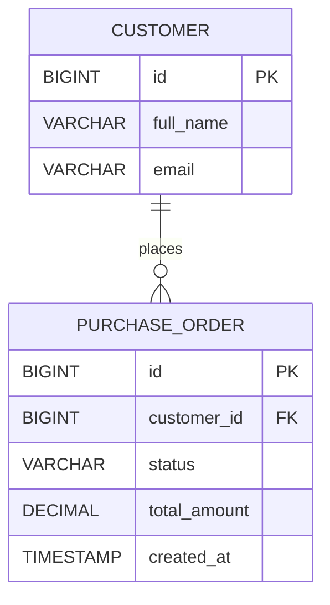
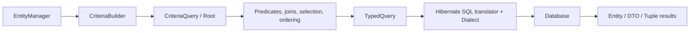

# Criteria API cho truy vấn được xây dựng bằng mã Java trong Hibernate

Trong ứng dụng Hibernate/Jakarta Persistence, rất nhiều truy vấn có cấu trúc cố định: lấy đơn hàng theo mã, tìm khách hàng theo email, đếm các đơn đã thanh toán. Với các tình huống đó, JPQL hoặc HQL dạng chuỗi thường dễ viết và dễ đọc. Nhưng một màn hình tìm kiếm nâng cao có thể có hàng chục tiêu chí tùy chọn: tên khách hàng, khoảng thời gian, tổng tiền tối thiểu/tối đa, trạng thái đơn, phương thức sắp xếp và phân trang. Việc ghép chuỗi HQL thủ công trong những tình huống như vậy dễ dẫn tới lỗi dấu cách, ngoặc, đặt tên tham số hoặc logic `AND/OR`.

**Jakarta Persistence Criteria API** cho phép biểu diễn câu truy vấn bằng **các đối tượng Java** thay vì một chuỗi truy vấn hoàn chỉnh. Hibernate là JPA provider sẽ tiếp nhận cây biểu thức Criteria, diễn giải mapping entity và sinh SQL cho Dialect cơ sở dữ liệu đang dùng.

Một truy vấn Criteria điển hình:

```java
CriteriaBuilder cb = entityManager.getCriteriaBuilder();

CriteriaQuery<PurchaseOrder> cq =
        cb.createQuery(PurchaseOrder.class);

Root<PurchaseOrder> order = cq.from(PurchaseOrder.class);

cq.select(order)
  .where(cb.equal(order.get("status"), OrderStatus.PAID))
  .orderBy(cb.desc(order.get("createdAt")));

List<PurchaseOrder> results =
        entityManager.createQuery(cq).getResultList();
```

Đây là cách diễn đạt tương đương về ý tưởng với JPQL:

```jpql
select o
from PurchaseOrder o
where o.status = :status
order by o.createdAt desc
```

Criteria API không phải một database engine khác. Nó là **cách xây dựng truy vấn có cấu trúc**; sau cùng Hibernate vẫn biên dịch thành SQL. Bài học này đi từ ví dụ cơ bản tới truy vấn động, phép nối, DTO projection, aggregate, subquery, phân trang, bulk update/delete, type-safe metamodel và các giới hạn cần lưu ý trong hệ thống thực tế.

## 1. Khi nào nên dùng Criteria API?

Một API tìm kiếm đơn hàng nhận yêu cầu như sau:

```text
GET /orders
    ?customerName=an
    &status=PAID
    &from=2026-01-01
    &to=2026-02-01
    &minTotal=500000
    &sort=createdAt
    &direction=desc
    &page=0
    &size=20
```

Người dùng có thể bỏ qua bất kỳ tham số nào. Tùy tổ hợp, câu `WHERE` phải thay đổi. Criteria API phù hợp vì ứng dụng có thể thêm `Predicate` theo điều kiện:

```java
List<Predicate> conditions = new ArrayList<>();

if (status != null) {
    conditions.add(cb.equal(root.get("status"), status));
}

if (minTotal != null) {
    conditions.add(
        cb.greaterThanOrEqualTo(root.get("totalAmount"), minTotal)
    );
}

cq.where(conditions.toArray(Predicate[]::new));
```

Ưu điểm là không phải nối những đoạn văn bản `" and ..."` và nhớ gắn ngoặc cho từng biểu thức.

### 1.1. So sánh các lựa chọn

| Cách truy vấn | Điểm mạnh | Cần cân nhắc |
|---|---|---|
| JPQL/HQL dạng chuỗi | Ngắn gọn cho query ổn định; dễ nhìn toàn bộ logic | Nhiều tiêu chí động có thể khiến việc ghép chuỗi phức tạp |
| Criteria API | Tạo query theo nhánh Java; tái sử dụng builder/predicate; hỗ trợ static metamodel | Code thường dài; các bước tạo cây query khó đọc nếu không tách hàm |
| Spring Data Specifications | Đóng gói các predicate Criteria có thể kết hợp | Cần Spring Data JPA; query count, fetch và pagination vẫn phải hiểu |
| Derived query methods | Rất ngắn cho tiêu chí đơn giản | Tên method dài, khó diễn tả biểu thức phức tạp |
| Native SQL | Tận dụng tính năng vendor-specific và optimizer hint | Giảm portability; mapping kết quả, đồng bộ context và bảo mật cần rõ |

Không phải cứ có hai điều kiện lọc là bắt buộc dùng Criteria. Chọn công cụ có chi phí bảo trì phù hợp với **mức độ biến đổi của câu truy vấn**.

## 2. Mô hình entity dùng xuyên suốt bài

Giả sử ứng dụng bán hàng có khách hàng và đơn hàng. Bảng SQL minh họa:

```sql
CREATE TABLE customer (
    id BIGINT PRIMARY KEY,
    full_name VARCHAR(150) NOT NULL,
    email VARCHAR(255) NOT NULL UNIQUE
);

CREATE TABLE purchase_order (
    id BIGINT PRIMARY KEY,
    customer_id BIGINT NOT NULL,
    status VARCHAR(30) NOT NULL,
    total_amount DECIMAL(18, 2) NOT NULL,
    created_at TIMESTAMP NOT NULL,
    FOREIGN KEY (customer_id) REFERENCES customer(id)
);

CREATE INDEX idx_order_status_created
    ON purchase_order(status, created_at);
```

Mô hình Java sử dụng Jakarta Persistence:

```java
import jakarta.persistence.*;
import java.math.BigDecimal;
import java.time.LocalDateTime;
import java.util.ArrayList;
import java.util.List;

public enum OrderStatus {
    NEW, PAID, SHIPPED, CANCELLED, ARCHIVED
}

@Entity
@Table(name = "customer")
public class Customer {

    @Id
    private Long id;

    @Column(name = "full_name", nullable = false)
    private String fullName;

    @Column(nullable = false, unique = true)
    private String email;

    @OneToMany(mappedBy = "customer", fetch = FetchType.LAZY)
    private List<PurchaseOrder> orders = new ArrayList<>();

    protected Customer() {}

    public Long getId() { return id; }
    public String getFullName() { return fullName; }
    public String getEmail() { return email; }
}

@Entity
@Table(name = "purchase_order")
public class PurchaseOrder {

    @Id
    private Long id;

    @ManyToOne(fetch = FetchType.LAZY, optional = false)
    @JoinColumn(name = "customer_id", nullable = false)
    private Customer customer;

    @Enumerated(EnumType.STRING)
    @Column(nullable = false)
    private OrderStatus status;

    @Column(name = "total_amount", nullable = false,
            precision = 18, scale = 2)
    private BigDecimal totalAmount;

    @Column(name = "created_at", nullable = false)
    private LocalDateTime createdAt;

    protected PurchaseOrder() {}

    public Long getId() { return id; }
    public Customer getCustomer() { return customer; }
    public OrderStatus getStatus() { return status; }
    public BigDecimal getTotalAmount() { return totalAmount; }
    public LocalDateTime getCreatedAt() { return createdAt; }
}
```

Ví dụ có thể đặt các class trong file riêng, với `public enum` và `public class` theo quy tắc Java. Những snippet về Criteria ở các phần sau giả định đã có `EntityManager entityManager` được quản lý đúng lifecycle và transaction khi cần.

### 2.1. Mối liên hệ entity và bảng



Criteria biểu diễn `root.get("totalAmount")` theo **tên thuộc tính Java**, không dùng tên cột `total_amount`. Hibernate kết hợp mapping để biết cột SQL tương ứng.

## 3. Các thành phần chính của Criteria API

Những kiểu cần nắm:

| Thành phần | Trách nhiệm |
|---|---|
| `CriteriaBuilder` | Factory tạo query, predicate, biểu thức, phép toán và aggregate |
| `CriteriaQuery<T>` | Cây query SELECT cùng kiểu kết quả `T` |
| `Root<X>` | Root entity xuất hiện trong `FROM` |
| `Path<X>` | Đường dẫn đến thuộc tính persistent |
| `Expression<T>` | Giá trị/biểu thức có kiểu để dùng trong phép toán |
| `Predicate` | Biểu thức điều kiện Boolean |
| `Join<Z, X>` | Association join từ entity `Z` sang `X` |
| `Fetch<Z, X>` | Yêu cầu fetch association, không nhất thiết là join để lọc |
| `Selection<T>` | Biểu thức xuất hiện ở `SELECT` |
| `Order` | `ORDER BY` tăng/giảm |
| `Subquery<T>` | Truy vấn lồng bên trong query khác |
| `CriteriaUpdate<T>` | Bulk UPDATE bằng cây Criteria |
| `CriteriaDelete<T>` | Bulk DELETE bằng cây Criteria |
| `TypedQuery<T>` | Truy vấn có thể bind parameter và thực thi để nhận kết quả `T` |

Hãy nhìn luồng xử lý:



**Criteria API tạo ra một abstract query**, không phải một câu SQL đã được thực thi. Lệnh `entityManager.createQuery(criteria)` tạo object truy vấn; lệnh `getResultList()`, `getSingleResult()` hoặc `executeUpdate()` mới thực thi theo đường tương ứng.

## 4. Truy vấn SELECT đơn giản bằng `CriteriaQuery`

Lấy đơn hàng theo trạng thái:

```java
import jakarta.persistence.EntityManager;
import jakarta.persistence.TypedQuery;
import jakarta.persistence.criteria.CriteriaBuilder;
import jakarta.persistence.criteria.CriteriaQuery;
import jakarta.persistence.criteria.Root;

CriteriaBuilder cb = entityManager.getCriteriaBuilder();

CriteriaQuery<PurchaseOrder> query =
        cb.createQuery(PurchaseOrder.class);

Root<PurchaseOrder> order = query.from(PurchaseOrder.class);

query.select(order)
     .where(cb.equal(order.get("status"), OrderStatus.PAID));

TypedQuery<PurchaseOrder> typedQuery =
        entityManager.createQuery(query);

List<PurchaseOrder> orders = typedQuery.getResultList();
```

Các bước:

1. Lấy `CriteriaBuilder` từ `EntityManager`.
2. Tạo `CriteriaQuery<PurchaseOrder>`, xác định kiểu kết quả.
3. Thêm root `PurchaseOrder` từ `FROM`.
4. Chọn root, đặt điều kiện `status = PAID`.
5. Chuyển cây Criteria thành `TypedQuery`.
6. Thực thi và nhận các entity managed trong persistence context hiện tại.

SQL minh họa có thể tương đương:

```sql
SELECT o.id, o.customer_id, o.status,
       o.total_amount, o.created_at
FROM purchase_order o
WHERE o.status = ?;
```

SQL cuối cùng tùy dialect, mapping, fetch plan và Hibernate version.

### 4.1. Đường dẫn thuộc tính `Path`

```java
Path<OrderStatus> status = order.get("status");
Path<BigDecimal> total = order.get("totalAmount");
```

Phương thức `get(String)` nhận **tên persistent attribute trong entity**, không phải tên cột SQL. Lỗi chính tả như `"total_amount"` thay cho `"totalAmount"` có thể chỉ được phát hiện khi query được build/biên dịch ở runtime. Static metamodel ở phần sau giúp giảm rủi ro này.

## 5. Các loại điều kiện với `CriteriaBuilder`

Criteria API cung cấp nhiều phép toán.

### 5.1. Bằng, khác và NULL

```java
Predicate isPaid =
    cb.equal(order.get("status"), OrderStatus.PAID);

Predicate isNotCancelled =
    cb.notEqual(order.get("status"), OrderStatus.CANCELLED);

Predicate noCustomerName =
    cb.isNull(order.get("customer").get("fullName"));
```

Ví dụ `isNull` ở trên chủ yếu minh họa API; mapping thực tế yêu cầu customer và tên customer không null. Không nên kỳ vọng query đó có kết quả hợp lệ trong schema đã mô tả.

**Không dùng `cb.equal(path, null)` để thay cho `IS NULL`** khi muốn biểu đạt null semantics có chủ đích. SQL `= NULL` không tương đương `IS NULL`. Dùng `cb.isNull(path)` hoặc `cb.isNotNull(path)`.

### 5.2. So sánh số và ngày giờ

```java
Predicate minTotal = cb.greaterThanOrEqualTo(
    order.<BigDecimal>get("totalAmount"),
    new BigDecimal("500000")
);

Predicate beforeDate = cb.lessThan(
    order.<LocalDateTime>get("createdAt"),
    LocalDateTime.of(2026, 2, 1, 0, 0)
);
```

Có thể dùng `lessThanOrEqualTo`, `greaterThan` và `between` theo điều kiện nghiệp vụ. Chú ý tính bao gồm của ranh giới thời gian.

### 5.3. Kết hợp AND, OR và NOT

```java
Predicate paid = cb.equal(
    order.get("status"), OrderStatus.PAID
);

Predicate shipped = cb.equal(
    order.get("status"), OrderStatus.SHIPPED
);

Predicate activeStatus = cb.or(paid, shipped);

Predicate expensive = cb.greaterThan(
    order.<BigDecimal>get("totalAmount"),
    new BigDecimal("1000000")
);

query.where(cb.and(activeStatus, expensive));
```

Ý nghĩa:

```text
(status = PAID OR status = SHIPPED)
AND totalAmount > 1000000
```

Dùng cấu trúc `cb.and`/`cb.or` để thể hiện thứ tự logic thay vì nối chuỗi và lo dấu ngoặc.

### 5.4. `conjunction()` và `disjunction()`

- `cb.conjunction()` là predicate đúng khi không có điều kiện con, hữu ích để bắt đầu chuỗi `AND` động.
- `cb.disjunction()` là predicate sai khi không có điều kiện con, hữu ích cho một nhánh `OR` động mà trường hợp trống phải không khớp gì.

Ví dụ:

```java
Predicate all = cb.conjunction();

if (status != null) {
    all = cb.and(all, cb.equal(order.get("status"), status));
}

if (minTotal != null) {
    all = cb.and(
        all,
        cb.greaterThanOrEqualTo(
            order.<BigDecimal>get("totalAmount"),
            minTotal
        )
    );
}
```

Với nhiều filter, dùng `List<Predicate>` thường dễ nhìn và dễ kiểm thử hơn so với lồng nhiều lần `cb.and`.

## 6. Xây dựng truy vấn động từ các filter tùy chọn

Giả sử request đã được parse/validate thành kiểu Java:

```java
public record OrderSearch(
    Long customerId,
    String customerName,
    OrderStatus status,
    BigDecimal minTotal,
    BigDecimal maxTotal,
    LocalDateTime fromInclusive,
    LocalDateTime toExclusive
) {}
```

Có thể viết một hàm tìm kiếm:

```java
public List<PurchaseOrder> search(
        EntityManager em,
        OrderSearch filter,
        int page,
        int size) {

    CriteriaBuilder cb = em.getCriteriaBuilder();

    CriteriaQuery<PurchaseOrder> cq =
        cb.createQuery(PurchaseOrder.class);

    Root<PurchaseOrder> order = cq.from(PurchaseOrder.class);
    List<Predicate> predicates = new ArrayList<>();

    if (filter.customerId() != null) {
        predicates.add(cb.equal(
            order.get("customer").get("id"),
            filter.customerId()
        ));
    }

    if (filter.status() != null) {
        predicates.add(cb.equal(
            order.get("status"),
            filter.status()
        ));
    }

    if (filter.minTotal() != null) {
        predicates.add(cb.greaterThanOrEqualTo(
            order.<BigDecimal>get("totalAmount"),
            filter.minTotal()
        ));
    }

    if (filter.maxTotal() != null) {
        predicates.add(cb.lessThanOrEqualTo(
            order.<BigDecimal>get("totalAmount"),
            filter.maxTotal()
        ));
    }

    if (filter.fromInclusive() != null) {
        predicates.add(cb.greaterThanOrEqualTo(
            order.<LocalDateTime>get("createdAt"),
            filter.fromInclusive()
        ));
    }

    if (filter.toExclusive() != null) {
        predicates.add(cb.lessThan(
            order.<LocalDateTime>get("createdAt"),
            filter.toExclusive()
        ));
    }

    if (filter.customerName() != null
            && !filter.customerName().isBlank()) {
        Join<PurchaseOrder, Customer> customer =
            order.join("customer", JoinType.INNER);

        String pattern = "%" +
            escapeLike(filter.customerName().toLowerCase(Locale.ROOT))
            + "%";

        predicates.add(cb.like(
            cb.lower(customer.get("fullName")),
            pattern,
            '!'
        ));
    }

    cq.select(order)
      .where(predicates.toArray(Predicate[]::new))
      .orderBy(
          cb.desc(order.get("createdAt")),
          cb.desc(order.get("id"))
      );

    int safeSize = Math.min(Math.max(size, 1), 100);
    int safePage = Math.max(page, 0);
    long first = (long) safePage * safeSize;

    if (first > Integer.MAX_VALUE) {
        throw new IllegalArgumentException("Page offset too large");
    }

    return em.createQuery(cq)
             .setFirstResult((int) first)
             .setMaxResults(safeSize)
             .getResultList();
}

private static String escapeLike(String value) {
    return value.replace("!", "!!")
                .replace("%", "!%")
                .replace("_", "!_");
}
```

Các import liên quan:

```java
import jakarta.persistence.criteria.Join;
import jakarta.persistence.criteria.JoinType;
import jakarta.persistence.criteria.Predicate;
import java.util.ArrayList;
import java.util.Locale;
```

Các lưu ý trong ví dụ:

- Chỉ thêm predicate khi filter được cung cấp.
- Giá trị `status` là enum hợp lệ, không ghép thành HQL text.
- `toExclusive` là ranh giới trên không bao gồm; phù hợp với khoảng thời gian `[from, to)`.
- Dùng `Locale.ROOT` để lowercase phía Java ổn định hơn so với phụ thuộc locale người dùng.
- `escapeLike` ngăn ký tự `%` và `_` từ input trở thành wildcard ngoài ý định; `'!'` là escape character dùng với `CriteriaBuilder.like`.
- Sắp xếp thêm `id` làm tie-breaker để phân trang có thứ tự xác định.
- Giới hạn page size và kiểm tra overflow thay vì cho phép offset lớn không kiểm soát.
- Code chưa làm gì với `customerName` khi không có giá trị, nên không tạo join không cần thiết.

**Đây là ví dụ xây dựng truy vấn động, không phải service hoàn chỉnh.** Ứng dụng thực tế còn cần validate `minTotal <= maxTotal`, múi giờ, quyền truy cập dữ liệu và error handling.

### 6.1. Vì sao dùng khoảng thời gian nửa mở?

Nếu muốn lọc các đơn từ ngày 01/01 đến hết ngày 31/01, thay vì dùng `23:59:59.999` với độ chính xác có thể khác ở database, chuyển thành:

```java
LocalDateTime fromInclusive =
    LocalDate.of(2026, 1, 1).atStartOfDay();

LocalDateTime toExclusive =
    LocalDate.of(2026, 2, 1).atStartOfDay();
```

Rồi dùng `createdAt >= from` và `createdAt < to`. Cách này thường dễ lý giải hơn khi field có độ chính xác microsecond/nanosecond hoặc khi database rounding timestamp.

Nếu dữ liệu lưu timezone-aware, phải chuẩn hóa các giá trị từ request sang múi giờ/instant nhất quán trước khi áp dụng filter.

## 7. Không có filter thì `where` xử lý thế nào?

Nếu `predicates` trống:

```java
cq.where(predicates.toArray(Predicate[]::new));
```

Theo API Criteria, gọi `where` với tập predicate rỗng loại bỏ những restriction trước đó. Khi query mới vừa tạo, nó tương đương không giới hạn hàng bởi `WHERE`.

Vì vậy cần hiểu yêu cầu nghiệp vụ:

- Một API tìm kiếm công khai có thể không được phép trả **mọi** đơn hàng khi người dùng bỏ hết filter.
- Một trang admin có thể chấp nhận trả trang đầu của mọi đơn, nhưng phải có pagination và authorization.
- Với hệ thống multi-tenant, predicate theo tenant phải được áp dụng bất kể input có filter hay không.

Không chỉ dựa vào filter từ client cho authorization. Ví dụ:

```java
predicates.add(cb.equal(
    order.get("customer").get("tenantId"),
    currentTenantId
));
```

Dòng trên giả định entity Customer có mapped attribute `tenantId` nếu ứng dụng thiết kế multi-tenant. **Đây là quy tắc phải được kiểm soát ở server**, không phải chỉ thêm khi client gửi tenantId.

## 8. ParameterExpression và parameter binding

Criteria API cho phép dùng literal hoặc `ParameterExpression<T>`. Với những query cần tái sử dụng ý tưởng hoặc truyền tham số tường minh, parameter object giúp chỉ rõ kiểu:

```java
CriteriaBuilder cb = entityManager.getCriteriaBuilder();

CriteriaQuery<PurchaseOrder> cq =
    cb.createQuery(PurchaseOrder.class);

Root<PurchaseOrder> order = cq.from(PurchaseOrder.class);

ParameterExpression<OrderStatus> statusParam =
    cb.parameter(OrderStatus.class, "status");

cq.select(order)
  .where(cb.equal(order.get("status"), statusParam));

List<PurchaseOrder> results =
    entityManager.createQuery(cq)
                 .setParameter("status", OrderStatus.PAID)
                 .getResultList();
```

Lợi ích:

- Không phải chèn giá trị request trực tiếp vào text HQL/SQL.
- Kiểu tham số được thể hiện rõ.
- Phân tách cấu trúc query với dữ liệu thực thi.
- Giảm rủi ro injection liên quan giá trị nhập khi sử dụng bind đúng.

Nhưng **Criteria API không tự bảo vệ mọi hình thức injection hoặc misuse**. Nếu cho phép client chỉ định trực tiếp tên field/function hoặc SQL fragment do ứng dụng dùng để xây cây, vẫn phải whitelist và kiểm tra quyền.

### 8.1. Có thể tái sử dụng CriteriaQuery giữa request không?

Không nên coi một `CriteriaQuery`/`Root`/`Predicate` là template mutable thread-safe để chia sẻ toàn ứng dụng. Đơn giản nhất là xây query mới cho mỗi request/operation, dùng các helper thuần để tạo predicate.

`CriteriaBuilder` có thể lấy từ EntityManager/EntityManagerFactory theo API tương ứng; tuy nhiên không chia sẻ `EntityManager` giữa các thread. Ranh giới an toàn vẫn là transaction/persistence context được framework quản lý.

## 9. Join association bằng Criteria

Để tìm order theo tên khách hàng, phải truy cập association `PurchaseOrder.customer`.

```java
CriteriaBuilder cb = entityManager.getCriteriaBuilder();

CriteriaQuery<PurchaseOrder> cq =
    cb.createQuery(PurchaseOrder.class);

Root<PurchaseOrder> order = cq.from(PurchaseOrder.class);

Join<PurchaseOrder, Customer> customer =
    order.join("customer", JoinType.INNER);

cq.select(order)
  .where(cb.like(
      cb.lower(customer.get("fullName")),
      "%an%"
  ));

List<PurchaseOrder> results =
    entityManager.createQuery(cq).getResultList();
```

SQL ý tưởng:

```sql
SELECT o.*
FROM purchase_order o
JOIN customer c ON c.id = o.customer_id
WHERE LOWER(c.full_name) LIKE '%an%';
```

Ở đây `Join<PurchaseOrder, Customer>` biểu diễn association từ order sang customer. Khi truy cập bằng mapping, Hibernate quyết định join condition từ khóa ngoại; ứng dụng không cần ghép `o.customer_id = c.id` bằng chuỗi.

### 9.1. Inner join và left join

`JoinType.INNER` yêu cầu có association khớp; `JoinType.LEFT` có thể giữ root ngay cả khi association không tồn tại.

```java
Join<PurchaseOrder, Customer> customer =
    order.join("customer", JoinType.LEFT);
```

Tuy nhiên, nếu sau đó đặt điều kiện ở `WHERE` như:

```java
cq.where(cb.equal(customer.get("fullName"), "An"));
```

thì các root không có customer sẽ bị loại vì predicate không khớp với NULL của outer join. Nhiều trường hợp `LEFT JOIN` kết hợp `WHERE` thực tế có kết quả như inner join đối với điều kiện trên bảng bên phải.

### 9.2. `join.on(...)` khác `where(...)`

Nếu muốn giữ root và chỉ giới hạn những hàng association được join, dùng `on` khi phù hợp:

```java
Join<Customer, PurchaseOrder> orders =
    customerRoot.join("orders", JoinType.LEFT);

orders.on(
    cb.equal(orders.get("status"), OrderStatus.PAID)
);
```

Ví dụ đếm số đơn PAID của mọi customer, kể cả customer không có đơn paid:

```java
CriteriaQuery<Tuple> cq = cb.createTupleQuery();

Root<Customer> c = cq.from(Customer.class);
Join<Customer, PurchaseOrder> paidOrders =
    c.join("orders", JoinType.LEFT);

paidOrders.on(
    cb.equal(paidOrders.get("status"), OrderStatus.PAID)
);

cq.multiselect(
    c.get("id").alias("customerId"),
    cb.count(paidOrders.get("id")).alias("paidCount")
);
cq.groupBy(c.get("id"));
```

Điều kiện `status = PAID` nằm ở `ON`, nên customer không có order PAID vẫn xuất hiện với count bằng 0. Nếu chuyển điều kiện ấy thành `WHERE` mà không xử lý thêm, các customer không có order khớp có thể biến mất.

## 10. Join collection và hiện tượng trùng root

Nếu query root `Customer` rồi join collection `orders`:

```java
CriteriaQuery<Customer> cq =
    cb.createQuery(Customer.class);

Root<Customer> customer = cq.from(Customer.class);

Join<Customer, PurchaseOrder> order =
    customer.join("orders", JoinType.INNER);

cq.select(customer)
  .where(cb.equal(order.get("status"), OrderStatus.PAID));
```

Một customer có ba order PAID có thể tạo ba hàng SQL trong phép join. Tùy query và Hibernate version, danh sách kết quả root có thể được xử lý duplicate theo các quy tắc khác nhau.

Khi muốn một customer duy nhất trong kết quả logic:

```java
cq.select(customer).distinct(true);
```

Nhưng `distinct(true)` không loại bỏ chi phí join và SQL rows trước khi deduplicate. Nếu chỉ cần biết customer có order PAID hay không, `EXISTS` subquery có thể diễn đạt tốt hơn và tránh nhân hàng root.

### 10.1. Không tạo join lặp một cách vô tình

Nếu các helper filter mỗi lần gọi `root.join("orders")` mà không phối hợp, query có thể chứa nhiều join đến cùng collection, tạo tích số hàng ngoài ý định.

Khi nhiều predicate phụ thuộc cùng association, có thể tạo join một lần rồi truyền `Join` vào helper hoặc dùng hàm quản lý join phù hợp. Đừng kết luận mọi join trùng alias sẽ tự được Hibernate loại bỏ.

## 11. `fetch(...)` khác `join(...)`

`join` xây association để lọc/nhóm/sắp xếp. `fetch` yêu cầu dữ liệu association được tải cùng root theo fetch plan.

Ví dụ lấy order cùng customer để xây DTO từ managed entity:

```java
CriteriaQuery<PurchaseOrder> cq =
    cb.createQuery(PurchaseOrder.class);

Root<PurchaseOrder> order = cq.from(PurchaseOrder.class);

order.fetch("customer", JoinType.INNER);

cq.select(order)
  .where(cb.equal(order.get("status"), OrderStatus.PAID));

List<PurchaseOrder> orders =
    entityManager.createQuery(cq).getResultList();
```

API `Fetch` không phải `Join` để truy cập attribute trong `WHERE`. Không nên cast `Fetch` thành `Join` chỉ vì một provider tình cờ cho phép. Nếu vừa cần filter vừa fetch, có thể thiết kế query tương ứng với join và fetch rõ ràng, hoặc dùng EntityGraph cho fetch plan và join cho predicate.

### 11.1. Fetch to-one và fetch collection có chi phí khác nhau

Fetch `order.customer` là to-one và thường không nhân số root theo cardinality quan hệ. Fetch `customer.orders` là to-many và có thể nhân hàng SQL.

```java
Root<Customer> customer = cq.from(Customer.class);
customer.fetch("orders", JoinType.LEFT);
cq.select(customer).distinct(true);
```

Nếu một customer có 100 order, SQL join có thể trả 100 hàng cho một root. Với nhiều collection cùng fetch, số hàng có thể tăng theo tích cardinality.

### 11.2. Phân trang với collection fetch cần đặc biệt cẩn thận

```java
cq.select(customer);
customer.fetch("orders", JoinType.LEFT);

List<Customer> page =
    entityManager.createQuery(cq)
                 .setMaxResults(20)
                 .getResultList();
```

Cần xem Hibernate version, Dialect và SQL thực tế. Pagination theo root cùng fetch join collection có thể tạo vấn đề: SQL rows không tương đương root rows, provider có thể phải xử lý trong bộ nhớ hoặc sử dụng cơ chế đặc biệt tùy version/DBMS.

Một hướng phổ biến là **lấy trang root ID trước, sau đó fetch association cho nhóm ID ấy**. Với collection rất lớn, query/paginate child riêng thay vì eager-fetch toàn bộ.

## 12. Sắp xếp an toàn với `orderBy`

```java
cq.orderBy(
    cb.desc(order.get("createdAt")),
    cb.desc(order.get("id"))
);
```

Có thể đổi `asc`/`desc` theo request, nhưng không để input tùy ý trở thành tên property:

```java
String requestedSort = request.sort();
Path<?> field = order.get(requestedSort); // Không nên dùng bừa bãi.
```

Dù đây không phải chuỗi SQL được nối trực tiếp, user vẫn có thể yêu cầu field không tồn tại, association bất ngờ hoặc cột tốn chi phí. Hãy whitelist field được phép sort.

```java
String sortField = switch (requestedSort) {
    case "total" -> "totalAmount";
    case "created" -> "createdAt";
    case "id" -> "id";
    default -> "createdAt";
};

Expression<?> sortExpression = order.get(sortField);

jakarta.persistence.criteria.Order direction =
    descending
        ? cb.desc(sortExpression)
        : cb.asc(sortExpression);

cq.orderBy(direction, cb.desc(order.get("id")));
```

Ngoài whitelist, xác định semantics khi sắp xếp trên NULL và collation. Các DBMS có thể có thứ tự NULL khác nhau nếu không chỉ rõ; trong Criteria chuẩn, một số tùy chọn nâng cao có thể cần API provider hoặc biểu thức `CASE`.

## 13. SELECT một thuộc tính thay vì entity

Nếu chỉ cần mã ID, không cần load entity:

```java
CriteriaQuery<Long> cq = cb.createQuery(Long.class);
Root<PurchaseOrder> order = cq.from(PurchaseOrder.class);

cq.select(order.get("id"));

List<Long> ids =
    entityManager.createQuery(cq).getResultList();
```

Projection scalar thường không tạo managed `PurchaseOrder` instance đầy đủ. Điều này hữu ích cho báo cáo hoặc các bước lấy ID trước khi fetch chi tiết.

Đừng sử dụng `CriteriaQuery<PurchaseOrder>` nếu `SELECT` chỉ trả `Long`; kiểu query và selection phải tương thích.

## 14. `Tuple` và nhiều cột kết quả

`Tuple` phù hợp khi một query cần nhiều trường nhưng chưa cần DTO riêng:

```java
import jakarta.persistence.Tuple;

CriteriaQuery<Tuple> cq = cb.createTupleQuery();
Root<PurchaseOrder> order = cq.from(PurchaseOrder.class);

cq.multiselect(
    order.get("id").alias("id"),
    order.get("totalAmount").alias("amount"),
    order.get("createdAt").alias("createdAt")
);

List<Tuple> rows = entityManager.createQuery(cq).getResultList();

for (Tuple row : rows) {
    Long id = row.get("id", Long.class);
    BigDecimal amount = row.get("amount", BigDecimal.class);
    LocalDateTime createdAt =
        row.get("createdAt", LocalDateTime.class);
}
```

Alias giúp truy cập kết quả rõ nghĩa hơn so với `row[0]`/`row[1]`. Tuy nhiên, alias là chuỗi và có thể đổi khi refactor; DTO có constructor rõ ràng thường phù hợp hơn cho API lâu dài.

## 15. DTO projection với `cb.construct`

Một endpoint danh sách đơn hàng chỉ cần ID, tổng tiền và tên khách hàng. Không cần tạo cả graph entity.

Định nghĩa DTO:

```java
public record OrderRow(
    Long id,
    BigDecimal totalAmount,
    String customerName
) {}
```

Criteria:

```java
CriteriaQuery<OrderRow> cq =
    cb.createQuery(OrderRow.class);

Root<PurchaseOrder> order = cq.from(PurchaseOrder.class);
Join<PurchaseOrder, Customer> customer =
    order.join("customer", JoinType.INNER);

cq.select(cb.construct(
    OrderRow.class,
    order.get("id"),
    order.get("totalAmount"),
    customer.get("fullName")
));

List<OrderRow> rows =
    entityManager.createQuery(cq).getResultList();
```

`cb.construct` yêu cầu kiểu/ thứ tự các expression khớp constructor có thể truy cập của DTO. Hibernate sẽ materialize kết quả tương ứng; DTO không trở thành managed entity.

### 15.1. DTO khác entity fetch ở điều gì?

| Tiêu chí | Entity result | DTO/record result |
|---|---|---|
| Được persistence context quản lý | Có, khi là entity managed | Không |
| Dirty checking trên object trả về | Có cho managed entity | Không |
| Có thể lazy-load association | Có thể | Không tự động như entity |
| Chọn chính xác cột cần thiết | Phụ thuộc query/fetch plan | Có thể rõ ràng qua projection |
| Thích hợp API đọc | Cần cẩn thận với lazy/serialization | Thường rõ hợp đồng dữ liệu |
| Thích hợp sửa entity rồi flush | Có | Không |

Không cần tránh entity mọi lúc. Nhưng nếu use case chỉ đọc vài cột để hiển thị, projection có thể giảm overhead và làm response ổn định hơn.

## 16. Aggregate: `count`, `sum`, `avg`, `groupBy`, `having`

Đếm tất cả đơn đã thanh toán:

```java
CriteriaQuery<Long> cq = cb.createQuery(Long.class);
Root<PurchaseOrder> order = cq.from(PurchaseOrder.class);

cq.select(cb.count(order))
  .where(cb.equal(order.get("status"), OrderStatus.PAID));

Long count =
    entityManager.createQuery(cq).getSingleResult();
```

`count` trả kết quả kiểu `Long` theo Jakarta Persistence. Đối với tổng tiền, dùng biểu thức `BigDecimal`:

```java
CriteriaQuery<BigDecimal> cq =
    cb.createQuery(BigDecimal.class);

Root<PurchaseOrder> order = cq.from(PurchaseOrder.class);

cq.select(cb.sum(order.<BigDecimal>get("totalAmount")));

BigDecimal sum = entityManager.createQuery(cq)
    .getSingleResult();
```

Nếu không có hàng nào được tính tổng, SQL `SUM` có thể trả `NULL`. Nếu API muốn 0, dùng `cb.coalesce` hoặc xử lý kết quả null có chủ đích.

### 16.1. Group by khách hàng

DTO:

```java
public record CustomerSales(
    Long customerId,
    String customerName,
    BigDecimal revenue,
    Long orderCount
) {}
```

Query:

```java
CriteriaQuery<CustomerSales> cq =
    cb.createQuery(CustomerSales.class);

Root<PurchaseOrder> order = cq.from(PurchaseOrder.class);
Join<PurchaseOrder, Customer> customer =
    order.join("customer", JoinType.INNER);

Expression<BigDecimal> revenue =
    cb.sum(order.<BigDecimal>get("totalAmount"));

Expression<Long> orderCount = cb.count(order.get("id"));

cq.select(cb.construct(
    CustomerSales.class,
    customer.get("id"),
    customer.get("fullName"),
    revenue,
    orderCount
));

cq.where(cb.equal(order.get("status"), OrderStatus.PAID));

cq.groupBy(
    customer.get("id"),
    customer.get("fullName")
);

cq.having(cb.greaterThan(
    revenue,
    new BigDecimal("10000000")
));

cq.orderBy(cb.desc(revenue));

List<CustomerSales> sales =
    entityManager.createQuery(cq).getResultList();
```

Cần phân biệt:

- `where` lọc **trước** khi nhóm.
- `groupBy` tạo nhóm theo khóa.
- `having` lọc **sau** khi aggregate.
- `orderBy` quyết định thứ tự cuối.

Các DBMS có quy tắc strict về những expression xuất hiện trong SELECT/HAVING/ORDER BY cùng GROUP BY. Hãy chạy trên DBMS đích để xác minh SQL thực tế.

## 17. Subquery với `EXISTS`

Tình huống: lấy khách hàng **có ít nhất một đơn PAID**. Thay vì join collection rồi distinct, có thể dùng subquery:

```java
CriteriaBuilder cb = entityManager.getCriteriaBuilder();

CriteriaQuery<Customer> cq =
    cb.createQuery(Customer.class);

Root<Customer> customer = cq.from(Customer.class);

Subquery<Long> paidOrderExists = cq.subquery(Long.class);

Root<PurchaseOrder> subOrder =
    paidOrderExists.from(PurchaseOrder.class);

paidOrderExists.select(cb.literal(1L));

paidOrderExists.where(
    cb.equal(
        subOrder.get("customer").get("id"),
        customer.get("id")
    ),
    cb.equal(
        subOrder.get("status"),
        OrderStatus.PAID
    )
);

cq.select(customer)
  .where(cb.exists(paidOrderExists));

List<Customer> customers =
    entityManager.createQuery(cq).getResultList();
```

SQL logic:

```sql
SELECT c.*
FROM customer c
WHERE EXISTS (
    SELECT 1
    FROM purchase_order o
    WHERE o.customer_id = c.id
      AND o.status = 'PAID'
);
```

Ưu điểm là `EXISTS` diễn đạt điều kiện tồn tại, không buộc tạo một dòng kết quả cho mỗi order khớp trước khi deduplicate root.

### 17.1. Khi nào dùng `NOT EXISTS`?

Lấy customer chưa từng có đơn PAID:

```java
cq.where(cb.not(cb.exists(paidOrderExists)));
```

Có thể dùng `cb.not` hoặc API phủ định tương đương. Với NULL và outer join, `NOT EXISTS` thường dễ biểu đạt đúng ý định hơn một phép left join kết hợp điều kiện `IS NULL` phức tạp. Nhưng vẫn cần đo execution plan trên dữ liệu thật.

### 17.2. `correlate` là lựa chọn khác cho correlated subquery

Criteria API còn có các overload `subquery.correlate(...)` để liên hệ một root/join của outer query với subquery. Cách này hữu ích khi muốn viết biểu thức correlated chính thức trong Criteria model.

Đối với ví dụ đơn giản ở trên, việc so sánh `subOrder.customer.id` với `customer.id` đã diễn đạt quan hệ tương quan. Khi viết subquery phức tạp, cần xác minh root và join nào thuộc query nào; không mang một `Predicate`/`Path` từ query hoàn toàn độc lập sang query khác.

## 18. `IN`, danh sách filter và trường hợp rỗng

Lọc nhiều trạng thái:

```java
List<OrderStatus> statuses =
    List.of(OrderStatus.PAID, OrderStatus.SHIPPED);

Predicate allowed =
    order.get("status").in(statuses);
```

Hoặc dùng `CriteriaBuilder.In` để xây từng giá trị:

```java
CriteriaBuilder.In<OrderStatus> allowed =
    cb.in(order.<OrderStatus>get("status"));

for (OrderStatus value : statuses) {
    allowed.value(value);
}
```

Đặc biệt chú ý **danh sách rỗng**. Không nên để một mảng rỗng trôi vào `IN ()` rồi đoán Hibernate/Dialect sẽ dịch giống nhau ở mọi version. Hãy quyết định nghiệp vụ trước:

- Rỗng nghĩa là **không lọc**: bỏ qua predicate.
- Rỗng nghĩa là **không có status được phép**: dùng `cb.disjunction()` để không trả hàng.
- Rỗng là input không hợp lệ: trả lỗi validation.

Ví dụ:

```java
if (statuses == null) {
    // Không áp dụng filter.
} else if (statuses.isEmpty()) {
    predicates.add(cb.disjunction()); // Không match row nào.
} else {
    predicates.add(order.get("status").in(statuses));
}
```

Với danh sách quá lớn, DBMS có thể giới hạn số bind parameter trong `IN`; cân nhắc batching/temporary table/strategy khác theo platform.

## 19. Phân trang: query dữ liệu và query đếm phải tách riêng

Khi trả một trang kết quả kèm `totalElements`, thường cần:

1. Query lấy trang dữ liệu.
2. Query `COUNT` tính tổng số bản ghi thỏa filter.

Ví dụ data query:

```java
CriteriaQuery<PurchaseOrder> dataQuery =
    cb.createQuery(PurchaseOrder.class);

Root<PurchaseOrder> dataRoot =
    dataQuery.from(PurchaseOrder.class);

dataQuery.select(dataRoot)
         .where(cb.equal(
             dataRoot.get("status"), OrderStatus.PAID
         ))
         .orderBy(
             cb.desc(dataRoot.get("createdAt")),
             cb.desc(dataRoot.get("id"))
         );

List<PurchaseOrder> page =
    entityManager.createQuery(dataQuery)
                 .setFirstResult(0)
                 .setMaxResults(20)
                 .getResultList();
```

Count query:

```java
CriteriaQuery<Long> countQuery =
    cb.createQuery(Long.class);

Root<PurchaseOrder> countRoot =
    countQuery.from(PurchaseOrder.class);

countQuery.select(cb.count(countRoot))
          .where(cb.equal(
              countRoot.get("status"), OrderStatus.PAID
          ));

Long total = entityManager.createQuery(countQuery)
    .getSingleResult();
```

### 19.1. Không tái sử dụng `Root` hoặc `Predicate` giữa hai query độc lập

Một sai lầm:

```java
Predicate p = cb.equal(dataRoot.get("status"), OrderStatus.PAID);

// Không dùng p trực tiếp với countQuery có countRoot khác!
countQuery.where(p);
```

`Predicate`/`Path` gắn với cấu trúc root/query mà nó được tạo ra. Reuse trong query khác có thể gây lỗi semantic/sql table group hoặc alias trong Hibernate. Hãy viết helper để **xây lại predicate với root của query mới**.

Ví dụ:

```java
static List<Predicate> statusPredicates(
        CriteriaBuilder cb,
        Root<PurchaseOrder> root,
        OrderStatus status) {

    List<Predicate> out = new ArrayList<>();

    if (status != null) {
        out.add(cb.equal(root.get("status"), status));
    }

    return out;
}
```

Gọi helper một lần với `dataRoot` và một lần với `countRoot`.

### 19.2. Count khi query có to-many join

Nếu data query join `customer.orders` hoặc các association to-many và một root tạo nhiều hàng, `cb.count(root)` có thể đếm các hàng join chứ không phải số root duy nhất.

Khi semantics cần đếm root khác nhau:

```java
countQuery.select(
    cb.countDistinct(countRoot.get("id"))
);
```

Tuy nhiên, không được sao chép mọi fetch join sang count query. Fetch join trong count thường vô nghĩa hoặc gây lỗi vì root owner không được select như entity. Thiết kế count query riêng theo mục đích và cùng filter logic, không có phần fetch dữ liệu hiển thị.

### 19.3. Count với group by không còn đơn giản là một Long

Nếu data query group by customer và có having, query count tổng số **nhóm** có thể cần query khác hoặc subquery/wrapping phù hợp. `cb.count(root)` đơn giản có thể không trả số nhóm như API mong muốn.

Đừng giả định mọi CriteriaQuery đều có thể biến thành count bằng cách đổi mỗi `select`.

## 20. Offset pagination và keyset pagination

`setFirstResult`/`setMaxResults` là cách phân trang truyền thống:

```java
typedQuery.setFirstResult(page * size);
typedQuery.setMaxResults(size);
```

Với offset lớn, database có thể phải bỏ qua nhiều hàng, làm truy vấn chậm. Keyset pagination (seek method) có thể phù hợp với danh sách có khóa sắp xếp ổn định.

Ví dụ order theo `createdAt DESC, id DESC` và lấy trang tiếp theo sau cặp khóa `(lastCreatedAt, lastId)`:

```java
Predicate older = cb.lessThan(
    order.<LocalDateTime>get("createdAt"),
    lastCreatedAt
);

Predicate sameTimeSmallerId = cb.and(
    cb.equal(order.get("createdAt"), lastCreatedAt),
    cb.lessThan(order.<Long>get("id"), lastId)
);

cq.where(cb.or(older, sameTimeSmallerId));

cq.orderBy(
    cb.desc(order.get("createdAt")),
    cb.desc(order.get("id"))
);

List<PurchaseOrder> next =
    entityManager.createQuery(cq)
                 .setMaxResults(20)
                 .getResultList();
```

Nếu còn filter trạng thái, tenant hoặc customer, cần thêm chúng vào `cb.and(...)` với predicate seek. Ví dụ `where` ở trên chỉ minh họa phần seek; gọi `where` lần nữa trên cùng query thay cho logic đã xây có thể thay thế restriction trước đó.

Keyset pagination yêu cầu thứ tự ổn định và xử lý rõ duplicate sort keys. Nó không cho phép nhảy tới trang số 100 theo cách offset thông thường nhưng thường tối ưu hơn cho feed lớn.

## 21. `CriteriaUpdate`: bulk UPDATE bằng Criteria

Ngoài SELECT, JPA có `CriteriaUpdate<T>` để thực hiện bulk update trực tiếp ở database:

```java
CriteriaBuilder cb = entityManager.getCriteriaBuilder();

CriteriaUpdate<PurchaseOrder> update =
    cb.createCriteriaUpdate(PurchaseOrder.class);

Root<PurchaseOrder> order = update.from(PurchaseOrder.class);

update.set("status", OrderStatus.ARCHIVED)
      .where(
          cb.equal(order.get("status"), OrderStatus.CANCELLED),
          cb.lessThan(
              order.<LocalDateTime>get("createdAt"),
              cutoff
          )
      );

int affected =
    entityManager.createQuery(update).executeUpdate();
```

Biến `cutoff` là mốc `LocalDateTime` đã được tính/validate trong service.

SQL ý tưởng:

```sql
UPDATE purchase_order
SET status = 'ARCHIVED'
WHERE status = 'CANCELLED'
  AND created_at < ?;
```

### 21.1. Bulk update khác sửa managed entity

`CriteriaUpdate` là **bulk DML**. Nó không đi qua dirty checking theo từng managed entity như gọi setter trên object rồi flush. Hệ quả:

- Managed entities đã load có thể trở thành **stale**.
- Lifecycle callbacks của từng entity không được xử lý như thao tác cập nhật entity thường.
- Không tự giả định `@Version` được kiểm tra/tăng cho từng row như update managed entity.
- Cascade/relationship semantics không giống thao tác trên entity.
- Việc cập nhật trực tiếp nhiều hàng có thể bỏ qua quy tắc nghiệp vụ nằm trong setter/domain method.

Ví dụ nếu một `PurchaseOrder` đã nằm trong persistence context với `status = CANCELLED`, sau bulk update object Java có thể vẫn giữ `CANCELLED` dù database đã đổi thành `ARCHIVED`.

Khi cần, hãy `flush` pending state trước bulk operation, rồi `clear`/`refresh` phù hợp sau bulk operation. Nhưng `clear` sẽ detach mọi managed entity và có thể làm mất pending changes chưa flush; phải kiểm soát transaction.

### 21.2. Vấn đề optimistic locking

Nếu bảng dùng `@Version`, không coi CriteriaUpdate là cách thay thế cho update managed entity khi nghiệp vụ yêu cầu kiểm tra expected version. Một bulk update cần thiết kế điều kiện version và cách tăng version tường minh nếu muốn giữ cùng protocol; hoặc dùng thao tác entity bình thường. Cũng cần kiểm tra số hàng `affected` đúng kỳ vọng.

## 22. `CriteriaDelete`: bulk DELETE

```java
CriteriaDelete<PurchaseOrder> delete =
    cb.createCriteriaDelete(PurchaseOrder.class);

Root<PurchaseOrder> order = delete.from(PurchaseOrder.class);

delete.where(
    cb.equal(order.get("status"), OrderStatus.ARCHIVED),
    cb.lessThan(
        order.<LocalDateTime>get("createdAt"),
        cutoff
    )
);

int deletedRows =
    entityManager.createQuery(delete).executeUpdate();
```

Điểm cần nhớ:

- Bulk delete thực hiện DML trực tiếp.
- Không tự chạy cascade remove/orphanRemoval và lifecycle callback của từng managed entity như khi gọi `entityManager.remove` trên từng object.
- Database foreign key vẫn có hiệu lực; có thể cần kế hoạch xóa child trước hoặc DB-level cascade nếu schema được thiết kế vậy.
- Persistence context có thể chứa instance đã bị xóa ở database và cần đồng bộ/clear phù hợp.
- Phải chạy trong transaction ghi đúng phạm vi.

Nếu hệ thống dùng soft delete hoặc audit, không dùng CriteriaDelete bừa bãi làm mất dữ liệu ngoài quy trình đã thiết kế.

## 23. Criteria API và type-safe static metamodel

Dùng `root.get("createdAt")` có nhược điểm: tên thuộc tính là chuỗi, đổi tên Java field nhưng quên sửa chuỗi có thể gây lỗi runtime.

Jakarta Persistence cung cấp **static metamodel** được tạo bằng annotation processing. Với entity `PurchaseOrder`, processor có thể sinh class tương tự:

```java
@StaticMetamodel(PurchaseOrder.class)
public abstract class PurchaseOrder_ {
    public static volatile SingularAttribute<PurchaseOrder, Long> id;
    public static volatile SingularAttribute<
        PurchaseOrder, OrderStatus> status;
    public static volatile SingularAttribute<
        PurchaseOrder, BigDecimal> totalAmount;
    public static volatile SingularAttribute<
        PurchaseOrder, LocalDateTime> createdAt;
}
```

Đây là minh họa cấu trúc class generated, **không phải file nên viết tay**. Processor sinh mã theo entity mapping.

Truy vấn sử dụng metamodel:

```java
Root<PurchaseOrder> order = cq.from(PurchaseOrder.class);

Predicate paid = cb.equal(
    order.get(PurchaseOrder_.status),
    OrderStatus.PAID
);

cq.where(paid)
  .orderBy(cb.desc(order.get(PurchaseOrder_.createdAt)));
```

Lợi ích:

- IDE hỗ trợ autocomplete.
- Nhiều lỗi rename/type được phát hiện lúc compile.
- Hạn chế chuỗi magic trong query.
- Generic type của path rõ hơn.

### 23.1. Cấu hình processor cần đúng namespace

Với Jakarta Persistence, metamodel processor phải tương thích với `jakarta.persistence.*` thay vì các project cũ còn dùng `javax.persistence.*`. Hibernate cung cấp annotation processor tương ứng theo version; tên artifact/plugin có thể khác giữa các series, do đó cần xem tài liệu chính thức của **phiên bản Hibernate đang chạy**.

Không dùng lẫn source code `javax.persistence` của Hibernate/JPA cũ với dependencies `jakarta.persistence` hiện đại rồi giả định annotation processing vẫn hoạt động.

### 23.2. Metamodel không làm query tự động nhanh hơn

Type-safe metamodel giúp compile-time safety và maintainability. Nó **không thay đổi bản chất SQL**, execution plan hoặc số hàng được database xử lý. Hai query có cùng logic nhưng một bên dùng string path, bên kia dùng `PurchaseOrder_.status` thường có SQL tương đương.

## 24. Tái sử dụng predicate mà không ràng buộc sai query

Với nhiều màn hình tìm kiếm, nên tách **cấu trúc filter** khỏi **CriteriaQuery instance**.

Ví dụ helper:

```java
static List<Predicate> buildOrderFilters(
        CriteriaBuilder cb,
        Root<PurchaseOrder> order,
        OrderSearch filter) {

    List<Predicate> conditions = new ArrayList<>();

    if (filter.status() != null) {
        conditions.add(cb.equal(
            order.get("status"), filter.status()
        ));
    }

    if (filter.minTotal() != null) {
        conditions.add(cb.greaterThanOrEqualTo(
            order.<BigDecimal>get("totalAmount"),
            filter.minTotal()
        ));
    }

    if (filter.toExclusive() != null) {
        conditions.add(cb.lessThan(
            order.<LocalDateTime>get("createdAt"),
            filter.toExclusive()
        ));
    }

    return conditions;
}
```

Khi build data query:

```java
List<Predicate> dataFilters =
    buildOrderFilters(cb, dataRoot, filter);
dataQuery.where(dataFilters.toArray(Predicate[]::new));
```

Khi build count query:

```java
List<Predicate> countFilters =
    buildOrderFilters(cb, countRoot, filter);
countQuery.where(countFilters.toArray(Predicate[]::new));
```

Mỗi lần gọi tạo predicate **mới gắn với root mới**. Đây là cách tái sử dụng logic mà không chia sẻ object Criteria phụ thuộc query.

### 24.1. Builder helper không nên vô tình thêm join/fetch

Nếu một helper vừa thêm predicate vừa `fetch` collection hoặc `orderBy`, dùng lại nó cho count query có thể gây lỗi hoặc count sai. Tách trách nhiệm:

- Filter builder: tạo predicate và các join cần cho lọc.
- Data query builder: selection, fetch plan, sorting, pagination.
- Count query builder: aggregate count, không fetch collection.
- Projection builder: DTO fields.
- Authorization/tenant guard: điều kiện bắt buộc cho mọi đường truy cập.

Không cố tạo một hàm chung điều khiển tất cả truy vấn bằng hàng chục cờ Boolean.

## 25. Spring Data JPA Specification

Nếu ứng dụng dùng Spring Data JPA, interface `Specification<T>` là lớp trừu tượng tiện lợi trên Criteria API.

Ví dụ:

```java
import org.springframework.data.jpa.domain.Specification;

public final class OrderSpecs {

    private OrderSpecs() {}

    public static Specification<PurchaseOrder> hasStatus(
            OrderStatus status) {

        return (root, query, cb) ->
            status == null
                ? cb.conjunction()
                : cb.equal(root.get("status"), status);
    }

    public static Specification<PurchaseOrder> minTotal(
            BigDecimal amount) {

        return (root, query, cb) ->
            amount == null
                ? cb.conjunction()
                : cb.greaterThanOrEqualTo(
                    root.get("totalAmount"),
                    amount
                );
    }
}
```

Repository:

```java
import org.springframework.data.jpa.repository.JpaRepository;
import org.springframework.data.jpa.repository.JpaSpecificationExecutor;

public interface PurchaseOrderRepository
        extends JpaRepository<PurchaseOrder, Long>,
                JpaSpecificationExecutor<PurchaseOrder> {
}
```

Sử dụng:

```java
Specification<PurchaseOrder> spec =
    Specification.where(OrderSpecs.hasStatus(OrderStatus.PAID))
                 .and(OrderSpecs.minTotal(new BigDecimal("500000")));

Page<PurchaseOrder> page =
    repository.findAll(spec, pageable);
```

API tiện ích như `Specification.where(...)` và cách chaining có thể thay đổi/deprecate giữa các phiên bản Spring Data; hãy dùng cú pháp của version thực tế. Đây là **API Spring Data**, không phải một phần của chuẩn Jakarta Persistence.

### 25.1. Count query và fetch trong Specifications

Spring Data có thể tạo query đếm để phân trang. Nếu Specification thêm collection fetch join vô điều kiện:

```java
root.fetch("orders", JoinType.LEFT);
```

nó có thể phá count query vì count không select owner như entity hoặc do join làm nhân hàng. Cần tách fetch plan khỏi filter, chọn API hỗ trợ count specification riêng nếu phiên bản cung cấp, hoặc viết custom repository query.

Đừng sửa bằng cách cast `Fetch` sang `Join` và dựa vào behavior riêng của provider nếu có lựa chọn API rõ ràng hơn.

## 26. Criteria API và HQL động: nên chọn cách nào?

Criteria làm mạnh ở khả năng **lắp ráp truy vấn** từ các biểu thức Java. HQL lại thường đọc được như một câu truy vấn hoàn chỉnh.

Ví dụ HQL ngắn:

```java
List<PurchaseOrder> orders = entityManager.createQuery(
    "select o from PurchaseOrder o " +
    "where o.status = :status " +
    "order by o.createdAt desc",
    PurchaseOrder.class
)
.setParameter("status", OrderStatus.PAID)
.getResultList();
```

Đoạn này ít mã hơn Criteria tương ứng. Nếu use case chỉ có một vài query ổn định, HQL có thể dễ bảo trì hơn.

Khi có 15 filter tùy chọn, nhiều nhánh điều kiện, query dựng theo quyền hoặc bộ tìm kiếm do người dùng cấu hình, Criteria/Specification có lợi thế hơn.

Một lựa chọn trung gian là duy trì các template HQL được thiết kế sẵn, chỉ chọn template dựa trên biến thể yêu cầu và bind parameters. Không nhất thiết dùng Criteria cho mọi câu SELECT.

## 27. Criteria API có type safety tới đâu?

Tên gọi *type-safe query construction* dễ tạo cảm giác mọi lỗi đều được compiler bắt trước.

Thực tế có nhiều cấp độ:

- `CriteriaQuery<OrderRow>` giúp thể hiện kiểu kết quả mong muốn.
- `Root<PurchaseOrder>` cho compiler biết root entity.
- `Path<BigDecimal>` giúp phép so sánh/aggregate đúng kiểu hơn.
- Static metamodel `PurchaseOrder_.totalAmount` giảm rủi ro sai tên property.
- Dùng `get("totalAmount")` vẫn có chuỗi tên field, lỗi có thể chỉ xuất hiện lúc runtime.
- `cb.construct(...)` có thể lỗi nếu constructor/argument types không tương thích.
- Một biểu thức/hàm có thể được Hibernate chấp nhận nhưng database từ chối vì Dialect/SQL capability.

Vì vậy **type-safe không thay thế integration test**. Nó giúp kiểm soát một số lỗi ở compile time, chứ không biến mọi câu query thành kết quả đúng đã được chứng minh.

## 28. Criteria API không loại bỏ rủi ro hiệu năng

Criteria chỉ thay cách *viết* truy vấn. Nó không tự tối ưu mọi phép join, aggregate, subquery hoặc fetch.

Một số rủi ro cần kiểm tra:

1. **N+1**: query root trả entity LAZY, rồi mapper đọc association của từng entity.
2. **Join multiplication**: fetch nhiều collection, SQL trả số hàng gấp nhiều lần số root.
3. **Count query chậm**: `COUNT(*)` có thể phải scan nhiều row/index entry dù chỉ trả một giá trị.
4. **Offset lớn**: database phải bỏ qua nhiều hàng.
5. **Lower/LIKE search**: `lower(column)` hoặc wildcard đầu chuỗi có thể làm index thường khó được sử dụng.
6. **Dynamic OR quá rộng**: nhiều điều kiện `OR` có thể ảnh hưởng optimizer.
7. **Subquery tương quan**: có thể gây work lặp lại tùy DBMS và execution plan.
8. **Fetch không cần thiết**: entity graph lớn nhưng API chỉ trả vài trường.
9. **Bộ lọc thiếu tenant/authorization**: vấn đề bảo mật nghiêm trọng, không chỉ hiệu năng.
10. **Vòng lặp dựng Criteria sai**: tạo join trùng hoặc ghi đè `where`/`orderBy` nhiều lần.

Cần quan sát:

- Số SQL statement thực thi.
- SQL được Hibernate sinh ra.
- Số hàng trả về và số hàng database xử lý.
- Kích thước ResultSet/DTO.
- Execution plan và index.
- Latency theo request, đặc biệt p95.
- Tình trạng cache, flush và transaction.

Đừng kết luận query Criteria tốt hơn HQL chỉ vì nó được xây bằng Java.

## 29. Criteria, flush và transaction

Criteria SELECT thường chạy trong persistence context hiện tại, còn flush behavior phụ thuộc flush mode. Ví dụ:

```java
PurchaseOrder order =
    entityManager.find(PurchaseOrder.class, 9001L);

// Giả sử entity có domain method đổi status.
order.markPaid();

// Một CriteriaQuery đếm các order PAID.
Long count = entityManager.createQuery(countQuery)
    .getSingleResult();
```

Nếu Hibernate dùng flush mode `AUTO` và query ảnh hưởng tới bảng có thay đổi pending, Hibernate có thể flush trước query để đáp ứng semantics cần thiết. Với `COMMIT`, tác động của state chưa flush lên query có thể khác.

Quan trọng:

- Criteria API không làm biến mất khái niệm dirty checking.
- `getResultList()` không có nghĩa transaction đã commit.
- `CriteriaUpdate`/`CriteriaDelete` có thể làm managed state stale.
- `EntityManager` không được dùng đồng thời giữa nhiều thread.
- Transaction isolation và locking vẫn do DBMS/transaction manager quyết định.

Khi business logic cần query phụ thuộc trạng thái vừa sửa, hãy xác định flush boundary; không đổ lỗi cho Criteria khi kết quả khác do chưa đồng bộ SQL.

## 30. Kiểm thử Criteria query có điều kiện động

Một integration test tốt cần kiểm tra những tổ hợp filter, không chỉ một trường hợp “đủ tham số”.

Ví dụ fixture:

| ID | Customer | Status | Total | Created |
|---|---|---|---:|---|
| 1 | An | PAID | 500.000 | 2026-01-05 |
| 2 | Bình | NEW | 300.000 | 2026-01-10 |
| 3 | An | SHIPPED | 900.000 | 2026-01-12 |
| 4 | Cường | PAID | 1.200.000 | 2026-02-01 |

Nên có tests cho:

- Không có filter: trả trang hợp lệ, có giới hạn.
- Chỉ có status.
- Một min/max total.
- Khoảng thời gian nửa mở và boundary.
- Customer name có `%`, `_`, dấu escape `!`.
- Hai predicate `OR` kết hợp với `AND`.
- Join to-one không làm mất root ngoài mong muốn.
- Join to-many có distinct hoặc exists phù hợp.
- Page offset và sort tie-breaker.
- Count query có cùng filter logic.
- Empty `IN` list theo rule nghiệp vụ.
- NULL semantics.
- DTO constructor/type mapping.
- Bulk update/delete và stale managed entity.
- Quyền tenant/authorization bắt buộc.

### 30.1. Integration test trên DBMS mục tiêu

Đừng chỉ test builder method bằng mock rồi kết luận query chạy được. Hibernate vẫn phải dịch cây Criteria sang SQL và DBMS phải thực thi được.

Với tính năng đặc thù như custom function, tuple comparison, JSON hoặc pagination phức tạp, nên test trên cùng DBMS family/version production, chẳng hạn qua Testcontainers. H2 có thể hữu ích cho test đơn giản nhưng không chứng minh mọi SQL Dialect production đều tương thích.

### 30.2. Quan sát SQL và số hàng

Bật SQL logging hoặc instrumentation trong môi trường test:

```properties
hibernate.show_sql=true
hibernate.format_sql=true
hibernate.generate_statistics=true
```

Có thể dùng `Statistics` hoặc JDBC proxy để đếm statement. Tuy nhiên, số statement không phản ánh toàn bộ chi phí; kiểm tra rows scanned/returned và execution plan khi tối ưu query lớn.

## 31. Bài thực hành A — Bộ lọc đơn hàng tùy chọn

**Yêu cầu:** Viết method trả danh sách order thỏa các filter:

- `status` tùy chọn.
- `minTotal` tùy chọn.
- `fromInclusive` và `toExclusive` tùy chọn.
- Sắp xếp theo `createdAt DESC, id DESC`.
- Chỉ lấy tối đa 50 đơn mỗi trang.

Khung code:

```java
CriteriaBuilder cb = em.getCriteriaBuilder();
CriteriaQuery<PurchaseOrder> cq =
    cb.createQuery(PurchaseOrder.class);
Root<PurchaseOrder> root =
    cq.from(PurchaseOrder.class);

List<Predicate> p = new ArrayList<>();

// TODO: thêm predicate theo từng filter.

cq.select(root)
  .where(p.toArray(Predicate[]::new))
  .orderBy(
      cb.desc(root.get("createdAt")),
      cb.desc(root.get("id"))
  );
```

**Gợi ý giải:** Dùng `cb.equal` cho status, `cb.greaterThanOrEqualTo` cho tổng tối thiểu và mốc bắt đầu, `cb.lessThan` cho mốc kết thúc. Chỉ thêm điều kiện nếu giá trị không null. Dùng `setFirstResult`/`setMaxResults` sau khi validate page/size.

**Câu hỏi mở rộng:** Nếu người dùng gửi `minTotal > maxTotal`, bạn nên trả query không có kết quả hay trả lỗi validation? Hãy chọn một hợp đồng API rõ ràng thay vì ngầm tạo query vô nghĩa.

## 32. Bài thực hành B — Tìm khách hàng có đơn PAID

**Yêu cầu:** Trả mỗi customer đúng một lần nếu customer có ít nhất một đơn PAID.

Hai cách:

1. Join `Customer.orders`, lọc status, rồi `distinct(true)`.
2. Dùng `EXISTS` subquery.

**Câu hỏi:**

- Vì sao join to-many có thể tạo nhiều hàng SQL cho một customer?
- `distinct(true)` có làm giảm lượng công việc join trước deduplication không?
- Khi nào `EXISTS` diễn đạt ý định nghiệp vụ rõ hơn?
- Nếu cần cả tên customer và số đơn PAID, có nên dùng `groupBy`/`count` không?

**Gợi ý giải:** Dùng `EXISTS` khi chỉ cần kiểm tra tồn tại; dùng aggregate `COUNT` khi cần số lượng. Nếu cần cả root entity và collection child, chọn fetch plan riêng và đánh giá cardinality.

## 33. Bài thực hành C — Trang kết quả và số lượng tổng

Giả sử API trả:

```json
{
  "page": 0,
  "size": 20,
  "totalElements": 137,
  "items": []
}
```

**Yêu cầu:** Viết hai CriteriaQuery: một lấy trang order, một tính total theo cùng filter.

**Câu hỏi:**

1. Có thể dùng cùng `Root` ở hai query không?
2. Vì sao không nên fetch collection ở count query?
3. Khi data query join to-many, `count(root)` có thể sai như thế nào?
4. Làm sao để các filter luôn đồng nhất?

**Gợi ý giải:** Tạo root riêng cho mỗi query. Gọi helper tạo `Predicate` mới theo root. Count dùng `countDistinct(id)` khi semantics cần đếm root duy nhất và join to-many có thể nhân hàng.

## 34. Bài thực hành D — Thực thi bulk update

**Yêu cầu:** Chuyển đơn `CANCELLED` tạo trước `cutoff` thành `ARCHIVED`.

Dùng:

```java
CriteriaUpdate<PurchaseOrder> update =
    cb.createCriteriaUpdate(PurchaseOrder.class);

Root<PurchaseOrder> root =
    update.from(PurchaseOrder.class);

update.set("status", OrderStatus.ARCHIVED);
update.where(
    cb.equal(root.get("status"), OrderStatus.CANCELLED),
    cb.lessThan(
        root.<LocalDateTime>get("createdAt"),
        cutoff
    )
);

int affected = em.createQuery(update).executeUpdate();
```

**Câu hỏi:**

- Tại sao cần transaction ghi?
- `affected` nghĩa là gì?
- Managed entity đã load trước đó có tự đổi status trong bộ nhớ không?
- Có tự tăng `@Version` và chạy lifecycle callbacks như entity update bình thường không?
- Nếu có pending changes trong context, khi nào cần flush/clear?

**Gợi ý giải:** Bulk update là DML trực tiếp; kiểm tra số hàng và chủ động đồng bộ persistence context. Không mặc định nó có cùng version/callback semantics như thay đổi managed entity.

## 35. Những sai lầm thường gặp và cách tránh

| Sai lầm | Vì sao có vấn đề | Cách xử lý |
|---|---|---|
| Dùng tên cột SQL trong `root.get` | Criteria dùng persistent attribute Java | Dùng `totalAmount` thay vì `total_amount` |
| Không phân biệt `CriteriaQuery<T>` và kiểu SELECT | Có thể lỗi type mapping | Kiểu query khớp entity/DTO/scalar |
| Reuse `Predicate` giữa data/count query | Predicate gắn với root/query ban đầu | Tạo lại qua helper |
| Dùng `cb.equal(path, null)` cho null | Không biểu đạt rõ `IS NULL` | `cb.isNull`/`cb.isNotNull` |
| Gọi `where` nhiều lần và nghĩ nó tự cộng dồn | Lệnh sau có thể thay restriction trước | Gom predicates bằng `AND/OR` |
| Trộn `AND/OR` không có nhóm | Sai logic filter | Dùng `cb.and(cb.or(...), ...)` |
| Thêm fetch join collection vào count query | Count sai hoặc lỗi owner không được select | Tách fetch plan khỏi count |
| Sort theo field bất kỳ từ request | Lỗi runtime hoặc dùng field ngoài phạm vi | Whitelist sort keys |
| Xem `distinct` là chữa mọi join multiplication | SQL rows vẫn có thể rất lớn | Dùng `EXISTS`/projection/fetch phù hợp |
| `IN` rỗng mà không định nghĩa semantics | SQL/vendor behavior có thể khác | Rỗng = bỏ lọc, false hoặc validation |
| Bulk DML rồi dùng managed object cũ | Persistence context có state stale | Flush/clear/refresh có chủ đích |
| Tin Criteria tự ngăn SQL injection hoàn toàn | Dynamic identifiers/functions vẫn có thể không an toàn | Bind values, whitelist structure |
| Cho phép truy vấn không filter trên dữ liệu nhạy cảm | Có thể lộ quá nhiều dữ liệu | Bắt buộc predicate quyền/tenant + pagination |
| Dùng Criteria cho mọi query cố định | Code dài và khó đọc | Dùng JPQL/HQL khi phù hợp |
| Chỉ test trên H2 | Không bảo đảm SQL Dialect production | Integration test DBMS mục tiêu |

## 36. Tổng kết

**Criteria API là công cụ xây dựng cây truy vấn bằng mã Java**: bắt đầu với `CriteriaBuilder`, tạo `CriteriaQuery` và `Root`, thêm `Predicate`, `Join`, `Selection`, `Order`, rồi thực thi qua `EntityManager.createQuery(...)`. Giá trị chính của nó nằm ở **truy vấn động có cấu trúc**, đặc biệt khi filter, sort và projection thay đổi theo request.

Các nguyên tắc quan trọng:

1. Phân biệt tên attribute Java với tên cột SQL.
2. Xây `Predicate` theo dữ liệu đã validate; kết hợp `AND/OR` rõ ràng.
3. Dùng bind parameter và whitelist field được phép sort/filter.
4. Tách data query, count query và fetch plan; không tái sử dụng `Root`/`Predicate` qua các query độc lập.
5. Cẩn thận với to-many joins, duplicate roots và collection fetch pagination.
6. Dùng DTO projection nếu chỉ cần dữ liệu đọc, `EXISTS` nếu chỉ kiểm tra tồn tại và aggregate nếu cần thống kê.
7. Hiểu bulk `CriteriaUpdate`/`CriteriaDelete` bỏ qua nhiều semantics quản lý entity thông thường và có thể làm context stale.
8. Dùng static metamodel khi muốn nâng mức type safety, nhưng vẫn cần integration test.
9. Đo SQL, số hàng, latency và execution plan; Criteria không tự làm query tối ưu.
10. Bảo vệ transaction, tenant và authorization ở server, không coi filter client là cơ chế bảo mật.

Khi một chức năng tìm kiếm thực sự có nhiều tổ hợp điều kiện, Criteria API giúp biến câu truy vấn thành những thành phần Java có thể xây dựng, tái sử dụng và kiểm thử. Khi truy vấn đơn giản, JPQL/HQL vẫn có thể rõ ràng hơn. Chọn đúng mức trừu tượng và luôn xác minh SQL sinh ra để cân bằng tính đúng đắn, khả năng bảo trì và hiệu năng Hibernate.
