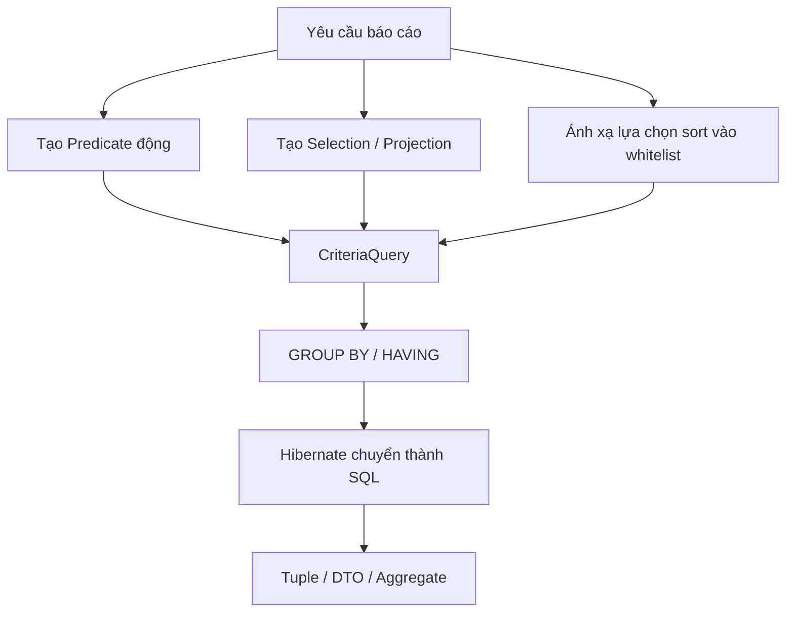

# Projection, tổng hợp, nhóm và sắp xếp động với Criteria API trong Hibernate

Khi một ứng dụng cần truy vấn linh hoạt, các điều kiện lọc, trường hiển thị và thứ tự sắp xếp thường thay đổi theo lựa chọn của người dùng. Một màn hình quản trị có thể cho phép chọn khoảng thời gian, trạng thái đơn hàng, khách hàng, số lượng đơn tối thiểu, rồi sắp xếp theo doanh thu hoặc tên khách hàng. Nếu viết một chuỗi HQL mới cho mỗi tổ hợp lựa chọn, code dễ trở thành một mê cung nối chuỗi và kiểm tra điều kiện.

**Jakarta Persistence Criteria API** cung cấp cách xây dựng truy vấn bằng các đối tượng có cấu trúc: `CriteriaBuilder`, `CriteriaQuery`, `Root`, `Join`, `Predicate`, `Expression` và `Order`. Nó cho phép tạo projection, hàm tổng hợp, GROUP BY, HAVING và ORDER BY một cách có chương trình, đồng thời hỗ trợ truyền tham số và xây dựng bộ lọc động.

Bài học này đi sâu vào bốn nhóm kỹ năng gắn liền nhau:

1. **Projection:** chỉ chọn những trường cần dùng và trả về scalar, `Object[]`, `Tuple` hoặc DTO/record.
2. **Tổng hợp:** sử dụng `count`, `countDistinct`, `sum`, `avg`, `min`, `max` và các biểu thức tính toán.
3. **Nhóm dữ liệu:** sử dụng `groupBy` và `having`, phân biệt điều kiện trước/sau nhóm, xử lý nhóm có số lượng 0.
4. **Sắp xếp động:** ánh xạ lựa chọn giao diện sang biểu thức Criteria an toàn, có giới hạn, không nối trực tiếp tên trường do client gửi.

Ngoài cú pháp, bài học còn giải thích những bẫy làm báo cáo sai: `LEFT JOIN` kết hợp `WHERE`, phép `SUM` bị nhân bởi JOIN nhiều dòng chi tiết, `COUNT(*)` trên nhóm rỗng, pagination tổng hợp và kiểu dữ liệu của hàm aggregate.

> Các ví dụ dùng `jakarta.persistence` và Java hiện đại. Dự án cũ dùng `javax.persistence` cần đổi package import. Một số phần mở rộng phụ thuộc Hibernate và SQL dialect sẽ được nêu rõ.

---

## 1. Tại sao dùng Criteria thay vì ghép chuỗi HQL?

Giả sử người dùng mở màn hình báo cáo doanh thu và chọn:

- Trạng thái: PAID.
- Thời gian: từ ngày A đến trước ngày B.
- Khách hàng: có thể có hoặc không.
- Tổng doanh thu tối thiểu: có thể có hoặc không.
- Sắp xếp: doanh thu giảm dần hoặc tên tăng dần.

Với cách nối chuỗi, code dễ trở nên như sau:

```java
String hql = "select ... from SalesOrder o where 1=1";

if (status != null) {
    hql += " and o.status = :status";
}

if (from != null) {
    hql += " and o.createdAt >= :from";
}

if (sortField != null) {
    hql += " order by " + sortField;
}
```

Các rủi ro gồm:

- Dễ thiếu khoảng trắng, dấu phẩy, `GROUP BY` hoặc `HAVING` khi ghép nhiều nhánh.
- Dễ lẫn điều kiện đặt trong `WHERE` với điều kiện sau tổng hợp.
- Nguy cơ injection nếu ghép trực tiếp tên field hoặc giá trị từ client.
- Khó dùng lại những biểu thức aggregate đã tạo.
- Khó duy trì đúng cùng điều kiện ở query dữ liệu và query đếm số nhóm.

Criteria xây dựng một **cây biểu thức truy vấn**:



Criteria vẫn cần được thiết kế đúng. Nó không tự phát hiện lỗi nghiệp vụ trong cách tính doanh thu hoặc tự tối ưu mọi truy vấn.

## 2. Mô hình dữ liệu dùng xuyên suốt

Giả sử hệ thống bán hàng có Customer, SalesOrder và OrderLine.

### Khách hàng

```java
import jakarta.persistence.*;
import java.util.ArrayList;
import java.util.List;

@Entity
@Table(name = "customers")
public class Customer {

    @Id
    private Long id;

    @Column(name = "display_name", nullable = false)
    private String displayName;

    private String region;

    @OneToMany(mappedBy = "customer")
    private List<SalesOrder> orders = new ArrayList<>();

    protected Customer() {}

    public Long getId() {
        return id;
    }

    public String getDisplayName() {
        return displayName;
    }

    public String getRegion() {
        return region;
    }

    public List<SalesOrder> getOrders() {
        return orders;
    }
}
```

### Trạng thái đơn hàng

```java
public enum OrderStatus {
    NEW,
    PAID,
    CANCELLED
}
```

### Đơn hàng

```java
import jakarta.persistence.*;
import java.math.BigDecimal;
import java.time.LocalDateTime;
import java.util.ArrayList;
import java.util.List;

@Entity
@Table(name = "sales_orders")
public class SalesOrder {

    @Id
    private Long id;

    @ManyToOne(fetch = FetchType.LAZY, optional = false)
    @JoinColumn(name = "customer_id", nullable = false)
    private Customer customer;

    @Enumerated(EnumType.STRING)
    private OrderStatus status;

    @Column(name = "total_amount", precision = 19, scale = 2)
    private BigDecimal totalAmount;

    @Column(name = "created_at", nullable = false)
    private LocalDateTime createdAt;

    @OneToMany(mappedBy = "order")
    private List<OrderLine> lines = new ArrayList<>();

    protected SalesOrder() {}

    public Long getId() {
        return id;
    }

    public Customer getCustomer() {
        return customer;
    }

    public OrderStatus getStatus() {
        return status;
    }

    public BigDecimal getTotalAmount() {
        return totalAmount;
    }

    public LocalDateTime getCreatedAt() {
        return createdAt;
    }

    public List<OrderLine> getLines() {
        return lines;
    }
}
```

### Dòng hàng

```java
import jakarta.persistence.*;
import java.math.BigDecimal;

@Entity
@Table(name = "order_lines")
public class OrderLine {

    @Id
    private Long id;

    @ManyToOne(fetch = FetchType.LAZY, optional = false)
    @JoinColumn(name = "order_id", nullable = false)
    private SalesOrder order;

    private String sku;
    private Integer quantity;

    @Column(name = "unit_price", precision = 19, scale = 2)
    private BigDecimal unitPrice;

    protected OrderLine() {}

    public Long getId() {
        return id;
    }

    public SalesOrder getOrder() {
        return order;
    }

    public String getSku() {
        return sku;
    }

    public Integer getQuantity() {
        return quantity;
    }

    public BigDecimal getUnitPrice() {
        return unitPrice;
    }
}
```

Các class là mô hình tối giản để học truy vấn; project thực cần constructor/domain methods, migration, validation, cấu hình Hibernate và các imports còn lại.

### Dữ liệu mẫu

| Khách hàng | Khu vực |
| --- | --- |
| 1 — An Phát | NORTH |
| 2 — Bình Minh | SOUTH |
| 3 — Cửu Long | NORTH |

| Đơn | Khách | Trạng thái | Tổng tiền |
| --- | --- | --- | ---: |
| 101 | An Phát | PAID | 120 |
| 102 | An Phát | PAID | 80 |
| 103 | An Phát | CANCELLED | 30 |
| 104 | Bình Minh | PAID | 50 |

Cửu Long chưa có đơn. Khi thống kê **đơn PAID** theo khách hàng, kỳ vọng:

| Khách hàng | Số đơn PAID | Doanh thu PAID |
| --- | ---: | ---: |
| An Phát | 2 | 200 |
| Bình Minh | 1 | 50 |
| Cửu Long | 0 | 0 |

Giá trị tiền trong bảng chỉ để minh họa phép tính, không gắn với đơn vị tiền tệ cụ thể.

## 3. Những đối tượng nền tảng của Criteria API

Một truy vấn Criteria thường bắt đầu bằng:

```java
CriteriaBuilder cb = em.getCriteriaBuilder();

CriteriaQuery<SalesOrder> cq =
    cb.createQuery(SalesOrder.class);

Root<SalesOrder> root =
    cq.from(SalesOrder.class);

cq.select(root);

List<SalesOrder> orders =
    em.createQuery(cq).getResultList();
```

Ý nghĩa:

| Thành phần | Vai trò |
| --- | --- |
| `EntityManager` | Tạo và thực thi query trong Persistence Context |
| `CriteriaBuilder` | Tạo biểu thức, predicate, aggregate, order |
| `CriteriaQuery<T>` | Mô tả cấu trúc query và kiểu result |
| `Root<T>` | Entity gốc trong FROM |
| `Join<X,Y>` | Quan hệ join giữa entity/association |
| `Path<T>` | Đường dẫn property |
| `Expression<T>` | Biểu thức có kiểu, có thể là path, aggregate hoặc phép tính |
| `Predicate` | Điều kiện logic |
| `Selection<T>` | Biểu thức chọn ra kết quả |
| `Order` | Quy tắc sắp xếp |

Ví dụ SQL/HQL tương đương:

```hql
select o
from SalesOrder o
```

Criteria API không bắt buộc bạn phải dùng Criteria cho mọi query. Khi HQL cố định, HQL có thể ngắn và dễ đọc hơn; khi query shape phụ thuộc nhiều lựa chọn hợp lệ, Criteria phát huy lợi thế.

## 4. Projection là gì?

**Projection** là quyết định truy vấn trả về những thông tin nào, thay vì mặc định trả toàn bộ entity.

Một danh sách đơn chỉ cần ID, trạng thái và số tiền có thể tránh tải cả Customer, OrderLine và nhiều field không cần dùng.

Ví dụ chọn một scalar:

```java
CriteriaBuilder cb = em.getCriteriaBuilder();

CriteriaQuery<Long> cq =
    cb.createQuery(Long.class);

Root<SalesOrder> order =
    cq.from(SalesOrder.class);

cq.select(order.get("id"));

List<Long> ids =
    em.createQuery(cq).getResultList();
```

Ở đây `CriteriaQuery<Long>` khai báo kết quả có kiểu `Long`. `order.get("id")` là một path đến thuộc tính entity, không phải cột SQL vật lý.

### So sánh entity query và projection

| Cách chọn | Trả về | Quản lý bởi Persistence Context? |
| --- | --- | --- |
| `cq.select(order)` | Entity `SalesOrder` | Có, managed theo context/lifecycle |
| `cq.select(order.get("id"))` | `Long` | Không phải managed entity |
| `cq.multiselect(...)` | Tuỳ kiểu CriteriaQuery | Scalar array/Tuple/DTO |
| `cb.construct(Dto.class, ...)` | DTO/record | DTO không phải managed entity |
| `cb.count(order)` | Aggregate `Long` | Không phải managed entity |

Projection đặc biệt phù hợp cho read-only API, dashboard, export và truy vấn báo cáo.

## 5. Chọn nhiều cột bằng `CriteriaQuery<Tuple>`

`Tuple` là lựa chọn tiện lợi khi cần nhiều scalar nhưng chưa muốn tạo DTO riêng.

```java
import jakarta.persistence.Tuple;
import jakarta.persistence.criteria.*;

CriteriaBuilder cb = em.getCriteriaBuilder();

CriteriaQuery<Tuple> cq =
    cb.createTupleQuery();

Root<SalesOrder> order =
    cq.from(SalesOrder.class);

Path<Long> id = order.get("id");
Path<OrderStatus> status = order.get("status");
Path<BigDecimal> amount = order.get("totalAmount");

cq.multiselect(
    id.alias("orderId"),
    status.alias("status"),
    amount.alias("amount")
);

cq.orderBy(cb.desc(order.get("createdAt")));

List<Tuple> tuples =
    em.createQuery(cq).getResultList();

for (Tuple tuple : tuples) {
    Long orderId = tuple.get("orderId", Long.class);
    OrderStatus s = tuple.get("status", OrderStatus.class);
    BigDecimal a = tuple.get("amount", BigDecimal.class);
}
```

Ưu điểm:

- Có thể đọc bằng alias và kiểu dữ liệu mong đợi.
- Truy vấn chọn đúng property cần dùng.
- Dễ thêm bớt cột trong quá trình khám phá dữ liệu.

Nhược điểm:

- Alias là chuỗi, có thể sai khi refactor.
- Cấu trúc kết quả còn phụ thuộc vị trí/alias runtime.
- Không thể hiện hợp đồng API rõ bằng một DTO typed.

### Alias nên duy nhất

Trong cùng `multiselect`, mỗi alias nên duy nhất:

```java
id.alias("orderId");
amount.alias("totalAmount");
```

Đặt trùng alias có thể gây lỗi Criteria query theo quy tắc selection alias. Đừng dùng lại alias `"id"` cho cả Order ID và Customer ID.

### `Tuple` không phải entity

`tuple.get("amount", BigDecimal.class)` trả scalar. Đổi giá trị trong DTO/map được tạo từ Tuple không làm Hibernate dirty-check entity gốc. Nếu use case cần cập nhật entity, hãy tải managed entity trong transaction ghi phù hợp.

## 6. Projection bằng `Object[]`

Có thể yêu cầu kết quả dạng mảng:

```java
CriteriaQuery<Object[]> cq =
    cb.createQuery(Object[].class);

Root<SalesOrder> order =
    cq.from(SalesOrder.class);

cq.multiselect(
    order.get("id"),
    order.get("status"),
    order.get("totalAmount")
);

List<Object[]> rows =
    em.createQuery(cq).getResultList();

for (Object[] row : rows) {
    Long id = (Long) row[0];
    OrderStatus status = (OrderStatus) row[1];
    BigDecimal amount = (BigDecimal) row[2];
}
```

`Object[]` hữu ích khi cần thử nghiệm nhanh, nhưng dễ sai index hoặc cast nếu thứ tự projection thay đổi.

**Trong code ứng dụng có hợp đồng lâu dài, ưu tiên record/DTO thay vì truyền `Object[]` qua nhiều tầng.**

## 7. Projection trực tiếp sang DTO bằng `construct`

Giả sử màn hình chỉ cần:

```java
package com.example.sales.dto;

import java.math.BigDecimal;

public record OrderRow(
    Long orderId,
    OrderStatus status,
    BigDecimal totalAmount
) {}
```

Criteria:

```java
CriteriaBuilder cb = em.getCriteriaBuilder();

CriteriaQuery<OrderRow> cq =
    cb.createQuery(OrderRow.class);

Root<SalesOrder> order =
    cq.from(SalesOrder.class);

cq.select(
    cb.construct(
        OrderRow.class,
        order.get("id"),
        order.get("status"),
        order.get("totalAmount")
    )
);

List<OrderRow> result =
    em.createQuery(cq).getResultList();
```

`cb.construct(Target.class, selections...)` tạo constructor projection. Kiểu và thứ tự các biểu thức phải khớp constructor mà Hibernate/JPA có thể gọi.

### Vì sao DTO/record phù hợp với báo cáo?

- Dữ liệu ra được xác định bằng kiểu Java.
- Không phải entity managed, không dirty-check.
- Tránh vô tình serialize lazy association.
- Hạn chế truyền object graph lớn qua API.
- Dễ viết test và thiết kế hợp đồng response.

Không nhầm DTO constructor projection với `new SalesOrder(...)` thành managed entity. DTO là đối tượng kết quả riêng, không tham gia persistence lifecycle trừ khi bạn chủ động dùng entity API trên nó theo thiết kế khác.

## 8. `multiselect` có kết quả khác nhau tùy kiểu `CriteriaQuery`

Đây là điểm thường gây nhầm lẫn.

Cùng một tập Selection có thể được đóng gói khác nhau:

- `CriteriaQuery<Tuple>` → mỗi row là `Tuple`.
- `CriteriaQuery<Object[]>` → mỗi row là `Object[]`.
- `CriteriaQuery<SomeDto>` → provider có thể dùng constructor tương ứng trong trường hợp `multiselect` hợp lệ.
- `CriteriaQuery<Object>` → semantics phụ thuộc số selection, có thể là scalar hoặc mảng.

Để tránh bất ngờ, dùng cách minh bạch:

- `cb.createTupleQuery()` + `multiselect` nếu cần Tuple.
- `cb.createQuery(Object[].class)` + `multiselect` nếu cần array.
- `cb.createQuery(Dto.class)` + `select(cb.construct(...))` nếu cần DTO.
- `cb.createQuery(Long.class)` + `select(cb.count(...))` nếu cần aggregate scalar.

### `cb.array` và `cb.tuple`

`CriteriaBuilder` cũng có các hàm tạo compound selection:

```java
cq.select(
    cb.tuple(
        order.get("id"),
        order.get("totalAmount")
    )
);
```

Ở đây `cq` cần là `CriteriaQuery<Tuple>`. Có thể dùng `cb.array(...)` với query result `Object[]`.

Khi query có nhiều selection, tránh sử dụng compound selection lồng nhau không được Criteria API cho phép. Giữ mỗi projection phẳng và rõ kiểu.

## 9. Lọc động trước khi chọn projection

Criteria phù hợp khi có nhiều điều kiện lọc tuỳ chọn.

Định nghĩa request:

```java
public record OrderFilter(
    OrderStatus status,
    Long customerId,
    LocalDateTime fromInclusive,
    LocalDateTime toExclusive,
    BigDecimal minimumAmount
) {}
```

Tạo query:

```java
public List<OrderRow> searchOrders(OrderFilter filter) {
    CriteriaBuilder cb = em.getCriteriaBuilder();

    CriteriaQuery<OrderRow> cq =
        cb.createQuery(OrderRow.class);

    Root<SalesOrder> order =
        cq.from(SalesOrder.class);

    List<Predicate> conditions = new ArrayList<>();

    if (filter.status() != null) {
        conditions.add(
            cb.equal(
                order.get("status"),
                filter.status()
            )
        );
    }

    if (filter.customerId() != null) {
        conditions.add(
            cb.equal(
                order.get("customer").get("id"),
                filter.customerId()
            )
        );
    }

    if (filter.fromInclusive() != null) {
        conditions.add(
            cb.greaterThanOrEqualTo(
                order.<LocalDateTime>get("createdAt"),
                filter.fromInclusive()
            )
        );
    }

    if (filter.toExclusive() != null) {
        conditions.add(
            cb.lessThan(
                order.<LocalDateTime>get("createdAt"),
                filter.toExclusive()
            )
        );
    }

    if (filter.minimumAmount() != null) {
        conditions.add(
            cb.greaterThanOrEqualTo(
                order.<BigDecimal>get("totalAmount"),
                filter.minimumAmount()
            )
        );
    }

    cq.select(
        cb.construct(
            OrderRow.class,
            order.get("id"),
            order.get("status"),
            order.get("totalAmount")
        )
    );

    cq.where(conditions.toArray(new Predicate[0]));
    cq.orderBy(cb.desc(order.get("createdAt")));

    return em.createQuery(cq).getResultList();
}
```

Điểm cần nhớ:

- `conditions` ban đầu rỗng nghĩa là không áp đặt điều kiện tuỳ chọn.
- Chỉ tạo `Predicate` cho tham số đã được cung cấp.
- `where(Predicate...)` nhận danh sách điều kiện.
- `cb.greaterThanOrEqualTo` cần kiểu `Comparable` phù hợp như `BigDecimal`, `LocalDateTime`.
- Giá trị đến từ request được đưa vào API Criteria dưới dạng giá trị, **không ghép chuỗi HQL**.
- Nên kiểm tra `fromInclusive < toExclusive` ở tầng validation trước khi gọi query.

Nếu có một điều kiện quyền truy cập luôn bắt buộc, đừng đặt nó trong nhánh tùy chọn. Thêm tenant/authorization predicate ngay từ đầu để bảo vệ phạm vi dữ liệu.

## 10. Các hàm tổng hợp trong Criteria API

Các hàm tổng hợp quen thuộc trong HQL có đối ứng trong `CriteriaBuilder`.

| Hàm HQL/SQL | CriteriaBuilder | Kết quả thường gặp |
| --- | --- | --- |
| `count(o)` | `cb.count(root)` | `Expression<Long>` |
| `count(distinct x)` | `cb.countDistinct(path)` | `Expression<Long>` |
| `sum(x)` | `cb.sum(expression)` | Kiểu số của expression |
| `avg(x)` | `cb.avg(expression)` | `Expression<Double>` |
| `min(x)` | `cb.min(expression)` | Kiểu số của expression |
| `max(x)` | `cb.max(expression)` | Kiểu số của expression |
| MIN/MAX thời gian/chuỗi | `cb.least` / `cb.greatest` | Kiểu Comparable tương ứng |

Các hàm `min/max` của CriteriaBuilder dành cho expression số; với giá trị thời gian hoặc chuỗi, dùng `least/greatest` theo kiểu Comparable và khả năng dialect.

## 11. `count`: đếm số bản ghi

Đếm tất cả đơn hàng:

```java
CriteriaBuilder cb = em.getCriteriaBuilder();

CriteriaQuery<Long> cq =
    cb.createQuery(Long.class);

Root<SalesOrder> order =
    cq.from(SalesOrder.class);

cq.select(cb.count(order));

Long count =
    em.createQuery(cq).getSingleResult();
```

HQL tương đương:

```hql
select count(o)
from SalesOrder o
```

### Đếm theo điều kiện

```java
cq.select(cb.count(order));

cq.where(
    cb.equal(
        order.get("status"),
        OrderStatus.PAID
    )
);
```

`COUNT` trả `Long` theo JPA, không nên cast sang `Integer`.

### `countDistinct`

Nếu cần số khách hàng có đơn:

```java
CriteriaQuery<Long> cq =
    cb.createQuery(Long.class);

Root<SalesOrder> order =
    cq.from(SalesOrder.class);

cq.select(
    cb.countDistinct(
        order.get("customer").get("id")
    )
);
```

Trong dữ liệu mẫu, số khách có đơn là 2, mặc dù có 4 đơn. `countDistinct` dùng khi muốn đếm giá trị khác nhau, nhất là sau khi join có thể nhân row.

### COUNT với NULL

`cb.count(expression)` bỏ qua các hàng có expression NULL. Với khóa ID không nullable, nó phù hợp để đếm entity phía phải của `LEFT JOIN`. Đây là nền tảng cho báo cáo nhóm có số lượng 0.

## 12. `sum`: tính tổng giá trị số

Tổng tiền các đơn PAID:

```java
CriteriaQuery<BigDecimal> cq =
    cb.createQuery(BigDecimal.class);

Root<SalesOrder> order =
    cq.from(SalesOrder.class);

Path<BigDecimal> amount =
    order.get("totalAmount");

cq.select(cb.sum(amount));

cq.where(
    cb.equal(
        order.get("status"),
        OrderStatus.PAID
    )
);

BigDecimal total =
    em.createQuery(cq).getSingleResult();
```

Với dữ liệu mẫu: `120 + 80 + 50 = 250`.

### SUM trên tập rỗng

Nếu không có dòng nào thỏa `WHERE`, `SUM` thường trả `null`, không phải 0. Có thể xử lý ở Java:

```java
BigDecimal safeTotal =
    total == null ? BigDecimal.ZERO : total;
```

Hoặc dùng `coalesce` trong Criteria:

```java
Expression<BigDecimal> totalExpression =
    cb.coalesce(
        cb.sum(order.<BigDecimal>get("totalAmount")),
        BigDecimal.ZERO
    );
```

`cb.coalesce` chọn giá trị khác NULL đầu tiên, giúp trả 0 theo policy báo cáo.

### Tổng số nguyên và nguy cơ tràn

CriteriaBuilder có `sumAsLong` và `sumAsDouble` cho một số expression số:

```java
Expression<Long> totalQuantity =
    cb.sumAsLong(
        line.<Integer>get("quantity")
    );
```

Dùng khi tổng số lượng có thể vượt phạm vi Integer. Với dữ liệu tiền tệ, nên dùng `BigDecimal` có precision/scale phù hợp; không đổi thành Double chỉ để làm phép tính dễ hơn.

## 13. `avg`: tính trung bình

Trung bình giá trị đơn PAID:

```java
CriteriaQuery<Double> cq =
    cb.createQuery(Double.class);

Root<SalesOrder> order =
    cq.from(SalesOrder.class);

Expression<Double> average =
    cb.avg(
        order.<BigDecimal>get("totalAmount")
    );

cq.select(average);

cq.where(
    cb.equal(
        order.get("status"),
        OrderStatus.PAID
    )
);
```

Theo JPA, `AVG` thường trả `Double`, kể cả khi input là BigDecimal.

### Trung bình tiền tệ cần chính sách riêng

Nếu tính giá trị tiền trung bình với yêu cầu làm tròn chính xác:

- Lấy `SUM(BigDecimal)` và `COUNT(Long)`.
- Chia bằng `BigDecimal.divide` với `scale` và `RoundingMode` đã xác định.
- Hoặc dùng native SQL/biểu thức database với quy tắc decimal chính xác phù hợp DBMS.

Không tự động coi Double là kiểu tiền tệ an toàn cho sổ sách kế toán.

### Trung bình bỏ qua NULL

`AVG` bỏ qua các giá trị expression NULL; mẫu số là số giá trị khác NULL. Nếu nghiệp vụ muốn coi NULL là 0, cần dùng `coalesce` trước khi tính AVG, nhưng điều đó thay đổi ý nghĩa của kết quả.

## 14. `min/max` và `least/greatest`

Giá trị đơn thấp nhất và cao nhất:

```java
CriteriaQuery<Tuple> cq =
    cb.createTupleQuery();

Root<SalesOrder> order =
    cq.from(SalesOrder.class);

Expression<BigDecimal> minimum =
    cb.min(order.<BigDecimal>get("totalAmount"));

Expression<BigDecimal> maximum =
    cb.max(order.<BigDecimal>get("totalAmount"));

cq.multiselect(
    minimum.alias("minAmount"),
    maximum.alias("maxAmount")
);
```

Với thời gian:

```java
Expression<LocalDateTime> earliest =
    cb.least(
        order.<LocalDateTime>get("createdAt")
    );

Expression<LocalDateTime> latest =
    cb.greatest(
        order.<LocalDateTime>get("createdAt")
    );
```

Kiểu trả về phù hợp với property đã mapping và chức năng DBMS. Trong ví dụ, LocalDateTime có tính so sánh theo trật tự thời gian đã quy ước.

### MIN/MAX không trả về entity có giá trị nhỏ nhất/lớn nhất

`cb.max(order.get("totalAmount"))` trả một giá trị, không tự trả `SalesOrder` chứa giá trị đó. Nếu cần entity, có thể dùng ORDER BY giảm dần và `setMaxResults(1)`, hoặc subquery để lấy các entity đồng hạng.

## 15. `groupBy`: tạo nhóm theo một thuộc tính

Báo cáo số đơn theo trạng thái:

```java
CriteriaBuilder cb = em.getCriteriaBuilder();

CriteriaQuery<Tuple> cq =
    cb.createTupleQuery();

Root<SalesOrder> order =
    cq.from(SalesOrder.class);

Path<OrderStatus> status =
    order.get("status");

Expression<Long> orderCount =
    cb.count(order);

cq.multiselect(
    status.alias("status"),
    orderCount.alias("orderCount")
);

cq.groupBy(status);

List<Tuple> rows =
    em.createQuery(cq).getResultList();

for (Tuple row : rows) {
    OrderStatus s =
        row.get("status", OrderStatus.class);

    Long count =
        row.get("orderCount", Long.class);
}
```

HQL tương đương:

```hql
select o.status, count(o)
from SalesOrder o
group by o.status
```

Kết quả một hàng cho mỗi trạng thái **đang có ít nhất một đơn**. Trạng thái không xuất hiện trong dữ liệu không tự tạo thành nhóm có count 0.

## 16. `groupBy` nhiều thuộc tính

Báo cáo số đơn và tổng tiền theo khách hàng và trạng thái:

```java
CriteriaQuery<Tuple> cq = cb.createTupleQuery();

Root<SalesOrder> order =
    cq.from(SalesOrder.class);

Path<Long> customerId =
    order.get("customer").get("id");

Path<OrderStatus> status =
    order.get("status");

Expression<Long> count =
    cb.count(order);

Expression<BigDecimal> total =
    cb.sum(
        order.<BigDecimal>get("totalAmount")
    );

cq.multiselect(
    customerId.alias("customerId"),
    status.alias("status"),
    count.alias("orderCount"),
    total.alias("totalAmount")
);

cq.groupBy(customerId, status);

cq.orderBy(
    cb.asc(customerId),
    cb.asc(status)
);
```

Một nhóm được xác định bởi **cặp (customerId, status)**. Nếu khách có đơn PAID và CANCELLED, khách đó xuất hiện thành hai dòng báo cáo.

### Quy tắc nhóm và projection

Khi có `GROUP BY`, các scalar expression trong SELECT mà không nằm trong hàm aggregate thường cần có trong group key.

Ví dụ chọn `customerId` và `customerName`:

```java
cq.multiselect(
    customerId,
    customerName,
    cb.count(order)
);

cq.groupBy(
    customerId,
    customerName
);
```

Một số DBMS cho phép rút gọn `GROUP BY customerId` nhờ phụ thuộc hàm, nhưng không nên dựa vào khả năng riêng của dialect nếu muốn code portable.

## 17. `having`: lọc kết quả sau khi nhóm

Giả sử cần khách hàng có ít nhất hai đơn PAID.

```java
CriteriaQuery<Tuple> cq =
    cb.createTupleQuery();

Root<SalesOrder> order =
    cq.from(SalesOrder.class);

Path<Long> customerId =
    order.get("customer").get("id");

Expression<Long> paidCount =
    cb.count(order);

cq.multiselect(
    customerId.alias("customerId"),
    paidCount.alias("paidCount")
);

cq.where(
    cb.equal(
        order.get("status"),
        OrderStatus.PAID
    )
);

cq.groupBy(customerId);

cq.having(
    cb.ge(paidCount, 2L)
);
```

HQL tương đương:

```hql
select o.customer.id, count(o)
from SalesOrder o
where o.status = :paidStatus
group by o.customer.id
having count(o) >= 2
```

### Phân biệt WHERE và HAVING

| Giai đoạn | Criteria API | Ý nghĩa |
| --- | --- | --- |
| Lọc hàng | `cq.where(...)` | Hàng nào tham gia nhóm |
| Chia nhóm | `cq.groupBy(...)` | Khóa nhóm là gì |
| Tính aggregate | `cb.count/sum/avg(...)` | Kết quả từng nhóm |
| Lọc nhóm | `cq.having(...)` | Nhóm nào được trả về |

**Không đặt điều kiện tổng doanh thu của một nhóm trong WHERE.** Trước khi nhóm chưa có kết quả SUM để so sánh.

### Nhiều điều kiện HAVING

```java
List<Predicate> havingConditions =
    new ArrayList<>();

if (minimumOrders != null) {
    havingConditions.add(
        cb.ge(orderCount, minimumOrders)
    );
}

if (minimumRevenue != null) {
    havingConditions.add(
        cb.ge(revenue, minimumRevenue)
    );
}

cq.having(
    havingConditions.toArray(new Predicate[0])
);
```

Nếu không có ngưỡng lọc nhóm, có thể không gọi `having`. Nếu điều kiện đã được thiết lập trước đó, gọi `having` lần mới thay thế danh sách HAVING cũ theo Criteria API; nên xây tất cả predicate rồi thiết lập một lần để tránh vô tình ghi đè.

## 18. LEFT JOIN và nhóm có số lượng 0

Một báo cáo doanh thu theo Customer thường phải hiển thị **mọi khách hàng**, kể cả người chưa có đơn PAID.

Nếu query bắt đầu từ `SalesOrder` thì Customer chưa có đơn không thể xuất hiện. Hãy bắt đầu từ `Customer` và dùng `LEFT JOIN`:

```java
CriteriaQuery<Tuple> cq =
    cb.createTupleQuery();

Root<Customer> customer =
    cq.from(Customer.class);

Join<Customer, SalesOrder> order =
    customer.join("orders", JoinType.LEFT);

Path<Long> customerId =
    customer.get("id");

Path<String> customerName =
    customer.get("displayName");

Expression<Long> orderCount =
    cb.count(order.get("id"));

cq.multiselect(
    customerId.alias("customerId"),
    customerName.alias("customerName"),
    orderCount.alias("orderCount")
);

cq.groupBy(customerId, customerName);

cq.orderBy(cb.asc(customerId));
```

Trong dữ liệu mẫu, kết quả đếm **mọi đơn**:

| Khách | Số đơn |
| --- | ---: |
| An Phát | 3 |
| Bình Minh | 1 |
| Cửu Long | 0 |

### Vì sao đếm `order.id`?

Với LEFT JOIN, khách không có Order vẫn tạo một hàng trung gian chứa Customer, còn property phía Order bằng NULL.

- `cb.count(customer)` sẽ đếm hàng Customer đó, có thể cho 1.
- `cb.count(order.get("id"))` bỏ qua ID NULL, nên cho 0.

Nếu mục đích là đếm entity ở phía phải tùy chọn, `count(rightJoin.id)` thường rõ nghĩa hơn `count(root)`.

## 19. Điều kiện lọc ở `Join.on` và `CriteriaQuery.where`

Muốn đếm **chỉ đơn PAID** nhưng vẫn giữ khách không có đơn PAID.

Cách dễ sai:

```java
Join<Customer, SalesOrder> order =
    customer.join("orders", JoinType.LEFT);

cq.where(
    cb.equal(order.get("status"), OrderStatus.PAID)
);
```

Điều kiện ở `WHERE` loại hàng mà `order` là NULL. Kết quả Customer 3 biến mất; những khách chỉ có đơn không phải PAID cũng có thể biến mất.

### Cách đúng: đặt điều kiện của phía JOIN vào ON

```java
Join<Customer, SalesOrder> order =
    customer.join("orders", JoinType.LEFT);

order.on(
    cb.equal(order.get("status"), OrderStatus.PAID)
);
```

HQL tương đương:

```hql
select c.id, count(o.id)
from Customer c
left join c.orders o
    on o.status = :paidStatus
group by c.id
```

Truy vấn giữ Customer dù không có Order PAID.

| Khách hàng | Số đơn PAID |
| --- | ---: |
| An Phát | 2 |
| Bình Minh | 1 |
| Cửu Long | 0 |

### Nhiều điều kiện ON

Giả sử chỉ đếm PAID trong khoảng thời gian:

```java
List<Predicate> joinConditions =
    new ArrayList<>();

joinConditions.add(
    cb.equal(order.get("status"), OrderStatus.PAID)
);

if (fromInclusive != null) {
    joinConditions.add(
        cb.greaterThanOrEqualTo(
            order.<LocalDateTime>get("createdAt"),
            fromInclusive
        )
    );
}

if (toExclusive != null) {
    joinConditions.add(
        cb.lessThan(
            order.<LocalDateTime>get("createdAt"),
            toExclusive
        )
    );
}

order.on(
    joinConditions.toArray(new Predicate[0])
);
```

**Cẩn thận:** gọi `order.on(...)` một lần sau khi tổng hợp điều kiện giúp tránh làm mất những ON predicates đã có. Các lời gọi `on` mới có thể thay thế restriction cũ thay vì tự động nối AND như bạn tưởng.

### Phân biệt điều kiện trên root và phía join

Ví dụ:

- `customer.region = :region` là điều kiện trên root → thường đặt trong `WHERE`.
- `order.status = PAID` và `order.createdAt` khi vẫn muốn giữ khách hàng 0 đơn → đặt trong `ON`.
- `sum(...) >= :minimum` là điều kiện sau tổng hợp → đặt trong `HAVING`.

Chọn đúng vị trí của predicate quan trọng ngang với việc dùng đúng phương thức API.

## 20. Xây báo cáo tổng hợp theo khách hàng với DTO

Định nghĩa DTO:

```java
package com.example.sales.dto;

import java.math.BigDecimal;

public record CustomerSalesSummary(
    Long customerId,
    String customerName,
    Long paidOrderCount,
    BigDecimal paidRevenue
) {}
```

Service query:

```java
public List<CustomerSalesSummary> loadPaidSummary() {
    CriteriaBuilder cb = em.getCriteriaBuilder();

    CriteriaQuery<CustomerSalesSummary> cq =
        cb.createQuery(CustomerSalesSummary.class);

    Root<Customer> customer =
        cq.from(Customer.class);

    Join<Customer, SalesOrder> order =
        customer.join("orders", JoinType.LEFT);

    order.on(
        cb.equal(order.get("status"), OrderStatus.PAID)
    );

    Path<Long> id = customer.get("id");
    Path<String> name = customer.get("displayName");

    Expression<Long> count =
        cb.count(order.get("id"));

    Expression<BigDecimal> revenue =
        cb.coalesce(
            cb.sum(
                order.<BigDecimal>get("totalAmount")
            ),
            BigDecimal.ZERO
        );

    cq.select(
        cb.construct(
            CustomerSalesSummary.class,
            id,
            name,
            count,
            revenue
        )
    );

    cq.groupBy(id, name);

    cq.orderBy(
        cb.desc(revenue),
        cb.asc(id)
    );

    return em.createQuery(cq).getResultList();
}
```

Đây là ví dụ tổng hợp hoàn chỉnh. Các phần chính:

1. Root là `Customer` để giữ khách không có đơn.
2. LEFT JOIN `orders`, điều kiện PAID ở ON.
3. `count(order.id)` cho kết quả 0 ở nhóm không có Order.
4. `coalesce(sum(totalAmount), ZERO)` chuyển NULL thành 0.
5. `cb.construct` trả DTO không managed.
6. `groupBy(id, name)` nhóm theo khách hàng.
7. `orderBy(desc(revenue), asc(id))` xếp doanh thu giảm dần và tie-break theo ID.

Với dữ liệu mẫu:

| Customer | paidOrderCount | paidRevenue |
| --- | ---: | ---: |
| An Phát | 2 | 200 |
| Bình Minh | 1 | 50 |
| Cửu Long | 0 | 0 |

## 21. JOIN có thể làm sai phép SUM

Không phải phép tính nào cũng đúng chỉ vì `groupBy` và `sum` không báo lỗi cú pháp.

Giả sử:

- Order#101 có tổng tiền 120 và **2** OrderLine.
- Order#102 có tổng tiền 80 và **1** OrderLine.

Một Criteria query:

```java
Root<SalesOrder> order =
    cq.from(SalesOrder.class);

Join<SalesOrder, OrderLine> line =
    order.join("lines", JoinType.INNER);

Expression<BigDecimal> total =
    cb.sum(
        order.<BigDecimal>get("totalAmount")
    );

cq.multiselect(
    order.get("customer").get("id"),
    total
);

cq.groupBy(
    order.get("customer").get("id")
);
```

JOIN nhân row Order theo số OrderLine:

| Order | Line | Order total |
| --- | --- | ---: |
| 101 | L1 | 120 |
| 101 | L2 | 120 |
| 102 | L3 | 80 |

Tổng thành `120 + 120 + 80 = 320`, **sai** nếu doanh thu thực là `120 + 80 = 200`.

### `countDistinct` chỉ sửa phép đếm

```java
Expression<Long> uniqueOrders =
    cb.countDistinct(order.get("id"));
```

Nếu cần đếm Order, `countDistinct` tránh đếm lặp theo line. Nhưng:

```java
cb.sum(order.<BigDecimal>get("totalAmount"))
```

vẫn cộng amount nhiều lần.

### Đừng dùng SUM(DISTINCT amount) để sửa

Hai Order khác nhau có thể cùng giá trị tiền. DISTINCT theo amount làm hai Order đó chỉ góp một giá trị, vẫn sai.

### Thiết kế đúng theo nguồn doanh thu

Nếu doanh thu đã được lưu ở `SalesOrder.totalAmount`, tổng hợp từ `SalesOrder` và **không join collection lines** khi không cần:

```java
Root<SalesOrder> order =
    cq.from(SalesOrder.class);

Expression<BigDecimal> revenue =
    cb.sum(
        order.<BigDecimal>get("totalAmount")
    );
```

Nếu doanh thu thực sự phải được tính từ từng OrderLine, có thể tổng hợp giá trị dòng:

```java
Expression<BigDecimal> lineValue =
    cb.prod(
        line.<BigDecimal>get("unitPrice"),
        cb.toBigDecimal(
            line.<Integer>get("quantity")
        )
    );

Expression<BigDecimal> revenue =
    cb.sum(lineValue);
```

Nhưng phép `unitPrice × quantity` chỉ đúng nếu nghiệp vụ không còn chiết khấu, thuế, phí, điều chỉnh giá hoặc currency khác cần tính. Phải xác định **đơn vị dữ liệu gốc hợp lệ** trước khi viết aggregate.

## 22. JOIN nhiều collection gây nhân chéo

Giả sử một Order có:

- 3 `OrderLine`.
- 2 `Payment`.

Nếu cùng join hai collection, kết quả trung gian có thể thành `3 × 2 = 6` dòng:

```java
Join<SalesOrder, OrderLine> line =
    order.join("lines", JoinType.LEFT);

// Ví dụ giả định entity có association "payments".
Join<SalesOrder, Payment> payment =
    order.join("payments", JoinType.LEFT);
```

Các phép `count(line.id)`, `count(payment.id)` hay `sum(line.unitPrice)` có thể bị nhân số lần.

`cb.countDistinct(line.get("id"))` và `cb.countDistinct(payment.get("id"))` giúp đếm các entity khác nhau. Nhưng với phép SUM tiền, cần xác định lại cấp tổng hợp. Có thể:

- Thực hiện hai query aggregate độc lập.
- Tổng hợp child trước rồi join kết quả qua derived table/subquery phù hợp dialect/Hibernate version.
- Dùng native SQL/CTE cho báo cáo nhiều tập con.
- Thiết kế bảng summary chuyên dụng.

**Criteria không tự tránh Cartesian multiplication.** Bạn vẫn phải suy luận cardinality của JOIN trước GROUP BY.

## 23. Conditional aggregation với Criteria CASE

Một màn hình có thể cần cùng lúc:

- Tổng số đơn.
- Số đơn PAID.
- Số đơn CANCELLED.
- Doanh thu chỉ từ PAID.

Nếu đặt `WHERE status = PAID`, các đơn CANCELLED bị loại trước khi tổng hợp và không còn để đếm. Có thể dùng **CASE** bên trong aggregate.

Ví dụ đếm số đơn PAID:

```java
Expression<Long> isPaid =
    cb.<Long>selectCase()
        .when(
            cb.equal(
                order.get("status"),
                OrderStatus.PAID
            ),
            1L
        )
        .otherwise(0L);

Expression<Long> paidCount =
    cb.sum(isPaid);
```

Ví dụ doanh thu PAID:

```java
Expression<BigDecimal> paidAmount =
    cb.<BigDecimal>selectCase()
        .when(
            cb.equal(
                order.get("status"),
                OrderStatus.PAID
            ),
            order.<BigDecimal>get("totalAmount")
        )
        .otherwise(BigDecimal.ZERO);

Expression<BigDecimal> paidRevenue =
    cb.sum(paidAmount);
```

Đặt các biểu thức trên vào `cq.multiselect(...)` và group theo Customer. Câu SQL có thể chứa `CASE WHEN ... THEN ... ELSE ... END`.

### Khi nào CASE hữu ích?

- Có nhiều chỉ số theo những điều kiện khác nhau trong cùng query.
- Cần giữ các hàng không phù hợp một chỉ số để chúng vẫn tham gia chỉ số khác.
- Muốn đếm theo nhiều trạng thái mà không chạy nhiều query riêng.

### Khi nào dùng ON?

Nếu toàn bộ báo cáo chỉ xét Order PAID nhưng vẫn cần giữ Customer 0 đơn, `LEFT JOIN ... ON status=PAID` thường đơn giản hơn.

Nếu muốn **nhiều aggregate khác trạng thái** trong cùng báo cáo, dùng CASE có thể phù hợp hơn.

Hibernate HQL hiện đại hỗ trợ thêm một số cú pháp aggregate `FILTER`, nhưng Criteria API chuẩn không có một hàm `filter` aggregate portable tương đương cho mọi provider. CASE là lựa chọn dễ biểu đạt hơn trong Criteria JPA.

## 24. `distinct(true)` khác `countDistinct`

Criteria cung cấp:

```java
cq.distinct(true);
```

Nó yêu cầu loại duplicate ở **kết quả SELECT** theo semantics query.

Trong khi:

```java
cb.countDistinct(order.get("id"));
```

là một **biểu thức aggregate đếm giá trị phân biệt**.

Hai công cụ không hoán đổi được.

### Ví dụ

Nếu query SELECT Customer entity từ Customer JOIN orders, một Customer có nhiều Orders có thể xuất hiện nhiều lần ở kết quả quan hệ trung gian. `cq.distinct(true)` có thể giúp diễn đạt ý định trả Customer không trùng.

Nhưng khi `SUM(order.totalAmount)` đã bị nhân do join lines, `cq.distinct(true)` trên các hàng tổng hợp **không sửa phép SUM**.

Cần chọn đúng cardinality trước khi tổng hợp, không chỉ thêm DISTINCT ở ngoài.

## 25. Sắp xếp tĩnh với `orderBy`

CriteriaBuilder hỗ trợ:

```java
cb.asc(expression);
cb.desc(expression);
```

Ví dụ đơn hàng mới nhất trước:

```java
cq.orderBy(
    cb.desc(order.get("createdAt")),
    cb.desc(order.get("id"))
);
```

Có thể dùng nhiều khóa sắp xếp. Khóa phụ ID giúp thứ tự ổn định khi có nhiều đơn cùng timestamp.

Với query aggregate:

```java
cq.orderBy(
    cb.desc(revenue),
    cb.asc(customerId)
);
```

Sắp xếp theo kết quả `SUM` hoặc `COUNT` là hợp lệ khi expression aggregate thuộc ngữ cảnh GROUP BY đúng.

### Không mặc định database trả nhóm theo thứ tự

Truy vấn có GROUP BY nhưng không ORDER BY không đảm bảo thứ tự. Không dựa vào thứ tự tăng dần “tình cờ” của group key trong một DBMS.

## 26. Sắp xếp động: vấn đề bảo mật và tính đúng

Một request từ client có thể chứa:

```json
{
  "sortBy": "paidRevenue",
  "direction": "desc"
}
```

Một cách nguy hiểm là nhận mọi chuỗi từ client rồi dùng trực tiếp:

```java
Path<?> field = customer.get(rawSortField);
cq.orderBy(cb.asc(field));
```

Dù Criteria tránh nối chuỗi SQL, lấy path từ **tên property tùy ý** vẫn có thể:

- Ném lỗi runtime do field không tồn tại.
- Cho phép sắp xếp theo field nội bộ không được công bố.
- Tạo JOIN implicit không mong muốn.
- Mở rộng API ngoài hợp đồng và gây truy vấn nặng.
- Bỏ qua quyền kiểm soát truy cập.

### Dùng enum/whitelist

```java
public enum SalesSortKey {
    CUSTOMER_NAME,
    PAID_ORDER_COUNT,
    PAID_REVENUE
}

public enum SortDirection {
    ASC,
    DESC
}

public record SalesSort(
    SalesSortKey key,
    SortDirection direction
) {}
```

Controller/parser chỉ ánh xạ những giá trị đầu vào hợp lệ sang enum. Không dùng client string như Criteria path trực tiếp.

## 27. Ánh xạ sort key động sang biểu thức Criteria

Đặt sau khi đã tạo `customerName`, `paidCount`, `paidRevenue`:

```java
Expression<?> sortExpression =
    switch (sort.key()) {
        case CUSTOMER_NAME -> customerName;
        case PAID_ORDER_COUNT -> paidCount;
        case PAID_REVENUE -> paidRevenue;
    };

Order primaryOrder =
    sort.direction() == SortDirection.ASC
        ? cb.asc(sortExpression)
        : cb.desc(sortExpression);

cq.orderBy(
    primaryOrder,
    cb.asc(customerId)
);
```

Điểm mạnh:

- Mỗi key API tương ứng một biểu thức cố định được code kiểm soát.
- Có thể sort theo **aggregate** chứ không chỉ entity field.
- Không tự tạo path tới field do người dùng nhập tùy ý.
- Có tie-breaker `customerId` giúp thứ tự ổn định.

### Tránh nhầm `Order` của Criteria với entity đơn hàng

Trong ví dụ trên, `Order` là `jakarta.persistence.criteria.Order`, tức **quy tắc sắp xếp**, không phải `SalesOrder` entity.

Nếu class nghiệp vụ cũng tên `Order`, có thể dùng tên đầy đủ:

```java
jakarta.persistence.criteria.Order sortOrder =
    cb.desc(paidRevenue);
```

### Default khi sort không được cung cấp

```java
SalesSort safeSort =
    requestedSort == null
        ? new SalesSort(
            SalesSortKey.PAID_REVENUE,
            SortDirection.DESC
        )
        : requestedSort;
```

Validate `key` và `direction` không null trước khi switch nếu request có thể gửi giá trị rỗng. Không nên ngầm sắp xếp theo một field bất kỳ khi người dùng gửi key không hợp lệ; nên trả lỗi validation hoặc dùng default rõ ràng theo API contract.

## 28. Nhiều khóa sắp xếp động

Một API nâng cao có thể nhận danh sách:

```json
{
  "sort": [
    {"key": "paidRevenue", "direction": "desc"},
    {"key": "customerName", "direction": "asc"}
  ]
}
```

Khi xử lý:

1. Giới hạn số sort keys được phép, ví dụ tối đa 3.
2. Chỉ cho phép key trong whitelist.
3. Chuyển từng key thành `Expression<?>` tương ứng.
4. Tạo `cb.asc/desc` theo direction.
5. Luôn bổ sung tie-breaker unique như Customer ID nếu chưa được chọn.
6. Không cho client đưa native SQL fragment vào sort.

Code khái niệm:

```java
List<jakarta.persistence.criteria.Order> orders =
    new ArrayList<>();

for (SalesSort criterion : sortCriteria) {
    Expression<?> expression =
        resolveSortExpression(
            criterion.key(),
            customerName,
            paidCount,
            paidRevenue
        );

    orders.add(
        criterion.direction() == SortDirection.ASC
            ? cb.asc(expression)
            : cb.desc(expression)
    );
}

orders.add(cb.asc(customerId));

cq.orderBy(orders);
```

Ở đây `resolveSortExpression` là helper whitelist do ứng dụng định nghĩa, không phải API sẵn có của JPA.

### Vì sao phải có tie-breaker?

Nếu hai khách cùng doanh thu 200 và request chỉ sort theo doanh thu, database có quyền trả hai hàng đó theo thứ tự bất kỳ. `customerId` đảm bảo thứ tự nhất quán hơn trong một snapshot dữ liệu, rất quan trọng khi phân trang.

## 29. Sắp xếp theo biểu thức tính toán

Criteria cho phép ORDER BY dựa trên biểu thức, ví dụ doanh thu trung bình:

```java
Expression<Double> averageAmount =
    cb.avg(
        order.<BigDecimal>get("totalAmount")
    );

cq.orderBy(cb.desc(averageAmount));
```

Hoặc nhóm theo khu vực rồi sắp xếp theo số khách:

```java
Expression<Long> customerCount =
    cb.countDistinct(customer.get("id"));

cq.orderBy(cb.desc(customerCount));
```

**Điều kiện:** ORDER BY cần phù hợp ngữ nghĩa GROUP BY và SQL dialect. Không lấy một scalar field không được nhóm/aggregate để sort trong aggregate query mà kỳ vọng database tự chọn đại một giá trị.

### Sắp xếp theo tên không phân biệt hoa thường

```java
Expression<String> normalizedName =
    cb.lower(
        customer.<String>get("displayName")
    );

cq.orderBy(
    cb.asc(normalizedName),
    cb.asc(customer.get("id"))
);
```

Khi query có GROUP BY, nếu ORDER BY dùng biểu thức `lower(displayName)` thì DB có thể chấp nhận vì `displayName` đã nằm trong group key; để portable, cần kiểm tra SQL/dialect khi sort theo biểu thức không nằm nguyên dạng trong khóa nhóm.

Dùng `lower` có thể ảnh hưởng việc sử dụng index thông thường; DB có thể cần functional index hoặc collation phù hợp nếu báo cáo lớn.

## 30. Sắp xếp NULL rõ ràng

Khi tổng doanh thu là NULL với nhóm không có đơn, thứ tự NULL có thể khác nhau giữa các DBMS.

Để sort theo số tiền và đặt nhóm rỗng ở mức 0:

```java
Expression<BigDecimal> safeRevenue =
    cb.coalesce(
        cb.sum(
            order.<BigDecimal>get("totalAmount")
        ),
        BigDecimal.ZERO
    );

cq.orderBy(
    cb.desc(safeRevenue),
    cb.asc(customerId)
);
```

Việc chuẩn hóa NULL thành 0 có ý nghĩa nếu nghiệp vụ định nghĩa “không phát sinh đơn” là doanh thu 0. Nếu NULL có nghĩa “chưa xác định/thiếu dữ liệu”, không nên tự động đổi thành 0.

### NULLS FIRST/LAST

HQL/SQL dialect có thể hỗ trợ cú pháp `NULLS FIRST` / `NULLS LAST`, nhưng Criteria API chuẩn không cung cấp một phương thức portable thống nhất cho mọi provider. Có thể:

- Dùng `coalesce` nếu có default nghiệp vụ hợp lệ.
- Dùng biểu thức `CASE` tạo sort bucket cho NULL.
- Dùng API Hibernate-specific hoặc native SQL nếu dự án cần cú pháp NULL ordering đặc thù.

Ví dụ bucket:

```java
Expression<Integer> nullBucket =
    cb.<Integer>selectCase()
        .when(cb.isNull(optionalValue), 1)
        .otherwise(0);

cq.orderBy(
    cb.asc(nullBucket),
    cb.asc(optionalValue)
);
```

`optionalValue` là expression thuộc ngữ cảnh query. Cách này đặt giá trị NULL ở bucket 1 sau giá trị không null (bucket 0) khi ORDER BY tăng dần.

## 31. Cùng một biểu thức aggregate dùng cho SELECT, HAVING, ORDER BY

Một lợi thế của Criteria là tạo expression một lần rồi tái sử dụng.

```java
Expression<Long> paidCount =
    cb.count(order.get("id"));

Expression<BigDecimal> paidRevenue =
    cb.coalesce(
        cb.sum(
            order.<BigDecimal>get("totalAmount")
        ),
        BigDecimal.ZERO
    );

cq.select(
    cb.construct(
        CustomerSalesSummary.class,
        customerId,
        customerName,
        paidCount,
        paidRevenue
    )
);

cq.groupBy(customerId, customerName);

cq.having(
    cb.ge(paidRevenue, minimumRevenue)
);

cq.orderBy(
    cb.desc(paidRevenue),
    cb.asc(customerId)
);
```

Không cần viết ba chuỗi `"sum(o.totalAmount)"` trong HQL rồi lo chúng khác nhau. Tuy nhiên, việc tái sử dụng cùng Expression **không bảo đảm database chỉ tính toán một lần**; optimizer và SQL sinh ra quyết định kế hoạch thực thi.

## 32. Bộ lọc nhóm động với `having`

Một request báo cáo có thể có:

```java
public record SalesReportFilter(
    String region,
    LocalDateTime fromInclusive,
    LocalDateTime toExclusive,
    Long minimumPaidOrders,
    BigDecimal minimumRevenue
) {}
```

Trong query:

```java
List<Predicate> havingFilters =
    new ArrayList<>();

if (filter.minimumPaidOrders() != null) {
    havingFilters.add(
        cb.ge(
            paidCount,
            filter.minimumPaidOrders()
        )
    );
}

if (filter.minimumRevenue() != null) {
    havingFilters.add(
        cb.ge(
            paidRevenue,
            filter.minimumRevenue()
        )
    );
}

if (!havingFilters.isEmpty()) {
    cq.having(
        havingFilters.toArray(new Predicate[0])
    );
}
```

Trong khi đó:

```java
if (filter.region() != null) {
    rootConditions.add(
        cb.equal(
            customer.get("region"),
            filter.region()
        )
    );
}
```

thuộc `WHERE` vì vùng của Customer là điều kiện trên từng hàng root.

Các điều kiện thời gian của Order nên đặt vào `order.on(...)` nếu báo cáo phải giữ khách 0 đơn trong kỳ.

### Không được thêm vào WHERE chỉ vì dễ code

Nếu chuyển `order.createdAt >= from` thành predicate của `cq.where`, Customer có Order nhưng không có Order nào trong kỳ báo cáo có thể bị loại hoàn toàn, thay vì xuất hiện với số đơn 0.

Đây là lỗi **semantics**, không phải chỉ chậm hơn hay nhanh hơn.

## 33. Ví dụ service xây báo cáo động hoàn chỉnh

Định nghĩa kiểu sắp xếp:

```java
public enum SalesSortKey {
    CUSTOMER_NAME,
    PAID_ORDER_COUNT,
    PAID_REVENUE
}

public enum SortDirection {
    ASC,
    DESC
}

public record SalesSort(
    SalesSortKey key,
    SortDirection direction
) {}
```

DTO:

```java
public record CustomerSalesSummary(
    Long customerId,
    String customerName,
    Long paidOrderCount,
    BigDecimal paidRevenue
) {}
```

Method service:

```java
@Transactional(readOnly = true)
public List<CustomerSalesSummary> searchSales(
        SalesReportFilter filter,
        SalesSort sort,
        int offset,
        int limit) {

    if (offset < 0 || limit <= 0 || limit > 200) {
        throw new IllegalArgumentException(
            "Pagination không hợp lệ"
        );
    }

    if (sort == null ||
            sort.key() == null ||
            sort.direction() == null) {
        throw new IllegalArgumentException(
            "Sort không hợp lệ"
        );
    }

    CriteriaBuilder cb = em.getCriteriaBuilder();

    CriteriaQuery<CustomerSalesSummary> cq =
        cb.createQuery(CustomerSalesSummary.class);

    Root<Customer> customer =
        cq.from(Customer.class);

    Join<Customer, SalesOrder> order =
        customer.join("orders", JoinType.LEFT);

    // Điều kiện của Order đặt vào ON để giữ Customer 0 đơn.
    List<Predicate> orderOn = new ArrayList<>();
    orderOn.add(
        cb.equal(order.get("status"), OrderStatus.PAID)
    );

    if (filter.fromInclusive() != null) {
        orderOn.add(
            cb.greaterThanOrEqualTo(
                order.<LocalDateTime>get("createdAt"),
                filter.fromInclusive()
            )
        );
    }

    if (filter.toExclusive() != null) {
        orderOn.add(
            cb.lessThan(
                order.<LocalDateTime>get("createdAt"),
                filter.toExclusive()
            )
        );
    }

    order.on(orderOn.toArray(new Predicate[0]));

    Path<Long> id = customer.get("id");
    Path<String> name = customer.get("displayName");

    Expression<Long> paidCount =
        cb.count(order.get("id"));

    Expression<BigDecimal> paidRevenue =
        cb.coalesce(
            cb.sum(
                order.<BigDecimal>get("totalAmount")
            ),
            BigDecimal.ZERO
        );

    cq.select(
        cb.construct(
            CustomerSalesSummary.class,
            id,
            name,
            paidCount,
            paidRevenue
        )
    );

    List<Predicate> where = new ArrayList<>();

    if (filter.region() != null &&
            !filter.region().isBlank()) {
        where.add(
            cb.equal(
                customer.get("region"),
                filter.region()
            )
        );
    }

    cq.where(where.toArray(new Predicate[0]));
    cq.groupBy(id, name);

    List<Predicate> having = new ArrayList<>();

    if (filter.minimumPaidOrders() != null) {
        having.add(
            cb.ge(
                paidCount,
                filter.minimumPaidOrders()
            )
        );
    }

    if (filter.minimumRevenue() != null) {
        having.add(
            cb.ge(
                paidRevenue,
                filter.minimumRevenue()
            )
        );
    }

    if (!having.isEmpty()) {
        cq.having(having.toArray(new Predicate[0]));
    }

    Expression<?> sortExpression =
        switch (sort.key()) {
            case CUSTOMER_NAME -> name;
            case PAID_ORDER_COUNT -> paidCount;
            case PAID_REVENUE -> paidRevenue;
        };

    jakarta.persistence.criteria.Order primary =
        sort.direction() == SortDirection.ASC
            ? cb.asc(sortExpression)
            : cb.desc(sortExpression);

    cq.orderBy(primary, cb.asc(id));

    return em.createQuery(cq)
        .setFirstResult(offset)
        .setMaxResults(limit)
        .getResultList();
}
```

Method giả định `EntityManager em` được inject trong service, ví dụ `@PersistenceContext`. Các model, DTO, enum và imports đã trình bày cần nằm ở package phù hợp.

### Những điều service này đảm bảo

- Trả DTO thay vì entity graph.
- Chỉ thống kê đơn PAID trong khoảng thời gian đã chọn.
- Giữ Customer không có đơn phù hợp với count 0, revenue 0.
- Lọc khu vực ở WHERE.
- Lọc ngưỡng số lượng/doanh thu ở HAVING.
- Sắp xếp theo whitelist của những expression đã xây.
- Có giới hạn `limit` tối đa 200 để tránh trả kết quả quá lớn.
- Có tie-breaker Customer ID.

### Những điều service này chưa giải quyết

- Chưa kiểm tra `filter` có null hay không; caller cần cung cấp filter hợp lệ hoặc service cần xử lý default.
- Chưa thêm tenant/authorization predicate; ứng dụng nhiều tenant phải bổ sung.
- Chưa tính tổng số nhóm cho phân trang kiểu Page.
- Chưa xử lý timezone khi chuyển khoảng ngày người dùng sang LocalDateTime.
- Chưa giải quyết consistency giữa nhiều request khi dữ liệu thay đổi.
- Chưa chứng minh index/query plan tối ưu trên database production.

Các điểm đó thuộc thiết kế ứng dụng/báo cáo thực tế, không phải những thứ Criteria tự làm hộ.

## 34. Đếm tổng số nhóm khi phân trang

Phân trang truy vấn tổng hợp khác phân trang entity thông thường.

Ví dụ query trả một hàng **cho mỗi Customer**:

```text
Customer 1 -> revenue 200
Customer 2 -> revenue 50
Customer 3 -> revenue 0
```

`cb.count(order)` là số Order, **không phải** tổng số Customer groups.

### Khi grouping chỉ theo Customer ID

Nếu không có điều kiện HAVING phức tạp, có thể đếm Customer thỏa bộ lọc root:

```java
CriteriaQuery<Long> countCq =
    cb.createQuery(Long.class);

Root<Customer> customer =
    countCq.from(Customer.class);

countCq.select(cb.count(customer));

if (region != null) {
    countCq.where(
        cb.equal(customer.get("region"), region)
    );
}

Long totalGroups =
    em.createQuery(countCq).getSingleResult();
```

Cách này đúng nếu **mỗi Customer tạo một nhóm** và không có HAVING loại nhóm nào. Nếu báo cáo dùng `minimumPaidOrders` hoặc `minimumRevenue`, số nhóm phải được đếm **sau HAVING**.

### HAVING khiến count group phức tạp hơn

Trường hợp chỉ cần số nhóm có ít nhất một Order PAID:

```java
CriteriaQuery<Long> countCq =
    cb.createQuery(Long.class);

Root<SalesOrder> order =
    countCq.from(SalesOrder.class);

countCq.select(
    cb.countDistinct(
        order.get("customer").get("id")
    )
);

countCq.where(
    cb.equal(
        order.get("status"),
        OrderStatus.PAID
    )
);
```

Nhưng điều này **không tương đương** các HAVING tổng doanh thu tối thiểu. Để đếm số nhóm thỏa HAVING, có thể:

- Dùng một count query riêng có logic tương đương.
- Dùng subquery/derived table nếu Hibernate version/dialect hỗ trợ.
- Dùng native SQL từ một grouped subquery khi cần.
- Với số nhóm ít và được phép, lấy kết quả nhóm rồi đếm trong Java, nhưng tránh cách này khi dữ liệu lớn.
- Dùng báo cáo snapshot/materialized view nếu query thống kê phức tạp chạy nhiều lần.

Không thay `having sum(...) >= ...` bằng `countDistinct(customer.id)` một cách máy móc.

## 35. Pagination bằng offset trên các nhóm

```java
TypedQuery<CustomerSalesSummary> query =
    em.createQuery(cq);

query.setFirstResult(pageIndex * pageSize);
query.setMaxResults(pageSize);

List<CustomerSalesSummary> rows =
    query.getResultList();
```

Pagination áp dụng lên **kết quả nhóm**, không phải các Order rows gốc. Tuy nhiên, database thường vẫn phải xử lý tập đầu vào, JOIN, GROUP BY và ORDER BY trước khi trả một trang.

### Bẫy overflow

Nếu `pageIndex` và `pageSize` lớn, phép nhân kiểu int có thể overflow:

```java
int offset = pageIndex * pageSize;
```

Nên validate giá trị, tính offset bằng kiểu dài rồi bảo đảm nó nằm trong phạm vi API `setFirstResult(int)`:

```java
long offsetLong = (long) pageIndex * pageSize;

if (offsetLong > Integer.MAX_VALUE) {
    throw new IllegalArgumentException(
        "Offset quá lớn"
    );
}

query.setFirstResult((int) offsetLong);
```

### Keyset pagination

Với tập nhóm lớn và sắp xếp ổn định theo `revenue DESC, customerId ASC`, có thể cân nhắc keyset pagination dựa trên cặp (`revenue`, `customerId`). Tuy nhiên:

- Điều kiện tiếp tục trang dựa trên aggregate `SUM` có thể phải được biểu diễn ở HAVING.
- Dữ liệu thay đổi giữa các trang có thể làm keyset mất snapshot consistency.
- Truy vấn group rất lớn có thể vẫn phải tính aggregate cho nhiều nhóm.
- Cần xác định rõ ngữ nghĩa khi nhiều nhóm cùng doanh thu.

Keyset pagination không phải một cải tiến miễn phí; nên chọn khi workload và dữ liệu chứng minh lợi ích.

## 36. Criteria với Spring Data JPA Specification

Spring Data JPA có abstraction `Specification<T>` để xây Predicate động:

```java
Specification<SalesOrder> spec =
    (root, query, cb) ->
        cb.equal(
            root.get("status"),
            OrderStatus.PAID
        );
```

Có thể kết hợp Specification theo điều kiện. Điều này phù hợp để lọc entity thông thường.

### Nhưng Specification không tự tạo projection aggregate

`JpaSpecificationExecutor.findAll(spec)` thường phục vụ truy vấn entity và pagination dựa trên entity. Nó **không tự động biến mọi Specification thành một báo cáo GROUP BY trả DTO**.

Nếu cần query tổng hợp:

- Dùng custom repository với EntityManager/CriteriaQuery.
- Tái sử dụng các helper chỉ xây Predicate khi phù hợp.
- Tạo `CriteriaQuery<Dto>`, `groupBy`, `having`, `orderBy` có chủ đích.
- Xây count query tương ứng nếu cần metadata phân trang.

### Không tái sử dụng Specification có side effect lên query một cách mù quáng

Một Specification có thể thay đổi `query.orderBy(...)`, `fetch(...)` hoặc `distinct(...)` ngoài việc trả Predicate. Khi dùng lại trên CriteriaQuery aggregate/count, những thay đổi đó có thể không phù hợp.

Tốt hơn là tách một helper tạo `Predicate` thuần theo root và CriteriaBuilder, còn projection/group/order do query tổng hợp sở hữu.

## 37. Static metamodel: giảm sai tên property

Criteria dùng chuỗi:

```java
root.get("createdAt");
```

Đây vẫn là string property; nếu đổi tên field mà không cập nhật chuỗi, lỗi có thể xuất hiện lúc runtime.

JPA Static Metamodel có thể giúp:

```java
root.get(SalesOrder_.createdAt);
root.get(SalesOrder_.totalAmount);
```

`SalesOrder_` là class metamodel được tạo bởi annotation processor phù hợp với entity model, không phải class JPA tự sinh ở runtime theo cách mọi project đều có sẵn.

### Ví dụ

```java
Path<LocalDateTime> createdAt =
    root.get(SalesOrder_.createdAt);

Path<BigDecimal> amount =
    root.get(SalesOrder_.totalAmount);

Predicate fromPredicate =
    cb.greaterThanOrEqualTo(
        createdAt,
        fromInclusive
    );
```

Lợi ích:

- Hỗ trợ type inference tốt hơn.
- Refactor property dễ phát hiện lỗi compile.
- Giảm typo tên field.
- IDE autocomplete hỗ trợ code Criteria dài.

Giới hạn: metamodel chỉ cải thiện tính đúng kiểu/property; nó không tự phát hiện JOIN cardinality, HAVING sai hoặc query quá chậm.

## 38. Criteria parameter thay vì nối giá trị động

Criteria cho phép dùng parameter expression:

```java
ParameterExpression<OrderStatus> statusParam =
    cb.parameter(
        OrderStatus.class,
        "status"
    );

cq.where(
    cb.equal(
        order.get("status"),
        statusParam
    )
);

TypedQuery<SalesOrder> query =
    em.createQuery(cq);

query.setParameter(
    "status",
    OrderStatus.PAID
);
```

Ví dụ này giả định `cq` là `CriteriaQuery<SalesOrder>` được tạo trước và `order` là root tương ứng.

Trong nhiều trường hợp, `cb.equal(path, value)` cũng được provider bind giá trị an toàn; nhưng `ParameterExpression` hữu ích khi cần một parameter có tên và tái sử dụng expression trong query.

### Không thể bind một field name như value

```java
cb.parameter(String.class, "sortField")
```

không thể biến nội dung parameter thành path/column identifier. Dynamic ORDER BY phải chọn biểu thức từ whitelist.

### Tránh trộn dữ liệu và cấu trúc

- **Giá trị** như status, ngày giờ, minTotal → parameter.
- **Cấu trúc** như field sort, direction, join type, aggregate function → code lựa chọn từ tập hợp hợp lệ.

Đó là cách giữ query builder vừa an toàn vừa có thể kiểm tra.

## 39. Nhóm theo ngày, tháng và hàm database

Báo cáo tháng có thể cần nhóm theo năm và tháng của `createdAt`.

HQL có các hàm ngày tháng tiện lợi, còn Criteria chuẩn không có một API thống nhất cho mọi hàm trích xuất ngày của DBMS/version.

Có thể dùng `CriteriaBuilder.function`:

```java
Expression<Integer> year =
    cb.function(
        "year",
        Integer.class,
        order.get("createdAt")
    );

Expression<Integer> month =
    cb.function(
        "month",
        Integer.class,
        order.get("createdAt")
    );

cq.multiselect(
    year.alias("year"),
    month.alias("month"),
    cb.count(order).alias("orderCount")
);

cq.groupBy(year, month);
cq.orderBy(cb.asc(year), cb.asc(month));
```

**Cảnh báo:** tên function, kiểu result và khả năng SQL sinh ra phụ thuộc Hibernate function registry, phiên bản và dialect. Đừng mặc định `year` hoặc `month` hoạt động với mọi provider/database.

### Không group theo tháng mà bỏ năm

Tháng 1 năm 2025 và tháng 1 năm 2026 phải là hai nhóm khác nhau nếu báo cáo theo kỳ năm-tháng. Chỉ nhóm theo `month` sẽ gộp chúng.

### Timezone

Nếu ứng dụng lưu UTC và người dùng xem doanh thu theo ngày địa phương, `year/month(createdAt)` trực tiếp trong database có thể không khớp múi giờ nghiệp vụ. Cần xác định timezone, quy đổi khoảng thời gian và cách tạo bucket nhất quán. Dữ liệu `LocalDateTime` và `Instant` có ngữ nghĩa khác nhau.

### Tối ưu bằng cột bucket

Đối với báo cáo rất lớn, có thể lưu thêm reporting day/month key đã chuẩn hóa (nếu nghiệp vụ và schema cho phép) hoặc materialized view. Điều đó giảm phụ thuộc vào hàm tính trên từng row và có thể giúp index. Không thêm denormalized bucket nếu chưa có yêu cầu đo được.

## 40. Nhóm theo CASE và bucket động

Ngoài group theo field có sẵn, Criteria có thể nhóm theo một biểu thức CASE.

Ví dụ chia khách thành nhóm theo tổng doanh thu thì cần aggregate ở cấp khách trước; không thể đặt `sum(...)` trực tiếp trong mọi biểu thức CASE dùng ở GROUP BY của cùng cấp query trên mọi SQL dialect.

Nhưng chia từng Order thành bucket theo amount là bài toán row-level hợp lệ:

```java
Expression<String> amountBand =
    cb.<String>selectCase()
        .when(
            cb.ge(
                order.<BigDecimal>get("totalAmount"),
                new BigDecimal("1000")
            ),
            "LARGE"
        )
        .when(
            cb.ge(
                order.<BigDecimal>get("totalAmount"),
                new BigDecimal("100")
            ),
            "MEDIUM"
        )
        .otherwise("SMALL");

cq.multiselect(
    amountBand.alias("band"),
    cb.count(order).alias("count")
);

cq.groupBy(amountBand);
```

Đây là cách tạo các nhóm tùy biến bằng expression.

### Thứ tự CASE quan trọng

Với amount = 1.500, cả điều kiện ≥ 1.000 và ≥ 100 đều đúng, nhưng nhánh CASE đầu tiên khớp sẽ được chọn. Do đó sắp nhánh theo chính sách phân loại.

### Ngưỡng động

Ngưỡng 100 và 1.000 có thể đến từ cấu hình hoặc parameter đã validation. Không nhất thiết hardcode giá trị nếu nghiệp vụ cho phép người dùng thay đổi. Nhưng khi bucket structure thay đổi theo request, cần xác định số nhóm tối đa và cách hiển thị để tránh tạo báo cáo khó diễn giải.

## 41. Subquery Criteria cho điều kiện tổng hợp

Có trường hợp cần **trả entity** thỏa một điều kiện aggregate.

Ví dụ tìm khách hàng có hơn 2 đơn PAID:

```java
CriteriaBuilder cb = em.getCriteriaBuilder();

CriteriaQuery<Customer> cq =
    cb.createQuery(Customer.class);

Root<Customer> customer =
    cq.from(Customer.class);

Subquery<Long> sq =
    cq.subquery(Long.class);

Root<SalesOrder> order =
    sq.from(SalesOrder.class);

sq.select(cb.count(order));

sq.where(
    cb.equal(
        order.get("customer"),
        customer
    ),
    cb.equal(
        order.get("status"),
        OrderStatus.PAID
    )
);

cq.select(customer);

cq.where(
    cb.gt(sq, 2L)
);
```

Đây là **correlated aggregate subquery**. Với mỗi Customer trong truy vấn ngoài, subquery đếm những Order PAID của Customer đó.

### Khi nào subquery hữu ích?

- Truy vấn ngoài cần trả entity thay vì DTO nhóm.
- Aggregate chỉ dùng làm điều kiện lọc entity.
- Muốn tránh JOIN làm nhân entity kết quả ngoài.
- Cần so sánh một giá trị với aggregate của một tập liên quan.

Không kết luận subquery luôn hiệu quả hơn GROUP BY. Optimizer, index và cardinality quyết định execution plan.

## 42. Criteria GROUP BY và SQL thực tế

Criteria:

```java
Root<Customer> customer =
    cq.from(Customer.class);

Join<Customer, SalesOrder> order =
    customer.join("orders", JoinType.LEFT);

order.on(
    cb.equal(
        order.get("status"),
        OrderStatus.PAID
    )
);

cq.multiselect(
    customer.get("id"),
    cb.count(order.get("id"))
);

cq.groupBy(customer.get("id"));
```

SQL minh họa:

```sql
SELECT
    c.id,
    COUNT(o.id)
FROM customers c
LEFT JOIN sales_orders o
  ON o.customer_id = c.id
 AND o.status = ?
GROUP BY c.id;
```

Hibernate sinh SQL dựa trên entity mapping, dialect và query tree. SQL thực tế có thể khác thứ tự field/alias, nhưng semantics phải tương ứng.

### Bật SQL logging

Với Hibernate 6/Spring Boot, trong môi trường development:

```properties
logging.level.org.hibernate.SQL=DEBUG
logging.level.org.hibernate.orm.jdbc.bind=TRACE
```

Bật logging bind ở TRACE có thể làm lộ PII và dữ liệu nhạy cảm. Chỉ sử dụng trong môi trường kiểm soát, mask khi cần và tắt sau khi chẩn đoán.

### Khi SQL khác dự kiến

Kiểm tra:

- `LEFT` có bị chuyển thành hiệu ứng INNER do WHERE không?
- GROUP BY có chứa đúng các biểu thức không?
- Có JOIN collection nào nhân hàng trước aggregate không?
- `SUM` có đang tính trên entity bị nhân row không?
- `ORDER BY` có dùng biểu thức aggregate hợp lệ không?
- Query có dùng đúng tenant/authorization predicate không?

Không đánh giá bằng số dòng Java Criteria; hãy quan sát SQL và kết quả trên dữ liệu test.

## 43. Performance của query Criteria tổng hợp

Criteria không tự tối ưu SQL hơn HQL. Hai truy vấn tương đương thường tạo execution plan tương tự nếu SQL sinh ra tương tự.

Các yếu tố ảnh hưởng:

- Số hàng qua WHERE và ON.
- Số JOIN và cardinality.
- Số nhóm phân biệt.
- `COUNT(DISTINCT)`, SUM/AVG phức tạp.
- GROUP BY trên function/expression.
- Sắp xếp theo aggregate.
- Index và statistics của DB.
- Số trang/offset trả về.
- Concurrency và snapshot/isolation.

### Lọc càng sớm càng đúng

Với báo cáo PAID trong tháng, điều kiện ở ON/WHERE theo semantics đúng làm giảm hàng Order cần tổng hợp. Tuy nhiên, đừng đẩy điều kiện từ ON sang WHERE chỉ để “lọc sớm” nếu điều đó loại các Customer 0 đơn.

### Dùng EXPLAIN

Quy trình:

1. Ghi SQL Hibernate sinh.
2. Lấy sample bind values an toàn.
3. Chạy `EXPLAIN`/`EXPLAIN ANALYZE` trong DBMS tương ứng.
4. Kiểm tra scan, join, hash/sort aggregate, temporary memory và index.
5. Thử index hoặc rewrite truy vấn.
6. So sánh trên workload/volume đại diện.

Một query Criteria có ít code không đảm bảo ít SQL hoặc ít IO.

### Projection giúp giảm công việc ORM

DTO projection thường tránh materialize entity đầy đủ và tránh dirty checking; nhưng nếu SQL vẫn join hàng triệu row trước GROUP BY, nút thắt có thể nằm ở database chứ không phải JVM.

## 44. Index và nhóm dữ liệu

Giả sử truy vấn có:

```sql
WHERE o.status = 'PAID'
  AND o.created_at >= ?
  AND o.created_at < ?
GROUP BY o.customer_id
```

Một index có thể liên quan `status`, `created_at`, `customer_id`. Thứ tự column tối ưu phụ thuộc:

- Độ chọn lọc của status.
- Độ rộng khoảng thời gian.
- Số customer.
- Có cần join sang customers không.
- Database engine và loại index.
- Tính phân bố dữ liệu.

Không khẳng định một thứ tự index là đúng trên mọi hệ thống. Dùng query plan và benchmark thực tế.

### Sắp xếp theo SUM có thể đắt

`ORDER BY SUM(amount) DESC` thường cần tính tổng các nhóm trước khi sắp xếp. Index trên `amount` không nhất thiết khiến query tránh công việc aggregate/sort. Với dashboard cập nhật định kỳ và dữ liệu lớn, có thể dùng bảng summary/materialized view với chiến lược refresh rõ ràng.

## 45. Pagination và tính nhất quán dữ liệu

Nếu dữ liệu thay đổi giữa hai lần lấy trang, nhóm có thể đổi vị trí vì doanh thu thay đổi.

Ví dụ:

- Trang 1 lấy top 20 Customer lúc 10:00.
- Một Order mới được thanh toán lúc 10:01.
- Trang 2 chạy trên dữ liệu mới, một Customer vượt lên top 20.

Ngay cả khi ORDER BY có tie-breaker, pagination offset có thể lặp/bỏ sót nhóm do dataset thay đổi.

Giải pháp tùy nhu cầu:

- Chấp nhận dữ liệu live và ghi rõ đặc tính giao diện.
- Chốt snapshot reporting tại một mốc thời gian.
- Dùng transaction isolation phù hợp khi cần nhất quán trong nhiều SELECT.
- Lưu kết quả báo cáo vào bảng snapshot và phân trang trên snapshot.
- Xem xét keyset pagination với tiêu chí ổn định, nhưng aggregate vẫn có thể đổi theo thời gian.

`@Transactional(readOnly=true)` không tự bảo đảm snapshot giống nhau trên mọi isolation level/database.

## 46. Multi-tenancy và authorization trong Criteria report

Báo cáo tổng hợp vẫn có thể làm lộ dữ liệu.

Giả sử cả Customer và SalesOrder có property `tenantId` trong một mô hình shared-schema. Một query phải có tenant predicate phù hợp:

```java
Predicate tenantFilter =
    cb.equal(
        customer.get("tenantId"),
        tenantIdFromSecurityContext
    );
```

`tenantIdFromSecurityContext` phải đến từ context được xác thực, không được tin một tenant ID tùy ý do client gửi.

Trong mô hình có Order thuộc tenant, có thể cần enforce tenant trên cả association join:

```java
order.on(
    cb.equal(
        order.get("status"),
        OrderStatus.PAID
    ),
    cb.equal(
        order.get("tenantId"),
        tenantIdFromSecurityContext
    )
);
```

Nhưng predicate chính xác phụ thuộc schema và hệ thống multi-tenancy. Nếu đã dùng database/schema per tenant hoặc Hibernate tenant discriminator, cách lọc có thể khác.

### Không bỏ tenant filter khỏi count query

Nếu query dữ liệu được lọc tenant nhưng query đếm nhóm không áp dụng cùng tenant, metadata phân trang vừa sai vừa có thể làm lộ quy mô dữ liệu tenant khác.

### Projection không miễn trừ authorization

Chỉ trả COUNT/SUM mà không trả từng entity không có nghĩa kết quả được phép tiết lộ. Authorization cũng áp dụng cho aggregate và các nhóm có số lượng nhỏ.

## 47. Dựng query động mà không làm thay đổi semantic khi reuse

Một vấn đề dễ gặp khi trích xuất helper:

```java
Predicate buildStatusPredicate(
    Root<SalesOrder> root,
    CriteriaBuilder cb,
    OrderStatus status
) {
    return cb.equal(root.get("status"), status);
}
```

Helper này gắn với Root của một query cụ thể. Không được xây `Predicate` từ Root của CriteriaQuery A rồi nhét vào CriteriaQuery B và kỳ vọng provider chấp nhận. Mỗi query cần biểu thức gắn với root/join của chính nó.

### Tái sử dụng **logic**, không tái sử dụng instance Predicate

Viết helper nhận Root/Join/CriteriaBuilder hiện tại:

```java
Predicate statusIs(
    Path<OrderStatus> statusPath,
    CriteriaBuilder cb,
    OrderStatus status
) {
    return cb.equal(statusPath, status);
}
```

Khi xây query khác, gọi helper với path của query đó.

### Đếm nhóm và data query phải có chung semantics

Không chỉ copy vài Predicate từ query dữ liệu. Phải bảo đảm:

- Cùng phạm vi tenant.
- Cùng root filter.
- Cùng ON filter nếu cần nhóm 0.
- Cùng GROUP BY keys.
- Cùng HAVING threshold.
- Cùng chính sách NULL/COALESCE.

Một helper có thể đóng gói **quy tắc lọc**, nhưng không nên làm việc copy/patch cây Criteria tùy tiện.

## 48. Những lỗi thường gặp

### Lỗi 1: nghĩ Criteria projection luôn trả entity

`Tuple`, `Object[]`, DTO/record và scalar là những loại kết quả khác entity managed.

**Cách xử lý:** xác định `CriteriaQuery<T>` và `select/construct` theo hợp đồng kết quả.

### Lỗi 2: dùng `Object[]` rồi cast nhầm COUNT

`COUNT` trả `Long` theo JPQL, không phải `Integer`.

**Cách xử lý:** dùng Tuple alias/typed DTO và kiểu `Long`.

### Lỗi 3: DTO constructor không khớp projection

Số lượng, thứ tự hoặc kiểu tham số không đúng constructor.

**Cách xử lý:** kiểm tra record/class constructor cùng expression types trước khi thực thi.

### Lỗi 4: dùng `where(cb.ge(sum,...))`

SUM là aggregate, thuộc giai đoạn HAVING.

**Cách xử lý:** `cq.groupBy(...); cq.having(cb.ge(sum, threshold));`.

### Lỗi 5: SELECT scalar không có trong GROUP BY

Query có thể không hợp lệ hoặc phụ thuộc dialect.

**Cách xử lý:** đưa scalar grouping expressions vào `groupBy` hoặc chuyển thành aggregate đúng ý nghĩa.

### Lỗi 6: bắt đầu từ Order nên mất Customer 0 đơn

Không có row Order thì Customer đó không thuộc tập FROM.

**Cách xử lý:** root Customer, LEFT JOIN orders nếu cần giữ nhóm rỗng.

### Lỗi 7: lọc status Order trong WHERE sau LEFT JOIN

Hàng Order NULL bị loại và nhóm 0 biến mất.

**Cách xử lý:** đặt predicate Order vào `Join.on`.

### Lỗi 8: dùng `count(customer)` để đếm Orders

LEFT JOIN có thể cho một row Customer ngay cả khi không có Order.

**Cách xử lý:** `cb.count(order.get("id"))`.

### Lỗi 9: SUM bị nhân do JOIN OrderLine

Một Order có nhiều lines nên amount bị lặp.

**Cách xử lý:** tổng hợp ở đúng cấp entity hoặc tính từ line theo nghiệp vụ.

### Lỗi 10: dùng `sum(distinct amount)` để khử lặp

Hai Order có cùng amount bị tính thành một giá trị.

**Cách xử lý:** thiết kế aggregate đúng theo ID/nguồn dữ liệu, không DISTINCT mù.

### Lỗi 11: gọi `cq.having` hoặc `cq.where` nhiều lần rồi mất điều kiện cũ

Các lời gọi thiết lập lại restrictions, không phải một builder tự động cộng dồn theo ý định.

**Cách xử lý:** gom danh sách Predicate rồi gọi một lần.

### Lỗi 12: gọi `join.on` nhiều lần tưởng luôn AND

Các ON restrictions mới có thể thay thế restrictions trước.

**Cách xử lý:** tạo tất cả ON Predicates rồi gọi một lần.

### Lỗi 13: dùng tên field từ client trực tiếp trong `root.get`

Có thể mở field ngoài hợp đồng hoặc ném lỗi runtime.

**Cách xử lý:** enum/whitelist mapping sang Expression đã định nghĩa.

### Lỗi 14: sort chỉ theo aggregate mà không có tie-breaker

Các nhóm có cùng SUM/COUNT có thứ tự không xác định.

**Cách xử lý:** thêm `cb.asc(customerId)` hoặc khóa duy nhất.

### Lỗi 15: nhầm `criteria.Order` với entity Order

Tên class giống nhau dễ gây import nhầm.

**Cách xử lý:** dùng `jakarta.persistence.criteria.Order` hoặc alias tên entity khác.

### Lỗi 16: dùng `distinct(true)` để sửa SUM sai

DISTINCT ở result không sửa amount bị nhân trong tập join trước GROUP BY.

**Cách xử lý:** sửa JOIN/cardinality và aggregate source.

### Lỗi 17: tính totalElements bằng số Order

Báo cáo nhóm Customer cần số nhóm Customer, không phải tổng số Order.

**Cách xử lý:** query đếm nhóm theo cùng GROUP BY/HAVING semantics.

### Lỗi 18: áp dụng Specification có fetch/order cho count query

Fetch join/order hoặc distinct của entity query có thể không hợp lệ cho scalar count query.

**Cách xử lý:** reuse helper Predicate thuần, thiết kế query data/count riêng.

### Lỗi 19: dùng function ngày tháng không portable

Tên function/kiểu kết quả phụ thuộc dialect và Hibernate version.

**Cách xử lý:** kiểm tra trên DB thực tế hoặc dùng native SQL/cột reporting bucket.

### Lỗi 20: nghĩ AVG(BigDecimal) luôn trả BigDecimal

`AVG` theo JPA thường cho Double.

**Cách xử lý:** xác định kiểu và policy làm tròn phù hợp nghiệp vụ.

### Lỗi 21: quên xử lý SUM rỗng

`SUM` có thể null, gây NPE hoặc DTO không như UI mong muốn.

**Cách xử lý:** `coalesce` hoặc chuẩn hóa trong application layer.

### Lỗi 22: phân trang nhóm mà không có ORDER BY ổn định

Page có thể chứa nhóm lặp hoặc mất nhóm khi thứ tự không xác định.

**Cách xử lý:** ORDER BY và tie-breaker; cân nhắc snapshot nếu dữ liệu biến động.

### Lỗi 23: không validate giới hạn pagination

Client có thể yêu cầu hàng triệu row hoặc offset cực lớn.

**Cách xử lý:** validate page size/offset và giới hạn theo SLA.

### Lỗi 24: bỏ qua tenant filter trong báo cáo tổng hợp

Query scalar vẫn có thể lộ doanh thu hoặc số lượng của tenant khác.

**Cách xử lý:** enforce authorization/tenant ở mọi query dữ liệu và count.

### Lỗi 25: tối ưu bằng cách tải entity rồi Stream trong Java

Tải hàng chục nghìn row và object graph không cần thiết.

**Cách xử lý:** dùng database aggregates/DTO projection khi kết quả cần là thống kê.

### Lỗi 26: nghĩ Criteria luôn nhanh hơn HQL

Criteria và HQL có thể tạo SQL giống nhau; hiệu năng nằm ở SQL plan và dữ liệu.

**Cách xử lý:** quan sát SQL, chạy EXPLAIN và đo workload.

## 49. Bài thực hành

### Bài 1: trả projection đơn giản

Yêu cầu: trả ID, trạng thái, tổng tiền của mọi Order bằng Tuple.

Gợi ý:

```java
CriteriaQuery<Tuple> cq = cb.createTupleQuery();
Root<SalesOrder> o = cq.from(SalesOrder.class);

cq.multiselect(
    o.get("id").alias("id"),
    o.get("status").alias("status"),
    o.get("totalAmount").alias("total")
);
```

Kiểm tra `tuple.get("total", BigDecimal.class)` trả đúng kiểu.

### Bài 2: trả DTO không managed

Dùng `cb.construct(OrderRow.class, ...)` thay Tuple. Giải thích vì sao sửa một field trong DTO không làm Hibernate tự flush UPDATE.

### Bài 3: đếm đơn PAID

```java
CriteriaQuery<Long> cq = cb.createQuery(Long.class);
Root<SalesOrder> o = cq.from(SalesOrder.class);

cq.select(cb.count(o));

cq.where(
    cb.equal(o.get("status"), OrderStatus.PAID)
);
```

Đối chiếu với dữ liệu mẫu: 3.

### Bài 4: tổng tiền PAID

```java
CriteriaQuery<BigDecimal> cq =
    cb.createQuery(BigDecimal.class);

Root<SalesOrder> o = cq.from(SalesOrder.class);

cq.select(
    cb.sum(o.<BigDecimal>get("totalAmount"))
);

cq.where(
    cb.equal(o.get("status"), OrderStatus.PAID)
);
```

Đối chiếu dữ liệu mẫu: 250.

### Bài 5: group theo status

Dùng `cb.count` và `cq.groupBy(order.get("status"))`. Giải thích vì sao trạng thái không có Order không tự xuất hiện với count 0.

### Bài 6: khách hàng có từ 2 đơn PAID

Root SalesOrder, WHERE status PAID, GROUP BY customer ID, HAVING count ≥ 2. Kỳ vọng chỉ Customer 1.

### Bài 7: tất cả Customer kể cả 0 đơn

Root Customer, LEFT JOIN orders, count(order.id), GROUP BY Customer ID/name. Kỳ vọng có Customer 3 với count 0.

### Bài 8: chỉ đếm PAID nhưng vẫn giữ Customer 3

Đặt `status = PAID` trong `order.on`, không phải WHERE. So sánh kết quả hai cách.

### Bài 9: phân tích sai số do JOIN

Thử join SalesOrder với lines và sum(totalAmount), rồi so với sum không join. Giải thích vì sao `countDistinct(order.id)` có thể sửa COUNT mà không sửa SUM.

### Bài 10: sort động theo enum

Tạo `SalesSortKey` gồm NAME, ORDER_COUNT, REVENUE. Dùng switch chọn Expression, tạo cb.asc/desc rồi tie-break Customer ID.

### Bài 11: HAVING động

Thêm `minimumPaidOrders` và `minimumRevenue` tùy chọn. Gom các Predicate vào list rồi gọi `cq.having(...)` một lần.

### Bài 12: count nhóm để phân trang

Với query không HAVING, đếm số Customer theo cùng root filter. Thêm HAVING doanh thu tối thiểu và giải thích vì sao count Customer trực tiếp không còn đủ.

### Bài 13: conditional aggregation

Tạo cùng một query đếm cả PAID và CANCELLED bằng `cb.selectCase` bên trong `cb.sum`, không lọc status ở WHERE.

### Bài 14: static metamodel

Thay `order.get("createdAt")` bằng `order.get(SalesOrder_.createdAt)`. Kiểm tra project có annotation processor sinh metamodel.

### Bài 15: kiểm tra SQL và hiệu năng

Bật SQL logging trên dữ liệu giả lập đủ lớn, quan sát JOIN/GROUP BY/ORDER BY và chạy EXPLAIN. Đối chiếu index và row counts trước khi kết luận query tối ưu.

## 50. Câu hỏi tự kiểm tra

**1. Projection khác entity selection ở đâu?**

Projection chọn scalar/field/DTO cần dùng, không nhất thiết materialize entity managed; entity selection trả entity trong Persistence Context.

**2. Nên dùng `Tuple` hay DTO?**

Tuple tiện cho kết quả nhiều scalar và thử nghiệm; DTO/record phù hợp hơn cho hợp đồng kiểu ổn định giữa các tầng.

**3. `cb.construct` yêu cầu gì?**

Class đích có constructor phù hợp số lượng, thứ tự và kiểu các biểu thức được chọn.

**4. `cb.count` trả kiểu nào?**

`Expression<Long>` theo JPA; kết quả Java là Long.

**5. `cb.avg` thường trả kiểu nào?**

`Expression<Double>`, kể cả khi input là BigDecimal.

**6. SUM trên tập không có giá trị có thể trả gì?**

NULL; dùng coalesce hoặc xử lý Java nếu nghiệp vụ muốn mặc định 0.

**7. `cq.where` khác `cq.having` ở đâu?**

WHERE lọc hàng trước GROUP BY; HAVING lọc nhóm theo kết quả tổng hợp.

**8. Vì sao scalar được SELECT cần được chú ý trong GROUP BY?**

Một nhóm có thể có nhiều giá trị của scalar không nằm trong group key, khiến query không xác định hoặc không portable.

**9. Vì sao root Customer + LEFT JOIN giữ được khách chưa có đơn?**

LEFT JOIN giữ hàng phía Customer dù không có hàng Order tương ứng.

**10. Vì sao `count(order.id)` cho 0 với Customer không có Order?**

Phía Order có ID NULL trên hàng LEFT JOIN placeholder; COUNT(expression) bỏ qua NULL.

**11. Vì sao điều kiện Order ở WHERE có thể phá LEFT JOIN?**

Hàng Order NULL không thỏa điều kiện, nên Customer 0 đơn có thể bị loại.

**12. Có nên dùng ON cho điều kiện chỉ tính PAID trong báo cáo vẫn giữ 0 không?**

Có, đặt condition ở `Join.on` hoặc dùng conditional aggregate theo thiết kế.

**13. Vì sao SUM(Order.totalAmount) có thể sai sau JOIN OrderLine?**

Mỗi Order bị lặp theo số lines, làm amount được cộng nhiều lần.

**14. `countDistinct(order.id)` có sửa mọi lỗi nhân dòng không?**

Không. Nó sửa phép đếm Order, không tự sửa các phép SUM trên field Order bị nhân.

**15. `cq.distinct(true)` khác `cb.countDistinct(...)` thế nào?**

Một cái yêu cầu distinct trên kết quả query; cái kia là aggregate đếm giá trị khác nhau.

**16. Sắp xếp động từ client nên thiết kế ra sao?**

Whitelist/enum ánh xạ tới Expression cụ thể; không dùng raw property name từ client làm path tùy ý.

**17. Vì sao cần tie-breaker khi ORDER BY aggregate?**

Nhiều nhóm có cùng tổng/count, nên cần khóa duy nhất để có thứ tự ổn định.

**18. Có thể sort theo `cb.sum(...)` không?**

Có khi query aggregate/GROUP BY hợp lệ; nên tái dùng Expression SUM đã tạo.

**19. Query data có HAVING nhưng count query chỉ đếm Customer có đúng không?**

Không nếu HAVING loại bớt nhóm; count query phải giữ cùng semantics nhóm và ngưỡng.

**20. Static metamodel giải quyết vấn đề gì?**

Giảm chuỗi property dễ typo và cải thiện type inference/refactoring của Criteria; không tự sửa logic JOIN/GROUP BY.

**21. `CriteriaBuilder.function` có portable không?**

Không hoàn toàn; tên hàm, kiểu kết quả và SQL phụ thuộc provider/dialect.

**22. `@Transactional(readOnly=true)` có bảo đảm báo cáo nhiều query dùng cùng snapshot không?**

Không tự động; còn phụ thuộc transaction isolation và DBMS.

**23. DTO aggregate có cần fetch join toàn bộ association không?**

Không. DTO chọn scalar đủ dùng; fetch join entity graph có thể tạo dữ liệu dư và nhân hàng.

**24. Criteria có luôn tạo SQL nhanh hơn HQL không?**

Không. Hai query tương đương có thể sinh SQL giống nhau, cần EXPLAIN/metrics để đánh giá.

**25. Vì sao phải áp dụng tenant filter trong báo cáo COUNT/SUM?**

Vì aggregate vẫn có thể làm lộ dữ liệu của tenant khác và làm sai phạm vi thống kê.

**26. Vì sao nên tính toán trong database thay vì tải mọi entity về Java?**

Database aggregate thường giảm truyền dữ liệu, object materialization và memory khi chỉ cần thống kê.

## 51. Tóm tắt thực hành

| Yêu cầu | Criteria API |
| --- | --- |
| Chọn một scalar | `cq.select(path)` |
| Chọn nhiều scalar | `cq.multiselect(...)` |
| Trả Tuple | `cb.createTupleQuery()` |
| Trả DTO/record | `cb.construct(Dto.class, ...)` |
| COUNT | `cb.count(expr)` |
| COUNT DISTINCT | `cb.countDistinct(expr)` |
| SUM | `cb.sum(expr)` |
| AVG | `cb.avg(expr)` |
| MIN/MAX số | `cb.min(expr)` / `cb.max(expr)` |
| MIN/MAX thời gian/chuỗi | `cb.least(expr)` / `cb.greatest(expr)` |
| Nhóm | `cq.groupBy(exprs...)` |
| Lọc hàng trước nhóm | `cq.where(predicates...)` |
| Lọc nhóm | `cq.having(predicates...)` |
| LEFT JOIN | `root.join("relation", JoinType.LEFT)` |
| Điều kiện trên join | `join.on(predicates...)` |
| CASE | `cb.selectCase()` |
| Giá trị mặc định cho NULL | `cb.coalesce(expr, fallback)` |
| Sắp xếp tăng/giảm | `cb.asc(expr)` / `cb.desc(expr)` |
| Sort nhiều điều kiện | `cq.orderBy(orderList)` |
| Chỉ trả một trang | `setFirstResult` + `setMaxResults` |
| Tham số có kiểu | `cb.parameter(...)` |
| Đường dẫn kiểu hóa | Static metamodel `Entity_` |

## 52. Những nguyên tắc cần nhớ

- **Projection quyết định dữ liệu trả về:** dùng `Tuple` khi cần linh hoạt, DTO/record khi cần hợp đồng kiểu ổn định.
- **Aggregate được tạo bằng CriteriaBuilder:** COUNT, SUM, AVG, MIN, MAX, DISTINCT có kiểu kết quả cụ thể và quy tắc NULL riêng.
- **`WHERE`, `GROUP BY` và `HAVING` là ba giai đoạn khác nhau:** không đặt điều kiện SUM của nhóm vào WHERE.
- **Bắt đầu từ đúng root:** báo cáo cần giữ Customer không có Order phải bắt đầu từ Customer và LEFT JOIN Order.
- **Dùng `Join.on` cho điều kiện của phía JOIN** khi muốn giữ nhóm không có dữ liệu khớp ở phía phải.
- **Đếm entity con bằng ID không NULL**, ví dụ `count(order.id)`, để LEFT JOIN trả 0 cho nhóm không có con.
- **Kiểm tra cardinality trước khi SUM:** JOIN collection có thể nhân Order và làm số tiền sai.
- **Sort động phải đi qua enum/whitelist** và ánh xạ đến Expression hợp lệ; không truy cập raw property do client gửi.
- **Thêm tie-breaker duy nhất** để ORDER BY và pagination ổn định trong cùng snapshot.
- **Đếm số nhóm khác đếm số row đầu vào;** HAVING khiến count query phải được thiết kế cẩn thận.
- **Static metamodel cải thiện type safety**, nhưng không thay khả năng suy luận ngữ nghĩa của lập trình viên.
- **Criteria không tự tối ưu SQL;** phải xem SQL sinh ra, execution plan, index và dữ liệu thực tế.
- **Tenant, authorization, timezone và consistency** là yêu cầu nghiệp vụ phải được thể hiện trong mọi query/report.
- **Không tải entity graph lớn nếu chỉ cần thống kê:** projection trực tiếp ở database thường tiết kiệm hơn.

Sức mạnh của Criteria API không nằm ở việc thay mọi chuỗi HQL bằng nhiều dòng Java, mà ở khả năng **xây dựng một truy vấn có cấu trúc từ những lựa chọn hợp lệ**. Khi projection, GROUP BY, HAVING và ORDER BY được thiết kế trên cùng các biểu thức có kiểu, bạn có thể mở rộng bộ lọc và sắp xếp theo yêu cầu sản phẩm mà vẫn kiểm soát được tính đúng đắn, an toàn và chi phí của SQL do Hibernate thực thi.
