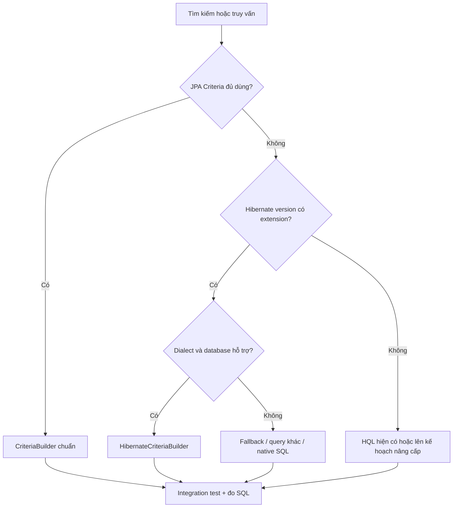

# HibernateCriteriaBuilder cùng các khả năng mở rộng theo phiên bản

## 1. Giới thiệu

Jakarta Persistence có API `CriteriaBuilder` để dựng truy vấn từ các biểu thức Java thay vì ghép chuỗi JPQL. Đây là lựa chọn hữu ích cho tìm kiếm động có nhiều điều kiện tùy chọn. Hibernate còn cung cấp `org.hibernate.query.criteria.HibernateCriteriaBuilder`, một giao diện **extends `CriteriaBuilder`**, mở rộng các phép toán và kiểu query để biểu đạt khả năng HQL không có trong các phiên bản JPA Criteria chuẩn tương ứng.

Ví dụ lấy builder:

```java
import org.hibernate.SessionFactory;
import org.hibernate.query.criteria.HibernateCriteriaBuilder;

SessionFactory factory =
    entityManagerFactory.unwrap(SessionFactory.class);

HibernateCriteriaBuilder cb =
    factory.getCriteriaBuilder();
```

Dù dùng HibernateCriteriaBuilder, code vẫn gọi được các method tiêu chuẩn như `createQuery`, `equal`, `and`, `or`, `like`, `between`, `in`, `exists` và `count`. Những tính năng bổ sung gồm window functions, CTE, set operations, các hàm chuyên biệt, SQL expression templates, INSERT Criteria và một số tiện ích chuyển đổi HQL/Criteria theo **đúng phiên bản**.

**Ba trục tương thích phải được kiểm tra riêng:**

1. Hibernate ORM version có method Java cần dùng không?
2. Jakarta Persistence version hiện tại chuẩn hóa những chức năng nào?
3. Database/Dialect có hỗ trợ SQL do Hibernate tạo ra không?

Có Java method không chứng minh một DBMS cụ thể sẽ chạy được SQL sinh ra.

## 2. API chuẩn và API Hibernate mở rộng

| Tiêu chí | JPA CriteriaBuilder | HibernateCriteriaBuilder |
|---|---|---|
| Package | `jakarta.persistence.criteria` | `org.hibernate.query.criteria` |
| Quan hệ kế thừa | Giao diện nền | Extends CriteriaBuilder |
| Filter động | Có | Kế thừa đầy đủ |
| Các phép JOIN, EXISTS, GROUP BY | Có | Kế thừa đầy đủ |
| Window functions nâng cao | Tùy phiên bản Jakarta | Có helper Hibernate riêng |
| CTE, derived roots | Giới hạn tùy chuẩn | Có extension Hibernate |
| Set operations | Tùy chuẩn | Có overload riêng theo release |
| Criteria INSERT | Không có trong các bản Criteria truyền thống | Có INSERT VALUES/SELECT extension |
| Native SQL expression | Không có helper tương đương trực tiếp | Có `sql(pattern, type, arguments)` |
| Portability qua JPA providers | Cao hơn | Chỉ khi sử dụng Hibernate |

Một mô hình hiệu quả là dùng API chuẩn cho truy vấn thường ngày và giới hạn Hibernate-only functionality trong những repository cần nó.



## 3. Truy cập builder trong ứng dụng JPA hoặc Spring

Có ba cách phổ biến:

```java
// Hibernate native:
HibernateCriteriaBuilder cb1 =
    sessionFactory.getCriteriaBuilder();

// Từ EntityManagerFactory:
HibernateCriteriaBuilder cb2 =
    entityManagerFactory.unwrap(SessionFactory.class)
        .getCriteriaBuilder();

// Từ EntityManager:
Session session = entityManager.unwrap(Session.class);
HibernateCriteriaBuilder cb3 =
    session.getCriteriaBuilder();
```

Imports gồm `org.hibernate.Session`, `org.hibernate.SessionFactory` và `org.hibernate.query.criteria.HibernateCriteriaBuilder`.

Khi không cần extension, dùng:

```java
CriteriaBuilder cb =
    entityManager.getCriteriaBuilder();
```

Khai biến là `CriteriaBuilder` giúp code không phụ thuộc method riêng Hibernate. Nếu một module phải hỗ trợ JPA provider khác, không nên cast builder sang kiểu Hibernate tùy tiện; sử dụng một repository adapter Hibernate riêng là minh bạch hơn.

## 4. Entity mẫu và bài toán truy vấn động

Giả sử có entity đơn hàng:

```java
@Entity
@Table(name = "purchase_orders")
public class PurchaseOrder {
    @Id
    @GeneratedValue(strategy = GenerationType.IDENTITY)
    private Long id;

    @Column(name = "order_code", nullable = false)
    private String orderCode;

    @Enumerated(EnumType.STRING)
    private OrderStatus status;

    private Instant createdAt;
    private BigDecimal totalAmount;

    @ManyToOne(fetch = FetchType.LAZY, optional = false)
    private Customer customer;

    protected PurchaseOrder() {}
}

@Entity
public class Customer {
    @Id
    private Long id;

    private String name;

    protected Customer() {}
}

public enum OrderStatus {
    DRAFT, CONFIRMED, CANCELLED
}
```

Đây là các mapping minh họa, không phải bộ class đã đủ constructors/getters/imports và validation. Trong dự án thực tế, đặt mỗi public entity ở file riêng, chọn ID generator và kiểu cột phù hợp DBMS.

Tiêu chí tìm kiếm:

```java
public record OrderSearch(
    OrderStatus status,
    String customerName,
    Instant fromInclusive,
    Instant toExclusive,
    BigDecimal minTotal
) {}
```

Dùng khoảng thời gian nửa mở `[fromInclusive, toExclusive)` thường rõ ràng hơn việc kết thúc ở `23:59:59.999` vì timestamp có độ chính xác khác nhau.

## 5. Dựng Criteria động theo chuẩn

```java
public List<PurchaseOrder> search(
        EntityManager em,
        OrderSearch input,
        int offset,
        int pageSize) {

    CriteriaBuilder cb = em.getCriteriaBuilder();
    CriteriaQuery<PurchaseOrder> query =
        cb.createQuery(PurchaseOrder.class);
    Root<PurchaseOrder> order =
        query.from(PurchaseOrder.class);

    List<Predicate> filters = new ArrayList<>();

    if (input.status() != null) {
        filters.add(cb.equal(
            order.get("status"),
            input.status()
        ));
    }
    if (input.fromInclusive() != null) {
        filters.add(cb.greaterThanOrEqualTo(
            order.get("createdAt"),
            input.fromInclusive()
        ));
    }
    if (input.toExclusive() != null) {
        filters.add(cb.lessThan(
            order.get("createdAt"),
            input.toExclusive()
        ));
    }
    if (input.minTotal() != null) {
        filters.add(cb.greaterThanOrEqualTo(
            order.get("totalAmount"),
            input.minTotal()
        ));
    }
    if (input.customerName() != null &&
            !input.customerName().isBlank()) {

        Join<PurchaseOrder, Customer> customer =
            order.join("customer");

        String pattern = "%" +
            input.customerName()
                .toLowerCase(Locale.ROOT) +
            "%";

        filters.add(cb.like(
            cb.lower(customer.get("name")),
            pattern
        ));
    }

    query.select(order)
         .where(filters.toArray(Predicate[]::new))
         .orderBy(
             cb.desc(order.get("createdAt")),
             cb.desc(order.get("id"))
         );

    return em.createQuery(query)
        .setFirstResult(offset)
        .setMaxResults(pageSize)
        .getResultList();
}
```

Các bước:

- `CriteriaQuery` biểu diễn SELECT trả về entity.
- `Root` là đối tượng trong FROM.
- `Join` truy cập association.
- `Predicate` biểu diễn điều kiện.
- `where` kết hợp danh sách điều kiện.
- `orderBy` tạo thứ tự, trong đó ID làm tie-breaker.
- `TypedQuery` dùng để bind parameters và phân trang.

**Criteria không tự động làm SQL hiệu quả hơn.** Điều kiện hàm trên cột có thể làm index không được tận dụng; JOIN one-to-many có thể nhân row; truy cập lazy associations sau query vẫn có thể tạo N+1.

### 5.1. Type safety với static metamodel

Thay vì các tên thuộc tính dạng chuỗi:

```java
Path<Instant> created =
    order.get(PurchaseOrder_.createdAt);

Join<PurchaseOrder, Customer> customer =
    order.join(PurchaseOrder_.customer);

Predicate predicate = cb.like(
    cb.lower(customer.get(Customer_.name)),
    pattern
);
```

Các class `PurchaseOrder_` và `Customer_` thường được tạo bởi annotation processor như Hibernate Processor. Chúng giúp compiler phát hiện nhiều lỗi rename field, nhưng không bảo đảm mọi query hợp lệ trên DBMS.

### 5.2. Input an toàn và LIKE

Không ghép user input vào HQL/SQL text. Có thể dùng parameter:

```java
ParameterExpression<OrderStatus> status =
    cb.parameter(OrderStatus.class, "status");

query.where(cb.equal(order.get("status"), status));

List<PurchaseOrder> result =
    em.createQuery(query)
      .setParameter("status", OrderStatus.CONFIRMED)
      .getResultList();
```

Nếu người dùng nhập `%` hoặc `_` trong phép LIKE, cần xác định đó là wildcard hay ký tự literal và escape theo yêu cầu. Bind parameter tránh SQL injection ở vị trí value, nhưng không tự thay đổi LIKE semantics.

## 6. JpaCriteriaQuery và các kiểu mở rộng

`HibernateCriteriaBuilder` có thể trả các kiểu cụ thể thuộc `org.hibernate.query.criteria`:

```java
HibernateCriteriaBuilder cb =
    sessionFactory.getCriteriaBuilder();

JpaCriteriaQuery<PurchaseOrder> query =
    cb.createQuery(PurchaseOrder.class);

JpaRoot<PurchaseOrder> order =
    query.from(PurchaseOrder.class);
```

`JpaCriteriaQuery<T>` extends JPA `CriteriaQuery<T>`. Nhờ return type cụ thể hơn, code có thể gọi extension như `createCountQuery()` ở Hibernate 6.4+.

```java
CriteriaQuery<PurchaseOrder> portable =
    cb.createQuery(PurchaseOrder.class);

JpaCriteriaQuery<PurchaseOrder> extended =
    cb.createQuery(PurchaseOrder.class);
```

Cả hai đều là Criteria query, nhưng biến `portable` chỉ lộ methods của interface chuẩn tại compile time. Không thể giải quyết lỗi method không tồn tại bằng việc cast nếu binary Hibernate thật sự chưa có method đó.

## 7. Extension: NULLS FIRST / NULLS LAST

Giá trị NULL có thứ tự mặc định khác nhau giữa DBMS. HibernateCriteriaBuilder cung cấp overload `asc`/`desc` nhận tham số null precedence ở các bản phù hợp.

```java
HibernateCriteriaBuilder cb =
    sessionFactory.getCriteriaBuilder();

JpaCriteriaQuery<PurchaseOrder> query =
    cb.createQuery(PurchaseOrder.class);

JpaRoot<PurchaseOrder> root =
    query.from(PurchaseOrder.class);

// Trên các release có overload boolean nullsFirst:
query.select(root).orderBy(
    cb.asc(root.get("deliveredAt"), false),
    cb.asc(root.get("id"))
);
```

Ý định là xếp NULL phía sau. Hibernate có thể render `NULLS LAST` hoặc biểu thức thay thế theo Dialect. Đây là ví dụ giả định entity có thuộc tính `deliveredAt`.

Với các phiên bản Jakarta Persistence mới, các khả năng về null precedence có thể được chuẩn hóa theo API riêng. Đừng sao chép một chữ ký Hibernate cụ thể sang mọi phiên bản.

## 8. Extension: format và SQL functions

API chuẩn đã có `lower`, `upper`, `concat`, `substring`, `coalesce` và `function`. Dùng helper chuẩn khi đủ:

```java
Expression<String> lowerCode =
    cb.lower(order.get("orderCode"));
```

HibernateCriteriaBuilder còn có các helper ngoài chuẩn như `format` cho temporal expression, một số hàm chuỗi/toán học/thời gian, aggregate và JSON/array functions theo release.

Ví dụ:

```java
HibernateCriteriaBuilder cb =
    sessionFactory.getCriteriaBuilder();

JpaCriteriaQuery<Tuple> query =
    cb.createTupleQuery();

JpaRoot<PurchaseOrder> order =
    query.from(PurchaseOrder.class);

JpaFunction<String> month =
    cb.format(order.get("createdAt"), "yyyy-MM");

query.multiselect(
    order.get("id").alias("id"),
    month.alias("month")
);
```

Pattern trong `format` được Hibernate diễn giải theo tài liệu của nó, không mặc định giống pattern của hàm PostgreSQL `to_char` hoặc MySQL `DATE_FORMAT`. Nếu chỉ lọc các đơn trong một tháng, dùng điều kiện `createdAt >= start` và `createdAt < nextMonth` thường dễ tận dụng index hơn.

## 9. Extension: window functions

Window functions thực hiện tính toán theo partition nhưng vẫn có thể trả một row cho mỗi record. Ví dụ SQL xếp hạng đơn hàng theo customer:

```sql
SELECT id, customer_id,
       ROW_NUMBER() OVER (
           PARTITION BY customer_id
           ORDER BY created_at DESC, id DESC
       ) AS row_num
FROM purchase_orders;
```

Trong Hibernate Criteria:

```java
HibernateCriteriaBuilder cb =
    sessionFactory.getCriteriaBuilder();

JpaCriteriaQuery<Tuple> query =
    cb.createTupleQuery();

JpaRoot<PurchaseOrder> root =
    query.from(PurchaseOrder.class);

JpaWindow window = cb.createWindow()
    .partitionBy(root.get("customer").get("id"))
    .orderBy(
        cb.desc(root.get("createdAt")),
        cb.desc(root.get("id"))
    );

JpaExpression<Long> position =
    cb.rowNumber(window);

query.multiselect(
    root.get("id").alias("id"),
    position.alias("position")
);
```

Các extension khác theo phiên bản gồm `rank`, `denseRank`, `firstValue`, `lastValue`, `lag`, `lead` và các aggregate window functions.

### 9.1. Window ORDER BY và result ORDER BY

`window.orderBy(...)` quyết định thứ tự trong mỗi partition. Nó **không tự sắp xếp toàn bộ result set**. Nếu ứng dụng muốn danh sách trả về có thứ tự cụ thể, cần `query.orderBy(...)` riêng.

### 9.2. Frame cho tổng lũy kế

```java
JpaWindow running = cb.createWindow()
    .partitionBy(root.get("customer").get("id"))
    .orderBy(cb.asc(root.get("createdAt")))
    .frameRows(
        cb.frameUnboundedPreceding(),
        cb.frameCurrentRow()
    );
```

Các DBMS có mức hỗ trợ khác nhau đối với `ROWS`, `RANGE`, `GROUPS` và frame exclusion. Có Hibernate Java method không bảo đảm DBMS cụ thể hỗ trợ cùng cú pháp/semantics.

## 10. Extension: filtered aggregates

Một số database hỗ trợ:

```sql
SELECT customer_id,
       COUNT(*) FILTER (WHERE status = 'CONFIRMED')
FROM purchase_orders
GROUP BY customer_id;
```

HibernateCriteriaBuilder ở những release phù hợp có overload aggregate nhận `JpaPredicate` filter:

```java
JpaPredicate confirmed = cb.equal(
    root.get("status"),
    OrderStatus.CONFIRMED
);

JpaExpression<Long> confirmedCount =
    cb.count(root.get("id"), confirmed);
```

Các helper như `functionAggregate` và `functionWithinGroup` cho phép diễn đạt những aggregate khác. Nếu chỉ cần đếm một trạng thái, JPA Criteria `WHERE` + `COUNT` có thể đơn giản và portable hơn. FILTER hữu ích khi muốn nhiều aggregate có điều kiện khác nhau trong cùng một GROUP BY.

Không JOIN nhiều collection rồi đếm tùy tiện: row multiplication có thể làm count bị phóng đại. Có thể cần `countDistinct` hoặc pre-aggregation.

## 11. Extension: sql(pattern, type, arguments)

`HibernateCriteriaBuilder.sql(...)` nhúng native SQL expression template. Ký tự `?` trong pattern được thay bằng các expression được truyền vào.

Ví dụ trên PostgreSQL có cài function `unaccent`:

```java
JpaExpression<String> unaccented = cb.sql(
    "unaccent(?)",
    String.class,
    customer.get("name")
);
```

Đây là API mạnh nhưng **phụ thuộc SQL/DBMS**. Không dùng nếu `cb.lower`, `cb.coalesce` hay `cb.function` đã giải quyết được nhu cầu.

**Bảo mật:** pattern phải là một chuỗi do code định nghĩa, không ghép tên hàm, cột hoặc mảnh SQL từ input không đáng tin cậy. Giá trị động dùng `ParameterExpression`/bind parameter; identifier dùng allowlist.

## 12. Mốc 6.3: chuyển HQL SELECT thành Criteria

Javadocs ghi overload `HibernateCriteriaBuilder.createQuery(String hql, Class<T>)` có từ Hibernate **6.3**. Nó biến một HQL SELECT query thành cây Criteria.

```java
HibernateCriteriaBuilder cb =
    sessionFactory.getCriteriaBuilder();

JpaCriteriaQuery<PurchaseOrder> query =
    cb.createQuery(
        """
        select o
        from PurchaseOrder o
        where o.status = :status
        """,
        PurchaseOrder.class
    );

List<PurchaseOrder> orders =
    entityManager.createQuery(query)
        .setParameter("status", OrderStatus.CONFIRMED)
        .getResultList();
```

Tính năng này phù hợp khi đã có một HQL base query cố định và muốn dùng nó như điểm bắt đầu cho Criteria. Nó **không hợp thức hóa việc nối dữ liệu người dùng trực tiếp vào HQL string**. Trên Hibernate 6.2, phương thức này chưa có với chữ ký trên.

## 13. Mốc 6.3: CriteriaDefinition

`org.hibernate.query.criteria.CriteriaDefinition` là một tiện ích DSL được tài liệu hóa từ Hibernate **6.3**.

```java
CriteriaDefinition<PurchaseOrder> definition =
    new CriteriaDefinition<>(
        sessionFactory,
        PurchaseOrder.class
    ) {{
        var order = from(PurchaseOrder.class);

        where(equal(
            order.get("status"),
            OrderStatus.CONFIRMED
        ));

        orderBy(desc(order.get("createdAt")));
    }};
```

Ví dụ dùng double-brace initialization để minh họa DSL. Đây không phải lý do dùng lớp ẩn danh trong mọi query. Với filter phụ thuộc từng request, dựng Criteria query mới thường rõ nghĩa và tránh shared mutable query state.

Nếu một Criteria definition được cache, không tiếp tục sửa `where`/`orderBy` trên cùng object đồng thời từ nhiều threads.

## 14. Mốc 6.4: JpaCriteriaQuery.createCountQuery()

`JpaCriteriaQuery<T>` có method `createCountQuery()` với mốc **Since: 6.4** trong Javadocs.

```java
JpaCriteriaQuery<PurchaseOrder> query =
    cb.createQuery(PurchaseOrder.class);

JpaRoot<PurchaseOrder> order =
    query.from(PurchaseOrder.class);

query.select(order)
     .where(cb.equal(
         order.get("status"),
         OrderStatus.CONFIRMED
     ));

JpaCriteriaQuery<Long> countQuery =
    query.createCountQuery();

Long total =
    entityManager.createQuery(countQuery)
        .getSingleResult();
```

Phương thức giúp tái sử dụng cấu trúc query khi đếm kết quả, nhưng cần hiểu **đơn vị kết quả**: một query JOIN one-to-many có thể tạo nhiều hàng cho cùng root; `COUNT` JOIN rows không luôn bằng số root entities duy nhất.

Đối với phân trang:

- Nếu mục tiêu là số root IDs, dùng query đếm đúng root semantics.
- Với `GROUP BY`, `DISTINCT` hoặc projection, kiểm tra count query sinh ra.
- Với collection `JOIN FETCH`, không mang fetch join sang count query một cách máy móc.
- Tạo integration test trên dữ liệu có nhiều children mỗi root.

Nếu đang dùng Hibernate 6.3, hãy viết một Criteria COUNT riêng:

```java
CriteriaQuery<Long> count =
    cb.createQuery(Long.class);

Root<PurchaseOrder> root =
    count.from(PurchaseOrder.class);

count.select(cb.count(root));
count.where(cb.equal(
    root.get("status"),
    OrderStatus.CONFIRMED
));
```

## 15. CTE và derived roots

Common Table Expressions (CTE) dùng SQL `WITH`, ví dụ:

```sql
WITH recent_orders AS (
    SELECT id, customer_id, total_amount
    FROM purchase_orders
    WHERE created_at >= :fromDate
)
SELECT customer_id, SUM(total_amount)
FROM recent_orders
GROUP BY customer_id;
```

Hibernate Criteria có những kiểu mở rộng như `JpaCteContainer`, `JpaCteCriteria` và các method `with(...)`, `withRecursiveUnionAll(...)` ở những phiên bản phù hợp.

Một recursive CTE có thể duyệt cây:

```sql
WITH RECURSIVE tree AS (
    SELECT id, parent_id, 0 AS depth
    FROM categories
    WHERE id = :rootId
    UNION ALL
    SELECT c.id, c.parent_id, t.depth + 1
    FROM categories c
    JOIN tree t ON c.parent_id = t.id
)
SELECT id, depth FROM tree;
```

Khi dựng bằng Criteria, cần kiểm tra generic types, CTE attribute definitions và callback producer theo Javadocs của bản Hibernate hiện tại. Đừng giả định mọi SQL feature như `SEARCH`/`CYCLE` hay materialization hints đều hỗ trợ trên mọi DBMS.

Hibernate cũng có extension cho derived root/subquery trong `FROM`. Với trường hợp đơn giản “nhóm khách có từ 5 đơn trở lên”, Criteria chuẩn `GROUP BY` + `HAVING` thường dễ dùng hơn một derived root.

## 16. Set operations: UNION, INTERSECT, EXCEPT

Các phép set:

- `UNION` hợp và loại tuple trùng.
- `UNION ALL` hợp nhưng giữ tuple trùng.
- `INTERSECT` lấy giao.
- `EXCEPT` lấy các giá trị thuộc tập trái không thuộc tập phải.

Ví dụ Hibernate Criteria với hai query ID:

```java
JpaCriteriaQuery<Long> q1 =
    cb.createQuery(Long.class);
JpaRoot<PurchaseOrder> a =
    q1.from(PurchaseOrder.class);

q1.select(a.get("id")).where(cb.equal(
    a.get("status"),
    OrderStatus.CONFIRMED
));

JpaCriteriaQuery<Long> q2 =
    cb.createQuery(Long.class);
JpaRoot<PurchaseOrder> b =
    q2.from(PurchaseOrder.class);

q2.select(b.get("id")).where(cb.equal(
    b.get("status"),
    OrderStatus.CANCELLED
));

JpaCriteriaQuery<Long> combined =
    cb.unionAll(q1, q2);
```

Đây là ví dụ mô tả API; với một status field, `WHERE status IN (...)` thường đơn giản hơn. Set operations hữu ích khi các nhánh có cấu trúc khác nhau nhưng result types tương thích.

Signatures và chuẩn hóa set operations thay đổi theo Hibernate/Jakarta Persistence version. SQL `INTERSECT ALL`/`EXCEPT ALL` có thể không portable trên các DBMS, phải kiểm tra Dialect.

## 17. Criteria INSERT là extension Hibernate

JPA Criteria truyền thống có SELECT, bulk UPDATE và DELETE. HibernateCriteriaBuilder còn có:

```java
JpaCriteriaInsertValues<ArchivedOrder> values =
    cb.createCriteriaInsertValues(ArchivedOrder.class);

JpaCriteriaInsertSelect<ArchivedOrder> select =
    cb.createCriteriaInsertSelect(ArchivedOrder.class);
```

Hai lời gọi trên **chỉ tạo đối tượng mutation**, chưa chỉ định đủ target columns/values hoặc SELECT nguồn.

Ý nghĩa SQL:

```sql
INSERT INTO archived_orders (id, order_code)
VALUES (:id, :code);

INSERT INTO archived_orders (id, order_code)
SELECT id, order_code
FROM purchase_orders
WHERE status = 'CANCELLED';
```

Bulk Criteria INSERT không phải vòng lặp `entityManager.persist`; nó không tự thực thi lifecycle callbacks/cascade trên từng entity. Với bulk UPDATE/DELETE tương tự, persistence context có thể giữ entity stale, và `@Version` không tự xử lý như dirty checking-managed update. Cần có transaction, khóa ngoại, auditing và cache synchronization thích hợp.

## 18. Mốc 7.0: set-returning functions

Hibernate 7.0 trở đi có những helper tạo function trả **nhiều hàng** như `setReturningFunction`, `generateSeries`, `unnestArray` và `unnestCollection`, theo Javadocs của những overload tương ứng.

Ví dụ SQL:

```sql
SELECT x
FROM generate_series(1, 10) AS x;
```

Điểm vào API Hibernate 7.x:

```java
// Chỉ khi version hiện tại có method:
var series = cb.generateSeries(1, 10);

// Dùng JpaSelectCriteria / JpaFrom.from hoặc join
// tương ứng để xây dựng một SELECT hoàn chỉnh.
```

Đây là ví dụ **khởi tạo expression**, không phải query thực thi hoàn chỉnh. Một DBMS có thể không hỗ trợ `generate_series` hoặc cần dialect translation. Không copy helper này vào Hibernate 6.6 và kỳ vọng compile được.

## 19. Ma trận phiên bản

| Mốc Hibernate | Khả năng tiêu biểu |
|---|---|
| 5.x | JPA Criteria và các API Hibernate cũ; không giả định package/signature của 6.x |
| **6.0** | `HibernateCriteriaBuilder` có từ 6.0 |
| **6.3** | `createQuery(String, Class)` để parse HQL SELECT sang Criteria; `CriteriaDefinition` |
| **6.4** | `JpaCriteriaQuery.createCountQuery()` |
| **6.5/6.6** | Các API window, CTE, aggregate, set operations được tài liệu hóa; cần kiểm tra từng overload |
| **7.0+** | Một số set-returning function helpers, như `generateSeries`, có mốc từ 7.0 |

**Đây là các mốc nổi bật, không phải danh sách tất cả tính năng theo release.** Một chức năng HQL/SQL có thể tồn tại trước khi một helper Criteria tương ứng được thêm vào.

Khi nâng cấp, phải xem cả **Hibernate ORM**, **Jakarta Persistence**, **JDK**, **Spring Boot/Spring Data nếu có**, **DBMS/Dialect**. API Java biên dịch thành công vẫn có thể phát SQL không được hệ quản trị cũ hỗ trợ.

## 20. @Incubating và chi phí bảo trì

Nhiều Hibernate extension được gắn `@Incubating` trong Javadocs. Nó báo hiệu API có thể thay đổi, không phải cam kết chức năng sẽ bị xóa.

Thực hành hợp lý:

- Ghi phiên bản Hibernate tối thiểu cho mỗi feature.
- Giới hạn extension trong repository/adapter thay vì đưa kiểu Hibernate ra public application API.
- Tránh gọi các lớp `internal` hoặc SPI khi public API có giải pháp.
- Dựng Criteria mới cho từng request nếu query cần mutate.
- Viết integration tests cho những method và SQL phụ thuộc DBMS.
- Xem migration guides khi nâng minor/major, nhất là những API incubating.

Ví dụ interface nghiệp vụ không lộ Hibernate types:

```java
public interface OrderSearchRepository {
    List<OrderSummary> search(
        OrderSearch filter,
        int offset,
        int limit
    );
}
```

Implementation bên trong có thể dùng HibernateCriteriaBuilder; service vẫn chỉ nhìn thấy DTO và contract nghiệp vụ.

## 21. Lỗi phổ biến và cách xử lý

| Triệu chứng | Nguyên nhân thường gặp | Hướng xử lý |
|---|---|---|
| `createWindow()` không được nhận diện | Biến có kiểu CriteriaBuilder chuẩn hoặc version thiếu method | Dùng HibernateCriteriaBuilder đúng version |
| `createQuery(String, Class)` không biên dịch | Hibernate trước 6.3 | Dựng Criteria chuẩn, giữ HQL, hoặc nâng version |
| `createCountQuery()` không biên dịch | JpaCriteriaQuery trước 6.4 | Viết count query riêng |
| `generateSeries()` không biên dịch | Hibernate 6.x chưa có helper 7.0 | Dùng phương án SQL/HQL khác hoặc nâng có kiểm soát |
| Function có trong Criteria nhưng SQL lỗi | Dialect/DBMS chưa hỗ trợ | Kiểm tra DB version, function registration và SQL |
| Count sai khi JOIN collection | Một root tạo nhiều SQL rows | COUNT DISTINCT root ID/EXISTS/query đếm riêng |
| Phân trang sai với collection fetch | JOIN nhân SQL rows | Page root IDs trước rồi fetch graph |
| Query SQL template có rủi ro injection | Pattern ghép từ untrusted input | Pattern cố định, bind parameters, allowlist identifiers |
| Query cùng object bị sửa từ nhiều threads | Shared mutable Criteria tree | Dựng query riêng hoặc immutable template |
| H2 test đúng, production lỗi | SQL/dialect/locking khác DBMS | Integration test trên DBMS đích |

Không dùng `distinct` như một miếng vá cho mọi truy vấn có JOIN collection; SQL DISTINCT không giải quyết triệt để row multiplication, cardinality của pagination hoặc multiple-bag fetching.

## 22. Kiểm thử và quan sát SQL

Trong Spring Boot với Hibernate 6:

```properties
logging.level.org.hibernate.SQL=DEBUG
spring.jpa.properties.hibernate.generate_statistics=true
```

Nếu cần bind tracing:

```properties
logging.level.org.hibernate.orm.jdbc.bind=TRACE
```

TRACE có thể lộ dữ liệu cá nhân hoặc secrets, chỉ bật có kiểm soát.

Các integration tests quan trọng:

1. **Dynamic filters:** thử không filter, nhiều filter, null, khoảng thời gian rỗng và điều kiện OR/AND.
2. **Window:** thử nhiều customers, timestamp bằng nhau, kiểm tra thứ tự partition và tie-breaker.
3. **Count:** thử JOIN one-to-many và DISTINCT; so với số root IDs thực.
4. **CTE/recursive CTE:** thử cây nhiều tầng, cycle/depth limit và DBMS hỗ trợ.
5. **Set operations:** kiểm tra UNION vs UNION ALL khi có giá trị trùng.
6. **Native SQL function:** kiểm tra function đã tồn tại trên DB và xử lý null/type đúng.
7. **Version upgrade:** chạy lại các query dùng `@Incubating`, xem SQL khác trước không.

Đo cả số query, số hàng JDBC trả về, execution plan, memory và hydration cost. Một Criteria tree nhìn gọn không đồng nghĩa SQL sinh ra tối ưu.

## 23. Kết luận

**HibernateCriteriaBuilder là phần mở rộng của JPA CriteriaBuilder**, phù hợp khi truy vấn động cần các tính năng HQL nâng cao mà API chuẩn của phiên bản đang dùng chưa diễn đạt tốt.

- Với tìm kiếm thông thường, ưu tiên `CriteriaBuilder` chuẩn: filter, join, exists, group by và projection.
- Với yêu cầu nâng cao, cân nhắc Hibernate extension: window, aggregate filter, CTE, set operations, Criteria INSERT và SQL expression templates.
- Với từng extension, đối chiếu **đúng method signature và mốc phiên bản**: 6.3 cho HQL-to-Criteria, 6.4 cho `createCountQuery()`, 7.0 cho một số set-returning functions.
- Phân biệt compile-time API compatibility với SQL dialect/database capability.
- Đưa vendor-specific code vào adapter, bind input an toàn và kiểm thử trên hệ quản trị thực.

### Tài liệu tham khảo theo phiên bản

- [Jakarta Persistence Specification](https://jakarta.ee/specifications/persistence/) — Criteria chuẩn.
- [HibernateCriteriaBuilder 6.0](https://docs.hibernate.org/orm/6.0/javadocs/org/hibernate/query/criteria/HibernateCriteriaBuilder.html) — API mở rộng ban đầu.
- [HibernateCriteriaBuilder 6.6](https://docs.hibernate.org/orm/6.6/javadocs/org/hibernate/query/criteria/HibernateCriteriaBuilder.html) — các method trong dòng 6.x.
- [JpaCriteriaQuery 6.6](https://docs.hibernate.org/orm/6.6/javadocs/org/hibernate/query/criteria/JpaCriteriaQuery.html) — `createCountQuery` và CTE query extensions.
- [CriteriaDefinition 6.6](https://docs.hibernate.org/orm/6.6/javadocs/org/hibernate/query/criteria/CriteriaDefinition.html) — mốc 6.3.
- [HibernateCriteriaBuilder 7.1](https://docs.hibernate.org/orm/7.1/javadocs/org/hibernate/query/criteria/HibernateCriteriaBuilder.html) — set-returning functions từ 7.0.
- [Hibernate HQL Reference 6.6](https://docs.hibernate.org/orm/6.6/querylanguage/html_single/) — window, CTE, set operators, functions.
- [Hibernate User Guide 6.6](https://docs.hibernate.org/orm/6.6/userguide/html_single/) — Criteria, mapping, SQL và performance.

Đừng dùng Javadocs `/current/` làm bằng chứng rằng một method đã có ở Hibernate bản cũ; hãy đọc tài liệu đúng artifact version đang triển khai.
