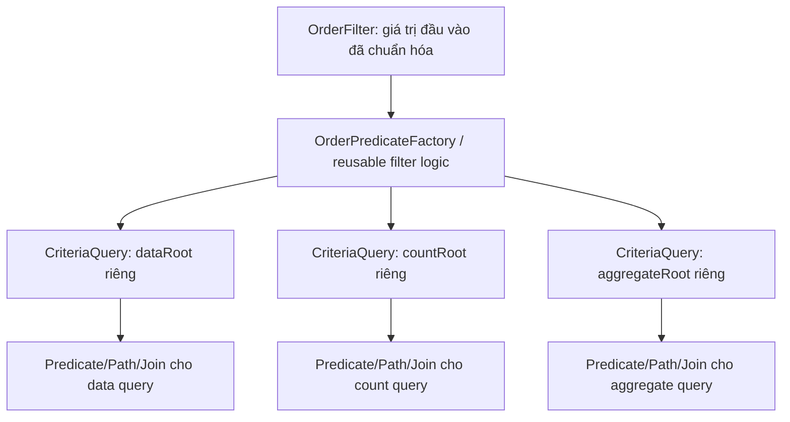

# Tái sử dụng phần điều kiện mà không làm sai alias hoặc phạm vi truy vấn trong Hibernate Criteria API

Trong ứng dụng Hibernate/Jakarta Persistence, nhiều truy vấn khác nhau có thể dùng **cùng một quy tắc lọc nghiệp vụ**: tìm đơn hàng đang hoạt động, chỉ lấy dữ liệu thuộc tenant hiện tại, lọc theo khoảng ngày hoặc trạng thái, và đếm tổng số bản ghi khớp để phân trang. Một nhu cầu tự nhiên là viết phần điều kiện một lần rồi dùng lại cho nhiều query.

Điểm dễ mắc lỗi nằm ở chữ **“dùng lại”**. Một đối tượng `Predicate`, `Path`, `Root` hoặc `Join` của Criteria API không phải đoạn SQL độc lập có thể mang sang mọi query. Nó là một **nút trong cây truy vấn** được gắn với nguồn dữ liệu, alias logic, association join và phạm vi (*scope*) của câu query đã tạo nó.

Nếu lấy predicate được xây từ `dataRoot` rồi gắn vào `countQuery` có `countRoot` khác, Hibernate có thể không tìm được SQL table group tương ứng, phát sinh alias sai, lỗi semantic model hoặc SQL không như kỳ vọng. Kể cả khi một phiên bản Hibernate nào đó chấp nhận trường hợp cụ thể, thiết kế này không phải cách tái sử dụng portable và đáng tin cậy.

Nguyên tắc trọng tâm của bài:

> **Tái sử dụng quy tắc hoặc hàm tạo điều kiện; tạo mới các node Criteria theo đúng `Root`, `Join`, `CriteriaQuery` và phạm vi truy vấn mà chúng phục vụ.**

Tài liệu này giải thích bản chất của alias/scope trong Criteria, trình bày cách viết bộ lọc tái sử dụng an toàn, quản lý join theo từng query, tạo data/count query, xử lý subquery tương quan, Spring Data `Specification`, multi-tenant scope, kiểm thử và những lỗi thường gặp.

## 1. Đặt vấn đề: một filter, nhiều loại truy vấn

Giả sử trang quản trị đơn hàng cần:

- Lấy danh sách đơn theo trạng thái, khoảng thời gian và tổng tiền.
- Đếm tổng số đơn khớp để trả thông tin phân trang.
- Tính tổng doanh thu của cùng tập đơn.
- Lấy ID những đơn được phép thao tác hàng loạt.
- Kiểm tra có tồn tại đơn chậm giao hay không.

Các câu query có `SELECT` và `FROM` khác nhau, nhưng nhiều predicate logic giống nhau:

```text
tenantId = currentTenant
AND status IN (PAID, SHIPPED)
AND createdAt >= fromInclusive
AND createdAt < toExclusive
AND totalAmount >= minTotal
```

Nếu copy-paste bộ lọc vào năm nơi, dễ quên một predicate bảo mật hoặc làm dữ liệu trang và count không thống nhất. Nếu chia sẻ một đối tượng `Predicate` được tạo trước, lại vướng scope của Criteria tree.

Giải pháp là giữ **giá trị filter bất biến** và một **factory/helper xây expression riêng cho từng root**.

### 1.1. Sơ đồ ranh giới đúng



Hàm tạo predicate có thể tái sử dụng. Những node được tạo ra trong mỗi lần gọi thì thuộc **cây query tương ứng**.

## 2. Mô hình dữ liệu xuyên suốt

Ví dụ dùng hệ thống bán hàng đa tenant:

```java
public enum OrderStatus {
    NEW, PAID, SHIPPED, CANCELLED
}
```

```java
import jakarta.persistence.*;
import java.math.BigDecimal;
import java.time.Instant;

@Entity
@Table(name = "purchase_order")
public class PurchaseOrder {

    @Id
    private Long id;

    @Column(name = "tenant_id", nullable = false)
    private Long tenantId;

    @Enumerated(EnumType.STRING)
    @Column(nullable = false)
    private OrderStatus status;

    @Column(name = "total_amount", nullable = false,
            precision = 18, scale = 2)
    private BigDecimal totalAmount;

    @Column(name = "created_at", nullable = false)
    private Instant createdAt;

    @ManyToOne(fetch = FetchType.LAZY, optional = false)
    @JoinColumn(name = "customer_id", nullable = false)
    private Customer customer;

    @OneToMany(mappedBy = "order", fetch = FetchType.LAZY)
    private java.util.List<OrderLine> lines = new java.util.ArrayList<>();

    protected PurchaseOrder() {}

    public Long getId() { return id; }
    public Long getTenantId() { return tenantId; }
    public OrderStatus getStatus() { return status; }
    public BigDecimal getTotalAmount() { return totalAmount; }
    public Instant getCreatedAt() { return createdAt; }
    public Customer getCustomer() { return customer; }
}
```

```java
@Entity
@Table(name = "customer")
public class Customer {

    @Id
    private Long id;

    @Column(nullable = false)
    private Long tenantId;

    @Column(name = "full_name", nullable = false)
    private String fullName;

    @Column(nullable = false)
    private boolean active;

    protected Customer() {}

    public Long getId() { return id; }
    public String getFullName() { return fullName; }
    public boolean isActive() { return active; }
}
```

```java
@Entity
@Table(name = "order_line")
public class OrderLine {

    @Id
    private Long id;

    @ManyToOne(fetch = FetchType.LAZY, optional = false)
    @JoinColumn(name = "order_id", nullable = false)
    private PurchaseOrder order;

    @Column(nullable = false)
    private String sku;

    @Column(nullable = false)
    private int quantity;

    protected OrderLine() {}

    public Long getId() { return id; }
}
```

Bảng dữ liệu có thể có các cột `purchase_order.tenant_id`, `purchase_order.customer_id` và `order_line.order_id`. Criteria dùng tên thuộc tính Java, ví dụ `root.get("createdAt")`, **không** dùng tên cột `created_at`.

## 3. Cây Criteria không phải chuỗi SQL độc lập

Những kiểu chính của Jakarta Persistence Criteria API:

| Kiểu | Chức năng | Phạm vi cần hiểu |
|---|---|---|
| `CriteriaBuilder` | Tạo query, predicate, expression và operation | Factory; không đồng nghĩa source của query |
| `CriteriaQuery<T>` | Đại diện cho SELECT query có kiểu `T` | Query tree riêng |
| `Root<X>` | Entity root khai báo trong `FROM` | Thuộc một query/from clause |
| `Path<X>` | Đường dẫn attribute bắt nguồn từ root/join | Gắn với parent path |
| `Join<Z, X>` | Node join association | Gắn với parent from/join |
| `Predicate` | Biểu thức Boolean | Thường tham chiếu các Path/Join thuộc query |
| `Subquery<T>` | Truy vấn lồng trong query cha | Có scope nội bộ và tương quan cha |
| `ParameterExpression<T>` | Chỗ giữ parameter có kiểu | Phải bind trong query được thực thi |
| `Selection<T>` | Thành phần SELECT/alias kết quả | Phạm vi selection riêng |
| `Order` | Biểu thức sắp xếp | Dẫn xuất từ expression thuộc query |

Về hình thức:

```java
CriteriaBuilder cb = em.getCriteriaBuilder();

CriteriaQuery<PurchaseOrder> query =
    cb.createQuery(PurchaseOrder.class);

Root<PurchaseOrder> root = query.from(PurchaseOrder.class);

Predicate p =
    cb.equal(root.get("status"), OrderStatus.PAID);

query.select(root).where(p);
```

`p` không chứa một câu SQL text có thể copy sang query bất kỳ. Nó giữ quan hệ với `root.get("status")`, mà root đó thuộc `query` hiện tại.

### 3.1. Alias ở tầng HQL/Criteria và SQL alias không đồng nhất

Một truy vấn JPQL/HQL dùng:

```hql
select o
from PurchaseOrder o
where o.status = :status
```

Ở đây `o` là identification variable của HQL. Hibernate có thể sinh SQL với alias như `po1_0` hoặc bất kỳ tên alias nào nó chọn:

```sql
SELECT po1_0.id, po1_0.status, ...
FROM purchase_order po1_0
WHERE po1_0.status = ?;
```

Tên SQL alias là chi tiết của SQL translator và Dialect; nó không phải một chuỗi nên được tự chế rồi gán vào mọi node Criteria.

### 3.2. `root.alias(...)` không giải quyết lỗi scope

Criteria cho phép đặt alias:

```java
Root<PurchaseOrder> root = query.from(PurchaseOrder.class);
root.alias("orderRoot");
```

Alias này có thể hữu ích với selection/tuple hoặc diễn đạt query model, nhưng **không biến root thành node toàn cục**. Đặt cùng tên alias cho hai root trong hai query không có nghĩa có thể dùng `Predicate` của query thứ nhất trong query thứ hai.

Vấn đề nằm ở **đối tượng root và phạm vi AST**, không chỉ ở tên alias nhìn thấy trong source.

## 4. Anti-pattern: lưu sẵn `Predicate` rồi dùng ở nhiều query

Đoạn sau có vấn đề:

```java
CriteriaBuilder cb = em.getCriteriaBuilder();

CriteriaQuery<PurchaseOrder> dataQuery =
    cb.createQuery(PurchaseOrder.class);

Root<PurchaseOrder> dataRoot =
    dataQuery.from(PurchaseOrder.class);

Predicate paid =
    cb.equal(dataRoot.get("status"), OrderStatus.PAID);

dataQuery.select(dataRoot).where(paid);

// Query khác, root khác.
CriteriaQuery<Long> countQuery =
    cb.createQuery(Long.class);

Root<PurchaseOrder> countRoot =
    countQuery.from(PurchaseOrder.class);

countQuery.select(cb.count(countRoot))
          .where(paid); // SAI THIẾT KẾ: paid trỏ về dataRoot.
```

`paid` được sinh từ `dataRoot` nhưng count query chỉ khai báo `countRoot`. Khi chuyển thành SQL, translator có thể không tìm ra table group tương ứng với `dataRoot` trong `countQuery` hoặc tạo SQL không hợp lệ.

Một số lỗi hay gặp ở những phiên bản và trường hợp khác nhau:

- `Could not locate TableGroup` hoặc thông báo thiếu table group.
- `Invalid path`/lỗi giải quyết alias.
- `Already registered a copy` trong một số luồng copy Semantic Query Model.
- Lỗi SQL alias không nằm trong `FROM`.
- Query trả count sai nếu node/joins được tái sử dụng không đúng.

Tên exception chính xác là implementation detail, **không phải tiêu chuẩn để xác nhận thiết kế**. Ngay cả khi một test tình cờ chạy được, không nên dựa vào việc chia sẻ node giữa các query độc lập.

### 4.1. “Cùng entity type” không có nghĩa “cùng root”

`dataRoot` và `countRoot` đều có type `PurchaseOrder`, nhưng chúng được tạo từ những câu query khác nhau. Giống như hai biến Java cùng kiểu không tự đại diện cho một đối tượng, hai `Root<PurchaseOrder>` cũng không thể thay thế cho nhau trong cây query.

## 5. Cách đúng: tái sử dụng hàm tạo predicate

Thay vì lưu `Predicate`, lưu **công thức tạo Predicate**:

```java
static Predicate hasStatus(
        CriteriaBuilder cb,
        Root<PurchaseOrder> root,
        OrderStatus status) {

    return cb.equal(root.get("status"), status);
}
```

Dùng trong data query:

```java
CriteriaQuery<PurchaseOrder> dataQuery =
    cb.createQuery(PurchaseOrder.class);

Root<PurchaseOrder> dataRoot =
    dataQuery.from(PurchaseOrder.class);

dataQuery.select(dataRoot)
         .where(hasStatus(
             cb, dataRoot, OrderStatus.PAID
         ));
```

Dùng trong count query:

```java
CriteriaQuery<Long> countQuery =
    cb.createQuery(Long.class);

Root<PurchaseOrder> countRoot =
    countQuery.from(PurchaseOrder.class);

countQuery.select(cb.count(countRoot))
          .where(hasStatus(
              cb, countRoot, OrderStatus.PAID
          ));
```

Mỗi lời gọi tạo một `Predicate` mới trỏ tới đúng root. Tái sử dụng nằm ở hàm `hasStatus` và giá trị `PAID`, không ở node đã tạo.

### 5.1. Chữ ký helper nên nhận những phụ thuộc gì?

Một helper đơn giản nên nhận:

- `CriteriaBuilder` để tạo expression.
- `Root<T>` hoặc `From<?, T>`/`Join<?, T>` đúng phạm vi.
- Giá trị filter, tốt nhất qua object bất biến.
- Nếu cần subquery: `CriteriaQuery<?>` hoặc `CommonAbstractCriteria`/`Subquery<?>` phù hợp.
- Nếu cần join: một query-local join registry thay vì global cache.

Không nên cho helper tự tạo `EntityManager` mới hoặc mở transaction khi chỉ cần xây predicate. Điều đó làm mờ ranh giới truy vấn và khiến test khó kiểm soát.

## 6. Tạo filter object bất biến

Giả sử request có các tiêu chí:

```java
import java.math.BigDecimal;
import java.time.Instant;
import java.util.Set;

public record OrderFilter(
    Set<OrderStatus> statuses,
    BigDecimal minTotal,
    BigDecimal maxTotal,
    Instant fromInclusive,
    Instant toExclusive,
    String customerName
) {
    public OrderFilter {
        statuses = statuses == null
            ? null
            : Set.copyOf(statuses);
    }
}
```

`OrderFilter` chứa **giá trị** và không giữ `Root`, `Path` hay `Predicate`. Nó có thể được dùng cho:

- Query dữ liệu.
- Query đếm.
- Query tổng hợp.
- Query kiểm tra tồn tại.
- Query lấy ID.

Nếu cần chuẩn hóa `customerName`, làm ở lớp validate/normalization hoặc trong helper, nhưng phải đảm bảo nhất quán. Không để query data lowercase nhưng count lại so sánh case-sensitive.

### 6.1. Quy định rõ ý nghĩa của tập status rỗng

Ba trường hợp khác nhau:

1. `statuses == null`: không áp dụng filter status.
2. `statuses.isEmpty()`: không status nào được phép, kết quả rỗng.
3. Có phần tử: lọc theo tập tương ứng.

Nếu nghiệp vụ chọn ý nghĩa khác cho list rỗng, phải ghi rõ. Đừng để một query bỏ qua list rỗng còn query khác tạo `IN ()` không tương thích DBMS.

## 7. Bộ lọc tái sử dụng cho các thuộc tính của root

Một helper xây tất cả điều kiện thuộc root:

```java
import jakarta.persistence.criteria.*;
import java.math.BigDecimal;
import java.time.Instant;
import java.util.ArrayList;
import java.util.List;

public final class OrderFilters {

    private OrderFilters() {}

    public static List<Predicate> rootPredicates(
            CriteriaBuilder cb,
            Root<PurchaseOrder> root,
            OrderFilter filter,
            Long currentTenantId) {

        List<Predicate> conditions = new ArrayList<>();

        // Điều kiện bắt buộc, không phụ thuộc request.
        conditions.add(cb.equal(
            root.get("tenantId"),
            currentTenantId
        ));

        if (filter.statuses() != null) {
            if (filter.statuses().isEmpty()) {
                conditions.add(cb.disjunction());
            } else {
                conditions.add(
                    root.get("status").in(filter.statuses())
                );
            }
        }

        if (filter.minTotal() != null) {
            conditions.add(cb.greaterThanOrEqualTo(
                root.<BigDecimal>get("totalAmount"),
                filter.minTotal()
            ));
        }

        if (filter.maxTotal() != null) {
            conditions.add(cb.lessThanOrEqualTo(
                root.<BigDecimal>get("totalAmount"),
                filter.maxTotal()
            ));
        }

        if (filter.fromInclusive() != null) {
            conditions.add(cb.greaterThanOrEqualTo(
                root.<Instant>get("createdAt"),
                filter.fromInclusive()
            ));
        }

        if (filter.toExclusive() != null) {
            conditions.add(cb.lessThan(
                root.<Instant>get("createdAt"),
                filter.toExclusive()
            ));
        }

        return conditions;
    }
}
```

Điểm quan trọng:

- Mỗi lần gọi `rootPredicates` tạo **List/Predicate mới**.
- Những Path được tạo từ `root` được cung cấp trong lời gọi hiện tại.
- `currentTenantId` là giá trị tin cậy do server xác định.
- `cb.disjunction()` diễn đạt “không match hàng nào” với tập status rỗng.
- `maxTotal` và `minTotal` không tự bảo đảm khoảng hợp lệ; cần validate riêng.

### 7.1. Áp dụng bộ điều kiện

```java
List<Predicate> predicates =
    OrderFilters.rootPredicates(
        cb, root, filter, currentTenantId
    );

query.where(predicates.toArray(Predicate[]::new));
```

Nếu muốn gộp với predicate khác, có thể:

```java
predicates.add(cb.isNotNull(root.get("createdAt")));

query.where(cb.and(predicates.toArray(Predicate[]::new)));
```

Không gọi `where(...)` nhiều lần với kỳ vọng nó tự động nối `AND`. Một lời gọi `where` mới **thay thế** những restriction được đặt trước đó. Hãy gom các điều kiện thành một cây logic cuối cùng.

## 8. Data query và count query phải có root riêng

Ví dụ phương thức tìm kiếm phân trang:

```java
public List<PurchaseOrder> findPage(
        EntityManager em,
        OrderFilter filter,
        Long tenantId,
        int offset,
        int limit) {

    CriteriaBuilder cb = em.getCriteriaBuilder();

    CriteriaQuery<PurchaseOrder> query =
        cb.createQuery(PurchaseOrder.class);

    Root<PurchaseOrder> root =
        query.from(PurchaseOrder.class);

    List<Predicate> predicates =
        OrderFilters.rootPredicates(
            cb, root, filter, tenantId
        );

    query.select(root)
         .where(predicates.toArray(Predicate[]::new))
         .orderBy(
             cb.desc(root.get("createdAt")),
             cb.desc(root.get("id"))
         );

    return em.createQuery(query)
             .setFirstResult(offset)
             .setMaxResults(limit)
             .getResultList();
}
```

Count query:

```java
public long countOrders(
        EntityManager em,
        OrderFilter filter,
        Long tenantId) {

    CriteriaBuilder cb = em.getCriteriaBuilder();

    CriteriaQuery<Long> query =
        cb.createQuery(Long.class);

    Root<PurchaseOrder> root =
        query.from(PurchaseOrder.class);

    List<Predicate> predicates =
        OrderFilters.rootPredicates(
            cb, root, filter, tenantId
        );

    query.select(cb.count(root))
         .where(predicates.toArray(Predicate[]::new));

    return em.createQuery(query).getSingleResult();
}
```

Hai query gọi **cùng helper** nhưng tạo root riêng. Điều kiện lọc được giữ đồng nhất về logic mà không trộn scope.

### 8.1. Trách nhiệm không giống nhau của data và count

| Phần | Data query | Count query |
|---|---|---|
| Root | Riêng | Riêng |
| Filter logic | Dùng helper chung | Dùng helper chung |
| Selection | Entity hoặc DTO | `count`/`countDistinct` |
| Ordering | Có nếu API yêu cầu | Thường không cần |
| Pagination | `setFirstResult`/`setMaxResults` | Không |
| Fetch association | Theo use case | Thường không fetch |
| Grouping | Chỉ khi cần | Cần thiết kế lại nếu count nhóm |

Không cố “copy toàn bộ data query rồi thay select bằng count” khi query có fetch join, group/having hoặc projections đặc thù.

## 9. Vì sao alias SQL không thể được tái sử dụng bằng cách đặt tên giống nhau?

Một lập trình viên thử:

```java
Root<PurchaseOrder> dataRoot = dataQuery.from(PurchaseOrder.class);
dataRoot.alias("o");

Root<PurchaseOrder> countRoot = countQuery.from(PurchaseOrder.class);
countRoot.alias("o");
```

Rồi cho rằng predicate `cb.equal(dataRoot.get("status"), ...)` có thể dùng cho count query vì cả hai root mang alias `"o"`.

Sai. Tên alias là **metadata của node**, không phải cơ chế “trỏ root mới”. Predicate vẫn tham chiếu object `dataRoot`.

Phân biệt:

- **Alias logic trong Criteria/HQL**: tên biểu tượng dùng trong một phạm vi query.
- **SQL table alias**: tên mà Hibernate sinh trong SQL cuối cùng.
- **Root identity**: node cụ thể xuất hiện trong `FROM` của query.
- **Scope**: nơi một root/path được phép tham chiếu.

Tái sử dụng alias name không chuyển `Path` từ scope này sang scope khác.

### 9.1. Alias của Tuple/Selection là trường hợp khác

```java
CriteriaQuery<Tuple> cq = cb.createTupleQuery();
Root<PurchaseOrder> root = cq.from(PurchaseOrder.class);

cq.multiselect(
    root.get("id").alias("orderId"),
    root.get("status").alias("orderStatus")
);
```

Tên `"orderId"`/`"orderStatus"` dùng để lấy phần tử `Tuple`:

```java
Tuple row = em.createQuery(cq).getResultList().get(0);
Long id = row.get("orderId", Long.class);
```

Chúng **không** làm các `Path` này trở thành có thể gắn vào query khác. Alias selection còn có thể bị ràng buộc tính duy nhất trong compound selection; tránh gán trùng alias.

## 10. Join cũng là node thuộc query

Bộ lọc theo tên khách hàng cần join:

```java
Join<PurchaseOrder, Customer> customer =
    root.join("customer", JoinType.INNER);

Predicate p = cb.like(
    cb.lower(customer.get("fullName")),
    "%an%"
);
```

`customer` được tạo từ `root` cụ thể. Không mang join ấy sang count query có root khác.

Anti-pattern:

```java
Join<PurchaseOrder, Customer> dataCustomer =
    dataRoot.join("customer");

Predicate customerNameFilter = cb.like(
    dataCustomer.get("fullName"),
    "An%"
);

// countRoot là Root khác:
countQuery.where(customerNameFilter); // Sai scope.
```

Cách đúng: mỗi query tạo join của riêng nó, rồi tạo predicate theo join đó.

### 10.1. Join type ảnh hưởng semantics

`INNER JOIN` chỉ giữ root có association khớp. `LEFT JOIN` giữ cả root không có association, nhưng nếu đặt điều kiện ở `WHERE` trên cột bên phải, các root có NULL có thể vẫn bị loại.

Ví dụ với customer không bắt buộc:

```java
Join<PurchaseOrder, Customer> customer =
    root.join("customer", JoinType.LEFT);

Predicate exactName =
    cb.equal(customer.get("fullName"), "An");

query.where(exactName);
```

Điều kiện ở `WHERE` có thể khiến `LEFT JOIN` vận hành như lọc inner đối với mục đích này.

Nếu muốn lọc **hàng bên phải mà vẫn giữ root không khớp**, cân nhắc predicate trong `join.on(...)` và cách xây selection/aggregate phù hợp. Không chuyển mọi predicate giữa `ON` và `WHERE` một cách máy móc.

## 11. Tái sử dụng helper có join một cách an toàn

Một helper trực tiếp:

```java
static Predicate customerNameContains(
        CriteriaBuilder cb,
        Root<PurchaseOrder> root,
        String name) {

    Join<PurchaseOrder, Customer> customer =
        root.join("customer", JoinType.INNER);

    String pattern = "%" +
        name.toLowerCase(java.util.Locale.ROOT)
        + "%";

    return cb.like(
        cb.lower(customer.get("fullName")),
        pattern
    );
}
```

Helper trên tạo join mới theo root được truyền, nên tránh scope sai. Nhưng còn một vấn đề: nếu gọi helper nhiều lần cho các điều kiện của cùng association, có thể tạo **nhiều join**.

Ví dụ:

```java
Predicate p1 = customerNameContains(cb, root, "an");
Predicate p2 = customerIsActive(cb, root); // Nếu hàm này cũng join("customer").
```

Query có thể chứa hai join đến `customer`. Với to-one, SQL có thể chỉ dư join; với to-many, join lặp có thể gây nhân số hàng nghiêm trọng hoặc thay đổi semantics.

Giải pháp là **chia sẻ join trong cùng query**, nhưng **không chia sẻ join giữa các query khác nhau**.

## 12. Query-local join registry

Một cách đơn giản với một association thường dùng là tạo object giữ join cho đúng root:

```java
import jakarta.persistence.criteria.Join;
import jakarta.persistence.criteria.JoinType;
import jakarta.persistence.criteria.Root;

public final class OrderJoins {

    private final Root<PurchaseOrder> root;

    private Join<PurchaseOrder, Customer> customer;

    public OrderJoins(Root<PurchaseOrder> root) {
        this.root = root;
    }

    public Join<PurchaseOrder, Customer> customerInner() {
        if (customer == null) {
            customer = root.join("customer", JoinType.INNER);
        }
        return customer;
    }
}
```

Trong data query:

```java
Root<PurchaseOrder> root = query.from(PurchaseOrder.class);
OrderJoins joins = new OrderJoins(root);

Join<PurchaseOrder, Customer> customer = joins.customerInner();

Predicate p1 = cb.like(
    cb.lower(customer.get("fullName")),
    "%an%"
);

Predicate p2 = cb.isTrue(customer.get("active"));

query.where(cb.and(p1, p2));
```

Trong count query, tạo registry **mới**:

```java
Root<PurchaseOrder> root = countQuery.from(PurchaseOrder.class);
OrderJoins joins = new OrderJoins(root);
// Các helper của count dùng joins mới này.
```

### 12.1. Không cache Join trong singleton

Sai thiết kế:

```java
@Service
public class GlobalJoinCache {
    private Join<PurchaseOrder, Customer> customerJoin;
}
```

Join phụ thuộc root và query, không phải trạng thái singleton. Nếu service này phục vụ nhiều request/transaction, việc giữ join có thể gây scope sai, race condition và leak các query tree.

Một join registry đúng phải có **lifecycle ngắn bằng query builder context** và không được chia sẻ giữa các query độc lập.

### 12.2. Khóa cache join phải thể hiện cả join type và ngữ nghĩa `ON`

Nếu dùng map nhiều association, key không thể chỉ luôn là tên `"customer"`. Cùng association có thể được join dạng `LEFT` hoặc `INNER`, hoặc có `ON` khác nhau. Reuse sai join type/ON làm thay đổi kết quả.

Với ví dụ `OrderJoins` bên trên, chỉ hỗ trợ `INNER` một cách tường minh. Nếu cần cả LEFT và INNER, phải thiết kế các method/cache key khác nhau hoặc tái cấu trúc query.

## 13. Filter builder nhận query-local context

Một giải pháp giúp code rõ khi nhiều predicate cùng dùng join là context cục bộ:

```java
public final class OrderQueryContext {

    private final CriteriaBuilder cb;
    private final Root<PurchaseOrder> root;
    private final OrderJoins joins;

    public OrderQueryContext(
            CriteriaBuilder cb,
            Root<PurchaseOrder> root) {

        this.cb = cb;
        this.root = root;
        this.joins = new OrderJoins(root);
    }

    public Predicate status(OrderStatus status) {
        return cb.equal(root.get("status"), status);
    }

    public Predicate customerActive() {
        return cb.isTrue(joins.customerInner().get("active"));
    }

    public Predicate customerName(String pattern) {
        return cb.like(
            cb.lower(joins.customerInner().get("fullName")),
            pattern
        );
    }
}
```

Mỗi data/count query tạo một `OrderQueryContext` mới với root của chính nó. Helper có thể tái sử dụng cách diễn đạt điều kiện mà vẫn giới hạn node vào đúng phạm vi.

**QueryContext ở đây là helper do ứng dụng tạo**, không phải Hibernate persistence context. Tránh đặt tên chung chung gây hiểu nhầm giữa hai khái niệm.

## 14. Tách logic thuần khỏi cây Criteria

Không phải mọi phần của filter đều cần truy cập `CriteriaBuilder`. Một số bước nên thực hiện bằng Java thuần:

- Chuẩn hóa chữ hoa/thường theo chính sách.
- Kiểm tra khoảng `min <= max`.
- Quy đổi ngày địa phương sang instant/timezone thống nhất.
- Chuyển trạng thái từ text sang enum hợp lệ.
- Áp dụng default và giới hạn page size.
- Whitelist trường sắp xếp.
- Escape wildcard cho `LIKE`.
- Chọn giới hạn tối đa cho tập `IN`.

Ví dụ:

```java
public static String likeContainsPattern(String input) {
    String normalized =
        input.strip().toLowerCase(java.util.Locale.ROOT);

    String escaped = normalized
        .replace("!", "!!")
        .replace("%", "!%")
        .replace("_", "!_");

    return "%" + escaped + "%";
}
```

Trong Criteria:

```java
Predicate nameFilter = cb.like(
    cb.lower(customerJoin.get("fullName")),
    likeContainsPattern(filter.customerName()),
    '!'
);
```

Hàm `likeContainsPattern` có thể tái sử dụng giữa nhiều query mà không có rủi ro alias vì nó chỉ xử lý dữ liệu Java, không giữ `Path`.

### 14.1. Đừng lẫn normalization với authorization

Một filter tùy chọn có thể bị bỏ qua. Nhưng điều kiện `tenantId = currentTenant` hoặc `deleted = false` (nếu domain có soft delete) phải luôn được áp dụng theo chính sách server. Không để client quyết định có thêm guard hay không.

## 15. Kết hợp điều kiện với `AND`, `OR` mà không mất phạm vi

Giả sử lọc:

```text
tenant = T
AND
(status = PAID OR status = SHIPPED)
AND
(total >= minTotal)
```

Cách đúng:

```java
Predicate allowedStatuses = cb.or(
    cb.equal(root.get("status"), OrderStatus.PAID),
    cb.equal(root.get("status"), OrderStatus.SHIPPED)
);

Predicate tenant = cb.equal(
    root.get("tenantId"), currentTenantId
);

Predicate minTotal = cb.greaterThanOrEqualTo(
    root.<BigDecimal>get("totalAmount"),
    minAmount
);

query.where(cb.and(
    tenant,
    allowedStatuses,
    minTotal
));
```

Nếu dùng `cb.or(tenant, allowedStatuses, minTotal)` thì logic trở thành hoàn toàn khác và có thể cho phép vượt tenant. Điều này là lỗi nghiệp vụ/bảo mật, không chỉ cú pháp.

### 15.1. `conjunction` và `disjunction`

- `cb.conjunction()`: predicate đúng với zero conjuncts.
- `cb.disjunction()`: predicate sai với zero disjuncts.

Dùng chúng khi logic đòi hỏi rõ:

```java
Predicate noneAllowed = cb.disjunction();

Predicate noExtraRestriction = cb.conjunction();
```

Không lạm dụng `conjunction()` trong một helper filter bắt buộc; nó có thể vô tình biến thiếu dữ liệu kiểm soát truy cập thành điều kiện luôn đúng.

### 15.2. Mỗi lần `where(...)` là một thiết lập của query

Sai kỳ vọng:

```java
query.where(tenantPredicate);
query.where(statusPredicate); // Có thể thay thế tenantPredicate.
```

Cách đúng:

```java
query.where(cb.and(
    tenantPredicate,
    statusPredicate
));
```

Hoặc gom tất cả predicate vào list và gọi `where` một lần sau khi hoàn tất các filter.

## 16. Count query và duplicate roots khi join to-many

Một query tìm customer có đơn PAID:

```java
CriteriaQuery<Customer> dataQuery =
    cb.createQuery(Customer.class);

Root<Customer> customer = dataQuery.from(Customer.class);
Join<Customer, PurchaseOrder> orders =
    customer.join("orders", JoinType.INNER);

dataQuery.select(customer)
         .distinct(true)
         .where(cb.equal(
             orders.get("status"), OrderStatus.PAID
         ));
```

Nếu một customer có 5 order PAID, SQL join có thể tạo 5 hàng cho customer đó.

Count query tương ứng **không thể** đơn giản chỉ làm:

```java
countQuery.select(cb.count(countRoot));
```

trên cùng join rồi nghĩ kết quả là số customer. Nó có thể đếm 5 hàng join.

Nếu count cần số customer duy nhất:

```java
countQuery.select(
    cb.countDistinct(countRoot.get("id"))
);
```

Nhưng điều kiện join phải được xây **lại theo countRoot**, không dùng `orders` từ data query.

### 16.1. `countDistinct` cũng có chi phí

`countDistinct(id)` có thể cần sort/hash hoặc chiến lược loại duplicate. Nếu chỉ cần biết mỗi customer có ít nhất một order PAID, `EXISTS` thường là cách diễn đạt rõ ràng và có thể tránh join multiplication ở tầng query logic.

Tuy nhiên, chọn cách nào cần dựa trên SQL execution plan và DBMS mục tiêu. `EXISTS` không phải lời hứa luôn nhanh hơn.

## 17. Tái sử dụng quy tắc “có ít nhất một child” bằng subquery

Yêu cầu: lấy customer có ít nhất một order PAID. Chúng ta muốn dùng cùng quy tắc trong query lấy customer và query đếm customer.

Cách an toàn là helper nhận **outer query** và **outer root** rồi tạo `Subquery` mới mỗi lần:

```java
static Predicate hasPaidOrder(
        CriteriaBuilder cb,
        CriteriaQuery<?> outerQuery,
        Root<Customer> customer) {

    Subquery<Long> sq = outerQuery.subquery(Long.class);

    Root<PurchaseOrder> order = sq.from(PurchaseOrder.class);

    sq.select(cb.literal(1L));

    sq.where(
        cb.equal(
            order.get("customer").get("id"),
            customer.get("id")
        ),
        cb.equal(
            order.get("status"),
            OrderStatus.PAID
        )
    );

    return cb.exists(sq);
}
```

Data query:

```java
CriteriaQuery<Customer> data =
    cb.createQuery(Customer.class);

Root<Customer> dataCustomer = data.from(Customer.class);

data.select(dataCustomer)
    .where(hasPaidOrder(cb, data, dataCustomer));
```

Count query:

```java
CriteriaQuery<Long> count =
    cb.createQuery(Long.class);

Root<Customer> countCustomer = count.from(Customer.class);

count.select(cb.count(countCustomer))
     .where(hasPaidOrder(cb, count, countCustomer));
```

Mỗi lời gọi tạo một subquery gắn với **outer query tương ứng**. Predicate bên trong dùng root mới của subquery và tham chiếu outer root đúng phạm vi.

### 17.1. Không giữ `Subquery` toàn cục

Sai:

```java
private Subquery<Long> cachedPaidOrderSubquery;
```

`Subquery` có query parent và scope. Nó không phải “mẫu truy vấn” độc lập để gắn vào mọi outer query. Nếu muốn reuse, giữ một helper tạo subquery mới như trên.

## 18. Correlation scope: outer query và subquery khác nhau

Một subquery có scope nội bộ. Có hai cách diễn đạt tương quan thường gặp:

1. Tạo root riêng trong subquery, rồi so sánh với path của outer root.
2. Dùng `subquery.correlate(outerRootOrJoin)` để tạo correlated root/join theo Criteria API.

Ví dụ tương quan bằng `correlate`:

```java
CriteriaQuery<Customer> cq =
    cb.createQuery(Customer.class);

Root<Customer> customer = cq.from(Customer.class);

Subquery<Long> sq = cq.subquery(Long.class);

Root<Customer> correlatedCustomer = sq.correlate(customer);

Join<Customer, PurchaseOrder> orders =
    correlatedCustomer.join("orders", JoinType.INNER);

sq.select(cb.literal(1L))
  .where(cb.equal(
      orders.get("status"),
      OrderStatus.PAID
  ));

cq.select(customer)
  .where(cb.exists(sq));
```

`correlatedCustomer` đại diện cho customer của outer query trong scope subquery. Điều này khác với việc tạo một root mới độc lập và hi vọng Hibernate tự đoán quan hệ.

### 18.1. Correlate là thao tác có chủ đích

Dùng `correlate` khi cần thể hiện association/path của outer query trong subquery. Không dùng để “sửa” một predicate được copy từ data query sang count query. Một subquery tương quan vẫn phải được tạo đúng cho **parent query** hiện tại.

### 18.2. Subquery lồng nhau cần phân biệt mỗi scope

Nếu query có hai cấp subquery, hãy dùng tên biến rõ:

```text
outerCustomerRoot
  -> outerQuery
      -> paidOrderSubquery
          -> subOrderRoot
          -> nestedLineSubquery
              -> subLineRoot
```

Không dùng một biến `root` chung rồi vô tình tham chiếu sai cấp. Đặc biệt khi các entity có attribute cùng tên `id`, lỗi scope có thể khó nhìn vì Java type vẫn hợp lệ.

## 19. Correlation và filter tenant trong subquery

Trong multi-tenant app, việc outer root có `tenantId` đúng chưa chắc đủ cho mọi query nếu database/schema cho phép liên kết chéo tenant hoặc subquery được dùng độc lập.

Ví dụ:

```java
sq.where(
    cb.equal(order.get("customer").get("id"), customer.get("id")),
    cb.equal(order.get("tenantId"), currentTenantId),
    cb.equal(order.get("status"), OrderStatus.PAID)
);
```

Nếu mỗi tenant dùng ID global và FK chặt, một số predicate có thể về mặt logic đã được implied. Nhưng không giả định điều đó khi thiết kế bảo mật nếu schema, migration hoặc writer ngoài ORM có thể tạo dữ liệu không nhất quán.

Một chính sách an toàn cần xem:

- Entity nào là nguồn xác định tenant?
- Mọi subquery/join có thể truy cập dữ liệu khác tenant không?
- User có quyền đối với customer/order được yêu cầu không?
- Filter có thể bị bỏ qua bởi một code path nào không?
- Bulk update/delete có áp dụng điều kiện tenant không?
- Query count có tiết lộ thông tin ngoài phạm vi không?

**Đúng alias nhưng sai authorization vẫn là truy vấn sai.** Scope về dữ liệu cũng quan trọng như scope của cây Criteria.

## 20. `Specification` trong Spring Data JPA: tái sử dụng hàm, không lưu node

Spring Data JPA cung cấp `Specification<T>` dựa trên Criteria API. Mỗi `Specification` mô tả cách tạo predicate dựa trên `Root`, `CriteriaQuery` và `CriteriaBuilder` được cung cấp khi query được xây.

```java
import org.springframework.data.jpa.domain.Specification;

public final class OrderSpecifications {

    private OrderSpecifications() {}

    public static Specification<PurchaseOrder> hasStatus(
            OrderStatus status) {

        return (root, query, cb) ->
            status == null
                ? cb.conjunction()
                : cb.equal(root.get("status"), status);
    }

    public static Specification<PurchaseOrder> belongsToTenant(
            Long tenantId) {

        return (root, query, cb) ->
            cb.equal(root.get("tenantId"), tenantId);
    }

    public static Specification<PurchaseOrder> minimumTotal(
            BigDecimal minimum) {

        return (root, query, cb) ->
            minimum == null
                ? cb.conjunction()
                : cb.greaterThanOrEqualTo(
                    root.<BigDecimal>get("totalAmount"),
                    minimum
                );
    }
}
```

Kết hợp:

```java
Specification<PurchaseOrder> filters =
    OrderSpecifications.belongsToTenant(currentTenantId)
        .and(OrderSpecifications.hasStatus(OrderStatus.PAID))
        .and(OrderSpecifications.minimumTotal(minAmount));
```

Đây là composition của **lambda/helper**. Khi Spring Data tạo data query và count query, nó có thể gọi `toPredicate` với root/query riêng, nhờ đó các node được tạo trong đúng context.

### 20.1. Đừng lưu kết quả `toPredicate` để tái sử dụng

```java
Predicate cached = specification.toPredicate(
    someRoot, someQuery, cb
);
```

Rồi gắn `cached` vào query khác vẫn có cùng lỗi scope như Criteria thông thường. Giá trị cần tái sử dụng là object `Specification` (hàm), không phải `Predicate` nó tạo ra.

### 20.2. `Specification` không bắt buộc sửa query

Một Specification tốt chủ yếu mô tả **điều kiện lọc**. Nếu nó làm:

```java
root.fetch("lines", JoinType.LEFT);
query.distinct(true);
query.orderBy(cb.desc(root.get("createdAt")));
```

thì việc kết hợp với specification khác hoặc dùng trong count query có thể làm query thay đổi không mong muốn. Tùy Spring Data version, count query có thể có semantics riêng và fetch có thể gây lỗi.

Nên tách fetch plan, ordering, projection và pagination khỏi filter specification khi có thể.

### 20.3. Kiểm tra version Spring Data JPA

Các helper/chữ ký như `Specification.where(...)` và cách kết hợp có thể thay đổi hoặc deprecate theo Spring Data version. Phần nền tảng vẫn là `toPredicate(root, query, cb)` được gọi với query context tương ứng. Hãy dựa vào API của phiên bản dự án, không sao chép nguyên mẫu cũ khi nâng framework.

## 21. Join registry trong Specification: tránh trạng thái dùng chung

Với nhiều Specification cùng cần `customer`, có hai hướng:

**Hướng A — Tạo một Specification tổng** và quản lý join local trong lambda:

```java
public static Specification<PurchaseOrder> customerFilters(
        String namePattern,
        boolean activeOnly) {

    return (root, query, cb) -> {
        Join<PurchaseOrder, Customer> customer =
            root.join("customer", JoinType.INNER);

        List<Predicate> filters = new ArrayList<>();

        if (namePattern != null) {
            filters.add(cb.like(
                cb.lower(customer.get("fullName")),
                namePattern,
                '!'
            ));
        }

        if (activeOnly) {
            filters.add(cb.isTrue(customer.get("active")));
        }

        return cb.and(filters.toArray(Predicate[]::new));
    };
}
```

**Hướng B — Dùng builder/query context** chỉ trong lần xây query và truyền join local giữa các predicate. Đây là cách phù hợp khi query không dựa vào nhiều Specification độc lập hoặc repository đã có custom implementation.

Không giữ một `Map<String, Join<?, ?>>` toàn cục. Một registry dùng chung giữa nhiều query có thể tái sử dụng Join sai root. Nếu cần tìm join đã tồn tại trong `root.getJoins()`, phải phân biệt association name, join type và `ON`; logic đó cần được thiết kế rõ, không chỉ so sánh tên attribute.

## 22. Tái sử dụng filter nhưng không vô tình biến LEFT JOIN thành INNER JOIN

Giả sử ứng dụng tìm **tất cả customer**, kèm số order PAID của mỗi người, kể cả customer không có order.

Criteria:

```java
CriteriaQuery<Tuple> query = cb.createTupleQuery();
Root<Customer> customer = query.from(Customer.class);

Join<Customer, PurchaseOrder> paidOrders =
    customer.join("orders", JoinType.LEFT);

paidOrders.on(
    cb.equal(paidOrders.get("status"), OrderStatus.PAID)
);

query.multiselect(
    customer.get("id").alias("customerId"),
    cb.count(paidOrders.get("id")).alias("paidCount")
);

query.groupBy(customer.get("id"));
```

Đặt filter `PAID` vào `ON` giúp giữ customer không có order PAID với count bằng 0.

Nếu dùng lại một helper chỉ trả:

```java
cb.equal(paidOrders.get("status"), OrderStatus.PAID)
```

rồi đưa vào `query.where(...)`, những customer không có order PAID có thể bị loại. Cùng một điều kiện logic `status=PAID` nhưng **vị trí áp dụng trong join** tạo semantics khác.

Do đó, khi tái sử dụng predicate cần xác định nó là:

- `WHERE` filter cho root result.
- `ON` filter chỉ giới hạn association được join.
- `HAVING` filter sau aggregate.
- Predicate của `EXISTS` subquery.
- Guard bảo mật cho tất cả query.

Đừng thiết kế một helper trả `Predicate` rồi áp vào bất kỳ vị trí nào mà không xét semantics.

## 23. Tái sử dụng biểu thức trong GROUP BY và HAVING

Một report tính tổng doanh thu theo khách hàng:

```java
CriteriaQuery<Tuple> query = cb.createTupleQuery();

Root<PurchaseOrder> order = query.from(PurchaseOrder.class);
Join<PurchaseOrder, Customer> customer =
    order.join("customer", JoinType.INNER);

Expression<BigDecimal> revenue =
    cb.sum(order.<BigDecimal>get("totalAmount"));

Predicate tenantScope =
    cb.equal(order.get("tenantId"), tenantId);

Predicate onlyPaid =
    cb.equal(order.get("status"), OrderStatus.PAID);

query.multiselect(
    customer.get("id").alias("customerId"),
    revenue.alias("revenue")
);

query.where(cb.and(tenantScope, onlyPaid));
query.groupBy(customer.get("id"));
query.having(cb.greaterThan(
    revenue,
    new BigDecimal("10000000")
));
```

Ở đây `revenue` là Expression thuộc **query hiện tại**. Nếu cần một report khác với root khác, tạo lại `cb.sum(otherRoot.get("totalAmount"))`. Không đưa expression `revenue` từ report này vào report kia.

### 23.1. WHERE và HAVING không thay thế nhau

- `WHERE` áp điều kiện trước grouping.
- `HAVING` áp điều kiện sau aggregate.
- Một predicate trên `sum(totalAmount)` thường thuộc `HAVING`.
- Một predicate trên `status` để chỉ tính đơn PAID thường thuộc `WHERE`.

Nếu helper gộp cả hai thành một list rồi đưa vào `where`, report có thể sai hoặc SQL bị từ chối.

## 24. Sắp xếp và phân trang phải dùng expression thuộc đúng root

Data query có thể cần:

```java
dataQuery.orderBy(
    cb.desc(dataRoot.get("createdAt")),
    cb.desc(dataRoot.get("id"))
);
```

Count query không cần `ORDER BY`. Không copy `Order` objects của data query sang count query và cũng không thêm sorting vào helper filter.

Khi user chọn sort field, whitelist key rồi tạo `Path` từ root hiện tại:

```java
static jakarta.persistence.criteria.Order sortOrder(
        CriteriaBuilder cb,
        Root<PurchaseOrder> root,
        String field,
        boolean ascending) {

    String attribute = switch (field) {
        case "created" -> "createdAt";
        case "total" -> "totalAmount";
        case "id" -> "id";
        default -> "createdAt";
    };

    Expression<?> path = root.get(attribute);

    return ascending ? cb.asc(path) : cb.desc(path);
}
```

Tái sử dụng logic map từ client key sang attribute là an toàn. Không lưu sẵn `Order` có chứa `Path` rồi áp sang query khác.

### 24.1. Phân trang ổn định

Nếu sắp xếp theo `createdAt`, nhiều order có thể trùng thời gian. Bổ sung `id` làm tie-breaker để kết quả giữa các trang ổn định hơn.

```java
dataQuery.orderBy(
    cb.desc(dataRoot.get("createdAt")),
    cb.desc(dataRoot.get("id"))
);
```

Count query không lấy trang nên không `setMaxResults` và không cần order.

## 25. Khi có fetch join, filter logic và fetch plan phải tách

Một data query có thể fetch to-one customer để hiển thị:

```java
Root<PurchaseOrder> root = dataQuery.from(PurchaseOrder.class);

root.fetch("customer", JoinType.INNER);

List<Predicate> predicates =
    OrderFilters.rootPredicates(
        cb, root, filter, tenantId
    );

dataQuery.select(root)
         .where(predicates.toArray(Predicate[]::new));
```

Count query:

```java
Root<PurchaseOrder> root =
    countQuery.from(PurchaseOrder.class);

List<Predicate> predicates =
    OrderFilters.rootPredicates(
        cb, root, filter, tenantId
    );

countQuery.select(cb.count(root))
          .where(predicates.toArray(Predicate[]::new));
```

Count **không** cần `root.fetch("customer")` nếu mục tiêu chỉ tính số root. Fetch join thường giả định owner entity xuất hiện trong selection; thêm vào count query có thể dẫn tới exception hoặc câu SQL không cần thiết.

### 25.1. Filter join và fetch join có vai trò khác nhau

- `root.join("customer")`: cho phép tham chiếu attribute customer trong filter/group/order.
- `root.fetch("customer")`: yêu cầu customer được tải theo fetch plan.
- `EntityGraph`: cách khác để mô tả association cần fetch mà không trộn trực tiếp vào filter logic.

Không cast `Fetch` sang `Join` chỉ để dùng trong `WHERE` nếu có thể xây truy vấn qua API chuẩn. Dựa vào behavior provider cụ thể làm giảm portability và có thể gãy khi nâng Hibernate.

## 26. Tái sử dụng lọc qua `EXISTS` thay vì join collection

Ví dụ cần tìm đơn chứa SKU `"A-001"`. Join `order.lines` có thể nhân số dòng nếu nhiều line khớp. `EXISTS` diễn đạt mục đích rõ hơn:

```java
static Predicate containsSku(
        CriteriaBuilder cb,
        CriteriaQuery<?> outerQuery,
        Root<PurchaseOrder> order,
        String sku) {

    Subquery<Long> sq = outerQuery.subquery(Long.class);
    Root<OrderLine> line = sq.from(OrderLine.class);

    sq.select(cb.literal(1L))
      .where(
          cb.equal(line.get("order").get("id"), order.get("id")),
          cb.equal(line.get("sku"), sku)
      );

    return cb.exists(sq);
}
```

Data query:

```java
Root<PurchaseOrder> dataRoot =
    dataQuery.from(PurchaseOrder.class);

Predicate skuFilter =
    containsSku(cb, dataQuery, dataRoot, "A-001");
```

Count query:

```java
Root<PurchaseOrder> countRoot =
    countQuery.from(PurchaseOrder.class);

Predicate skuCountFilter =
    containsSku(cb, countQuery, countRoot, "A-001");
```

Một helper dùng được ở cả hai nơi nhưng **mỗi lần tạo subquery mới**, gắn với outer query riêng. Đây là ví dụ quan trọng vì filter cần cả `CriteriaQuery<?>` chứ không chỉ `Root`.

### 26.1. Có thể dùng `CommonAbstractCriteria` không?

Một số API Criteria dùng kiểu chung như `CommonAbstractCriteria` cho query/subquery. Khi thiết kế helper tổng quát, có thể cân nhắc kiểu này để tạo subquery từ đúng parent. Tuy nhiên, chữ ký cụ thể và overload cần đối chiếu Jakarta Persistence version đang dùng; với ví dụ SELECT data/count, nhận `CriteriaQuery<?>` là đủ rõ ràng.

## 27. Áp dụng cùng filter cho projection, aggregate và EXISTS

Không phải truy vấn nào cũng trả entity. Tái sử dụng ở đây là **những điều kiện có cùng semantics**, nhưng selection khác:

| Use case | Selection | Filter logic |
|---|---|---|
| Danh sách order | `select(root)` | OrderFilter + tenant |
| Tổng số order | `count(root)` | OrderFilter + tenant |
| Trang DTO | `cb.construct(...)` | OrderFilter + tenant |
| Tổng doanh thu | `sum(root.totalAmount)` | OrderFilter + tenant |
| Kiểm tra có tồn tại order | `select(root.id)` với `setMaxResults(1)` | OrderFilter + tenant |
| Bulk update | `CriteriaUpdate` | Có thể dùng helper phù hợp nhưng khác API/semantics |

Tránh tạo một helper mang cả `select`, `orderBy` và `fetch` vào trong filter. Nếu cùng filter logic nhưng context khác, thiết kế factory phù hợp cho từng loại query.

### 27.1. Trường hợp count nhóm không chỉ là đổi `select`

Nếu data query `groupBy(customer.id)` và `having(sum > threshold)`, tổng số trang là số **nhóm** thỏa điều kiện, không phải số order. `cb.count(root)` có thể đếm order chứ không đếm nhóm.

Khi đó count query cần thiết kế riêng (có thể subquery/derived query hoặc một query tổng hợp khác tùy JPA/Hibernate/DBMS), không chỉ gọi lại helper rootPredicates rồi `count(root)`.

## 28. Lưu ý với CriteriaUpdate và CriteriaDelete

Bulk DML Criteria có API khác SELECT:

```java
CriteriaUpdate<PurchaseOrder> update =
    cb.createCriteriaUpdate(PurchaseOrder.class);

Root<PurchaseOrder> updateRoot =
    update.from(PurchaseOrder.class);
```

Filter thuần root có thể trừu tượng hóa bằng `Root`/`Path` phù hợp, nhưng các query bulk có **giới hạn khác**: chuẩn JPA bulk update/delete thường chỉ có một root và không hỗ trợ JOIN như SELECT thông thường. Có thể cần subquery hợp lệ hoặc điều kiện trên field của root; chi tiết tùy provider và DBMS.

Không viết một helper luôn gọi:

```java
root.join("customer", JoinType.INNER)
```

rồi giả định nó sẽ hoạt động trên mọi `CriteriaUpdate` hoặc `CriteriaDelete`.

### 28.1. Ví dụ bulk update scope tenant

```java
CriteriaUpdate<PurchaseOrder> update =
    cb.createCriteriaUpdate(PurchaseOrder.class);

Root<PurchaseOrder> root =
    update.from(PurchaseOrder.class);

update.set("status", OrderStatus.CANCELLED);

update.where(
    cb.equal(root.get("tenantId"), currentTenantId),
    cb.equal(root.get("status"), OrderStatus.NEW),
    cb.lessThan(
        root.<Instant>get("createdAt"),
        cutoff
    )
);

int changed = em.createQuery(update).executeUpdate();
```

Ở đây các predicate mới được tạo từ `updateRoot`, **không phải** copy predicate của SELECT query. Điều kiện tenant vẫn bắt buộc.

### 28.2. Bulk DML có side effect với persistence context

`CriteriaUpdate` và `CriteriaDelete` thực hiện SQL trực tiếp. Managed entities đã có trong persistence context có thể trở thành stale; entity lifecycle callbacks, dirty checking per-entity và optimistic version semantics không tự vận hành như sửa từng managed instance.

Sau bulk DML, cần xác định flush/clear/refresh phù hợp, không tiếp tục dùng state cũ mà không biết database đã thay đổi.

## 29. Static metamodel giúp an toàn tên thuộc tính, không sửa scope

Static metamodel có thể cung cấp attribute có kiểu:

```java
// Class PurchaseOrder_ được annotation processor sinh ra.
root.get(PurchaseOrder_.status)
root.get(PurchaseOrder_.totalAmount)
root.get(PurchaseOrder_.createdAt)
```

Ưu điểm:

- Hạn chế typo tên field.
- Type information rõ hơn.
- IDE refactor dễ hơn.

Nhưng:

```java
Path<OrderStatus> p = dataRoot.get(PurchaseOrder_.status);
```

`p` **vẫn thuộc `dataRoot`**. Metamodel chỉ thay cách xác định thuộc tính, không biến path thành độc lập với query.

Cách đúng:

```java
Predicate dataP =
    cb.equal(dataRoot.get(PurchaseOrder_.status), OrderStatus.PAID);

Predicate countP =
    cb.equal(countRoot.get(PurchaseOrder_.status), OrderStatus.PAID);
```

Giữ type-safe metadata, tạo expression mới ở mỗi root.

## 30. Không chia sẻ CriteriaQuery mutable giữa request/thread

Criteria query được xây bằng các method như `select`, `where`, `orderBy`, `groupBy` và `having`. Quá trình xây query là một quá trình cấu hình cây truy vấn.

Không thiết kế singleton chứa một `CriteriaQuery` rồi mỗi HTTP request sửa filter trên đó:

```java
// Anti-pattern
private final CriteriaQuery<PurchaseOrder> sharedQuery;
```

Đặc biệt không dùng chung `EntityManager` giữa các thread; EntityManager/Session không được thiết kế cho truy cập đồng thời.

Cách an toàn:

- Lưu **filter object/value** bất biến.
- Lưu **helper function** hoặc `Specification` có thể tạo node mới.
- Tạo `CriteriaQuery`, `Root`, `Join` và `Predicate` riêng cho mỗi operation.
- Giữ join registry/query context trong scope xây dựng một query.
- Không cho các object Criteria có state thoát ra thành field cache đa request.

Nếu cần query plan cache, để Hibernate/JDBC/DBMS quản lý các tầng cache tương ứng; không tự dùng một Criteria tree mutable làm “plan cache” ở service.

## 31. Các dạng lỗi scope thường gặp trong Hibernate

Khi chuyển Criteria thành SQM/SQL AST, Hibernate có thể báo lỗi mang nội dung như:

- Không xác định được path hoặc alias.
- Không tìm được table group cho một `NavigablePath`.
- Root/From không thuộc phạm vi query hiện tại.
- Copy context đã đăng ký một node.
- Không thể xác định SQL table reference cho path.
- Truy vấn count có fetch join nhưng owner không nằm trong selection.
- Alias selection trùng hoặc projection không tương thích.

Không phải lúc nào những lỗi này cũng do reuse predicate. Chúng cũng có thể đến từ mapping sai, dynamic join phức tạp hoặc thay đổi behavior giữa Hibernate versions. Nhưng khi lỗi xuất hiện ngay sau refactor “dùng chung predicate cho data và count”, hãy kiểm tra **nguồn gốc mọi Root/Path/Join/Predicate** trước.

### 31.1. Đọc log theo tầng

| Tầng | Dấu hiệu | Hướng kiểm tra |
|---|---|---|
| Criteria construction | Property/attribute không tồn tại | Tên Java field, static metamodel |
| Semantic query model | Path/From scope không hợp lệ | Predicate tham chiếu root nào? |
| SQL AST translation | TableGroup/alias không có | Join/path có thuộc query không? |
| JDBC/SQL | SQL alias không tồn tại, syntax error | SQL Hibernate sinh và Dialect |
| Kết quả nghiệp vụ | Count khác data, trùng root | Join cardinality, distinct/exists |
| Hiệu năng | N+1, join multiplication | SQL statements, result rows, fetch plan |

### 31.2. Cách điều tra có hệ thống

1. Xác định data query hay count query đang lỗi.
2. Đánh dấu từng `Root` được tạo và query sở hữu nó.
3. Xem từng helper nhận root nào.
4. Kiểm tra predicate có bị lưu vào biến field/cached lambda output không.
5. Kiểm tra join có được tạo từ đúng root và đúng join type.
6. Kiểm tra subquery có được tạo từ outer query hiện tại không.
7. Kiểm tra `where(...)` có bị gọi nhiều lần làm mất điều kiện không.
8. Xem SQL Hibernate sinh ra, nếu đã đến tầng SQL.
9. Chạy lại integration test với fixture nhiều child và nhiều tenant.
10. Tách biệt lỗi query scope khỏi lỗi mapping/DBMS.

Đừng chỉ đổi tên alias trong `root.alias(...)` để “sửa” một predicate dùng sai root; đó là giải pháp nhầm tầng.

## 32. Kiểm thử helper tái sử dụng

Một bộ test nên bao gồm cả kết quả truy vấn và tính nhất quán giữa các query type.

Fixture minh họa:

| Order ID | Tenant | Status | Customer | Total |
|---|---|---|---|---:|
| 1 | 10 | PAID | An | 500 |
| 2 | 10 | SHIPPED | An | 800 |
| 3 | 10 | NEW | Bình | 200 |
| 4 | 20 | PAID | Cường | 1000 |
| 5 | 10 | PAID | An | 600 |

Với filter `tenant = 10`, `statuses = {PAID, SHIPPED}`, `minTotal = 500`:

- Data query phải trả ID 1, 2, 5.
- Count query phải trả 3.
- Aggregate tổng tiền phải là 1.900 theo đơn vị ví dụ.
- Order của tenant 20 không được xuất hiện dù cùng status.
- Nếu sắp xếp, phải có thứ tự xác định.

### 32.1. Test data/count nhất quán

```java
@Test
void dataAndCountUseSameFilters() {
    OrderFilter filter = new OrderFilter(
        Set.of(OrderStatus.PAID, OrderStatus.SHIPPED),
        new BigDecimal("500"),
        null, null, null, null
    );

    List<PurchaseOrder> data =
        repository.findPage(filter, 10L, 0, 100);

    long count =
        repository.countOrders(filter, 10L);

    assertEquals(3L, count);
    assertEquals(3, data.size());
}
```

Ví dụ `repository` ở đây là custom repository được triển khai bằng các phương thức `findPage`/`countOrders` minh họa ở trên; không phải method có sẵn của `JpaRepository`.

### 32.2. Test filter có join

Thêm test customerName và trạng thái active:

- Data query có join customer.
- Count query xây lại join riêng.
- Không dùng lại `Join` cũ.
- Nếu join to-many, kiểm tra kết quả distinct/count đúng.
- Nếu áp dụng `LEFT JOIN` và `ON`, kiểm tra customer không có child vẫn được giữ khi nghiệp vụ yêu cầu.

### 32.3. Test subquery scope

Gọi helper `hasPaidOrder` trong cả data/count query; chạy với customer có nhiều order PAID, một order, không order và order khác tenant.

Test này vừa kiểm tra helper tạo subquery mới, vừa xác nhận `EXISTS` không làm số root tăng do nhiều child.

### 32.4. Test thật với Hibernate và DBMS mục tiêu

Mock `CriteriaBuilder` thường làm test phức tạp mà không chứng minh SQL có thể được dịch đúng. Với lỗi alias/scope, nên dùng integration test trên Hibernate thật và database phù hợp. H2 có thể phát hiện một số lỗi query model, nhưng không bảo đảm mọi SQL Dialect production đều giống nhau.

## 33. Logging và quan sát SQL để nhận biết alias sai

Trong môi trường dev/test, có thể bật:

```properties
hibernate.show_sql=true
hibernate.format_sql=true
hibernate.generate_statistics=true
```

Hoặc dùng logging category của Hibernate/JDBC proxy tương ứng với version.

Khi xem SQL:

- Data query có đúng điều kiện tenant/status/date không?
- Count query có cùng filter logic không?
- Alias của bảng trong `WHERE` có thuộc `FROM/JOIN` không?
- Có join customer hoặc lines bị lặp không?
- Có `DISTINCT`/`EXISTS` khi cần tránh trùng root không?
- Count query có fetch join thừa không?
- Có các query lazy phụ ngoài dự kiến không?

Tên alias SQL thường do Hibernate tự sinh và có thể khác sau upgrade. **Không viết test so sánh tuyệt đối tên alias như `po1_0`** nếu mục đích thực sự là kiểm tra semantics. Kiểm tra kết quả và cấu trúc SQL quan trọng hơn.

## 34. Tối ưu hóa mà không đánh đổi tính đúng đắn

Việc tái sử dụng filter có thể ảnh hưởng hiệu năng theo hai hướng:

- **Tốt:** giảm copy-paste, nhất quán data/count, chọn `EXISTS` thay join trùng và kiểm soát query shape.
- **Không tốt nếu lạm dụng:** helper luôn thêm join/fetch, làm count chậm, tạo nhiều SQL rows hoặc làm mất predicate tenant.

Một câu query có ít dòng Java không nhất thiết ít SQL hoặc chạy nhanh.

### 34.1. N+1 không được sửa chỉ bằng reuse predicate

Nếu data query trả `PurchaseOrder` với `customer` lazy, sau đó code duyệt:

```java
for (PurchaseOrder order : orders) {
    System.out.println(order.getCustomer().getFullName());
}
```

có thể xảy ra N+1. Điều này không liên quan trực tiếp đến việc filter predicate được tái sử dụng đúng. Phải chọn fetch plan/DTO projection phù hợp cho endpoint.

### 34.2. Count có thể đắt dù chỉ trả một Long

Count query có `EXISTS` hoặc join và filter nhiều bảng có thể cần scan/aggregate lớn. Hãy dùng execution plan và index phù hợp. Không chỉ đo kích thước result count bằng một hàng.

### 34.3. Đo theo request

Nên ghi nhận SQL statement count, rows returned/scanned, entity/collection load và p95 latency. Khi refactor predicate helper, chạy lại test correctness **và** benchmark kịch bản quan trọng.

## 35. Bài thực hành A — Sửa lỗi dùng chung predicate

Đoạn code sau đang lỗi:

```java
CriteriaBuilder cb = em.getCriteriaBuilder();

CriteriaQuery<PurchaseOrder> data =
    cb.createQuery(PurchaseOrder.class);
Root<PurchaseOrder> a = data.from(PurchaseOrder.class);

Predicate filter =
    cb.equal(a.get("status"), OrderStatus.PAID);

data.select(a).where(filter);

CriteriaQuery<Long> count = cb.createQuery(Long.class);
Root<PurchaseOrder> b = count.from(PurchaseOrder.class);

count.select(cb.count(b)).where(filter);
```

**Yêu cầu:**

1. Giải thích `filter` thuộc root nào.
2. Vì sao gắn `filter` vào count query là sai scope?
3. Viết helper nhận `CriteriaBuilder`, `Root<PurchaseOrder>` và status.
4. Gọi helper riêng cho `a` và `b`.
5. Giải thích vì sao `a.alias("x")` và `b.alias("x")` không sửa được lỗi.

**Gợi ý đáp án:**

```java
static Predicate statusEquals(
        CriteriaBuilder cb,
        Root<PurchaseOrder> root,
        OrderStatus status) {
    return cb.equal(root.get("status"), status);
}

data.where(statusEquals(cb, a, OrderStatus.PAID));

count.where(statusEquals(cb, b, OrderStatus.PAID));
```

Tái sử dụng nằm ở function, không phải Predicate instance.

## 36. Bài thực hành B — Hai filter cùng dùng customer join

Bạn có hai filter:

- `customer.fullName` chứa một chuỗi.
- `customer.active = true`.

**Câu hỏi:**

1. Nếu mỗi helper đều `root.join("customer")`, SQL có thể gặp vấn đề gì?
2. Tại sao không giữ join ở field của singleton repository?
3. Làm sao tái sử dụng join trong một query mà không chia sẻ sang count query?
4. Nếu đổi sang `LEFT JOIN` nhưng đặt `active = true` trong `WHERE`, customer thiếu association có được giữ không?

**Gợi ý:** Dùng `OrderJoins` theo mỗi root/query. Trong data query tạo một registry, trong count query tạo registry mới. Join type và vị trí `ON`/`WHERE` cần theo semantics chính xác.

## 37. Bài thực hành C — Tái sử dụng EXISTS subquery

**Yêu cầu:** Tạo helper `hasSku(cb, outerQuery, outerRoot, sku)` dùng `EXISTS` để xác định đơn có ít nhất một line thuộc SKU yêu cầu.

Dùng helper trong:

- Data query trả danh sách `PurchaseOrder`.
- Count query trả tổng số order.
- Query lấy ID để thao tác hàng loạt.

**Câu hỏi:**

1. Vì sao helper cần `outerQuery`?
2. Vì sao không cache `Subquery` giữa các query?
3. Vì sao `EXISTS` có thể tránh số root bị nhân do join to-many?
4. Điều kiện `tenantId` nên được áp dụng ở đâu?

**Gợi ý:** Mỗi query tạo `Subquery` của riêng nó, với root line của subquery và outer order root được truyền vào. Tenant guard phải nằm trong chính sách bắt buộc, không chỉ phụ thuộc input khách hàng.

## 38. Bài thực hành D — Data/count với điều kiện rỗng

Giả sử filter có `statuses = []` và `minTotal = null`.

**Yêu cầu:** Viết rõ ba chính sách có thể:

- `null` nghĩa là bỏ qua filter.
- List rỗng nghĩa là không có giá trị hợp lệ nên trả rỗng.
- Hoặc API trả lỗi input cho list rỗng.

**Câu hỏi:**

1. `cb.disjunction()` có ý nghĩa gì?
2. Nếu data query trả rỗng nhưng count query bỏ qua list rỗng, user sẽ thấy lỗi gì?
3. Vì sao filter object bất biến hữu ích?
4. Vì sao không nên truyền trực tiếp raw JSON filter vào singleton Predicate cache?

**Gợi ý:** Chọn một semantics thống nhất trong helper dùng cho cả data/count. Dữ liệu filter có thể tái sử dụng, nhưng Predicate phải được tạo mới theo root.

## 39. Bài thực hành E — Phân biệt ON và WHERE

Yêu cầu tính số order PAID cho tất cả customer, bao gồm khách hàng có 0 order PAID.

**Câu hỏi:**

1. Tại sao cần `LEFT JOIN`?
2. Điều kiện `status=PAID` nên nằm trong `ON` hay `WHERE`?
3. Nếu helper trả Predicate rồi đặt bừa ở `WHERE`, kết quả sai ra sao?
4. Count `order.id` có cho 0 khi không có hàng PAID không?
5. Cần `GROUP BY` những trường nào theo DBMS và selection?

**Gợi ý:** Dùng `leftJoin.on(status=PAID)` và `groupBy(customer.id)`. Đếm `paidOrders.id`; khi không khớp sẽ có NULL phía child, nên `count(child.id)` cho 0. Nếu SELECT thêm tên customer, cần group by tên theo yêu cầu SQL/DBMS.

## 40. Bảng quyết định thiết kế helper

| Nhu cầu | Nên tái sử dụng | Không nên giữ lại |
|---|---|---|
| Lọc status/amount/date | Hàm tạo predicate + filter values | `Predicate` gắn với root cũ |
| Data/count có filter giống nhau | Hàm builder nhận root mới | `Root`/`Path` của data query |
| Hai điều kiện cùng join customer | Join registry local trong query | `Join` ở singleton/global |
| Lọc bằng EXISTS | Hàm tạo `Subquery` mới theo outer query | `Subquery` của query khác |
| Sort theo field từ client | Whitelist + hàm tạo `Order` | `Order` đã gắn với path cũ |
| DTO projection | Hàm tạo selection theo root mới | `Selection` của query khác |
| Aggregate | Công thức aggregate theo root mới | `Expression` tổng hợp của query khác |
| Multi-tenant authorization | Giá trị tenant tin cậy + guard factory | Predicate cache bỏ qua tenant |
| Spring Data Specification | Lambda/specification tạo node mỗi lần | Kết quả `toPredicate` đã tạo |
| CriteriaUpdate/Delete | Filter semantics được chuyển phù hợp API | Join/fetch từ SELECT query |

## 41. Tổng kết

Trong Hibernate Criteria API, mỗi `CriteriaQuery` là một cây truy vấn riêng. `Root`, `Path`, `Join`, `Predicate`, `Subquery` và nhiều `Expression` nằm trong cây đó và mang ý nghĩa theo **nguồn dữ liệu cũng như phạm vi** mà chúng được tạo ra. Đặt cùng tên alias không làm các node thuộc query khác nhau trở nên hoán đổi được.

Một thiết kế an toàn có những nguyên tắc:

1. **Tái sử dụng quy tắc, không tái sử dụng node Criteria** đã tạo từ root/query khác.
2. Dùng **filter object bất biến** để giữ điều kiện và giá trị đã chuẩn hóa.
3. Dùng **predicate factory** nhận `CriteriaBuilder` và `Root` của query hiện tại.
4. Tạo **join registry riêng cho từng query**, không giữ Join toàn cục.
5. Với `EXISTS`, tạo **subquery mới từ outer query hiện tại** và tương quan đúng outer root.
6. Tách **WHERE**, **ON**, **HAVING**, selection, fetch và ordering vì mỗi phần có semantics khác nhau.
7. Xây **data query và count query riêng**, không copy root/predicate/fetch giữa chúng.
8. Kiểm soát **to-many cardinality**, duplicate root và `countDistinct` hoặc `EXISTS` khi cần.
9. Với Spring Data JPA, tái sử dụng **Specification lambda**, không lưu sẵn output `Predicate`.
10. Giữ **tenant/authorization guards** bắt buộc trong mọi đường query, kể cả count và bulk DML.
11. Không chia sẻ `EntityManager` hoặc CriteriaQuery mutable giữa request/thread.
12. Dùng static metamodel để giảm lỗi tên thuộc tính, nhưng hiểu rằng nó **không thay đổi scope**.
13. Đo SQL/result semantics trên Hibernate/DBMS thật và kiểm thử data/count nhất quán.

Khi refactor truy vấn động, tiêu chí thành công không chỉ là “ít dòng code hơn”. Điều quan trọng là **mỗi điều kiện vẫn trỏ tới đúng root, đúng join và đúng query**, các query data/count/aggregate cùng phản ánh một quy tắc nghiệp vụ, và không có dữ liệu nào vô tình lọt khỏi phạm vi được phép đọc hoặc sửa.
