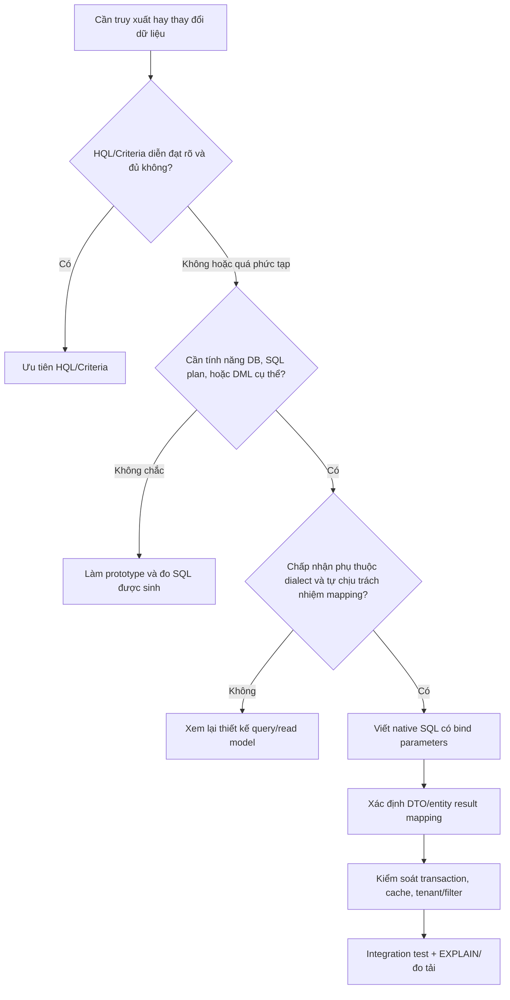

# Khi nào dùng native SQL trong ứng dụng Hibernate

## 1. Vấn đề: HQL/Criteria đã có rồi, vì sao vẫn cần SQL gốc?

Hibernate ORM giúp ánh xạ entity Java sang bảng quan hệ, quản lý Persistence Context, dirty checking, association và transaction. Khi truy vấn dữ liệu, lập trình viên thường dùng **HQL/JPQL** hoặc **Criteria API** để viết theo mô hình entity thay vì thao tác trực tiếp với tên bảng, cột và cú pháp SQL của từng hệ quản trị.

Ví dụ nghiệp vụ xem danh sách đơn hàng đã thanh toán:

```java
List<PurchaseOrder> orders = entityManager.createQuery(
    "select o from PurchaseOrder o " +
    "where o.status = :status " +
    "order by o.createdAt desc",
    PurchaseOrder.class
)
.setParameter("status", OrderStatus.PAID)
.getResultList();
```

Hibernate tự chuyển đường dẫn entity `PurchaseOrder.status` sang cột thích hợp, xử lý kiểu của parameter, sinh SQL theo dialect và materialize entity.

Tuy nhiên, có những bài toán cần tận dụng cú pháp đặc thù database, một SQL plan được kiểm soát chặt hoặc một câu lệnh cập nhật nguyên tử mà cách diễn đạt bằng HQL/Criteria không rõ ràng hoặc không được phiên bản đang dùng hỗ trợ đầy đủ. Khi đó, **native SQL** là công cụ hợp lý.

Ví dụ PostgreSQL:

```sql
SELECT
    o.id,
    o.order_number,
    o.attributes ->> 'shippingMethod' AS shipping_method
FROM purchase_orders o
WHERE o.attributes @> CAST(:jsonFilter AS jsonb);
```

Truy vấn trên sử dụng toán tử JSONB `->>` và `@>` riêng của PostgreSQL. Với native SQL, ứng dụng viết trực tiếp truy vấn mà database hiểu, thay vì yêu cầu Hibernate chuyển đổi biểu thức tương đương.

**Câu hỏi chính không phải “Có thể viết native SQL không?” mà là “Tại sao native SQL đáng dùng hơn HQL/Criteria trong use case này?”**

Sau bài học, bạn sẽ biết cách nhận diện tình huống phù hợp, gọi native query trong Hibernate/JPA, chọn kiểu mapping kết quả, giữ transaction và Persistence Context nhất quán, tránh SQL injection, và đo hiệu năng thay vì tối ưu dựa trên cảm giác.

## 2. Native SQL là gì trong ngữ cảnh Hibernate?

Native SQL là câu SQL được viết theo tên bảng, cột và cú pháp mà hệ quản trị cơ sở dữ liệu chấp nhận. Hibernate đóng vai trò trung gian để tạo query, bind parameter, chạy statement và có thể ánh xạ kết quả về scalar, DTO hoặc managed entity.

Ví dụ JPA:

```java
Query query = entityManager.createNativeQuery(
    "select id, order_number " +
    "from purchase_orders " +
    "where status = :status"
);

query.setParameter("status", "PAID");

List<?> rows = query.getResultList();
```

Khác với HQL:

```hql
select o.id, o.orderNumber
from PurchaseOrder o
where o.status = :status
```

Trong native SQL:

- `purchase_orders` là tên **bảng thực tế**.
- `order_number` là tên **cột thực tế**.
- Các hàm và toán tử là của **database**.
- Bạn chịu trách nhiệm làm rõ SQL trả về những cột nào.
- Hibernate không tự diễn giải toàn bộ câu SQL như một cây truy vấn entity path.

Trong HQL/JPQL:

- `PurchaseOrder` là tên entity.
- `orderNumber` là thuộc tính Java được ánh xạ.
- Hibernate quản lý phép biến đổi entity path, join association và các phần của cú pháp query.

Native SQL **không có nghĩa bỏ Hibernate hoàn toàn**. Bạn vẫn có thể chạy SQL qua `EntityManager` hoặc `Session` và tham gia transaction đang được quản lý. Nhưng những tính năng HQL có thể tự chèn vào truy vấn dựa trên mapping không được mặc định áp dụng theo cùng cách lên mọi câu SQL do bạn tự viết.

## 3. Ba công cụ truy vấn: HQL/JPQL, Criteria và native SQL

| Tiêu chí | HQL/JPQL | Criteria API | Native SQL |
|---|---|---|---|
| Ngôn ngữ truy vấn | Entity và thuộc tính | Cây biểu thức entity typed | Bảng, cột và SQL database |
| Truy vấn cố định dễ đọc | Thường tốt | Có thể dài dòng | Tốt với SQL phức tạp quen thuộc |
| Bộ lọc động nhiều nhánh | Có thể ghép query | Rất phù hợp | Cần build/bind cẩn thận |
| Tính portable | JPQL tương đối portable; HQL có mở rộng | Phần chuẩn Criteria tương đối portable | Phụ thuộc SQL dialect/tính năng DB |
| Association path | Có cú pháp theo mapping | Có Root/Join/Path | Phải tự viết join theo bảng/cột |
| Kết quả entity | Được Hibernate xử lý thuận tiện | Được Hibernate xử lý thuận tiện | Có thể map về entity nhưng cần đúng cột/mapping |
| DTO/scalar | Constructor projection, Tuple | Construct, Tuple | Alias, Object[], mapping/transformer |
| Cú pháp rất riêng của DB | Có thể cần function/extension | Có thể cần function/extension | Trực tiếp dùng cú pháp của DB |
| Refactor tên Java field | Được mapping hóa | Có thể dùng static metamodel | SQL dễ gãy khi đổi tên bảng/cột |
| Kiểm soát SQL shape | Hibernate quyết định nhiều phần | Hibernate quyết định nhiều phần | Cao hơn, nhưng DB optimizer vẫn quyết định plan |
| Rủi ro | N+1, join/fetch sai | Query tree rối, join sai | Injection, stale context, DB lock-in, sai mapping |

### Nguyên tắc chọn mặc định

1. **HQL/JPQL** khi truy vấn theo entity và association, cú pháp rõ, nhu cầu tương đối ổn định.
2. **Criteria API** khi có nhiều filter/sort/joins động cần ghép theo điều kiện.
3. **Native SQL** khi cần tính năng hoặc hình dạng SQL mà HQL/Criteria phiên bản hiện tại không diễn đạt tốt, hoặc khi có bằng chứng đo lường rõ ràng về lợi ích của truy vấn SQL cụ thể.

Không dùng native SQL chỉ vì “SQL gần database nên chắc chắn nhanh hơn”. Hibernate có thể sinh SQL tương đương từ HQL; cùng một SQL plan sẽ không tự nhanh hơn vì xuất phát từ API khác.

## 4. Cây quyết định trước khi chọn native SQL



Hãy trả lời các câu hỏi sau trong review:

- **Tính năng nào cụ thể** của database khiến native SQL cần thiết?
- Nếu một bản nâng cấp Hibernate hỗ trợ HQL tương đương, có nên chuyển về HQL không?
- Kết quả chỉ dùng để đọc, hay sẽ đưa entity vào Persistence Context để sửa?
- Có native UPDATE/DELETE/INSERT ảnh hưởng entity đã managed không?
- Có filter tenant, soft delete hoặc authorization cần đưa vào SQL không?
- Có cần phân trang/sort ổn định và count đi kèm không?
- Nếu chuyển PostgreSQL sang một DB khác, chi phí port query là bao nhiêu?
- Có test SQL và plan trên DB thực tế không?

## 5. Những trường hợp native SQL thường hợp lý

### 5.1. Tính năng đặc thù của hệ quản trị

Ví dụ:

- PostgreSQL `jsonb`, toán tử containment `@>`, expression index, `RETURNING`.
- PostgreSQL full-text search với `to_tsvector`, `to_tsquery` và chỉ mục GIN.
- PostgreSQL `DISTINCT ON` hoặc một kiểu CTE/materialization hint đặc thù.
- SQL Server `OUTPUT`, những gợi ý locking/index theo T-SQL khi đã xác minh cần.
- Oracle-specific analytic functionality, hints hoặc cú pháp chuyên biệt.
- MySQL-specific upsert syntax hay các hàm JSON tùy phiên bản.

Một số đặc điểm có thể gọi được từ HQL bằng function hoặc extension. Native SQL phù hợp **khi khả năng đó thiếu, quá khó biểu diễn hoặc không tạo query plan mong muốn**.

### 5.2. Báo cáo/read model có SQL shape đặc biệt

Ví dụ:

- Chọn một số bản ghi mới nhất **trên từng khách hàng**.
- Phân tích các nhóm theo nhiều cấp.
- Tổng hợp, phân hạng hoặc tính tỷ lệ trên tập dữ liệu lớn.
- Dùng CTE đệ quy cho cấu trúc cây nếu cú pháp/semantics phù hợp DB.
- Truy vấn dùng view, materialized view hoặc table-valued function đặc thù.

### 5.3. DML nguyên tử hoặc vendor-specific

Ví dụ:

- Cập nhật tồn kho với điều kiện không âm, kết hợp `RETURNING` để lấy state mới.
- `INSERT ... ON CONFLICT ...` theo PostgreSQL.
- Atomic claim job với `FOR UPDATE SKIP LOCKED` theo dialect.
- Bulk data operation rất lớn không phù hợp materialize từng entity.

**Không phải mọi bulk update đều cần native SQL.** HQL hỗ trợ `update`/`delete`; Criteria cũng có `CriteriaUpdate` và `CriteriaDelete`. Chọn native khi cú pháp/đặc điểm SQL thêm thực sự cần thiết.

### 5.4. Kiểm soát query plan đã được chứng minh

Có lúc SQL Hibernate sinh không đúng hình dạng mong muốn: join dư, nested query phức tạp hoặc query không tận dụng index tốt. Sau khi:

1. Kiểm tra mapping và fetch plan.
2. Xem SQL thực tế.
3. Chạy `EXPLAIN`/`EXPLAIN ANALYZE`.
4. Thử chỉnh HQL/Criteria trước.
5. Đo lại kết quả trên dữ liệu đại diện.

…mới nên quyết định giữ native SQL để kiểm soát query shape. SQL gốc cho bạn **quyền chọn statement**, không cho quyền ra lệnh optimizer phải dùng một plan nhất định trừ những cơ chế hint/vendor riêng.

## 6. Những trường hợp thường không nên chọn native SQL

Native SQL có thể là lựa chọn tệ nếu chỉ để:

- Lấy entity theo ID: `em.find(PurchaseOrder.class, id)` thường rõ hơn.
- Đọc một association đơn giản đã có mapping.
- Lọc vài field thông thường; HQL/Criteria đã đủ.
- Chữa `LazyInitializationException` bằng một SQL phụ không rõ boundary.
- Né vấn đề N+1 mà chưa phân tích fetch join, batching, subselect hoặc DTO projection.
- Cập nhật một managed entity đơn giản mà Hibernate dirty checking đã làm đúng.
- Tạo query động bằng cách nối chuỗi input người dùng.
- “Tối ưu” khi chưa có benchmark và chưa xem SQL plan.

Native SQL cũng không nên tự động dùng cho mọi dashboard chỉ vì báo cáo có nhiều cột: HQL 6.x có nhiều tính năng mạnh như biểu thức cửa sổ, CTE, set operations theo phiên bản. **Đừng mặc định rằng chỉ native SQL mới viết được CTE hoặc window function.** Hãy kiểm tra bộ tính năng HQL thực tế của version ứng dụng trước khi quyết định.

## 7. Mô hình ví dụ: Order, Customer và Inventory

Giả sử hệ thống có các bảng:

```sql
CREATE TABLE customers (
    id BIGINT PRIMARY KEY,
    full_name VARCHAR(200) NOT NULL
);

CREATE TABLE purchase_orders (
    id BIGINT PRIMARY KEY,
    order_number VARCHAR(64) NOT NULL UNIQUE,
    customer_id BIGINT NOT NULL REFERENCES customers(id),
    status VARCHAR(24) NOT NULL,
    total_amount NUMERIC(18, 2) NOT NULL,
    created_at TIMESTAMP NOT NULL
);

CREATE TABLE inventory (
    sku VARCHAR(60) PRIMARY KEY,
    available_quantity INTEGER NOT NULL
        CHECK (available_quantity >= 0)
);
```

Entity tương ứng:

```java
@Entity
@Table(name = "purchase_orders")
public class PurchaseOrder {

    @Id
    private Long id;

    @Column(name = "order_number")
    private String orderNumber;

    @Enumerated(EnumType.STRING)
    private OrderStatus status;

    @Column(name = "total_amount")
    private BigDecimal totalAmount;

    @Column(name = "created_at")
    private Instant createdAt;

    @ManyToOne(fetch = FetchType.LAZY)
    @JoinColumn(name = "customer_id")
    private Customer customer;

    protected PurchaseOrder() {}

    public Long getId() { return id; }
    public String getOrderNumber() { return orderNumber; }
    public BigDecimal getTotalAmount() { return totalAmount; }
}
```

Các đoạn sau có thể dùng `EntityManager em` hoặc `Session session` trong transaction do ứng dụng quản lý. Tên bảng, field và lớp Java chỉ nhằm minh họa; nguồn code riêng cần import đầy đủ và mapping nhất quán với DB.

## 8. Native SELECT trả scalar: trường hợp đơn giản nhất

Khi chỉ cần báo cáo nhẹ, không nhất thiết materialize entity.

SQL:

```sql
SELECT
    o.id,
    o.order_number,
    o.total_amount
FROM purchase_orders o
WHERE o.status = :status
ORDER BY o.id;
```

JPA:

```java
List<?> rows = em.createNativeQuery(
    "select o.id, o.order_number, o.total_amount " +
    "from purchase_orders o " +
    "where o.status = :status " +
    "order by o.id"
)
.setParameter("status", "PAID")
.getResultList();

for (Object row : rows) {
    Object[] values = (Object[]) row;

    Number idNumber = (Number) values[0];
    String orderNumber = (String) values[1];
    BigDecimal total = (BigDecimal) values[2];

    Long id = idNumber.longValue();
    System.out.println(id + " " + orderNumber + " " + total);
}
```

### Lưu ý về kiểu giá trị

Native result types chịu tác động JDBC driver, SQL expression và dialect. Một `BIGINT` có thể được trả bằng những kiểu `Number` khác nhau; `COUNT(*)` có thể ra `Long`, `BigInteger` hoặc dạng numeric được provider xử lý. Giá trị `NUMERIC` thường là `BigDecimal` nhưng cần dựa vào schema và driver.

Không cast mọi cột số thành `Long` chỉ vì SQL dùng `BIGINT`, và không giả định query một cột luôn trả `Object[]`: một native scalar selection có thể trả trực tiếp scalar cho mỗi row.

### Khi nào nên dùng kiểu kết quả này?

- Query nhỏ, có ít cột.
- Báo cáo nội bộ không cần nhiều lớp DTO.
- Prototype để đánh giá query plan.

Với API dài hạn, `Object[]` khó bảo trì vì phụ thuộc thứ tự SELECT. Nên cân nhắc DTO mapping có alias rõ.

## 9. Native SELECT trả entity được Hibernate quản lý

Nếu bạn cần một `PurchaseOrder` entity sau query:

```java
List<?> rows = em.createNativeQuery(
    "select o.* from purchase_orders o " +
    "where o.status = :status",
    PurchaseOrder.class
)
.setParameter("status", "PAID")
.getResultList();

for (Object value : rows) {
    PurchaseOrder order = (PurchaseOrder) value;
    System.out.println(order.getOrderNumber());
}
```

Với `EntityManager#createNativeQuery(sql, EntityClass)`, Hibernate ánh xạ result row về entity type đã được khai báo. Entity được nạp trong Persistence Context có thể tham gia identity map và được quản lý như entity Hibernate khác, miễn kết quả ánh xạ hợp lệ.

### Cần trả đủ cột cho entity mapping

Một query kiểu:

```sql
SELECT id, order_number
FROM purchase_orders;
```

thường **không đủ** để Hibernate hydrate đúng một `PurchaseOrder` entity có thêm status, totalAmount, createdAt và foreign key. Tùy mapping, thiếu cột có thể dẫn đến JDBC/SQL exception, state thiếu hoặc hành vi không được hỗ trợ.

Trong ví dụ đơn bảng, `SELECT o.*` là cách ngắn để lấy đầy đủ cột của một entity. Nhưng không phải lời khuyên dùng `SELECT *` cho mọi native SQL:

- Join nhiều bảng có thể trùng tên cột `id`, `status`.
- Inheritance, discriminator hoặc secondary table có thể đòi hỏi mapping thêm.
- Schema thay đổi có thể làm query phụ thuộc các cột ngoài nhu cầu.
- Một DTO projection thường tốt hơn nếu chỉ cần vài field.

### Entity result không tự fetch mọi association

Nếu PurchaseOrder có association `customer` lazy, native SELECT từ bảng orders không đồng nghĩa customer đã được load. Truy cập `order.getCustomer()` vẫn có thể phát SQL theo mapping/fetch plan.

Native SQL không miễn trừ N+1. Khi cần nhiều association, bạn phải thiết kế fetch/mapping hoặc truy vấn riêng phù hợp.

### Query trả entity vẫn chịu Persistence Context

Khi một entity có cùng định danh đã managed trong Session, Hibernate có thể trả lại managed instance hiện có. Đừng coi mỗi native SELECT là một thao tác “đọc state mới nhất” độc lập bất kể first-level cache.

Nếu native SQL được dùng để xác nhận thay đổi từ DB trong khi Session đang giữ state cũ, phải nghĩ tới `flush`, `refresh`, `clear` và transaction isolation.

## 10. Native query bằng Session API

Hibernate `Session` có API native query riêng:

```java
List<PurchaseOrder> orders = session.createNativeQuery(
    "select o.* from purchase_orders o " +
    "where o.status = :status",
    PurchaseOrder.class
)
.setParameter("status", "PAID")
.getResultList();
```

Một số tính năng Hibernate-specific còn cho phép khai báo scalar/result handling hay query synchronization rõ hơn.

Ví dụ sử dụng `addScalar` (kiểu API và cách khai báo `BasicType`/`JavaType` có thay đổi theo Hibernate version):

```java
var query = session.createNativeQuery(
    "select id, order_number from purchase_orders"
);

query.addScalar("id", Long.class);
query.addScalar("order_number", String.class);

List<?> rows = query.getResultList();
```

Trong production, hãy dùng đúng overload được Hibernate version của dự án cung cấp. Không suy ra mọi ví dụ `addScalar` cũ sử dụng `StandardBasicTypes` sẽ biên dịch giống nhau ở các major version.

### Khi nào chọn Session thay EntityManager?

- Ứng dụng vốn dùng Hibernate native API.
- Cần API đồng bộ hóa query spaces (`addSynchronized...`).
- Cần cơ chế mapping/transformer hoặc các extension Hibernate-specific.

Khi không cần tính năng riêng, `EntityManager` đủ cho nhiều native SELECT/DML, giúp code giữ mặt API JPA quen thuộc.

## 11. DTO result mapping: tránh Object[] trong code nghiệp vụ

DTO tách result của native SQL khỏi managed entity và giúp API không vô tình serialize entity graph.

```java
public record OrderReportRow(
    Long orderId,
    String orderNumber,
    BigDecimal totalAmount,
    Long itemCount
) {}
```

Giả sử có bảng `order_lines`:

```sql
CREATE TABLE order_lines (
    id BIGINT PRIMARY KEY,
    order_id BIGINT NOT NULL REFERENCES purchase_orders(id),
    sku VARCHAR(60) NOT NULL,
    quantity INTEGER NOT NULL
);
```

Query:

```sql
SELECT
    o.id AS order_id,
    o.order_number AS order_number,
    o.total_amount AS total_amount,
    COUNT(l.id) AS item_count
FROM purchase_orders o
LEFT JOIN order_lines l ON l.order_id = o.id
WHERE o.status = :status
GROUP BY o.id, o.order_number, o.total_amount
ORDER BY o.id;
```

### 11.1. Mapping thủ công, rõ thứ tự

```java
List<?> raw = em.createNativeQuery(sql)
    .setParameter("status", "PAID")
    .getResultList();

List<OrderReportRow> report = new ArrayList<>();

for (Object row : raw) {
    Object[] values = (Object[]) row;
    report.add(new OrderReportRow(
        ((Number) values[0]).longValue(),
        (String) values[1],
        (BigDecimal) values[2],
        ((Number) values[3]).longValue()
    ));
}
```

Đây là cách đơn giản, không đòi mapping annotation. Nhược điểm: thứ tự cột và phép cast phải được giữ nhất quán.

### 11.2. @SqlResultSetMapping và @ConstructorResult

Jakarta Persistence hỗ trợ khai báo mapping của native query:

```java
@SqlResultSetMapping(
    name = "OrderReportRowMapping",
    classes = @ConstructorResult(
        targetClass = OrderReportRow.class,
        columns = {
            @ColumnResult(name = "order_id", type = Long.class),
            @ColumnResult(name = "order_number", type = String.class),
            @ColumnResult(name = "total_amount", type = BigDecimal.class),
            @ColumnResult(name = "item_count", type = Long.class)
        }
    )
)
@Entity
@Table(name = "purchase_orders")
public class PurchaseOrder {
    // Mappings của entity PurchaseOrder.
}
```

Đoạn annotation này là minh họa phần mapping được đặt trên một managed class, **không phải định nghĩa thay thế toàn bộ entity** ở mục trước.

Thực thi:

```java
List<?> rows = em.createNativeQuery(
    sql,
    "OrderReportRowMapping"
).setParameter("status", "PAID")
 .getResultList();

List<OrderReportRow> report = rows.stream()
    .map(OrderReportRow.class::cast)
    .toList();
```

`@ColumnResult` và `@ConstructorResult` giúp khớp alias với constructor. SQL phải trả các alias được khai báo; kiểu và thứ tự constructor phải tương thích. `COUNT` và numeric conversion là những trường hợp cần test với JDBC driver cụ thể.

### 11.3. EntityResult và FieldResult

`@SqlResultSetMapping` cũng hỗ trợ ánh xạ cột query sang entity bằng `@EntityResult`/`@FieldResult`. Đây là lựa chọn khi result set có alias không khớp tên mapping thông thường hoặc truy vấn join phức tạp.

Tuy nhiên, entity mapping của một native query không giải quyết tự động mọi quan hệ lồng nhau. Với read model có nhiều bảng và field tổng hợp, DTO thường rõ ràng và ít phụ thuộc vòng đời Persistence Context hơn.

## 12. Parameter binding: an toàn với giá trị, không an toàn với cấu trúc tùy ý

Native query nên bind giá trị bằng parameter:

```java
List<?> rows = em.createNativeQuery(
    "select id, order_number " +
    "from purchase_orders " +
    "where status = :status and total_amount >= :minimum"
)
.setParameter("status", "PAID")
.setParameter("minimum", new BigDecimal("100000"))
.getResultList();
```

Tránh nối chuỗi giá trị:

```java
// Không an toàn:
String sql =
    "select * from purchase_orders where order_number = '" +
    userSuppliedNumber + "'";
```

Lỗi không chỉ là dấu nháy và injection; bạn còn tự gánh escaping, conversion và query plan caching.

### 12.1. Không bind được tên bảng/cột như giá trị

Sai ý tưởng:

```java
String sql = "select * from :tableName order by :sortColumn";
```

JDBC parameter đại diện cho **giá trị**, không đại diện cho tên bảng, column identifier hoặc keyword SQL. `:sortColumn` trong ORDER BY không trở thành một tên cột được optimizer hiểu theo cách bạn mong muốn.

Nếu API cho phép sort:

```java
String orderBy = switch (sortField) {
    case CREATED_AT -> "o.created_at";
    case AMOUNT -> "o.total_amount";
    case ORDER_NUMBER -> "o.order_number";
};

String direction = descending ? "DESC" : "ASC";

String sql = """
    SELECT o.id, o.order_number, o.total_amount
    FROM purchase_orders o
    WHERE o.status = :status
    ORDER BY
    """ + orderBy + " " + direction + ", o.id DESC";
```

`sortField` là enum/allow-list do ứng dụng định nghĩa, không phải giá trị tên cột tùy ý từ HTTP request. Dữ liệu sort direction cũng được chọn từ giá trị hợp lệ, không lấy nguyên chuỗi user input.

### 12.2. Danh sách IN

Một số Hibernate native query APIs hỗ trợ `setParameterList`:

```java
var query = session.createNativeQuery(
    "select id, order_number " +
    "from purchase_orders where id in (:ids)"
);

query.setParameterList("ids", orderIds);
List<?> result = query.getResultList();
```

`setParameterList` là API Hibernate-specific; đừng giả định `EntityManager#createNativeQuery` hoặc mọi JDBC driver đều hỗ trợ bind một Java List như một placeholder SQL chuẩn trong mọi trường hợp.

Nếu danh sách rỗng, xác định nghiệp vụ: trả rỗng, bỏ filter hay từ chối input. Đừng tự phát sinh `IN ()` và kỳ vọng mọi dialect xử lý giống nhau.

Với danh sách rất lớn, nên cân nhắc bảng tạm, batching hoặc cơ chế array/table-valued parameter theo database.

## 13. PostgreSQL JSONB: ví dụ native SQL có lợi ích rõ

Giả sử có cột JSONB `attributes` trong `purchase_orders`:

```sql
ALTER TABLE purchase_orders
ADD COLUMN attributes jsonb NOT NULL DEFAULT '{}'::jsonb;

CREATE INDEX ix_orders_attributes_gin
ON purchase_orders USING GIN (attributes);
```

Query lấy phương thức giao hàng và lọc những order có thuộc tính JSON tương ứng:

```sql
SELECT
    o.id,
    o.order_number,
    o.attributes ->> 'shippingMethod' AS shipping_method
FROM purchase_orders o
WHERE o.attributes @> CAST(:filterJson AS jsonb)
ORDER BY o.id;
```

Java:

```java
String filterJson = "{\"shippingMethod\":\"EXPRESS\"}";

List<?> rows = em.createNativeQuery(sql)
    .setParameter("filterJson", filterJson)
    .getResultList();
```

Trong PostgreSQL:

- `->>` lấy giá trị thuộc tính JSON dưới dạng text.
- `@>` kiểm tra containment của JSONB.
- `CAST(:filterJson AS jsonb)` cho database biết kiểu JSONB của parameter.
- GIN index có thể hỗ trợ một số dạng predicate JSONB, nhưng phải xem operator class và query plan cụ thể.

### Giới hạn

Query này **không portable** sang MySQL/Oracle/SQL Server mà không viết lại cú pháp. Nếu ứng dụng đã cam kết PostgreSQL và JSONB là phần quan trọng của domain/read model, phụ thuộc ấy có thể hoàn toàn hợp lý.

Ngược lại, nếu chỉ cần truy vấn một trường phổ biến như `status` hoặc `createdAt`, HQL/Criteria thường ít phụ thuộc database hơn.

## 14. Window function và CTE: chọn native theo nhu cầu thực tế

Bài toán: lấy **tối đa ba đơn gần nhất cho mỗi khách hàng**.

SQL ví dụ:

```sql
WITH ranked_orders AS (
    SELECT
        o.id,
        o.customer_id,
        o.order_number,
        o.created_at,
        ROW_NUMBER() OVER (
            PARTITION BY o.customer_id
            ORDER BY o.created_at DESC, o.id DESC
        ) AS rn
    FROM purchase_orders o
    WHERE o.status = :status
)
SELECT
    id,
    customer_id,
    order_number,
    created_at
FROM ranked_orders
WHERE rn <= :limitPerCustomer
ORDER BY customer_id, rn;
```

`ROW_NUMBER() OVER (PARTITION BY ...)` đánh số thứ tự trong từng nhóm khách hàng. `rn <= :limitPerCustomer` chọn số lượng tối đa trên mỗi nhóm, thay vì toàn bộ danh sách trang theo một LIMIT chung.

### Vì sao có thể chọn native?

- Query được database/DBA thiết kế và tối ưu riêng.
- Cần hints hoặc cấu trúc CTE phụ thuộc dialect.
- HQL/Criteria đang dùng không diễn đạt được chính xác một tính năng.
- Có kết quả đo rõ ràng từ query plan hoặc tính năng bổ sung.

### Điều cần phân biệt

Hibernate HQL hiện đại có hỗ trợ các cấu trúc nâng cao như window functions và CTE ở những phiên bản nhất định. Vì vậy, **một CTE hoặc window function không tự động bắt buộc phải viết native SQL**.

Quy trình hợp lý là thử diễn đạt bằng HQL nếu phiên bản hỗ trợ, xem SQL được sinh, rồi quyết định native có thực sự tạo lợi thế về khả năng biểu đạt, tối ưu hay tính dễ bảo trì hay không.

## 15. Upsert và RETURNING: native SQL cho thao tác phụ thuộc dialect

PostgreSQL có cú pháp:

```sql
INSERT INTO inventory_reservations (
    request_key,
    sku,
    quantity
)
VALUES (
    :requestKey,
    :sku,
    :quantity
)
ON CONFLICT (request_key) DO NOTHING
RETURNING id;
```

Giả sử bảng:

```sql
CREATE TABLE inventory_reservations (
    id BIGINT GENERATED BY DEFAULT AS IDENTITY PRIMARY KEY,
    request_key VARCHAR(80) NOT NULL UNIQUE,
    sku VARCHAR(60) NOT NULL,
    quantity INTEGER NOT NULL CHECK (quantity > 0)
);
```

Ứng dụng muốn một request key chỉ tạo một bản ghi reservation. `ON CONFLICT DO NOTHING` tránh chèn trùng key khi hai request cạnh tranh; `RETURNING id` trả ID nếu hàng vừa được insert.

### Một lỗi quan trọng: conflict không đồng nghĩa operation đã hoàn tất

Nếu `RETURNING` không trả hàng vì đã có `request_key`:

1. Đọc lại reservation hiện có.
2. So sánh `sku` và `quantity` với ý định ban đầu.
3. Nếu cùng payload, áp dụng chính sách idempotent replay.
4. Nếu payload khác, trả conflict nghiệp vụ; không coi là thành công.

Nếu reservation phải đồng thời trừ tồn kho hoặc phát sự kiện, những bước ấy cần **cùng transaction và quy tắc concurrency nhất quán**. Chỉ chèn key không tự bảo đảm toàn bộ use case đã hoàn thành đúng.

### RETURNING không giống executeUpdate() thông thường

Một statement `INSERT/UPDATE ... RETURNING` có thể trả **result set**. API gọi và kiểu result cần theo provider/JDBC driver; không tự động dùng `executeUpdate()` rồi chờ nhận mọi cột RETURNING.

Khi chỉ cần số hàng bị ảnh hưởng, `executeUpdate()` của native UPDATE/DELETE có thể phù hợp. Khi cần dữ liệu returned, xây native query theo API và dialect hỗ trợ result set, rồi kiểm thử cách lấy result.

## 16. Atomic UPDATE: khi nào native SQL giúp tránh read-modify-write race?

Giả sử nhiều request cùng mua một SKU. Code đọc stock rồi trừ trên entity mà không có biện pháp concurrency có thể gặp lost update hoặc tranh chấp version.

Một câu SQL điều kiện:

```sql
UPDATE inventory
SET available_quantity = available_quantity - :requested
WHERE sku = :sku
  AND available_quantity >= :requested;
```

Java:

```java
int updated = em.createNativeQuery(
    "update inventory " +
    "set available_quantity = available_quantity - :requested " +
    "where sku = :sku " +
    "and available_quantity >= :requested"
)
.setParameter("requested", requestedQuantity)
.setParameter("sku", sku)
.executeUpdate();

if (updated != 1) {
    throw new InsufficientStockOrMissingSkuException();
}
```

Predicate và phép trừ được database thực hiện trong một statement, giúp không cần tách “đọc → tính → ghi” làm các bước không đồng bộ.

### Không nên kết luận chỉ native SQL mới làm được

Một HQL bulk update cũng có thể biểu diễn kiểu phép trừ và điều kiện trên mapped entity. Chọn native nếu cần thêm cú pháp đặc thù, `RETURNING`, lock hint hoặc SQL shape mà ORM query không cung cấp thuận tiện.

### Điều kiện về transaction

Nếu use case còn tạo Order và OutboxEvent, cần thực hiện trong một transaction thích hợp để các bước commit/rollback cùng nhau. Atomic UPDATE bảo vệ invariant stock trong một statement nhưng không tự thay thế ranh giới transaction của toàn use case.

## 17. Native DML và Persistence Context: rủi ro dữ liệu cũ

Đây là khác biệt quan trọng nhất khi trộn ORM với native UPDATE/DELETE.

Giả sử Session đã tải:

```java
PurchaseOrder order = em.find(PurchaseOrder.class, 101L);
System.out.println(order.getStatus()); // NEW
```

Sau đó native SQL đổi status:

```java
em.createNativeQuery(
    "update purchase_orders " +
    "set status = :status " +
    "where id = :id"
)
.setParameter("status", "PAID")
.setParameter("id", 101L)
.executeUpdate();
```

Trong cùng Persistence Context, `order` vẫn có thể giữ `status = NEW`. Native DML làm việc trực tiếp với database, không đi qua dirty checking trên từng managed entity.

```text
Persistence Context                         Database
-------------------                         --------
PurchaseOrder#101.status = NEW              status = NEW
                   |
                   | native UPDATE
                   +--------------------->  status = PAID
                   |
PurchaseOrder#101.status = NEW              status = PAID
        (stale object)
```

### Cách xử lý tùy tình huống

**Refresh entity cụ thể:**

```java
em.refresh(order);
```

Hibernate có thể đọc lại state từ database theo transaction/isolation đang dùng.

**Clear Persistence Context:**

```java
em.clear();
```

Điều này detach các entity đang managed. Lần `find` sau có thể tạo state mới. Nhưng `clear()` **không flush những thay đổi chưa ghi**, nên phải kiểm soát công việc còn pending trước khi clear.

**Tách ranh giới unit of work:** thực hiện native batch DML trong transaction/Persistence Context riêng nếu phù hợp, sau đó dùng context khác để đọc state.

### Bảng quyết định

| Tình huống | Hành động nên cân nhắc |
|---|---|
| Native UPDATE đổi đúng một Order đang managed | `refresh(order)` hoặc tách transaction/context |
| Native bulk UPDATE hàng nghìn Order | Flush pending changes trước, thực thi DML, clear/detach phù hợp |
| Native DELETE xóa entity đang managed | Không tiếp tục dùng entity như thể còn tồn tại; clear/detach và xử lý quan hệ |
| Có pending changes trên entity bị native UPDATE | Xác định thứ tự flush; tránh flush sau ghi đè native state |
| Có L2 cache/query cache | Xem xét synchronization/invalidation theo API Hibernate/version |

**`refresh` hoặc `clear` không tự bảo đảm business consistency nếu transaction isolation hay bước nghiệp vụ đã sai**. Chúng giải quyết state của Persistence Context, không thay thế thiết kế concurrency.

## 18. Flush và thứ tự thực thi: ORM write trước native read

Giả sử một entity đã được sửa trong bộ nhớ:

```java
PurchaseOrder order = em.find(PurchaseOrder.class, 101L);
order.markPaid();

// Có thể Hibernate chưa gửi UPDATE cho entity.
Object status = em.createNativeQuery(
    "select status from purchase_orders where id = :id"
)
.setParameter("id", 101L)
.getSingleResult();
```

Hibernate dirty checking có thể hoãn SQL UPDATE đến flush/commit. Khi native query đọc database trước khi các thay đổi đó được flush, thứ tự quan sát dữ liệu cần được xem xét.

### Đừng dựa vào một quy tắc auto-flush cho mọi API

Hành vi flush của native queries có thể khác giữa:

- `EntityManager` và `Session` API.
- `FlushModeType.AUTO`, `COMMIT` hoặc Hibernate-specific flush modes.
- Native query có khai báo synchronized query spaces hay không.
- Phiên bản Hibernate.
- Transaction đang active và trạng thái persistence context.

Không nên khẳng định rằng “mọi native SELECT luôn flush trước” hoặc “native SELECT không bao giờ flush”.

### Khi bắt buộc native query thấy các ORM writes trước đó

Một cách rõ ràng trong transaction:

```java
order.markPaid();
em.flush();

Object status = em.createNativeQuery(
    "select status from purchase_orders where id = :id"
)
.setParameter("id", order.getId())
.getSingleResult();
```

`flush()` gửi pending DML tới database **trong transaction hiện tại**, không đồng nghĩa commit. Transaction có thể rollback sau đó.

### Đồng bộ query spaces bằng Hibernate API

Với native query qua Hibernate `Session`, có thể khai báo những bảng/entity mà SQL truy cập:

```java
var query = session.createNativeQuery(
    "select o.id, o.order_number " +
    "from purchase_orders o where o.status = :status"
);

query.addSynchronizedEntityClass(PurchaseOrder.class);
query.setParameter("status", "PAID");
List<?> rows = query.getResultList();
```

API synchronization giúp Hibernate biết query liên quan entity/table spaces nào, phục vụ auto-flush và những khía cạnh invalidation/cache tùy phiên bản.

Cũng có API dạng `addSynchronizedQuerySpace("purchase_orders")` trong những phiên bản phù hợp. Cần dùng đúng tên query space và kiểm tra chính xác API version.

**Chỉ đăng ký synchronization không thay thế việc phân tích thứ tự DML** khi native query sửa nhiều bảng hoặc khi mapping phức tạp.

## 19. Native UPDATE/DELETE và optimistic locking

Giả sử entity dùng version:

```java
@Version
private long version;
```

Hibernate thường dùng version khi update managed entity để phát hiện optimistic locking conflict.

Một câu native SQL:

```sql
UPDATE purchase_orders
SET status = 'PAID'
WHERE id = :id;
```

**Không tự động thực thi toàn bộ optimistic locking protocol của entity** nếu bạn không viết nó vào SQL. Database có thể cập nhật hàng bất kể version hiện tại; managed entity trong context cũng không tự đổi snapshot/version.

Nếu muốn optimistic concurrency rõ ràng trong native SQL:

```sql
UPDATE purchase_orders
SET
    status = :newStatus,
    version = version + 1
WHERE id = :id
  AND version = :expectedVersion;
```

Sau đó:

```java
if (updatedRows == 0) {
    throw new OptimisticConflictException();
}
```

Điều này chỉ là một pattern. Cần xem:

- Version column có đúng kiểu và chiến lược generation không?
- DB trigger hoặc mapping có cập nhật version riêng không?
- Có các invariant khác trong `WHERE` không?
- Có managed entity nào đang giữ version cũ không?
- Đếm số hàng bị ảnh hưởng theo driver có đáng tin cho case của bạn không?

Nếu chỉ thay đổi một entity managed bình thường, để Hibernate xử lý `@Version` thường ít rủi ro hơn việc tự viết protocol.

## 20. Native SQL bypass một phần cơ chế entity lifecycle

Native bulk UPDATE/DELETE không chạy như thao tác từng entity:

- Không dirty check từng object.
- Không tự cập nhật first-level cache của mọi object đã load.
- Không nên giả định entity lifecycle callback như `@PreUpdate`, `@PreRemove` chạy cho từng hàng.
- Không tự áp dụng mọi `CascadeType`/`orphanRemoval` ở tầng object graph.
- Không tự cập nhật version theo semantics managed update.
- Không tự chạy Bean Validation theo cách persist/merge entity có thể làm.
- Database constraint, trigger và cascade do database vẫn có hiệu lực.

Ví dụ:

```java
@PreRemove
public void beforeDelete() {
    auditService.recordRemoval(id);
}
```

Đừng kỳ vọng:

```sql
DELETE FROM purchase_orders WHERE status = 'CANCELLED';
```

sẽ gọi `beforeDelete()` cho mỗi Order. Nếu audit là invariant quan trọng, hãy thiết kế audit ở tầng phù hợp: transaction service, domain operation, database trigger hoặc batch audit record với logic rõ ràng.

## 21. Second-level cache, query cache và synchronization

Hibernate có thể có:

1. **First-level cache** trong Persistence Context (luôn có với Session/EntityManager).
2. **Second-level cache** cho entity/collection nếu cấu hình.
3. **Query cache** nếu bật và dùng.

Native SQL tác động database trực tiếp, còn cache có thể chưa biết đủ phạm vi dữ liệu bị ảnh hưởng nếu query spaces không được khai báo hoặc statement được chạy ngoài Hibernate.

Một số phiên bản Hibernate áp dụng invalidation rộng cho native DML không biết query spaces; trường hợp khác cần metadata synchronization để Hibernate nhận diện phạm vi ảnh hưởng. **Không nên mô tả một quy tắc cache invalidation duy nhất cho mọi version/configuration**.

### Nếu native SQL đọc/sửa các entity có cache

- Kiểm tra mapping cache và query cache đang bật không.
- Xác định bảng/query spaces mà statement đọc/sửa.
- Sử dụng các API synchronization của Hibernate khi phù hợp.
- Với JDBC chạy ngoài Hibernate, có thể phải chủ động invalidate cache theo thiết kế.
- Kiểm thử đọc lại từ Session mới và từ L2 cache sau native DML.

Đừng dùng `em.clear()` như giải pháp cho L2 cache; nó chủ yếu tác động first-level cache của EntityManager hiện tại.

## 22. Native SQL, tenant và soft delete: đặc biệt quan trọng với bảo mật

Giả sử hệ thống multi-tenant lưu tenant ID chung bảng:

```sql
CREATE TABLE purchase_orders (
    id BIGINT PRIMARY KEY,
    tenant_id BIGINT NOT NULL,
    order_number VARCHAR(64) NOT NULL,
    status VARCHAR(20) NOT NULL,
    deleted_at TIMESTAMP NULL
);
```

Trong HQL trên entity, Hibernate có thể áp filter/discriminator restriction hoặc cơ chế multi-tenancy đã cấu hình. Với SQL gốc viết trực tiếp, **không được giả định Hibernate sẽ tự nối cùng mọi điều kiện tenant, soft delete hay authorization vào mọi native query**.

Query nguy hiểm:

```sql
SELECT id, order_number
FROM purchase_orders
WHERE status = :status;
```

Nếu nhiều tenant dùng chung bảng, query này có thể đọc dữ liệu tenant khác.

Query an toàn hơn theo business boundary:

```sql
SELECT id, order_number
FROM purchase_orders
WHERE tenant_id = :tenantId
  AND deleted_at IS NULL
  AND status = :status;
```

### Những điểm phải tự bảo đảm

- Tenant ID lấy từ trusted request/session identity, không nhận nguyên vẹn từ input chưa được kiểm quyền.
- Mọi join/subquery đều có ranh giới tenant phù hợp.
- Soft-delete semantics áp dụng nhất quán ở tất cả bảng liên quan.
- Authorization không chỉ được “ẩn” trong query màn hình; cần được enforce tại điểm truy cập.
- Database Row-Level Security, nếu dùng, vẫn là một lớp bảo vệ độc lập nhưng phụ thuộc cấu hình role/session.
- Multi-tenancy theo schema/database có thể tác động connection/schema routing; vẫn phải kiểm tra SQL có truy vấn đúng schema/database không.

**Native SQL có thể bỏ qua những tiện ích mapping cấp ORM, nhưng không được bỏ qua quy tắc truy cập dữ liệu.**

## 23. Phân trang và sắp xếp native query

Native query có thể phân trang qua API:

```java
Query query = em.createNativeQuery(
    "select o.id, o.order_number " +
    "from purchase_orders o " +
    "where o.status = :status " +
    "order by o.created_at desc, o.id desc"
);

query.setParameter("status", "PAID");
query.setFirstResult(page * size);
query.setMaxResults(size);

List<?> rows = query.getResultList();
```

Khả năng và cách Hibernate áp limit/offset cho native SQL có thể phụ thuộc dialect, hình dạng SQL và phiên bản. Nếu SQL đã tự có `LIMIT/OFFSET`, `FETCH FIRST` hay CTE pagination, phải tránh áp hai lớp phân trang mâu thuẫn.

### Thứ tự phải xác định

`ORDER BY created_at DESC` chưa đủ nếu nhiều hàng cùng timestamp. Thêm ID hoặc unique key:

```sql
ORDER BY o.created_at DESC, o.id DESC
```

Khi offset lớn, database có thể phải bỏ qua nhiều hàng trước khi trả page. Với luồng dữ liệu lớn, cân nhắc keyset pagination:

```sql
SELECT o.id, o.order_number, o.created_at
FROM purchase_orders o
WHERE o.status = :status
  AND (
      o.created_at < :lastCreatedAt
      OR (
          o.created_at = :lastCreatedAt
          AND o.id < :lastId
      )
  )
ORDER BY o.created_at DESC, o.id DESC
LIMIT :pageSize;
```

Mẫu trên minh họa pagination sau cặp khóa cuối cùng theo thứ tự giảm dần. Phải xử lý trang đầu không có cursor, dữ liệu nullable, sort keys và transaction snapshot theo contract thực tế.

### Count query riêng

Nếu API cần tổng số Order:

```sql
SELECT COUNT(*)
FROM purchase_orders o
WHERE o.status = :status;
```

Không lấy số row trong trang hiện tại làm total. Nếu data query có join to-many làm nhân hàng, count cũng phải phù hợp với số **entity/đơn duy nhất** mà API trình bày, có thể dùng `COUNT(DISTINCT o.id)` hoặc EXISTS.

## 24. Native locking và job queue: ví dụ cần biết DB cụ thể

Một worker lấy job chưa xử lý có thể muốn tránh nhiều worker chọn cùng job:

```sql
SELECT j.id, j.payload
FROM jobs j
WHERE j.status = 'READY'
ORDER BY j.created_at, j.id
FOR UPDATE SKIP LOCKED
LIMIT :batchSize;
```

Cú pháp và semantics locking cần xác nhận trên database mục tiêu. Trong một transaction thích hợp, `SKIP LOCKED` cho phép một worker bỏ qua row đã bị transaction khác giữ lock, phù hợp một số hàng đợi cạnh tranh.

### Không chỉ SELECT rồi bỏ transaction

Nếu worker:

1. SELECT những job chưa xử lý.
2. Commit ngay, thả lock.
3. Xử lý bên ngoài mà không ghi trạng thái claim/reservation.

…thì worker khác có thể lấy lại cùng job. Hãy thiết kế state machine/claim token, transaction boundary, retry và idempotency phù hợp.

### HQL cũng có locking API

Hibernate hỗ trợ lock mode và những cơ chế lock hints/timeout tùy phiên bản/dialect. Không phải cứ có `FOR UPDATE` là bắt buộc native SQL. Native thường được chọn khi cần chính xác một vendor-specific locking statement hay query shape mà ORM API không đáp ứng tốt.

## 25. Native SQL và transaction: vẫn phải có ranh giới nghiệp vụ

Native SQL chạy qua `EntityManager` hoặc `Session` **không tự biến nhiều câu lệnh thành một transaction nguyên tử**.

Ví dụ service:

```java
@Transactional
public void confirmOrder(long orderId) {
    PurchaseOrder order = repository.findById(orderId)
        .orElseThrow(OrderNotFoundException::new);

    int updated = entityManager.createNativeQuery(
        "update purchase_orders " +
        "set status = :newStatus " +
        "where id = :orderId and status = :expectedStatus"
    )
    .setParameter("newStatus", "PAID")
    .setParameter("expectedStatus", "NEW")
    .setParameter("orderId", orderId)
    .executeUpdate();

    if (updated != 1) {
        throw new OrderStateConflictException();
    }

    // Nếu cần sử dụng lại order, phải xử lý stale state.
    entityManager.refresh(order);
}
```

Đây là một ví dụ minh họa transaction và stale state. Trong hệ thống thật, cần xem `@Version`, payment idempotency, audit và các bước side effect; không tự gọi external payment provider bên trong transaction dài chỉ vì SQL update đã nguyên tử.

### SQLException và rollback-only

Database có thể đánh dấu transaction aborted khi native SQL gặp constraint violation, deadlock hoặc lỗi syntax. Sau lỗi persistence nghiêm trọng, không nên tiếp tục dùng cùng Session như chưa có gì xảy ra.

Khi dùng Spring `@Transactional`, exception và rollback rule phải được xử lý đúng tại transaction boundary. Khi dùng resource-local Session API, rollback/close Session nếu attempt thất bại. Với lỗi transient cần retry, retry **toàn nghiệp vụ trong transaction/context mới** chứ không lặp lại statement cuối trong transaction đã hỏng.

## 26. Kết hợp native SQL với JDBC/JdbcTemplate: biết rõ ai sở hữu connection

Có trường hợp một workload cực lớn hoặc batch import phù hợp plain JDBC, Spring JdbcTemplate hoặc driver-specific bulk API hơn Hibernate entity lifecycle.

Nếu ứng dụng đang dùng Hibernate:

- `Session#doWork(...)` hoặc `doReturningWork(...)` cho phép thao tác JDBC trên connection liên quan Session.
- Với Spring, JdbcTemplate có thể tham gia transaction khi DataSource và transaction manager được cấu hình nhất quán.
- Không tự đóng hoặc commit connection do Hibernate/transaction manager đang sở hữu.
- Không chạy SQL qua một DataSource/connection hoàn toàn khác rồi giả định nó cùng transaction với entity changes.
- Sau JDBC DML, Persistence Context và cache có thể stale tương tự native DML.

Ví dụ Hibernate:

```java
session.doWork(connection -> {
    try (PreparedStatement ps = connection.prepareStatement(
            "update inventory " +
            "set available_quantity = available_quantity - ? " +
            "where sku = ? and available_quantity >= ?")) {

        ps.setInt(1, quantity);
        ps.setString(2, sku);
        ps.setInt(3, quantity);
        int updated = ps.executeUpdate();

        if (updated != 1) {
            throw new SQLException("Inventory reservation failed");
        }
    }
});
```

Đoạn code minh họa cách dùng connection và prepared statement; exception semantics và translation sang domain exception cần thiết kế riêng. Nếu chỉ cần một native UPDATE, dùng `EntityManager.createNativeQuery` thường ngắn gọn hơn.

## 27. SQL schema migration, view và quyền truy cập

Native queries gắn chặt với schema thật. Khi migration:

```text
purchase_orders.order_number
             |
             v
purchase_orders.external_order_code
```

HQL query dùng entity property có thể tiếp tục hoạt động nếu mapping được cập nhật mà tên thuộc tính Java giữ nguyên. Native SQL chứa `order_number` sẽ lỗi nếu cột vật lý bị đổi/tách và query chưa được cập nhật.

### Những việc cần phối hợp

- Duy trì versioned migration qua Flyway, Liquibase hoặc công cụ tương ứng.
- Tìm các native SQL references khi đổi bảng/cột.
- Test query trên schema sau migration.
- Kiểm tra database view, materialized view và quyền của application role.
- Với zero-downtime migration, xét khoảng thời gian hai phiên bản ứng dụng cùng chạy.
- Không sửa một view làm thay đổi alias/type mà không cập nhật DTO mapping.

Nếu native SQL phụ thuộc view như `order_reporting_view`, view trở thành một **hợp đồng dữ liệu** cần quản lý version và quyền truy cập giống code.

## 28. Native queries có thể bị lỗi do alias và tên cột

Ví dụ join:

```sql
SELECT *
FROM purchase_orders o
JOIN customers c ON c.id = o.customer_id;
```

Cả hai bảng có thể có cột `id`, `created_at`. Với result mapping dạng alias hoặc DTO, trùng alias khiến giá trị khó nhận diện hoặc Hibernate/JDBC báo lỗi.

Cách rõ hơn:

```sql
SELECT
    o.id AS order_id,
    o.order_number AS order_number,
    c.id AS customer_id,
    c.full_name AS customer_name
FROM purchase_orders o
JOIN customers c ON c.id = o.customer_id;
```

Đối với DTO, mỗi selection có alias cụ thể. Đối với entity result mapping phức tạp, `@SqlResultSetMapping`/`@FieldResult` hoặc cơ chế Hibernate thích hợp cần được dùng để giải thích alias.

### Đừng nhầm alias với Java property

Một query trả alias `customer_name` không khiến `PurchaseOrder.customer.name` tự được eager-fetch vào entity. Alias chỉ xác định tên cột trong result set; quan hệ entity vẫn được quản lý theo mapping và cách result mapping được cấu hình.

## 29. Native query có thể phá vỡ portability ở những vị trí nào?

Không chỉ cú pháp JSONB là không portable. Các điểm khác:

| Vấn đề | Ví dụ khác biệt giữa DB |
|---|---|
| Pagination | `LIMIT/OFFSET`, `FETCH FIRST`, `TOP` |
| Upsert | `ON CONFLICT`, `ON DUPLICATE KEY UPDATE`, `MERGE` |
| Returning | `RETURNING`, `OUTPUT` hoặc API tương đương |
| JSON | `jsonb`, `JSON_EXTRACT`, `JSON_VALUE` |
| Array | `ANY`, array parameters, table-valued parameters |
| Full-text | `tsvector`, `MATCH ... AGAINST`, vendor search APIs |
| Locking | `FOR UPDATE SKIP LOCKED`, hints hoặc cú pháp khác |
| Boolean | SQL boolean và biểu diễn JDBC khác nhau |
| Date/time | Interval, timezone arithmetic, timestamp syntax |
| Case/Collation | Case-sensitive/case-insensitive matching |
| Identifier quoting | Dấu nháy, reserved words, case folding |
| Data type | UUID, JSON, NUMERIC, binary, custom types |

Nếu dự án đã chọn một DB lâu dài, **phụ thuộc dialect là một quyết định có thể chấp nhận được**. Nhưng phải ghi rõ trong code/documentation và bảo vệ bằng integration tests.

Nếu sản phẩm cần hỗ trợ nhiều DB, nên:

- Giữ phần query portable ở HQL/Criteria khi được.
- Cô lập native SQL trong repository/adapter riêng.
- Có phương án triển khai theo dialect cho những tính năng bắt buộc.
- Test các dialect được hỗ trợ.
- Không phát tán string SQL vendor-specific khắp service/controller.

## 30. Hiệu năng: native SQL không tự nhanh hơn

Giả sử:

```hql
select o.id, o.orderNumber
from PurchaseOrder o
where o.status = :status
```

và native:

```sql
SELECT id, order_number
FROM purchase_orders
WHERE status = :status;
```

Nếu Hibernate sinh SQL có cùng điều kiện và database chọn cùng query plan, không có cơ sở để khẳng định native SQL nhanh hơn đáng kể.

Các nguồn chi phí thực:

- Số round-trips đến DB.
- Số hàng và byte trả về.
- Join cardinality.
- Index selectivity và plan ổn định.
- Parse/bind/prepare query và cache.
- Entity hydration và dirty checking.
- Transaction/lock duration.
- Chạy cùng lúc với workload khác.

Native SQL có thể **giảm** chi phí nếu trả thẳng DTO nhỏ, tránh một join không cần thiết hoặc dùng một operator/index đặc thù. Nó cũng có thể **tăng** chi phí nếu query plan kém, kết quả quá rộng hay bỏ qua các tối ưu ORM đã có.

### Quy trình benchmark đáng tin

1. Chụp SQL do HQL/Criteria thực sự sinh.
2. Viết phương án native tương đương về **kết quả**.
3. Chạy trên database cùng version/dialect production.
4. Tạo dữ liệu đại diện về số hàng, độ lệch phân phối, hot rows.
5. So sánh `EXPLAIN`, số rows, latency p50/p95/p99 và network bytes.
6. Đảm bảo cách fetch/result mapping/transaction tương đương.
7. Chạy warm-up và nhiều lần; tách tác động của cache.
8. Chọn phương án dễ bảo trì nhất đáp ứng SLO, không chỉ phương án thắng một microbenchmark.

## 31. Native SQL trong hệ thống multi-team: tổ chức code để dễ bảo trì

Không đặt SQL dài trực tiếp trong controller:

```java
@GetMapping("/report")
public List<?> report() {
    return em.createNativeQuery(
        "with ... select ... join ... where ... "
    ).getResultList();
}
```

Thay vào đó:

```text
Controller
   |
   v
Application service
   |
   v
OrderReportingRepository
   |
   +-- native SQL template
   +-- parameter validation/binding
   +-- DTO result mapping
   +-- SQL error translation
   +-- integration tests
```

Một repository read model có thể:

```java
@Repository
public class OrderReportingRepository {

    @PersistenceContext
    private EntityManager em;

    public List<OrderReportRow> reportPaidOrders() {
        String sql = """
            SELECT
                o.id AS order_id,
                o.order_number AS order_number,
                o.total_amount AS total_amount,
                COUNT(l.id) AS item_count
            FROM purchase_orders o
            LEFT JOIN order_lines l ON l.order_id = o.id
            WHERE o.status = :status
            GROUP BY o.id, o.order_number, o.total_amount
            ORDER BY o.id
            """;

        List<?> raw = em.createNativeQuery(sql)
            .setParameter("status", "PAID")
            .getResultList();

        return raw.stream()
            .map(Object[].class::cast)
            .map(values -> new OrderReportRow(
                ((Number) values[0]).longValue(),
                (String) values[1],
                (BigDecimal) values[2],
                ((Number) values[3]).longValue()
            ))
            .toList();
    }
}
```

**Đây là mã minh họa**, chưa có filter tenant, page, input validation, mapping errors và error translation đầy đủ. Khi dùng `@SqlResultSetMapping`, có thể tách phần mapping để giảm cast thủ công.

### Vị trí đặt SQL

- Java text block trong repository: dễ tìm và refactor cùng code, hợp với query vừa phải.
- Named native query/metadata JPA: hữu ích nếu muốn đặt mapping cùng entity.
- File SQL resource: hợp với query dài, version review hoặc syntax highlight.
- Database view/materialized view: hợp với read model được nhiều nơi cùng tiêu thụ.

Chọn một quy ước để tránh query tồn tại ở quá nhiều nơi, và bảo đảm migration/test có thể tìm được mọi native query quan trọng.

## 32. Kiểm thử native SQL cần bao phủ những gì?

Với HQL, Hibernate giúp kiểm tra tên entity/attribute ở bước parse. Với native SQL, database thường là nơi xác định truy vấn có hợp lệ hay không. **Integration test với DB mục tiêu rất quan trọng**.

### 32.1. Kịch bản cơ bản

- Query chạy trên schema mới nhất.
- Alias và kiểu dữ liệu ánh xạ đúng DTO/entity.
- Không trả nhầm tenant hoặc soft-deleted rows.
- Null, empty result, số lớn và timestamp được xử lý đúng.
- Sort/pagination cho kết quả ổn định.
- Query count trả đúng total sau JOIN.

### 32.2. Kịch bản Persistence Context

1. Load managed entity.
2. Chạy native UPDATE trên cùng hàng.
3. Xác nhận state managed có thể stale.
4. Thử `refresh`/`clear` hoặc transaction mới.
5. Nếu bật L2 cache, kiểm tra đọc lại qua Session khác.

### 32.3. Kịch bản transaction và concurrency

- Atomic UPDATE với hai transaction cạnh tranh.
- Optimistic version predicate có row count đúng.
- Constraint violation rollback đúng.
- Locking statement không tạo deadlock không kiểm soát.
- Retryable failure không được retry trong Session đã hỏng.

### 32.4. Kịch bản SQL injection

Tạo input chứa dấu nháy, ký tự wildcard, tên cột giả và các chuỗi “đặc biệt”. Xác nhận:

- Scalar values luôn bind.
- Dynamic ORDER BY chỉ dùng allow-list.
- Client không được chọn bảng/schema tùy ý.
- Tìm kiếm LIKE xử lý `%` và `_` theo hợp đồng.

### 32.5. Kiểm thử bằng database thật

H2 có thể không hỗ trợ chính xác PostgreSQL JSONB, `ON CONFLICT`, locking hoặc SQL functions giống production. Dùng Testcontainers hoặc database test instance đúng vendor/version khi query tận dụng vendor-specific features.

## 33. Logging và quan sát native query

Hibernate SQL logging ví dụ:

```properties
logging.level.org.hibernate.SQL=DEBUG
logging.level.org.hibernate.orm.jdbc.bind=TRACE
```

Tùy Hibernate version và logging framework, logger bind parameters có tên khác; cần kiểm tra configuration phù hợp.

Với native SQL, log nên gắn:

- Use case/query name.
- Correlation/request ID.
- SQL execution duration.
- Số rows trả về hoặc bị ảnh hưởng.
- Số page/cursor và những tham số **không nhạy cảm**.
- SQLState/vendor code khi thất bại.

Không log nguyên thông tin thanh toán, secret, session token hay dữ liệu cá nhân trong bind parameter log production.

### StatementInspector

Hibernate có `StatementInspector` để quan sát SQL trước khi gửi JDBC. Với query cần đo độ trễ thực thi, cần metrics ở JDBC/DataSource/driver hoặc DB, vì inspect statement text không tự đo toàn bộ execution/network/hydration time.

### Đọc query plan

- Với PostgreSQL có `EXPLAIN` và `EXPLAIN (ANALYZE, BUFFERS)`.
- Các DB khác có công cụ plan riêng.
- `ANALYZE` có thể **thực thi** statement, nên đặc biệt cẩn thận với DML.
- Theo dõi rows estimated vs actual, scans, joins, sorts và indexes.

Đo đủ workload thay vì tối ưu SQL dựa trên số dòng code.

## 34. Những lỗi thường gặp khi dùng native SQL

### Lỗi 1: Dùng tên Java property làm tên cột SQL

```sql
SELECT orderNumber FROM purchase_orders;
```

Nếu schema dùng `order_number`, SQL trên sai. Native SQL dùng tên database; HQL mới dùng tên property Java.

### Lỗi 2: Trả entity từ SELECT thiếu cột

`SELECT id, order_number` rồi yêu cầu Hibernate tạo cả PurchaseOrder entity có thể không đủ mapping. Với projection nhỏ, dùng DTO/scalar.

### Lỗi 3: SELECT * trong query join nhiều bảng

Trùng alias `id`/`status` gây lỗi hoặc mapping không rõ. Liệt kê cột và alias.

### Lỗi 4: Ghép input thẳng vào SQL

Dẫn đến injection và lỗi escaping. Dùng bind parameters cho values, allow-list cho identifier/sort.

### Lỗi 5: Nhầm entity result với DTO result

Entity result tham gia Persistence Context; DTO/scalar chỉ là dữ liệu. Hai trường hợp có vòng đời và stale-state khác nhau.

### Lỗi 6: Native UPDATE xong đọc managed entity cũ

Persistence Context không tự đồng bộ mọi bulk SQL. Dùng refresh/clear/context mới khi phù hợp.

### Lỗi 7: Dựa vào auto-flush mặc định cho mọi native query

Hành vi phụ thuộc API/flush mode/query spaces. Khi phải có thứ tự chính xác, flush/synchronization có chủ đích và test.

### Lỗi 8: Quên @Version và callbacks

Native DML không tự chạy optimistic locking/lifecycle theo managed entity update. Tự xử lý nếu nghiệp vụ yêu cầu.

### Lỗi 9: Quên filter tenant/soft delete

SQL có thể truy cập dữ liệu mà HQL mapping thường hạn chế. Đây là lỗi nghiêm trọng về data isolation.

### Lỗi 10: Bật native SQL để chữa N+1 không có kế hoạch

Vẫn có thể tạo N+1 khi mapping entity result chứa lazy association. Chọn DTO, fetch plan hoặc batching phù hợp.

### Lỗi 11: Quên portability và migration

Query gắn với cột/tính năng DB; đổi schema hoặc dialect có thể làm lỗi runtime. Cần integration test và quyền sở hữu.

### Lỗi 12: Lạm dụng native query làm business logic không kiểm thử được

Một query dài trộn kiểm tra quyền, tạo side effect, chuyển trạng thái và trả report có thể khó quan sát. Phân tách transaction/business invariant và cô lập SQL phù hợp.

## 35. Bài thực hành 1: so sánh HQL với native SQL

Cho bảng PurchaseOrder:

1. Viết HQL tìm 20 Order PAID mới nhất, sort theo `createdAt DESC, id DESC`.
2. Viết native SQL cho cùng kết quả chỉ lấy `id`, `orderNumber`, `totalAmount`.
3. Tạo DTO `OrderSummary`.
4. Chạy cùng dữ liệu trên database mục tiêu.
5. So sánh SQL, số rows, execution plan, hydration time và khả năng bảo trì.

### Câu hỏi

- Vì sao HQL entity query và native scalar query có thể khác tốc độ dù WHERE giống nhau?
- Nếu chuyển HQL sang DTO projection, lợi thế của native có còn lớn không?
- Native SELECT entity có làm customer association tự eager không?

Gợi ý: cần so sánh **cùng lượng dữ liệu** mới công bằng; entity hydration và DTO mapping có chi phí khác nhau.

## 36. Bài thực hành 2: JSONB và database-specific feature

Trên PostgreSQL:

1. Thêm cột `attributes jsonb` vào orders.
2. Tạo các Order với `shippingMethod` khác nhau.
3. Viết native SQL lọc JSONB containment bằng `@>`.
4. Bind JSON filter bằng parameter, không nối input.
5. Thử index GIN và `EXPLAIN`.
6. Viết test trên PostgreSQL, không chỉ H2.
7. Ghi rõ vì sao native được chọn và tính năng HQL hiện tại có đáp ứng được không.

### Câu hỏi

- Điều gì xảy ra nếu chuyển database sang một hệ không hỗ trợ `@>`?
- Nếu filter JSONB trên bảng lớn, index nào có thể hữu ích?
- Một câu SQL ngắn có bảo đảm plan tốt không?

## 37. Bài thực hành 3: stale Persistence Context sau native UPDATE

Kịch bản:

```java
PurchaseOrder order = em.find(PurchaseOrder.class, 101L);

em.createNativeQuery(
    "update purchase_orders set status='PAID' where id=:id"
)
.setParameter("id", 101L)
.executeUpdate();

System.out.println(order.getStatus());
```

Hãy:

1. Quan sát state managed trước và sau native UPDATE.
2. Gọi `em.refresh(order)` trong transaction phù hợp.
3. Gọi `em.clear()` rồi `find` lại từ EntityManager.
4. Thử một field đang dirty trước native UPDATE, xem thứ tự flush tác động ra sao.
5. Nếu có `@Version`, kiểm tra concurrency với native SQL.
6. Nếu bật L2 cache, kiểm tra state khi đọc từ Session mới.

Không sử dụng bài thực hành này trong database có dữ liệu thật; thao tác DML cần môi trường test.

## 38. Bài thực hành 4: upsert/idempotency

Tạo bảng `inventory_reservations` có unique `request_key`.

Yêu cầu:

1. Hai request đồng thời cùng `request_key` không tạo hai reservation.
2. Cùng key nhưng payload khác phải bị từ chối theo nghiệp vụ.
3. Có thể xác định result khi client retry sau timeout.
4. Reservation và cập nhật inventory phải nằm trong transaction nhất quán.
5. Side effect như gửi sự kiện cần outbox/idempotency nếu có.

Viết native SQL `ON CONFLICT`/`RETURNING` cho PostgreSQL. Sau đó xác định cách xử lý trường hợp `RETURNING` không có hàng và kiểm tra business key trong transaction mới.

## 39. Bài thực hành 5: bảo đảm tenant isolation

Giả sử orders có `tenant_id` và `deleted_at`.

1. Viết một native query trả Order report theo status.
2. Thêm điều kiện tenant và soft delete vào query.
3. Seed hai tenant có order_number giống nhau.
4. Bằng integration test, xác nhận tenant A không bao giờ nhìn thấy dữ liệu tenant B.
5. Thử một subquery/join tới order_lines; kiểm tra liên kết tenant.
6. Nếu DB dùng Row-Level Security, test bằng đúng application DB role.

Đây là loại test quan trọng hơn việc chứng minh native SQL nhanh hơn vài mili-giây.

## 40. Checklist ra quyết định

| Câu hỏi | Nếu câu trả lời là “không” |
|---|---|
| Có nhu cầu thật sự mà HQL/Criteria không đáp ứng tốt? | Giữ HQL/Criteria |
| Đã đo SQL thực tế và query plan? | Đo trước khi tối ưu |
| Chấp nhận phụ thuộc database/dialect? | Tìm giải pháp portable |
| Có định nghĩa output entity, scalar hay DTO rõ? | Chưa nên đưa vào production |
| Có bind values và allow-list identifier/sort? | Sửa bảo mật trước |
| Có kiểm soát tenant, soft delete và authorization? | Chặn release |
| Có xử lý flush, stale Persistence Context, version? | Thiết kế transaction lại |
| Có tính đến L2 cache/query cache nếu bật? | Bổ sung kiểm chứng |
| Có phân trang/count đúng và ổn định? | Hoàn thiện contract |
| Có integration test trên database thật? | Chưa đủ bằng chứng |
| Có owner cho query khi schema thay đổi? | Gán trách nhiệm bảo trì |

## 41. Nguyên tắc cần nhớ

1. **Native SQL là công cụ bổ sung, không phải lựa chọn mặc định thay HQL/Criteria.** Nó hữu ích nhất khi có nhu cầu rõ về cú pháp database, query shape hoặc DML đặc thù.
2. **HQL/Criteria làm việc với entity model; native SQL làm việc với schema vật lý.** Không nhầm tên thuộc tính Java với cột SQL.
3. **Cần chọn kiểu kết quả có chủ đích:** scalar/Object[], DTO/ConstructorResult hay entity được Hibernate quản lý. Mỗi lựa chọn có trade-off khác.
4. **Bind giá trị bằng parameter; allow-list tên cột, sort direction và identifiers động.** Prepared parameters không thay thế được SQL identifiers.
5. **Native DML không tự đồng bộ first-level cache và toàn bộ entity lifecycle.** Flush/refresh/clear hoặc transaction/context mới khi thích hợp.
6. **Đừng quên `@Version`, callbacks và cache khi bypass managed entity updates.** Những invariant này cần được thiết kế lại nếu thực thi SQL trực tiếp.
7. **Không mặc định Hibernate sẽ áp mọi filter, tenant và soft-delete restriction vào native SQL.** Bảo đảm ranh giới quyền dữ liệu ở statement hoặc database policy.
8. **Cú pháp database-specific đánh đổi portability.** Cô lập SQL, quản lý schema migration và test đúng DB version.
9. **Native không tự nhanh hơn.** So sánh cùng semantics, lượng dữ liệu, query plan, số row, latency và hydration.
10. **Transaction vẫn quyết định tính nguyên tử nghiệp vụ.** Native statement, ORM entity changes, retries và side effects cần ranh giới rõ ràng.
11. **HQL hiện đại có tính năng nâng cao.** Đừng dùng native chỉ vì thấy CTE, window function hoặc bulk update; hãy kiểm tra những gì version hiện tại đã hỗ trợ.
12. **Test quan trọng nhất là test tích hợp trên database thật**, bao gồm result mapping, concurrency, tenant isolation và stale Persistence Context.

Khi lựa chọn giữa HQL/Criteria và native SQL, hãy ưu tiên **ngữ nghĩa nghiệp vụ rõ, an toàn dữ liệu và khả năng bảo trì**. Native SQL là một lựa chọn mạnh khi thật sự cần diễn đạt gần database, nhưng càng gần database thì ứng dụng càng phải tự chịu trách nhiệm cho mapping, transaction, filters, caching, portability và kế hoạch kiểm thử.

### Tài liệu tham khảo chính thức

- [Hibernate ORM User Guide — Native SQL](https://docs.jboss.org/hibernate/orm/current/userguide/html_single/Hibernate_User_Guide.html#sql)
- [Hibernate ORM User Guide — Native SQL queries](https://docs.jboss.org/hibernate/orm/current/userguide/html_single/Hibernate_User_Guide.html#sql-native-query)
- [Hibernate ORM User Guide — Flushing](https://docs.jboss.org/hibernate/orm/current/userguide/html_single/Hibernate_User_Guide.html#flushing)
- [Hibernate ORM User Guide — Fetching](https://docs.jboss.org/hibernate/orm/current/userguide/html_single/Hibernate_User_Guide.html#fetching)
- [Hibernate ORM Query Language reference](https://docs.jboss.org/hibernate/orm/current/querylanguage/html_single/Hibernate_Query_Language.html)
- [Hibernate ORM Javadocs — NativeQuery](https://docs.jboss.org/hibernate/orm/current/javadocs/org/hibernate/query/NativeQuery.html)
- [Jakarta Persistence specification — Native queries and SQL result set mapping](https://jakarta.ee/specifications/persistence/)
- [PostgreSQL documentation — JSON Types](https://www.postgresql.org/docs/current/datatype-json.html)
- [PostgreSQL documentation — INSERT, ON CONFLICT and RETURNING](https://www.postgresql.org/docs/current/sql-insert.html)
- [PostgreSQL documentation — EXPLAIN](https://www.postgresql.org/docs/current/sql-explain.html)
