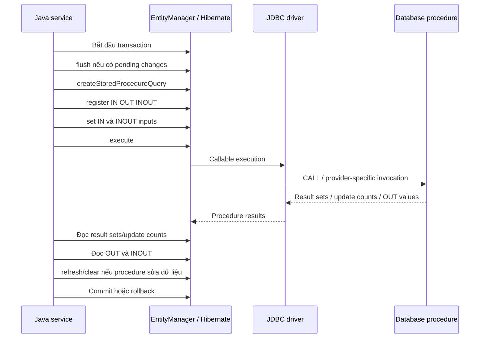

# Thực thi thủ tục lưu trữ và tham số vào, ra với Hibernate

Trong các ứng dụng dùng **Hibernate ORM**, phần lớn thao tác dữ liệu được thực hiện qua entity, JPQL/HQL hoặc Criteria API. Tuy nhiên, không phải mọi quy tắc xử lý đều nằm ở Java. Nhiều hệ thống — nhất là hệ thống lâu năm, phần mềm tài chính, báo cáo và tích hợp dữ liệu — còn sử dụng **stored procedure** (thủ tục lưu trữ) chạy ở database.

Khác với câu `SELECT` thông thường, stored procedure có thể:

- Nhận nhiều **tham số đầu vào** (`IN`).
- Trả giá trị qua **tham số đầu ra** (`OUT`).
- Nhận một giá trị rồi thay đổi và trả lại qua **tham số hai chiều** (`INOUT`).
- Trả một hoặc nhiều **result set** hoặc cursor.
- Thực hiện nhiều câu DML trong một lần gọi, tùy thiết kế và quyền database.
- Gọi các procedure/function khác, áp dụng quy tắc nghiệp vụ hoặc phát sinh exception từ database.

Hibernate/Jakarta Persistence cung cấp `StoredProcedureQuery`, trong khi Hibernate native API và JDBC cung cấp thêm những cách gọi có mức kiểm soát thấp hơn. Điều khó không chỉ là cú pháp `CALL`: bạn còn phải hiểu **chữ ký procedure**, **thứ tự tham số**, **kiểu JDBC**, **trình tự lấy kết quả**, **transaction**, **persistence context** và **khả năng khác nhau giữa các hệ quản trị cơ sở dữ liệu**.

Bài học này đi từ ví dụ thực thi hoàn chỉnh, phân biệt `IN`/`OUT`/`INOUT`/`REF_CURSOR`, tới cách đọc nhiều result set, gọi JDBC `CallableStatement` khi cần và xử lý các lỗi thường gặp.

## 1. Stored procedure nằm ở đâu trong kiến trúc ORM?

Hình dung một tầng truy cập dữ liệu:

```text
Java service
    |
    +--> EntityManager.persist / find / remove
    |         |
    |         +--> Hibernate entity lifecycle / dirty checking
    |
    +--> JPQL / HQL / Criteria
    |         |
    |         +--> Hibernate query translator -> SQL
    |
    +--> StoredProcedureQuery
              |
              +--> Hibernate/JDBC callable execution
                        |
                        +--> Database stored procedure
                                  |
                                  +--> SQL / DML / OUT params / result sets
```

Hibernate có thể quản lý transaction và kết nối JDBC cho lời gọi, nhưng **không tự biết mọi thay đổi nội bộ mà procedure đã thực hiện**. Nếu procedure cập nhật bảng qua SQL, persistence context không nhất thiết được cập nhật như khi Java sửa field của một managed entity.

Ví dụ một service đang nắm một `Account` đã load, sau đó gọi procedure để cộng số dư. Nếu tiếp tục đọc getter trên object cũ, ứng dụng có thể thấy số dư đã load trước lời gọi thay vì trạng thái mới trong database. Đây là khác biệt quan trọng giữa **gọi procedure** và **thao tác entity lifecycle**.

### Khi nào procedure có thể phù hợp?

- Tái sử dụng logic nghiệp vụ hoặc báo cáo đã tồn tại trong database.
- Thực thi tập hợp SQL phức tạp, được DBMS tối ưu đặc biệt.
- Tích hợp hệ thống legacy với API database được công bố bằng procedures.
- Cần nhiều OUT parameters hoặc result sets.
- Cần sử dụng chức năng đặc thù của database, chấp nhận tính phụ thuộc vendor.
- Có quy định bảo mật cho phép role chỉ `EXECUTE` procedure thay vì truy cập trực tiếp mọi bảng.

Procedure không mặc nhiên nhanh hơn ORM hoặc native SQL. Hiệu năng phải được đo trên workload thật; thiết kế giao diện vào/ra, transaction và truy vết lỗi vẫn quyết định tính đúng đắn.

## 2. Phân biệt procedure với function và câu SQL gốc

Ba thao tác này thường bị gọi chung là “SQL gốc”, nhưng chúng không giống nhau:

| Cơ chế | Ý tưởng | Ví dụ khái niệm |
|---|---|---|
| Native SQL query | Java gửi SQL trực tiếp | `select * from purchase_orders where customer_id = ?` |
| Stored procedure | Java gọi chương trình database có chữ ký tham số | `call count_orders(?, ?, ?)` |
| Database function | Java gọi hàm có giá trị trả về theo quy tắc DBMS | `select count_orders_fn(?)` |

Một function có thể trả scalar, record, set of rows hoặc cursor tùy DBMS. Một procedure có thể dùng OUT/INOUT và trả result sets. Cú pháp định nghĩa/cách gọi hoàn toàn không đồng nhất giữa MySQL, PostgreSQL, Oracle và SQL Server.

**Không coi `SELECT some_function(...)` và `CALL some_procedure(...)` là hai cú pháp có thể hoán đổi tùy ý.** Chọn API gọi phù hợp với loại object database thật sự được tạo.

## 3. Bốn dạng tham số thường gặp

Trong Jakarta Persistence, `jakarta.persistence.ParameterMode` biểu diễn mode khi đăng ký tham số procedure.

| Mode | Hướng dữ liệu | Java cần làm gì? | Ví dụ |
|---|---|---|---|
| `IN` | Java → database | Đăng ký, đặt giá trị bằng `setParameter` | ID khách hàng |
| `OUT` | Database → Java | Đăng ký, lấy bằng `getOutputParameterValue` | Tổng đơn hàng |
| `INOUT` | Hai chiều | Đăng ký, đặt giá trị ban đầu, đọc giá trị sau gọi | Bộ đếm lần gọi |
| `REF_CURSOR` | Database → Java qua cursor | Đăng ký theo DB/provider support, xử lý result set | Danh sách hóa đơn |

### Ví dụ bằng lời

Procedure nhận `customerId = 12` (`IN`), tìm tổng số đơn hàng và ghi vào `totalOrders` (`OUT`). Nó đồng thời nhận `attempts = 3` (`INOUT`), tăng lên 4 và trả lại.

```text
Trước khi gọi:
    customerId = 12       (IN)
    totalOrders = ?       (OUT)
    attempts = 3          (INOUT)

Sau khi gọi:
    customerId = 12
    totalOrders = 17      (OUT, ví dụ)
    attempts = 4          (INOUT)
```

Với `OUT`, ứng dụng không cần đặt giá trị đầu vào. Với `INOUT`, cần cung cấp giá trị ban đầu; kết quả sau gọi có thể khác hoặc bằng giá trị ban đầu tùy logic database.

## 4. Tạo một procedure mẫu trong MySQL

Để minh họa trọn vẹn, giả sử có bảng đơn hàng:

```sql
create table purchase_orders (
    id bigint primary key,
    customer_id bigint not null,
    total_amount decimal(19, 2) not null,
    created_at timestamp not null
);

create index ix_purchase_orders_customer
    on purchase_orders(customer_id);
```

Ta tạo procedure đếm đơn hàng của một khách hàng. Ví dụ dưới đây dùng **MySQL syntax**, không phải SQL chuẩn di động giữa mọi DBMS.

```sql
-- Chạy trong MySQL command-line client:
DELIMITER $$

CREATE PROCEDURE count_orders(
    IN p_customer_id BIGINT,
    OUT p_total BIGINT,
    INOUT p_invocations INT
)
BEGIN
    SELECT COUNT(*)
      INTO p_total
      FROM purchase_orders
     WHERE customer_id = p_customer_id;

    SET p_invocations = COALESCE(p_invocations, 0) + 1;
END$$

DELIMITER ;
```

Ý nghĩa:

- `p_customer_id` nhận ID cần đếm.
- `p_total` được database gán bằng số hàng thỏa điều kiện.
- `p_invocations` nhận số lần gọi ban đầu rồi tăng 1.
- Query sử dụng index trên `customer_id` nếu optimizer quyết định có lợi.
- Procedure chỉ đọc bảng và thay đổi tham số; chưa có DML cập nhật dữ liệu nghiệp vụ.

**Lưu ý về `DELIMITER`:** đó là directive của một số MySQL client, không phải câu SQL gửi nguyên văn qua JDBC. Flyway, Liquibase hoặc công cụ migration khác có parser/quy ước script riêng. Không sao chép `DELIMITER` một cách máy móc vào mọi migration file.

### Gọi thử trong MySQL client

```sql
SET @count = NULL;
SET @invocations = 3;

CALL count_orders(12, @count, @invocations);

SELECT @count AS total_orders,
       @invocations AS invocations;
```

Nếu customer 12 có 17 đơn hàng, kết quả minh họa là `total_orders=17` và `invocations=4`. Java không cần dùng user variables `@count` như ví dụ client này: JPA/JDBC hỗ trợ binding OUT/INOUT parameters trực tiếp.

## 5. Khởi tạo JPA `StoredProcedureQuery`

API chính của Jakarta Persistence:

```java
import jakarta.persistence.EntityManager;
import jakarta.persistence.ParameterMode;
import jakarta.persistence.StoredProcedureQuery;
```

Một lời gọi procedure thường gồm:

1. `createStoredProcedureQuery(procedureName)`.
2. `registerStoredProcedureParameter(...)` cho từng tham số.
3. `setParameter(...)` cho các tham số `IN` và `INOUT`.
4. `execute()`.
5. `getOutputParameterValue(...)` và/hoặc đọc result sets.
6. Để transaction commit hoặc rollback theo boundary nghiệp vụ.

Với procedure mẫu, có thể viết:

```java
public OrderCounter countOrders(
        EntityManager entityManager,
        long customerId,
        int previousInvocations) {

    StoredProcedureQuery call =
        entityManager.createStoredProcedureQuery("count_orders");

    call.registerStoredProcedureParameter(
        1, Long.class, ParameterMode.IN
    );
    call.registerStoredProcedureParameter(
        2, Long.class, ParameterMode.OUT
    );
    call.registerStoredProcedureParameter(
        3, Integer.class, ParameterMode.INOUT
    );

    call.setParameter(1, customerId);
    call.setParameter(3, previousInvocations);

    call.execute();

    Number total = (Number) call.getOutputParameterValue(2);
    Number invocations = (Number) call.getOutputParameterValue(3);

    return new OrderCounter(
        total.longValue(),
        invocations.intValue()
    );
}

public record OrderCounter(long total, int invocations) {}
```

Đoạn ví dụ giả định procedure luôn gán `p_total` và `p_invocations` không null. Nếu OUT có thể null, cần kiểm tra trước khi gọi `longValue()` hoặc `intValue()`.

### Vì sao dùng `Number`?

Database `BIGINT` thường map sang `Long`, nhưng driver và Dialect có thể trả một subtype `Number` khác tùy kiểu SQL thực tế. Với `DECIMAL`, `BigDecimal` thường là lựa chọn thích hợp nhất. Việc dùng `Number` trong ví dụ đọc COUNT giúp tránh một vài giả định cast quá cụ thể.

Đăng ký kiểu Java trong `registerStoredProcedureParameter` vẫn phải phù hợp chữ ký SQL và mapping driver. Không dùng `Object.class` cho tất cả tham số rồi hy vọng provider luôn suy ra kiểu chính xác.

## 6. Tham số theo vị trí: thứ tự là một phần của contract

Ví dụ procedure:

```sql
count_orders(
    IN p_customer_id BIGINT,   -- vị trí 1
    OUT p_total BIGINT,        -- vị trí 2
    INOUT p_invocations INT    -- vị trí 3
)
```

Trong `StoredProcedureQuery`, vị trí thường bắt đầu từ **1**:

```java
call.registerStoredProcedureParameter(
    1, Long.class, ParameterMode.IN
);
call.registerStoredProcedureParameter(
    2, Long.class, ParameterMode.OUT
);
call.registerStoredProcedureParameter(
    3, Integer.class, ParameterMode.INOUT
);

call.setParameter(1, 12L);
call.setParameter(3, 3);
```

Không gọi `setParameter(2, ...)` cho OUT-only parameter. Nếu gọi `setParameter(1, ...)` nhầm cho giá trị bộ đếm, database có thể nhận tham số sai kiểu hoặc logic trả kết quả không đúng.

### Thay đổi thứ tự tham số là breaking change

Nếu DBA đổi thứ tự chữ ký từ `(customerId, total, invocations)` thành `(customerId, invocations, total)`, mã Java dùng positional registration phải đổi theo. Điều này nên được xem như thay đổi public API của database, cần migration và integration test.

## 7. Tham số theo tên: rõ nghĩa nhưng phụ thuộc hỗ trợ

JPA cho phép đăng ký tham số theo tên:

```java
StoredProcedureQuery call =
    entityManager.createStoredProcedureQuery("count_orders");

call.registerStoredProcedureParameter(
    "p_customer_id", Long.class, ParameterMode.IN
);
call.registerStoredProcedureParameter(
    "p_total", Long.class, ParameterMode.OUT
);
call.registerStoredProcedureParameter(
    "p_invocations", Integer.class, ParameterMode.INOUT
);

call.setParameter("p_customer_id", 12L);
call.setParameter("p_invocations", 3);

call.execute();

Number total = (Number)
    call.getOutputParameterValue("p_total");
```

Tên làm mã dễ đọc hơn, nhưng khả năng truyền/tra cứu tên thực tế phụ thuộc JDBC driver, Hibernate version, Dialect và metadata procedure của database. Một số tổ hợp xử lý positional parameters ổn định hơn.

Khi gặp lỗi “parameter name not found” hoặc registration không khớp, kiểm tra chữ ký procedure, schema/catalog và driver support. Nếu hệ thống không hỗ trợ named binding tin cậy, dùng vị trí có tài liệu hóa thứ tự.

**Không pha trộn named và positional parameters trong cùng một call** nếu không có contract/provider cụ thể xác nhận cách làm đó.

## 8. OUT parameter chỉ có ý nghĩa sau khi thực thi

Đăng ký OUT không phải đã chạy procedure:

```java
call.registerStoredProcedureParameter(
    2, Long.class, ParameterMode.OUT
);
```

Giá trị OUT được tạo khi database thực thi lời gọi:

```java
call.execute();

Object output = call.getOutputParameterValue(2);
```

Nếu gọi `getOutputParameterValue` quá sớm, kết quả có thể không hợp lệ hoặc provider có thể xử lý theo cách khác với mong đợi. Để code rõ ràng, luôn thực hiện call trước.

Với procedure vừa trả result sets/update counts vừa có OUT, quy tắc portable là **xử lý các result sets và update counts cần thiết trước khi lấy OUT parameters**, vì database/driver có thể yêu cầu tiêu thụ kết quả trước khi OUT sẵn sàng.

## 9. INOUT: vừa set input vừa đọc output

`INOUT` không giống `OUT`. Đăng ký mode:

```java
call.registerStoredProcedureParameter(
    3, Integer.class, ParameterMode.INOUT
);
```

Đặt giá trị ban đầu:

```java
call.setParameter(3, 3);
```

Thực thi rồi lấy lại:

```java
call.execute();
Number changed = (Number) call.getOutputParameterValue(3);
```

Trong procedure MySQL mẫu, nó sẽ tăng giá trị lên 4.

### INOUT có thể null

Chữ ký procedure có thể cho phép null. SQL `NULL + 1` là NULL, nên thủ tục mẫu dùng `COALESCE(p_invocations, 0) + 1`. Điều này là logic do người viết procedure quyết định, không phải quy tắc JPA tự thêm vào.

Nếu `INOUT` có thể null hoặc type có quy tắc conversion đặc biệt, Java cần thiết kế nullable type, tránh primitive unboxing gây `NullPointerException`.

## 10. `@NamedStoredProcedureQuery`: khai báo call bằng metadata

Thay vì đăng ký tham số lặp lại trong service, JPA cho phép khai báo metadata:

```java
import jakarta.persistence.Entity;
import jakarta.persistence.Id;
import jakarta.persistence.NamedStoredProcedureQuery;
import jakarta.persistence.ParameterMode;
import jakarta.persistence.StoredProcedureParameter;

@Entity
@NamedStoredProcedureQuery(
    name = "PurchaseOrder.countByCustomer",
    procedureName = "count_orders",
    parameters = {
        @StoredProcedureParameter(
            name = "p_customer_id",
            mode = ParameterMode.IN,
            type = Long.class
        ),
        @StoredProcedureParameter(
            name = "p_total",
            mode = ParameterMode.OUT,
            type = Long.class
        ),
        @StoredProcedureParameter(
            name = "p_invocations",
            mode = ParameterMode.INOUT,
            type = Integer.class
        )
    }
)
public class PurchaseOrder {

    @Id
    private Long id;

    private Long customerId;
}
```

Gọi named query:

```java
StoredProcedureQuery call =
    entityManager.createNamedStoredProcedureQuery(
        "PurchaseOrder.countByCustomer"
    );

call.setParameter("p_customer_id", 12L);
call.setParameter("p_invocations", 3);

call.execute();

Number total = (Number)
    call.getOutputParameterValue("p_total");

Number invocations = (Number)
    call.getOutputParameterValue("p_invocations");
```

Có hai loại tên khác nhau:

- `name` là **tên query trong persistence unit**, ví dụ `PurchaseOrder.countByCustomer`.
- `procedureName` là **tên object ở database**, ví dụ `count_orders`.

Đừng nhầm `createNamedStoredProcedureQuery(...)` với `createStoredProcedureQuery(...)`. API đầu tìm metadata query đã khai báo; API sau nhận trực tiếp procedure name.

### Khi nào dùng named metadata?

Dùng khi signature ổn định, được gọi ở nhiều nơi và muốn khai báo mapping tập trung. Với procedure thay đổi theo deployment, hoặc khi cần logic đặc thù JDBC, dynamic registration hoặc `CallableStatement` có thể dễ kiểm soát hơn.

## 11. Procedure name, schema và catalog

Trong dự án có nhiều schema, tên `count_orders` có thể không đủ rõ. Database có thể phân giải tên theo current schema, search path, default catalog, user hoặc package.

Tùy DBMS, procedure có thể cần tên dạng:

```text
count_orders
reporting.count_orders
dbo.find_orders
finance_package.process_payment
```

Không ghép những thành phần này theo cú pháp của DBMS khác. Oracle package, SQL Server schema và PostgreSQL search path không có semantics giống nhau.

Khuyến nghị:

- Tài liệu hóa schema/catalog/package procedure thuộc về.
- Cố định quyền EXECUTE cho database role.
- Đồng bộ migration và application deployment.
- Tránh procedure name động lấy từ input người dùng.
- Nếu procedure bị overload, kiểm tra cách driver/Hibernate chọn đúng chữ ký và kiểu tham số.

`@NamedStoredProcedureQuery` giảm lặp metadata, nhưng không thay thế quản lý phiên bản database schema.

## 12. `execute()` trả boolean nghĩa là gì?

Điểm dễ hiểu sai: `StoredProcedureQuery.execute()` trả `boolean`, nhưng đó **không phải cờ “procedure đã thành công”**.

Đối với `Query.execute()` của stored procedure, giá trị boolean biểu diễn loại kết quả đầu tiên theo contract:

- `true`: kết quả đầu tiên là result set.
- `false`: kết quả đầu tiên là update count hoặc không có result set đầu tiên.

Ví dụ:

```java
boolean firstIsResultSet = call.execute();
```

Không viết:

```java
if (!call.execute()) {
    throw new IllegalStateException("Procedure thất bại");
}
```

Một procedure chỉ trả OUT parameters thường có thể trả `false` mà vẫn thực thi thành công.

Để biết procedure thành công, dựa vào exception, transaction status và business status code/OUT parameter được định nghĩa rõ — không dựa vào boolean trên.

## 13. Procedure trả status code qua OUT

Một số database APIs dùng status code:

```text
p_status_code OUT INTEGER
p_status_text OUT VARCHAR
```

Ví dụ Java:

```java
call.execute();

Number statusCode =
    (Number) call.getOutputParameterValue("p_status_code");

String statusText =
    (String) call.getOutputParameterValue("p_status_text");

if (statusCode.intValue() != 0) {
    throw new BusinessProcedureException(statusText);
}
```

Cần biết rõ contract:

- `0` có thật sự là thành công không?
- OUT có thể null không?
- Exception SQL đã tự rollback transaction chưa?
- Procedure có thể trả warning dù thành công không?
- Lỗi nghiệp vụ có nên là OUT status hay SQL exception?

Không tự chọn “0 là thành công” nếu procedure chưa quy định như vậy. Đừng bỏ qua OUT status rồi chỉ dựa vào việc `execute()` không ném exception.

## 14. Procedure trả result set

Stored procedure có thể trả rows như một query. Ví dụ một procedure báo cáo đơn hàng của khách hàng có thể trả:

```text
id | customer_id | total_amount
10 | 12          | 350000.00
11 | 12          | 220000.00
```

Có nhiều cách:

- Database trả JDBC result set trực tiếp từ procedure.
- Database trả result set thông qua OUT `REF_CURSOR`.
- Database hỗ trợ nhiều result sets/update counts trong cùng một call.
- Procedure trả scalar trong OUT, không có result set.

Cách trả rows phụ thuộc DBMS. Không có một mẫu `REF_CURSOR` dùng nguyên vẹn cho MySQL, PostgreSQL, Oracle và SQL Server.

### Đọc result set với JPA

Khi procedure trả result set theo cách mà provider nhận diện, có thể dùng:

```java
StoredProcedureQuery call =
    entityManager.createStoredProcedureQuery("find_orders");

call.registerStoredProcedureParameter(
    1, Long.class, ParameterMode.IN
);
call.setParameter(1, 12L);

boolean firstIsResultSet = call.execute();

if (firstIsResultSet) {
    List<?> rows = call.getResultList();
    // Map/cast theo result mapping đã khai báo.
}
```

Nếu không khai báo entity/result mapping, mỗi row có thể là scalar hoặc `Object[]` tùy số cột và provider. Không ép thẳng result sang một entity type nếu SQL không trả đủ cột/alias theo mapping.

## 15. Map result set về entity

Nếu result set thực sự biểu diễn đầy đủ các hàng của một entity, có thể chỉ định result class:

```java
StoredProcedureQuery call =
    entityManager.createStoredProcedureQuery(
        "find_orders",
        PurchaseOrder.class
    );
```

Điều này **không** có nghĩa mọi result set bất kỳ có thể map về entity. Stored procedure phải trả các cột cần thiết cho entity mapping, gồm identifier và những cột bắt buộc khác. Alias, inheritance discriminator, association keys và mapping chi tiết phải được kiểm tra.

Nếu chỉ trả vài cột cho báo cáo, dùng DTO/result-set mapping thay vì tạo entity thiếu state. Việc map managed entities còn có thể dùng first-level cache; dữ liệu bên ngoài ORM có nguy cơ stale nếu procedure vừa thay đổi hàng.

### `@SqlResultSetMapping`

Với kết quả phức tạp, JPA cung cấp `@SqlResultSetMapping` và các thành phần như `@EntityResult`, `@FieldResult`, `@ColumnResult`, `@ConstructorResult` để diễn đạt mapping.

Ví dụ DTO projection metadata:

```java
@SqlResultSetMapping(
    name = "OrderTotalsMapping",
    classes = @ConstructorResult(
        targetClass = OrderTotals.class,
        columns = {
            @ColumnResult(name = "customer_id", type = Long.class),
            @ColumnResult(name = "total_amount", type = BigDecimal.class)
        }
    )
)
@Entity
public class PurchaseOrder {
    @Id
    private Long id;
}
```

DTO:

```java
public record OrderTotals(
    Long customerId,
    BigDecimal totalAmount
) {}
```

Sau đó có thể chỉ định result-set mapping khi tạo `StoredProcedureQuery` hoặc qua named stored procedure metadata, tùy JPA API/provider. Tên alias phải khớp cột mà procedure trả. Nếu output chỉ có một scalar OUT parameter, không cần `@SqlResultSetMapping`.

## 16. `REF_CURSOR` là gì?

Một cursor cho phép database trả tập rows thông qua một handle/tham số. Với JPA, `ParameterMode.REF_CURSOR` dùng để mô tả loại tham số này khi DBMS và provider hỗ trợ.

Ví dụ Oracle PL/SQL minh họa:

```sql
CREATE OR REPLACE PROCEDURE find_orders (
    p_customer_id IN NUMBER,
    p_orders OUT SYS_REFCURSOR
)
AS
BEGIN
    OPEN p_orders FOR
        SELECT id, customer_id, total_amount, created_at
          FROM purchase_orders
         WHERE customer_id = p_customer_id;
END;
/
```

`SYS_REFCURSOR` là kiểu Oracle. Dấu `/` cuối block là lệnh thực thi của các SQL tool như SQL*Plus/SQLcl, không phải phần thân gửi nguyên vẹn qua mọi JDBC migration tool.

### Đăng ký REF_CURSOR qua JPA

Ví dụ khái niệm:

```java
StoredProcedureQuery call =
    entityManager.createStoredProcedureQuery(
        "find_orders",
        PurchaseOrder.class
    );

call.registerStoredProcedureParameter(
    1, Long.class, ParameterMode.IN
);

call.registerStoredProcedureParameter(
    2, void.class, ParameterMode.REF_CURSOR
);

call.setParameter(1, 12L);
call.execute();

// Với driver/provider hỗ trợ, cursor có thể được tiếp nhận
// như result set và đọc qua getResultList().
List<?> rows = call.getResultList();
```

Cách register `void.class` cho REF_CURSOR, thứ tự retrieve cursor và khả năng mapping phụ thuộc provider/version/Dialect/driver. Với Oracle, driver có thể expose cursor thông qua cơ chế JDBC khác. Vì vậy đây là **hướng API cần xác minh bằng integration test**, không phải đoạn code bảo đảm chạy trên mọi DBMS.

### Không trộn cursor với scalar OUT một cách tùy tiện

Nếu procedure vừa có REF_CURSOR vừa có OUT status, phải hiểu thứ tự xử lý result sets/update counts/OUT theo JPA và driver. Đọc hoặc đóng cursor đúng vòng đời, trong transaction/connection thích hợp.

## 17. Oracle, PostgreSQL, SQL Server và MySQL khác nhau thế nào?

| DBMS | Procedure call thường gặp | Cách trả rows thường gặp | Điểm cần kiểm tra |
|---|---|---|---|
| MySQL | `CALL proc(?, ...)` | Result set trực tiếp; OUT/INOUT parameters | JDBC driver, parameter types, multiple results |
| PostgreSQL | `CALL proc(...)` với procedures; `SELECT fn(...)` với functions | `SETOF`/table function, cursor/REFCURSOR theo thiết kế | Procedure vs function, driver callable behavior, transaction/cursor |
| Oracle | PL/SQL procedure, có thể qua package | `SYS_REFCURSOR`, OUT scalars | Parameter binding, package name, cursor handling |
| SQL Server | `EXEC dbo.proc ...` ở SQL side | Result sets trực tiếp, OUTPUT parameters, RETURN code | Multiple result sets/update counts, `SET NOCOUNT ON` |

Đừng thiết kế repository với giả định mọi DBMS đều có cùng SQL CALL syntax, OUT type và transaction semantics. Hibernate Dialect giúp trong một số trường hợp nhưng **không biến mọi stored procedure thành API SQL di động tuyệt đối**.

## 18. PostgreSQL: phân biệt function và procedure

PostgreSQL hỗ trợ `CREATE PROCEDURE` và `CALL` từ PostgreSQL 11, trong khi function có lịch sử lâu hơn và được gọi bằng `SELECT`. Một hệ thống legacy có thể gọi đối tượng là “stored procedure” nhưng trên thực tế lại triển khai bằng database function.

Ví dụ PostgreSQL function trả số đơn:

```sql
CREATE OR REPLACE FUNCTION count_orders_fn(
    p_customer_id bigint
)
RETURNS bigint
LANGUAGE sql
AS $$
    SELECT COUNT(*)
    FROM purchase_orders
    WHERE customer_id = p_customer_id
$$;
```

Có thể gọi bằng native SQL:

```java
Object raw = entityManager.createNativeQuery(
        "select count_orders_fn(:customerId)"
    )
    .setParameter("customerId", 12L)
    .getSingleResult();

long count = ((Number) raw).longValue();
```

Đây là **function SELECT**, không phải `CALL` tới procedure. Kiểu Java cụ thể của scalar phụ thuộc driver/provider.

PostgreSQL procedure dùng `CALL` và có những quy tắc đặc thù cho transaction control. Đừng giả định một procedure có thể tự `COMMIT` khi đang chạy trong transaction block do Spring/Hibernate quản lý. Đối với `refcursor` PostgreSQL, vòng đời cursor và transaction rất quan trọng; không trả handle rồi đóng transaction trước khi đọc dữ liệu.

### Khi nào cần JDBC trực tiếp trên PostgreSQL?

Khi driver/metadata callable, procedure OUT/INOUT hoặc `refcursor` không khớp với cách `StoredProcedureQuery` diễn giải, JDBC hoặc native SQL theo cú pháp PostgreSQL thực tế có thể rõ ràng hơn. Giữ transaction do Hibernate quản lý và test trên đúng PostgreSQL/driver version.

## 19. SQL Server: result sets, OUTPUT và return status

SQL Server có thể trả result sets và OUTPUT parameters. Ví dụ ý tưởng:

```sql
CREATE OR ALTER PROCEDURE dbo.find_customer_orders
    @customer_id BIGINT,
    @match_count INT OUTPUT
AS
BEGIN
    SET NOCOUNT ON;

    SELECT id, customer_id, total_amount
      FROM dbo.purchase_orders
     WHERE customer_id = @customer_id;

    SELECT @match_count = COUNT(*)
      FROM dbo.purchase_orders
     WHERE customer_id = @customer_id;
END;
```

`SET NOCOUNT ON` hạn chế một số thông báo row count không cần thiết, giúp client xử lý result sets đơn giản hơn trong nhiều trường hợp. Nó **không** biến procedure thành một query chỉ có một result set nếu procedure thực sự có nhiều SELECT.

SQL Server còn có procedure return status code, khác với OUTPUT parameter và khác với boolean của JPA `execute()`. Nếu contract yêu cầu đọc return code cụ thể, `CallableStatement` hoặc API driver có thể là lựa chọn cần thiết.

Thứ tự đọc result sets/update counts trước OUTPUT có ý nghĩa đặc biệt khi một procedure trả nhiều kết quả. Hãy đọc theo contract driver, tránh gọi OUT quá sớm.

## 20. Oracle: NUMBER, VARCHAR2 và cursor mapping

Oracle PL/SQL OUT `NUMBER` có thể được driver map thành `BigDecimal` hoặc kiểu số khác tùy registration/conversion. Vì vậy không ép mọi `NUMBER` thành `Long` mà không kiểm tra.

Ví dụ:

```sql
CREATE OR REPLACE PROCEDURE account_summary (
    p_account_id IN NUMBER,
    p_balance OUT NUMBER,
    p_status OUT VARCHAR2
)
AS
BEGIN
    SELECT balance
      INTO p_balance
      FROM accounts
     WHERE id = p_account_id;

    p_status := 'OK';
END;
/
```

Nếu `SELECT ... INTO` không tìm thấy hàng hoặc tìm quá nhiều hàng, PL/SQL có thể phát sinh exception trừ khi procedure xử lý rõ. Java nhận database exception qua JDBC/Hibernate, không tự biến mọi trường hợp thành `p_status='NOT_FOUND'`.

Với `SYS_REFCURSOR`, phải đóng/tiêu thụ result set theo driver. Khi dùng `CallableStatement`, có thể cần `Types.REF_CURSOR` hoặc kiểu hằng Oracle-specific với driver cũ. Luôn kiểm tra version.

## 21. Nhiều result sets và update counts

Một stored procedure có thể:

1. Chạy UPDATE và phát update count.
2. Trả một SELECT result set.
3. Trả result set thứ hai.
4. Trả OUT status.

Nếu Java chỉ gọi `getResultList()` một lần, có thể bỏ qua kết quả hoặc đọc nhầm result đang active.

Một mẫu duyệt kết quả của `StoredProcedureQuery`:

```java
StoredProcedureQuery call =
    entityManager.createStoredProcedureQuery("complex_report");

// Đăng ký các tham số và set input trước ở đây.

boolean isResultSet = call.execute();

while (true) {
    if (isResultSet) {
        List<?> rows = call.getResultList();
        processRows(rows);
    } else {
        int updateCount = call.getUpdateCount();

        if (updateCount == -1) {
            break; // Không còn result set/update count.
        }

        recordUpdateCount(updateCount);
    }

    isResultSet = call.hasMoreResults();
}

// Sau khi xử lý results/update counts:
Object status = call.getOutputParameterValue("p_status");
```

`execute()` cho biết loại kết quả đầu tiên, `hasMoreResults()` chuyển sang kết quả kế tiếp, còn `getUpdateCount()` cho biết số hàng của update result hiện tại hoặc `-1` khi không có update count. Trong thực tế, code phải xử lý đặc điểm provider/driver, đặc biệt với REF_CURSOR hoặc multiple results.

**Không dùng boolean của `execute()` như cờ thành công.**

## 22. Đọc result sets trước OUT parameters

Jakarta Persistence khuyến nghị quy tắc portable: kết quả JDBC result sets và update counts nên được xử lý trước khi trích OUT parameter values. Một số database/driver chỉ cung cấp OUT values sau khi client tiêu thụ hết rows hoặc đóng result sets.

Trình tự an toàn:

```text
register IN/OUT/INOUT
       |
set IN/INOUT values
       |
execute
       |
consume result sets / update counts
       |
read OUT/INOUT outputs
       |
commit/rollback transaction
```

Với procedure chỉ có OUT values và không có result sets, đọc OUT ngay sau `execute` là hợp lý. Với REF_CURSOR, thứ tự và API cần được kiểm chứng trên DBMS/provider thực.

## 23. JDBC `CallableStatement`: kiểm soát trực tiếp kiểu SQL

Nếu JPA/Hibernate wrapper không đủ, JDBC `CallableStatement` là API nền tảng để gọi procedure.

Ví dụ gọi MySQL `count_orders`:

```java
import java.sql.CallableStatement;
import java.sql.Connection;
import java.sql.Types;

public OrderCounter viaJdbc(
        Connection connection,
        long customerId,
        int previousInvocations) throws SQLException {

    try (CallableStatement statement =
            connection.prepareCall("{call count_orders(?, ?, ?)}")) {

        statement.setLong(1, customerId);

        statement.registerOutParameter(2, Types.BIGINT);

        statement.registerOutParameter(3, Types.INTEGER);
        statement.setInt(3, previousInvocations);

        statement.execute();

        long total = statement.getLong(2);
        boolean totalWasNull = statement.wasNull();

        int invocations = statement.getInt(3);
        boolean invocationsWasNull = statement.wasNull();

        if (totalWasNull || invocationsWasNull) {
            throw new SQLException(
                "Procedure returned unexpected NULL output"
            );
        }

        return new OrderCounter(total, invocations);
    }
}
```

`{call ...}` là JDBC escape syntax mà driver diễn giải thành lời gọi phù hợp database nếu được hỗ trợ. Không nhầm với cú pháp SQL native cố định ở mọi DB.

### Tại sao `wasNull()` quan trọng?

Các getter JDBC cho primitive như `getInt` và `getLong` có thể trả `0` nếu SQL NULL. Để phân biệt giá trị 0 thật với NULL, gọi `wasNull()` **ngay sau getter tương ứng**. Nếu gọi getter kế tiếp trước, `wasNull()` sẽ phản ánh cột/tham số vừa đọc gần nhất.

Với type nullable, `getObject` và kiểm tra null có thể rõ ràng hơn nếu driver hỗ trợ mapping mong muốn.

## 24. Dùng JDBC qua Hibernate `Session.doReturningWork()`

Không nên tự mở một `DriverManager.getConnection()` riêng từ service nếu muốn procedure tham gia transaction Hibernate đang quản lý. Hibernate cung cấp `Session.doWork` và `Session.doReturningWork` để thực thi JDBC trên connection gắn với Session.

```java
import org.hibernate.Session;

@Transactional
public OrderCounter countViaJdbc(
        long customerId,
        int previousInvocations) {

    Session session = entityManager.unwrap(Session.class);

    return session.doReturningWork(connection -> {
        try (CallableStatement statement =
                connection.prepareCall("{call count_orders(?, ?, ?)}")) {

            statement.setLong(1, customerId);
            statement.registerOutParameter(2, Types.BIGINT);
            statement.registerOutParameter(3, Types.INTEGER);
            statement.setInt(3, previousInvocations);

            statement.execute();

            long total = statement.getLong(2);
            int invocations = statement.getInt(3);

            return new OrderCounter(total, invocations);
        }
    });
}
```

Ví dụ này giả định OUT không null và bỏ qua check `wasNull()` để tập trung vào integration. Bản production cần kiểm soát null, kiểu SQL và exceptions theo contract procedure.

### Quản lý tài nguyên đúng

- Đóng `CallableStatement` bằng try-with-resources.
- Đóng `ResultSet` được nhận từ cursor khi không dùng tới nữa.
- **Không tự đóng `Connection`** do Hibernate cung cấp qua `doWork`/`doReturningWork`.
- Không tự gọi `connection.commit()` nếu transaction đang do Spring/JPA/Hibernate quản lý.
- Giữ mọi thao tác JDBC trong phạm vi Session/transaction thích hợp.

`Session.doReturningWork` trả kết quả từ callback; `Session.doWork` thích hợp nếu callback không cần trả Java value.

## 25. Hibernate native `ProcedureCall`

Ngoài `StoredProcedureQuery` chuẩn JPA, Hibernate còn có native API như `org.hibernate.procedure.ProcedureCall` và `ProcedureOutputs`. Chúng có thể hữu ích khi cần xử lý outputs hoặc provider-specific procedure behavior.

Ở mức khái niệm:

```text
Session
  -> createStoredProcedureCall(procedureName)
  -> register parameters
  -> bind inputs
  -> execute / obtain outputs
  -> read result sets and output params
```

Tên method, overload và hỗ trợ function calls có thể khác theo Hibernate major version. Không trộn mã Hibernate 5 với Hibernate 6/7 nếu chưa đối chiếu Javadocs. Nếu `StoredProcedureQuery` đã đáp ứng signature, ưu tiên API chuẩn để giảm phụ thuộc provider.

## 26. Gọi function khác gọi procedure

Với function trả scalar, cú pháp JDBC escape thường có dạng:

```text
{ ? = call function_name(?) }
```

Trong khi procedure thường có dạng:

```text
{ call procedure_name(?, ?) }
```

Return value của function không tự động tương đương một `OUT` parameter bình thường trong mọi JPA provider. Hibernate native procedure APIs có thể có phương thức cấu hình function call theo version; với PostgreSQL function SELECT đơn giản, native SQL projection có thể trực tiếp hơn.

Cách chọn:

- **Procedure có IN/OUT/INOUT:** xét `StoredProcedureQuery`.
- **Function scalar dùng được trong SELECT:** xét native SQL query/projection.
- **Signature đặc biệt, multiple cursors hoặc return code:** xét `CallableStatement` hoặc Hibernate-specific API.
- **Cần portable domain semantics:** giữ contract ở service, triển khai adapter riêng cho từng DBMS.

## 27. Kiểu Java, SQL và JDBC phải khớp

Mỗi parameter có ba góc nhìn:

1. Type trong signature database.
2. JDBC type mà driver hiểu.
3. Java class Hibernate/JPA dùng để bind và đọc.

Ví dụ:

| SQL type khái quát | Java thường dùng | JDBC type thường gặp | Lưu ý |
|---|---|---|---|
| BIGINT | `Long` | `Types.BIGINT` | COUNT/OUT có thể thành subtype `Number` |
| INTEGER | `Integer` | `Types.INTEGER` | NULL khác số 0 |
| DECIMAL/NUMERIC | `BigDecimal` | `Types.DECIMAL` | Chú ý precision/scale |
| VARCHAR | `String` | `Types.VARCHAR` | Character set/collation |
| DATE | `LocalDate` / `java.sql.Date` | `Types.DATE` | Mapping phụ thuộc JDBC/provider |
| TIMESTAMP | `LocalDateTime` / `Timestamp` | `Types.TIMESTAMP` | Múi giờ và precision |
| BOOLEAN/BIT | `Boolean` hoặc kiểu số | `Types.BOOLEAN` / `Types.BIT` | DBMS hỗ trợ khác nhau |
| Cursor | driver-specific object/`ResultSet` | `Types.REF_CURSOR` nơi hỗ trợ | Provider/version-specific |

Đừng tự ép `DECIMAL` thành `double` cho số tiền vì có thể mất chính xác. Với `TIMESTAMP`, xác định timezone semantics rõ thay vì giả định driver dùng UTC.

### Precision và scale

Procedure có tham số `DECIMAL(19,2)` nên được gọi với `BigDecimal` phù hợp:

```java
BigDecimal amount = new BigDecimal("150000.75");
```

Không khởi tạo BigDecimal trực tiếp từ một `double` literal nhạy cảm với sai số nhị phân nếu nghiệp vụ cần giá trị thập phân chính xác.

## 28. Null input và output

Không phải tham số nào cũng cho phép NULL. JDBC/JPA cần đủ metadata kiểu để bind null đúng.

Ví dụ `IN` nullable:

```java
call.setParameter("p_note", null);
```

Một số driver có thể cần type registration rõ hoặc JDBC `setNull(index, Types.VARCHAR)`. Hibernate/JPA registration `String.class` thường giúp suy ra type, nhưng không loại bỏ mọi khác biệt giữa Dialect và overload.

Với `OUT`:

```java
Object output = call.getOutputParameterValue("p_optional_total");

if (output == null) {
    // Xử lý absence theo contract.
} else {
    BigDecimal total = (BigDecimal) output;
}
```

Cần định nghĩa null có nghĩa là “không có dữ liệu”, “không tính được”, “không có quyền” hay “lỗi”. Không coi null OUT là số 0 nếu business contract chưa cho phép.

## 29. Transaction boundary khi gọi stored procedure

Một lời gọi procedure có thể đọc dữ liệu hoặc thực hiện DML. Với thao tác nghiệp vụ, thường cần transaction rõ ràng:

```java
@Service
public class AccountService {

    @PersistenceContext
    private EntityManager entityManager;

    @Transactional
    public TransferOutcome transfer(
            long fromId,
            long toId,
            BigDecimal amount) {

        StoredProcedureQuery call =
            entityManager.createStoredProcedureQuery(
                "transfer_funds"
            );

        // Register IN/OUT parameters theo signature thực.
        // Bind input, execute, đọc status và xử lý lỗi.
        return mapOutcome(call);
    }
}
```

Đoạn này là khung thiết kế: `mapOutcome` và registrations phải được hiện thực đúng contract procedure trước khi dùng. Nó không phải copy-paste demo hoàn chỉnh.

### Ai sở hữu COMMIT?

Thông thường, với Spring/Hibernate transaction, service transaction boundary sở hữu commit/rollback. Không để procedure tùy tiện tự commit nếu nghiệp vụ cần nhiều bước Java và database cùng atomic.

Tuy nhiên, DBMS có quy tắc riêng: một số procedure cho phép transaction control ở hoàn cảnh đặc biệt, một số có autonomous transactions, một số không cho commit khi nằm trong caller transaction. Nếu stored procedure có transaction control nội bộ, phải xác nhận semantics của đúng DBMS và xem nó có tương thích với transaction manager không.

### `@Transactional(readOnly = true)` không phải hàng rào bảo mật

Một transaction read-only hint có thể giúp tối ưu một số đường đọc nhưng không bảo đảm mọi DBMS chặn procedure ghi dữ liệu. Nếu procedure có DML, cấu hình transaction/permission theo bản chất thao tác, không dựa vào annotation như một cơ chế authorization.

## 30. Flush trước khi procedure đọc state mới

Hibernate giữ một số thay đổi Java trong persistence context cho tới khi flush.

Giả sử:

```java
Customer customer = entityManager.find(Customer.class, 12L);
customer.setStatus("ACTIVE");

// Procedure query bảng customers và cần nhìn trạng thái mới.
call.execute();
```

Nếu UPDATE chưa flush, procedure có thể nhìn thấy database state cũ trong cùng transaction. Auto-flush behavior trước stored procedure có thể phụ thuộc flush mode và provider synchronization metadata; **không dựa vào giả định Hibernate luôn biết procedure đọc bảng nào**.

Khi tính đúng đắn phụ thuộc thứ tự, flush tường minh:

```java
entityManager.flush();
call.execute();
```

Flush gửi pending SQL trong transaction nhưng **không phải commit**. Nếu transaction rollback, thay đổi đã flush có thể được rollback.

## 31. Clear hoặc refresh sau procedure ghi dữ liệu

Ngược lại, nếu procedure cập nhật bảng, Hibernate có thể không biết entity managed nào đã đổi.

```java
Account account = entityManager.find(Account.class, accountId);
BigDecimal before = account.getBalance();

callProcedureThatUpdatesAccount(accountId);

// Object managed có thể còn state trước khi procedure chạy.
BigDecimal potentiallyStale = account.getBalance();
```

Có hai hướng:

### Refresh một entity cần đọc lại

```java
entityManager.refresh(account);

BigDecimal current = account.getBalance();
```

`refresh` yêu cầu provider đọc lại state từ database trong persistence context hiện tại. Cần hiểu quan hệ lazy, pending changes và cascade refresh; đừng refresh tùy tiện nếu entity còn thay đổi chưa muốn mất.

### Flush trước rồi clear sau

```java
entityManager.flush();
call.execute();
entityManager.clear();
```

`clear()` detach **toàn bộ** managed entities trong context, không chỉ bảng mà procedure tác động. Nếu có pending changes chưa flush, clear có thể làm mất những thay đổi đó. Vì vậy thường flush trước, rồi thực thi procedure, rồi clear nếu phù hợp.

Một giải pháp khác là cô lập procedure call trong transaction/persistence context riêng. Lựa chọn phụ thuộc domain workflow.

## 32. Second-level cache và query cache

`entityManager.clear()` chỉ làm sạch first-level persistence context. Nó **không tự xóa Hibernate second-level cache**.

Khi procedure hoặc native SQL thay đổi dữ liệu ở database mà ORM không nắm hết bảng bị tác động, cache entries có thể không còn hợp lệ. Cần kiểm tra provider-specific cache synchronization/invalidation hoặc evict rõ ràng.

JPA cung cấp cache eviction:

```java
entityManagerFactory.getCache()
    .evict(Account.class, accountId);
```

Đây chỉ là ví dụ cho cache của một entity cụ thể. Nếu procedure thay đổi hàng loạt bảng/collection/query results, việc evict một Account là chưa đủ. Evict toàn bộ cache có thể rất đắt và không nên là phản xạ mặc định.

Với Hibernate native APIs, có những cách khai báo synchronized entity/query spaces cho một số query types. Stored procedure support, cache provider và invalidation cần được kiểm tra theo Hibernate version và đường gọi thực.

## 33. Procedure có nhiều hiệu ứng phụ phải được tài liệu hóa

Một thủ tục tên `recalculate_invoice` có thể không chỉ cập nhật invoice:

```text
recalculate_invoice(invoice_id)
  |
  +--> update invoices
  +--> update invoice_lines
  +--> insert audit_log
  +--> update customer_balance
  +--> create notification_outbox
```

Nếu Java chỉ refresh Invoice mà tiếp tục dùng CustomerBalance đang managed, dữ liệu có thể stale. Nếu procedure ghi audit/outbox, exception hoặc retry có thể tạo duplicates nếu thiết kế không idempotent.

Vì vậy, contract procedure cần mô tả:

- Bảng/aggregate nào được đọc hoặc ghi.
- Tham số IN/OUT/INOUT và kiểu dữ liệu.
- Result sets và thứ tự trả.
- Business status codes và SQL exceptions.
- Transaction behavior, locking và isolation requirements.
- Có thể retry không; yêu cầu idempotency key không.
- Các quyền database cần cấp.
- Cache/persistence-context invalidation cần làm ở caller.

Đây là “API contract” giữa tầng Java và database, không chỉ là câu `CALL`.

## 34. Exception handling và rollback

Procedure có thể phát sinh lỗi như:

- Không tồn tại procedure hoặc sai schema.
- Không có quyền EXECUTE.
- Sai số lượng/kiểu tham số.
- Constraint violation.
- Deadlock hoặc lock timeout.
- Division by zero, conversion error hoặc SQL exception do procedure chủ động phát.
- Failure trong các DML bước giữa.

JPA/Hibernate thường bọc hoặc chuyển một số SQL exceptions thành persistence exceptions. Không ép mọi lỗi procedure thành một exception nghiệp vụ duy nhất làm mất SQLState/vendor error code.

Ví dụ khung:

```java
@Transactional
public void executeBusinessOperation() {
    try {
        StoredProcedureQuery call =
            entityManager.createStoredProcedureQuery(
                "business_operation"
            );

        // register/bind according to DB signature
        call.execute();
    } catch (PersistenceException ex) {
        // Log procedure name, correlation ID, SQLState
        // và thông tin không nhạy cảm nếu có.
        throw ex; // để transaction manager rollback.
    }
}
```

Không log raw PIN, credential, số tài khoản đầy đủ hoặc dữ liệu bí mật ở input bindings. Nếu exception được catch rồi “nuốt” để trả success, transaction có thể commit trạng thái không như ý hoặc vẫn bị mark rollback-only.

### Retry có điều kiện

Chỉ retry deadlock/serialization failure khi:

- Operation có thể chạy lại an toàn.
- Lời gọi nằm trong transaction mới phù hợp.
- Có giới hạn số lần thử/backoff.
- Không gây side effects bên ngoài transaction không thể hoàn tác.
- Procedure hỗ trợ idempotency nếu có nguy cơ chạy lặp.

Không retry tất cả database errors: constraint violation và sai chữ ký procedure thường không tự hết.

## 35. Quyền EXECUTE và bảo mật

Stored procedure có thể là ranh giới quyền truy cập database. Trong môi trường hạn chế quyền, application role được cấp `EXECUTE` trên procedure nhưng không nhất thiết được cấp trực tiếp quyền DML trên mọi bảng; chi tiết phụ thuộc security model của DBMS, definer/invoker rights và ownership chaining.

Dù dùng binding parameters, **dynamic SQL được ghép chuỗi bên trong procedure vẫn có thể bị SQL injection**.

Ví dụ không an toàn về ý tưởng:

```sql
-- Pseudocode: KHÔNG làm theo
SET @sql = CONCAT(
    'SELECT * FROM users WHERE name = ''',
    p_user_input,
    ''''
);
```

Binding ở Java chỉ bảo vệ value ở biên Java–JDBC; nó không tự sửa dynamic SQL unsafe bên trong procedure.

Nguyên tắc:

- Dùng bind variables/prepared statements cho dữ liệu bên trong procedure.
- Không nhận tên bảng/procedure động tùy ý từ user.
- Giới hạn database privileges theo least privilege.
- Phân biệt input validation với SQL parameter binding.
- Kiểm tra definer/invoker mode và ownership.
- Audit các lời gọi destructive/high-privilege theo chính sách hệ thống.

## 36. Hiệu năng: một CALL không có nghĩa một phép toán

Một lời gọi procedure có thể ẩn hàng trăm câu SQL và nhiều vòng lặp. Đếm một `CALL` từ phía Java không đủ chứng minh tối ưu.

Cần đo:

- Số lần gọi procedure trên mỗi request.
- Thời gian thực thi bên trong database.
- Execution plan của các SQL chính.
- Indexes và cardinality.
- Lock contention, deadlocks, transaction duration.
- Kích thước OUT result sets/cursors.
- Network round trips, đặc biệt nếu mỗi entity đều gọi một procedure.
- Caching, row transfer và memory.

### Tránh N+1 procedure calls

```java
for (Long customerId : customerIds) {
    callCountOrdersProcedure(customerId);
}
```

Nếu có 10.000 customers, đó có thể là 10.000 database calls. Trong một số use case, query set-based:

```sql
select customer_id, count(*)
from purchase_orders
where customer_id in (...)
group by customer_id;
```

hiệu quả hơn nhiều. Với danh sách IDs lớn, sử dụng table-valued parameter, staging table hoặc temp table theo DBMS có thể phù hợp. Cần benchmark, không mặc định procedure call nhanh hơn projection query.

## 37. Spring Data JPA `@Procedure`

Spring Data JPA có annotation `@Procedure` để khai báo lời gọi stored procedure trên repository. Ví dụ khái niệm:

```java
public interface PurchaseOrderRepository
        extends JpaRepository<PurchaseOrder, Long> {

    @Procedure(procedureName = "count_orders")
    // Signature mapping và OUT handling phải phù hợp
    // Spring Data JPA version và DB procedure thực.
    Object countOrders(/* IN/INOUT parameters */);
}
```

Đoạn này minh họa hướng tích hợp, **không phải code hoàn chỉnh để chạy**. Khi procedure có nhiều OUT/INOUT values và result sets, repository method signature, `@Param` hoặc named metadata cần được cấu hình theo tài liệu Spring Data version. Nếu mapping trở nên mơ hồ, sử dụng custom repository/service với `StoredProcedureQuery` hoặc JDBC rõ ràng hơn.

Không nhầm `@Procedure` của Spring Data JPA với `@NamedStoredProcedureQuery` của Jakarta Persistence. Chúng là API ở các tầng khác nhau.

## 38. Kiểm thử trên DBMS thật và quản lý migration

Stored procedure là code phụ thuộc database. H2 hoặc in-memory DB thường không mô phỏng đầy đủ MySQL/Oracle/SQL Server/PostgreSQL procedure behavior. Nếu production dùng một DBMS cụ thể, integration test nên dùng chính engine/version đó, thường qua Testcontainers hoặc test database được quản lý.

Bộ test nên kiểm tra:

1. Procedure thực sự tồn tại trong schema sau migration.
2. Application DB role có quyền EXECUTE.
3. `IN` được bind đúng giá trị.
4. `OUT` trả đúng kiểu và giá trị.
5. `INOUT` nhận và thay đổi giá trị.
6. Trường hợp không có rows hoặc OUT null.
7. Result sets/multiple result sets được đọc đúng thứ tự.
8. Numeric precision, date/time/timezone conversions.
9. Transaction rollback hoàn tác DML theo contract.
10. Flush trước procedure và stale persistence context sau DML.
11. Timeout/SQL exception/constraint failure được map đúng.
12. Deploy phiên bản procedure mới không phá Java caller cũ.

### Ví dụ ý tưởng test IN/OUT/INOUT

```java
@Test
@Transactional
void countOrdersReturnsOutAndInOut() {
    // Test fixture tạo đúng 2 purchase_orders cho customerId=12.

    StoredProcedureQuery call = entityManager
        .createStoredProcedureQuery("count_orders");

    call.registerStoredProcedureParameter(
        1, Long.class, ParameterMode.IN
    );
    call.registerStoredProcedureParameter(
        2, Long.class, ParameterMode.OUT
    );
    call.registerStoredProcedureParameter(
        3, Integer.class, ParameterMode.INOUT
    );

    call.setParameter(1, 12L);
    call.setParameter(3, 7);
    call.execute();

    Number total = (Number) call.getOutputParameterValue(2);
    Number invocations =
        (Number) call.getOutputParameterValue(3);

    assertEquals(2L, total.longValue());
    assertEquals(8, invocations.intValue());
}
```

Test giả định migration MySQL mẫu đã được áp dụng và fixture độc lập; việc chạy test không thay thế validation của STEP 5.

### Kiểm thử rollback với procedure ghi dữ liệu

Tạo một procedure cập nhật bảng trong transaction, gọi nó rồi chủ động rollback. Query lại bằng transaction/EntityManager mới để xác nhận dữ liệu đã trở về trạng thái trước, nếu database contract quy định thao tác transactional.

Nếu procedure tự commit hoặc có side effects ngoài transaction, test cần phát hiện điều đó thay vì giả định rollback luôn hoàn toàn.

## 39. Lỗi thường gặp

### “Không tìm thấy procedure dù tên đúng”

Kiểm tra schema/catalog, default search path, role privileges, database connection đích và case sensitivity. Có thể Java đang kết nối database khác với nơi đã chạy migration.

### “No such parameter” khi dùng tên

Kiểm tra procedure signature, driver metadata và khả năng named registration. Thử positional 1-based binding nếu provider/driver hỗ trợ tên không ổn định.

### “Wrong number of arguments”

Số parameters đã đăng ký không khớp chữ ký procedure hoặc overload được phân giải sai. Với OUT/INOUT, vẫn phải register đúng vị trí dù không set input cho OUT-only.

### “Cast Long thất bại”

Driver có thể trả `BigDecimal`, `BigInteger` hoặc subtype `Number` khác. Kiểm tra database SQL type và JDBC mapping; tránh cast tùy tiện.

### “execute() trả false, tưởng procedure lỗi”

Boolean đó chỉ biểu diễn loại kết quả đầu tiên, **không phải success flag**.

### “OUT parameter chưa có giá trị”

Có thể chưa execute, chưa xử lý hết result sets hoặc driver yêu cầu đúng thứ tự. Kiểm tra mode, type, metadata và cursor handling.

### “Procedure đã UPDATE nhưng find() vẫn trả dữ liệu cũ”

Entity đang managed trong persistence context. Cần `refresh()` hoặc `clear()`/context riêng, cùng chiến lược cache thích hợp.

### “Procedure không thấy thay đổi Java trước đó”

Hibernate chưa flush pending state. Gọi `flush()` trước khi procedure cần đọc dữ liệu mới trong database.

### “REF_CURSOR chạy Oracle nhưng lỗi PostgreSQL”

Các DBMS có procedure/function/cursor syntax và JDBC semantics khác nhau. Không dùng nguyên một cách đăng ký cursor cho mọi DB.

### “Có quá nhiều result sets/row counts”

Procedure thực sự trả nhiều results hoặc SQL Server phát update counts. Duyệt kết quả theo `hasMoreResults/getUpdateCount`; cân nhắc `SET NOCOUNT ON` theo contract SQL Server.

### “Transaction rollback nhưng side effect vẫn còn”

Procedure có transaction control/autonomous transaction hoặc đã gọi hệ thống ngoài. Thiết kế lại atomicity và audit/outbox; xác minh DBMS semantics.

### “Procedure nhanh trên SQL console nhưng chậm trong ứng dụng”

Có thể do gọi N lần, session settings, parameter sniffing, connection state, network, transaction locks hoặc fetch nhiều result rows. Đo execution plan và end-to-end latency.

## 40. Checklist thiết kế và vận hành

Trước khi đưa procedure call vào production, hãy trả lời:

- Procedure thực sự là procedure hay function?
- Nó thuộc database/schema/package nào?
- Chữ ký IN/OUT/INOUT/REF_CURSOR chính xác ra sao?
- Thứ tự parameters có được version hóa không?
- Named registration có được driver hỗ trợ không?
- Nullability và SQL–Java/JDBC type mapping đã rõ chưa?
- Procedure trả OUT, result set hay cả hai?
- Có nhiều result sets và update counts không?
- Đã phân biệt boolean `execute()` với status nghiệp vụ chưa?
- Result set có được map sang entity/DTO đúng cách không?
- Cursor được tiêu thụ và đóng trong đúng transaction chưa?
- Ai sở hữu transaction commit/rollback?
- Procedure có tự commit hoặc autonomous transaction không?
- Pending entity changes có cần flush trước call không?
- Managed entities có cần refresh/clear sau call không?
- L2/query cache có thể stale không?
- Exception/SQLState/vendor codes có được giữ để chẩn đoán không?
- Quyền EXECUTE và dynamic SQL đã được kiểm soát chưa?
- Có idempotency/retry policy cho thao tác ghi không?
- Migration và application version có tương thích không?
- Đã test trên đúng DBMS/JDBC driver/Hibernate version chưa?

## 41. Sơ đồ trình tự gọi procedure an toàn



Luồng này là hướng thiết kế chung. Với cursor và DBMS đặc thù, việc trích OUT/result set có thể cần điều chỉnh theo driver/provider contract.

## 42. Tổng kết: thủ tục lưu trữ là một API database

Khi làm việc với stored procedure, **chữ ký và semantics ở database là hợp đồng**, không chỉ là một dòng SQL để Java gọi.

Những điểm cần ghi nhớ:

1. **`StoredProcedureQuery` là API chuẩn JPA** để gọi procedure và đăng ký tham số.
2. **`IN` cần input, `OUT` cần đọc output, `INOUT` cần cả hai**; `REF_CURSOR` dùng cho cursor nơi DB/provider hỗ trợ.
3. **Positional registration bắt đầu từ 1**; thứ tự cần khớp chữ ký database.
4. **Named registration rõ nghĩa hơn nhưng phụ thuộc driver/provider**; không mặc định mọi môi trường hỗ trợ giống nhau.
5. **`@NamedStoredProcedureQuery` định nghĩa metadata dùng lại**, còn `procedureName` là tên object database.
6. **`execute()` trả boolean về loại kết quả đầu tiên, không phải thành công/thất bại**.
7. **Xử lý result sets/update counts trước OUT** là quy tắc portable an toàn khi procedure trả nhiều kết quả.
8. **Procedure, function và native SELECT không hoán đổi tùy ý**; PostgreSQL, Oracle, MySQL, SQL Server có semantics khác nhau.
9. **`CallableStatement` là lối xuống JDBC** khi cần kiểm soát SQL types, cursors, multiple results hoặc return codes.
10. **Dùng `Session.doWork/doReturningWork` để chia sẻ connection/transaction của Hibernate**; không tự đóng connection do Session quản lý.
11. **Flush trước procedure khi nó cần thấy pending changes**; refresh/clear sau khi procedure thay đổi bảng mà ORM không tự đồng bộ.
12. **Quyền EXECUTE, transaction, error handling, cache, retry và integration tests** quan trọng ngang cú pháp register parameter.

Một triển khai tốt không cố che mọi khác biệt DBMS dưới một abstraction mơ hồ. Nó xác định rõ contract của procedure, dùng API Java đủ mạnh cho chữ ký đó, giữ transaction nhất quán, quản lý persistence context sau side effects và kiểm thử trên đúng database thực tế. Khi làm được điều này, stored procedures trở thành một phần có thể kiểm soát của tầng Data Persistence thay vì nguồn lỗi khó tái hiện.
