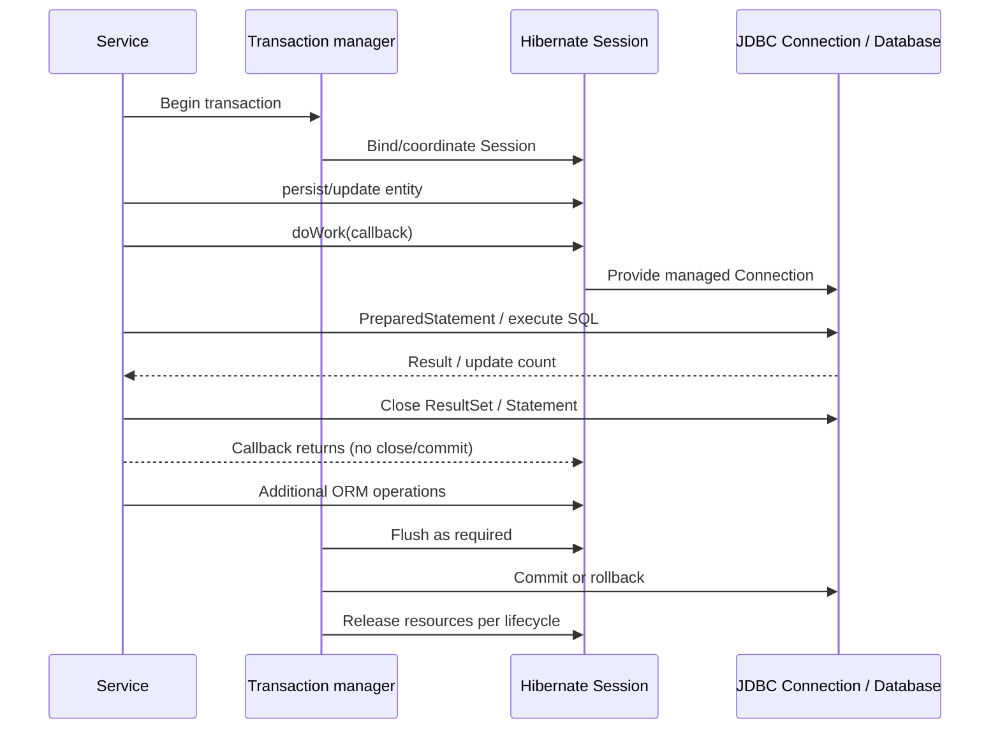

# Không tự đóng hoặc quản lý commit trên kết nối Hibernate đang sở hữu

Khi dùng SQL gốc (native SQL) hoặc JDBC trực tiếp cùng Hibernate, một chi tiết tưởng nhỏ có thể phá vỡ toàn bộ transaction: **ai sở hữu kết nối JDBC đang được sử dụng?**

Giả sử ứng dụng có `Session` Hibernate và lấy được một `java.sql.Connection` thông qua `Session.doWork(...)`. Lập trình viên có thể quen với JDBC thuần:

```java
try (Connection connection = dataSource.getConnection()) {
    // Thực thi SQL.
    connection.commit();
}
```

Mẫu trên có thể hợp lệ **nếu chính code đã lấy và sở hữu một Connection riêng trong mô hình JDBC được quản lý thủ công phù hợp**. Nhưng khi Connection được **Hibernate hoặc transaction manager cấp để dùng trong một Session/transaction hiện có**, việc gọi `connection.close()`, `connection.commit()`, `connection.rollback()` hoặc tự ý đổi `autoCommit` là sai ranh giới trách nhiệm.

Nguyên tắc của bài học:

> **Code nhận Connection từ Hibernate để sử dụng, không nhận quyền sở hữu vòng đời Connection.** Hãy để Hibernate và transaction manager quyết định lúc mở, tái sử dụng, commit, rollback và release kết nối. Trong callback JDBC, chỉ đóng các `Statement` và `ResultSet` do chính code tạo.

Điều này đặc biệt quan trọng khi ứng dụng dùng Spring `@Transactional`, JTA, connection pool, multi-tenancy, Hibernate flushing, dirty checking và bộ nhớ đệm Persistence Context.

---

## 1. Phân biệt ba khái niệm: sử dụng, sở hữu và giao dịch

Một Connection JDBC vừa là “đường truyền” tới database vừa mang trạng thái phiên làm việc ở mức JDBC, ví dụ transaction, auto-commit, isolation hoặc schema hiện tại.

Nhưng **tham chiếu Java tới Connection không đồng nghĩa quyền đóng hoặc commit kết nối đó**.

Có ba vai trò khác nhau:

1. **Người sử dụng:** code được quyền gọi `prepareStatement`, `executeQuery`, `executeUpdate` trong phạm vi đã được cấp.
2. **Chủ sở hữu vòng đời:** thành phần chịu trách nhiệm mượn/trả kết nối từ pool, đóng/release và khôi phục trạng thái cần thiết.
3. **Người quản lý transaction:** thành phần quyết định commit hoặc rollback của đơn vị công việc.

Trong ứng dụng Hibernate:

- `Session`/`EntityManager` điều phối truy cập cơ sở dữ liệu và Persistence Context.
- Hibernate/JDBC connection provider điều phối connection acquisition/release.
- Spring transaction manager, JPA `EntityTransaction`, Hibernate `Transaction` hoặc JTA transaction coordinator quản lý transaction tùy kiến trúc.
- Connection pool như HikariCP có thể cung cấp proxy Connection và thu hồi nó khi release.
- Code trong `Session.doWork` được dùng Connection **mượn từ Hibernate**, không được thay thế transaction coordinator.

### Bảng phân định trách nhiệm

| Thao tác | Ai nên thực hiện khi Connection do Hibernate sở hữu? |
| --- | --- |
| `connection.prepareStatement(sql)` | Code JDBC trong callback |
| `statement.executeQuery()` | Code JDBC trong callback |
| `statement.executeUpdate()` | Code JDBC trong callback |
| `resultSet.next()` | Code JDBC trong callback |
| `resultSet.close()` | Code tạo/nhận ResultSet |
| `preparedStatement.close()` | Code tạo PreparedStatement |
| `connection.close()` | Hibernate/connection provider/transaction infrastructure |
| `connection.commit()` | Transaction manager phù hợp, **không phải callback** |
| `connection.rollback()` | Transaction manager phù hợp, **không phải callback** |
| `connection.setAutoCommit(...)` | Transaction infrastructure, không tự ý thay trong callback |
| `Session.close()` | Thành phần sở hữu Session; không phải một helper JDBC bất kỳ |
| `EntityManager.close()` | Thành phần sở hữu EntityManager; với container-managed context không tự ý đóng |

Không nên biến bảng này thành quy tắc “mọi Connection trên đời đều không được close”. Trong **JDBC thuần**, nếu code trực tiếp gọi `dataSource.getConnection()` và sở hữu connection, code phải release đúng cách. Vấn đề ở đây là **Connection đang được Hibernate/transaction manager sở hữu**.

## 2. Vì sao việc tự đóng Connection có thể gây lỗi nghiêm trọng?

Giả sử một service Spring có transaction:

```java
@Transactional
public void placeOrder(PlaceOrderRequest request) {
    SalesOrder order = createAndPersistOrder(request);

    session.doWork(connection -> {
        insertAuditRow(connection, order.getId());
    });

    reserveInventory(order);
}
```

Ý định: tạo order, ghi audit, giữ hàng tồn kho — **cùng một transaction**.

Nếu `insertAuditRow` tự gọi:

```java
connection.close();
```

thì có thể xảy ra:

- Hibernate cố dùng lại một connection đã bị đóng/release.
- Các statement sau đó lỗi vì connection không còn hợp lệ.
- Connection pool nhận lại connection quá sớm và giao cho luồng/transaction khác.
- Transaction manager mất khả năng điều phối rollback/commit đúng như kỳ vọng.
- Exception xuất hiện muộn ở `flush` hoặc lúc commit thay vì ngay tại vị trí close.
- Trạng thái Hibernate Session và trạng thái connection bị lệch.

Ảnh hưởng thực tế phụ thuộc proxy của pool, connection handling mode và transaction integration. Có wrapper có thể chặn `close`, có wrapper trả connection về pool, có thể có lỗi ngay lập tức. **Không được dựa vào việc một môi trường thử nghiệm “không thấy lỗi” để coi close là hợp lệ.**

### SQL log có thể đánh lừa

Vẫn có thể thấy:

```sql
INSERT INTO orders ...;
INSERT INTO audit_events ...;
```

trong log trước khi một lỗi connection được phát hiện. Điều đó **không chứng minh transaction đã commit thành công**. Phải kiểm tra trạng thái transaction và dữ liệu sau commit.

## 3. Vì sao tự gọi `commit()` còn nguy hiểm hơn?

Xét một unit of work:

```text
BEGIN transaction
  Hibernate persist Order
  JDBC insert Audit
  Hibernate update Inventory
COMMIT một lần ở transaction boundary
```

Nếu callback JDBC tự gọi `connection.commit()` ngay sau insert Audit, nó có thể kết thúc transaction vật lý **trước khi các bước nghiệp vụ còn lại hoàn tất**.

Ví dụ sai:

```java
session.doWork(connection -> {
    try (PreparedStatement ps =
            connection.prepareStatement(
                "insert into audit_events(order_id, event_type) " +
                "values (?, ?)"
            )) {

        ps.setLong(1, orderId);
        ps.setString(2, "CREATED");
        ps.executeUpdate();
    }

    connection.commit(); // SAI: không sở hữu transaction!
});
```

Các hệ quả có thể gồm:

- Audit được commit quá sớm, còn bước cập nhật inventory thất bại.
- Transaction manager nghĩ rằng vẫn quản lý một transaction chưa hoàn tất.
- Hibernate flush tiếp dữ liệu trong một transaction khác/không đúng ngữ cảnh.
- Một lần rollback bên ngoài không thể hoàn tác phần đã commit trước đó.
- Trong JTA, driver hoặc môi trường có thể cấm `commit` trực tiếp trên managed connection.

**Atomicity bị phá vỡ:** nghiệp vụ không còn đảm bảo “hoặc tất cả thành công, hoặc không có gì được lưu”.

### Không được tự gọi `rollback()`

`connection.rollback()` trong callback cũng sai ownership. Nó có thể hủy các thay đổi trước đó của Hibernate hoặc của service mà callback không biết, làm transaction manager mất đồng bộ về trạng thái.

Nếu thao tác JDBC gặp lỗi:

1. Để exception đi ra khỏi callback.
2. Để transaction manager/Hibernate xử lý failure và rollback toàn unit of work theo policy.
3. Không tự rollback một connection Hibernate-managed rồi cố tiếp tục business transaction như chưa có gì xảy ra.

## 4. Sơ đồ vòng đời đúng



Các chi tiết về thời điểm connection được lấy và release phụ thuộc transaction platform/Hibernate connection handling mode. Ý chính không đổi: callback sử dụng JDBC connection do Hibernate cung cấp, còn transaction infrastructure quyết định kết thúc transaction.

## 5. API nên dùng: `Session.doWork(...)`

Hibernate cung cấp:

```java
void Session.doWork(Work work)
```

`Work` có callback nhận một Connection JDBC:

```java
@FunctionalInterface
public interface Work {
    void execute(Connection connection) throws SQLException;
}
```

Đây là biểu diễn ý tưởng của API Hibernate; các package thực tế gồm `org.hibernate.jdbc.Work`, `org.hibernate.Session`, `java.sql.Connection`.

### Ví dụ viết đúng

```java
import java.sql.PreparedStatement;
import org.hibernate.Session;

public void writeAudit(Session session, long orderId) {
    session.doWork(connection -> {
        String sql = """
            insert into audit_events(order_id, event_type)
            values (?, ?)
            """;

        try (PreparedStatement ps =
                connection.prepareStatement(sql)) {

            ps.setLong(1, orderId);
            ps.setString(2, "ORDER_CREATED");
            ps.executeUpdate();
        }

        // KHÔNG connection.commit().
        // KHÔNG connection.rollback().
        // KHÔNG connection.close().
    });
}
```

Phần code trên:

- Được Hibernate cấp Connection trong callback.
- Tạo PreparedStatement của riêng nó.
- Đóng PreparedStatement bằng try-with-resources.
- Không quyết định transaction boundary.
- Không giữ Connection cho việc sử dụng về sau.

**Đây là cách cơ bản để thực thi JDBC trực tiếp mà vẫn tôn trọng quyền sở hữu Connection của Hibernate.**

### `doWork` không đảm bảo một transaction đã mở

`Session.doWork` là điểm truy cập JDBC qua Hibernate, không phải `beginTransaction` tự động. Hãy gọi nó trong transaction phù hợp khi thao tác cần tính nguyên tử, đặc biệt đối với DML.

Ví dụ chuẩn:

```java
try (Session session = sessionFactory.openSession()) {
    Transaction tx = session.beginTransaction();

    try {
        session.persist(order);
        writeAudit(session, order.getId());

        tx.commit();
    } catch (RuntimeException ex) {
        if (tx.isActive()) {
            tx.rollback();
        }
        throw ex;
    }
}
```

Đây là ví dụ **application tự sở hữu Session và transaction bằng Hibernate native API**. Vì code đã mở Session/transaction, nó cũng sở hữu việc gọi `tx.commit()/rollback()` và `session.close()` ở **boundary ngoài** — khác hoàn toàn với tự gọi `connection.commit()/close()` bên trong `doWork`.

**Lưu ý ID:** nếu entity dùng identifier sinh khi flush/insert, `order.getId()` có thể cần Hibernate đã thực hiện insert trước khi dùng làm foreign key. Thiết kế generator và flush order phải phù hợp; các ví dụ đơn giản giả định ID đã có tại thời điểm gọi `writeAudit`.

## 6. Đọc dữ liệu bằng `Session.doReturningWork(...)`

Khi callback cần trả kết quả, Hibernate cung cấp `doReturningWork`.

```java
import java.sql.PreparedStatement;
import java.sql.ResultSet;
import org.hibernate.Session;

public long countAuditEvents(Session session, long orderId) {
    return session.doReturningWork(connection -> {
        String sql = """
            select count(*)
            from audit_events
            where order_id = ?
            """;

        try (PreparedStatement ps =
                connection.prepareStatement(sql)) {

            ps.setLong(1, orderId);

            try (ResultSet rs = ps.executeQuery()) {
                rs.next();
                return rs.getLong(1);
            }
        }
    });
}
```

`doReturningWork` nhận callback `ReturningWork<T>` và trả kết quả `T`. Kết quả nên là giá trị đã được materialize trong callback, ví dụ `Long`, DTO hoặc collection DTO.

**Không trả về `ResultSet` hoặc `Connection` để xử lý ở ngoài callback.** Khi callback kết thúc, phạm vi sử dụng Connection được Hibernate cấp đã kết thúc, và Statement/ResultSet cũng cần được đóng.

### Ví dụ không an toàn

```java
ResultSet resultSet =
    session.doReturningWork(connection -> {
        PreparedStatement ps =
            connection.prepareStatement(
                "select * from audit_events"
            );

        return ps.executeQuery(); // SAI: ResultSet thoát ra ngoài.
    });
```

Mẫu này làm rò rỉ Statement/ResultSet và gắn việc đọc kết quả với connection mà application không sở hữu. Hãy đọc hết result set trong callback và trả DTO đã materialize.

## 7. Try-with-resources: đóng đúng thứ được phép đóng

Nhiều lập trình viên học JDBC thuần với mẫu:

```java
try (Connection connection = dataSource.getConnection();
     PreparedStatement ps =
         connection.prepareStatement(sql);
     ResultSet rs = ps.executeQuery()) {
    // ...
}
```

Mẫu này **đúng nếu code sở hữu Connection trả về từ DataSource** trong phạm vi không bị transaction infrastructure quản lý riêng theo contract khác.

Nhưng trong Hibernate `doWork`, mẫu sau là sai:

```java
session.doWork(connection -> {
    try (connection) { // SAI: đóng Connection của Hibernate.
        // ...
    }
});
```

Hoặc:

```java
session.doWork(connection -> {
    try (Connection c = connection) {
        // SAI dù đổi tên biến thành c.
    }
});
```

### Mẫu đúng

```java
session.doWork(connection -> {
    try (PreparedStatement ps =
            connection.prepareStatement(
                "update inventory set quantity = quantity - ? " +
                "where product_id = ? and quantity >= ?"
            )) {

        ps.setInt(1, requestedQuantity);
        ps.setLong(2, productId);
        ps.setInt(3, requestedQuantity);

        int affected = ps.executeUpdate();

        if (affected != 1) {
            throw new IllegalStateException(
                "Không đủ hàng hoặc sản phẩm không tồn tại"
            );
        }
    }
});
```

Ở đây:

- Connection: Hibernate sở hữu, callback **không đóng**.
- PreparedStatement: callback tạo, callback **đóng**.
- ResultSet nếu có: callback tạo, callback **đóng**.
- Transaction: caller/transaction manager quyết định commit hoặc rollback.

### Statement đóng có tự đóng ResultSet không?

Theo JDBC, đóng Statement thường đóng ResultSet do Statement đó tạo. Tuy vậy, dùng try-with-resources riêng cho ResultSet giúp rõ ownership, giảm thời gian giữ cursor và không cần dựa vào việc đóng gián tiếp.

## 8. Một bảng phân biệt ba kiểu quản lý Connection

| Kịch bản | Ai lấy Connection? | Ai close/release? | Ai commit/rollback? |
| --- | --- | --- | --- |
| JDBC thuần tự quản lý | Code gọi `DataSource.getConnection` | Code sở hữu, theo contract DataSource | Code hoặc transaction manager tuỳ kiến trúc |
| Hibernate `Session.doWork` | Hibernate cung cấp trong callback | Hibernate/connection provider | Hibernate/Spring/JTA transaction coordinator |
| Spring transaction-bound JDBC qua helper phù hợp | Spring transaction infrastructure | Spring/helper theo contract (không đóng tay connection bound) | Spring transaction manager |
| JTA-managed datasource | Container/JTA | Container/provider | JTA transaction manager |
| Native SQL qua `EntityManager.createNativeQuery` | Hibernate/JPA nội bộ | Hibernate/JPA | JPA/Hibernate/Spring/JTA boundary |

Mỗi tầng có thể sử dụng connection pool phía dưới. Pool không thay thế transaction manager.

**Hãy xác định rõ contract tại điểm lấy Connection, không dựa vào kiểu Java `Connection` để suy ra ownership.**

## 9. Spring `@Transactional`: ai quản lý commit?

Trong Spring, cách thông dụng là để service điều phối transaction:

```java
import jakarta.persistence.EntityManager;
import jakarta.persistence.PersistenceContext;
import org.hibernate.Session;
import org.springframework.stereotype.Service;
import org.springframework.transaction.annotation.Transactional;

@Service
public class AuditService {

    @PersistenceContext
    private EntityManager em;

    @Transactional
    public void recordOrderAndAudit(SalesOrder order) {
        em.persist(order);
        em.flush(); // Khi cần chắc chắn INSERT/ID đã có.

        Session session = em.unwrap(Session.class);

        session.doWork(connection -> {
            try (PreparedStatement ps =
                    connection.prepareStatement(
                        "insert into audit_events(order_id, event_type) " +
                        "values (?, ?)"
                    )) {

                ps.setLong(1, order.getId());
                ps.setString(2, "CREATED");
                ps.executeUpdate();
            }
        });

        // Spring quyết định commit khi method hoàn thành bình thường.
    }
}
```

Spring transaction manager:

- Bắt đầu/join transaction theo cấu hình.
- Điều phối Hibernate EntityManager/Session tương ứng.
- Commit khi transaction boundary hoàn thành thành công.
- Rollback theo policy khi có exception.
- Giải phóng tài nguyên thích hợp sau transaction.

Callback JDBC không tự quyết định các bước đó.

### Đừng gọi `Session.getTransaction().commit()` bên trong `@Transactional`

Ngay cả khi lấy được `Session` từ EntityManager, **Spring đã là người sở hữu transaction boundary**. Không nên gọi `session.getTransaction().commit()` từ trong helper chỉ vì có Session.

Hai mức điều phối transaction khác nhau có thể va chạm, hoặc `commit` native không được phép khi JTA/container đã quản lý.

### Tránh tự close EntityManager do Spring inject

`@PersistenceContext` thường cung cấp một proxy EntityManager được quản lý bởi container/Spring. Không gọi `em.close()` trong service nghiệp vụ thông thường. Hệ thống phải quản lý lifecycle của nó.

## 10. Tại sao không gọi `setAutoCommit`?

`Connection.setAutoCommit(boolean)` thay đổi cách database commit statement.

Trong JDBC:

- `autoCommit=true`: mỗi statement có thể được commit tự động theo semantics JDBC.
- `autoCommit=false`: nhiều statement có thể nằm trong cùng transaction tới khi commit/rollback.

Khi Hibernate/transaction manager đã thiết lập transaction, code trong callback không được tự ý:

```java
connection.setAutoCommit(true);  // SAI.
connection.setAutoCommit(false); // Cũng không nên tự ý.
```

Lý do:

1. Có thể làm mất ranh giới transaction manager đã thiết lập.
2. Việc chuyển từ `autoCommit=false` sang `true` có thể commit transaction đang diễn ra theo JDBC contract.
3. Trạng thái Connection có thể không được khôi phục đúng trước khi pool tái sử dụng.
4. Một số managed datasource/JTA cấm thay đổi auto-commit.
5. Hibernate có các giả định và cấu hình riêng về auto-commit và connection provider.

Đừng nghĩ rằng chỉ `commit()` mới nguy hiểm. **Đổi auto-commit cũng có thể gây commit ngoài ý muốn.**

### `hibernate.connection.provider_disables_autocommit` là gì?

Một số cấu hình Hibernate cho phép tối ưu cách thu nhận connection khi provider/pool được cấu hình auto-commit sẵn phù hợp, chẳng hạn property `hibernate.connection.provider_disables_autocommit` trong phiên bản hỗ trợ.

Đây là **hợp đồng cấu hình giữa Hibernate và connection provider**, không phải lời mời để callback tự gọi `setAutoCommit`. Cấu hình sai có thể khiến các statement chạy ngoài transaction mong đợi; cần được kiểm tra ở hạ tầng và integration test.

## 11. Không đổi isolation, schema và session state tùy tiện

Ngoài `commit` và `close`, một Connection còn có các trạng thái khác:

```java
connection.setTransactionIsolation(
    Connection.TRANSACTION_READ_COMMITTED
);

connection.setReadOnly(true);
connection.setSchema("tenant_a");
connection.setCatalog("catalog_a");
```

Những lời gọi này có thể làm thay đổi state của connection được Hibernate/pool tái sử dụng.

### Transaction isolation

Nếu cần `READ_COMMITTED`, `REPEATABLE_READ` hoặc isolation khác, hãy cấu hình ở transaction manager hoặc use-case boundary:

```java
@Transactional(
    isolation = Isolation.REPEATABLE_READ
)
public ReportResult loadReport() {
    // ...
}
```

Khả năng hỗ trợ phụ thuộc database và transaction manager. Không tự nâng/hạ isolation trong callback JDBC trừ khi hạ tầng cho phép và có cơ chế quản lý trạng thái rõ ràng.

### Read-only của connection

`connection.setReadOnly(true)` có thể là hint đối với JDBC driver/database, không đồng nghĩa cơ chế bảo mật. Nếu cần transaction chỉ đọc, dùng transaction configuration phù hợp:

```java
@Transactional(readOnly = true)
public List<OrderSummary> listOrders() {
    // ...
}
```

Nếu cần ngăn ghi tuyệt đối, dùng quyền database/authorization, không chỉ dựa vào read-only hint.

### Schema/catalog trong multi-tenancy

Hibernate có thể dùng ConnectionProvider/MultiTenantConnectionProvider để chọn schema/database tenant, rồi reset state khi release.

Tự gọi `connection.setSchema(...)` trong `doWork` có thể khiến những query Hibernate tiếp theo chạy sai tenant hoặc gây rò rỉ state sang kết nối được reuse. Với multi-tenancy, hãy dùng cơ chế tenant routing đã được thiết kế và kiểm tra isolation; không tự đổi schema trong DAO ngẫu nhiên.

## 12. Không giữ Connection qua khỏi callback

Một lỗi vòng đời:

```java
private Connection savedConnection;

public void prepare(Session session) {
    session.doWork(connection -> {
        savedConnection = connection; // SAI.
    });
}

public void later() throws SQLException {
    savedConnection.prepareStatement("select 1");
}
```

Tại `later()`:

- Hibernate có thể đã release/đổi connection.
- Transaction có thể đã commit/rollback.
- Connection pool có thể tái sử dụng connection.
- Saved Connection có thể closed hoặc thuộc transaction khác.
- Thread hiện tại có thể khác thread sở hữu Session.

**Connection được cung cấp cho callback để dùng trong phạm vi callback, không phải handle có vòng đời độc lập.**

### Không đưa Connection cho tác vụ bất đồng bộ

```java
session.doWork(connection -> {
    executor.submit(() -> {
        // SAI: sử dụng connection sau khi callback kết thúc.
        runSql(connection);
    });
});
```

Session Hibernate thường không thread-safe; một Connection JDBC cũng không nên dùng đồng thời không có giao thức quản lý riêng. Nếu cần async job, tạo unit of work/transaction riêng trong worker và nhận Connection từ hạ tầng của worker đó.

## 13. Không trả `Connection` từ `doReturningWork`

Câu lệnh sau có thể biên dịch nhưng sai ownership:

```java
Connection connection =
    session.doReturningWork(c -> c); // SAI.
```

Đối tượng được trả ra không phải tài nguyên do caller có quyền tự đóng hay giữ lâu. Thay vào đó, trả dữ liệu đã chuyển thành một kiểu Java độc lập:

```java
record AuditEventRow(long id, String type) {}

List<AuditEventRow> events =
    session.doReturningWork(connection -> {
        List<AuditEventRow> result =
            new ArrayList<>();

        try (PreparedStatement ps =
                connection.prepareStatement(
                    "select id, event_type from audit_events " +
                    "where order_id = ?"
                )) {

            ps.setLong(1, orderId);

            try (ResultSet rs = ps.executeQuery()) {
                while (rs.next()) {
                    result.add(
                        new AuditEventRow(
                            rs.getLong("id"),
                            rs.getString("event_type")
                        )
                    );
                }
            }
        }

        return result;
    });
```

`List<AuditEventRow>` không còn phụ thuộc vào JDBC cursor sau khi callback kết thúc.

## 14. JDBC Exception: để lỗi đi đúng transaction boundary

Callback của `Work`/`ReturningWork` có thể ném `SQLException`.

```java
session.doWork(connection -> {
    try (PreparedStatement ps =
            connection.prepareStatement(sql)) {

        ps.executeUpdate();
    }
});
```

Nếu có `SQLException`:

- Hibernate có thể chuyển exception sang `JDBCException` hoặc một exception runtime phù hợp theo cơ chế của phiên bản.
- Spring transaction boundary thường rollback với unchecked exception theo policy mặc định.
- JTA/container transaction coordinator xử lý theo cơ chế của nó.

Điều quan trọng là **không âm thầm nuốt lỗi rồi để service commit**.

### Ví dụ sai: bỏ qua lỗi

```java
session.doWork(connection -> {
    try (PreparedStatement ps =
            connection.prepareStatement(sql)) {

        ps.executeUpdate();
    } catch (SQLException ex) {
        log.warn("Ignore JDBC error", ex);
        // SAI nếu nghiệp vụ yêu cầu SQL phải thành công.
    }
});
```

Nếu callback không ném lỗi, transaction manager có thể tiếp tục và commit những thay đổi khác, gây dữ liệu thiếu nhất quán.

### Cách xử lý đúng theo policy

- Nếu SQL là bước bắt buộc: để exception propagate/đánh dấu transaction rollback.
- Nếu bước này thật sự có thể bỏ qua: thiết kế một failure policy rõ ràng, cân nhắc database transaction state và xử lý độc lập; không mặc định tiếp tục sau mọi SQLException.
- Nếu cần retry: thường rollback unit of work hiện tại rồi thử lại trong transaction mới, có backoff/idempotency phù hợp.

Một số DBMS (ví dụ PostgreSQL sau nhiều lỗi statement trong transaction) chuyển transaction sang trạng thái failed, yêu cầu rollback. Do đó không nên catch SQLException rồi giả định có thể tiếp tục ghi trong cùng transaction.

## 15. Native SQL qua Hibernate thay cho `doWork`

Nhiều nhu cầu SQL gốc không cần truy cập JDBC Connection trực tiếp.

Jakarta Persistence hỗ trợ:

```java
int affected = em.createNativeQuery(
    "update inventory " +
    "set quantity = quantity - :amount " +
    "where product_id = :id and quantity >= :amount"
)
.setParameter("amount", requestedQuantity)
.setParameter("id", productId)
.executeUpdate();
```

Ưu điểm:

- Hibernate quản lý Connection/JDBC statement.
- Dùng transaction đã gắn với EntityManager.
- Có thể bind parameter qua API query.
- Ít nguy cơ vô tình gọi `connection.close`/`commit`.

`Session.createNativeQuery(...)` cũng phù hợp trong trường hợp cần API Hibernate.

### Khi nào thật sự dùng `doWork`?

Một số tác vụ cần tính năng JDBC trực tiếp:

- API driver cụ thể.
- JDBC batch với `PreparedStatement.addBatch()`.
- `CallableStatement` có out parameter theo giao thức riêng.
- Streaming hoặc một số kiểu binary/LOB JDBC đặc thù.
- Thư viện JDBC chỉ nhận `Connection` nhưng có thể hoạt động theo ownership được kiểm soát.
- Lấy metadata/capability của driver khi không có API HQL phù hợp.

Nếu query chỉ là một SELECT/UPDATE/DELETE đơn giản, thường nên bắt đầu bằng native query API trước.

## 16. Native SQL cũng phải tôn trọng Persistence Context

Dùng `doWork` hoặc native DML có thể thay dữ liệu database **ngoài dirty checking của entity**.

Giả sử:

```java
SalesOrder order = em.find(
    SalesOrder.class,
    orderId
);

// JDBC cập nhật status trực tiếp.
session.doWork(connection -> {
    try (PreparedStatement ps =
            connection.prepareStatement(
                "update sales_orders set status = ? where id = ?"
            )) {

        ps.setString(1, "CANCELLED");
        ps.setLong(2, orderId);
        ps.executeUpdate();
    }
});

// order.getStatus() có thể vẫn là giá trị đã tải trước đó.
```

Hibernate Persistence Context giữ entity managed theo identity map. Code JDBC thay đổi row trực tiếp không tự cập nhật field `status` của object đã tải.

### `flush` trước JDBC nếu cần thứ tự

Nếu Hibernate có INSERT/UPDATE pending chưa gửi xuống DB và câu JDBC phụ thuộc kết quả đó, hãy flush ở **tầng Session/EntityManager**, không tự commit:

```java
em.flush();

session.doWork(connection -> {
    // JDBC xử lý các row Hibernate vừa flush.
});
```

**Flush khác commit:**

- `flush` đồng bộ thay đổi pending xuống DB trong transaction.
- `commit` kết thúc transaction theo coordinator và làm thay đổi bền vững khi thành công.

Flush trước JDBC có thể cần thiết vì `doWork` không phải lúc nào cũng tự flush các ORM changes pending theo cách giống mọi query HQL.

### `refresh` sau JDBC

Nếu JDBC cập nhật row của entity đang managed:

```java
session.doWork(connection -> {
    // UPDATE sales_orders ...
});

em.refresh(order);
```

`refresh` yêu cầu nạp lại state entity từ database theo semantics provider. Phải dùng trong ngữ cảnh hợp lệ, đặc biệt sau khi xử lý pending changes để không vô tình ghi đè thay đổi chưa flush.

### `clear` cũng có thể cần, nhưng phải hiểu tác động

```java
em.flush();
session.doWork(connection -> {
    // Bulk UPDATE/DELETE ...
});
em.clear();
```

`clear` detach **tất cả** managed entities trong Persistence Context, không chỉ row JDBC vừa thay. Nếu caller còn tham chiếu entity với mong muốn dirty checking sau đó, chúng sẽ không còn managed. Thiết kế unit of work rõ ràng thay vì gọi clear tùy tiện.

## 17. JDBC DML không tự chạy entity lifecycle callback

Nếu cập nhật/xóa bằng SQL trực tiếp:

```java
session.doWork(connection -> {
    try (PreparedStatement ps =
            connection.prepareStatement(
                "delete from order_lines where order_id = ?"
            )) {

        ps.setLong(1, orderId);
        ps.executeUpdate();
    }
});
```

thì Hibernate không đi qua lifecycle remove của từng `OrderLine` entity như khi gọi `EntityManager.remove`.

Các cơ chế có thể bị bỏ qua gồm:

- `@PreRemove`, `@PostRemove` của từng entity.
- JPA cascade REMOVE/orphanRemoval ở tầng entity.
- Hibernate entity event listeners.
- Một số audit/Envers integration dựa trên ORM events.
- Version check/`@Version` tự động nếu SQL không tự thêm version predicate.
- Hibernate filter/tenant predicate nếu code SQL không tự thể hiện.

Database triggers và FK cascade vẫn có thể chạy vì chúng nằm ở database, nhưng đó là cơ chế khác.

**Vì vậy, SQL trực tiếp phải được chọn vì lý do cụ thể, không chỉ vì dễ viết.** Phải đánh giá đầy đủ business rules, constraints, cache và audit.

## 18. JDBC update count không phải bảo đảm transaction đã commit

`PreparedStatement.executeUpdate()` trả về update count theo JDBC driver cho statement.

```java
int updated = session.doReturningWork(connection -> {
    try (PreparedStatement ps =
            connection.prepareStatement(
                "update inventory " +
                "set quantity = quantity - ? " +
                "where product_id = ? and quantity >= ?"
            )) {

        ps.setInt(1, amount);
        ps.setLong(2, productId);
        ps.setInt(3, amount);

        return ps.executeUpdate();
    }
});
```

Nếu `updated == 1`, statement đã tác động một row theo semantics JDBC. Điều đó **không chứng minh** outer transaction đã commit. Một exception xuất hiện sau đó có thể khiến transaction rollback, hoàn tác thay đổi.

### Xử lý optimistic concurrency thủ công

Nếu JDBC trực tiếp cập nhật entity có version:

```sql
UPDATE sales_orders
SET status = ?, version = version + 1
WHERE id = ? AND version = ?;
```

Update count 0 có thể là không tồn tại hoặc version không còn khớp. Nhưng việc tự viết version predicate cũng đòi hỏi đồng bộ với Hibernate managed state/cache. Nếu không cần JDBC đặc biệt, thường an toàn hơn để Hibernate xử lý `@Version` qua entity lifecycle.

## 19. Batch JDBC đúng cách mà không chiếm ownership

`Session.doWork` có thể dùng JDBC batch:

```java
session.doWork(connection -> {
    String sql = """
        insert into order_audit(order_id, action)
        values (?, ?)
        """;

    try (PreparedStatement ps =
            connection.prepareStatement(sql)) {

        for (AuditItem item : auditItems) {
            ps.setLong(1, item.orderId());
            ps.setString(2, item.action());
            ps.addBatch();
        }

        int[] counts = ps.executeBatch();
        // Đọc counts nếu nghiệp vụ cần.
    }

    // KHÔNG commit batch bằng connection.commit().
});
```

Toàn bộ batch vẫn thuộc transaction do caller/transaction manager điều phối.

### Batch không thay transaction boundary

`executeBatch` gửi nhiều executions xuống database theo JDBC; nó không có nghĩa tự commit một lần. Nếu outer transaction rollback, các thay đổi batch thuộc transaction đó cũng phải tuân theo rollback semantics của database.

### Batch count không luôn là số row chính xác

Theo JDBC, `executeBatch` có thể trả:

- Số row bị ảnh hưởng cho từng execution.
- `Statement.SUCCESS_NO_INFO`.
- `Statement.EXECUTE_FAILED` trong những điều kiện driver có thể tiếp tục.

Không suy ra `counts.length` bằng tổng số row đã commit.

## 20. Không gọi `rollback` để “reset batch” trong callback

Khi batch lỗi, mẫu sau nguy hiểm:

```java
session.doWork(connection -> {
    try (PreparedStatement ps =
            connection.prepareStatement(sql)) {

        ps.executeBatch();
    } catch (SQLException ex) {
        connection.rollback(); // SAI: rollback cả transaction Hibernate!
        // ...
    }
});
```

Rollback trực tiếp có thể hủy ORM INSERT/UPDATE do service thực hiện trước đó nhưng vẫn để Session chứa pending/in-memory state không đồng bộ.

Cách phù hợp:

- Nếu batch là phần bắt buộc của nghiệp vụ, propagate exception.
- Caller/transaction manager rollback toàn transaction.
- Nếu muốn xử lý theo chunk độc lập, thiết kế nhiều transaction boundary bên ngoài callback, ví dụ một transaction cho mỗi chunk.
- Nếu cần savepoint, dùng API của transaction manager và kiểm tra khả năng support thay vì tự thao tác connection tùy tiện.

### Savepoint có được phép không?

JDBC có `Connection.setSavepoint` và `rollback(savepoint)`, nhưng trong Hibernate/JTA/Spring, hành vi này có thể xung đột transaction coordinator hoặc không được hỗ trợ.

Với Spring, chương trình có thể dùng `TransactionStatus`/`SavepointManager` hoặc nested transaction theo khả năng manager; một số transaction manager hỗ trợ savepoint, một số khác không. Đừng lén tạo savepoint trong helper JDBC khi unit of work phía ngoài không biết.

## 21. JTA/container-managed transaction

Trong môi trường ứng dụng dùng JTA, connection có thể được enlist vào transaction toàn cục do container quản lý.

Ví dụ khái niệm:

```java
@Transactional
public void submitBusinessOperation() {
    // Các ORM và JDBC thao tác trong một transaction
    // được quản lý bởi JTA/container.
}
```

Với JTA, các lời gọi trực tiếp:

```java
connection.commit();
connection.rollback();
connection.setAutoCommit(true);
```

trên managed connection có thể bị cấm hoặc làm phá transaction coordinator.

Nếu cần giao dịch nhiều resource hoặc phân tán, phải dùng kiến trúc transaction/outbox/saga phù hợp, không tự “commit từng connection” bên trong một JTA transaction.

### Transaction rollback-only

Một exception có thể khiến JTA transaction bị đánh dấu rollback-only. Dù callback sau đó xử lý thành công, outer commit vẫn có thể thất bại. Không coi việc không thấy exception tại `doWork` là bằng chứng transaction hợp lệ.

## 22. Connection pool: tại sao `close` có thể không đóng socket nhưng vẫn sai?

Nhiều pool trả về **proxy Connection**. Khi gọi:

```java
connection.close();
```

proxy có thể trả connection vật lý về pool thay vì đóng TCP socket.

Trong JDBC thuần, đó là cách release đúng nếu code sở hữu borrowed connection. Nhưng trong Hibernate `doWork`:

- Hibernate vẫn xem connection thuộc phiên làm việc hiện tại.
- Pool có thể xem connection đã được trả.
- Hai tầng quản lý có trạng thái không khớp.
- Sử dụng tiếp có thể ném “connection is closed” hoặc lỗi bất thường.
- Trong trường hợp nghiêm trọng, connection bị cấp lại sai thời điểm.

Không tìm cách “sửa” bằng cách gọi `connection.isClosed()` sau khi close hoặc dựa vào proxy biết tự bảo vệ. **Sửa ownership**, không vá hậu quả.

### Pool leak detection

Connection pool có thể ghi cảnh báo connection leak khi tài nguyên bị giữ lâu. Không được phản ứng bằng cách thêm `connection.close()` vào callback `doWork` một cách mù quáng.

Hãy kiểm tra:

- Transaction có quá dài không?
- Query có treo/đợi lock không?
- ResultSet/Statement có được đóng không?
- Session/EntityManager có được release theo lifecycle không?
- Có giữ reference Connection ra ngoài callback không?
- Job có quên kết thúc transaction không?

Pool leak detection là tín hiệu, không tự chỉ ra ai có quyền close.

## 23. Hibernate Connection acquisition/release mode

Hibernate có nhiều chế độ xử lý việc lấy và release JDBC Connection, chịu ảnh hưởng transaction strategy, Session lifecycle và cấu hình như physical connection handling mode.

Có thể gặp các cách:

- Chỉ lấy Connection khi SQL/JDBC thực sự cần.
- Giữ Connection trong transaction.
- Release sau transaction.
- Trong một số môi trường JTA, release theo statement hoặc theo chế độ hỗ trợ.

Không nên thiết kế code dựa trên giả định một `Session` luôn giữ **cùng một physical JDBC Connection** từ đầu đến cuối vòng đời trong mọi cấu hình.

### Hệ quả đối với callback

- Chỉ dùng Connection được truyền vào callback.
- Không cache/so sánh identity của physical Connection để suy ra tính đúng đắn.
- Không giữ Connection sau callback.
- Không tự điều khiển release mode bằng close.

Nếu dùng connection-specific state như temporary table, session variable, vendor-specific cursor, cần hiểu connection handling mode và transaction boundary thật; có thể không phù hợp với release mode nhất định.

## 24. Không nhầm `Session.close()` với `Connection.close()`

Nếu ứng dụng tự mở Session:

```java
try (Session session = sessionFactory.openSession()) {
    Transaction tx = session.beginTransaction();

    try {
        // ORM/JDBC work trong session.
        tx.commit();
    } catch (RuntimeException ex) {
        if (tx.isActive()) {
            tx.rollback();
        }
        throw ex;
    }
}
```

`try (Session session = ...)` là đúng vì code đã mở và sở hữu Session; khi thoát block, Hibernate đóng Session và quản lý release tài nguyên theo contract.

Bên trong `Session.doWork`, không được suy từ đó rằng `try (Connection c = connection)` cũng đúng. Đây là hai quyền sở hữu ở hai cấp độ khác nhau.

### EntityManager trong ứng dụng Java SE tự quản lý

Nếu tự gọi `EntityManager em = emf.createEntityManager()`, code có trách nhiệm `em.close()` tại boundary thích hợp. Nhưng nếu EntityManager do container/Spring inject và quản lý, service không nên tự close.

Nguyên tắc duy nhất: **thành phần tạo/sở hữu lifecycle của resource theo contract sẽ giải phóng resource đó**.

## 25. DataSource.getConnection ngoài Hibernate có thực sự “cùng transaction” không?

Một anti-pattern thường gặp:

```java
@Transactional
public void updateOrder() throws SQLException {
    em.find(SalesOrder.class, orderId)
        .markPaid();

    try (Connection c = dataSource.getConnection()) {
        // Có chắc cùng transaction với EntityManager?
    }
}
```

Câu trả lời phụ thuộc integration:

- Datasource có được bind với transaction manager không?
- `getConnection` trả một connection mới hay proxy transaction-aware?
- Có dùng Spring `DataSourceUtils` hoặc `TransactionAwareDataSourceProxy` không?
- Hibernate và JDBC có cùng DataSource/transaction manager không?
- Application có JTA hay local transactions?
- Có cùng tenant/schema không?

Không được mặc định mọi connection từ cùng một DataSource đều cùng transaction. Một connection riêng có thể auto-commit độc lập, làm thay đổi SQL không rollback cùng ORM.

### Khi cần chắc chắn dùng Hibernate connection

Dùng:

```java
Session session = em.unwrap(Session.class);

session.doWork(connection -> {
    // JDBC chạy qua Connection của Session hiện tại.
});
```

Điều này rõ ràng hơn về ownership và mối liên kết với Session hiện tại.

### Khi dùng Spring JDBC cùng Hibernate

Spring cung cấp `DataSourceUtils.getConnection` và `DataSourceUtils.releaseConnection` để tham gia transaction-bound connection theo đúng contract khi cấu hình phù hợp; `JdbcTemplate` thường đảm nhiệm acquisition/release cho code ứng dụng.

Không tự close một connection được lấy qua `DataSourceUtils.getConnection`; hãy release bằng `DataSourceUtils.releaseConnection` theo contract của Spring. Dù vậy, cần cấu hình transaction manager/DataSource đúng để Hibernate và Spring JDBC thực sự chia sẻ transaction; không phải chỉ dùng cùng tên datasource là đủ.

## 26. Thư viện bên thứ ba nhận `Connection`

Một số SDK, bulk loader hoặc thư viện legacy có API:

```java
library.importData(Connection connection, List<Row> rows);
```

Điểm cần kiểm tra trước khi truyền Connection Hibernate-managed:

1. Thư viện có gọi `connection.close()` không?
2. Thư viện có gọi `commit()/rollback()` không?
3. Thư viện có thay `autoCommit`, isolation, schema/catalog không?
4. Thư viện có giữ Connection sau khi method trả về không?
5. Thư viện có tạo thread xử lý bất đồng bộ không?
6. Thư viện có đóng mọi `Statement`/`ResultSet` của chính nó không?
7. Thư viện có giả định connection không thuộc JTA transaction không?

Nếu thư viện tự commit/close, **không truyền trực tiếp** Hibernate-managed Connection mà không có adapter hoặc contract đảm bảo an toàn.

### Có nên tạo wrapper chặn `close` và `commit`?

Một adapter Connection chỉ cho phép các thao tác JDBC cần thiết và chặn thao tác lifecycle có thể là giải pháp cho thư viện hỗ trợ non-owning connection. Nhưng phải làm cẩn thận:

- Wrapper có thể cần triển khai rất nhiều phương thức JDBC.
- Thư viện có thể gọi `unwrap` để truy cập physical Connection.
- Không chặn exception/transaction state một cách sai.
- Nhiều driver-specific API có thể không tương thích.

Trước tiên ưu tiên API của thư viện có chế độ **caller-managed transaction/non-owning connection**. Nếu không có, cân nhắc chạy thư viện trong unit of work/connection riêng do một boundary khác sở hữu, với thiết kế nhất quán dữ liệu rõ ràng.

## 27. Khi nào code được phép tự đóng Connection?

Không phải mọi lời gọi `connection.close()` đều sai.

### Trường hợp JDBC thuần, code sở hữu Connection

```java
public long countOrders(DataSource dataSource)
        throws SQLException {

    String sql = "select count(*) from sales_orders";

    try (Connection connection =
            dataSource.getConnection();
         PreparedStatement ps =
            connection.prepareStatement(sql);
         ResultSet rs = ps.executeQuery()) {

        rs.next();
        return rs.getLong(1);
    }
}
```

Ở đây code chủ động lấy Connection từ DataSource trong phạm vi độc lập. Nếu DataSource contract cho phép caller-managed connection, code phải release bằng `close`. Ví dụ dùng auto-commit mặc định của DataSource cho truy vấn SELECT đơn giản; không tự quản lý một transaction ghi phức tạp trong code này.

### Trường hợp code tự quản lý transaction JDBC

```java
try (Connection connection =
        dataSource.getConnection()) {

    boolean oldAutoCommit =
        connection.getAutoCommit();

    try {
        connection.setAutoCommit(false);

        executeBusinessStatements(connection);

        connection.commit();
    } catch (SQLException | RuntimeException ex) {
        connection.rollback();
        throw ex;
    } finally {
        connection.setAutoCommit(oldAutoCommit);
    }
}
```

Mẫu này chỉ phù hợp trong **JDBC local transaction do chính code sở hữu**, không phải Connection Hibernate-managed hay JTA/Spring transaction-bound. Ngay cả trong JDBC thuần, việc rollback hoặc restore state trong `finally` cũng có thể ném SQLException; code production cần chính sách xử lý suppressed exceptions và connection pool phù hợp.

### So sánh hai tình huống

```text
A. Code gọi DataSource.getConnection() để tự quản lý
   -> code có trách nhiệm release/transaction theo contract.

B. Hibernate gọi callback doWork(connection)
   -> Hibernate sở hữu Connection, callback chỉ dùng tạm.
   -> không close/commit/rollback/đổi autoCommit.
```

Điểm phân biệt không nằm ở SQL hay ở class `Connection`, mà ở **ai đang sở hữu transaction/lifecycle tại thời điểm truy cập**.

## 28. Các trường hợp JDBC không nên cố tự điều khiển commit

### DDL

Một số DBMS thực hiện **implicit commit** với một số câu DDL, ví dụ `CREATE TABLE` hoặc `ALTER TABLE`. Ngay cả khi không gọi `connection.commit()`, gửi DDL trong một business transaction có thể phá kỳ vọng atomicity ở một số database.

Nếu cần schema migration:

- Dùng Flyway, Liquibase hoặc migration tool phù hợp.
- Chạy trong quy trình deploy/migration rõ ràng.
- Không nhúng DDL ngẫu nhiên vào `Session.doWork` trong business transaction.
- Kiểm tra transactional DDL support của DBMS.

### Stored procedure tự commit

Một stored procedure hoặc trigger có thể có side effect/transaction behavior riêng tùy DBMS. Chạy bằng `CallableStatement` không đồng nghĩa mọi hiệu ứng đều rollback được theo mong muốn. Hãy hiểu contract procedure trước khi gọi từ Hibernate transaction.

### Autonomous transaction

Một số DBMS hỗ trợ autonomous transaction. Nếu procedure ghi audit trong autonomous transaction, nó có thể commit độc lập với transaction gọi. Điều đó là **thiết kế transaction ở database**, không sửa được bằng cách bỏ `Connection.commit` khỏi callback. Cần đảm bảo hành vi được nghiệp vụ chấp nhận.

## 29. Không dùng Connection của Hibernate cho công việc bất đồng bộ kéo dài

Ví dụ sai:

```java
session.doWork(connection -> {
    startLongRunningExport(connection);
    // Hàm export trả về trước khi job đọc xong dữ liệu.
});
```

Nếu job dùng cursor sau callback, nó có thể truy cập resource không còn hợp lệ.

### Thiết kế phù hợp hơn

- Nếu export nhỏ: đọc ResultSet và tạo DTO/file trong callback hoặc trong unit of work có boundary rõ.
- Nếu export lớn: streaming/scroll API được hỗ trợ với lifecycle Session/transaction phù hợp, đóng cursor đúng lúc.
- Nếu export chạy nền: tạo job riêng, có Session/transaction riêng trong thread worker, không giữ Connection của request.
- Không chia sẻ Session giữa thread để tiết kiệm chi phí tạo session.

Connection pool là tài nguyên dùng chung; giữ connection quá lâu có thể gây cạn pool ngay cả khi không có lỗi close.

## 30. Test integration: JDBC và ORM phải rollback cùng nhau

Một phép thử quan trọng là bảo đảm SQL trực tiếp và Hibernate operations nằm trong cùng transaction.

Ví dụ test giả định có helper quản lý transaction:

```java
@Test
void jdbcWorkAndOrmWorkRollbackTogether() {
    Long orderId = seedOrder();

    assertThrows(
        BusinessFailure.class,
        () -> service.changeOrderAndThenFail(orderId)
    );

    // Đọc lại trong EntityManager/transaction mới.
    assertOrderUnchanged(orderId);
    assertNoAuditEventForFailedOperation(orderId);
}
```

Service:

```java
@Transactional
public void changeOrderAndThenFail(Long orderId) {
    SalesOrder order = em.find(
        SalesOrder.class,
        orderId
    );

    order.markCancelled();

    Session session = em.unwrap(Session.class);

    session.doWork(connection -> {
        try (PreparedStatement ps =
                connection.prepareStatement(
                    "insert into audit_events(order_id, event_type) " +
                    "values (?, ?)"
                )) {

            ps.setLong(1, orderId);
            ps.setString(2, "CANCEL_ATTEMPT");
            ps.executeUpdate();
        }
    });

    throw new BusinessFailure("Intentional failure");
}
```

`BusinessFailure` là unchecked exception do ứng dụng/test định nghĩa. Với Spring mặc định, unchecked exception thường kích hoạt rollback.

Sau rollback, kỳ vọng:

- Status của Order không bị đổi bền vững.
- Audit event do JDBC insert không tồn tại.
- Không có connection leak.
- Một request mới vẫn có thể truy vấn database bình thường.

Nếu Audit row vẫn tồn tại sau rollback, cần điều tra connection không cùng transaction, stored procedure autonomous transaction, pool/transaction manager mismatch hoặc những yếu tố tương tự.

## 31. Test không đóng connection trong `doWork`

Có thể dùng datasource proxy/instrumentation để theo dõi:

- JDBC Connection do Hibernate cấp.
- Số `PreparedStatement` được mở/đóng.
- Số `ResultSet` được mở/đóng.
- Khi Hibernate release Connection.
- Transaction commit/rollback theo boundary bên ngoài.

Ý tưởng test:

```text
1. Open transaction.
2. Persist an entity.
3. Run doWork with PreparedStatement.
4. Continue using Hibernate in same transaction.
5. Commit transaction.
6. Open a new transaction and verify data.
7. Confirm no pool leak warnings.
```

Không cần tự gọi `connection.isClosed()` để chứng minh ownership. Trạng thái proxy/physical connection có thể không phản ánh điều đúng cần kiểm tra. Điều cần chứng minh là transaction thực hiện trọn vẹn, resource được giải phóng theo lifecycle và connection pool ổn định.

## 32. Test transaction bị lỗi

Một test khác mô phỏng `SQLException` hoặc constraint violation trong callback:

```text
BEGIN
Hibernate INSERT parent
JDBC INSERT duplicate unique key -> failure
Application transaction -> rollback
New transaction -> parent is absent
```

Nếu parent vẫn tồn tại sau thất bại, có thể đã xảy ra commit ngoài ý muốn hoặc transaction bị chia cắt.

Test phải chạy trên DB có hành vi transaction phù hợp mục tiêu deployment. In-memory database có thể khác PostgreSQL/MySQL/Oracle/SQL Server về DDL, isolation, constraint enforcement và trạng thái transaction sau lỗi.

## 33. Test không dùng kết nối ngoài callback

Trong review, có thể tìm các dấu hiệu nguy hiểm:

```java
this.connection = connection;
return connection;
CompletableFuture.runAsync(() -> use(connection));
new Thread(() -> use(connection)).start();
```

Không dùng chúng trong `doWork/doReturningWork`.

Nếu một thư viện cần giữ cursor/stream, phải có lifecycle wrapper do code ở transaction boundary sở hữu và bảo đảm Session vẫn mở; không dùng Connection raw đã thoát khỏi callback làm handle riêng.

## 34. Những lỗi thường gặp trong thực tế

### Lỗi 1: đặt Connection vào try-with-resources trong `doWork`

```java
session.doWork(c -> {
    try (Connection connection = c) { // SAI.
        // ...
    }
});
```

**Cách sửa:** chỉ đưa PreparedStatement/ResultSet vào try-with-resources.

### Lỗi 2: tự commit sau JDBC insert

```java
connection.commit(); // SAI trong doWork.
```

**Cách sửa:** để Spring/Session/JTA transaction boundary commit.

### Lỗi 3: tự rollback khi bắt SQLException

```java
connection.rollback(); // SAI trong doWork.
```

**Cách sửa:** propagate failure để coordinator rollback toàn unit of work.

### Lỗi 4: tự bật auto-commit trước SELECT

```java
connection.setAutoCommit(true); // Có thể thay transaction boundary.
```

**Cách sửa:** để provider/transaction manager quyết định auto-commit.

### Lỗi 5: tự đổi isolation trong DAO

```java
connection.setTransactionIsolation(...);
```

**Cách sửa:** cấu hình isolation ở transaction boundary khi thực sự cần.

### Lỗi 6: đổi schema tenant bằng Connection

```java
connection.setSchema(requestTenant);
```

**Cách sửa:** dùng multi-tenant routing/context được xác thực và configured provider.

### Lỗi 7: giữ Connection trong field static/member

```java
cachedConnection = connection;
```

**Cách sửa:** sử dụng Connection chỉ trong callback, không lưu tham chiếu.

### Lỗi 8: trả ResultSet từ `doReturningWork`

ResultSet phải đọc tiếp sau khi callback kết thúc, dễ leak và mất kết nối.

**Cách sửa:** materialize DTO/list trong callback.

### Lỗi 9: truyền Connection cho SDK tự close

SDK release tài nguyên mà Hibernate còn cần.

**Cách sửa:** kiểm tra contract SDK, dùng chế độ non-owning connection hoặc boundary riêng.

### Lỗi 10: dùng `dataSource.getConnection` rồi nghĩ chắc chắn cùng transaction với Hibernate

Có thể lấy connection khác, auto-commit độc lập.

**Cách sửa:** dùng `Session.doWork` hoặc Spring JDBC transaction-aware integration đã được cấu hình đúng.

### Lỗi 11: quên đóng PreparedStatement

Khi callback kết thúc, không phải tất cả driver tự đóng Statement ngay.

**Cách sửa:** dùng try-with-resources trên tài nguyên mà code tạo.

### Lỗi 12: quên đóng ResultSet

Cursor có thể giữ tài nguyên driver/server.

**Cách sửa:** đóng ResultSet sớm, tốt nhất trong try-with-resources.

### Lỗi 13: native JDBC UPDATE rồi đọc entity cũ trong L1

Persistence Context giữ state không được refresh tự động.

**Cách sửa:** flush trước nếu cần, rồi refresh/clear theo đúng unit of work.

### Lỗi 14: gọi JDBC trước khi Hibernate flush INSERT cần thiết

Row foreign key cha chưa có ở DB.

**Cách sửa:** flush Hibernate khi cần đảm bảo thứ tự SQL, nhưng không commit thủ công.

### Lỗi 15: native JDBC xóa dữ liệu mà kỳ vọng cascade/entity listener

Raw SQL không chạy JPA lifecycle của entity theo cách EntityManager.remove.

**Cách sửa:** lựa chọn ORM lifecycle nếu cần cascade/callback hoặc triển khai side effect tường minh.

### Lỗi 16: không để ý second-level cache/query cache

Native SQL ngoài quản lý entity có thể làm cache stale.

**Cách sửa:** thiết kế cache invalidation/eviction/refresh phù hợp; không giả định cache tự nhận mọi thay đổi JDBC.

### Lỗi 17: nuốt SQLException để tiếp tục commit

Transaction có thể không còn hợp lệ hoặc dữ liệu thiếu audit.

**Cách sửa:** rollback theo policy và retry trong unit of work mới nếu cần.

### Lỗi 18: sửa lỗi pool leak bằng cách close Connection Hibernate

Đóng sớm làm hỏng ownership, không giải quyết transaction dài.

**Cách sửa:** điều tra lifetime Session/transaction/Statement/ResultSet và pool metrics.

### Lỗi 19: Session là managed nhưng service gọi `session.close()`

Có thể đóng context Spring/JTA đang cần.

**Cách sửa:** chỉ close Session nếu chính application đã mở và sở hữu Session.

### Lỗi 20: tự tạo transaction native trong `@Transactional`

`session.getTransaction().commit()` hoặc `connection.commit()` có thể phá coordinator.

**Cách sửa:** dùng một transaction owner nhất quán.

### Lỗi 21: chỉ kiểm tra SQL INSERT xuất hiện rồi kết luận commit

SQL có thể đã flush trước rollback.

**Cách sửa:** xác minh sau commit bằng transaction/context mới.

### Lỗi 22: chạy DDL giữa business transaction

DBMS có thể implicit commit hoặc schema lock.

**Cách sửa:** chạy migration qua công cụ và lifecycle riêng.

### Lỗi 23: gửi SQL động bằng nối chuỗi dữ liệu người dùng

`Statement.execute("... " + userInput)` dễ injection.

**Cách sửa:** dùng PreparedStatement parameter placeholders; whitelist tên bảng/cột nếu cấu trúc thực sự phải động.

### Lỗi 24: làm việc bất đồng bộ trên Connection callback

Thread khác có thể dùng Connection sau release hoặc đồng thời với Hibernate.

**Cách sửa:** worker async phải có transaction/Session riêng.

### Lỗi 25: cho rằng doWork tự commit JDBC batch

`executeBatch` không đồng nghĩa commit.

**Cách sửa:** outer transaction boundary commit/rollback toàn batch.

## 35. Cách review một đoạn code JDBC bên trong Hibernate

Khi đọc một callback `Session.doWork`, tự hỏi:

1. Connection đến từ đâu? Có thực sự do Hibernate cung cấp không?
2. Ai đã mở transaction và ai sẽ kết thúc nó?
3. Callback có gọi `close/commit/rollback/setAutoCommit` trên Connection không?
4. Callback có đổi schema/isolation/readOnly của Connection không?
5. Có giữ Connection/ResultSet/Statement ngoài callback không?
6. Mọi Statement/ResultSet có được đóng không?
7. SQL có dùng PreparedStatement để bind giá trị không?
8. JDBC có cần nhìn thấy ORM INSERT/UPDATE pending không? Nếu có, flush đã được xử lý chưa?
9. JDBC thay đổi row của managed entity không? Cần refresh/clear/cache handling không?
10. JDBC trực tiếp có bỏ qua version/cascade/callback/audit mà nghiệp vụ cần không?
11. Có khả năng exception bị nuốt khiến transaction commit không đầy đủ không?
12. Có test rollback cho cả ORM và JDBC không?
13. Có kiểm tra connection pool sau thao tác không?
14. Với multi-tenancy, SQL có chạy đúng tenant và không thay state kết nối ngoài ý muốn không?

Đây là checklist trong công việc code review và troubleshooting, không phải lý do để thêm commit/rollback vào callback.

## 36. Bài thực hành 1: sửa đoạn code sai

Đoạn code:

```java
session.doWork(connection -> {
    try (Connection c = connection;
         PreparedStatement ps =
             c.prepareStatement(
                 "insert into audit_events(message) values (?)"
             )) {

        ps.setString(1, "created");
        ps.executeUpdate();
        c.commit();
    }
});
```

**Vấn đề:** tự close Connection bằng try-with-resources và tự commit transaction.

Bản sửa:

```java
session.doWork(connection -> {
    try (PreparedStatement ps =
            connection.prepareStatement(
                "insert into audit_events(message) values (?)"
            )) {

        ps.setString(1, "created");
        ps.executeUpdate();
    }
});
```

Bên ngoài callback, application/transaction manager phải quản lý transaction:

```java
try (Session session = sessionFactory.openSession()) {
    Transaction tx = session.beginTransaction();

    try {
        // Gọi callback đúng.
        tx.commit();
    } catch (RuntimeException ex) {
        if (tx.isActive()) {
            tx.rollback();
        }
        throw ex;
    }
}
```

Nếu đang trong Spring `@Transactional`, không thêm khối native `tx.commit` này; Spring đã là transaction owner.

## 37. Bài thực hành 2: đọc dữ liệu và đóng resource đúng

Yêu cầu: lấy email người dùng bằng native JDBC dưới Hibernate, trả về String hoặc null.

```java
String email = session.doReturningWork(connection -> {
    try (PreparedStatement ps =
            connection.prepareStatement(
                "select email from users where id = ?"
            )) {

        ps.setLong(1, userId);

        try (ResultSet rs = ps.executeQuery()) {
            if (rs.next()) {
                return rs.getString("email");
            }

            return null;
        }
    }
});
```

Kết quả được materialize thành String. Connection không bị đóng hoặc trả ra khỏi callback.

## 38. Bài thực hành 3: JDBC bulk update và entity cache

Yêu cầu: xóa flag `archived` trong một bảng bằng native JDBC, trong khi Session có thể đã tải các entity tương ứng.

Các bước đề xuất:

1. Xác định transaction boundary.
2. `em.flush()` nếu còn ORM changes cần đồng bộ trước JDBC.
3. Thực thi JDBC UPDATE trong `doWork`.
4. Xem update count để kiểm tra điều kiện.
5. Nếu cần tiếp tục dùng các entity đã managed, `refresh` những entity cụ thể hoặc `clear` theo thiết kế.
6. Cân nhắc L2/query cache invalidation nếu dữ liệu đổi qua JDBC trực tiếp.
7. Commit bằng transaction manager.
8. Kiểm tra dữ liệu từ transaction mới.

**Không gọi `connection.commit()` ở bước 3.**

## 39. Bài thực hành 4: batch và rollback

Yêu cầu: insert 500 audit rows bằng JDBC batch, nhưng phải rollback toàn bộ nếu bước nghiệp vụ sau đó thất bại.

Giải pháp:

- Mở một transaction ngoài callback.
- Gọi `Session.doWork` và `executeBatch` trong callback.
- Đóng PreparedStatement.
- Tiếp tục business logic ORM trong cùng transaction.
- Nếu exception: transaction manager rollback.
- Không tự commit sau mỗi batch.
- Test xác nhận 500 audit rows không còn sau rollback.

Nếu muốn xử lý 500 rows theo nhiều transaction độc lập, thiết kế chunk transaction ở tầng service/coordinator, không gọi commit trực tiếp trong vòng lặp JDBC trên Hibernate Connection.

## 40. Câu hỏi tự kiểm tra

**1. Vì sao có tham chiếu `Connection` không đồng nghĩa quyền `close()`?**

Vì Connection có thể do Hibernate/transaction manager quản lý; code trong callback chỉ được cấp quyền sử dụng tạm thời.

**2. Trong `Session.doWork` có nên đặt Connection vào try-with-resources không?**

Không. Chỉ nên đóng các tài nguyên do callback tạo, như PreparedStatement và ResultSet.

**3. Ai nên commit khi dùng `@Transactional` của Spring?**

Spring transaction manager ở transaction boundary, không phải code JDBC trong callback.

**4. Khi application tự mở Session và `Transaction`, có được gọi `tx.commit()` không?**

Có, ở boundary do chính application sở hữu. Nhưng không được tự gọi `connection.commit()` trong `doWork`.

**5. Vì sao `connection.setAutoCommit(true)` nguy hiểm?**

Nó có thể làm commit transaction đang chạy khi chuyển từ false sang true và phá state mà transaction manager kiểm soát.

**6. `Session.doWork` và `doReturningWork` khác nhau thế nào?**

`doWork` chạy callback JDBC không trả kết quả; `doReturningWork` cho callback trả một kết quả đã materialize.

**7. Có nên trả ResultSet ra khỏi `doReturningWork` không?**

Không. ResultSet phụ thuộc Statement/Connection và phải được đọc/đóng trong callback.

**8. SQL trực tiếp có tự cập nhật entity managed trong L1 không?**

Không. Entity trong Persistence Context có thể stale, cần refresh/clear theo unit of work.

**9. `em.flush()` có tương đương commit không?**

Không. Flush đẩy pending SQL xuống DB trong transaction; commit là kết thúc transaction theo coordinator.

**10. Nếu cần JDBC thấy row mà Hibernate mới persist, nên làm gì?**

Bảo đảm flush đã xảy ra theo đúng transaction/fetch strategy, không tự commit.

**11. Raw JDBC DELETE có chạy `@PreRemove`/cascade của JPA không?**

Không theo entity lifecycle thông thường. Cần chọn ORM remove nếu business logic phụ thuộc callback/cascade.

**12. JDBC batch `executeBatch` có đồng nghĩa commit các row không?**

Không. Nó thực thi batch trong transaction hiện tại; commit/rollback thuộc transaction owner.

**13. Vì sao `DataSource.getConnection` có thể không cùng transaction với Hibernate?**

Vì nó có thể trả connection độc lập hoặc proxy với cơ chế enlist khác; cần integration transaction-aware đúng.

**14. Khi dùng Spring JDBC có cách nhận connection transaction-aware nào?**

Spring `DataSourceUtils` hoặc `JdbcTemplate` theo cấu hình transaction manager/DataSource phù hợp.

**15. `connection.close()` trên pool proxy có thể làm gì?**

Nó thường release/return connection vào pool, dù socket vật lý không bị đóng — vẫn là hành vi sai khi Hibernate chưa release.

**16. Nếu thư viện bên thứ ba tự commit/close Connection thì có thể truyền Hibernate Connection trực tiếp không?**

Không an toàn; phải kiểm tra contract, dùng non-owning mode/adapter hoặc transaction boundary riêng.

**17. Nếu SQL trong callback lỗi, có nên gọi `connection.rollback()` trực tiếp không?**

Không. Propagate failure để transaction manager xử lý rollback toàn unit of work.

**18. Có thể dùng Connection callback trên thread khác không?**

Không nên. Session/Connection có transaction/thread lifecycle tương ứng; async worker cần unit of work riêng.

**19. Native SQL có tự áp dụng tenant filter của Hibernate không?**

Không nên mặc định; SQL trực tiếp phải có tenant predicate/routing phù hợp theo thiết kế hệ thống.

**20. Vì sao không tự đổi schema của Connection trong callback?**

Nó có thể làm query sau đó chạy sai tenant hoặc rò rỉ state sang connection được pool tái sử dụng.

**21. Query đã executeUpdate trả 1 có chắc đã commit không?**

Không. Transaction bên ngoài có thể rollback sau đó.

**22. Vì sao DDL không nên đặt tùy tiện trong business transaction?**

Một số DBMS implicit commit với DDL hoặc có lock/schema semantics riêng, có thể phá atomicity.

**23. Khi Spring inject EntityManager, service có nên tự `close` không?**

Không. Container/Spring sở hữu lifecycle của managed EntityManager.

**24. Trong JDBC thuần tự lấy Connection, có phải luôn không được close không?**

Không. Nếu caller thực sự sở hữu connection và datasource contract cho phép, phải release đúng cách, thường bằng try-with-resources.

**25. Dấu hiệu nào chứng minh ORM và JDBC cùng rollback?**

Sau một failure có chủ đích, đọc lại bằng transaction mới và xác nhận cả row Hibernate lẫn row JDBC đều không được commit.

**26. Mục tiêu chính của bài học là gì?**

Phân định **quyền sử dụng Connection**, **quyền quản lý vòng đời** và **quyền điều phối transaction** để SQL trực tiếp không phá tính nguyên tử và sự nhất quán của Hibernate.

## 41. Ghi nhớ cốt lõi

- **`Session.doWork/doReturningWork` cấp Connection để sử dụng, không chuyển quyền sở hữu Connection cho callback.**
- **Không gọi `Connection.close/commit/rollback/setAutoCommit` trên Connection do Hibernate quản lý.**
- **Chỉ đóng `PreparedStatement`, `Statement`, `ResultSet` và các tài nguyên JDBC do code tạo trong callback.**
- **Transaction boundary phải có một chủ sở hữu rõ ràng:** Spring `@Transactional`, JPA `EntityTransaction`, Hibernate `Transaction` hoặc JTA.
- **Không giữ Connection, Statement, ResultSet ra ngoài callback**, đặc biệt không lưu field hoặc đưa cho task async.
- **Không đổi isolation/schema/catalog tùy tiện** vì Connection được pool/transaction infrastructure tái sử dụng.
- **Flush khác commit:** dùng `em.flush()` khi JDBC cần thấy ORM changes, không gọi `connection.commit()`.
- **JDBC trực tiếp bỏ qua lifecycle/cascade/dirty checking của entity**, có thể làm Persistence Context và cache stale.
- **Native SQL qua EntityManager/Session có thể đủ** cho nhiều use case và tránh phải trực tiếp quản lý JDBC resource.
- **Timeout, lỗi JDBC và rollback phải được xử lý tại transaction boundary**, không nuốt SQLException để commit một phần dữ liệu.
- **JTA, Spring, connection pool và multi-tenancy** làm hậu quả của việc tự close/commit còn khó dự đoán hơn.
- **Chỉ khi chính code sở hữu Connection trong JDBC thuần**, code mới tự release và quản lý local transaction theo contract thích hợp.
- **Kiểm thử rollback đồng thời ORM + JDBC** là cách xác nhận chúng đang tham gia cùng một đơn vị công việc.

Kết luận: **được phép dùng JDBC trực tiếp không có nghĩa được phép quản lý vòng đời của JDBC Connection**. Trong Hibernate, Connection đi qua `doWork` là tài nguyên được mượn trong phạm vi callback. Hãy quản lý Statement/ResultSet do mình tạo, để transaction owner quyết định commit/rollback, và kiểm chứng ORM + SQL gốc cùng tuân theo một ranh giới transaction. Nhờ đó ứng dụng giữ được tính nguyên tử dữ liệu, tránh lỗi connection pool và không phá vỡ cơ chế quản lý persistence của Hibernate.
