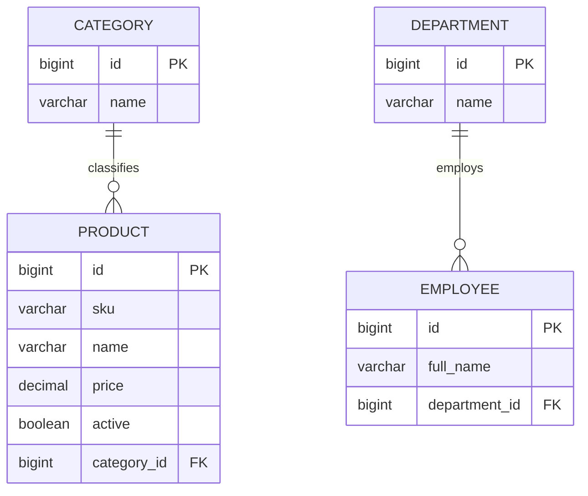

# DTO projection, biểu thức constructor và ánh xạ Tuple trong HQL/Hibernate

## 1. Vấn đề: một truy vấn có thể trả về nhiều dạng kết quả

Khi làm việc với Hibernate, không phải mọi truy vấn đều cần trả về entity được quản lý bởi persistence context. Một màn hình danh sách sản phẩm có thể chỉ cần **mã, tên, giá bán và số lượng tồn**; một báo cáo phòng ban có thể chỉ cần **tên phòng ban và tổng nhân viên**. Nếu luôn tải entity đầy đủ rồi duyệt association để tạo response, ứng dụng có thể mất chi phí hydrate object, giữ entity trong persistence context, kích hoạt lazy loading hoặc N+1.

Trong ngữ cảnh **kết quả truy vấn và phân trang**, có ba kiểu kết quả đặc biệt quan trọng:

1. **Entity result**: HQL trả về entity như `Product` hoặc `Department`; Hibernate có thể quản lý state của chúng trong persistence context.
2. **DTO projection**: truy vấn chọn đúng những cột/biểu thức cần dùng, rồi tạo đối tượng dữ liệu như `ProductRow`, Java record hoặc class có constructor.
3. **Tuple result**: truy vấn trả về một hàng gồm nhiều phần tử không nhất thiết thuộc cùng một entity; application đọc chúng theo **alias** hoặc **vị trí**, sau đó có thể ánh xạ sang DTO.

Ví dụ hai truy vấn có mục đích khác nhau:

```java
// Trả về entity Product managed.
List<Product> products = em.createQuery(
        "select p from Product p",
        Product.class
    )
    .getResultList();

// Trả về dữ liệu của một màn hình danh sách.
List<ProductRow> rows = em.createQuery(
        """
        select new com.example.catalog.ProductRow(
            p.id, p.sku, p.name, p.price
        )
        from Product p
        """,
        ProductRow.class
    )
    .getResultList();
```

Câu thứ hai được gọi là **constructor projection**. `ProductRow` không phải entity chỉ vì được tạo từ HQL; nó là object kết quả thông thường.

### 1.1. Mục tiêu học tập

Sau bài này, bạn cần phân biệt được:

- Khi nào nên lấy entity, scalar, `Object[]`, DTO hoặc `Tuple`.
- Cách viết `select new fully.qualified.Dto(...)` trong HQL/JPQL.
- Cách ánh xạ vào Java record, class immutable hoặc class có constructor.
- Cách đọc `Tuple` bằng alias, index, `getElements()` và chuyển sang DTO.
- Sự khác nhau giữa constructor projection và Tuple về kiểm tra kiểu, maintainability, portability.
- Cách kết hợp projection với JOIN, aggregate, GROUP BY, ORDER BY và pagination.
- Giới hạn của pagination khi JOIN collection, cũng như yêu cầu về count query.
- Những lỗi thực tế liên quan kiểu dữ liệu, null, alias, duplicate rows và query phức tạp.

## 2. Mô hình ví dụ dùng xuyên suốt

Giả sử hệ thống có bảng sản phẩm và phòng ban:



Các entity minh họa:

```java
import java.math.BigDecimal;
import jakarta.persistence.*;

@Entity
@Table(name = "products")
public class Product {
    @Id
    @GeneratedValue(strategy = GenerationType.IDENTITY)
    private Long id;

    @Column(nullable = false, unique = true)
    private String sku;

    @Column(nullable = false)
    private String name;

    @Column(nullable = false, precision = 16, scale = 2)
    private BigDecimal price;

    @Column(nullable = false)
    private boolean active;

    @ManyToOne(fetch = FetchType.LAZY)
    @JoinColumn(name = "category_id")
    private Category category;

    protected Product() {}

    // Getter, constructor và nghiệp vụ được lược bớt.
}
```

```java
@Entity
@Table(name = "categories")
public class Category {
    @Id
    private Long id;

    private String name;

    // Getter và constructor.
}
```

Các đoạn code tiếp theo giả định entity `Department` có `id`, `name`, và association `employees`; `Employee` có `id`, `fullName`, `department`. Các import Java/Jakarta cần thiết được lược bớt ở đoạn code ngắn để tập trung vào cú pháp projection. Mọi truy vấn nên thực hiện trong phạm vi `EntityManager` hoặc `Session` được quản lý đúng vòng đời, với transaction khi use case yêu cầu.

### 2.1. HQL/JPQL dùng property, không dùng tên cột SQL

```hql
select p.sku, p.name, p.price
from Product p
```

Các biểu thức `p.sku`, `p.name`, `p.price` là thuộc tính của `Product`. Không thay bằng `p.product_sku` hay tên cột SQL nếu entity không có thuộc tính tương ứng.

## 3. Các kiểu result phổ biến

### 3.1. Trả entity

```java
List<Product> products = em.createQuery(
        "select p from Product p where p.active = true",
        Product.class
    )
    .getResultList();
```

Mỗi hàng kết quả thường là `Product` managed trong persistence context. Thay đổi trên entity managed có thể được Hibernate đồng bộ khi flush nếu transaction phù hợp. Tải entity hợp lý khi use case cần thao tác nghiệp vụ, thay đổi state hoặc truy cập association theo fetch plan đã thiết kế.

### 3.2. Trả một scalar

```java
List<String> names = em.createQuery(
        "select p.name from Product p order by p.name",
        String.class
    )
    .getResultList();
```

Query chỉ trả tên; không cần tạo `Product` entity. Đây cũng là projection, nhưng chỉ có một biểu thức đầu ra.

### 3.3. Trả nhiều scalar bằng Object[]

```java
List<Object[]> results = em.createQuery(
        """
        select p.id, p.name, p.price
        from Product p
        order by p.id
        """,
        Object[].class
    )
    .getResultList();

for (Object[] row : results) {
    Long id = (Long) row[0];
    String name = (String) row[1];
    BigDecimal price = (BigDecimal) row[2];
}
```

`Object[]` có ưu điểm là đơn giản, nhưng thứ tự cột tạo thành một contract ngầm. Nếu đổi thứ tự SELECT mà không sửa Java, lỗi có thể xuất hiện khi cast hoặc dữ liệu bị gán sai.

### 3.4. DTO projection và Tuple

```hql
select new com.example.catalog.ProductRow(p.id, p.sku, p.name, p.price)
from Product p
```

hoặc:

```hql
select p.id as id, p.sku as sku, p.name as name, p.price as price
from Product p
```

Ở dạng thứ nhất, HQL tạo DTO trực tiếp. Ở dạng thứ hai, application có thể dùng `Tuple` để truy xuất từng phần tử theo alias. Cả hai đều thường chọn ít field hơn entity result và không cần quản lý DTO như một entity.

| Kết quả | Truy vấn điển hình | Cách sử dụng | Hạn chế |
|---|---|---|---|
| Entity | `select p` | Domain logic, cập nhật managed state | Có thể tải dư field/association |
| Scalar | `select p.name` | Một giá trị cho mỗi row | Không mô tả cấu trúc nhiều trường |
| `Object[]` | `select p.id, p.name` | Cast theo index | Dễ nhầm thứ tự/kiểu |
| DTO constructor | `select new ...ProductRow(...)` | Read model cố định, API/list | Constructor phải khớp với select |
| `Tuple` | `select p.id as id, ...` | Kết quả động hoặc mapping tùy chỉnh | Alias và cast cần được quản lý |

## 4. DTO projection là gì?

**Data Transfer Object (DTO)** là object dùng để đóng gói dữ liệu cần trao đổi giữa các tầng hoặc trả về cho client. DTO thường không cần annotation `@Entity`, không có lifecycle managed/persisted riêng và không đại diện cho một database row có dirty checking.

Một DTO cho trang danh sách sản phẩm:

```java
package com.example.catalog;

import java.math.BigDecimal;

public record ProductRow(
        Long id,
        String sku,
        String name,
        BigDecimal price
) {}
```

DTO chỉ chứa bốn field mà màn hình cần; không mang toàn bộ association `Product.category`, collection, version hoặc logic persistence.

### 4.1. Lợi ích của projection

- **Ít dữ liệu hơn:** select những biểu thức cần thiết thay vì mặc định toàn bộ state của entity.
- **Ít object graph hơn:** tránh vô tình khởi tạo association.
- **Rõ hợp đồng API:** DTO chỉ công bố field mà client được phép đọc.
- **Dễ phân trang:** có thể trả về một hàng dữ liệu cho mỗi kết quả logic khi query được thiết kế đúng.
- **Có thể dùng aggregate:** biểu diễn `COUNT`, `SUM`, `AVG` mà không phải tạo entity “báo cáo” giả.
- **Không có dirty checking trên DTO:** sửa DTO không tự động thay đổi database.

Projection **không mặc định nhanh hơn** trong mọi use case. Lợi ích thực tế phụ thuộc số field, query plan, kích thước kết quả, JOIN và chi phí mapping. Với những thao tác phải sửa entity, vẫn cần tải managed entity.

### 4.2. DTO không phải entity managed

```java
ProductRow row = ...; // Nhận từ constructor projection.

// Không có setter vì record immutable.
// Nếu là class có setter, sửa DTO vẫn không làm Hibernate update Product.
```

Không gọi `em.persist(row)` hoặc `em.merge(row)` trừ khi đây thật sự là mapped entity (khi đó không còn là DTO thuần). Muốn cập nhật sản phẩm, hãy tải `Product` managed trong transaction, kiểm tra quyền/validation rồi thay state của entity.

### 4.3. DTO nên có tính bất biến và ngữ nghĩa rõ

Java record phù hợp với read model ngắn. Class immutable cũng tốt khi cần constructor tùy chỉnh, validation hoặc logic trình bày. Tránh trả nguyên entity qua REST chỉ vì tiết kiệm một lớp DTO: điều đó có thể làm serializer truy cập lazy association, gây N+1, lộ field hoặc vòng lặp quan hệ hai chiều.

## 5. Biểu thức constructor trong HQL/JPQL

### 5.1. Cú pháp `select new`

JPQL hỗ trợ constructor expression theo cấu trúc:

```hql
select new com.example.catalog.ProductRow(
    p.id,
    p.sku,
    p.name,
    p.price
)
from Product p
where p.active = true
order by p.name, p.id
```

Trong code:

```java
List<ProductRow> rows = em.createQuery(
        """
        select new com.example.catalog.ProductRow(
            p.id, p.sku, p.name, p.price
        )
        from Product p
        where p.active = :active
        order by p.name, p.id
        """,
        ProductRow.class
    )
    .setParameter("active", true)
    .getResultList();
```

Hibernate lấy các giá trị select từ result set và gọi constructor phù hợp của `ProductRow`. Với Java record, canonical constructor tương ứng với danh sách component.

### 5.2. Vì sao phải dùng tên lớp đầy đủ?

Trong JPQL constructor expression portable, sau `new` dùng fully qualified class name, ví dụ `com.example.catalog.ProductRow`. Điều này giúp provider xác định DTO khi parse query.

Một số phiên bản Hibernate hỗ trợ thêm cú pháp HQL-specific hoặc cơ chế result packaging tiện lợi, nhưng khi muốn query portable giữa các JPA provider, dùng cú pháp constructor đầy đủ.

### 5.3. Không cần `@Entity`, `@Table` hay `@Column` trên DTO

```java
public record ProductRow(
        Long id, String sku, String name, BigDecimal price
) {}
```

Record này không cần mapping annotation. HQL tạo nó nhờ constructor có tham số tương ứng. Class có constructor public phù hợp cũng hoạt động:

```java
public final class ProductRowClass {
    private final Long id;
    private final String name;
    private final BigDecimal price;

    public ProductRowClass(Long id, String name, BigDecimal price) {
        this.id = id;
        this.name = name;
        this.price = price;
    }

    public Long getId() { return id; }
    public String getName() { return name; }
    public BigDecimal getPrice() { return price; }
}
```

Constructor expression tương ứng:

```hql
select new com.example.catalog.ProductRowClass(
    p.id, p.name, p.price
)
from Product p
```

### 5.4. Thứ tự và kiểu tham số phải khớp

```java
public record ProductRow(
        Long id,
        String sku,
        String name,
        BigDecimal price
) {}
```

Query phải trả tham số theo đúng thứ tự: `Long`, `String`, `String`, `BigDecimal`. Nếu viết:

```hql
select new com.example.catalog.ProductRow(
    p.name, p.sku, p.id, p.price
)
from Product p
```

Hibernate không tìm được constructor phù hợp hoặc có thể gặp lỗi type/instantiation. Nếu hai tham số cùng kiểu `String` nhưng bị hoán đổi, constructor vẫn được gọi thành công và **dữ liệu sẽ sai nghĩa**. Vì vậy, thứ tự select là một phần của contract DTO.

### 5.5. Tên alias không thay thứ tự constructor

```hql
select new com.example.catalog.ProductRow(
    p.id, p.sku, p.name, p.price
)
from Product p
```

Trong constructor projection, mapping là **theo vị trí biểu thức và constructor argument**. Alias như `p.name as productName` không tự động gán dữ liệu vào field tên `productName` trên DTO.

Không nhầm constructor projection với JavaBean mapping qua setter.

### 5.6. Null và primitive fields

Nếu cột nullable như `description` có thể null, dùng kiểu reference:

```java
public record ProductDescriptionRow(
        Long id,
        String description
) {}
```

Nếu constructor có tham số primitive `int`, `long` hoặc `boolean` mà kết quả có thể null, unboxing có thể thất bại. Với field nullable, dùng `Integer`/`Long`/`Boolean` hoặc cung cấp biểu thức `coalesce` có fallback phù hợp và cùng kiểu.

Ví dụ:

```hql
select new com.example.catalog.ProductDescriptionRow(
    p.id,
    p.description
)
from Product p
```

### 5.7. Constructor projection có thể chứa biểu thức, không chỉ field

```hql
select new com.example.catalog.ProductLabel(
    p.id,
    concat(p.sku, ' - ', p.name),
    p.price
)
from Product p
```

DTO có thể chứa giá trị tính toán. Kiểu của biểu thức phải khớp với constructor. Khi dùng function đặc thù database, kiểm tra tính portable của HQL/JPQL và SQL dialect.

## 6. Constructor expression với JOIN

Một trang cần thông tin sản phẩm và tên category. Không nhất thiết phải tải cả `Category` entity:

```java
public record ProductCatalogRow(
        Long id,
        String sku,
        String name,
        String categoryName,
        BigDecimal price
) {}
```

HQL:

```hql
select new com.example.catalog.ProductCatalogRow(
    p.id,
    p.sku,
    p.name,
    c.name,
    p.price
)
from Product p
left join p.category c
where p.active = true
order by p.name, p.id
```

`LEFT JOIN` giữ cả sản phẩm không có category; khi đó `categoryName` là null.

SQL minh họa:

```sql
SELECT p.id, p.sku, p.name, c.name, p.price
FROM products p
LEFT JOIN categories c ON c.id = p.category_id
WHERE p.active = true
ORDER BY p.name, p.id;
```

DTO projection này thường không cần hydrate `Category` entity chỉ để lấy `c.name`. Đồng thời cũng không cần gọi `product.getCategory().getName()` trong vòng lặp, nhờ đó tránh mẫu lazy N+1 cho use case tương ứng.

### 6.1. JOIN thường khác JOIN FETCH

Dùng:

```hql
left join p.category c
```

khi chỉ cần select cột từ association trong DTO. **Không cần `join fetch`**, vì constructor projection không trả entity owner để Hibernate hydrate association theo cách fetch join. Viết `join fetch` trong query select thuần DTO có thể không hợp lệ hoặc dẫn đến lỗi về owner không nằm trong select list.

`JOIN` để tham chiếu dữ liệu liên quan; `JOIN FETCH` để tải association của entity đang được trả về. Chúng giải quyết nhu cầu khác nhau.

### 6.2. JOIN tới collection có thể nhân dòng

Nếu Department có nhiều Employee:

```hql
select new com.example.reporting.DepartmentEmployeeRow(
    d.id, d.name, e.id, e.fullName
)
from Department d
join d.employees e
```

Một Department có 10 Employee tạo **10 DTO rows**. Đây không phải lỗi Hibernate: query yêu cầu một hàng cho mỗi cặp Department–Employee.

Nếu mục tiêu là **một DTO cho mỗi Department**, cần chọn một cách:

- Aggregate `count(e)` và `group by`.
- Chỉ chọn parent data và truy vấn child riêng.
- Dựng nested DTO từ hai query được nhóm trong ứng dụng.
- Phân trang parent rồi tải association theo parent IDs.

Không dùng `distinct` như một cách chung để “gộp” mười Employee khác nhau vào một DTO có collection. `DISTINCT` chỉ loại các hàng có select values giống nhau; nó không xây nested list giúp bạn.


## 7. DTO projection với aggregate và GROUP BY

Báo cáo thường cần tổng, trung bình hoặc đếm thay vì entity đầy đủ.

### 7.1. Một hàng cho mỗi phòng ban

DTO:

```java
package com.example.reporting;

public record DepartmentSummary(
        Long departmentId,
        String departmentName,
        Long employeeCount
) {}
```

HQL:

```hql
select new com.example.reporting.DepartmentSummary(
    d.id,
    d.name,
    count(e.id)
)
from Department d
left join d.employees e
group by d.id, d.name
order by d.name, d.id
```

`LEFT JOIN` giữ cả Department không có Employee; `count(e.id)` của nhóm đó là 0. Không dùng `count(*)` bừa bãi với left join nếu mục tiêu là số child, vì dòng left join có thể vẫn tồn tại dù child là null.

Trong JPA/HQL, `count(...)` thường có kết quả Java kiểu `Long`; vì vậy DTO dùng `Long employeeCount` là cách diễn đạt rõ kiểu.

### 7.2. Kết quả của các aggregate khác

| Biểu thức | Kiểu Java thường gặp | Chú ý |
|---|---|---|
| `count(e.id)` | `Long` | 0 khi nhóm không có giá trị non-null |
| `sum(e.salary)` | Phụ thuộc kiểu của expression, thường `BigDecimal` nếu salary là BigDecimal | Có thể null khi không có giá trị để cộng |
| `avg(e.salary)` | Thường `Double` theo quy tắc JPQL | Có thể null khi không có giá trị |
| `min(e.salary)` | Theo kiểu biểu thức | Có thể null |
| `max(e.salary)` | Theo kiểu biểu thức | Có thể null |

Nếu aggregate có thể null, không dùng primitive trong DTO trừ khi bạn đã xử lý null bằng `coalesce` và xác nhận kiểu biểu thức.

### 7.3. Nhiều JOIN collection tạo count sai

Giả sử Department có hai collection: Employee và Project. Query:

```hql
select d.id, count(e.id), count(p.id)
from Department d
left join d.employees e
left join d.projects p
group by d.id
```

Nếu Department có 5 Employee và 3 Project, JOIN có thể tạo 15 dòng, khiến `count(e.id)` và `count(p.id)` bị nhân. Trong một số use case có thể dùng `count(distinct e.id)` và `count(distinct p.id)`; với dữ liệu lớn, tách aggregate subquery hoặc nhiều query có thể hiệu quả hơn.

Projection không tự loại bỏ vấn đề nhân dòng do SQL JOIN. Cần hiểu cardinality.

## 8. Tuple là gì?

`jakarta.persistence.Tuple` biểu diễn một **row gồm nhiều phần tử có kiểu**. Khác với `Object[]`, Tuple cho phép truy cập phần tử bằng alias, vị trí hoặc `TupleElement<?>`.

Các API thường dùng:

- `tuple.get("alias")`: lấy giá trị theo alias, trả `Object`.
- `tuple.get("alias", Long.class)`: lấy theo alias và kiểu mong đợi.
- `tuple.get(0)`: lấy phần tử đầu tiên theo index **0-based**.
- `tuple.get(0, Long.class)`: lấy theo index và kiểu.
- `tuple.getElements()`: liệt kê metadata phần tử, alias và Java type.
- `tuple.toArray()`: lấy các giá trị dưới dạng `Object[]`.

**Lưu ý:** index của `Tuple.get(int)` bắt đầu từ 0, khác positional query parameter `?1` bắt đầu từ 1.

## 9. Truy vấn Tuple bằng HQL

Hibernate hỗ trợ chọn kết quả `Tuple.class` từ query HQL có nhiều biểu thức:

```java
import jakarta.persistence.Tuple;
import java.math.BigDecimal;
import java.util.List;

List<Tuple> rows = em.createQuery(
        """
        select
            p.id as productId,
            p.sku as sku,
            p.name as productName,
            p.price as price
        from Product p
        where p.active = :active
        order by p.id
        """,
        Tuple.class
    )
    .setParameter("active", true)
    .getResultList();

for (Tuple row : rows) {
    Long id = row.get("productId", Long.class);
    String sku = row.get("sku", String.class);
    String name = row.get("productName", String.class);
    BigDecimal price = row.get("price", BigDecimal.class);

    System.out.printf("%d %s %s %s%n", id, sku, name, price);
}
```

HQL là query do Hibernate xử lý nên kiểu kết quả `Tuple.class` này được hỗ trợ trong Hibernate hiện đại. Nếu cần một đường đi portable về mặt Jakarta Persistence cho Tuple, **Criteria API với `CriteriaQuery<Tuple>`** là lựa chọn tiêu chuẩn rõ ràng.

### 9.1. Alias đến từ SELECT, không tự sinh từ tên property

Trong query:

```hql
select p.id as productId, p.name as productName
from Product p
```

bạn có thể đọc:

```java
row.get("productId", Long.class);
row.get("productName", String.class);
```

Không nên giả định alias `productName` tồn tại nếu query chỉ viết `select p.name` mà không `as productName`. Hành vi alias tự tạo có thể khác theo provider và truy vấn.

**Nguyên tắc:** nếu muốn dùng Tuple theo tên, đặt alias tường minh và duy nhất cho mỗi expression.

### 9.2. Truy xuất Tuple theo index

```java
Tuple row = rows.get(0);

Long id = row.get(0, Long.class);
String sku = row.get(1, String.class);
String name = row.get(2, String.class);
BigDecimal price = row.get(3, BigDecimal.class);
```

Vị trí 0, 1, 2, 3 tương ứng thứ tự biểu thức trong SELECT. Nếu đổi thứ tự select, code theo index phải đổi theo. Khi có alias ổn định, đọc theo alias thường dễ bảo trì hơn.

### 9.3. Tìm hiểu metadata phần tử Tuple

```java
for (TupleElement<?> element : row.getElements()) {
    System.out.printf(
        "alias=%s, javaType=%s%n",
        element.getAlias(),
        element.getJavaType().getName()
    );
}
```

`TupleElement` có thể cung cấp alias null nếu query không đặt alias rõ. Metadata hữu ích cho mapping linh hoạt, debug hoặc framework tạo báo cáo, nhưng không nên dùng `getJavaType()` để né trách nhiệm thiết kế contract kiểu của DTO.

### 9.4. Tuple truy cập sai alias hoặc sai type

```java
row.get("wrongAlias");
row.get("productId", String.class);
```

Các lời gọi này có thể ném `IllegalArgumentException` nếu alias không tồn tại hoặc giá trị không thể gán vào type yêu cầu. Không “chữa” bằng cách ép mọi giá trị qua `String.valueOf` nếu business cần một `Long` hay `BigDecimal` thực sự.

### 9.5. Null trong Tuple

Nếu `LEFT JOIN` không có association:

```hql
select p.id as id, c.name as categoryName
from Product p
left join p.category c
```

thì `row.get("categoryName", String.class)` có thể trả null. Vì vậy DTO tương ứng nên cho phép null hoặc xử lý fallback rõ:

```java
String categoryName =
        row.get("categoryName", String.class);

String label = categoryName == null
        ? "Chưa phân loại"
        : categoryName;
```

Không coi null trong Tuple là lỗi mapping mặc định; trước tiên xét semantics của LEFT JOIN và dữ liệu.

## 10. Tuple bằng Jakarta Persistence Criteria API

Criteria API cho phép tạo tuple query theo cách portable. Ví dụ:

```java
import jakarta.persistence.Tuple;
import jakarta.persistence.criteria.*;

CriteriaBuilder cb = em.getCriteriaBuilder();
CriteriaQuery<Tuple> cq = cb.createTupleQuery();
Root<Product> product = cq.from(Product.class);

cq.multiselect(
    product.get("id").alias("productId"),
    product.get("name").alias("productName"),
    product.get("price").alias("price")
);

cq.where(cb.isTrue(product.get("active")));
cq.orderBy(
    cb.asc(product.get("name")),
    cb.asc(product.get("id"))
);

List<Tuple> tuples = em.createQuery(cq).getResultList();
```

Truy xuất:

```java
for (Tuple tuple : tuples) {
    Long id = tuple.get("productId", Long.class);
    String name = tuple.get("productName", String.class);
    BigDecimal price = tuple.get("price", BigDecimal.class);
}
```

Với Criteria API, các alias nằm trên các `Selection` và có thể tái sử dụng trong mapping. Nếu một multiselect có alias trùng nhau, query có thể bị từ chối vì ambiguous alias; đặt tên duy nhất cho từng phần tử.

### 10.1. Tạo Tuple cho JOIN

```java
CriteriaBuilder cb = em.getCriteriaBuilder();
CriteriaQuery<Tuple> cq = cb.createTupleQuery();
Root<Product> p = cq.from(Product.class);

Join<Product, Category> c =
        p.join("category", JoinType.LEFT);

cq.multiselect(
    p.get("id").alias("productId"),
    p.get("name").alias("productName"),
    c.get("name").alias("categoryName")
);

List<Tuple> tuples = em.createQuery(cq).getResultList();
```

`JoinType.LEFT` giữ các Product chưa gắn Category. `categoryName` khi đó có thể null.

### 10.2. Criteria constructor query cũng được hỗ trợ

Nếu muốn DTO trực tiếp từ Criteria API, có thể dùng `cb.construct`:

```java
CriteriaBuilder cb = em.getCriteriaBuilder();
CriteriaQuery<ProductRow> cq =
        cb.createQuery(ProductRow.class);
Root<Product> p = cq.from(Product.class);

cq.select(cb.construct(
    ProductRow.class,
    p.get("id"),
    p.get("sku"),
    p.get("name"),
    p.get("price")
));

List<ProductRow> rows = em.createQuery(cq).getResultList();
```

Như HQL `select new`, thứ tự và kiểu của constructor arguments phải khớp DTO. Nếu query có nhiều predicate tùy chọn, Criteria giúp xây cả phần WHERE và SELECT mà không nối nhiều mảnh HQL string.

## 11. Chuyển Tuple sang DTO thủ công

Khi shape của truy vấn cố định, có thể map Tuple sang DTO:

```java
public record ProductRow(
        Long id,
        String sku,
        String name,
        BigDecimal price
) {}
```

```java
List<Tuple> tuples = em.createQuery(
        """
        select p.id as id,
               p.sku as sku,
               p.name as name,
               p.price as price
        from Product p
        order by p.id
        """,
        Tuple.class
    )
    .getResultList();

List<ProductRow> rows = tuples.stream()
        .map(tuple -> new ProductRow(
            tuple.get("id", Long.class),
            tuple.get("sku", String.class),
            tuple.get("name", String.class),
            tuple.get("price", BigDecimal.class)
        ))
        .toList();
```

Điểm mạnh của cách này là mọi phép mapping được viết tường minh, dễ đặt fallback/null handling. Điểm yếu là có một bước map bổ sung và alias string dễ sai nếu được lặp ở nhiều nơi.

### 11.1. Đặt alias trong hằng số nếu được dùng nhiều lần

```java
private static final String ALIAS_PRODUCT_ID = "productId";
private static final String ALIAS_NAME = "name";
```

Không bắt buộc biến mọi alias thành constant, nhưng với nhiều query/mapper cùng contract, nên giảm việc copy-paste string tùy tiện.

### 11.2. Ánh xạ sang Map nếu thật sự cần shape động

```java
Map<String, Object> values = new LinkedHashMap<>();

for (TupleElement<?> element : tuple.getElements()) {
    String alias = element.getAlias();
    if (alias == null || alias.isBlank()) {
        throw new IllegalStateException(
            "Projection requires explicit aliases"
        );
    }
    values.put(alias, tuple.get(element));
}
```

`Map<String,Object>` có ích cho báo cáo động hoặc framework, nhưng không thay thế DTO có kiểu rõ cho business API ổn định. Client của map phải tự xử lý cast, null và schema.

### 11.3. Tránh mapping “mù” bằng reflection

Việc suy đoán setter từ alias, bỏ qua lỗi type hoặc mapping bằng reflection không kiểm soát có thể che giấu lỗi schema. Nếu quyết định dùng generic mapper, cần quy ước alias, xử lý null, coercion, exception và kiểm thử contract. Với endpoint quan trọng, constructor DTO tường minh thường dễ kiểm soát hơn.


## 12. Hibernate-specific result transformation

Hibernate cung cấp cơ chế biến đổi row khi query được thực thi, hữu ích khi không muốn viết `stream().map(...)` ở từng nơi. Trong Hibernate 6, một API tiêu biểu là `TupleTransformer` qua `setTupleTransformer` trên Hibernate query.

### 12.1. Biến Object[]/alias thành DTO

```java
import org.hibernate.query.Query;
import java.util.HashMap;
import java.util.Map;

Query<ProductRow> query = session.createQuery(
        """
        select
            p.id as id,
            p.sku as sku,
            p.name as name,
            p.price as price
        from Product p
        order by p.id
        """,
        ProductRow.class
    );

query.setTupleTransformer((tuple, aliases) -> {
    Map<String, Integer> positions = new HashMap<>();

    for (int i = 0; i < aliases.length; i++) {
        positions.put(aliases[i], i);
    }

    return new ProductRow(
        (Long) tuple[positions.get("id")],
        (String) tuple[positions.get("sku")],
        (String) tuple[positions.get("name")],
        (BigDecimal) tuple[positions.get("price")]
    );
});

List<ProductRow> rows = query.getResultList();
```

Đây là ý tưởng row transformer; **không phải API portable JPQL**. Trong ứng dụng thật, Hibernate query phải được tạo với result type tương thích với cách transformer trả DTO; nếu API/version đang dùng suy luận kiểu quá chặt, có thể tạo query dạng `Query<?>` và đặt transformer với generic result type theo chữ ký của phiên bản. Không giả định đoạn minh họa chạy trên mọi dòng Hibernate 6 nếu type signature đã thay đổi.

Alias array phản ánh các selection của query. Đừng giả định mọi alias luôn non-null hoặc duy nhất nếu bạn không khai báo `as` rõ.

### 12.2. Phân biệt row transformation và list transformation

- **TupleTransformer**: biến đổi **mỗi hàng** từ giá trị + alias thành kết quả mong muốn.
- **ResultListTransformer**: có thể xử lý **cả danh sách** sau khi lấy các row, chẳng hạn tổ chức một hình dạng kết quả đặc biệt.

List transformer không phải cách mặc định để sửa pagination sai do join collection. Phân trang phải được thiết kế ở cấp query/database trước khi group kết quả, nếu không có thể tạo trang sai kích thước hoặc bỏ sót parent.

### 12.3. Khi nào nên dùng transformer?

Hợp lý khi:

- Có một lớp repository dùng Hibernate API trực tiếp.
- Shape SELECT linh hoạt nhưng vẫn muốn tạo DTO có kiểu.
- Cần chuyển đổi kết quả legacy mà không thể thay nhiều câu HQL một lúc.

Không nên dùng transformer chỉ để tránh viết `select new` cho một DTO đơn giản. Nó tăng coupling với Hibernate và tạo thêm code để quản lý index/type/alias.

## 13. HQL-specific dynamic instantiation

Ngoài constructor expression chuẩn JPQL, một số phiên bản Hibernate hỗ trợ kết quả dạng cấu trúc động như `new list(...)` hoặc `new map(...)` trong HQL. Ví dụ minh họa cú pháp Hibernate-specific:

```hql
select new map(
    p.id as id,
    p.name as name,
    p.price as price
)
from Product p
```

Dạng kết quả này là extension của HQL, **không phải JPQL portable**. Kiểu của map value thường là Object, nên ứng dụng phải cast hoặc chuyển tiếp sang DTO.

Với API ổn định, ưu tiên DTO record hoặc class có constructor. Chỉ dùng dynamic instantiation dạng map/list khi có lý do cụ thể và đã xác nhận cú pháp với phiên bản Hibernate của dự án.

## 14. Constructor projection so với Tuple: chọn thế nào?

| Tiêu chí | Constructor DTO | Tuple |
|---|---|---|
| Kiểu kết quả | DTO/record cụ thể | `Tuple` chứa nhiều phần tử |
| Cách lấy field | Getter/record accessor | Alias, index hoặc TupleElement |
| Mapping | Trong query qua `select new` | Bằng application hoặc framework |
| Kiểm tra kiểu | Phải tìm constructor phù hợp | Cast/type-check khi `get(...)` |
| Đổi thứ tự SELECT | Có thể ảnh hưởng constructor | Alias rõ có thể giảm lệ thuộc thứ tự |
| Đổi alias | Ít ảnh hưởng khi chỉ constructor | Ảnh hưởng code dùng `get("alias")` |
| Portability | JPQL constructor expression chuẩn | Criteria Tuple chuẩn; HQL Tuple qua Hibernate |
| Dữ liệu cố định cho API | Rất phù hợp | Có thể dư linh hoạt |
| Shape báo cáo động | Ít linh hoạt | Phù hợp hơn |
| Nested collection DTO | Không tự tạo nested list | Cũng không tự tạo nested list |
| Tương tác persistence context | DTO không managed | Tuple không managed; phần tử có thể chứa entity |
| Chi phí code | Constructor + HQL | Alias + mapping/getter/cast |

**Khuyến nghị theo use case:** với màn hình danh sách có contract ổn định, dùng constructor DTO/record. Với báo cáo động, lựa chọn cột linh hoạt hoặc tích hợp framework cần metadata của từng selection, dùng Tuple. Nếu cần cập nhật domain entity, tải entity managed thay vì DTO.

## 15. Phân trang kết quả DTO

HQL/JPQL không cần cú pháp `LIMIT` phụ thuộc database để phân trang: thường dùng API query:

```java
int pageIndex = 2; // Trang thứ ba, index bắt đầu từ 0.
int pageSize = 20;

List<ProductRow> rows = em.createQuery(
        """
        select new com.example.catalog.ProductRow(
            p.id, p.sku, p.name, p.price
        )
        from Product p
        where p.active = true
        order by p.name, p.id
        """,
        ProductRow.class
    )
    .setFirstResult(pageIndex * pageSize)
    .setMaxResults(pageSize)
    .getResultList();
```

- `setFirstResult(offset)` nhận offset **0-based**.
- `setMaxResults(pageSize)` giới hạn số hàng kết quả trả về.
- Phải có `ORDER BY` ổn định nếu cần phân trang nhất quán.
- Thêm khóa phụ duy nhất như `p.id` nếu nhiều sản phẩm có cùng tên.

Nếu chỉ `order by p.name`, những hàng có name giống nhau có thể xuất hiện theo thứ tự không xác định giữa các lần query, làm bản ghi lặp hoặc bị bỏ qua giữa các trang.

### 15.1. Xây một page object có count

DTO:

```java
public record PageResult<T>(
        List<T> items,
        long totalElements,
        int pageIndex,
        int pageSize
) {}
```

Count query độc lập:

```java
Long total = em.createQuery(
        """
        select count(p.id)
        from Product p
        where p.active = :active
        """,
        Long.class
    )
    .setParameter("active", true)
    .getSingleResult();
```

Data query phải có cùng logic lọc:

```java
List<ProductRow> rows = em.createQuery(
        """
        select new com.example.catalog.ProductRow(
            p.id, p.sku, p.name, p.price
        )
        from Product p
        where p.active = :active
        order by p.name, p.id
        """,
        ProductRow.class
    )
    .setParameter("active", true)
    .setFirstResult(pageIndex * pageSize)
    .setMaxResults(pageSize)
    .getResultList();

PageResult<ProductRow> result =
        new PageResult<>(rows, total, pageIndex, pageSize);
```

Count query không cần `ORDER BY` hoặc constructor projection. Khi data query có JOIN/GROUP BY/DISTINCT, không được máy móc thay SELECT bằng `count(p.id)` mà chưa xét số hàng logic.

### 15.2. Phân trang DTO cùng to-one JOIN

Ví dụ:

```hql
select new com.example.catalog.ProductCatalogRow(
    p.id, p.sku, p.name, c.name, p.price
)
from Product p
left join p.category c
order by p.name, p.id
```

Một Product thường khớp tối đa một Category nên LEFT JOIN to-one không làm tăng số hàng Product. Việc phân trang trực tiếp trên DTO rows thường tương đối rõ ràng.

### 15.3. Phân trang JOIN to-many

Ví dụ:

```hql
select new com.example.reporting.DepartmentEmployeeRow(
    d.id, d.name, e.id, e.fullName
)
from Department d
join d.employees e
order by d.id, e.id
```

Một Department có nhiều Employee, nên pagination ở đây là trên **cặp Department–Employee**, không phải trên số Department. Nếu UI muốn “20 Department một trang, mỗi Department kèm Employee”, không thể mặc định `setMaxResults(20)` là 20 Department.

Có thể phân trang parent IDs trước rồi tải child theo tập ID đó:

```java
List<Long> departmentIds = em.createQuery(
        """
        select d.id
        from Department d
        order by d.name, d.id
        """,
        Long.class
    )
    .setFirstResult(pageIndex * pageSize)
    .setMaxResults(pageSize)
    .getResultList();
```

Sau đó chạy query thứ hai cho các Department và Employee liên quan (tránh query IN nếu ID list rỗng). Gom các row theo department ID trong Java. `IN :ids` không đảm bảo giữ thứ tự của input, nên khôi phục thứ tự theo danh sách IDs hoặc đặt ORDER BY rõ.

Đặc biệt không dùng collection `JOIN FETCH` cùng pagination một cách tùy tiện; Hibernate có thể phải phân trang trong bộ nhớ hoặc cảnh báo/fail tùy cấu hình.

### 15.4. Phân trang aggregate/grouped DTO

Với `DepartmentSummary`:

```hql
select new com.example.reporting.DepartmentSummary(
    d.id, d.name, count(e.id)
)
from Department d
left join d.employees e
group by d.id, d.name
order by d.name, d.id
```

Nếu mỗi Department tạo đúng một nhóm, pagination có thể áp dụng trên các nhóm đó. Tuy nhiên count query nên đếm **số Department thỏa filter**, không đếm tổng số Employee:

```hql
select count(d.id)
from Department d
```

Nếu có HAVING, bộ lọc phụ thuộc aggregate hoặc nhiều JOIN làm nhân dòng, cách đếm số nhóm phải phản ánh đúng logic của data query. Có thể cần query riêng, count distinct, subquery hoặc thiết kế báo cáo lại. Đoạn count đơn giản chỉ đúng cho trường hợp mỗi Department là một nhóm và cùng filter.

### 15.5. Offset pagination có giới hạn

Khi offset lớn, database vẫn có thể phải bỏ qua nhiều hàng; khi dữ liệu thay đổi giữa các lần lấy trang, có thể xuất hiện duplicate/missing rows dù đã ORDER BY ổn định. Với luồng dữ liệu lớn, cân nhắc **keyset/seek pagination** theo tuple khóa sắp xếp, chẳng hạn `(name, id)`, và sử dụng điều kiện tiếp tục từ hàng cuối.

Ví dụ ý tưởng:

```hql
from Product p
where p.name > :lastName
   or (p.name = :lastName and p.id > :lastId)
order by p.name, p.id
```

Khi dùng DTO, có thể select các trường của khóa cursor để client/server biết mốc tiếp theo. Cursor phải thống nhất với ORDER BY và policy null/collation.

## 16. Native SQL khác với HQL projection

Ví dụ sau là **native SQL**, không phải HQL:

```java
List<Object[]> rows = em.createNativeQuery(
        """
        select p.id, p.sku, p.name, p.price
        from products p
        """
    )
    .getResultList();
```

Trong native SQL, `select new com.example.Dto(...)` không phải cú pháp SQL. Để ánh xạ native SQL vào constructor, Jakarta Persistence hỗ trợ `@SqlResultSetMapping` với `@ConstructorResult` và `@ColumnResult`, hoặc API result mapping đặc thù Hibernate.

Ví dụ sơ lược:

```java
@SqlResultSetMapping(
    name = "ProductRowMapping",
    classes = @ConstructorResult(
        targetClass = ProductRow.class,
        columns = {
            @ColumnResult(name = "id", type = Long.class),
            @ColumnResult(name = "sku", type = String.class),
            @ColumnResult(name = "name", type = String.class),
            @ColumnResult(name = "price", type = BigDecimal.class)
        }
    )
)
@Entity
class Product {
    // ...
}
```

Với mapping trên, native SQL phải trả đúng alias và kiểu cột tương ứng. `@SqlResultSetMapping` là metadata có thể đặt trên entity được quản lý; nó không biến `ProductRow` thành entity.

Nếu yêu cầu là HQL/JPQL và entity property đã biểu diễn đủ dữ liệu, constructor projection trực tiếp thường đơn giản hơn cấu hình native result mapping.


## 17. Những vấn đề đặc biệt khi ánh xạ projection

### 17.1. Numeric type conversion

Không tự coi mọi số từ database là `Integer`. Những biểu thức như `count`, `sum`, phép tính và native SQL có quy tắc kiểu khác nhau. Với JPQL `count`, dùng `Long` trong DTO là lựa chọn rõ. Với `BigDecimal price`, giữ `BigDecimal` thay vì chuyển sang `double` cho dữ liệu tiền tệ.

```java
public record DepartmentSummary(
        Long id,
        String name,
        Long employeeCount
) {}
```

Nếu nhận Tuple, sử dụng `get("employeeCount", Long.class)` khi truy vấn có biểu thức `count(...)` phù hợp.

### 17.2. Null từ LEFT JOIN và aggregate

```hql
select p.id as id, c.name as categoryName
from Product p
left join p.category c
```

`categoryName` có thể null. Không để DTO constructor nhận primitive cho giá trị nullable. Với `sum` trên tập không có giá trị, kết quả có thể null; dùng `coalesce` nếu muốn 0 theo nghiệp vụ.

### 17.3. Duplicate row và DISTINCT

`SELECT DISTINCT` chỉ khác nhau về giá trị được select. Nó không bảo đảm một hàng cho mỗi entity parent nếu query chọn cả child fields.

```hql
select distinct d.id, d.name, e.fullName
from Department d
join d.employees e
```

Các Employee khác nhau sẽ tạo hàng khác nhau dù cùng `d.id`. Nếu muốn parent summary, dùng aggregate/grouping thay vì nghĩ DISTINCT sẽ gộp child thành list.

### 17.4. DTO chứa entity reference vẫn có thể lazy-load

Có thể viết constructor có tham số entity:

```hql
select new com.example.catalog.ProductWithCategory(
    p.id, p.category
)
from Product p
```

Nhưng `Category` là entity reference; DTO có thể chứa entity managed/proxy tùy fetch plan. Khi truy cập association sau khi Session đóng, lazy loading có thể vẫn là vấn đề. Nếu muốn DTO thuần, chọn scalar `p.category.name` hoặc các field cần thiết.

### 17.5. Bẫy khởi tạo collection trong mapper

Không làm như sau nếu chỉ cần count:

```java
List<Department> departments =
        em.createQuery("select d from Department d", Department.class)
          .getResultList();

List<DepartmentSummary> summaries = departments.stream()
    .map(d -> new DepartmentSummary(
        d.getId(), d.getName(), (long) d.getEmployees().size()
    ))
    .toList();
```

Mỗi lời gọi `getEmployees().size()` có thể khởi tạo collection lazy và tạo N+1. Tốt hơn là viết query aggregate `count(e.id)` và constructor DTO ngay tại database.

### 17.6. Lỗi constructor không khớp

Các triệu chứng phổ biến:

- Hibernate không tìm được DTO class do sai package.
- Constructor không public/không có access phù hợp theo provider.
- Số tham số hoặc kiểu tham số không khớp.
- DTO record đổi thứ tự component nhưng query chưa đổi.
- Hai tham số `String` hoán đổi khiến dữ liệu bị gán nhầm mà không báo lỗi.

Nên lưu query cùng DTO contract trong cùng module phù hợp và có integration test chạy HQL với schema thật để phát hiện mismatch.

### 17.7. Alias Tuple và index không đồng nhất

Tuple alias là tên từ SELECT/Criteria Selection, index là vị trí zero-based. Đọc alias sai sẽ ném exception; đọc đúng index nhưng sai logic có thể đưa dữ liệu vào field không mong muốn.

Nên đặt alias có chủ ý, ví dụ `productId`, `productName`, `categoryName`, tránh alias mơ hồ như `id` khi join nhiều entity nếu nó dễ gây nhầm.

### 17.8. Projection không tự bảo đảm dữ liệu đúng thời điểm

Nếu chạy data query và count query riêng trong hai transaction hoặc với dữ liệu biến động, `totalElements` có thể không hoàn toàn tương ứng với `items`. Có thể cần transaction và isolation phù hợp tùy yêu cầu nhất quán của trang. Việc DTO immutable không giải quyết tự động race condition này.

### 17.9. Projection không tự động giới hạn quyền

Một query có thể chọn ít cột nhưng vẫn vô tình trả dữ liệu của tenant hoặc người dùng khác nếu thiếu WHERE authorization. Hãy đưa tenant/ownership constraint vào query, dùng parameter binding và kiểm thử truy cập chéo quyền.

## 18. Chọn phương án theo tình huống

| Use case | Phương án nên cân nhắc | Lý do |
|---|---|---|
| Sửa sản phẩm | Managed `Product` entity | Dirty checking, lifecycle và domain logic |
| Trang danh sách Product có field cố định | `select new ProductRow(...)` | Contract rõ, ít field |
| Dịch vụ chỉ cần danh sách tên | Scalar `List<String>` | Đơn giản nhất |
| Báo cáo số Employee theo Department | Constructor aggregate DTO | Một row/nhóm, không hydrate collection |
| Truy vấn động có số cột thay đổi | `Tuple`/Map với alias | Dễ đọc metadata và ánh xạ linh hoạt |
| Criteria search có select nhiều field | `CriteriaQuery<Tuple>` | Portable Tuple với Selection alias |
| Criteria search trả DTO cố định | `cb.construct(...)` | Constructor projection typed |
| Legacy HQL cần custom row conversion | Hibernate `TupleTransformer` | Chuyển giá trị/alias ở tầng result |
| Native SQL trả DTO | `@SqlResultSetMapping` hoặc mapper đặc thù | `select new` không phải native SQL |
| Parent + nested child paged response | Page parent trước, query child sau | Tránh nhân dòng/pagination sai |
| REST API bảo mật, dữ liệu ổn định | DTO immutable | Không lộ entity graph/proxy |

Không cố chọn Tuple hoặc constructor DTO trong mọi trường hợp. Cách đơn giản nhất là cách phản ánh đúng shape kết quả và lifecycle của use case.

## 19. Ví dụ repository hoàn chỉnh: DTO + pagination + count

Ví dụ bên dưới minh họa phân trang một danh sách Product theo active flag và category ID. DTO một hàng cho mỗi Product.

```java
package com.example.catalog;

import jakarta.persistence.EntityManager;
import java.util.List;

public final class ProductReadRepository {
    private final EntityManager em;

    public ProductReadRepository(EntityManager em) {
        this.em = em;
    }

    public PageResult<ProductRow> findPage(
            boolean active,
            int pageIndex,
            int pageSize
    ) {
        if (pageIndex < 0 || pageSize <= 0 || pageSize > 200) {
            throw new IllegalArgumentException("Invalid page arguments");
        }

        long offset = (long) pageIndex * pageSize;
        if (offset > Integer.MAX_VALUE) {
            throw new IllegalArgumentException("Offset too large");
        }

        Long total = em.createQuery(
                """
                select count(p.id)
                from Product p
                where p.active = :active
                """,
                Long.class
            )
            .setParameter("active", active)
            .getSingleResult();

        List<ProductRow> rows = em.createQuery(
                """
                select new com.example.catalog.ProductRow(
                    p.id, p.sku, p.name, p.price
                )
                from Product p
                where p.active = :active
                order by p.name, p.id
                """,
                ProductRow.class
            )
            .setParameter("active", active)
            .setFirstResult((int) offset)
            .setMaxResults(pageSize)
            .getResultList();

        return new PageResult<>(rows, total, pageIndex, pageSize);
    }
}
```

DTO record:

```java
package com.example.catalog;

import java.math.BigDecimal;

public record ProductRow(
        Long id,
        String sku,
        String name,
        BigDecimal price
) {}

public record PageResult<T>(
        List<T> items,
        long totalElements,
        int pageIndex,
        int pageSize
) {}
```

`ProductReadRepository` là class minh họa để làm rõ query. Trong Spring/Jakarta EE, EntityManager thường được inject và transaction do container/framework quản lý. Trong ứng dụng Java SE, phải quản lý lifecycle EntityManager rõ ràng.

**Lưu ý:** validation page size và offset phải có trong API thật. Tính `pageIndex * pageSize` bằng `long` trước khi cast giúp tránh overflow; một hệ thống có offset rất lớn nên cân nhắc keyset pagination hoặc từ chối request theo contract.

## 20. Debug kết quả HQL/Tuple

Khi một projection trả dữ liệu bất thường:

1. Kiểm tra **HQL SELECT**: thứ tự biểu thức, alias, JOIN và GROUP BY.
2. Kiểm tra **DTO constructor signature**: số tham số, kiểu, thứ tự.
3. Kiểm tra **Tuple metadata**: `getElements()`, alias và Java type.
4. Kiểm tra **nullability**: cột nullable, LEFT JOIN hoặc aggregate trả null.
5. Kiểm tra **row count**: JOIN collection có nhân dòng không.
6. Kiểm tra **ORDER BY và pagination**: có khóa phụ duy nhất không.
7. Kiểm tra **count query**: đếm cùng số hàng logic của data query hay không.
8. Kiểm tra **generated SQL/bind values** trong môi trường dev và tránh log dữ liệu nhạy cảm.

Có thể in metadata trong test:

```java
Tuple first = tuples.get(0);

for (TupleElement<?> element : first.getElements()) {
    System.out.println(
        element.getAlias() + " -> " + element.getJavaType()
    );
}
```

Đừng dùng logging object entity/association tùy tiện để debug projection vì `toString()` có thể chạm lazy fields và tạo query ngoài ý muốn.

## 21. Các nhầm lẫn thường gặp

| Nhầm lẫn | Thực tế |
|---|---|
| DTO trả về từ HQL là managed entity | DTO là object thường, không tự dirty-check |
| `select new` cần `@Entity` trên DTO | Không; cần constructor phù hợp |
| Alias tự ánh xạ vào setter của constructor DTO | Constructor expression ánh xạ theo thứ tự argument |
| `Tuple.get(1)` là cột đầu tiên | Tuple index bắt đầu từ 0 |
| Positional parameter `?1` là index 0 | Positional query parameter bắt đầu từ 1 |
| Không khai báo alias vẫn luôn gọi `Tuple.get("name")` được | Không nên giả định; hãy đặt alias tường minh |
| `Object[]` và Tuple có cùng mức an toàn | Tuple cho access theo alias/type, nhưng vẫn cần mapping đúng |
| `DISTINCT` biến nhiều child rows thành một nested DTO | DISTINCT chỉ loại những hàng select trùng nhau |
| DTO JOIN luôn chỉ tạo một row trên một parent | To-many JOIN có thể nhân dòng |
| Constructor DTO kết hợp `join fetch` luôn tốt | Fetch join dành cho entity owner; DTO chỉ cần JOIN thường |
| DTO projection tự giải quyết N+1 | Chỉ khi query không chạm lazy association trong mapper |
| Count query có thể copy nguyên data query rồi đổi SELECT | JOIN/GROUP BY/DISTINCT có thể làm count sai |
| Tuple transformer là JPQL portable | Đó là API Hibernate-specific |
| Native SQL hỗ trợ `select new package.Dto` | `select new` là HQL/JPQL, không phải SQL |
| Phân trang không cần ORDER BY | Thiếu order ổn định dễ lặp/bỏ sót hàng giữa các trang |

## 22. Bài tập thực hành

**Bài 1 — Entity và DTO.** Chạy `select p` và `select new ProductRow(...)` trên cùng dataset. So các field, SQL và việc DTO có được managed không.

**Bài 2 — Constructor record.** Tạo `ProductRow` record, viết constructor expression, rồi cố tình đổi thứ tự hai String fields để quan sát rủi ro hoán đổi dữ liệu.

**Bài 3 — LEFT JOIN.** Tạo Product không có Category, chọn `categoryName` bằng LEFT JOIN và xử lý null trong DTO.

**Bài 4 — Scalar và Object[].** Viết `select p.name` rồi `select p.id, p.name`. So sánh an toàn kiểu với DTO constructor.

**Bài 5 — Tuple alias.** Viết HQL Tuple có `as productId`, `as productName`. Đọc bằng alias, sau đó thử alias sai trong test.

**Bài 6 — Tuple index.** Đọc cùng hàng bằng `get(0)` và `get(1)`. Đổi thứ tự SELECT và giải thích khác biệt với alias.

**Bài 7 — Criteria Tuple.** Viết `createTupleQuery()` và `multiselect`, đặt alias tường minh. Đọc metadata từ `getElements()`.

**Bài 8 — Criteria constructor.** Viết `cb.construct(ProductRow.class, ...)`, so với HQL `select new`.

**Bài 9 — Aggregate DTO.** Đếm Employee theo Department với LEFT JOIN, GROUP BY, count(e.id). Kiểm tra Department rỗng trả count 0.

**Bài 10 — Nhân dòng.** JOIN Department với Employee và Project; kiểm tra count bị nhân, thử `count(distinct ...)` hoặc chia query.

**Bài 11 — Pagination.** Viết data query ProductRow có ORDER BY theo `name, id` và count query. Chạy nhiều trang và kiểm tra tổng số row.

**Bài 12 — Phân trang parent.** Thử paginate Department–Employee rows, rồi đổi sang page Department IDs trước. Giải thích khác nhau về “một trang”.

**Bài 13 — Native SQL.** Viết một query native trả scalar và thử `@SqlResultSetMapping`; phân biệt nó với HQL constructor expression.

**Bài 14 — Lazy association trong DTO.** Tạo DTO giữ `Category` entity reference, đóng Session rồi truy cập lazy field; so với DTO chỉ chứa `categoryName`.

## 23. Câu hỏi tự kiểm tra

**1. DTO projection khác entity result thế nào?**

DTO là object dữ liệu thông thường, không được quản lý để dirty checking như entity managed.

**2. Cú pháp JPQL constructor expression là gì?**

`select new com.example.Dto(x, y, ...) from Entity e`, với tham số khớp constructor.

**3. Java record dùng được làm DTO không?**

Có. Canonical constructor của record phù hợp với constructor expression khi kiểu/thứ tự khớp.

**4. Alias có quyết định tham số constructor không?**

Không. Constructor mapping dựa theo vị trí expression.

**5. Tuple khác Object[] ở đâu?**

Tuple cho phép truy cập theo alias, vị trí và metadata `TupleElement`; Object[] chủ yếu dựa index/cast.

**6. Tuple index bắt đầu từ đâu?**

Từ 0; positional query parameter `?1` lại bắt đầu từ 1.

**7. Khi nào dùng `CriteriaQuery<Tuple>`?**

Khi xây Criteria query trả nhiều biểu thức và muốn đọc chúng qua Tuple theo cách portable.

**8. JOIN FETCH có cần thiết trong constructor DTO chỉ lấy scalar từ association không?**

Không. JOIN thường đủ để select field liên quan; fetch join dành cho entity owner.

**9. Vì sao count query cần thiết cho page object?**

Data query chỉ trả một trang; count query cho tổng số kết quả logic để hiển thị phân trang.

**10. Vì sao một Department có thể tạo nhiều DTO rows?**

Vì JOIN tới collection Employee tạo một hàng cho mỗi cặp Department–Employee nếu SELECT child fields.

**11. `count(e.id)` thường trả kiểu gì?**

`Long`. Định nghĩa DTO phù hợp với kiểu aggregate.

**12. Khi nào dùng Tuple thay constructor DTO?**

Khi shape dữ liệu thay đổi linh hoạt, cần alias/metadata hoặc mapper tùy chỉnh; DTO constructor thường tốt hơn cho result contract cố định.

## 24. Ghi nhớ

- **Entity result** dùng khi cần object managed; **DTO projection** dùng cho dữ liệu đọc/response có contract rõ; **Tuple** hữu ích với kết quả nhiều biểu thức và mapping linh hoạt.
- `select new package.Dto(...)` là constructor expression chuẩn JPQL; Java record/class cần constructor khớp thứ tự và kiểu.
- DTO không tự managed/persisted; thay đổi DTO không làm Hibernate UPDATE entity.
- Tuple hỗ trợ `get("alias", Type.class)`, `get(index)` và `getElements()`. Tuple index là **0-based**.
- Đặt alias tường minh khi dùng Tuple; đừng phụ thuộc alias tự phát sinh.
- Constructor projection với JOIN thường chỉ cần `join`/`left join`, không cần fetch join entity.
- Aggregate/GROUP BY có thể trả DTO một hàng cho mỗi nhóm; `count` thường trả `Long` và aggregate khác có thể null.
- To-many JOIN có thể nhân dòng; DISTINCT không xây nested DTO list.
- Pagination cần ORDER BY ổn định, offset/page size hợp lệ và count query có cùng logic hàng kết quả.
- Hibernate TupleTransformer là extension tiện lợi nhưng tăng coupling; native SQL mapping khác với HQL `select new`.
- Chọn result shape theo use case, luôn kiểm tra null, type, alias, cardinality và quyền truy cập.

### Tài liệu tham khảo

- [Hibernate ORM 6.6 — HQL Query Language (projection và dynamic instantiation)](https://docs.jboss.org/hibernate/orm/6.6/querylanguage/html_single/Hibernate_Query_Language.html)
- [Hibernate ORM 6.6 User Guide — Querying](https://docs.jboss.org/hibernate/orm/6.6/userguide/html_single/Hibernate_User_Guide.html#hql)
- [Hibernate ORM 6.6 JavaDoc — TupleTransformer](https://docs.jboss.org/hibernate/orm/6.6/javadocs/org/hibernate/query/TupleTransformer.html)
- [Jakarta Persistence 3.1 Specification — Constructor expressions, Tuple và Criteria](https://jakarta.ee/specifications/persistence/3.1/jakarta-persistence-spec-3.1)
- [Jakarta Persistence 3.1 API — Tuple](https://jakarta.ee/specifications/persistence/3.1/apidocs/jakarta.persistence/jakarta/persistence/Tuple.html)

