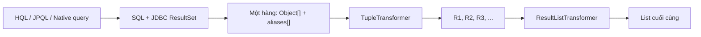
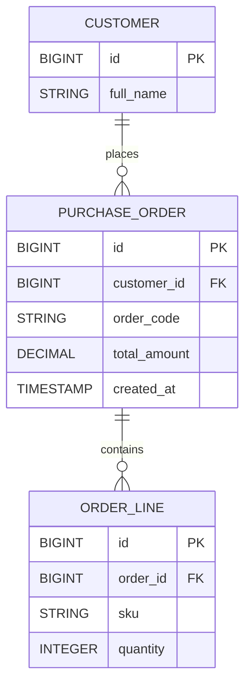

# `TupleTransformer` hoặc `ResultListTransformer` trong phạm vi API hỗ trợ của Hibernate

Trong chương **Kết quả và phân trang**, một câu hỏi quan trọng không chỉ là “truy vấn lấy dữ liệu nào?” mà còn là “kết quả SQL được chuyển thành cấu trúc Java nào?”. Hibernate có thể trả entity, scalar, `Object[]`, `Tuple`, DTO hoặc những cấu trúc được ứng dụng tự xây dựng. Với một số truy vấn phức tạp, kết quả phẳng của SQL chưa khớp với DTO mà tầng ứng dụng cần.

Hibernate cung cấp hai hook chuyển đổi kết quả đáng chú ý trong API truy vấn của mình:

- **`TupleTransformer<R>`**: biến đổi **từng tuple/hàng kết quả** thành một đối tượng Java `R`.
- **`ResultListTransformer<R>`**: nhận **danh sách các phần tử kết quả** và có thể xử lý danh sách ở cấp tổng thể, chẳng hạn loại phần tử trùng hoặc gộp các DTO hàng phẳng có cùng khóa.

Cả hai là **API riêng của Hibernate**, không thuộc hợp đồng `jakarta.persistence.TypedQuery` thuần chuẩn. Hành vi và chữ ký setter có thể thay đổi theo series Hibernate; vì vậy các ví dụ ở đây dùng phong cách API **Hibernate ORM 6.x** và cần được đối chiếu với Javadoc của version ứng dụng trước khi đưa vào production.

Điểm phân biệt quan trọng:

> `TupleTransformer` quyết định **mỗi hàng trở thành gì**; `ResultListTransformer` quyết định **danh sách những phần tử đó được xử lý thế nào**. Cả hai không làm SQL tự trở nên ngắn hơn, không giới hạn dữ liệu database phải trả về và không thay thế pagination ở tầng SQL.

Bài học đi qua API contract, ánh xạ DTO, alias, loại duplicate, ghép quan hệ một-nhiều, phân trang an toàn, count query, native SQL, tương thích Hibernate version và cách kiểm thử.

## 1. Kết quả SQL phẳng và kết quả Java mong muốn

Giả sử một màn hình danh sách đơn hàng chỉ cần:

```text
Order ID | Order code | Total | Customer name
----------------------------------------------
101      | ORD-101    | 250   | An
102      | ORD-102    | 500   | Bình
```

Một câu HQL trả bốn cột:

```hql
select o.id, o.orderCode, o.totalAmount, c.fullName
from PurchaseOrder o
join o.customer c
order by o.id
```

Nếu không dùng projection/transformer, dạng kết quả phổ biến là mỗi hàng có các phần tử:

```java
Object[] tuple = {101L, "ORD-101", new BigDecimal("250"), "An"};
```

Nhưng giao diện Java mong muốn:

```java
public record OrderRow(
    Long orderId,
    String orderCode,
    BigDecimal totalAmount,
    String customerName
) {}
```

Chuyển `Object[]` sang `OrderRow` có thể làm thủ công trong vòng lặp, dùng HQL constructor projection hoặc dùng `TupleTransformer`. Chọn cách nào phụ thuộc độ phức tạp của phép biến đổi và khả năng API.

### 1.1. Hai tầng biến đổi



Ví dụ:

- `TupleTransformer`: `(id, code, amount, name) -> new OrderRow(...)`.
- `ResultListTransformer`: loại các `OrderRow` trùng khóa hoặc gộp các object chứa một phần dữ liệu của cùng một đơn.

Không được suy ra thứ tự trên khiến `ResultListTransformer` trở thành công cụ tự động nhóm dữ liệu theo khóa. **Chính code transformer phải quyết định quy tắc nhóm, giữ thứ tự và xử lý hàng trùng.**

## 2. Mô hình dữ liệu dùng trong bài

Giả sử có ba entity:

```java
@Entity
@Table(name = "customer")
public class Customer {

    @Id
    private Long id;

    @Column(nullable = false)
    private String fullName;

    protected Customer() {}

    public Long getId() { return id; }
    public String getFullName() { return fullName; }
}
```

```java
@Entity
@Table(name = "purchase_order")
public class PurchaseOrder {

    @Id
    private Long id;

    @Column(nullable = false)
    private String orderCode;

    @Column(nullable = false, precision = 18, scale = 2)
    private BigDecimal totalAmount;

    @Column(nullable = false)
    private Instant createdAt;

    @ManyToOne(fetch = FetchType.LAZY, optional = false)
    @JoinColumn(name = "customer_id", nullable = false)
    private Customer customer;

    @OneToMany(mappedBy = "order", fetch = FetchType.LAZY)
    private List<OrderLine> lines = new ArrayList<>();

    protected PurchaseOrder() {}
}
```

```java
@Entity
@Table(name = "order_line")
public class OrderLine {

    @Id
    private Long id;

    @ManyToOne(fetch = FetchType.LAZY, optional = false)
    @JoinColumn(name = "order_id", nullable = false)
    private PurchaseOrder order;

    @Column(nullable = false)
    private String sku;

    @Column(nullable = false)
    private Integer quantity;

    protected OrderLine() {}
}
```

Mỗi class được đặt ở file riêng và import `jakarta.persistence.*`, `java.util.*`, `java.math.BigDecimal`, `java.time.Instant` tương ứng. Code minh họa giả định entity đã được mapping, có fixture và transaction/persistence context phù hợp.

Mô hình quan hệ:



## 3. Phân biệt API chuẩn JPA với Hibernate extension

Jakarta Persistence có:

```java
jakarta.persistence.EntityManager
jakarta.persistence.Query
jakarta.persistence.TypedQuery<T>
jakarta.persistence.Tuple
jakarta.persistence.criteria.CriteriaBuilder
```

Các API trên **không yêu cầu** nhà cung cấp phải có `setTupleTransformer` hoặc `setResultListTransformer`.

Hibernate có thêm các kiểu trong package của mình:

```java
org.hibernate.Session
org.hibernate.query.Query
org.hibernate.query.TupleTransformer
org.hibernate.query.ResultListTransformer
```

Trong Hibernate 6.x, contract cốt lõi được diễn đạt khái quát như:

```java
@FunctionalInterface
public interface TupleTransformer<T> {
    T transformTuple(Object[] tuple, String[] aliases);
}
```

và:

```java
@FunctionalInterface
public interface ResultListTransformer<T> {
    List<T> transformList(List<T> resultList);
}
```

Đây là chữ ký ý tưởng của các functional interface. Trước khi sử dụng setter, kiểm tra **chữ ký method và generic return type của đúng `org.hibernate.query.Query` trong Hibernate ORM version đang chạy**.

### 3.1. Phạm vi hỗ trợ có nghĩa là gì?

“Trong phạm vi API hỗ trợ” có nhiều lớp:

1. **Version:** setter và type có sẵn trong Hibernate version đang chạy không?
2. **Query implementation:** truy vấn đó có trả được `org.hibernate.query.Query` hoặc loại `NativeQuery` tương ứng không?
3. **Result shape:** tuple có những cột và alias mà transformer mong đợi không?
4. **Method thực thi:** dùng `getResultList()`, `getSingleResult()`, stream/scroll hoặc kết hợp pagination có semantics gì?
5. **Framework:** Spring Data/JPA repository có cho phép truy cập query Hibernate để cấu hình transformer không?

Một đoạn code dùng `Session.createQuery(...)` có thể hợp lệ nhưng không thể dán nguyên vào `TypedQuery` của JPA mà không đi qua provider API phù hợp.

## 4. `TupleTransformer`: biến đổi từng tuple thành DTO

Ví dụ với Hibernate `Session`:

```java
import org.hibernate.Session;
import java.math.BigDecimal;
import java.util.List;

public record OrderRow(
    Long orderId,
    String orderCode,
    BigDecimal totalAmount,
    String customerName
) {}

Session session = entityManager.unwrap(Session.class);

List<OrderRow> rows = session.createQuery(
    """
    select o.id, o.orderCode, o.totalAmount, c.fullName
    from PurchaseOrder o
    join o.customer c
    order by o.id
    """,
    Object[].class
)
.setTupleTransformer((tuple, aliases) ->
    new OrderRow(
        (Long) tuple[0],
        (String) tuple[1],
        (BigDecimal) tuple[2],
        (String) tuple[3]
    )
)
.getResultList();
```

Với mỗi hàng query trả về, transformer tạo một `OrderRow`. Kết quả là một `List<OrderRow>` thay vì phải duyệt `List<Object[]>` ở code gọi.

### 4.1. Diễn giải vị trí trong tuple

Với danh sách `SELECT` trên:

| Vị trí | Expression HQL | Kiểu Java kỳ vọng |
|---:|---|---|
| `tuple[0]` | `o.id` | `Long` |
| `tuple[1]` | `o.orderCode` | `String` |
| `tuple[2]` | `o.totalAmount` | `BigDecimal` |
| `tuple[3]` | `c.fullName` | `String` |

Nếu thêm một expression vào giữa danh sách `SELECT` mà không sửa transformer, code có thể gán nhầm trường hoặc ném `ClassCastException`.

Vì vậy, positional tuple mapping hợp lý với query được kiểm soát chặt và có integration test. Với nhiều cột, mapping theo alias hoặc constructor projection có thể dễ bảo trì hơn.

### 4.2. Transformer không phải entity mapper của Hibernate

`OrderRow` ở đây là DTO/record. Nó không tự trở thành managed entity và Hibernate không tự dirty-check nó.

```java
OrderRow row = rows.get(0);
// Không có dirty checking hoặc persist tự động với row.
```

Nếu DTO cần sửa và lưu vào database, service phải tải hoặc tham chiếu entity phù hợp, validate nghiệp vụ và áp dụng thay đổi trong transaction. Không dùng transformer như một cơ chế thay thế lifecycle entity.

## 5. Alias trong `TupleTransformer`

Phương thức `transformTuple(Object[] tuple, String[] aliases)` cho phép đọc tên các phần tử được chọn.

HQL có alias tường minh:

```hql
select
    o.id as orderId,
    o.orderCode as code,
    o.totalAmount as amount,
    c.fullName as customerName
from PurchaseOrder o
join o.customer c
```

Trong trường hợp tương ứng, `aliases` có thể chứa các giá trị như:

```text
["orderId", "code", "amount", "customerName"]
```

Nên dùng alias tường minh khi cần mapping theo tên. Không suy đoán alias của một expression không có `as` sẽ luôn có giá trị mong muốn.

### 5.1. Helper ánh xạ alias thành giá trị

```java
import java.util.HashMap;
import java.util.Map;

static Map<String, Object> aliasValues(
        Object[] tuple,
        String[] aliases) {

    Map<String, Object> values = new HashMap<>();

    if (aliases == null || aliases.length != tuple.length) {
        throw new IllegalArgumentException(
            "Tuple and alias metadata do not match"
        );
    }

    for (int i = 0; i < tuple.length; i++) {
        String alias = aliases[i];

        if (alias == null || alias.isBlank()) {
            throw new IllegalArgumentException(
                "Missing alias for column position " + i
            );
        }

        if (values.containsKey(alias)) {
            throw new IllegalArgumentException(
                "Duplicate result alias: " + alias
            );
        }

        values.put(alias, tuple[i]);
    }

    return values;
}
```

Cách này có chủ đích **báo lỗi sớm** khi thiếu alias hoặc alias trùng. Nó phù hợp khi query của ứng dụng quy định mọi selection phải có alias.

`HashMap` cho phép value `null`, khác với một số factory map bất biến không cho phép null. Tuy vậy, alias name từ native SQL có thể bị chuẩn hóa chữ hoa/thường bởi database/driver; không thể mặc định mọi provider giữ nguyên alias giống HQL.

### 5.2. Dùng helper trong transformer

```java
List<OrderRow> rows = session.createQuery(
    """
    select o.id as orderId,
           o.orderCode as code,
           o.totalAmount as amount,
           c.fullName as customerName
    from PurchaseOrder o
    join o.customer c
    """,
    Object[].class
)
.setTupleTransformer((tuple, aliases) -> {
    Map<String, Object> values = aliasValues(tuple, aliases);

    return new OrderRow(
        (Long) values.get("orderId"),
        (String) values.get("code"),
        (BigDecimal) values.get("amount"),
        (String) values.get("customerName")
    );
})
.getResultList();
```

Ưu điểm: thứ tự cột `SELECT` có thể thay đổi mà mapping vẫn dựa vào alias. Đánh đổi: alias vẫn là chuỗi, có thể bị typo, trùng hoặc khác cách viết sau khi sửa query.

## 6. Positional mapping và alias mapping: khi nào chọn?

| Tiêu chí | Dựa trên `tuple[index]` | Dựa trên `aliases` |
|---|---|---|
| Code | Ngắn, trực tiếp | Dài hơn, cần helper |
| Phụ thuộc thứ tự SELECT | Có | Ít hơn |
| Phụ thuộc tên alias | Không | Có |
| Trường không có alias | Không ảnh hưởng | Phải có fallback hoặc báo lỗi |
| Native SQL/Dialect alias case | Ít phụ thuộc | Cần kiểm tra JDBC metadata |
| Test | Kiểm tra thứ tự/kiểu | Kiểm tra alias/kiểu/trùng |
| Phù hợp | Query ngắn, ổn định | Projection rộng, có alias quy ước |

Không có lựa chọn tuyệt đối tốt nhất. Nếu truy vấn chỉ cần ba cột, HQL constructor projection thường còn đơn giản hơn cả hai.

## 7. `TupleTransformer` với JPA `EntityManager`

`EntityManager.createQuery(...)` trả `TypedQuery` của JPA, không có method `setTupleTransformer` trong interface chuẩn.

Nếu đang làm việc qua JPA API, có thể unwrap query sang loại Hibernate tương ứng:

```java
import jakarta.persistence.TypedQuery;
import org.hibernate.query.Query;
import org.hibernate.query.TupleTransformer;

TypedQuery<Object[]> jpaQuery =
    entityManager.createQuery(
        """
        select o.id, o.orderCode, o.totalAmount
        from PurchaseOrder o
        """,
        Object[].class
    );

Query<Object[]> hibernateQuery =
    jpaQuery.unwrap(Query.class);

List<OrderRow> rows = hibernateQuery
    .setTupleTransformer((tuple, aliases) ->
        new OrderRow(
            (Long) tuple[0],
            (String) tuple[1],
            (BigDecimal) tuple[2],
            null
        )
    )
    .getResultList();
```

Đoạn mã theo phong cách Hibernate 6.x; exact generic inference/overload có thể cần điều chỉnh cho series dùng trong dự án. Quan trọng hơn, việc unwrap **gắn code vào Hibernate**, nên không thể kỳ vọng provider JPA bất kỳ hỗ trợ tương tự.

### 7.1. Một cách khác: unwrap `Session`

```java
Session session = entityManager.unwrap(Session.class);
```

Sau đó dùng `session.createQuery(...)` nếu kiến trúc ứng dụng cho phép phụ thuộc Hibernate. Tránh tạo thêm một Session không cùng unit of work chỉ để gọi transformer. `unwrap(Session.class)` thường cho phép truy cập Session gắn với EntityManager hiện tại.

### 7.2. Những câu hỏi phải xác nhận theo version

- `setTupleTransformer` có trên `org.hibernate.query.Query`/`SelectionQuery` version đó không?
- Setter trả về query có generic type nào?
- Truy vấn `createQuery(hql, Object[].class)` có phù hợp result shape không?
- Native query có cần `NativeQuery` hoặc result mapping riêng không?
- Framework repository có thực thi ngay query trước khi extension được cấu hình không?

Đọc Javadoc đúng Hibernate version trước khi áp dụng. Không sửa import qua `jakarta.persistence.Query` rồi cho rằng hai interface giống nhau.

## 8. `ResultListTransformer`: xử lý danh sách sau khi có phần tử

Trong khi tuple transformer làm việc trên **từng hàng**, list transformer nhận cả danh sách:

```java
@FunctionalInterface
public interface ResultListTransformer<T> {
    List<T> transformList(List<T> resultList);
}
```

Ứng dụng có thể sử dụng nó để:

- Loại duplicate DTO theo khóa.
- Giữ lại bản ghi đầu tiên cho mỗi business key.
- Gộp nhiều DTO “một hàng” thành một DTO chứa collection.
- Sắp xếp lại kết quả sau một phép biến đổi theo hợp đồng rõ ràng.
- Chuẩn hóa danh sách khi SQL không biểu diễn trực tiếp kết quả mong muốn.

Nhưng **cùng generic type `T` là điều quan trọng**. List transformer thường nhận `List<T>` và trả `List<T>`, không nên xem nó là phương thức arbitrary `List<A> -> List<B>`. Nếu cần biến kiểu từ tuple sang DTO, dùng `TupleTransformer<DTO>` trước.

### 8.1. Ví dụ loại duplicate theo order ID

```java
List<OrderRow> uniqueOrders = session.createQuery(
    """
    select o.id, o.orderCode, o.totalAmount, c.fullName
    from PurchaseOrder o
    join o.customer c
    join o.lines l
    order by o.id
    """,
    Object[].class
)
.setTupleTransformer((tuple, aliases) ->
    new OrderRow(
        (Long) tuple[0],
        (String) tuple[1],
        (BigDecimal) tuple[2],
        (String) tuple[3]
    )
)
.setResultListTransformer(list -> {
    Map<Long, OrderRow> byOrderId =
        new LinkedHashMap<>();

    for (OrderRow row : list) {
        byOrderId.putIfAbsent(row.orderId(), row);
    }

    return new ArrayList<>(byOrderId.values());
})
.getResultList();
```

`LinkedHashMap` giữ thứ tự lần đầu gặp khóa. Với mỗi order ID, chỉ một `OrderRow` được trả. Query JOIN `o.lines` có thể tạo nhiều SQL rows cho cùng order.

**Chú ý:** ví dụ dùng inner join lines nên order **không có line** sẽ bị loại ngay trong SQL. Transformer không thể khôi phục root đã bị loại bởi JOIN. Nếu nghiệp vụ phải giữ order không có line, cần `left join` hoặc query khác.

### 8.2. Chọn khóa dedup chính xác

Không dùng toàn bộ `OrderRow.equals` một cách vô thức nếu mục tiêu là mỗi order chỉ xuất hiện một lần. Một order có thể được chọn kèm các cột phụ khác nhau theo từng row. Khóa đúng thường là identifier của root hoặc khóa nghiệp vụ đã được định nghĩa ổn định.

Nếu khóa có thể null, cần quy định rõ semantics, không gom mọi root không có ID thành một phần tử.

## 9. Kết hợp cả hai transformer: dựng DTO một-nhiều

Đây là tình huống thể hiện rõ sự khác biệt giữa hai API.

SQL join trả dạng phẳng:

```text
order_id | order_code | line_id | sku   | quantity
---------------------------------------------------
101      | ORD-101    | 1       | A-001 | 2
101      | ORD-101    | 2       | B-002 | 1
102      | ORD-102    | 3       | C-003 | 5
103      | ORD-103    | NULL    | NULL  | NULL
```

Ứng dụng muốn:

```text
OrderWithLines(101, "ORD-101", [Line(1,...), Line(2,...)])
OrderWithLines(102, "ORD-102", [Line(3,...)])
OrderWithLines(103, "ORD-103", [])
```

Định nghĩa DTO:

```java
public record LineView(
    Long lineId,
    String sku,
    Integer quantity
) {}

public record OrderWithLines(
    Long orderId,
    String orderCode,
    List<LineView> lines
) {}
```

`OrderWithLines` là record, nhưng `lines` trong ví dụ là `ArrayList` có thể thay đổi trong lúc gộp. Nên coi kết quả là **DTO xây dựng nội bộ**, không dùng như value object bất biến tuyệt đối; khi trả API có thể tạo snapshot `List.copyOf(...)` nếu cần.

### 9.1. Tuple transformer tạo một DTO tạm cho mỗi SQL row

```java
List<OrderWithLines> grouped = session.createQuery(
    """
    select o.id, o.orderCode,
           l.id, l.sku, l.quantity
    from PurchaseOrder o
    left join o.lines l
    order by o.id, l.id
    """,
    Object[].class
)
.setTupleTransformer((tuple, aliases) -> {
    Long orderId = (Long) tuple[0];
    String orderCode = (String) tuple[1];

    OrderWithLines row =
        new OrderWithLines(
            orderId,
            orderCode,
            new ArrayList<>()
        );

    // LEFT JOIN: không có child -> các cột line là NULL.
    if (tuple[2] != null) {
        row.lines().add(new LineView(
            (Long) tuple[2],
            (String) tuple[3],
            (Integer) tuple[4]
        ));
    }

    return row;
})
.setResultListTransformer(list -> {
    Map<Long, OrderWithLines> byId =
        new LinkedHashMap<>();

    for (OrderWithLines current : list) {
        OrderWithLines existing = byId.get(current.orderId());

        if (existing == null) {
            byId.put(current.orderId(), current);
        } else {
            existing.lines().addAll(current.lines());
        }
    }

    return new ArrayList<>(byId.values());
})
.getResultList();
```

Ở đây:

1. Mỗi row SQL tạo một `OrderWithLines` tạm có 0 hoặc 1 line.
2. List transformer duyệt toàn bộ những DTO tạm.
3. Các row có cùng `orderId` được gộp vào một object.
4. `LinkedHashMap` giữ thứ tự order xuất hiện lần đầu.
5. Order không có line vẫn có một DTO với danh sách trống nhờ `LEFT JOIN` và kiểm tra `lineId != null`.

### 9.2. Vì sao không tạo `LineView` cho tuple có NULL?

Với `LEFT JOIN`, một order không có line vẫn có thể tạo một row SQL mà mọi cột child là NULL. Nếu luôn tạo `new LineView(null, null, null)`, DTO sẽ chứa một “line giả” không tồn tại.

Thường phải dùng **ID của child** để quyết định child có thật, không chỉ kiểm tra `sku`, vì một vài field khác có thể nullable theo domain.

### 9.3. Vì sao dùng `LinkedHashMap` thay vì `HashMap`?

`HashMap` không có hợp đồng giữ thứ tự iteration. Trong trường hợp API trả danh sách theo `order by`, `LinkedHashMap` giúp giữ thứ tự root theo lần xuất hiện đầu tiên trong kết quả.

Tuy nhiên, **thứ tự đầu ra vẫn cần được định nghĩa ngay trong SQL/HQL**. Không dựa vào thứ tự mặc định của database khi không có `ORDER BY`.

## 10. Giới hạn của cách gộp: một root có nhiều nhánh to-many

Giả sử query join đồng thời:

```text
PurchaseOrder
  ├── lines        (4)
  └── discounts    (3)
```

Join có thể tạo `4 × 3 = 12` rows cho một order. Nếu list transformer chỉ `addAll(lines)` cho từng row, cùng một line có thể bị thêm ba lần.

Đây là **join multiplication**, không phải lỗi của Hibernate transformer.

### 10.1. De-duplicate child theo khóa

Có thể dùng `LinkedHashMap<Long, LineView>` hoặc `LinkedHashSet<Long>` trong accumulator để chỉ giữ child theo `lineId`.

Ví dụ ý tưởng:

```java
Map<Long, LinkedHashMap<Long, LineView>> linesByOrder =
    new LinkedHashMap<>();

for (FlatRow row : rows) {
    linesByOrder.computeIfAbsent(
        row.orderId(),
        ignored -> new LinkedHashMap<>()
    );

    if (row.lineId() != null) {
        linesByOrder.get(row.orderId()).putIfAbsent(
            row.lineId(),
            new LineView(row.lineId(), row.sku(), row.quantity())
        );
    }
}
```

`FlatRow` ở đây là một DTO trung gian minh họa nếu ứng dụng chọn xử lý ngoài transformer. Nếu vẫn dùng `ResultListTransformer<OrderWithLines>`, cần kết hợp accumulator nhất quán với type đó. Đừng trộn các kiểu query result mà không xét generic contract.

### 10.2. Tối ưu hơn có thể là tách query

Nếu SQL trả nhiều rows lặp lại vì join nhiều collection, một số query riêng theo root ID có thể hiệu quả hơn:

1. Query danh sách root ID.
2. Query lines theo root ID.
3. Query discounts theo root ID.
4. Ghép trong Java theo ID.

Số statement tăng, nhưng tổng số hàng và bytes có thể giảm mạnh. **Một câu SQL không đồng nghĩa với truy vấn nhanh**, và list transformer không làm biến mất chi phí của rows đã được database/JDBC trả về.

## 11. `ResultListTransformer` không phải phép biến đổi SQL

Xét:

```java
.setResultListTransformer(list -> ...)
```

Lambda này hoạt động **sau khi** các phần tử kết quả đã được xử lý để tạo danh sách, theo contract API. Nó không được truyền vào SQL optimizer và không thể làm database:

- Bỏ qua các row không cần thiết chỉ vì Java sẽ loại duplicate.
- Giới hạn số child của mỗi parent.
- Tính `COUNT(DISTINCT ...)`.
- Trả ngay trang thứ hai theo root sau khi gộp.
- Ngừng join các bảng làm nhân rows.

Những nhu cầu trên phải giải quyết bằng query design, SQL/Dialect, pagination, projection, subquery hoặc kế hoạch lấy dữ liệu nhiều bước.

### 11.1. Các tầng xử lý cần phân biệt

| Tầng | Thao tác ví dụ | Chi phí xảy ra ở đâu |
|---|---|---|
| SQL | `JOIN`, `WHERE`, `ORDER BY`, `LIMIT` | Database |
| JDBC | Nhận row, đọc cột, truyền network | Driver/ứng dụng |
| Tuple transform | `Object[] -> OrderRow` | Java cho mỗi row |
| List transform | Dedup/group `List<OrderRow>` | Java trên danh sách |
| Serialization | `OrderRow -> JSON` | API/server |

Tối ưu sai tầng có thể làm số SQL thấp nhưng Java heap/CPU hoặc network rất lớn.

## 12. Phân trang là giới hạn quan trọng nhất với list transformer

Đây là điểm dễ gây lỗi tính đúng đắn nhất.

Giả sử SQL join order-line tạo dữ liệu:

```text
Order 101 -> 10 rows (10 lines)
Order 102 -> 1 row
Order 103 -> 1 row
Order 104 -> 5 rows
```

Ứng dụng chạy:

```java
session.createQuery(hql, Object[].class)
       .setTupleTransformer(...)
       .setResultListTransformer(...)
       .setFirstResult(0)
       .setMaxResults(10)
       .getResultList();
```

Nếu giới hạn được thực thi trên **10 rows phẳng**, chúng có thể chỉ bao gồm order 101. Sau khi nhóm, danh sách cuối chỉ có một parent, dù yêu cầu là “10 đơn hàng”.

Nguy hiểm hơn, nếu offset cắt giữa các line của cùng một order, DTO có thể **thiếu child**. Transformer không có cách khôi phục các SQL rows không được lấy.

### 12.1. Tại sao không “transform trước rồi mới limit”?

Với pagination ở SQL/JDBC, database và Hibernate thường chọn subset rows trước khi list transformer gộp chúng. Không được thiết kế API dựa trên giả định rằng Hibernate sẽ tải toàn bộ database, nhóm tất cả parent rồi phân trang đúng root sau.

Một số query/entity fetch plan có cơ chế xử lý collection pagination đặc thù theo phiên bản, nhưng **đừng áp dụng quy tắc đó cho DTO transformer trên kết quả phẳng**.

### 12.2. Bảng mô tả nguy cơ

| Kết quả SQL trước biến đổi | `setMaxResults(10)` | Số DTO order sau gộp |
|---|---|---|
| 10 rows, mỗi row một order | 10 rows | 10 |
| 10 rows của cùng một order | 10 rows | 1 |
| 5 rows order A + 5 rows order B | 10 rows | 2 |
| 5 rows đầu của order có 20 lines | 5 rows | 1 DTO **thiếu lines** |

Mục tiêu phân trang theo **root entity**, không phải theo row sau join, phải được thiết kế riêng.

## 13. Phân trang an toàn theo hai pha

Khi API cần **N order mỗi trang** cùng danh sách lines, cách thường rõ ràng là:

1. Chọn trang **order ID** ở database (không join collection).
2. Lấy order và lines cho **nhóm ID** của trang.
3. Gộp rows theo `orderId`.
4. Sắp thứ tự DTO theo danh sách ID của trang.
5. Tính tổng số order bằng count query riêng nếu API yêu cầu.

### 13.1. Pha một: query trang ID

```java
List<Long> pageIds = session.createQuery(
    """
    select o.id
    from PurchaseOrder o
    where o.totalAmount >= :minAmount
    order by o.createdAt desc, o.id desc
    """,
    Long.class
)
.setParameter("minAmount", minAmount)
.setFirstResult(pageIndex * pageSize)
.setMaxResults(pageSize)
.getResultList();
```

Lưu ý validate `pageIndex >= 0`, `pageSize` trong giới hạn cho phép và tránh overflow khi nhân offset. Để đơn giản, snippet giả định các input đã được validate.

### 13.2. Pha hai: lấy rows thuộc trang đó

```java
if (pageIds.isEmpty()) {
    return List.of();
}

List<OrderWithLines> orders = session.createQuery(
    """
    select o.id, o.orderCode,
           l.id, l.sku, l.quantity
    from PurchaseOrder o
    left join o.lines l
    where o.id in :ids
    order by o.id, l.id
    """,
    Object[].class
)
.setParameter("ids", pageIds)
.setTupleTransformer((tuple, aliases) -> {
    OrderWithLines row = new OrderWithLines(
        (Long) tuple[0],
        (String) tuple[1],
        new ArrayList<>()
    );

    if (tuple[2] != null) {
        row.lines().add(new LineView(
            (Long) tuple[2],
            (String) tuple[3],
            (Integer) tuple[4]
        ));
    }

    return row;
})
.setResultListTransformer(list -> {
    Map<Long, OrderWithLines> merged =
        new LinkedHashMap<>();

    for (OrderWithLines row : list) {
        OrderWithLines current = merged.get(row.orderId());

        if (current == null) {
            merged.put(row.orderId(), row);
        } else {
            current.lines().addAll(row.lines());
        }
    }

    return new ArrayList<>(merged.values());
})
.getResultList();
```

### 13.3. Trả DTO theo thứ tự của trang ID

`IN :ids` **không bảo đảm** database trả rows theo đúng thứ tự của `pageIds`. Ví dụ query thứ hai order by ID nhưng trang ban đầu order by thời gian.

Có thể sắp xếp lại:

```java
Map<Long, Integer> rank = new HashMap<>();

for (int i = 0; i < pageIds.size(); i++) {
    rank.put(pageIds.get(i), i);
}

orders.sort(
    Comparator.comparingInt(
        row -> rank.get(row.orderId())
    )
);
```

Đoạn này giả định mỗi order trong `orders` đều có ID thuộc `pageIds`. Với thay đổi dữ liệu đồng thời giữa hai query, một order có thể biến mất; API phải có chính sách transaction isolation/consistency phù hợp.

### 13.4. Một lưu ý về tính nhất quán giữa hai pha

Trong isolation `READ_COMMITTED`, một transaction khác có thể sửa/xóa order hoặc lines giữa hai truy vấn. Kết quả pha hai có thể phản ánh snapshot mới hơn pha một.

Nếu nghiệp vụ yêu cầu snapshot nhất quán, chọn transaction/isolation hoặc protocol phù hợp. Đừng cho rằng hai pha tự động tạo snapshot duy nhất ở mọi DBMS.

## 14. Count query phải độc lập với transformer

Một API phân trang thường trả:

```json
{
  "page": 0,
  "size": 10,
  "totalElements": 128,
  "items": []
}
```

`totalElements` thường là **tổng số order gốc** khớp filter, không phải:

- Số SQL rows sau join.
- Số phần tử `Object[]` trước list transformer.
- Số DTO còn lại sau `setMaxResults`.
- Số line của một order.

Count query riêng:

```java
Long total = session.createQuery(
    """
    select count(o)
    from PurchaseOrder o
    where o.totalAmount >= :minAmount
    """,
    Long.class
)
.setParameter("minAmount", minAmount)
.getSingleResult();
```

Nếu count query join collection để lọc theo child, có thể cần `count(distinct o.id)` hoặc `exists` để tránh nhân count.

### 14.1. Ví dụ đếm root khi có điều kiện child

```hql
select count(distinct o.id)
from PurchaseOrder o
join o.lines l
where l.sku = :sku
```

Hoặc diễn đạt bằng `exists`:

```hql
select count(o)
from PurchaseOrder o
where exists (
    select 1
    from OrderLine l
    where l.order = o
      and l.sku = :sku
)
```

Hai dạng có thể có execution plan khác nhau; kiểm tra với DBMS thực tế. **List transformer không thay thế count query**, vì count phải tính trên toàn tập khớp filter, không chỉ trang hiện tại.

## 15. Phân biệt SQL `DISTINCT`, Hibernate dedup và list transformer

Những thao tác này cùng liên quan duplicate nhưng không đồng nghĩa.

**SQL/HQL `DISTINCT`**:

```hql
select distinct o.id, o.orderCode
from PurchaseOrder o
join o.lines l
```

Có thể loại rows trùng nhau dựa trên *toàn bộ biểu thức trong SELECT*. Nếu chọn thêm `l.id` thì các rows khác nhau ở line ID và không bị gộp.

**Dedupe root entity của Hibernate**: Với một số query fetch join entity, Hibernate có cơ chế đảm bảo mỗi entity identity xuất hiện theo semantics phiên bản. Điều này không tự áp dụng y hệt cho mọi scalar/DTO projection.

**`ResultListTransformer`**: ứng dụng tự định nghĩa duplicate theo `orderId` hoặc business key.

| Cơ chế | Tầng | Khóa loại trùng |
|---|---|---|
| `DISTINCT` | SQL/database hoặc query translation | Các selection được xét theo SQL |
| Entity identity mapping | ORM/persistence context | Identifier/entity instance theo semantics provider |
| `ResultListTransformer` | Java result list | Logic do ứng dụng viết |

Không áp dụng `distinct` một cách máy móc rồi cho rằng SQL rows do join một-nhiều sẽ biến mất hết. Cũng không dùng list transformer để che giấu một join vô tình nhân hàng tới mức tốn kém.

## 16. HQL constructor projection: lựa chọn tốt hơn khi biến đổi đơn giản

Không phải query nào cũng cần transformer. Với DTO phẳng và constructor rõ ràng:

```java
public record OrderRow(
    Long orderId,
    String orderCode,
    BigDecimal totalAmount,
    String customerName
) {}
```

Có thể viết:

```java
List<OrderRow> rows = session.createQuery(
    """
    select new com.example.dto.OrderRow(
        o.id,
        o.orderCode,
        o.totalAmount,
        c.fullName
    )
    from PurchaseOrder o
    join o.customer c
    order by o.id
    """,
    OrderRow.class
).getResultList();
```

Ưu điểm:

- Kết quả có type ngay trong HQL.
- Không cần xử lý `Object[]` bằng tay.
- Không cần `TupleTransformer` chỉ để gọi một constructor.
- Code đọc được như định nghĩa response.
- Provider có thể kiểm tra constructor result type khi biên dịch query theo khả năng/version.

Nếu constructor signature thay đổi, query vẫn phải được integration test. Nhưng với DTO phẳng, constructor expression thường ít mã hơn tuple transformer.

### 16.1. Khi nào transformer có lợi hơn constructor projection?

- Cần xử lý scalar kiểu DBMS trả khác với DTO.
- Cần alias-based mapping phức tạp.
- Cần chuyển các cột phân tán thành value object bằng logic Java.
- Có query native SQL cần custom result mapping.
- Cần xử lý từng row trước khi gộp danh sách.
- Không thể mô tả dễ bằng constructor expression hoặc JPA mapping chuẩn.

Không dùng transformer chỉ vì “nó linh hoạt hơn”; API bổ sung đồng nghĩa thêm code và rủi ro version lock-in.

## 17. `jakarta.persistence.Tuple` là lựa chọn chuẩn JPA

Nếu muốn truy cập kết quả nhiều cột bằng alias nhưng không muốn phụ thuộc Hibernate transformer:

```java
import jakarta.persistence.Tuple;

List<Tuple> rows = entityManager.createQuery(
    """
    select o.id as orderId,
           o.totalAmount as amount
    from PurchaseOrder o
    """,
    Tuple.class
).getResultList();

for (Tuple row : rows) {
    Long id = row.get("orderId", Long.class);
    BigDecimal amount = row.get("amount", BigDecimal.class);
}
```

`Tuple` thuộc Jakarta Persistence và phù hợp với các truy vấn select nhiều expression. Ứng dụng có thể map `Tuple` sang DTO trong một vòng lặp Java thường.

Sự khác biệt:

- `TupleTransformer` thực hiện mapping như một hook trong pipeline truy vấn Hibernate.
- `Tuple` + mapping bên ngoài giữ ứng dụng gần API JPA hơn.
- Cả hai đều phải kiểm tra alias, kiểu dữ liệu và số lượng rows khi có join.

Không nhầm tên `TupleTransformer` với `Tuple`: một cái là **callback chuyển đổi**, một cái là **kiểu kết quả** chuẩn.

## 18. Native SQL và transformer

Một tình huống khác là truy vấn native SQL cần áp dụng custom mapping. Ví dụ:

```sql
SELECT
    o.id AS order_id,
    o.order_code AS code,
    o.total_amount AS amount
FROM purchase_order o
WHERE o.id = ?;
```

Trong Hibernate 6.x, có thể làm theo hướng:

```java
List<OrderRow> rows = session.createNativeQuery(
    """
    select o.id as order_id,
           o.order_code as code,
           o.total_amount as amount
    from purchase_order o
    where o.id = :id
    """,
    Object[].class
)
.setParameter("id", orderId)
.setTupleTransformer((tuple, aliases) ->
    new OrderRow(
        ((Number) tuple[0]).longValue(),
        (String) tuple[1],
        (BigDecimal) tuple[2],
        null
    )
)
.getResultList();
```

**Lưu ý:** chính xác overload `createNativeQuery`, kiểu result Class và khả năng transformer tùy Hibernate series. Hãy kiểm tra API phiên bản dùng trong dự án; khi có khác biệt, lấy query dưới loại `NativeQuery`/`Query` được hỗ trợ thay vì ép cast tùy tiện.

### 18.1. Native query thường có khác biệt kiểu dữ liệu

Cột SQL `BIGINT` có thể được JDBC/Hibernate biểu diễn là `Long` hoặc một `Number` khác theo query mapping, dialect và driver. Vì vậy `((Number) tuple[0]).longValue()` có thể linh hoạt hơn `(Long) tuple[0]` khi cột thực sự mang nghĩa số nguyên dài.

Tuy nhiên, **không cast mọi thứ thành Number rồi cho là an toàn**:

- Một value có thể null.
- Decimal lớn có thể bị mất độ chính xác nếu chuyển qua `double`.
- `BigDecimal` conversion cần semantics rõ.
- Date/time có thể trả những kiểu cần mapping riêng.
- DBMS có thể trả JSON/array/binary theo driver-specific object.

Khi mapping chuẩn Java rõ ràng, có thể dùng `addScalar`/basic result mapping hoặc `@SqlResultSetMapping` phù hợp thay vì đoán type bằng cast.

### 18.2. Alias case và duplicate columns

Trong native SQL, driver/Dialect có thể thay đổi cách trả alias chữ hoa/thường và xử lý tên cột trùng. Ví dụ `order_id` có thể cần xử lý khác `ORDER_ID` trên DBMS/mode nhất định.

Nếu ứng dụng mapping theo alias:

1. Đặt alias tường minh và duy nhất.
2. Log hoặc kiểm tra `aliases` trong integration test.
3. Không đặt rule dựa vào alias mà chỉ một driver version tình cờ trả ra.
4. Nếu cần portability, cân nhắc positional mapping hoặc mapping metadata có chủ đích.
5. Không lấy alias từ input người dùng rồi ghép trực tiếp thành SQL.

## 19. Kết hợp transformer và `@SqlResultSetMapping`

Jakarta Persistence có `@SqlResultSetMapping` để ánh xạ kết quả native SQL thành entity, scalar hoặc constructor result tùy cấu hình.

Ví dụ ý tưởng:

```java
@SqlResultSetMapping(
    name = "OrderRowMapping",
    classes = @ConstructorResult(
        targetClass = OrderRow.class,
        columns = {
            @ColumnResult(name = "order_id", type = Long.class),
            @ColumnResult(name = "code", type = String.class),
            @ColumnResult(name = "amount", type = BigDecimal.class),
            @ColumnResult(name = "customer_name", type = String.class)
        }
    )
)
```

Mapping đầy đủ phải đặt trong vị trí annotation hợp lệ và dùng query có các alias tương ứng.

`@SqlResultSetMapping` là lựa chọn chuẩn JPA khi native SQL cần constructor mapping có thể khai báo tĩnh. `TupleTransformer` tiện cho logic mapping động hoặc cần xử lý không biểu đạt tự nhiên bằng annotation.

Không bắt buộc kết hợp cả hai; thường chọn một chiến lược rõ ràng để tránh làm pipeline kết quả phức tạp không cần thiết.

## 20. Transformer và kết quả entity managed

Nếu HQL trả entity:

```hql
select o from PurchaseOrder o
```

Hibernate quản lý entity theo persistence context và identifier. `TupleTransformer` thường được dùng nhiều nhất khi query trả nhiều scalar/tuple cần dựng DTO.

Có thể dùng hook transformer trong những result shape khác nếu API hỗ trợ, nhưng không nên biến đổi entity bằng cách sửa giá trị trong transformer rồi mặc định đó là cách an toàn để thay thế service/domain logic.

Các lưu ý:

- Entity managed có lifecycle, dirty checking và fetch behavior của Hibernate.
- DTO được transformer tạo ra không tự được managed.
- Duyệt association từ entity bên trong transformer có thể kích hoạt lazy SQL phụ.
- Tạo entity mới bằng constructor trong transformer không tự làm nó managed.
- Nếu cần cập nhật entity, thực hiện tại transaction/service với validation và optimistic locking phù hợp.

Transformer là **công cụ tổ chức kết quả đọc**, không phải nơi tốt để ghi dữ liệu hoặc kích hoạt side effect nghiệp vụ.

## 21. Không thực hiện I/O hoặc cập nhật trong transformer

Một tuple transformer được gọi nhiều lần — có thể hàng trăm hoặc hàng nghìn lần tùy result set. Không nên đặt các thao tác như:

```java
.setTupleTransformer((tuple, aliases) -> {
    // Không nên:
    // emailService.sendEmail(...);
    // remoteApi.call(...);
    // entityManager.persist(...);
    return mapRow(tuple);
})
```

Lý do:

- Không kiểm soát số lần callback nếu query thay đổi.
- I/O tăng latency theo số row.
- Side effect có thể xảy ra trước khi transaction commit.
- Exception ở giữa list khiến một phần side effect đã diễn ra.
- Retry query có thể lặp lại side effect.
- Khó test/caching và gây bất ngờ cho người duy trì.

Hãy giữ transformer **thuần, xác định, ít side effect**, tập trung vào chuyển đổi dữ liệu. Nếu cần thao tác sau khi truy vấn thành công, xử lý ở service layer với transaction/outbox/idempotency protocol phù hợp.

## 22. Null handling phải theo domain

Với SQL:

```hql
select o.id, c.fullName
from PurchaseOrder o
left join o.customer c
```

Tên khách hàng có thể `null` nếu association tùy chọn hoặc database có dữ liệu đặc biệt. Một transformer:

```java
new OrderRow(
    (Long) tuple[0],
    null,
    null,
    (String) tuple[1]
)
```

có thể hợp lệ nếu `customerName` được phép null. Nhưng nếu DTO contract yêu cầu không null, cần xử lý rõ:

- Đổi join thành `INNER` nếu chỉ muốn những order có customer.
- Dùng `coalesce` nếu có giá trị fallback nghiệp vụ hợp lý.
- Trả error nếu null là trạng thái dữ liệu không hợp lệ.
- Đặt field DTO là nullable và hiển thị fallback ở UI.

Không dùng `String.valueOf(tuple[i])` một cách vô thức nếu nó biến null thành chuỗi literal `"null"`.

### 22.1. Aggregate có thể trả null

`SUM(...)` thường có thể trả NULL khi không có row khớp. Ví dụ:

```java
BigDecimal sum = (BigDecimal) tuple[1];
```

Phải quyết định `null` nghĩa là “không có dữ liệu” hay cần đổi thành `BigDecimal.ZERO`. Cách xử lý phải thống nhất giữa query, DTO và API.

### 22.2. LEFT JOIN và child null

Trong phép gộp order-line, hãy kiểm tra `lineId` trước khi tạo child. Đừng thêm một line có ID null chỉ để giữ một slot cho row LEFT JOIN.

## 23. Generic type và cast: tránh làm mất an toàn kiểu

Hai hook có thể tạo nên pipeline:

```text
Query<Object[]>
   -- TupleTransformer<OrderRow> -->
Query<OrderRow>
   -- ResultListTransformer<OrderRow> -->
List<OrderRow>
```

Điều quan trọng là **generic type của query sau tuple transform đã thay đổi theo DTO**. Không ép kiểu toàn bộ list sang kiểu mới nếu chưa có transformer bảo đảm từng phần tử thuộc kiểu đó.

Anti-pattern:

```java
@SuppressWarnings("unchecked")
List<OrderRow> rows =
    (List<OrderRow>) (List<?>) rawResults;
```

Cast này chỉ che warning, không map giá trị; lúc truy cập phần tử vẫn có thể ném `ClassCastException`.

### 23.1. Không lạm dụng transformer để đổi kiểu danh sách lần thứ hai

`ResultListTransformer<T>` làm việc trên `List<T>`. Nếu muốn tạo `List<OrderSummary>` từ `List<OrderRow>`, hãy:

- Tạo `TupleTransformer<OrderSummary>` ngay từ đầu nếu có thể; hoặc
- Thực hiện mapping ở service layer sau khi nhận `List<OrderRow>`.

Đừng cố trả `List<OrderSummary>` từ một `ResultListTransformer<OrderRow>` bằng raw types hoặc cast không an toàn.

## 24. Ordering trước và sau list transformer

Nếu list transformer loại trùng hoặc gộp, thứ tự phần tử cuối phụ thuộc:

- `ORDER BY` trong HQL/SQL.
- Thứ tự duyệt danh sách.
- Collection/map được sử dụng trong transformer.
- Có sort bổ sung ở Java hay không.

Ví dụ:

```java
Map<Long, OrderRow> byId = new LinkedHashMap<>();

for (OrderRow row : list) {
    byId.putIfAbsent(row.orderId(), row);
}
```

`LinkedHashMap` giữ thứ tự gặp khóa đầu tiên. Nếu SQL không có `ORDER BY`, thứ tự đó có thể thay đổi giữa các lần chạy hoặc khi execution plan thay đổi.

### 24.1. Giữ tie-breaker cho pagination

```hql
order by o.createdAt desc, o.id desc
```

Nếu nhiều order có cùng `createdAt`, thêm `id` làm tie-breaker giúp xác định thứ tự. Dù list transformer có dùng `sort`, phần phân trang SQL vẫn cần thứ tự xác định **trước khi giới hạn rows**.

### 24.2. Sort sau pagination không sửa được trang sai

Nếu database đã trả 20 rows thuộc sai/thiếu parent do join, gọi `list.sort(...)` không khôi phục những parent hoặc line đã bị loại khỏi result set.

## 25. Memory và streaming: không nhóm list lớn một cách vô hạn

`ResultListTransformer` cần danh sách các phần tử được cung cấp cho nó theo execution path của API. Vì vậy, sử dụng nó để gộp hàng trăm nghìn/millions tuple trong một query có thể gây:

- Giữ nhiều DTO tạm trong heap.
- Cấp phát `ArrayList` và `HashMap` lớn.
- GC pressure và latency.
- Thời gian chuyển đổi Java cao.
- Dữ liệu phải được đọc từ database trước khi gộp.

Đối với dữ liệu lớn, cân nhắc:

- Database aggregation/projection.
- Pagination theo root rồi tải child theo nhóm.
- Truy vấn các nhánh riêng với số lượng bị giới hạn.
- Streaming/scrolling API của Hibernate nếu use case và provider hỗ trợ.
- Xử lý dữ liệu theo chunk với quy tắc không mất parent/child qua ranh giới chunk.

### 25.1. Không giả định `ResultListTransformer` hoạt động như nhau với stream/scroll

Các method `getResultList()`, `getResultStream()` và `scroll()` có đường thực thi và khả năng materialization khác nhau tùy Hibernate version. `ResultListTransformer` theo bản chất nhận **một List**, nên không được mặc định nó sẽ chạy giống `getResultList()` khi ứng dụng xử lý từng phần tử bằng stream.

Nếu cần list-level grouping, chọn đường API được tài liệu của version xác nhận và viết integration test. Nếu cần streaming thật sự, nên thiết kế accumulator có thể xử lý row tuần tự theo thứ tự và giới hạn memory thay vì dựa vào list transformer trên toàn bộ tập.

### 25.2. Streaming cũng không tự giới hạn database work

Dùng stream có thể giảm việc giữ mọi phần tử trong Java, nhưng không có nghĩa DBMS không quét nhiều rows hoặc driver không buffer dữ liệu. Fetch size, cursor support, transaction lifetime và driver configuration đều có tác động.

## 26. Performance: đo hơn là nhìn số dòng Java

Khi thay vòng lặp map DTO bằng tuple transformer, số SQL statement có thể **không thay đổi**, vì HQL/SQL vẫn lấy cùng tập dữ liệu. Lợi ích chủ yếu thuộc tổ chức code và mapping kết quả.

Khi dùng list transformer để dedup, số DTO Java cuối có thể giảm, nhưng:

- Database vẫn trả nhiều rows.
- JDBC vẫn truyền/đọc rows đó.
- Tuple transformer vẫn chạy trên từng row.
- List transformer còn tốn thời gian gom.

Cần theo dõi:

| Metric | Ý nghĩa |
|---|---|
| SQL statement count | Phát hiện N+1 và query phụ |
| ResultSet row count | Biết có join multiplication |
| Rows scanned / execution plan | Chi phí DBMS |
| DTO count before/after list transform | Mức co rút ở Java |
| Bytes transferred/response size | Dung lượng dữ liệu |
| Heap/allocations | Chi phí tạo DTO trung gian |
| p50/p95 latency | Ảnh hưởng người dùng |
| Count query latency | Chi phí lấy totalElements |

Không gọi một transformer là “tối ưu truy vấn” chỉ vì danh sách sau biến đổi ngắn hơn.

## 27. Query cache và transformer

Một query được cache theo cấu hình Hibernate có các quy tắc cache result và invalidation riêng. Không tự suy rằng kết quả `List<DTO>` sau list transformer có thể được cache/dùng lại y hệt entity result trong mọi cấu hình.

Các câu hỏi cần kiểm tra:

- Query cache có bật không?
- Query result type là scalar, tuple hay entity?
- Transformer có deterministic và không side effect không?
- Cache có lưu row representation hay object transformed theo đường query/version đó?
- Second-level cache có làm giảm SQL phụ không?
- Khi nâng Hibernate, transformed result cache behavior có thay đổi không?

Nếu endpoint cần caching kết quả DTO ở tầng ứng dụng, có thể cache **output API được xác định rõ** với TTL/invalidation phù hợp, độc lập với việc Hibernate có query cache hay không.

## 28. `ResultListTransformer` với nested DTO nhiều cấp

Một cấu trúc:

```text
Customer
  └── Orders
       └── Lines
```

khó dựng từ một join lớn hơn rất nhiều so với `Order -> Lines`. Nếu query join ba cấp, mỗi row có thể phải mang customer ID, order ID và line ID. Transformer cần:

1. Khóa customer theo `customerId`.
2. Khóa order trong mỗi customer theo `orderId`.
3. Khóa line trong mỗi order theo `lineId`.
4. Xử lý `LEFT JOIN` null ở từng cấp.
5. Giữ thứ tự xác định.
6. Tránh child duplicate khi join nhiều nhánh.
7. Không cắt giữa parent group khi phân trang.

Một accumulator nội bộ nhiều map là hợp lý, nhưng kết quả API nên có kiểu DTO rõ ràng; đừng bắt service layer biết chi tiết các map tạm.

### 28.1. Cân nhắc query riêng khi graph sâu

Nếu cần nhiều collection và dữ liệu có cardinality lớn, “tất cả trong một query rồi transformer” có thể tạo tích Descartes. Một chiến lược nhiều query theo tập root ID thường dễ giới hạn rows và tối ưu riêng mỗi nhánh.

## 29. Tương thích giữa Hibernate 5 và Hibernate 6+

Các dự án cũ có thể dùng `org.hibernate.transform.ResultTransformer` cùng hai method:

```java
Object transformTuple(Object[] tuple, String[] aliases);

List transformList(List collection);
```

Trong những dòng Hibernate trước, một API transformer thường gom cả row-level và list-level transformation. Hibernate 6 giới thiệu/tách rõ hợp đồng theo hướng `TupleTransformer` và `ResultListTransformer`, giúp diễn đạt hai trách nhiệm riêng biệt.

Một số API/adapter legacy có thể còn tồn tại, bị deprecated hoặc có đường tương thích theo version. **Không sao chép nguyên `setResultTransformer` từ bài hướng dẫn Hibernate 5 vào dự án Hibernate 6/7 rồi giả định đó là lựa chọn chuẩn hiện tại.**

### 29.1. Cách nâng cấp tư duy

| Ý định ở code cũ | Hướng diễn đạt ở API hiện đại |
|---|---|
| Mỗi row thành DTO | `TupleTransformer<DTO>` |
| Loại duplicate ở cuối | `ResultListTransformer<DTO>` |
| Cả hai bước | Ghép hai transformer nếu query API hỗ trợ |
| Chỉ gọi constructor DTO | Cân nhắc HQL `select new ...` |
| Truy cập nhiều scalar theo tên | JPA `Tuple` hoặc alias transformer |
| Native SQL có mapping cố định | `@SqlResultSetMapping` hoặc scalar mapping |

Không nâng cấp chỉ bằng đổi tên import. Phải kiểm tra result shape, generic type, alias, pagination và cách framework gọi truy vấn.

### 29.2. API đúng phiên bản là ranh giới thực tế

Trước khi áp dụng code, ghi rõ:

- `org.hibernate.Version.getVersionString()` ở runtime.
- `hibernate-core` resolved dependency version.
- `org.hibernate.query.Query` và `NativeQuery` trong Javadoc series đó.
- Chữ ký `setTupleTransformer`, `setResultListTransformer`.
- Tính năng `getResultList`/`getSingleResult`/`stream` mà use case cần.
- Dialect/DBMS/driver nếu dùng native SQL.
- Đường thực thi thực tế của Spring Data/framework nếu dùng repository abstraction.

Một snippet hợp lệ ở một series không tự đảm bảo biên dịch ở series khác.

## 30. `getSingleResult()` và list-level transformation

`TupleTransformer` diễn đạt phép ánh xạ theo từng row và có thể phù hợp với query trả một tuple, nhưng `ResultListTransformer` lại có contract xử lý `List<T>`.

Không thiết kế nghiệp vụ dựa trên giả định rằng list-level transformer chắc chắn sẽ chạy với semantics giống `getResultList()` khi gọi `getSingleResult()`. Hãy xem Javadoc và test execution path của Hibernate version thực tế.

Nếu use case thật sự chỉ cần một DTO duy nhất, ưu tiên query giới hạn phù hợp và constructor projection hoặc tuple transformer đơn giản. Đừng dùng list transformer gộp nhiều rows rồi gọi `getSingleResult()` để “biến nhiều rows thành một” khi không biết đường API xử lý duplicate/cardinality ra sao.

## 31. Dùng transformer trong Spring Data JPA

Spring Data JPA thường quản lý query thông qua repository interfaces và projection facilities. Để cấu hình Hibernate-specific transformer, ứng dụng có thể cần custom repository implementation sử dụng `EntityManager` và unwrap query.

Ví dụ cấu trúc:

```java
@Repository
public class OrderReadRepository {

    @PersistenceContext
    private EntityManager em;

    public List<OrderRow> findRows() {
        Session session = em.unwrap(Session.class);

        return session.createQuery(
            """
            select o.id, o.orderCode,
                   o.totalAmount, c.fullName
            from PurchaseOrder o
            join o.customer c
            order by o.id
            """,
            Object[].class
        )
        .setTupleTransformer((tuple, aliases) ->
            new OrderRow(
                (Long) tuple[0],
                (String) tuple[1],
                (BigDecimal) tuple[2],
                (String) tuple[3]
            )
        )
        .getResultList();
    }
}
```

`@Repository` và `@PersistenceContext` tương ứng với Spring/Jakarta imports. Method này dùng Hibernate API có chủ đích; repository không thể được thay bằng một query method trả DTO tùy tiện rồi kỳ vọng Spring tự áp list transformer.

### 31.1. Khi nào không cần custom repository?

- Spring Data interface/class-based projection đã đáp ứng.
- JPQL constructor expression đủ rõ.
- Query chỉ trả một entity hoặc scalar.
- Mapping DTO có thể làm ở service mà không tạo dữ liệu thừa.

Chọn transformer khi nó **giải quyết nhu cầu cụ thể** không được giải quyết gọn hơn bằng API đã có.

## 32. Những lỗi thường gặp

| Triệu chứng | Nguyên nhân có thể | Cách xử lý |
|---|---|---|
| `setTupleTransformer` không thấy trong IDE | Biến có type `jakarta.persistence.Query`/`TypedQuery` | Dùng API Hibernate hoặc unwrap đúng |
| Không biên dịch do generic type | Sai kiểu query trước/sau transform | Kiểm tra setter return type theo version |
| `ClassCastException` trên `tuple[i]` | Kiểu JDBC/selection khác dự kiến | Xem Java type, mapping, dùng conversion an toàn |
| `ArrayIndexOutOfBoundsException` | SELECT ít cột hơn transformer kỳ vọng | Kiểm tra result shape và test |
| Alias null | Expression chưa đặt alias hoặc metadata khác | Đặt `as`/mapping theo index |
| Alias bị đổi case | Native SQL/driver/Dialect | Kiểm tra aliases thực tế |
| DTO bị trùng | Join to-many tạo nhiều rows | SQL DISTINCT, EXISTS hoặc list grouping phù hợp |
| DTO thiếu children ở trang cuối | Pagination cắt flat rows | Two-phase page root IDs |
| Count sai | Đếm SQL rows thay vì root IDs | Count query riêng, distinct/exists |
| List transformer bị bỏ qua khi stream | API execution path khác | Kiểm tra version, dùng đường được hỗ trợ |
| Duplicate child sau group | Join nhiều collection tạo tích hàng | Dedupe child ID hoặc tách query |
| Root không có child biến mất | Dùng inner join | Dùng left join nếu nghiệp vụ cần |
| Hàng NULL tạo “child giả” | Không kiểm tra child ID | Chỉ tạo child khi ID không null |
| Heap tăng mạnh | Group toàn bộ tập lớn trong memory | Pagination/streaming/aggregation theo nhóm |
| DTO có thay đổi nhưng DB không cập nhật | DTO không phải managed entity | Cập nhật qua entity/service có transaction |
| HQL constructor và transformer mapping khác nhau | Query/DTO contract không thống nhất | Chọn một đường mapping rõ ràng |

## 33. Quy trình kiểm thử transformer

Một integration test nên chạy trên Hibernate và database phù hợp, không chỉ mock callback.

### 33.1. Fixture đa dạng

Tạo:

- Một order không có line.
- Một order có một line.
- Một order có nhiều line.
- Hai order cùng khách hàng.
- Hai line có SKU giống nhau nhưng ID khác nhau.
- Một trường hợp có giá trị nullable được phép.
- Dữ liệu đủ lớn để phát hiện pagination cắt giữa parent groups.

Ví dụ fixture:

```text
ORD-101: lines [1, 2, 3]
ORD-102: lines []
ORD-103: lines [4]
ORD-104: lines [5, 6, 7, 8]
```

### 33.2. Test tuple mapping

Xác nhận DTO của ORD-101 có đúng:

- `orderId`.
- `orderCode`.
- `totalAmount`.
- `customerName`.

Thử thay thứ tự SELECT trong một test chuyên biệt nếu mapping theo alias; nếu mapping theo index, giữ query cố định và có test kiểm tra code thích hợp.

### 33.3. Test list grouping

Xác nhận:

- Số DTO bằng số order.
- ORD-101 có ba line, không bị lặp.
- ORD-102 có list rỗng, không có `LineView(null,...)`.
- Thứ tự root và child đúng như `ORDER BY`.
- Các key có duplicate row không làm trùng child nếu join thêm nhánh.

### 33.4. Test phân trang

Dùng page size 2 nhưng order đầu có 10 lines. Nếu query group trực tiếp trên flat rows có `setMaxResults(2)`, kết quả có thể sai. Đảm bảo implement two-phase paging, rồi kiểm tra:

- Trang có đúng hai order nếu còn dữ liệu.
- Không order nào có collection bị cắt giữa chừng.
- `totalElements` đếm số order, không đếm line rows.
- Thứ tự theo page ID được giữ sau query `IN`.

### 33.5. Test biên của NativeQuery

Với native SQL:

- Xác nhận alias thực tế.
- Xác nhận `id`, amount, timestamp type.
- Xác nhận NULL.
- Kiểm tra PostgreSQL/MySQL/SQL Server/Oracle cụ thể nếu sản phẩm hỗ trợ nhiều DBMS.

Test trên H2 không chứng minh JDBC alias/type của production DBMS sẽ giống.

## 34. Bài thực hành A — Viết `TupleTransformer` cho DTO phẳng

Yêu cầu:

- Query `PurchaseOrder` và `Customer`.
- Chọn ID, mã đơn, tổng tiền, tên khách hàng.
- Kết quả là `List<OrderRow>`.
- Không tạo managed `PurchaseOrder` nếu chỉ cần DTO.

Khung code:

```java
List<OrderRow> rows = session.createQuery(
    """
    select o.id, o.orderCode,
           o.totalAmount, c.fullName
    from PurchaseOrder o
    join o.customer c
    order by o.id
    """,
    Object[].class
)
.setTupleTransformer((tuple, aliases) -> {
    // TODO: tạo OrderRow từ tuple.
    return new OrderRow(
        (Long) tuple[0],
        (String) tuple[1],
        (BigDecimal) tuple[2],
        (String) tuple[3]
    );
})
.getResultList();
```

Câu hỏi:

1. Trong trường hợp này, `TupleTransformer` có thể thay bằng HQL constructor projection không?
2. Nếu thứ tự `SELECT` thay đổi, positional mapping gặp rủi ro gì?
3. DTO này có dirty-checking không?
4. Nếu truy vấn trả rất nhiều rows, transformer có giảm rows JDBC không?

Gợi ý: Constructor projection thường gọn hơn; positional mapping phụ thuộc thứ tự; DTO không managed; transformer không giảm số rows do SQL trả.

## 35. Bài thực hành B — Dedupe DTO sau join

Yêu cầu:

- Query order join lines.
- Mỗi order chỉ xuất hiện một lần trong output.
- Giữ thứ tự order ID tăng.
- Không trả order không có line nếu dùng inner join; nếu muốn giữ, sửa thành left join.

Gợi ý:

```java
.setResultListTransformer(list -> {
    Map<Long, OrderRow> unique = new LinkedHashMap<>();

    for (OrderRow row : list) {
        unique.putIfAbsent(row.orderId(), row);
    }

    return new ArrayList<>(unique.values());
})
```

Câu hỏi: `DISTINCT` trên những cột nào có thể thay thế dedup này? Nếu SELECT thêm `line.id`, `DISTINCT` có còn một row trên mỗi order không?

## 36. Bài thực hành C — Gộp Order và Lines

Fixture:

```text
Order 10: line 1, line 2
Order 11: không có line
Order 12: line 3
```

Yêu cầu:

1. Viết `LEFT JOIN` lấy order ID, code, line ID, SKU và quantity.
2. `TupleTransformer` biến một row thành `OrderWithLines` có 0 hoặc 1 line.
3. `ResultListTransformer` dùng `LinkedHashMap` gộp theo order ID.
4. Xác nhận order 11 vẫn có DTO với `lines=[]`.
5. Nêu cách tránh duplicate lines nếu query join thêm discounts.

Gợi ý: Chỉ tạo `LineView` khi line ID không null; khi nhiều to-many joins, dùng child ID set/map hoặc tách query.

## 37. Bài thực hành D — Sửa lỗi pagination

Một developer viết:

```java
query.setFirstResult(20)
     .setMaxResults(20)
     .setResultListTransformer(groupByOrderId)
     .getResultList();
```

Query lấy `PurchaseOrder JOIN OrderLine`.

Câu hỏi:

1. Offset/limit đang tính theo đơn vị nào?
2. Tại sao trang có thể chỉ còn hai order?
3. Có thể mất một phần lines không?
4. Vì sao không thể sửa bằng `groupByOrderId` tốt hơn?
5. Viết quy trình two-phase page IDs rồi fetch children.

Gợi ý: Pagination trên flat SQL rows; list transformer chỉ xử lý rows đã nhận. Phải phân trang root ID trước, sau đó query associations theo các ID của trang.

## 38. Bài thực hành E — Nâng cấp từ Hibernate legacy

Code cũ có:

```java
query.setResultTransformer(oldTransformer);
```

`oldTransformer` từng thực hiện cả `transformTuple` và `transformList`.

Yêu cầu:

- Xác định Hibernate runtime version và Javadoc tương ứng.
- Tách logic row-level sang `TupleTransformer`.
- Tách dedup/group sang `ResultListTransformer`.
- Không dùng raw casts để né generic mismatch.
- Kiểm tra `getResultList`, aliases, native query và pagination sau nâng cấp.
- Giữ nguyên functional semantics qua regression tests.

Không kết luận việc thay API thành công chỉ vì code biên dịch; query shape và cách trang hóa cũng phải đúng.

## 39. Checklist quyết định dùng transformer

Trước khi thêm transformer vào repository:

- [ ] Tôi đang dùng đúng Hibernate version có API này.
- [ ] Variable query có type Hibernate `Query`/`NativeQuery`, không chỉ JPA `TypedQuery`.
- [ ] Tôi thực sự cần mapping tùy biến, thay vì HQL constructor projection hoặc JPA `Tuple`.
- [ ] SELECT có thứ tự/alias được kiểm soát và có test.
- [ ] Tôi đã xác định Java types, NULL và alias case trong native SQL.
- [ ] `TupleTransformer<R>` trả cùng kiểu `R` mà query/list transformer cần.
- [ ] `ResultListTransformer<R>` giữ semantics danh sách `R`, không ép kiểu bất hợp lý.
- [ ] Dedupe/group dựa trên khóa đúng, không dựa vào identity ngẫu nhiên.
- [ ] Query có `ORDER BY` xác định nếu output cần thứ tự.
- [ ] Với join collection, tôi không phân trang trực tiếp trên flat rows rồi mong được trang parent.
- [ ] Count query tính đúng số root, độc lập với list transformer.
- [ ] Tôi đã đo SQL statement, rows, bytes, heap và latency nếu dataset lớn.
- [ ] Transformer không chứa side effect hoặc I/O nghiệp vụ.
- [ ] Code có integration test trên đúng Hibernate/DBMS mục tiêu.
- [ ] Nếu dùng Spring Data, custom repository hoặc projection path được chọn rõ ràng.

## 40. Tổng kết

`TupleTransformer` và `ResultListTransformer` là hai công cụ Hibernate-specific để xử lý kết quả khi entity/DTO projection thông thường chưa đủ.

Nhớ các điểm chính:

1. **`TupleTransformer` xử lý từng tuple**: từ `Object[]` và `aliases[]` tạo đối tượng Java.
2. **`ResultListTransformer` xử lý cả danh sách phần tử cùng kiểu**: phù hợp để dedup hoặc gộp DTO phẳng.
3. **Dùng hai hook liên tiếp khi cần**: mỗi row thành DTO tạm rồi gộp theo root ID.
4. **Không nhầm transformer với standard JPA API**: `TypedQuery` không có setter Hibernate; cần `Session` hoặc unwrap phù hợp.
5. **Đối chiếu Javadoc đúng Hibernate version**: nhất là setter, generics, native query và execution method.
6. **Ưu tiên HQL constructor projection/JPA Tuple** cho bài toán đơn giản và cần portability.
7. **Alias và kiểu tuple là contract cần test**; đừng dựa vào tên alias tự sinh hoặc cast ngẫu nhiên.
8. **LEFT JOIN cần kiểm tra child ID null** để không tạo phần tử giả.
9. **List transformer không giảm số SQL rows/bytes đã trả**, không thay thế SQL `DISTINCT`/`EXISTS` hoặc optimizer.
10. **Không phân trang root bằng limit trên flat rows của join to-many**. Dùng two-phase page IDs rồi fetch/group nếu cần đủ collection.
11. **Count query phải đếm đúng root**, không lấy `list.size()` sau transform làm tổng toàn bộ kết quả.
12. **Không dùng list transformer cho khối dữ liệu vô hạn**; đo heap, latency và cân nhắc streaming/chunking có kiểm soát.

Khi hiểu đúng ranh giới từng tầng — SQL tạo rows, tuple transformer tạo phần tử, list transformer tổ chức danh sách — bạn có thể xây DTO đọc phức tạp mà vẫn dự đoán được kết quả. Những giới hạn về API, phân trang và chi phí dữ liệu phải được thiết kế cùng truy vấn, chứ không thể vá sau bằng một callback Java.
