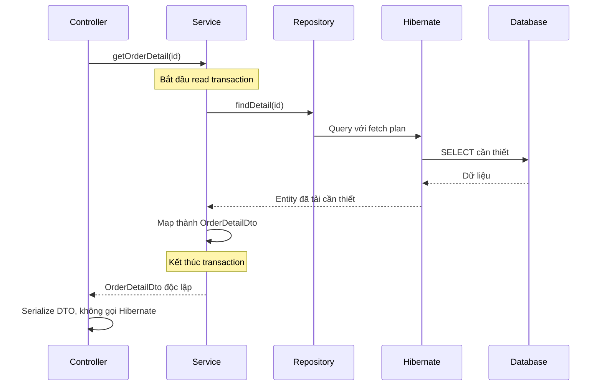

# Trả DTO ra ranh giới ứng dụng để tránh tải trì hoãn ngoài dự kiến

Trong Hibernate, một entity Java không chỉ là một object chứa dữ liệu. Khi còn được quản lý bởi `Session` hoặc `EntityManager`, entity có thể liên quan đến **Persistence Context**, **proxy**, **persistent collection**, cơ chế **dirty checking** và các thuộc tính được tải theo yêu cầu (*lazy loading*). Vì vậy, việc trả thẳng entity từ repository qua service, controller, JSON serializer hoặc một tác vụ chạy bất đồng bộ có thể khiến truy vấn SQL xuất hiện ở thời điểm ngoài dự kiến.

Ví dụ:

```java
@GetMapping("/orders/{id}")
public PurchaseOrder findOrder(@PathVariable Long id) {
    return orderService.findOrder(id);
}
```

Nếu `PurchaseOrder.customer` hoặc `PurchaseOrder.lines` là lazy association, Jackson có thể gọi getter khi xây dựng JSON. Khi đó có thể xảy ra một trong hai tình huống:

- Nếu Persistence Context đã đóng, serializer cố truy cập lazy association chưa khởi tạo và Hibernate ném `LazyInitializationException`.
- Nếu Session vẫn mở nhờ Open Session in View (OSIV), serializer có thể kích hoạt thêm hàng loạt SQL, thậm chí tạo **N+1 query** mà tầng service không nhìn thấy.

Một chiến lược thường an toàn hơn là **trả DTO (Data Transfer Object) ra khỏi ranh giới ứng dụng**, còn entity chỉ phục vụ nghiệp vụ trong phạm vi Persistence Context phù hợp.

```text
Controller / API
      ↑
   DTO / record
      ↑
Service — mapping hoặc query projection trong transaction
      ↑
Repository — entity / scalar / projection
      ↑
Hibernate Session / Persistence Context
      ↑
Database
```

**Nguyên tắc cốt lõi:** xác định toàn bộ dữ liệu cần trả về **trước khi rời tầng sở hữu transaction**, tải dữ liệu ấy bằng fetch plan hoặc projection thích hợp, chuyển sang DTO không mang proxy/entity managed, rồi mới đưa DTO qua ranh giới service, HTTP, message queue, cache hoặc background job.

Bài học thuộc nhóm **Kết quả và phân trang**, nên ngoài chuyện lazy loading, chúng ta sẽ làm rõ cách tạo DTO cho danh sách và trang chi tiết, cách phân trang mà không fetch collection sai cách, cách đếm tổng số hàng, và cách đo N+1 trong truy vấn trả nhiều kết quả.

---

## 1. Entity không phải là hợp đồng API

Entity JPA dùng để mô hình hóa dữ liệu và vòng đời persistence:

- Có identifier và mapping tới bảng.
- Có association `@ManyToOne`, `@OneToMany`, `@OneToOne`, `@ManyToMany`.
- Có thể chứa proxy và persistent collection.
- Có thể được Hibernate theo dõi để tự động UPDATE khi field thay đổi.
- Có thể có cascade, orphan removal, entity callback, version và filter.
- Có thể được thay đổi khi mapping/quan hệ trong database thay đổi.

DTO có mục tiêu khác:

- Chỉ mang những trường mà use case cho phép và cần trả.
- Là hợp đồng kết quả của API, service, job hoặc message.
- Có thể biểu diễn dữ liệu đã tổng hợp/định dạng.
- Không có vòng đời entity managed và không phụ thuộc Session để lấy thêm dữ liệu.
- Có thể được thiết kế immutable bằng Java `record`.
- Có thể version độc lập với database schema.

| Tiêu chí | Entity | DTO/record |
| --- | --- | --- |
| Vai trò chính | Domain/persistence model | Dữ liệu vượt ranh giới ứng dụng |
| Hibernate dirty checking | Có khi managed, tùy mapping/chế độ | Không |
| Proxy lazy association | Có thể chứa | Nên không chứa |
| Persistent collection | Có thể có | Dùng collection Java thông thường |
| Thay đổi field có tự ghi DB? | Có thể, nếu managed và dirty | Không |
| Cấu trúc phụ thuộc mapping DB | Thường có | Nên theo use case/API |
| JSON serialization | Có nguy cơ query ngoài ý muốn | Dễ kiểm soát hơn |
| An toàn phân trang | Phụ thuộc fetch plan | Có thể thiết kế dữ liệu vừa đủ |

**DTO không phải bản sao toàn bộ entity.** Nếu copy mọi field và nhét nguyên entity liên quan vào DTO, vấn đề lazy loading vẫn tồn tại dưới một hình thức khác.

## 2. Vì sao getter có thể phát SQL?

Ví dụ entity:

```java
@Entity
@Table(name = "purchase_orders")
public class PurchaseOrder {

    @Id
    private Long id;

    @ManyToOne(fetch = FetchType.LAZY)
    @JoinColumn(name = "customer_id")
    private Customer customer;

    @OneToMany(mappedBy = "order", fetch = FetchType.LAZY)
    private List<OrderLine> lines = new ArrayList<>();

    public Long getId() { return id; }
    public Customer getCustomer() { return customer; }
    public List<OrderLine> getLines() { return lines; }
}
```

Khi ứng dụng gọi:

```java
PurchaseOrder order = em.find(PurchaseOrder.class, id);

Customer customer = order.getCustomer();
```

`getCustomer()` có thể chỉ trả **proxy chưa khởi tạo**. Đến khi ứng dụng cần state:

```java
String name = customer.getName();
```

Hibernate có thể phát:

```sql
select c.id, c.name
from customers c
where c.id = ?;
```

Với collection:

```java
List<OrderLine> lines = order.getLines();
```

có thể chỉ lấy wrapper. Nhưng:

```java
for (OrderLine line : lines) {
    System.out.println(line.getSku());
}
```

thường làm Hibernate tải các row `order_lines` của đơn hàng.

### Truy cập lazy sau khi Session đóng

```java
PurchaseOrder detached;

try (EntityManager em = emf.createEntityManager()) {
    detached = em.find(PurchaseOrder.class, id);
}

// EntityManager đã đóng.
int count = detached.getLines().size();
```

Nếu collection chưa initialized, Hibernate không còn Session thích hợp để truy vấn và có thể ném `LazyInitializationException`.

Đây không phải lỗi của `size()`; đó là hệ quả của việc đưa một object còn phụ thuộc lazy loading ra ngoài phạm vi có thể tải dữ liệu.

### Getter identifier không chứng minh entity đã được tải

Một proxy `Customer` thường có identifier đã biết; gọi `customer.getId()` có thể không làm khởi tạo proxy. Nhưng gọi `getName()` thì cần state thực. Vì vậy, việc mapper chỉ đọc ID chạy ổn không có nghĩa mapper sẽ chạy ổn nếu sau này thêm tên khách hàng.

## 3. Ranh giới ứng dụng cần được định nghĩa rõ

Trong kiến trúc nhiều tầng, ranh giới thường gặp là:

- **Repository → service:** repository có thể trả entity nếu service còn ở trong transaction và sẽ xử lý/mapping tiếp.
- **Service → controller:** nên trả DTO hoặc kết quả nghiệp vụ đã materialize, thay vì entity có lazy state chưa xác định.
- **Controller → HTTP response:** JSON serializer chỉ nên đọc những field có sẵn, không được quyết định query database tùy getter.
- **Application → message queue/outbox:** payload nên là dữ liệu độc lập, không chứa entity/proxy.
- **Synchronous request → background worker:** worker nhận ID/command DTO, mở transaction mới nếu cần truy vấn thêm.
- **Application → cache distributed:** cache giá trị DTO/snapshot phù hợp, không serialize nguyên managed entity graph.
- **Ứng dụng → export/report:** mỗi bản ghi xuất cần được materialize theo kế hoạch đọc có kiểm soát.

Không có quy tắc bắt buộc **mọi method nội bộ đều phải trả DTO**. Bên trong một application service transaction, entity có thể là đối tượng hợp lý để thực hiện nghiệp vụ. Mục tiêu là **không để sự phụ thuộc vào Session rò rỉ qua một ranh giới mà caller không kiểm soát**.

### Ranh giới không chỉ là HTTP

Ngay cả khi không có controller, việc lưu entity vào `CompletableFuture` hoặc biến global để xử lý sau cũng có nguy cơ:

```java
PurchaseOrder order = repository.findById(id).orElseThrow();

executor.execute(() -> {
    // Có thể chạy sau khi transaction đã đóng.
    sendEmail(order.getCustomer().getName());
});
```

Thiết kế an toàn hơn:

```java
OrderMailData mail = orderService.loadMailData(id);

executor.execute(() -> {
    sendEmail(mail.customerName());
});
```

Hoặc chỉ gửi order ID cho worker để worker tự truy vấn dữ liệu trong transaction mới.

## 4. Mô hình dữ liệu dùng xuyên suốt bài

Ta dùng một hệ thống đơn hàng đơn giản.

```java
public enum OrderStatus {
    DRAFT, PAID, CANCELLED
}
```

### `Customer`

```java
import jakarta.persistence.*;

@Entity
@Table(name = "customers")
public class Customer {

    @Id
    private Long id;

    @Column(nullable = false)
    private String name;

    private String email;

    protected Customer() {}

    public Long getId() { return id; }
    public String getName() { return name; }
    public String getEmail() { return email; }
}
```

### `PurchaseOrder`

```java
import jakarta.persistence.*;
import java.math.BigDecimal;
import java.time.Instant;
import java.util.ArrayList;
import java.util.List;

@Entity
@Table(name = "purchase_orders")
public class PurchaseOrder {

    @Id
    private Long id;

    @Column(nullable = false)
    private String orderNumber;

    @Enumerated(EnumType.STRING)
    private OrderStatus status;

    @Column(nullable = false, precision = 19, scale = 2)
    private BigDecimal totalAmount;

    @Column(nullable = false)
    private Instant placedAt;

    @ManyToOne(fetch = FetchType.LAZY, optional = false)
    @JoinColumn(name = "customer_id", nullable = false)
    private Customer customer;

    @OneToMany(mappedBy = "order", fetch = FetchType.LAZY)
    private List<OrderLine> lines = new ArrayList<>();

    protected PurchaseOrder() {}

    public Long getId() { return id; }
    public String getOrderNumber() { return orderNumber; }
    public OrderStatus getStatus() { return status; }
    public BigDecimal getTotalAmount() { return totalAmount; }
    public Instant getPlacedAt() { return placedAt; }
    public Customer getCustomer() { return customer; }
    public List<OrderLine> getLines() { return lines; }
}
```

### `OrderLine`

```java
import jakarta.persistence.*;
import java.math.BigDecimal;

@Entity
@Table(name = "order_lines")
public class OrderLine {

    @Id
    private Long id;

    @ManyToOne(fetch = FetchType.LAZY, optional = false)
    @JoinColumn(name = "order_id", nullable = false)
    private PurchaseOrder order;

    @Column(nullable = false)
    private String sku;

    private int quantity;

    @Column(nullable = false, precision = 19, scale = 2)
    private BigDecimal unitPrice;

    protected OrderLine() {}

    public Long getId() { return id; }
    public String getSku() { return sku; }
    public int getQuantity() { return quantity; }
    public BigDecimal getUnitPrice() { return unitPrice; }
}
```

Các class này là mô hình tối giản cho ví dụ. Trong ứng dụng thật cần constructor/domain methods, ID generation, constraint/migration và imports phù hợp.

Giả định `customer` là to-one lazy, `lines` là to-many lazy. Những mapping này tạo ra đúng bài toán của danh sách và trang chi tiết: màn hình danh sách chỉ cần tên Customer, còn trang chi tiết mới cần các OrderLine.

## 5. DTO nên được thiết kế theo use case

Một API danh sách và API chi tiết **không nhất thiết dùng chung DTO**.

### DTO cho danh sách

```java
package com.example.orders.api;

import java.math.BigDecimal;
import java.time.Instant;

public record OrderListDto(
    Long id,
    String orderNumber,
    String customerName,
    BigDecimal totalAmount,
    OrderStatus status,
    Instant placedAt
) {}
```

DTO này không chứa `Customer` entity hoặc `OrderLine`. Nó chỉ mang thông tin đủ cho bảng danh sách.

### DTO cho chi tiết

```java
package com.example.orders.api;

import java.math.BigDecimal;
import java.util.List;

public record OrderLineDto(
    Long id,
    String sku,
    int quantity,
    BigDecimal unitPrice
) {}

public record OrderDetailDto(
    Long id,
    String orderNumber,
    String customerName,
    String customerEmail,
    BigDecimal totalAmount,
    List<OrderLineDto> lines
) {
    public OrderDetailDto {
        lines = List.copyOf(lines);
    }
}
```

Ở đây:

- `OrderDetailDto.lines` là `List<OrderLineDto>` thông thường, không phải Hibernate persistent collection.
- `OrderLineDto` chứa scalar, không chứa `OrderLine` entity.
- `List.copyOf` tạo snapshot list không sửa được qua danh sách trả ra, đồng thời yêu cầu các phần tử không null.
- Bản thân record không có Persistence Context và không thể lazy-load thêm dữ liệu.

### Vì sao không chỉ khai báo DTO như sau?

```java
public record BadOrderDto(
    Long id,
    Customer customer,
    List<OrderLine> lines
) {}
```

Mặc dù tên class chứa “Dto”, nó vẫn mang entity/proxy/persistent collection. JSON serializer hoặc worker sử dụng DTO này vẫn có thể đụng tới lazy state.

**Đổi tên kiểu thành DTO chưa đủ; phải cắt tham chiếu tới mô hình persistence.**

## 6. Cách thứ nhất: ánh xạ entity thành DTO trong transaction

Một service có thể tải entity đúng cách, rồi tạo DTO trước khi method kết thúc.

```java
@Service
public class OrderQueryService {

    private final PurchaseOrderRepository repository;

    public OrderQueryService(PurchaseOrderRepository repository) {
        this.repository = repository;
    }

    @Transactional(readOnly = true)
    public OrderListDto getListItem(Long id) {
        PurchaseOrder order = repository.findById(id)
            .orElseThrow(() ->
                new EntityNotFoundException("Không tìm thấy đơn")
            );

        return new OrderListDto(
            order.getId(),
            order.getOrderNumber(),
            order.getCustomer().getName(),
            order.getTotalAmount(),
            order.getStatus(),
            order.getPlacedAt()
        );
    }
}
```

Ưu điểm:

- Mapper chạy khi Persistence Context còn mở.
- DTO không giữ entity sau khi ra khỏi service.
- Code đơn giản, dễ áp dụng khi chỉ có một entity.

Nhưng còn vấn đề: **đọc `order.getCustomer().getName()` có thể kích hoạt SQL riêng**. Khi xử lý một Order, chi phí có thể chấp nhận; khi xử lý 100 Order, cùng mapper có thể gây N+1.

Vì vậy **ánh xạ trong transaction giải quyết lỗi lazy ngoài ranh giới, nhưng không tự giải quyết hiệu năng truy vấn**.

## 7. N+1 vẫn xảy ra dù mapping DTO ở trong transaction

Ví dụ:

```java
@Transactional(readOnly = true)
public List<OrderListDto> listPaidOrders() {
    List<PurchaseOrder> orders =
        repository.findByStatus(OrderStatus.PAID);

    return orders.stream()
        .map(order -> new OrderListDto(
            order.getId(),
            order.getOrderNumber(),
            order.getCustomer().getName(),
            order.getTotalAmount(),
            order.getStatus(),
            order.getPlacedAt()
        ))
        .toList();
}
```

Nếu query gốc tải 100 Order và Customer của mỗi Order khác nhau:

```text
1 SELECT -> 100 PurchaseOrder
100 SELECT -> 100 Customer (khi mapper gọi getName)
--------------------------------------------
Có thể tổng cộng 101 SELECT
```

Số truy vấn có thể thấp hơn nếu Customer trùng nhau, L1/L2 cache có hit hoặc Hibernate batch fetching được cấu hình. Tuy nhiên, rủi ro N+1 vẫn tồn tại.

### Ba hướng xử lý phổ biến

1. **DTO projection trực tiếp:** SELECT đúng cột cần dùng, không cần materialize Order entity.
2. **Fetch to-one association:** dùng JOIN FETCH hoặc EntityGraph để tải Customer cùng Order trước khi map.
3. **Batch fetching:** Hibernate gom việc khởi tạo nhiều proxy thành ít query hơn, nếu phù hợp mapping/use case.

Lựa chọn phải dựa trên dữ liệu cần trả, kích thước result set và cách phân trang.

## 8. Cách thứ hai: JPQL constructor projection

Khi màn hình chỉ cần vài cột, cách gọn và thường hiệu quả là query trực tiếp ra DTO.

```java
@PersistenceContext
private EntityManager em;

@Transactional(readOnly = true)
public List<OrderListDto> listPaidOrders(int limit) {
    return em.createQuery(
        """
        select new com.example.orders.api.OrderListDto(
            o.id,
            o.orderNumber,
            c.name,
            o.totalAmount,
            o.status,
            o.placedAt
        )
        from PurchaseOrder o
        join o.customer c
        where o.status = :status
        order by o.placedAt desc, o.id desc
        """,
        OrderListDto.class
    )
    .setParameter("status", OrderStatus.PAID)
    .setMaxResults(limit)
    .getResultList();
}
```

Điều cần hiểu:

- `select new ...` gọi constructor của DTO/record.
- `o.customer` được join để đọc `c.name` như một scalar.
- Query không cần trả `PurchaseOrder` managed instances.
- DTO được tạo khi truy vấn thực thi, với các giá trị đã có.
- Sau khi service kết thúc, serializer đọc DTO mà không cần Session.

### Truy vấn này có còn dùng lazy loading không?

HQL có JOIN nhưng **không lazy-load Customer entity** theo kiểu gọi getter từng Order. Database trả các cột theo query; Hibernate dựng DTO từ kết quả. Vì không trả managed entity graph, không có proxy Customer trong DTO.

### Cần đảm bảo constructor khớp kiểu

Với record:

```java
OrderListDto(
    Long id,
    String orderNumber,
    String customerName,
    BigDecimal totalAmount,
    OrderStatus status,
    Instant placedAt
)
```

thứ tự và kiểu phải khớp các biểu thức `SELECT`. Nếu đổi sang `Integer` cho `id` nhưng entity ID là `Long`, query có thể lỗi khi Hibernate phân tích/khởi tạo DTO.

### Đường dẫn đầy đủ của DTO

Trong JPQL chuẩn, constructor expression dùng tên class đủ package. Hibernate có thể cung cấp các dạng projection khác theo phiên bản, nhưng dùng tên đầy đủ trong `select new` giúp truy vấn rõ ràng và dễ chuyển giữa provider.

## 9. Projection không đồng nghĩa fetch join

Hai query dưới đây có mục đích khác nhau.

**Lấy entity cùng association:**

```hql
select o
from PurchaseOrder o
join fetch o.customer
where o.status = :status
```

**Lấy cột rồi dựng DTO:**

```hql
select new com.example.orders.api.OrderListDto(
    o.id, o.orderNumber, c.name,
    o.totalAmount, o.status, o.placedAt
)
from PurchaseOrder o
join o.customer c
where o.status = :status
```

Ở query đầu, Hibernate materialize entity Order và Customer theo fetch plan; chúng có thể managed. Ở query sau, ORM chỉ cần giá trị để dựng DTO.

**Không nên thêm `join fetch` vào constructor projection chỉ vì muốn “tránh N+1”.** Fetch join dành cho owner entity được trả trong result set; khi owner không được chọn để materialize, fetch join thường không phù hợp và có thể bị Hibernate từ chối.

JOIN thông thường đã đủ để chọn cột `c.name` cho DTO.

## 10. Cách thứ ba: Criteria API constructor projection

Khi bộ lọc được tạo động, Criteria API cho phép dựng DTO có kiểu.

```java
CriteriaBuilder cb = em.getCriteriaBuilder();

CriteriaQuery<OrderListDto> cq =
    cb.createQuery(OrderListDto.class);

Root<PurchaseOrder> order =
    cq.from(PurchaseOrder.class);

Join<PurchaseOrder, Customer> customer =
    order.join("customer", JoinType.INNER);

cq.select(
    cb.construct(
        OrderListDto.class,
        order.get("id"),
        order.get("orderNumber"),
        customer.get("name"),
        order.get("totalAmount"),
        order.get("status"),
        order.get("placedAt")
    )
);

cq.where(
    cb.equal(
        order.get("status"),
        OrderStatus.PAID
    )
);

cq.orderBy(
    cb.desc(order.get("placedAt")),
    cb.desc(order.get("id"))
);

List<OrderListDto> result =
    em.createQuery(cq)
      .setMaxResults(20)
      .getResultList();
```

Ưu điểm:

- Thuận tiện khi WHERE/ORDER BY được xây theo nhiều điều kiện.
- Dùng một kiểu DTO rõ ràng.
- Có thể dùng Static Metamodel (`PurchaseOrder_`) để giảm string property.
- Không phải tạo entity managed chỉ để đọc scalar.

Nhược điểm là code dài hơn JPQL cho truy vấn cố định. Không nên dùng Criteria chỉ vì tin rằng nó luôn chạy nhanh hơn; SQL sinh ra và execution plan mới quyết định hiệu năng.

## 11. Spring Data JPA class-based projection

Spring Data JPA hỗ trợ method repository với JPQL constructor projection.

```java
public interface PurchaseOrderRepository
        extends JpaRepository<PurchaseOrder, Long> {

    @Query(
        value = """
            select new com.example.orders.api.OrderListDto(
                o.id, o.orderNumber, c.name,
                o.totalAmount, o.status, o.placedAt
            )
            from PurchaseOrder o
            join o.customer c
            where o.status = :status
            order by o.placedAt desc, o.id desc
            """,
        countQuery = """
            select count(o)
            from PurchaseOrder o
            where o.status = :status
            """
    )
    Page<OrderListDto> findListPageByStatus(
        @Param("status") OrderStatus status,
        Pageable pageable
    );
}
```

Khi gọi:

```java
Pageable pageable = PageRequest.of(0, 20);

Page<OrderListDto> page =
    repository.findListPageByStatus(
        OrderStatus.PAID,
        pageable
    );
```

Ở đây:

- Query dữ liệu trả `OrderListDto`.
- `countQuery` đếm Order phù hợp với cùng điều kiện `status`.
- `Pageable` giới hạn số lượng kết quả.
- Thứ tự cố định nhờ ORDER BY trong query.
- Controller trả `Page` hoặc response pagination DTO tùy API contract.

Với nhu cầu sắp xếp tùy người dùng, dùng whitelist các sort key hợp lệ và thiết kế query phù hợp; không chèn trực tiếp tên field bất kỳ từ request.

### Đảm bảo count query cùng phạm vi

Nếu data query lọc `customer.tenantId`, khoảng ngày, trạng thái hoặc điều kiện ẩn dữ liệu, count query cũng phải áp dụng cùng phạm vi. Nếu không, `totalElements` sẽ sai và có thể tiết lộ số lượng dữ liệu của tenant khác.

## 12. Interface projection của Spring Data JPA

Spring Data cũng hỗ trợ interface-based projection.

```java
public interface OrderHeaderView {
    Long getId();
    String getOrderNumber();
    BigDecimal getTotalAmount();
}
```

Một repository có thể trả:

```java
List<OrderHeaderView> findByStatus(OrderStatus status);
```

Spring Data tạo projection proxy để cung cấp các property đã chọn theo cơ chế của framework.

### Vì sao interface projection cần thận trọng?

- Projection là proxy của framework, không nhất thiết là một immutable value object như record.
- Nested projection/association có thể gây join hoặc materialization dữ liệu nhiều hơn dự kiến, tùy query và mapping.
- Open projection dùng SpEL có thể làm việc tối ưu select cột kém rõ ràng hơn.
- Không nên suy rằng mọi interface projection luôn chỉ lấy đúng từng cột trong mọi trường hợp.

Với DTO dùng làm ranh giới API ổn định, record/class constructor projection thường dễ kiểm soát hơn. Interface projection vẫn hữu ích cho query đơn giản, nhưng cần quan sát SQL khi có association lồng nhau.

### Không đưa entity vào interface DTO kiểu “trá hình”

Ví dụ một projection expose trực tiếp:

```java
Customer getCustomer();
```

có thể làm proxy/entity Customer xuất hiện ở tầng trả kết quả. Nếu API chỉ cần tên, hãy thiết kế trường `customerName` hoặc DTO chứa scalar tương ứng thay vì mang entity.

## 13. Trang chi tiết: DTO lồng nhau cần dữ liệu to-many

Projection trực tiếp một row rất phù hợp với danh sách. Nhưng trang chi tiết thường cần:

```json
{
  "id": 101,
  "orderNumber": "SO-101",
  "customerName": "An Phát",
  "customerEmail": "contact@example.test",
  "totalAmount": 200.00,
  "lines": [
    {"id": 1, "sku": "A-01", "quantity": 2, "unitPrice": 50.00},
    {"id": 2, "sku": "B-02", "quantity": 1, "unitPrice": 100.00}
  ]
}
```

Đây là một object DTO chứa danh sách con, không phải một row SQL đơn giản. Có hai hướng chính:

1. Tải một root entity với fetch plan đủ các quan hệ cần thiết, rồi map thành DTO trong transaction.
2. Query scalar cho phần header và query scalar riêng cho lines, sau đó ghép DTO bằng ID.

Cả hai đều có thể đúng. Không cần cố nhét toàn bộ đồ thị lồng nhau vào một JPQL constructor expression nếu điều đó làm query khó hiểu hoặc nhân row.

## 14. Trang chi tiết: fetch join rồi mapping trong transaction

Với một Order duy nhất, có thể dùng JOIN FETCH:

```java
@Transactional(readOnly = true)
public OrderDetailDto getDetail(Long orderId) {
    PurchaseOrder order = em.createQuery(
        """
        select distinct o
        from PurchaseOrder o
        join fetch o.customer
        left join fetch o.lines
        where o.id = :id
        """,
        PurchaseOrder.class
    )
    .setParameter("id", orderId)
    .getSingleResult();

    List<OrderLineDto> lineDtos = order.getLines()
        .stream()
        .map(line -> new OrderLineDto(
            line.getId(),
            line.getSku(),
            line.getQuantity(),
            line.getUnitPrice()
        ))
        .toList();

    return new OrderDetailDto(
        order.getId(),
        order.getOrderNumber(),
        order.getCustomer().getName(),
        order.getCustomer().getEmail(),
        order.getTotalAmount(),
        lineDtos
    );
}
```

Điểm cần chú ý:

- `join fetch o.customer` tải Customer cần cho DTO.
- `left join fetch o.lines` tải lines; LEFT giúp không loại Order chưa có line.
- Mapper chạy trong transaction, khi dữ liệu cần dùng đã có.
- DTO sau khi trả không chứa entity hoặc persistent collection.
- `distinct` biểu thị ý định một root; Hibernate 6 còn có cơ chế khử trùng lặp root entity khi fetch join, nhưng SQL thực tế có thể vẫn chứa nhiều hàng cho collection.

Ví dụ này phù hợp với **một đơn hàng**, không phải giải pháp phân trang danh sách Order có nhiều lines.

### Không fetch nhiều collection tùy tiện

Nếu Order có cả `lines` và `payments`, fetch join đồng thời nhiều collection có thể tạo tích Descartes và tăng lượng dữ liệu mạnh. Với nhiều bag collection, Hibernate có thể báo `MultipleBagFetchException`. Cần chọn chiến lược load tách, batch/subselect hoặc query DTO theo từng association.

## 15. Trang chi tiết: hai scalar queries rồi ghép DTO

Nếu không muốn tải entity graph, có thể query phần header và lines riêng.

Đầu tiên, tạo DTO header:

```java
public record OrderHeaderDto(
    Long id,
    String orderNumber,
    String customerName,
    String customerEmail,
    BigDecimal totalAmount
) {}
```

Query header:

```java
OrderHeaderDto header = em.createQuery(
    """
    select new com.example.orders.api.OrderHeaderDto(
        o.id, o.orderNumber, c.name, c.email, o.totalAmount
    )
    from PurchaseOrder o
    join o.customer c
    where o.id = :id
    """,
    OrderHeaderDto.class
)
.setParameter("id", orderId)
.getSingleResult();
```

Query lines:

```java
List<OrderLineDto> lines = em.createQuery(
    """
    select new com.example.orders.api.OrderLineDto(
        l.id, l.sku, l.quantity, l.unitPrice
    )
    from OrderLine l
    where l.order.id = :id
    order by l.id asc
    """,
    OrderLineDto.class
)
.setParameter("id", orderId)
.getResultList();
```

Ghép:

```java
return new OrderDetailDto(
    header.id(),
    header.orderNumber(),
    header.customerName(),
    header.customerEmail(),
    header.totalAmount(),
    lines
);
```

Ưu điểm:

- Không materialize `PurchaseOrder` hay `OrderLine` managed.
- Không có proxy/collection của Hibernate rời service.
- SQL dễ dự đoán: thường một truy vấn header và một truy vấn lines.
- Có thể phân trang/giới hạn lines riêng nếu danh sách quá lớn.

Nhược điểm:

- Có hai query thay vì một.
- Nếu dữ liệu bị sửa giữa hai query, kết quả có thể thuộc hai snapshot khác nhau theo transaction isolation.
- Phải tự định nghĩa thứ tự, bộ lọc và quyền truy cập cho cả hai query.

Nếu yêu cầu nhất quán mạnh, cần thiết kế transaction isolation hoặc snapshot phù hợp; `@Transactional(readOnly=true)` không tự bảo đảm cùng snapshot với mọi DBMS.

## 16. Đừng tạo DTO bằng cách gọi `BeanUtils.copyProperties` bừa bãi

Một cách tưởng tiết kiệm code:

```java
BeanUtils.copyProperties(entity, dto);
```

Có thể có vấn đề:

- Reflection có thể gọi nhiều getter hơn dự kiến.
- Getter association lazy có thể khởi tạo proxy.
- Cấu trúc DTO và entity khác nhau nên copy có thể không chính xác.
- Một số field nhạy cảm có thể bị copy nếu trùng tên.
- Nested associations không được convert đúng thành DTO.
- Việc thêm field vào entity có thể tác động ngoài ý muốn tới output.

Nếu dùng mapping library như MapStruct, hãy định nghĩa chính xác trường nào được map và kiểm tra code generated:

```java
@Mapper(componentModel = "spring")
public interface OrderMapper {

    @Mapping(
        target = "customerName",
        source = "customer.name"
    )
    OrderListDto toListDto(PurchaseOrder order);
}
```

MapStruct có thể sinh code gọi `getCustomer().getName()`. Nó giúp giảm boilerplate nhưng **không tự giải quyết lazy loading/N+1**.

**MapStruct là công cụ mapping, không phải fetch plan.**

## 17. OSIV: vì sao API trả entity có thể “chạy được” nhưng vẫn nguy hiểm

Open Session in View (OSIV) có thể giữ EntityManager/Session mở xuyên suốt phần lớn HTTP request.

Với OSIV bật:

```text
HTTP request
  -> Controller
     -> Service transaction bắt đầu
     -> Repository trả entity
     -> Service transaction kết thúc
  -> JSON serializer gọi getter
     -> Hibernate vẫn có Session mở
     -> Lazy SELECT phát sinh trong giai đoạn serialize
  -> Response
```

Đây là lý do một số ứng dụng không thấy `LazyInitializationException` dù trả entity. Nhưng những SQL phát sinh trong serialization có thể:

- Nằm ngoài transaction service ban đầu.
- Gây N+1 không được đo ở repository/service.
- Phụ thuộc sâu vào cấu trúc JSON và Jackson annotations.
- Tăng thời gian giữ Persistence Context/connection.
- Tạo lỗi khi network/database không sẵn sàng trong giai đoạn render response.

Với Spring Boot web dùng JPA, có thể cấu hình:

```properties
spring.jpa.open-in-view=false
```

Cài đặt này giúp nhìn rõ ranh giới khi xây API, nhưng **không tự sửa các service còn trả entity lazy**. Cần chuyển sang DTO và tải đúng dữ liệu trước khi serialization.

Không cần tuyên bố OSIV luôn sai trong mọi loại ứng dụng; một số hệ thống view rendering có chủ ý dùng nó. Tuy vậy, với API cần hiệu năng/query count dự đoán được, việc không phụ thuộc OSIV thường là kiến trúc rõ ràng hơn.

## 18. `@JsonIgnore` và Jackson Hibernate Module không thay thế DTO

Một số ứng dụng tìm cách sửa lazy serialization bằng annotation:

```java
@JsonIgnore
@OneToMany(mappedBy = "order")
private List<OrderLine> lines;
```

Điều này có thể ngăn Jackson serialize `lines`, nhưng:

- API mất trường lines ngay cả khi một endpoint thực sự cần.
- Entity persistence bị trộn với yêu cầu trình bày JSON.
- Những association khác vẫn có thể lazy-load.
- Quyền dữ liệu và version API không được giải quyết.
- `toString`, mapper, validator hoặc code khác vẫn có thể truy cập lazy data.

Các module Jackson tích hợp Hibernate có thể hỗ trợ xử lý proxy/lazy association theo cấu hình, nhưng không biến entity graph thành hợp đồng API rõ ràng và không loại bỏ N+1 một cách tổng quát.

**DTO giải quyết ranh giới dữ liệu; annotation serializer chủ yếu điều chỉnh cách biểu diễn object cụ thể.**

## 19. `Hibernate.initialize(...)`: có thể dùng nhưng không phải giải pháp tổng quát

Một service có thể gọi:

```java
Hibernate.initialize(order.getLines());
```

khi Session còn mở, rồi map DTO.

Nhưng:

- Điều này chỉ khởi tạo collection được chỉ định.
- Nếu mỗi line còn có `Product` lazy, gọi `line.getProduct().getName()` vẫn có thể phát SQL.
- Nếu gọi `initialize` trong vòng lặp trên nhiều Order, có thể tạo N+1.
- API này là Hibernate-specific.
- Không bắt buộc phải dùng nếu fetch join/projection đã giải quyết.

Ví dụ:

```java
for (PurchaseOrder order : orders) {
    Hibernate.initialize(order.getLines());
}
```

có thể phát một SELECT cho lines của từng Order. Batch fetching/subselect hoặc query theo tập ID có thể hiệu quả hơn.

Chọn dữ liệu cần dùng cho DTO rồi thiết kế fetch plan, thay vì khởi tạo mọi association “để chắc chắn”.

## 20. `EntityGraph` giúp mapper tải đúng association

Một repository có thể yêu cầu association cần cho DTO:

```java
public interface PurchaseOrderRepository
        extends JpaRepository<PurchaseOrder, Long> {

    @EntityGraph(attributePaths = {"customer"})
    Optional<PurchaseOrder> findWithCustomerById(Long id);
}
```

Truy vấn có EntityGraph có thể tải Customer cùng Order theo fetch plan provider chọn. Sau đó mapper đọc `customer.name` mà thường không cần query riêng.

Với trang chi tiết:

```java
@EntityGraph(attributePaths = {"customer", "lines"})
@Query("select o from PurchaseOrder o where o.id = :id")
Optional<PurchaseOrder> findDetail(@Param("id") Long id);
```

Cần hiểu:

- EntityGraph yêu cầu association được fetch, không bảo đảm luôn đúng một SQL JOIN.
- Fetch graph có thể tạo nhiều row nếu có collection.
- Không dùng graph fetch collection tùy tiện với `Pageable`.
- Graph không giải quyết việc mapper truy cập association khác chưa được yêu cầu.
- EntityGraph chỉ hữu ích khi trả entity để mapping; constructor projection có thể tránh cần entity graph.

## 21. Phân trang entity khác phân trang DTO

Một danh sách Order có 100.000 row không nên tải hết rồi mới cắt trong Java:

```java
List<PurchaseOrder> all = repository.findAll();

return all.stream()
    .skip(offset)
    .limit(pageSize)
    .map(this::toDto)
    .toList();
```

Cách này:

- Tải quá nhiều entity.
- Tiêu tốn bộ nhớ/Persistence Context.
- Có thể gây hàng loạt lazy SELECT trong mapper.
- Phân trang sau khi đã tốn chi phí DB/JVM.
- Không kiểm soát snapshot/order ổn định.

Nên phân trang **ở database** bằng `Pageable` hoặc `setFirstResult/setMaxResults`:

```java
Pageable pageRequest =
    PageRequest.of(0, 20);

Page<OrderListDto> page =
    repository.findListPageByStatus(
        OrderStatus.PAID,
        pageRequest
    );
```

Constructor projection khiến mỗi hàng phân trang được trả thành DTO đã đủ scalar, không phải một entity chờ serializer khởi tạo association.

## 22. `Page<T>`, `Slice<T>` và `List<T>`

Trong Spring Data, các kiểu kết quả phân trang phục vụ yêu cầu khác nhau.

| Kiểu | Thông tin chính | Có thể cần count query? | Phù hợp |
| --- | --- | --- | --- |
| `Page<Dto>` | Nội dung trang, totalElements, totalPages | Thường có | UI cần tổng số trang |
| `Slice<Dto>` | Nội dung và có trang tiếp theo hay không | Thường tránh count tổng | Infinite scroll/load more |
| `List<Dto>` với Pageable | Kết quả giới hạn | Không tự có metadata tổng | API chỉ cần nội dung |
| Keyset/window | Phân đoạn theo khóa cuối | Không nhất thiết cần count | Dữ liệu lớn, đi tiếp tuần tự |

`Page` có thể tối ưu bỏ một số count query tùy tình huống/framework, nhưng không nên giả định mọi page query chỉ thực thi đúng một SQL.

### Vì sao count query cần chú ý?

Dữ liệu trang:

```sql
select ...
from purchase_orders ...
where status = ?
order by placed_at desc, id desc
offset ? rows fetch next ? rows only;
```

Count query:

```sql
select count(*)
from purchase_orders
where status = ?;
```

Hai truy vấn trả những loại thông tin khác nhau. Một truy vấn có JOIN và DISTINCT/grouping phức tạp có thể cần count query được thiết kế riêng.

### Không trả `Page<PurchaseOrder>` trực tiếp qua controller chỉ vì tiện

`Page` chỉ bọc content; nếu content là entity lazy, JSON serialization vẫn có thể phát SQL hoặc lỗi sau transaction. Dùng `Page<OrderListDto>` hoặc response pagination DTO.

## 23. Anti-pattern: fetch join collection cùng pagination

Ví dụ HQL:

```hql
select distinct o
from PurchaseOrder o
left join fetch o.lines
order by o.placedAt desc
```

Sau đó:

```java
query.setFirstResult(0);
query.setMaxResults(20);
```

Vấn đề: quan hệ to-many làm mỗi Order xuất hiện thành nhiều row SQL.

Giả sử:

- Order 1 có 10 line.
- Order 2 có 1 line.
- Order 3 có 5 line.

Nếu database giới hạn 20 row SQL, đó không tương đương lấy 20 Order đầy đủ. Provider có thể phải xử lý pagination ở bộ nhớ hoặc phát cảnh báo/exception tùy Hibernate version/configuration.

### Hibernate có thể phân trang trong memory

Khi collection fetch join và pagination cùng tồn tại, Hibernate có thể áp dụng giới hạn ở tầng Java sau khi tải nhiều dữ liệu hơn dự kiến. Điều này gây overhead lớn, dù API trả đúng số Order.

Trong Hibernate có cấu hình để fail thay vì âm thầm phân trang trong memory, ví dụ:

```properties
spring.jpa.properties.hibernate.query.fail_on_pagination_over_collection_fetch=true
```

Cấu hình này hữu ích để phát hiện pattern rủi ro trong development/integration test (tên property và hành vi cần đối chiếu Hibernate version). Không dùng fetch join collection + `Pageable` như giải pháp mặc định cho API danh sách.

### Fetch join to-one thường khác

`join fetch o.customer` là association to-one. Nó thường không nhân row gốc theo cách to-many, nên có thể phù hợp với trang root entity nếu query và sort đúng. Tuy nhiên, DTO projection trực tiếp vẫn có thể tiết kiệm materialization hơn khi chỉ cần vài scalar.

## 24. Chiến lược trang danh sách: chỉ chọn các cột cần hiển thị

Với list view, cách đơn giản nhất là **không lấy lines**.

```hql
select new com.example.orders.api.OrderListDto(
    o.id,
    o.orderNumber,
    c.name,
    o.totalAmount,
    o.status,
    o.placedAt
)
from PurchaseOrder o
join o.customer c
where o.status = :status
order by o.placedAt desc, o.id desc
```

Khi có 20 DTO trong một trang, ứng dụng không cần init collection `lines`.

Nếu UI cần số lượng dòng hàng, cân nhắc:

- Query tổng hợp `count(line.id)` có GROUP BY đúng.
- Lưu một counter được duy trì nhất quán nếu có lý do nghiệp vụ.
- Query batch theo tập order IDs để lấy line count.
- Không lặp `order.getLines().size()` trên mọi Order mà chưa biết lazy behavior.

### Aggregate count và pagination

Ví dụ HQL trả row DTO chứa line count:

```hql
select new com.example.orders.api.OrderCardDto(
    o.id,
    o.orderNumber,
    c.name,
    count(l.id)
)
from PurchaseOrder o
join o.customer c
left join o.lines l
where o.status = :status
group by o.id, o.orderNumber, c.name
order by o.placedAt desc, o.id desc
```

Có thể cần đưa `o.placedAt` vào `GROUP BY` để portable nếu ORDER BY dùng scalar ngoài group key. Với GROUP BY/pagination, cần count query tính **số Order group**, không đếm tổng OrderLine. Quan sát SQL vì JOIN và grouping có thể tốn chi phí.

Khi query list trở nên phức tạp, hai truy vấn scalar (list IDs + aggregate counts) đôi khi dễ kiểm soát hơn.

## 25. Chiến lược hai bước khi phải tải collection cho một trang

Nếu API thực sự phải trả các Order và lines của **một trang**, có thể dùng **two-phase fetching**.

### Bước 1 — Lấy page Order IDs

```java
List<Long> ids = em.createQuery(
    """
    select o.id
    from PurchaseOrder o
    where o.status = :status
    order by o.placedAt desc, o.id desc
    """,
    Long.class
)
.setParameter("status", OrderStatus.PAID)
.setFirstResult(offset)
.setMaxResults(pageSize)
.getResultList();
```

Query này phân trang trên **Order IDs**, không phải SQL rows bị nhân bởi collection.

### Bước 2 — Tải Order và association theo tập IDs

```java
if (ids.isEmpty()) {
    return List.of();
}

List<PurchaseOrder> fetched = em.createQuery(
    """
    select distinct o
    from PurchaseOrder o
    join fetch o.customer
    left join fetch o.lines
    where o.id in :ids
    """,
    PurchaseOrder.class
)
.setParameter("ids", ids)
.getResultList();
```

Không đặt `setFirstResult/setMaxResults` ở query thứ hai vì nó fetch collection.

### Bước 3 — Khôi phục thứ tự ID đã phân trang

`IN :ids` không bảo đảm kết quả theo thứ tự trong danh sách IDs.

```java
Map<Long, PurchaseOrder> byId =
    fetched.stream().collect(
        Collectors.toMap(
            PurchaseOrder::getId,
            Function.identity(),
            (left, right) -> left
        )
    );

List<PurchaseOrder> ordered = ids.stream()
    .map(byId::get)
    .filter(Objects::nonNull)
    .toList();
```

### Bước 4 — Map sang DTO **trong transaction**

```java
List<OrderDetailDto> result = ordered.stream()
    .map(this::toDetailDto)
    .toList();
```

`toDetailDto` là mapper của application, cần đọc đúng những association đã fetch. Không để entity `ordered` thoát ra controller.

### Giới hạn của two-phase fetching

- Có ít nhất hai truy vấn, và SQL query thứ hai có thể trả nhiều row nếu một Order có nhiều lines.
- Khi IDs rỗng, phải tránh `IN ()` không hợp lệ.
- Một số database giới hạn số phần tử của `IN`; cần page size hợp lý.
- Khi có nhiều collection, vẫn cần hạn chế fetch join để tránh nhân chéo.
- Dữ liệu có thể thay đổi giữa query IDs và query fetch; transaction isolation/snapshot quyết định tính nhất quán.
- Phải áp dụng tenant/security scope ở cả hai query khi cần, không chỉ dựa vào ID là đủ.
- Nếu chỉ cần scalar DTO, query DTO trực tiếp thường đơn giản hơn.

**Hai bước là kỹ thuật có chủ đích cho bài toán pagination + collection, không phải công thức bắt buộc cho mọi API.**

## 26. Batch fetching và subselect fetching

Một cách khác để giảm N+1 khi mapping entity là để Hibernate tải nhiều lazy associations theo lô.

Hibernate có `@BatchSize` hoặc cấu hình default batch fetch size:

```java
@BatchSize(size = 32)
@OneToMany(mappedBy = "order", fetch = FetchType.LAZY)
private List<OrderLine> lines = new ArrayList<>();
```

Khi mapper truy cập lines của nhiều Order trong cùng Session, Hibernate có thể gom IDs và tải nhiều collections bằng ít SELECT hơn.

Subselect fetching trên collection cũng có thể tải nhiều collections liên quan tới nhóm parent đã query qua một subselect, theo mapping và phiên bản Hibernate.

### Không phải lời bảo đảm mọi trường hợp đều nhanh

- Batch size không đồng nghĩa một SQL cho mọi association.
- Dataset có thể có nhiều cấp lazy nested association.
- Paging query và scope parent có thể ảnh hưởng subselect behavior.
- Một collection khổng lồ vẫn tốn bộ nhớ khi khởi tạo.
- Cần đo số query, thời gian và row count trên dữ liệu thật.

Nếu API chỉ cần vài scalar, DTO projection vẫn thường là điểm xuất phát tốt.

## 27. DTO mapping phải diễn ra khi dữ liệu đã sẵn sàng

Một pattern rõ trách nhiệm:



Không nên để tầng controller “giúp” initialize lazy association. Ranh giới đúng là service/application query use case hoặc một adapter truy vấn được thiết kế rõ.

### Đừng chuyển entity vào constructor DTO rồi mới map sau

Sai:

```java
public class DeferredOrderDto {
    private final PurchaseOrder order;

    public String getCustomerName() {
        return order.getCustomer().getName();
    }
}
```

Dù class có tên DTO, getter vẫn đọc entity và có thể lazy-load khi serializer gọi.

Đúng:

```java
public record OrderHeaderDto(
    Long id,
    String customerName
) {}
```

`customerName` được lấy và lưu thành String trước khi rời transaction.

## 28. Controller trả DTO, không quyết định query

```java
@RestController
@RequestMapping("/orders")
public class OrderController {

    private final OrderQueryService service;

    public OrderController(OrderQueryService service) {
        this.service = service;
    }

    @GetMapping("/{id}")
    public OrderDetailDto detail(@PathVariable Long id) {
        return service.getDetail(id);
    }
}
```

Controller:

- Nhận request/validate dữ liệu đầu vào.
- Gọi application service.
- Trả DTO.
- Không gọi `Hibernate.initialize`.
- Không tự mở Session để phục vụ JSON.
- Không truy cập entity lazy sau khi service đã kết thúc.

Đối với danh sách:

```java
@GetMapping
public Page<OrderListDto> list(
        @RequestParam OrderStatus status,
        Pageable pageable) {

    return service.listPage(status, pageable);
}
```

Service phải trả `Page<OrderListDto>` đúng query plan. Cần giới hạn page size và whitelist sort fields ở API boundary.

## 29. DTO không tự giải quyết quyền truy cập

Projection giúp định hình dữ liệu nhưng không tự đảm bảo user được phép xem nó.

Ví dụ:

```java
select new com.example.orders.api.OrderListDto(
    o.id, o.orderNumber, c.name,
    o.totalAmount, o.status, o.placedAt
)
from PurchaseOrder o
join o.customer c
where o.tenantId = :tenantId
  and o.status = :status
```

`o.tenantId` là property minh họa cho hệ thống shared-schema multi-tenant; model phía trên chưa khai báo field này.

Các điểm quan trọng:

- Lấy tenant ID từ security context đáng tin, không tin toàn bộ dữ liệu client gửi.
- Count query, query IDs và query fetch phase hai phải cùng tenant scope.
- Nếu account chỉ xem đơn của một nhóm khách, cần thêm business authorization predicate.
- Không đưa email hoặc dữ liệu nhạy cảm vào DTO list nếu UI không cần.
- DTO detail có thể chứa nhiều field hơn list, nhưng phải theo quyền của người yêu cầu.
- Query scalar/aggregate vẫn phải áp dụng authorization.

**DTO giảm nguy cơ lộ dữ liệu vô tình do serialize mọi field, nhưng authorization vẫn phải được thực thi trong query/service.**

## 30. Tránh dữ liệu nhạy cảm trong API contract

Entity có thể chứa:

- Mật khẩu hash hoặc token.
- Thông tin thanh toán.
- Ghi chú nội bộ.
- Dữ liệu cá nhân khách hàng.
- Cờ moderation hoặc business metadata.
- Các trường dành riêng cho nhân viên.

Nếu trả entity trực tiếp, việc thêm một getter mới trong entity có thể vô tình mở rộng JSON response. Với DTO, các field được chọn chủ động.

Ví dụ:

```java
public record PublicCustomerDto(
    Long id,
    String displayName
) {}
```

Không đưa `email` vào DTO công khai nếu endpoint không cần. Đừng dùng mapper “copy all matching fields” khi policy là allowlist.

## 31. Khi DTO chứa collection, cần snapshot thực sự

Giả sử mapper tạo DTO như sau:

```java
public record BadDetailDto(
    Long id,
    List<OrderLine> lines
) {}
```

Nó vẫn chứa `OrderLine` entities. Dù gọi `List.copyOf(order.getLines())`, bạn chỉ copy collection reference elements, còn từng phần tử vẫn là entity/proxy.

Đúng hơn:

```java
List<OrderLineDto> lineDtos =
    order.getLines()
         .stream()
         .map(line -> new OrderLineDto(
             line.getId(),
             line.getSku(),
             line.getQuantity(),
             line.getUnitPrice()
         ))
         .toList();
```

Mỗi phần tử DTO chỉ có scalar. Nếu field là mutable type như `Date` hoặc `byte[]`, cần sao chép phòng vệ hoặc dùng immutable representation phù hợp. `record` chỉ đảm bảo reference field là final, không tự làm immutable mọi object được giữ bên trong.

### Dùng `List.copyOf` có đủ không?

`List.copyOf` tạo list không sửa được ở cấp collection, nhưng không deep-copy các phần tử mutable. Trong ví dụ các phần tử là record chứa `Long`, `String`, `int` và `BigDecimal`, chúng phù hợp để dùng như dữ liệu giá trị.

## 32. Lazy trong DTO có thể tái xuất hiện theo cách khác

Một số hệ thống tạo DTO bằng getter tính toán:

```java
public String getTotalFormatted() {
    return format(order.getTotalAmount());
}
```

Nếu DTO vẫn giữ `order` entity, getter có thể truy cập persistence ở thời điểm serialize. DTO tốt nên lưu giá trị:

```java
public record OrderAmountDto(
    BigDecimal totalAmount,
    String formattedAmount
) {}
```

Khi mapping, format theo locale/currency policy rồi lưu thành chuỗi đã tính, nếu đó là hợp đồng API.

### Không trì hoãn mapping bằng Stream lazy

Java Stream là lazy trước terminal operation. Nếu service trả `Stream<Dto>` có nguồn là entity/result stream:

```java
public Stream<OrderListDto> badStream() {
    return repository.streamOrders()
        .map(this::toDto);
}
```

và caller duyệt sau khi Session đóng, mapping có thể lỗi. Ngoài ra, database-backed Stream/cursor cần lifecycle đúng.

Đối với API phân trang thông thường, materialize `List<Dto>` hoặc `Page<Dto>` trong transaction. Với export streaming lớn, thiết kế một callback/consumer có transaction và cursor lifecycle rõ ràng; không đưa raw entity Stream tự do qua boundary.

## 33. Async, event và message queue: chỉ gửi dữ liệu đã materialize

Một event sai:

```java
public record OrderCreatedEvent(
    PurchaseOrder order
) {}
```

Nếu listener chạy sau commit hoặc trên thread khác, `event.order().getCustomer().getName()` có thể cố lazy-load ngoài Session.

Các lựa chọn đúng hơn:

```java
public record OrderCreatedEvent(
    Long orderId,
    String orderNumber,
    Long customerId
) {}
```

hoặc:

```java
public record OrderCreatedMessage(
    Long orderId,
    String orderNumber,
    String customerName
) {}
```

Tùy use case:

- Nếu worker cần dữ liệu mới nhất, gửi ID để nó truy vấn trong transaction riêng.
- Nếu worker cần snapshot tại thời điểm tạo event, gửi các scalar snapshot cần thiết.
- Nếu yêu cầu publish sau commit, dùng outbox/transactional event semantics phù hợp.
- Không gửi Session, EntityManager, Hibernate proxy hoặc entity managed qua queue.

DTO của message cũng phải có schema/versioning và idempotency policy khi được xử lý bất đồng bộ.

## 34. Serialization không được là một bước truy vấn ẩn

Một response DTO đã materialize có thể được serialize mà không cần database:

```java
OrderDetailDto detail =
    orderQueryService.getDetail(orderId);

String json = objectMapper.writeValueAsString(detail);
```

Ở bước `writeValueAsString`, serializer chỉ đọc scalar/List DTO.

Một phép kiểm tra kỹ thuật hữu ích là sau khi service trả DTO, đóng transaction/Persistence Context rồi serialize DTO. Nếu serialization vẫn cần SQL hoặc ném `LazyInitializationException`, DTO có thể còn giữ entity/proxy hoặc getter deferred.

### Beware custom serializer

Một custom Jackson serializer có thể gọi repository hoặc tạo query bên trong để tính field. Điều đó phá nguyên tắc “serialization không truy vấn”. Hãy đưa dữ liệu đó vào application query/mapping trước khi serialize, hoặc mô tả rõ thiết kế đặc biệt nếu bất khả kháng.

## 35. Query count: cách chứng minh DTO thực sự tránh N+1

Để so sánh hai hướng, thử tải cùng một trang 20 Order:

**Hướng A — entity + mapper lazy:**

```text
SELECT 20 PurchaseOrder: 1 query
SELECT Customer từng Order: tối đa 20 query
Tổng: có thể 21 SELECT
```

**Hướng B — JPQL constructor projection:**

```text
SELECT Order + Customer name: thường 1 query
Tổng: thường 1 SELECT cho dữ liệu trang
(+ có thể 1 COUNT nếu trả Page)
```

Số query thực tế chịu ảnh hưởng cache, fetch strategy, provider và count query. Không dựa chỉ vào sơ đồ suy luận; hãy đo.

### Hibernate SQL logging

Với Hibernate 6/Spring Boot:

```properties
logging.level.org.hibernate.SQL=DEBUG
logging.level.org.hibernate.orm.jdbc.bind=TRACE
```

Bind TRACE có thể ghi dữ liệu nhạy cảm. Chỉ bật trong môi trường được kiểm soát, mask dữ liệu và tắt sau khi chẩn đoán.

### Hibernate Statistics

Nếu bật:

```properties
spring.jpa.properties.hibernate.generate_statistics=true
```

có thể quan sát `Statistics.getPrepareStatementCount()` hoặc các chỉ số khác theo SessionFactory. Những số liệu này có thể được chia sẻ giữa nhiều request; không reset thống kê toàn cục trong production để đo một request đang chạy song song.

### JDBC proxy/APM

DataSource proxy hoặc APM có thể liên kết SQL executions với request và chỉ ra N+1. Chú ý phân biệt:

- Số JDBC executions.
- Số prepared statements.
- Số rows database trả.
- Thời gian thực thi DB.
- Thời gian materialize entity/DTO.
- Thời gian serialize response.

Một DTO projection có thể giảm ORM overhead nhưng vẫn là query chậm nếu SQL JOIN/sort thiếu index.

## 36. Test sau khi EntityManager đóng

Một integration test hữu ích:

```java
@Test
void dtoCanBeSerializedAfterTransactionEnds()
        throws Exception {

    OrderDetailDto dto =
        orderQueryService.getDetail(existingOrderId);

    // Service transaction đã kết thúc trước bước serialize.
    String json = objectMapper.writeValueAsString(dto);

    assertTrue(json.contains("orderNumber"));
}
```

Test dùng service bean thực, không gọi method `getDetail` nội bộ trên cùng object để giả định `@Transactional` đã được proxy áp dụng.

### Dùng EntityManager mới để tránh test bị che bởi L1

Nếu test tạo dữ liệu và query trong cùng Persistence Context, association có thể đã được initialized sẵn, khiến lỗi lazy/N+1 không xuất hiện.

Một hướng:

1. Seed dữ liệu và commit.
2. Kết thúc/clear Persistence Context seed.
3. Gọi service qua Spring proxy với transaction mới.
4. Lấy DTO.
5. Sau transaction, serialize DTO.
6. Kiểm tra SQL count ở điều kiện cache rõ ràng.

Không cần cố ý kiểm tra “entity luôn lỗi sau transaction”; mục tiêu là **DTO không phụ thuộc vào session**, ngay cả khi query/entity cache lạnh.

## 37. Test chính sách số query

Một test hiệu năng chức năng có thể kiểm tra:

- Trang 20 Order không gây 1 + 20 SQL.
- DTO projection không select bảng OrderLine khi list view không cần.
- API detail có giới hạn số query hợp lý.
- Count query của Page có đủ các filter.
- Không có SQL trong giai đoạn JSON serialization.
- Query không pagination collection fetch join trong memory.

Không khóa test quá cứng vào số statement nếu Hibernate version/dialect hoặc fetch strategy hợp lệ có thể đổi cấu trúc SQL. Chỉ assert query count/SQL shape khi đó là yêu cầu thiết kế cần bảo vệ khỏi regression.

Để tránh cache che vấn đề, dùng fixture đủ nhiều Customer/Order và Persistence Context mới; kiểm soát L2/query cache trong test khi phù hợp.

## 38. Lỗi `LazyInitializationException` không nên được “chữa” bằng EAGER tràn lan

Một phản xạ thường gặp:

```java
@ManyToOne(fetch = FetchType.EAGER)
private Customer customer;

@OneToMany(fetch = FetchType.EAGER)
private List<OrderLine> lines;
```

Cách này có thể làm lỗi lazy bên ngoài biến mất trong một số code path, nhưng đổi lại:

- Tải nhiều dữ liệu không cần ở list view.
- Tạo JOIN/phụ truy vấn lớn.
- Không tránh được N+1 trong mọi query.
- Dễ tạo Cartesian multiplication với nhiều collection.
- Làm hiệu năng phụ thuộc entity mapping mặc định thay vì use case.
- Gây khó khăn pagination.

Giải pháp bền vững thường là DTO/projection và fetch plan rõ theo từng endpoint.

### Khi nào EAGER có thể hợp lý?

Một association rất nhỏ, luôn cần và có lý do domain rõ có thể được fetch sớm. Nhưng vẫn phải đo và hiểu semantics; không đổi EAGER chỉ để che lỗi boundary của một controller.

## 39. Tại sao `@Transactional(readOnly=true)` không đủ?

Annotation:

```java
@Transactional(readOnly = true)
public PurchaseOrder getOrder(Long id) {
    return repository.findById(id).orElseThrow();
}
```

không biến entity thành DTO và không tự khởi tạo toàn bộ associations.

Khi method kết thúc:

- Entity có thể detached nếu context đã đóng.
- Lazy collection chưa initialized vẫn tồn tại dưới dạng wrapper.
- Caller không nên coi `readOnly=true` là giấy phép gọi getter bất kỳ ngoài transaction.
- Nếu OSIV bật, caller có thể vẫn tải dữ liệu nhưng query bị dời sang tầng khác.

`readOnly=true` là hint/tối ưu ở transaction level (tùy Spring/Hibernate integration), không phải fetch graph hoặc một kết quả đã materialize.

Cách đúng hơn:

```java
@Transactional(readOnly = true)
public OrderDetailDto getDetail(Long id) {
    PurchaseOrder order = repository.findDetail(id)
        .orElseThrow();

    return toDetailDto(order);
}
```

Và `findDetail` cần fetch plan đủ những association mà mapper truy cập.

## 40. Cẩn trọng với self-invocation của `@Transactional`

Trong cấu hình Spring proxy thông thường:

```java
public OrderDetailDto outer(Long id) {
    return this.loadDto(id);
}

@Transactional(readOnly = true)
public OrderDetailDto loadDto(Long id) {
    // ...
}
```

Lời gọi `this.loadDto(...)` có thể không đi qua proxy, do đó annotation transaction không được áp dụng như mong đợi.

Hệ quả: mapper có thể chạy ngoài transaction hoặc tham gia context khác.

Hãy đặt transaction ở application service bean được gọi qua proxy phù hợp hoặc dùng cơ chế transaction management rõ ràng. Không giả định annotation trên method là đủ để lazy loading hoạt động trong mọi đường gọi.

## 41. Mapping list và detail cần chính sách NULL rõ ràng

Một số association là optional:

```java
@ManyToOne(fetch = FetchType.LAZY, optional = true)
private Customer customer;
```

Nếu `customer` có thể null, dùng `join o.customer c` (inner join) sẽ loại Order không có Customer. Với list view cần giữ những Order đó, dùng `left join` và DTO cho phép `customerName` null:

```hql
select new com.example.orders.api.OrderListDto(
    o.id,
    o.orderNumber,
    c.name,
    o.totalAmount,
    o.status,
    o.placedAt
)
from PurchaseOrder o
left join o.customer c
```

Nếu hợp đồng API cần chuỗi thay thế:

```hql
coalesce(c.name, 'Không xác định')
```

có thể phù hợp, nhưng chỉ khi đó là policy nghiệp vụ. Không biến dữ liệu “không biết” thành một giá trị giả mà người dùng tưởng thật.

### Collection rỗng nên biểu diễn thế nào?

Trong `OrderDetailDto`, thường nên trả:

```json
{"lines": []}
```

khi Order không có line, thay vì proxy hoặc null nếu API quy định list luôn tồn tại. DTO constructor có thể dùng `List.of()`/`List.copyOf()`. Hãy phân biệt “không có line” với “không được quyền xem line” nếu hệ thống có phân quyền riêng.

## 42. Pagination và tính ổn định của thứ tự

Một query trang không có ORDER BY rõ có thể trả các row theo thứ tự tùy database.

Nên dùng một thứ tự toàn phần cho trang:

```hql
order by o.placedAt desc, o.id desc
```

`placedAt` có thể trùng giữa nhiều Order. `id` là tie-breaker duy nhất, giúp kết quả ổn định hơn trong cùng snapshot.

Nếu dữ liệu thay đổi giữa hai request phân trang, offset pagination vẫn có thể lặp/bỏ sót row do thứ tự dịch chuyển. Với dataset lớn và “load more” theo thứ tự cố định, có thể cân nhắc keyset pagination theo cặp `(placedAt, id)`.

Ví dụ logic của trang tiếp theo khi sắp giảm dần:

```hql
where o.status = :status
  and (
       o.placedAt < :lastPlacedAt
       or (
           o.placedAt = :lastPlacedAt
           and o.id < :lastId
       )
  )
order by o.placedAt desc, o.id desc
```

Trong `WHERE`, đây là ví dụ chỉ cho trang sau của thứ tự giảm dần theo cặp khóa. Cần xử lý null, sort direction, quyền truy cập và các điều kiện lọc khác nếu ứng dụng mở rộng.

DTO list vẫn là lựa chọn phù hợp cho keyset pagination; nó không cần entity graph.

## 43. Projection cho báo cáo tổng hợp

Một endpoint thống kê số đơn theo trạng thái không cần trả entity:

```java
public record OrderStatusSummary(
    OrderStatus status,
    Long count,
    BigDecimal totalAmount
) {}
```

```java
List<OrderStatusSummary> rows = em.createQuery(
    """
    select new com.example.orders.api.OrderStatusSummary(
        o.status,
        count(o),
        sum(o.totalAmount)
    )
    from PurchaseOrder o
    group by o.status
    order by o.status
    """,
    OrderStatusSummary.class
).getResultList();
```

Lợi ích:

- Database tính aggregate.
- Không materialize từng Order entity.
- Kết quả là record độc lập.
- Không có lazy association để serializer chạm.
- Không cần giữ transaction mở chỉ để format một danh sách entity.

Lưu ý `SUM` trên tập rỗng thường trả null; với GROUP BY, nhóm không tồn tại không tự tạo dòng số lượng 0. API cần xử lý nếu UI muốn tất cả trạng thái enum với count 0.

## 44. Projection không luôn tối ưu khi dữ liệu nghiệp vụ phức tạp

DTO projection trực tiếp tốt khi cần một số scalar và phép tính dễ biểu diễn bằng SQL.

Nhưng nếu DTO có quy tắc nghiệp vụ phức tạp:

- Tính trạng thái hiển thị từ nhiều sự kiện.
- Kiểm tra quyền xem từng dòng.
- Tổng hợp nhiều collection có cardinality khác nhau.
- Dựa trên domain method có invariant.
- Cần gọi thêm service/domain policy.

Có thể phù hợp hơn khi:

1. Load entity và association theo fetch plan có chủ đích.
2. Thực thi domain logic **trong transaction**.
3. Map kết quả sang DTO.
4. Trả DTO ra ngoài boundary.

Không cố biến mọi quy tắc nghiệp vụ thành một biểu thức `CASE`/JOIN cực lớn chỉ để tránh entity. Mục tiêu là rõ semantics và kiểm soát SQL, không phải loại bỏ entity ở mọi nơi.

## 45. Không dùng DTO làm entity để ghi ngược một cách tùy tiện

DTO dùng cho response có thể thiếu nhiều field, association và version.

Sai:

```java
PurchaseOrder entity =
    convertResponseDtoToEntity(requestDto);

em.merge(entity);
```

Nếu convert một DTO thiếu field thành entity rồi `merge`, có thể ghi đè trạng thái không có trong request, làm mất association hoặc gây lỗi optimistic locking.

Với command/update:

1. Validate request DTO riêng.
2. Tải managed entity bằng ID trong transaction ghi.
3. Kiểm tra quyền truy cập.
4. Gọi domain method cập nhật các trường được phép.
5. Để Hibernate dirty checking và `@Version` xử lý theo mapping.
6. Trả response DTO mới nếu cần.

**Response DTO là dữ liệu xuất; command DTO là dữ liệu vào.** Không coi chúng là bản chụp đầy đủ của entity có thể merge ngược tùy ý.

## 46. Caching DTO khác caching Hibernate entity

Một DTO đã materialize có thể cache theo key như `orderId` hoặc danh sách phân trang, nhưng vẫn cần:

- Key bao gồm tenant, quyền truy cập, filter, sort và page cursor nếu liên quan.
- TTL/eviction theo chính sách dữ liệu.
- Tránh lưu field nhạy cảm vượt phạm vi cần thiết.
- Bảo đảm serialization format/version.
- Không cache một DTO chứa proxy hoặc entity.
- Quy định mức chấp nhận stale.

Hibernate L2 cache lưu entity/collection state theo cơ chế ORM; cache DTO ở tầng application là chiến lược khác. Không giả định read-only DTO tự đồng bộ với DB sau khi bản ghi thay đổi.

## 47. Mapping DTO với enum, ngày giờ và tiền tệ

### Enum

Entity lưu `OrderStatus`; DTO có thể trả enum hoặc chuỗi API tùy hợp đồng. Nếu API cần giá trị ổn định qua version, cân nhắc mapping enum sang string/code rõ, tránh làm thay đổi API chỉ vì đổi tên Java enum.

### Thời gian

Entity có `Instant placedAt`; DTO có thể trả Instant hoặc ISO-8601 string theo serializer. Nếu hiển thị giờ địa phương, nên phân biệt **timestamp lưu trữ** và **timezone của người dùng**, tránh chuyển đổi thiếu thông tin.

### Tiền

Giữ `BigDecimal` cho giá trị tiền khi cần độ chính xác decimal, đồng thời biểu thị currency nếu dữ liệu có nhiều loại tiền. Không chuyển sang `double` chỉ để thuận tiện trong DTO nếu số tiền yêu cầu chính xác.

### Identifier

Đừng để ID kiểu Long tự trở thành thông tin phân quyền. API có thể trả ID nhưng vẫn phải kiểm tra user có quyền truy cập record đó khi gọi detail/download.

## 48. Một số lựa chọn kiến trúc và đánh đổi

| Tình huống | Cách thường phù hợp | Lưu ý |
| --- | --- | --- |
| Danh sách chỉ 4–8 field | JPQL/Criteria constructor projection | Không materialize entity graph |
| Danh sách có Page | `Page<Dto>` với count query phù hợp | Count có thể thêm SQL |
| Infinite scroll | `Slice<Dto>` hoặc keyset | Không nhất thiết cần tổng số trang |
| Chi tiết một Order + lines | Fetch join/EntityGraph rồi map DTO | Không áp pagination vào collection fetch join |
| Chi tiết nhiều collection | Nhiều query scalar/fetch theo lô | Tránh Cartesian multiplication |
| Business logic phụ thuộc entity | Load entity trong transaction rồi map | Cần fetch plan và đo N+1 |
| Trả message async | Event DTO snapshot hoặc ID | Không gửi entity/proxy |
| Export lớn | DTO projection + streaming/chunk | Quản lý cursor/transaction boundary |
| Cache API | DTO độc lập với policy invalidation | Tenant/security/cache key |
| Báo cáo aggregate | DTO scalar qua GROUP BY/SUM/COUNT | NULL và kiểu kết quả |
| Query filter động | Criteria DTO projection | Whitelist sort và quyền truy cập |

Không có một chiến lược tốt nhất cho mọi hệ thống. Điểm chung là **dữ liệu trả ra ngoài ranh giới phải đầy đủ và độc lập với lazy state**.

## 49. Checklist review một API trả kết quả Hibernate

Trước khi triển khai endpoint:

1. Endpoint trả entity hay DTO? Nếu entity, ranh giới lazy có được quản lý có chủ đích không?
2. DTO có chứa JPA entity, Hibernate proxy hoặc persistent collection ở bất kỳ cấp lồng nào không?
3. Những getter nào mapper cần? Fetch plan có tải chúng trước khi transaction kết thúc không?
4. Mapping có chạy trong transaction thực tế, không bị self-invocation làm annotation mất hiệu lực không?
5. Có N+1 khi xử lý một trang N root entities không?
6. List view có cần toàn bộ collection không, hay chỉ một số scalar/counter?
7. Nếu fetch collection, có áp pagination trực tiếp trên JOIN FETCH không?
8. Page count query có áp đúng filter tenant/status/permission không?
9. ORDER BY có tie-breaker duy nhất để pagination ổn định không?
10. Page size và offset/cursor có được validate/giới hạn không?
11. DTO có chứa field nhạy cảm không cần thiết không?
12. Nested list đã được map sang DTO scalar thay vì copy entity reference chưa?
13. DTO có xử lý null/empty collection rõ theo API contract không?
14. Có serialization/logging/custom getter nào còn gọi repository/lazy entity không?
15. Có test serialize DTO sau transaction và đo query count không?
16. Với async/message, payload có độc lập Session và idempotency policy không?
17. Với cache, key có tenant/authorization scope và TTL hợp lý không?
18. Đã kiểm tra SQL thực tế bằng logging/APM khi dữ liệu đạt kích thước đại diện chưa?

Đây là những điểm thực tế giúp ngăn lỗi lazy ngoài dự kiến và kiểm soát chi phí một API phân trang.

## 50. Những lỗi thường gặp

### Lỗi 1: Controller trả entity trực tiếp

```java
@GetMapping("/{id}")
public PurchaseOrder get(@PathVariable Long id) {
    return service.find(id);
}
```

Serializer có thể chạm lazy getter hoặc làm lộ field ngoài ý muốn.

**Cách sửa:** service trả `OrderDetailDto` đã materialize.

### Lỗi 2: DTO chứa entity

```java
record OrderDto(Long id, Customer customer) {}
```

Không thật sự tách khỏi persistence model.

**Cách sửa:** chứa `customerId`, `customerName` hoặc `CustomerDto` scalar.

### Lỗi 3: Mỗi root gọi getter lazy trong mapper

Mapper chạy N lần, gây N+1.

**Cách sửa:** constructor projection, fetch join to-one, EntityGraph hoặc batch fetching theo use case.

### Lỗi 4: Mapper chạy sau transaction

Proxy/collection chưa initialized không thể tải.

**Cách sửa:** map DTO trong transaction hoặc query projection trực tiếp.

### Lỗi 5: Chỉ thêm `@Transactional(readOnly=true)` rồi trả entity

Read-only không tự fetch association và không biến entity thành DTO.

**Cách sửa:** xác định fetch plan và map trước boundary.

### Lỗi 6: Bật OSIV để che `LazyInitializationException`

Có thể dời SQL sang serialization, che N+1.

**Cách sửa:** không phụ thuộc Session ở tầng web; dùng DTO.

### Lỗi 7: Đổi tất cả association thành EAGER

Tải thừa dữ liệu, có thể tạo nhiều SQL/Cartesian multiplication.

**Cách sửa:** LAZY theo mapping phù hợp và fetch plan theo endpoint.

### Lỗi 8: Dùng `BeanUtils.copyProperties` mà không giới hạn field

Có thể gọi getter lazy/copy field nhạy cảm.

**Cách sửa:** explicit mapper hoặc projection, kiểm tra generated code.

### Lỗi 9: `List.copyOf(order.getLines())` rồi cho rằng đã loại entity

List mới vẫn chứa `OrderLine` entities.

**Cách sửa:** map từng element thành `OrderLineDto`.

### Lỗi 10: DTO giữ entity trong field private và getter tính toán

Serializer gọi getter vẫn truy cập entity.

**Cách sửa:** lưu scalar được tính trước.

### Lỗi 11: Trả Stream có mapping lazy ra ngoài service

Terminal operation có thể chạy sau khi Session đóng.

**Cách sửa:** materialize List/Page trong transaction hoặc quản lý stream lifecycle đặc biệt.

### Lỗi 12: Trả `Page<Entity>` thay vì `Page<Dto>`

Page wrapper không ngăn lazy serialization.

**Cách sửa:** query projection, map Page sang DTO trong transaction.

### Lỗi 13: Fetch join collection rồi `setMaxResults`

Database rows bị nhân theo child; Hibernate có thể paginate trong memory.

**Cách sửa:** DTO list query hoặc two-phase fetch IDs trước.

### Lỗi 14: Query fetch phase 2 không khôi phục thứ tự page IDs

`IN (:ids)` không bảo đảm order.

**Cách sửa:** reorder theo danh sách IDs của phase 1.

### Lỗi 15: Query count không cùng filter với query data

TotalElements sai và có thể lộ dữ liệu ngoài phạm vi.

**Cách sửa:** áp đủ tenant/status/date/permission predicates.

### Lỗi 16: Không có ORDER BY ổn định

Kết quả giữa các trang có thể chồng lặp ngay trong snapshot vì thứ tự không xác định.

**Cách sửa:** thêm khóa unique như ID vào ORDER BY.

### Lỗi 17: DTO projection trả to-many bằng một field entity collection

Không phải constructor projection scalar đơn giản; vẫn có thể đụng lazy collection.

**Cách sửa:** map tập con bằng query/fetch riêng và ghép DTO.

### Lỗi 18: Mapping library tự động giải quyết N+1

Mapper chỉ chuyển object, không định nghĩa fetch plan.

**Cách sửa:** đo SQL và thiết kế query.

### Lỗi 19: Interface projection lồng association không kiểm tra SQL

Có thể join/materialize dữ liệu ngoài dự kiến.

**Cách sửa:** kiểm tra query, cân nhắc DTO constructor scalar.

### Lỗi 20: Gắn quá nhiều association vào EntityGraph của list page

To-many có thể làm tăng row và phá pagination hiệu quả.

**Cách sửa:** dùng graph to-one khi cần, collection qua query riêng.

### Lỗi 21: Query danh sách tự tính `lines.size()` cho từng root

Có thể khởi tạo toàn bộ collection hoặc phát N+1.

**Cách sửa:** count aggregate hoặc query batch counts.

### Lỗi 22: DTO trả email/nội dung nhạy cảm chỉ vì entity có

Projection phải là allowlist theo use case.

**Cách sửa:** tách public/internal DTO, enforce authorization.

### Lỗi 23: Trả entity qua event/async

Worker xử lý sau commit với lazy proxy đã detached.

**Cách sửa:** event DTO scalar hoặc ID để worker tự query.

### Lỗi 24: Tái dùng response DTO để `merge` ngược vào entity

Có thể ghi đè field/association không có trong request.

**Cách sửa:** command DTO và domain update trên managed entity.

### Lỗi 25: Test cùng Persistence Context với fixture đã warm

Association đã tải sẵn nên không thấy N+1/LazyInitializationException.

**Cách sửa:** seed/commit, context mới, kiểm soát cache.

### Lỗi 26: Nghĩ DTO projection luôn là một SQL nhanh

Có thể có count query, join/sort nặng hoặc thiếu index.

**Cách sửa:** quan sát SQL, row count, query plan và workload.

## 51. Thực hành có hướng dẫn

### Bài 1 — Chuyển entity response thành DTO

Từ:

```java
public PurchaseOrder get(Long id);
```

sang:

```java
public OrderDetailDto getDetail(Long id);
```

Thiết kế DTO không chứa entity và map trong transaction.

### Bài 2 — Tránh N+1 của Customer trong list

Tạo `Page<OrderListDto>` bằng JPQL constructor projection, chọn `c.name` qua JOIN thay vì gọi `order.getCustomer().getName()` sau khi lấy Page entity.

### Bài 3 — Kiểm tra JSON sau transaction

Gọi service trả DTO, sau đó dùng ObjectMapper serialize ở bước khác và xác nhận không cần Session.

### Bài 4 — Trang chi tiết có lines

So sánh:

- Fetch join một Order với Customer/lines rồi map.
- Hai scalar queries: header + lines rồi ghép DTO.

Đo query count và số rows trong SQL.

### Bài 5 — Bật fail-fast pagination over collection fetch

Cấu hình Hibernate fail khi kết hợp collection fetch join với pagination. Viết một test cố tình dùng query sai để hiểu vì sao phải tách hai phase.

### Bài 6 — Two-phase ID pagination

Phân trang Order IDs, fetch associations theo tập ID, reorder và map DTO trong transaction. Thử dữ liệu có Order 0 lines và Order 20 lines.

### Bài 7 — Count query đúng tenant

Thêm giả định `tenantId` vào PurchaseOrder; đảm bảo query data và query count đều lọc tenant và status.

### Bài 8 — Thay `Page<Dto>` bằng `Slice<Dto>`

Với màn hình infinite scroll không cần totalPages, thử Slice để giảm nhu cầu count query và so sánh SQL.

### Bài 9 — Mapper cho nested list

Thử `List.copyOf(order.getLines())` rồi phân tích vì sao vẫn chứa entity. Sửa bằng `map(line -> new OrderLineDto(...))`.

### Bài 10 — Trả event độc lập Session

Thay `OrderCreatedEvent(PurchaseOrder order)` bằng record chứa ID/snapshot scalar. Kiểm tra listener chạy trong thread khác vẫn không có lazy loading.

### Bài 11 — Query DTO với Criteria

Dùng `cb.construct(OrderListDto.class, ...)` và thêm filter status/time. Giữ ORDER BY `placedAt desc, id desc`.

### Bài 12 — Lỗi quyền dữ liệu

Giả lập hai tenant cùng có order. Đảm bảo không thể lấy detail bằng ID tenant khác, kể cả query DTO trực tiếp.

### Bài 13 — Đo query count trước/sau

Trên 50 Order và 50 Customer khác nhau, so sánh entity+mapper với JPQL constructor projection trong context mới.

### Bài 14 — Response có tùy chọn lines

Đừng thêm `lines` vào mọi list DTO. Thiết kế detail endpoint hoặc `include=lines` được kiểm soát với fetch plan và giới hạn kích thước rõ.

### Bài 15 — DTO aggregate

Viết query `OrderStatusSummary` trả status, count, totalAmount. Xử lý nhóm không tồn tại và SUM NULL theo hợp đồng API.

## 52. Câu hỏi tự kiểm tra

**1. Vì sao entity không nên mặc định là API response?**

Vì entity có persistence lifecycle, lazy proxy/collection, khả năng bị dirty-check, cấu trúc mapping và dữ liệu nội bộ có thể không phù hợp hợp đồng API.

**2. DTO có thể chứa `Customer` entity mà vẫn tránh lazy loading không?**

Không bảo đảm. DTO chứa entity có thể vẫn mang proxy và getter lazy.

**3. Khi nào mapper entity → DTO nên chạy?**

Trong transaction/Persistence Context phù hợp, sau khi dữ liệu cần dùng đã được tải; hoặc dùng projection trực tiếp không cần mapper entity.

**4. Mapping trong transaction có tự sửa N+1 không?**

Không. Mapper có thể gọi lazy getter trên từng entity và phát nhiều SELECT.

**5. JPQL `select new ...` có lợi gì?**

Database trả đúng cột cần dùng, Hibernate dựng DTO/record trực tiếp, không cần trả managed entity graph.

**6. Có nên dùng `join fetch` trong constructor projection chỉ để lấy `customerName` không?**

Thường không. JOIN thông thường đủ để chọn scalar; fetch join dành cho entity owner được materialize.

**7. EntityGraph có đảm bảo một SQL duy nhất không?**

Không. Provider có thể chọn join hoặc các truy vấn khác tùy mapping/fetch plan.

**8. Vì sao `Page<Entity>` vẫn có thể gây lỗi lazy?**

Page chỉ bọc entity; serializer vẫn có thể gọi lazy getter của content.

**9. `Page<Dto>` có thể phát thêm query gì?**

Count query để xác định totalElements/totalPages, tùy framework và dữ liệu.

**10. Khi nào `Slice<Dto>` hợp lý?**

Khi UI chỉ cần biết có trang tiếp theo, không cần tổng số phần tử/trang.

**11. Vì sao collection fetch join và pagination nguy hiểm?**

To-many nhân SQL rows; giới hạn row không tương đương giới hạn root entity đầy đủ, provider có thể paginate trong memory.

**12. Two-phase fetch hoạt động thế nào?**

Lấy trang root IDs trước, fetch associations của đúng IDs không phân trang ở query hai, reorder theo IDs rồi map DTO.

**13. Vì sao phải reorder sau `where id in :ids`?**

SQL không đảm bảo thứ tự kết quả theo thứ tự các phần tử trong `IN`.

**14. `List.copyOf(List<OrderLine>)` đã tạo DTO hoàn toàn độc lập chưa?**

Chưa. List mới vẫn chứa entity OrderLine. Phải map từng phần tử thành OrderLineDto.

**15. OSIV có giúp code tránh N+1 không?**

Không. Nó có thể cho phép lazy SELECT trong serialization, thậm chí che N+1.

**16. `@JsonIgnore` có thay thế DTO không?**

Không hoàn toàn. Nó điều chỉnh JSON cho một field nhưng không tách persistence model và API contract.

**17. `Hibernate.initialize(lines)` có tự tải association bên trong từng line không?**

Không nhất thiết. Các association lồng nhau có thể vẫn lazy.

**18. Vì sao record không tự bảo đảm deep immutability?**

Record field reference là final, nhưng object/list/array chứa bên trong vẫn có thể mutable; cần copy khi thích hợp.

**19. DTO projection có thay thế authorization không?**

Không. Query vẫn phải lọc tenant/permission và chỉ chọn field được phép.

**20. Vì sao không gửi entity qua async event?**

Worker có thể xử lý sau transaction, khi entity/proxy đã detached và lazy loading không còn khả dụng.

**21. Vì sao `@Transactional(readOnly=true)` không đủ để tránh LazyInitializationException?**

Nó không tự fetch các association hoặc biến entity thành DTO; caller vẫn có thể đọc state chưa khởi tạo sau boundary.

**22. Tại sao list DTO và detail DTO nên khác nhau?**

List cần dữ liệu nhỏ cho nhiều root; detail cần quan hệ sâu hơn cho một root. Dùng chung có thể tải thừa và gây pagination kém.

**23. Khi query trả DTO rồi JSON serializer chạy, có cần EntityManager mở không?**

Không, nếu DTO thật sự chỉ chứa dữ liệu độc lập đã materialize và serializer không chủ động truy vấn database.

**24. Vì sao query count phải có cùng tenant/status filter với query data?**

Để totalElements chính xác và không tiết lộ thông tin về dữ liệu ngoài quyền truy cập.

**25. DTO có luôn nhanh hơn entity trong mọi tình huống không?**

Không. SQL projection vẫn có thể chậm do join/sort/index. Entity mapping đôi khi hợp lý nếu cần domain logic; phải đo workload.

**26. Điểm kiểm chứng quan trọng nhất của ranh giới DTO là gì?**

Sau khi service/transaction kết thúc, caller có thể dùng/serialize DTO **không kích hoạt SQL và không phụ thuộc Session**.

## 53. Ghi nhớ cốt lõi

- **Không trả entity/proxy/persistent collection trực tiếp qua ranh giới ứng dụng khi caller không kiểm soát Session.**
- **DTO thực sự là giá trị độc lập**, chứa scalar, nested DTO và collection Java thông thường — không giữ entity “ẩn” trong field.
- **Map entity → DTO bên trong transaction**, hoặc dùng JPQL/Criteria/Spring Data projection dựng DTO trực tiếp từ SQL result.
- **Mapping trong transaction tránh lỗi lazy sau boundary nhưng không tự chữa N+1.**
- **Fetch plan theo use case:** danh sách ưu tiên DTO scalar; chi tiết có thể fetch association rồi map.
- **JOIN thông thường là đủ cho constructor projection scalar; không cần fetch join entity nếu không materialize owner.**
- **Không dùng collection fetch join cùng pagination như pattern mặc định.** Dùng two-phase IDs hoặc query DTO/tập con riêng.
- **Page và Slice có mục tiêu khác nhau.** Page có thể thêm count query; count phải cùng filter và quyền truy cập.
- **JSON serializer không nên là tầng truy vấn database.** OSIV có thể che vấn đề thay vì giải quyết nó.
- **Mapper/BeanUtils/Jackson annotations không thay thế fetch planning** và không tự bảo đảm đúng quyền dữ liệu.
- **Đối với async, event, queue và cache**, chỉ gửi DTO snapshot hoặc identifier để worker tự tải trong transaction riêng.
- **Test trong Persistence Context mới**, serialize sau transaction và đo số SQL để tránh cache che lỗi.
- **Thực hiện tenant/authorization ngay ở query/service**, kể cả khi chỉ trả DTO.
- **DTO response không phải entity để merge ngược:** cập nhật nên dùng command DTO và managed entity trong transaction ghi.
- **Đo query plan và row count**, không suy rằng DTO projection luôn có hiệu năng tối ưu.

Một API Hibernate ổn định không để dữ liệu tự “hoàn thiện” bằng SQL phát sinh ngẫu nhiên khi controller, serializer hoặc background worker đọc getter. Hãy xác định dữ liệu cần trả, tải và ánh xạ nó trong một đơn vị công việc có kiểm soát, rồi **đưa DTO hoàn chỉnh qua ranh giới ứng dụng**. Cách thiết kế này giúp tránh lỗi lazy initialization, giảm N+1, giữ phân trang đúng và làm hợp đồng dữ liệu rõ ràng, an toàn, dễ kiểm thử.
