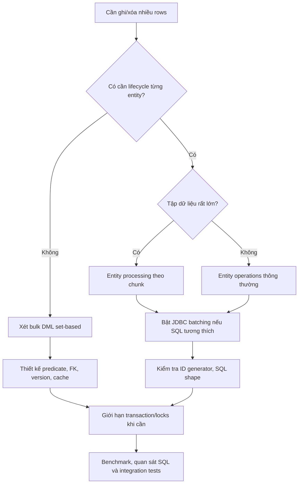

# Phân biệt JDBC batching, bulk DML và xử lý từng thực thể theo lô

Trong ứng dụng Java dùng Hibernate ORM, yêu cầu “ghi hàng loạt” thường xuất hiện khi phải thêm hàng chục nghìn sự kiện, cập nhật trạng thái nhiều đơn hàng, xóa dữ liệu hết hạn hoặc đồng bộ dữ liệu từ hệ thống khác. Vấn đề là cụm từ **batch processing** có thể chỉ ba kỹ thuật khác nhau:

1. **JDBC batching:** gom nhiều lần thực thi câu SQL có hình dạng giống nhau thành các nhóm ở tầng JDBC, giảm số lượt trao đổi với database.
2. **Bulk DML:** gửi một lệnh `UPDATE`/`DELETE` set-based (hoặc một bulk insert theo khả năng Hibernate/SQL) để database tự xử lý nhiều rows.
3. **Xử lý từng thực thể theo lô (chunked entity processing):** tải hoặc tạo một nhóm nhỏ entity, áp dụng lifecycle của ORM cho từng entity, sau đó `flush()`/`clear()` và tiếp tục nhóm tiếp theo.

Cả ba đều có thể xử lý nhiều bản ghi, nhưng **không đồng nghĩa và không thay thế nhau một cách vô điều kiện**. JDBC batching và chunk processing còn có thể dùng **cùng lúc**: mỗi entity vẫn đi qua lifecycle Hibernate, trong khi các SQL `INSERT`/`UPDATE`/`DELETE` được gửi qua JDBC theo batch.

Chọn sai kỹ thuật có thể dẫn tới:

- Mất cơ hội tối ưu vì chỉ gọi `saveAll()` mà không có JDBC batch.
- Tiêu tốn nhiều RAM vì nạp 500.000 managed entities trong một persistence context.
- Bỏ qua `@PreUpdate`, `@PreRemove`, cascade hoặc auditing khi chuyển sang bulk DML.
- Đọc state cũ vì bulk query không đồng bộ first-level cache.
- Không phát hiện optimistic locking conflict như kỳ vọng.
- Khóa nhiều rows quá lâu trong một transaction, gây deadlock hoặc replication lag.
- Bỏ sót rows khi dùng offset pagination trên tập dữ liệu đang bị sửa/xóa.

Bài học đặt ba kỹ thuật cạnh nhau, giải thích luồng SQL, cấu hình Hibernate, ranh giới transaction, xử lý lỗi và cách chọn theo ngữ nghĩa nghiệp vụ.

## 1. Cùng một bài toán, ba cách tư duy

Giả sử hệ thống lưu `ActivityLog`. Mỗi log có thời gian tạo và cờ đã lưu trữ:

```java
@Entity
@Table(name = "activity_logs")
public class ActivityLog {

    @Id
    @GeneratedValue(strategy = GenerationType.SEQUENCE)
    private Long id;

    @Column(nullable = false)
    private Instant createdAt;

    @Column(nullable = false)
    private boolean archived;

    @Version
    private long version;

    protected ActivityLog() {}

    public ActivityLog(Instant createdAt) {
        this.createdAt = createdAt;
        this.archived = false;
    }

    public Long getId() {
        return id;
    }

    public boolean isArchived() {
        return archived;
    }

    public void archive() {
        if (!archived) {
            archived = true;
        }
    }
}
```

Nhiệm vụ: đánh dấu 100.000 log trước `cutoff` là archived.

### Cách A: entity-by-entity

```java
List<ActivityLog> logs = entityManager.createQuery("""
    select l from ActivityLog l
    where l.createdAt < :cutoff
      and l.archived = false
    """, ActivityLog.class)
    .setParameter("cutoff", cutoff)
    .getResultList();

for (ActivityLog log : logs) {
    log.archive();
}
```

Hibernate theo dõi từng managed entity và tạo `UPDATE` khi flush. Với 100.000 entities được giữ cùng lúc, bộ nhớ và dirty checking có thể rất tốn kém.

### Cách B: bulk JPQL UPDATE

```java
int affected = entityManager.createQuery("""
    update ActivityLog l
    set l.archived = true
    where l.createdAt < :cutoff
      and l.archived = false
    """)
    .setParameter("cutoff", cutoff)
    .executeUpdate();
```

Database xử lý một tập rows theo predicate. Không có 100.000 Java entities được hydrate hoặc gọi `archive()`.

### Cách C: entity-by-entity theo chunk, có thể kèm JDBC batch

```text
Tải 200 entity -> gọi archive() từng entity
   -> flush (Hibernate phát UPDATEs)
   -> clear (giải phóng managed state)
   -> tải 200 entity tiếp theo
   -> ...
```

Ở cách C, **chunking** giới hạn bộ nhớ và số entity managed đồng thời. Nếu `hibernate.jdbc.batch_size` được bật và các câu SQL tương thích, Hibernate có thể dùng **JDBC batching** ngay trong bước flush của mỗi chunk.

Điều này chứng minh: **chunk processing và JDBC batching là hai trục độc lập**, không phải hai tên cho cùng một thao tác.

## 2. Bảng so sánh nhanh

| Tiêu chí | JDBC batching qua ORM | Bulk JPQL/HQL/SQL | Entity processing theo chunk |
|---|---|---|---|
| Đơn vị tư duy | Nhiều lần thực thi SQL có cùng shape | Một mutation set-based | Một số lượng entity giới hạn mỗi lượt |
| Có hydrate entity? | Tùy thao tác, thường có với update/delete | Không cần | Có nếu xử lý entities đã tồn tại |
| Có persistence context? | Có khi dùng Hibernate stateful Session | Query chạy trong context nhưng bỏ qua state từng entity | Có, được xả bằng flush/clear |
| Entity callbacks/listeners | Có theo lifecycle | Không gọi từng entity | Có theo lifecycle |
| Cascade ORM | Có theo mapping | Không tự chạy | Có theo mapping |
| Optimistic `@Version` | Theo entity operations | Không tự kiểm tra/tăng version | Theo entity operations |
| Số SQL logic | Nhiều executions, gửi theo batch | Ít statement set-based hơn | Nhiều executions; có thể batched |
| RAM Hibernate | Phụ thuộc số entity đang managed | Thường thấp | Giới hạn theo chunk |
| SQL predicate | Thường theo ID và version | Theo điều kiện tập dữ liệu | SELECT theo điều kiện, UPDATE/DELETE theo entity |
| Ưu điểm mạnh | Giảm round trips, giữ lifecycle | Set-based throughput | Giới hạn RAM, giữ lifecycle |
| Rủi ro lớn | Không batch được do SQL shape/generator | Bỏ lifecycle, stale context | Nhiều SELECT, transaction dài/skip rows |

**Không có lựa chọn luôn thắng.** Phải xác định thao tác cần giữ những semantics nào rồi mới tối ưu throughput.

## 3. JDBC batching thực chất là gì?

JDBC cung cấp khả năng thêm nhiều lần thực thi statement vào batch:

```java
try (PreparedStatement statement = connection.prepareStatement(
        "update activity_logs set archived = ? where id = ?")) {

    for (Long id : ids) {
        statement.setBoolean(1, true);
        statement.setLong(2, id);
        statement.addBatch();
    }

    int[] updateCounts = statement.executeBatch();
}
```

Mỗi lần `addBatch()` lưu một bộ bind values cho **cùng SQL statement**. `executeBatch()` yêu cầu driver thực thi các phần tử đó theo batch.

Ở mức khái niệm:

```text
Không batch:
  send UPDATE(id=1)  -> database
  send UPDATE(id=2)  -> database
  send UPDATE(id=3)  -> database

Có batch:
  prepare UPDATE
  addBatch(id=1)
  addBatch(id=2)
  addBatch(id=3)
  executeBatch()    -> driver/database
```

JDBC batching **không tự biến ba UPDATE thành một SQL UPDATE có WHERE IN**. Driver có thể tối ưu cách gửi hoặc rewrite thành multi-row syntax trong một số trường hợp, nhưng đó là khả năng riêng của driver/DBMS, không phải đảm bảo chung của JDBC API.

### Hai lợi ích chính

- Giảm overhead gọi JDBC/round trips khi nhiều executions tương thích.
- Tái sử dụng prepared statement và kế hoạch thực thi trong điều kiện phù hợp.

### Những gì JDBC batching không thay đổi

- Mỗi row vẫn được tác động theo SQL predicate riêng của mỗi execution.
- SQL constraint và optimistic-lock row count vẫn có vai trò.
- ORM lifecycle không biến mất chỉ vì JDBC batch được bật.
- Một batch không phải tự động là một transaction. Transaction có thể chứa nhiều batches hoặc một batch có thể chạy trong transaction của caller.

## 4. Cấu hình JDBC batching trong Hibernate

Một cấu hình thông dụng:

```properties
hibernate.jdbc.batch_size=50
hibernate.order_inserts=true
hibernate.order_updates=true
```

Trong ứng dụng Spring Boot, Hibernate properties thường được truyền qua namespace:

```properties
spring.jpa.properties.hibernate.jdbc.batch_size=50
spring.jpa.properties.hibernate.order_inserts=true
spring.jpa.properties.hibernate.order_updates=true
```

Ý nghĩa:

- `hibernate.jdbc.batch_size`: kích thước batch JDBC mục tiêu cho các statement tương thích.
- `hibernate.order_inserts`: cho phép Hibernate sắp xếp insert actions thuận lợi hơn cho batching.
- `hibernate.order_updates`: sắp xếp update actions thuận lợi cho batching, có thể ảnh hưởng lock ordering.
- Driver, generator, SQL shape, transaction và mapping vẫn quyết định batch thực tế.

Các cấu hình này không làm mọi câu SQL được batch. Cần kiểm tra API/property còn được hỗ trợ ở đúng Hibernate version đang dùng.

### Đặt batch size theo Session

Trong các Hibernate versions hỗ trợ, có thể điều chỉnh tại Session:

```java
Session session = entityManager.unwrap(Session.class);
session.setJdbcBatchSize(100);
```

Điều này hữu ích với một batch job có workload khác request thông thường, nhưng cần cân nhắc Session scope và bảo đảm cấu hình không tác động ngoài phạm vi mong muốn.

### Chọn kích thước bao nhiêu?

`20`, `50` hoặc `100` thường là điểm thử nghiệm, **không phải con số tối ưu phổ quát**. Batch quá nhỏ ít giảm round trips; quá lớn có thể tăng memory, payload, lock duration hoặc phức tạp hóa lỗi. Benchmark trên driver/DBMS thực, đo throughput và latency P95/P99.

## 5. Ví dụ persist nhiều entity với Hibernate JDBC batch

```java
@Transactional
public void importLogs(
        EntityManager entityManager,
        List<Instant> timestamps) {

    final int chunkSize = 50;

    for (int i = 0; i < timestamps.size(); i++) {
        entityManager.persist(new ActivityLog(timestamps.get(i)));

        if ((i + 1) % chunkSize == 0) {
            entityManager.flush();
            entityManager.clear();
        }
    }

    entityManager.flush();
    entityManager.clear();
}
```

Đây là một **luồng có cả entity chunking và khả năng JDBC batching**:

1. `persist` đăng ký entity mới trong persistence context.
2. Hibernate chuẩn bị entity insert actions, ID generation và callback lifecycle.
3. Mỗi 50 phần tử, `flush` gửi pending SQL.
4. Nếu các INSERT tương thích, JDBC có thể batch chúng.
5. `clear` detach entities, không để persistence context phình ra theo tổng số dòng.
6. Transaction bao ngoài vẫn chỉ commit khi service hoàn thành.

**Không gọi `clear()` trước `flush()`** vì pending inserts/updates có thể chưa được gửi; clear có thể làm mất thay đổi chưa flush.

### Sự khác nhau giữa flush và commit

`flush()` gửi SQL tới database trong transaction. `commit()` xác nhận transaction.

```text
persist 50
 -> flush: SQL đã được thực thi trong transaction
persist 50 tiếp
 -> flush: SQL tiếp tục được thực thi
 -> commit: xác nhận tất cả
```

Nếu transaction rollback sau lần flush thứ mười, các inserts đã flush vẫn có thể bị rollback. Flush không phải checkpoint bền vững.

## 6. Khi nào INSERT không batch được: IDENTITY

Một giới hạn quan trọng của Hibernate ORM là chiến lược sinh khóa chính.

```java
@Id
@GeneratedValue(strategy = GenerationType.IDENTITY)
private Long id;
```

Với `IDENTITY`, database thường sinh ID ngay khi INSERT chạy. Hibernate cần lấy ID đó để quản lý persistent identity. Trong đường ORM INSERT thông thường, Hibernate **có thể phải thực thi INSERT ngay** và không áp dụng JDBC insert batching cho các entity dùng identity generation; Hibernate documentation nêu rõ giới hạn batching inserts này trong nhiều phiên bản.

Đổi sang sequence-based generation ở DBMS hỗ trợ có thể giúp batching:

```java
@Id
@GeneratedValue(
    strategy = GenerationType.SEQUENCE,
    generator = "activity_log_seq"
)
@SequenceGenerator(
    name = "activity_log_seq",
    sequenceName = "activity_log_seq",
    allocationSize = 50
)
private Long id;
```

Một sequence allocator có thể cấp trước nhiều identifiers, cho phép Hibernate xếp nhiều INSERT trong action queue và JDBC batch.

**Cần đồng bộ cấu hình sequence trong database và allocation/optimizer của Hibernate.** Không đổi `IDENTITY` sang `SEQUENCE` chỉ bằng annotation mà không migration/test schema thực.

### MySQL thì sao?

MySQL chủ yếu dùng auto-increment cho ID. Nếu không có sequence generator phù hợp với schema, bạn vẫn có thể tối ưu các đường bulk SQL hoặc JDBC ngoài ORM, nhưng không nên giả định `@GeneratedValue(SEQUENCE)` hoạt động chỉ vì Hibernate có annotation đó.

## 7. SQL shape quyết định việc nhóm batch

Giả sử có hai entity types:

```text
ActivityLog -> INSERT activity_logs (...)
AuditEntry  -> INSERT audit_entries (...)
```

Nếu code xen kẽ:

```java
persist(log1);
persist(audit1);
persist(log2);
persist(audit2);
```

Hibernate có thể thấy chuỗi SQL shapes xen kẽ. Batch JDBC thường chỉ nhóm các executions có cùng statement shape và execution context. `hibernate.order_inserts=true` có thể giúp nhóm insert actions theo entity type, cải thiện batching.

Tương tự, `@DynamicUpdate` có thể khiến các entity cùng type tạo UPDATE SQL khác nhau theo những field thay đổi:

```text
UPDATE accounts SET name=? WHERE id=?
UPDATE accounts SET status=? WHERE id=?
UPDATE accounts SET name=?, status=? WHERE id=?
```

Các statements khác shape không được gộp vào cùng một prepared-statement batch đơn giản. Dynamic SQL tiết kiệm cập nhật cột không cần thiết, nhưng có thể giảm cơ hội batch. Cần cân bằng giữa số cột ghi, SQL plan reuse và batch throughput.

### Batch không bao giờ chỉ do một property quyết định

Ngay cả khi `batch_size=50`:

- ID generation có thể cản insert batching.
- SQL shapes khác nhau làm batch bị chia.
- Flush xảy ra quá thường xuyên làm batch quá nhỏ.
- Driver/connection có thể không hỗ trợ tối ưu kỳ vọng.
- Generated values/version handling có thể cần SQL bổ sung.
- Cấu hình order actions có thể thay đổi thứ tự thực thi so với thứ tự gọi Java.

## 8. JDBC batching và optimistic locking

Entity có `@Version`:

```java
@Entity
public class Account {

    @Id
    private Long id;

    @Version
    private long version;

    private BigDecimal balance;

    public void credit(BigDecimal amount) {
        this.balance = balance.add(amount);
    }
}
```

Hibernate thường dùng SQL dạng:

```sql
update accounts
set balance = ?, version = ?
where id = ? and version = ?;
```

Khi một managed entity được update, Hibernate biết version cũ và có thể kiểm tra affected-row count để phát hiện xung đột. JDBC batching **không có nghĩa Hibernate bỏ optimistic locking**. Tuy nhiên, cách driver trả update counts trong batch và cách Hibernate xác minh chúng phụ thuộc JDBC driver/provider/version.

Một driver có thể trả `Statement.SUCCESS_NO_INFO` cho một phần kết quả, khiến thông tin row count kém chi tiết hơn. Vì vậy cần kiểm thử xung đột `@Version` khi bật batching trên DBMS thực, đặc biệt ở các transaction đồng thời.

### Không đánh đồng với bulk update

Bulk JPQL UPDATE không đi qua optimistic checking tự động cho từng managed entity; vấn đề này được phân tích ở phần bulk DML bên dưới.

## 9. Batch errors: có thể thất bại sau khi đã gửi nhiều executions

Với JDBC:

```java
int[] counts = statement.executeBatch();
```

Nếu một statement vi phạm constraint, driver có thể ném `BatchUpdateException`. Tùy driver và cấu hình, những statement trước lỗi có thể đã chạy, các phần tử sau có thể chưa chạy hoặc có thể được tiếp tục xử lý.

Đừng giả định batch execution là atomic chỉ vì có `executeBatch()`.

**Atomicity chủ yếu do transaction quyết định.** Nếu cùng transaction và database hỗ trợ rollback, caller nên rollback khi lỗi không thể phục hồi. Cần xử lý exception translation do Hibernate/Spring thực hiện; tránh nuốt exception rồi commit một trạng thái không mong muốn.

### Làm sao tìm row lỗi?

- Ghi correlation ID/import batch ID.
- Ghi index/chunk number và IDs không nhạy cảm.
- Đọc nested SQLState/vendor error code.
- Nếu JDBC driver cung cấp update counts, diễn giải theo tài liệu driver.
- Có thể chia batch nhỏ hơn để cô lập lỗi, nhưng không tự động retry những dữ liệu vi phạm constraint.
- Với import cần partial success, thiết kế validation/staging table thay vì phụ thuộc vào hành vi continuation mơ hồ của driver.

## 10. Ba nghĩa khác nhau của từ “batch” trong Hibernate

Rất dễ nhầm các cấu hình:

| Thuật ngữ/cấu hình | Mục đích | Có làm bulk SQL mutation không? |
|---|---|---|
| `hibernate.jdbc.batch_size` | Gom DML executions tại tầng JDBC | Không, vẫn có nhiều executions |
| `@BatchSize` / `hibernate.default_batch_fetch_size` | Batch fetching khi tải lazy entities/collections | Không, đây là tối ưu SELECT |
| `hibernate.jdbc.fetch_size` / `setFetchSize` | Hint số rows driver fetch mỗi đợt từ ResultSet | Không, liên quan đọc dữ liệu |
| Chunk size `200` trong vòng lặp | Giới hạn số entity xử lý mỗi lượt | Không tự làm JDBC batch |
| JPQL bulk `update/delete` | Một DML theo predicate tập rows | Có, theo nghĩa set-based mutation |

Đọc tên `batch_size` mà không biết nó thuộc write batching hay fetch batching có thể dẫn đến cấu hình sai.

**Batch fetching** giải quyết N+1 SELECT ở association, không phải giảm round trips cho INSERT/UPDATE/DELETE. **Fetch size** là hint cho driver khi đọc ResultSet, không tự tạo DML batch.

## 11. Bulk DML là gì?

Bulk DML tác động tới **tập rows theo predicate** thay vì yêu cầu Java tải và thay đổi từng entity.

Ví dụ JPQL UPDATE:

```java
int affected = entityManager.createQuery("""
    update ActivityLog l
    set l.archived = true
    where l.createdAt < :cutoff
      and l.archived = false
    """)
    .setParameter("cutoff", cutoff)
    .executeUpdate();
```

Hibernate có thể dịch thành SQL dạng:

```sql
update activity_logs
set archived = true
where created_at < ?
  and archived = false;
```

Database tối ưu một lệnh DML trên nhiều rows. Java không cần hydrate từng ActivityLog.

### Bulk DELETE

```java
int deleted = entityManager.createQuery("""
    delete from ActivityLog l
    where l.createdAt < :cutoff
    """)
    .setParameter("cutoff", cutoff)
    .executeUpdate();
```

### Bulk INSERT

JPA portable JPQL chủ yếu có bulk UPDATE và DELETE. Hibernate HQL có các khả năng bulk INSERT như `insert into ... select ...` theo version và mapping; native SQL cũng hỗ trợ `INSERT ... SELECT` hoặc DB-specific multi-row insert. Không coi bulk INSERT HQL là khả năng portable giữa mọi JPA provider.

Đối với nhập dữ liệu từ file, DB-native bulk loaders/staging tables có thể vượt xa entity-by-entity inserts nếu không cần lifecycle ORM.

## 12. Bulk DML không phải nhiều lần gọi JDBC batch

Hãy so sánh SQL khái niệm:

**JDBC batching:**

```sql
update activity_logs
set archived = ?, version = ?
where id = ? and version = ?;

-- Cùng SQL shape, chạy lặp nhiều bộ bind values trong JDBC batch.
```

**Bulk JPQL UPDATE:**

```sql
update activity_logs
set archived = true
where created_at < ?
  and archived = false;
```

Bulk DML có thể xử lý hàng trăm nghìn rows trong một statement. JDBC batch có thể gửi hàng trăm hoặc hàng nghìn executions theo ID. Cả hai đều được database thực thi, nhưng **đơn vị thao tác và nghĩa của dữ liệu khác nhau**.

### Bulk DML có luôn chỉ là một câu SQL không?

Không. Nếu entity được ánh xạ qua nhiều physical tables hoặc inheritance strategies như `JOINED`, Hibernate có thể cần temporary ID tables, CTE hoặc nhiều SQL statements để bảo đảm xóa/update đúng mapping. Đây vẫn là bulk DML theo entity-level semantics, không phải vòng lặp `remove()`.

Số entity bị ảnh hưởng mà `executeUpdate()` trả về không nhất thiết bằng tổng physical rows ở mọi bảng.

## 13. Bulk DML bỏ qua vòng đời từng entity

Xét:

```java
@Entity
public class PurchaseOrder {

    @Id
    private Long id;

    private OrderStatus status;

    @PreUpdate
    void beforeUpdate() {
        // Audit hoặc invariant phụ thuộc lifecycle.
    }

    @PreRemove
    void beforeRemove() {
        // Audit hoặc side effect theo entity.
    }
}
```

Khi tải entity rồi sửa field, Hibernate có thể gọi callbacks phù hợp lúc flush. Khi dùng bulk JPQL:

```java
entityManager.createQuery("""
    update PurchaseOrder o
    set o.status = :status
    where o.createdAt < :cutoff
    """)
    .setParameter("status", OrderStatus.EXPIRED)
    .setParameter("cutoff", cutoff)
    .executeUpdate();
```

Hibernate **không gọi `@PreUpdate` cho từng row**. Tương tự, bulk DELETE không gọi `@PreRemove` từng entity và không tự thực thi JPA `CascadeType.REMOVE` hoặc `orphanRemoval`.

| Tính năng | Entity update/delete (có thể JDBC batched) | Bulk DML |
|---|---|---|
| `@PreUpdate` / `@PreRemove` | Có theo lifecycle | Không cho từng row |
| Entity listeners | Có theo lifecycle | Không cho từng row |
| Cascade `REMOVE` | Có khi gọi remove và mapping cho phép | Không tự áp dụng |
| `orphanRemoval` | Có khi relationship changes phù hợp | Không tự áp dụng |
| Hibernate dirty checking | Có | Không theo từng entity |
| Entity-specific validation trong method | Có nếu code gọi method | Không |
| Trigger database | Có nếu SQL tương ứng chạy | Có nếu SQL tương ứng chạy |
| FK `ON DELETE CASCADE` | Theo schema khi DELETE xảy ra | Theo schema khi DELETE xảy ra |

### Đừng nhầm cascade ORM với cascade database

`CascadeType.REMOVE` diễn ra trong entity lifecycle. Foreign key `ON DELETE CASCADE` diễn ra tại DBMS và vẫn có thể chạy với bulk DELETE. Nhưng database cascade **không gọi** entity callbacks của Hibernate.

Nếu nghiệp vụ cần callback/audit/outbox theo từng entity, cân nhắc xử lý entity theo chunk hoặc thiết kế audit set-based/DB trigger tương đương đã được kiểm thử.

## 14. Bulk UPDATE bỏ qua optimistic locking tự động

Entity có version:

```java
@Version
private long version;
```

Đường entity update thường có predicate:

```sql
update activity_logs
set archived = ?, version = ?
where id = ? and version = ?;
```

Bulk JPQL:

```java
int updated = entityManager.createQuery("""
    update ActivityLog l
    set l.archived = true
    where l.createdAt < :cutoff
    """)
    .setParameter("cutoff", cutoff)
    .executeUpdate();
```

không tự kiểm tra version cũ của từng managed entity, cũng không tự increment version theo lifecycle như khi dirty checking.

### Có thể tự tăng version trong bulk query?

Với entity có version số, có thể thiết kế bulk query chủ động:

```java
int updated = entityManager.createQuery("""
    update ActivityLog l
    set l.archived = true,
        l.version = l.version + 1
    where l.createdAt < :cutoff
      and l.archived = false
    """)
    .setParameter("cutoff", cutoff)
    .executeUpdate();
```

Đây là một chính sách concurrency do ứng dụng viết, không phải Hibernate tự kiểm tra từng expected version. Trong Hibernate HQL còn có khả năng `update versioned` theo version/provider constraints; không dùng như cú pháp JPQL portable.

Nếu cần optimistic compare-and-swap cho một row:

```java
int changed = entityManager.createQuery("""
    update ActivityLog l
    set l.archived = true,
        l.version = l.version + 1
    where l.id = :id
      and l.version = :expectedVersion
    """)
    .setParameter("id", id)
    .setParameter("expectedVersion", version)
    .executeUpdate();

if (changed != 1) {
    throw new OptimisticLockException(
        "Entity đã bị thay đổi hoặc không tồn tại"
    );
}
```

Nếu phải kiểm tra version riêng từng entity, entity-by-entity có thể đơn giản và an toàn hơn một bulk statement phức tạp.

## 15. Bulk DML không đồng bộ persistence context

Ví dụ:

```java
ActivityLog log = entityManager.find(ActivityLog.class, id);
boolean before = log.isArchived();

entityManager.createQuery("""
    update ActivityLog l
    set l.archived = true
    where l.id = :id
    """)
    .setParameter("id", id)
    .executeUpdate();

boolean after = log.isArchived();
```

`after` **có thể vẫn là giá trị cũ**, vì `log` là object managed đã load trước khi bulk query chạy. Hibernate không tự đổi field của mọi entity đang trong first-level cache khi bulk DML cập nhật database.

Tương tự, bulk DELETE có thể làm row biến mất nhưng object vẫn còn managed.

### Hướng xử lý

- `entityManager.refresh(entity)` nếu cần đồng bộ một entity cụ thể.
- `entityManager.clear()` để detach toàn bộ managed entities rồi load lại khi cần.
- Tách bulk operation vào transaction/persistence context riêng.
- Tránh dùng các managed objects bị ảnh hưởng sau bulk query.

### Pattern flush trước, clear sau

```java
entityManager.flush();

int affected = entityManager.createQuery("""
    update ActivityLog l
    set l.archived = true
    where l.createdAt < :cutoff
    """)
    .setParameter("cutoff", cutoff)
    .executeUpdate();

entityManager.clear();
```

`flush()` đồng bộ pending entity changes cần thiết trước bulk query. `clear()` ngăn tiếp tục dùng state cũ trong persistence context, nhưng nó **detach tất cả entities**, không chỉ ActivityLog. Nếu có pending changes chưa flush, clear có thể làm mất những thay đổi đó.

`clear()` không có nghĩa L2 cache đã được evict; cần xem cache invalidation của đường HQL/native SQL đang dùng.

## 16. Bulk DELETE và foreign key

Giả sử:

```sql
create table customers (
    id bigint primary key
);

create table purchase_orders (
    id bigint primary key,
    customer_id bigint not null,
    foreign key (customer_id) references customers(id)
);
```

Bulk DELETE customers:

```java
entityManager.createQuery("""
    delete from Customer c
    where c.inactive = true
    """).executeUpdate();
```

có thể bị database từ chối vì PurchaseOrder còn tham chiếu customer. `CascadeType.REMOVE` trong mapping Customer không được chạy vì bulk query không tải và remove từng entity.

Hướng xử lý:

- Xóa child rows trước parent bằng bulk DML có điều kiện đúng.
- Dùng FK `ON DELETE CASCADE` nếu domain cho phép.
- Nếu cần entity callbacks/cascade logic, xóa từng managed parent theo chunk.

Đừng bỏ FK chỉ để bulk DELETE chạy. Constraint là bảo vệ dữ liệu ở database; hãy thiết kế thứ tự và ngữ nghĩa xóa phù hợp.

## 17. Xử lý từng thực thể theo lô (chunking) là gì?

Chunking là chiến lược **chia tổng workload thành từng nhóm nhỏ**, không bắt buộc thay đổi API ORM.

```text
100.000 entity
  |
  +-- chunk 1: 200
  |      -> load/process/flush/clear
  +-- chunk 2: 200
  |      -> load/process/flush/clear
  +-- ...
  +-- chunk 500: 200
         -> load/process/flush/clear
```

Mục tiêu:

- Không giữ hàng trăm nghìn managed entities cùng lúc.
- Giới hạn memory của persistence context, snapshots và collections.
- Đặt điểm `flush` rõ ràng.
- Có thể kiểm soát transaction theo từng chunk nếu nghiệp vụ cho phép.
- Vẫn giữ lifecycle, callbacks, cascade, validation và version semantics của ORM.

Chunking **không tự giảm số SQL executions**. Để giảm round trips, có thể bật JDBC batching song song.

### Chunk size khác JDBC batch size

Có thể chọn:

```text
chunkSize = 500 entities
jdbc.batch_size = 50 statements
```

Mỗi chunk có thể tạo nhiều JDBC batches; số thực tế phụ thuộc SQL shapes, entity actions và cascade. Không cần buộc hai con số bằng nhau.

## 18. Tại sao không tải toàn bộ trước khi cập nhật?

```java
List<ActivityLog> logs = entityManager.createQuery("""
    select l from ActivityLog l
    where l.archived = false
    """, ActivityLog.class)
    .getResultList();

for (ActivityLog log : logs) {
    log.archive();
}
```

Với 500.000 rows, Hibernate cần quản lý một số lượng lớn Java objects và persistent snapshots. Ngay cả khi JDBC batching được bật, action queue và persistence context vẫn có thể rất lớn cho tới khi flush/clear.

Rủi ro:

- Heap pressure, garbage collection kéo dài.
- `OutOfMemoryError`.
- Dirty checking mất thời gian.
- Transaction giữ locks lâu nếu thực thi một lần cuối.
- Khó checkpoint/retry.

Chunking giải quyết vấn đề RAM, còn chia transaction theo chunk giải quyết thêm lock duration/partial failure, nhưng làm thay đổi atomicity.

## 19. Chunking bằng keyset pagination

Khi cập nhật hoặc xóa dần tập dữ liệu, **tránh offset pagination** trên tập kết quả đang thay đổi. Dùng khóa sắp xếp ổn định, ví dụ ID tăng dần.

Một mẫu chunk processing:

```java
@Transactional
public void archiveOldLogs(Instant cutoff) {
    Long lastId = 0L;
    final int chunkSize = 200;

    while (true) {
        List<ActivityLog> chunk = entityManager.createQuery("""
            select l
            from ActivityLog l
            where l.id > :lastId
              and l.createdAt < :cutoff
              and l.archived = false
            order by l.id
            """, ActivityLog.class)
            .setParameter("lastId", lastId)
            .setParameter("cutoff", cutoff)
            .setMaxResults(chunkSize)
            .getResultList();

        if (chunk.isEmpty()) {
            break;
        }

        for (ActivityLog log : chunk) {
            log.archive();
        }

        lastId = chunk.get(chunk.size() - 1).getId();

        entityManager.flush();
        entityManager.clear();
    }
}
```

Đặc điểm:

- Mỗi lần chỉ load tối đa `chunkSize` entities.
- ID cursor tăng, tránh bỏ qua hàng do predicate `archived=false` thay đổi sau flush.
- Entity method `archive()` vẫn chạy và Hibernate thực hiện dirty checking.
- JDBC batching có thể gom UPDATEs theo SQL shape.
- Transaction toàn method vẫn là một transaction nếu `@Transactional` được áp dụng thực sự.

Ví dụ giả định IDs dương và thứ tự ID ổn định. Với key kiểu UUID, khóa tổng hợp hoặc ID có thể âm, cần điều chỉnh cursor/so sánh và giá trị khởi đầu. Nếu có concurrent insert/update, keyset đơn giản chưa bảo đảm snapshot bất biến; phải xác định cutoff và isolation phù hợp.

## 20. Lỗi offset pagination khi thay đổi tập dữ liệu

Ví dụ dữ liệu ban đầu có IDs 1–10, tất cả `archived=false`. Mỗi chunk lấy 3 rows, sau đó archive rồi query lại với offset:

```text
Lần 1: offset 0 -> [1, 2, 3] -> archive
Dữ liệu chưa archive: [4, 5, 6, 7, 8, 9, 10]

Lần 2: offset 3 -> [7, 8, 9]
Bỏ qua: [4, 5, 6]
```

Offset được tính trên **tập kết quả mới**, không còn là tập kết quả trước update.

Lỗi tương tự xảy ra khi xóa rows rồi tiếp tục dùng offset ngày càng tăng. Khắc phục:

- Dùng keyset với ID/cursor tăng ổn định.
- Chọn IDs một lần vào staging table rồi xử lý.
- Dùng cơ chế claim/queue theo DBMS nếu nhiều workers.
- Nếu truy vấn luôn lấy `offset 0`, phải có cơ chế đổi predicate để tiến trình không lặp mãi; concurrency vẫn cần cân nhắc.

## 21. Xóa từng entity theo chunk

Nếu xóa một customer cần cascade `REMOVE` và `@PreRemove`, có thể xử lý theo keyset:

```java
@Transactional
public void removeExpiredCustomers(Instant cutoff) {
    Long lastId = 0L;

    while (true) {
        List<Customer> chunk = entityManager.createQuery("""
            select c
            from Customer c
            where c.id > :lastId
              and c.expiredAt < :cutoff
            order by c.id
            """, Customer.class)
            .setParameter("lastId", lastId)
            .setParameter("cutoff", cutoff)
            .setMaxResults(100)
            .getResultList();

        if (chunk.isEmpty()) {
            break;
        }

        lastId = chunk.get(chunk.size() - 1).getId();

        for (Customer customer : chunk) {
            entityManager.remove(customer);
        }

        entityManager.flush();
        entityManager.clear();
    }
}
```

Hibernate xử lý lifecycle và cascade theo mapping. Nhưng nếu mỗi Customer có 1.000 child entities, một chunk 100 parents vẫn có thể tải/xử lý rất nhiều objects. Chunk size phải được chọn dựa trên **cardinality thực của object graph**, không chỉ số root rows.

Với batch deletes, SQL batching phụ thuộc statement shapes, DB driver, version semantics và action ordering. Chunking bảo vệ RAM tốt hơn nhưng không bảo đảm một batch luôn có đúng 100 DELETEs.

## 22. Dùng `flush()` và `clear()` đúng thứ tự

Trong entity chunk processing:

```java
for (ActivityLog log : chunk) {
    log.archive();
}

entityManager.flush();
entityManager.clear();
```

- `flush` gửi SQL theo pending actions.
- `clear` detach objects và giải phóng state do persistence context giữ.
- Java references còn trong `chunk` vẫn tồn tại tới khi scope kết thúc/GC, nhưng không còn managed sau clear.
- Transaction vẫn mở nếu chưa commit.
- Những entity được detach sau clear không còn tự lưu thay đổi tiếp theo.

### Thứ tự sai

```java
for (ActivityLog log : chunk) {
    log.archive();
}

entityManager.clear(); // Nguy cơ bỏ pending changes chưa flush.
```

Nếu code tiếp tục sửa các entity đã detach và tưởng Hibernate tự flush, dữ liệu có thể không được lưu.

### Ngoài ra, `flush` không luôn rẻ

Flush có thể kích hoạt nhiều INSERT/UPDATE/DELETE và cascade actions. Nếu một chunk lớn, lần flush vẫn có thể nặng. Cần giới hạn cả root count và object graph cardinality.

## 23. Một transaction lớn hay một transaction cho mỗi chunk?

Có hai lựa chọn lớn.

### A. Một transaction cho toàn bộ job

```text
BEGIN
  chunk 1 -> flush/clear
  chunk 2 -> flush/clear
  ...
  chunk N -> flush/clear
COMMIT
```

Ưu điểm:

- Toàn bộ thao tác có tính atomic theo transaction.
- Lỗi ở chunk sau có thể rollback mọi thay đổi trước đó.

Nhược điểm:

- Transaction kéo dài, nhiều lock/log/undo có thể tích lũy.
- Connection bị giữ lâu.
- Replication lag/bloat có thể tăng tùy DBMS.
- Rollback lớn nếu lỗi ở gần cuối.

### B. Một transaction cho mỗi chunk

```text
BEGIN chunk 1 -> COMMIT
BEGIN chunk 2 -> COMMIT
...
BEGIN chunk N -> COMMIT
```

Ưu điểm:

- Giảm thời gian giữ lock.
- Có thể retry/resume từ checkpoint.
- Giới hạn rollback scope và log pressure.

Nhược điểm:

- Không còn atomicity toàn bộ.
- Lỗi giữa chừng để lại partial completion.
- Cần idempotency, checkpoint và monitoring.
- Phải xác định semantics khi dữ liệu thay đổi giữa các chunks.

**`flush()/clear()` không tự tạo transaction mới.** Nếu muốn commit mỗi chunk trong Spring, cần transaction boundary thật sự riêng, ví dụ mỗi chunk được một service khác gọi qua proxy với `REQUIRES_NEW` hoặc dùng `TransactionTemplate`. Self-invocation đến method `@Transactional` trong cùng bean có thể không kích hoạt proxy transaction như mong đợi.

## 24. Tách transaction bằng `TransactionTemplate`

Khung thiết kế cho commit theo chunk:

```java
public void runCleanup(Instant cutoff) {
    Long lastId = 0L;

    while (true) {
        Long cursor = lastId;

        ChunkOutcome result = transactionTemplate.execute(status -> {
            List<ActivityLog> chunk = entityManager.createQuery("""
                select l from ActivityLog l
                where l.id > :cursor
                  and l.createdAt < :cutoff
                  and l.archived = false
                order by l.id
                """, ActivityLog.class)
                .setParameter("cursor", cursor)
                .setParameter("cutoff", cutoff)
                .setMaxResults(200)
                .getResultList();

            if (chunk.isEmpty()) {
                return new ChunkOutcome(0, cursor);
            }

            for (ActivityLog log : chunk) {
                log.archive();
            }

            Long next = chunk.get(chunk.size() - 1).getId();
            entityManager.flush();

            return new ChunkOutcome(chunk.size(), next);
        });

        if (result == null || result.count() == 0) {
            break;
        }
        lastId = result.lastId();
    }
}

record ChunkOutcome(int count, Long lastId) {}
```

Đây là khung minh họa. Nó giả định `TransactionTemplate` được cấu hình, `EntityManager` là proxy gắn với current transaction và mỗi callback có transaction hợp lệ. Không lấy EntityManager application-managed rồi dùng ngoài phạm vi, không thay thế transaction management bằng một vòng lặp tự viết không có commit.

Nếu mỗi chunk commit riêng, hãy lưu checkpoint bền vững và thiết kế idempotent để job có thể chạy tiếp sau lỗi hoặc restart.

## 25. Concurrency: khi nào cần locking hoặc claim rows?

Nếu hai workers cùng chạy cleanup:

```text
Worker A: SELECT IDs 101–200
Worker B: SELECT IDs 101–200
Worker A: UPDATE
Worker B: UPDATE cùng rows
```

Với entity có `@Version`, một worker có thể gặp optimistic locking conflict. Với bulk update predicate có `archived=false`, worker thứ hai có thể ảnh hưởng 0 rows hoặc bị lock, tùy isolation và timing.

Các hướng thiết kế:

- Chỉ cho một job instance chạy tại một thời điểm.
- Dùng partitioning theo key range.
- Dùng claim/state transition atomic.
- Dùng pessimistic locking hoặc DB-specific `SKIP LOCKED` cho queue processing.
- Dùng optimistic version checks, retry có giới hạn.
- Dùng idempotent operation và checkpoint.

`SKIP LOCKED` hữu ích cho queue workers nhưng không phải một lựa chọn portable cho mọi JPQL query/Dialect. Nó có thể bỏ qua rows đang khóa, nên phải thiết kế cơ chế xử lý lại; không dùng khi yêu cầu snapshot đầy đủ và thứ tự tuyệt đối.

## 26. Bulk DML và transaction lớn

Một lệnh:

```sql
delete from activity_logs
where created_at < ?;
```

có thể xóa hàng triệu rows. Dù chỉ một SQL statement, database vẫn phải:

- Tìm rows theo index/scan.
- Duy trì constraints và indexes.
- Ghi WAL/redo/undo theo DBMS.
- Giữ locks và xử lý concurrency.
- Gọi triggers hoặc FK cascades nếu có.
- Phát sinh vacuum/bloat hoặc replication lag tùy engine.

Bulk DML không tự động tránh transaction dài. Với retention data cực lớn, cân nhắc:

- Xóa theo các khoảng ID/thời gian có checkpoint.
- Dùng SQL native để giới hạn rows theo DBMS.
- Dùng staging table cho tập IDs cần xóa.
- Dùng partition drop/detach nếu thiết kế bảng theo thời gian và DBMS hỗ trợ.
- Chọn thời gian chạy và giám sát replication/lock pressure.

Với bulk chunking, mỗi chunk có thể là **một bulk DML nhỏ**, khác với entity-by-entity chunk processing. Hai khái niệm này cũng có thể kết hợp theo nhu cầu.

## 27. Mẫu xóa bằng nhiều bulk DELETE nhỏ

Một chiến lược là lấy một trang IDs rồi xóa bằng một bulk statement:

```java
List<Long> ids = entityManager.createQuery("""
    select l.id
    from ActivityLog l
    where l.createdAt < :cutoff
    order by l.id
    """, Long.class)
    .setParameter("cutoff", cutoff)
    .setMaxResults(500)
    .getResultList();

if (!ids.isEmpty()) {
    int deleted = entityManager.createQuery("""
        delete from ActivityLog l
        where l.id in :ids
        """)
        .setParameter("ids", ids)
        .executeUpdate();

    entityManager.clear();
}
```

Mỗi lượt có thể xóa tối đa số IDs đã chọn mà không hydrate entities. Đây là **bulk DML theo chunk**, không phải xóa từng entity theo lifecycle.

Lưu ý:

- Không dùng offset tăng dần trên tập đang bị xóa.
- SQL `IN` có giới hạn bind parameter của DBMS/driver.
- Nếu con có FK, phải xử lý đúng thứ tự hoặc cascade DB.
- Truy vấn IDs và DELETE có thể gặp race với transaction khác.
- Nếu commit từng lượt, operation không còn atomic toàn bộ.
- Clear nếu có managed objects bị bulk query ảnh hưởng; clear không thay cho xử lý L2/query cache.
- Nếu cần version predicate riêng từng ID, bulk `IN` đơn giản không cung cấp compare-and-swap từng row.

## 28. Spring Data JPA: `saveAll` không tự hứa JDBC batching

Một repository:

```java
public interface ActivityLogRepository
        extends JpaRepository<ActivityLog, Long> {
}
```

Khi gọi:

```java
repository.saveAll(logs);
```

Spring Data thường thực hiện lưu các entity lần lượt qua JPA `persist`/`merge` tùy state. **`saveAll` không phải bằng chứng JDBC batching đã bật hoặc đã hoạt động**.

Cần đồng thời xem:

- `hibernate.jdbc.batch_size`.
- Entity ID generation; `IDENTITY` có thể cản insert batching.
- `save` đi vào `persist` hay `merge`.
- SQL shape và ordering.
- Transaction boundary.
- Flush frequency.
- Driver behavior.

Tương tự, `saveAllAndFlush` yêu cầu flush nhưng không tự đảm bảo một batch tối ưu. Gọi `saveAndFlush` trong vòng lặp từng entity thường làm hỏng cơ hội gom nhiều statements.

### `saveAll` với tập cực lớn

```java
repository.saveAll(halfMillionLogs);
```

có thể khiến persistence context quản lý lượng lớn entities cho tới commit. Chia thành chunks, flush/clear qua EntityManager hoặc transaction boundaries phù hợp sẽ kiểm soát RAM tốt hơn.

## 29. Spring Data JPA bulk methods khác entity delete

Ví dụ:

```java
public interface CustomerRepository
        extends JpaRepository<Customer, Long> {

    @Modifying(
        flushAutomatically = true,
        clearAutomatically = true
    )
    @Query("""
        delete from Customer c
        where c.inactive = true
        """)
    int deleteInactiveInBulk();
}
```

Đây là bulk JPQL DELETE, không đi qua `EntityManager.remove` cho từng customer.

Tương tự, các method `deleteAllInBatch()` hoặc `deleteAllByIdInBatch(ids)` của Spring Data JPA thực hiện bulk operation theo implementation/version. Không coi chúng tương đương với `delete(entity)` hoặc một derived delete method mà repository có thể tải entities rồi remove để bảo toàn callbacks.

### flushAutomatically và clearAutomatically

- `flushAutomatically` yêu cầu flush trước modifying query.
- `clearAutomatically` yêu cầu clear sau modifying query.
- Clear detach toàn bộ persistence context hiện tại; không chỉ entities vừa xóa.
- Cần transaction hợp lệ.
- Không làm bulk DML chạy ORM callbacks/cascade.

Nếu service còn pending changes quan trọng, hiểu rõ side effects của auto-clear trước khi bật.

## 30. StatelessSession: con đường khác với ba kỹ thuật chính

Hibernate có `StatelessSession`, một API đặc thù để thao tác dữ liệu mà không dùng first-level persistence context theo cách của stateful `Session`.

Đặc điểm khái quát:

- Không có automatic dirty checking trên managed entity graph như Session.
- Không có first-level cache theo mô hình stateful.
- Thao tác `insert`/`update`/`delete` có semantics rõ hơn về thực thi trực tiếp.
- Không áp dụng đầy đủ persistence-context lifecycle/cascades như stateful Session.
- Có những giới hạn và khả năng batching khác theo Hibernate version.

`StatelessSession` **không phải bulk JPQL UPDATE** và cũng **không có nghĩa mọi statement tự được JDBC batched**. Nếu cần dùng nó cho import/export khối lượng lớn, kiểm tra đúng Javadocs/version, entity callbacks, collections, generated IDs, batching và transaction semantics.

Không thay `EntityManager` bằng StatelessSession chỉ để tránh gọi `clear()` mà không phân tích mất mát về lifecycle/cascade.

## 31. JDBC trực tiếp là một phương án thứ tư

Nếu cần ghi raw rows và không dùng entity lifecycle, có thể sử dụng JDBC `PreparedStatement.addBatch` hoặc database-native bulk loader. Nó khác với Hibernate ORM JDBC batching ở tầng kiểm soát:

```java
try (PreparedStatement ps = connection.prepareStatement("""
        insert into activity_logs(created_at, archived)
        values (?, ?)
        """)) {

    int count = 0;

    for (Instant time : timestamps) {
        ps.setTimestamp(1, Timestamp.from(time));
        ps.setBoolean(2, false);
        ps.addBatch();

        if (++count % 500 == 0) {
            ps.executeBatch();
        }
    }

    ps.executeBatch();
}
```

Các cột `id` được bỏ khỏi ví dụ vì giả định database có default/identity generator; DDL và generated keys phải được thiết kế chính xác. Với app dùng Hibernate, lấy JDBC connection trong transaction qua `Session.doWork()/doReturningWork()` thay vì mở một connection riêng không liên quan. Không đóng `Connection` do Hibernate quản lý.

JDBC trực tiếp tránh hydrate entities nhưng:

- Không chạy ORM cascade/callback/dirty checking.
- Có thể làm persistence context và L2 cache stale.
- Cần tự quản SQL types, error handling và generated keys.
- Dễ phụ thuộc database schema hơn.

Nó phù hợp khi bạn chủ động muốn bypass ORM, không phải thay thế tương đương `persist`.

## 32. Bulk DML và audit/outbox

Nếu ứng dụng ghi audit trong `@PreUpdate`:

```java
@PreUpdate
void audit() {
    // Ghi audit theo lifecycle.
}
```

thì chuyển sang bulk `update ActivityLog ...` sẽ không gọi callback đó từng row.

Có ba hướng:

1. **Giữ entity-by-entity** (kèm JDBC batch/chunk) nếu callback per entity là yêu cầu bắt buộc.
2. **Ghi audit theo tập bằng SQL** trong cùng transaction, nếu phải xử lý rất nhiều rows.
3. **Dùng database trigger/outbox** có contract rõ ràng nếu muốn bắt mọi write path.

Nếu phát event ra broker, nên dùng transactional outbox khi cần bảo đảm sự kiện chỉ được phát sau commit. Một vòng lặp gọi HTTP/message broker trong `@PreUpdate` không phải transaction side effect có thể rollback cùng database.

Bulk DML có thể nhanh hơn nhưng không thể “tự nhiên” tái tạo mọi domain behavior của entity lifecycle.

## 33. Đo hiệu năng đúng chỗ

Không chỉ nhìn log Hibernate thấy ít dòng SQL rồi kết luận JDBC batch đã hoạt động.

### Với JDBC batching, đo

- Số logical entity mutations.
- Số JDBC batch executions và số operations trong mỗi batch.
- Round trips/network traffic.
- Tổng thời gian flush và commit.
- SQL shapes có được nhóm không.
- Driver-specific rewrite/optimization.
- CPU/memory và số lượng entities managed.

### Với bulk DML, đo

- Affected row count.
- Execution plan, index scan, IO.
- Lock wait, deadlock, rollback/redo/undo/WAL.
- Trigger/FK cascade overhead.
- Transaction duration.
- Query compilation và temp-table/CTE strategy nếu inheritance phức tạp.

### Với chunk processing, đo

- Peak heap và persistence-context size.
- Query cost cho mỗi chunk.
- Thời gian flush/clear.
- Tổng SQL count, N+1 selects do cascade/lazy loading.
- Checkpoint/retry behavior.
- Tỷ lệ conflicts khi chạy nhiều workers.

Hibernate statistics giúp quan sát một phần activity, nhưng prepared-statement count không tự chứng minh số network round trips hoặc chất lượng batching. Dùng JDBC datasource proxy, driver metrics, database monitoring hoặc tracing phù hợp để thấy batch execution thực sự.

## 34. Cấu hình và log minh họa

Một bộ cấu hình test:

```properties
spring.jpa.properties.hibernate.jdbc.batch_size=50
spring.jpa.properties.hibernate.order_inserts=true
spring.jpa.properties.hibernate.order_updates=true

spring.jpa.properties.hibernate.generate_statistics=true
logging.level.org.hibernate.SQL=DEBUG
logging.level.org.hibernate.orm.jdbc.bind=TRACE
```

Tên logger có thể khác giữa Hibernate major versions. `hibernate.generate_statistics` hữu ích khi quan sát flush/entity actions; nó có overhead nên thường chỉ bật trong test/performance investigation.

**Không bật bind-value TRACE vô điều kiện trên production**, vì có thể làm lộ dữ liệu nhạy cảm và tăng lượng log đáng kể.

### Kiểm tra trong integration test

- Tạo 200 entities dùng `SEQUENCE`.
- Cấu hình JDBC batch size 50.
- Persist rồi flush; quan sát số batches thực từ datasource/driver/database.
- Đổi sang `IDENTITY` trong fixture tương thích và so sánh.
- Bật/tắt `order_inserts` để đo tác động khi nhiều entity types.
- Kiểm tra rollback của một batch nếu phần tử cuối vi phạm constraint.
- Kiểm tra optimistic locking conflict khi batch updates.

Đây là kiểm thử hiệu năng/hành vi của dự án, không phải lý do đoán rằng cấu hình chắc chắn có hiệu lực chỉ từ một property.

## 35. Ví dụ benchmark: 100.000 ActivityLog

Giả sử cần archive 100.000 logs; kết quả định tính:

| Cách làm | Java objects cần load | SQL logic | Điểm mạnh | Điểm yếu |
|---|---|---|---|---|
| Load tất cả rồi update | 100.000 | Nhiều UPDATE theo ID | Lifecycle đầy đủ | RAM lớn; flush/dirty checking nặng |
| Load 200/chunk, JDBC batch 50 | ~200 mỗi lượt | Nhiều UPDATE, được nhóm | Lifecycle và bounded RAM | Cần SELECT/chunk; vẫn nhiều mutations |
| Bulk UPDATE một lần | Không cần 100.000 entity | Thường một set-based mutation | Throughput thường cao | Bỏ callback/version checks; locks/stale context |
| Bulk UPDATE theo key ranges | Không cần hydrate | Một DML mỗi range | Giới hạn transaction/log | Partial completion, checkpoint |
| JDBC raw batch INSERT | Không cần entity | Nhiều INSERT executions được batch | Kiểm soát SQL trực tiếp | Không có ORM lifecycle/cascade |

Bảng trên không đưa ra thời gian giả định kiểu “bulk nhanh gấp 100 lần”. Mức tăng phụ thuộc DBMS, indexes, cardinality, triggers, relationship graph, transaction và mạng. Benchmark nên dùng dữ liệu có phân phối tương tự production.

## 36. Khi nào nên chọn JDBC batching?

Chọn JDBC batching khi:

- Bạn cần giữ JPA/Hibernate entity lifecycle.
- Bạn đang insert/update/delete nhiều entities theo ID.
- Mapping/cascade/callback/version semantics phải được bảo toàn.
- SQL shape đủ đồng nhất để tạo batch.
- ID generation cho phép batching, đặc biệt với inserts.
- Có thể cấu hình flush/call size phù hợp.

Ví dụ import domain entities cần validation trong constructor, `@PrePersist` hoặc versioned updates. JDBC batching giảm overhead I/O mà không đổi semantics logic của `persist`/`merge`/`remove`.

**Nhưng JDBC batching không khắc phục sự phình to của persistence context.** Nếu số lượng entities lớn, kết hợp chunking.

## 37. Khi nào nên chọn bulk DML?

Chọn bulk DML khi:

- Quy tắc xử lý có thể mô tả rõ bằng predicate set-based.
- Không cần chạy entity callbacks/cascade/version checks cho từng row, hoặc đã có cơ chế thay thế.
- Bạn muốn tránh hydrate lượng lớn entities.
- Database có thể tối ưu câu SQL theo index/plan.
- Có chiến lược flush/clear/refresh/cache invalidation rõ.
- Transaction/log/lock footprint được kiểm soát.

Ví dụ:

```java
@Transactional
public int archiveBefore(Instant cutoff) {
    entityManager.flush();

    int affected = entityManager.createQuery("""
        update ActivityLog l
        set l.archived = true
        where l.createdAt < :cutoff
          and l.archived = false
        """)
        .setParameter("cutoff", cutoff)
        .executeUpdate();

    entityManager.clear();
    return affected;
}
```

Đây là thao tác phù hợp nếu archive chỉ là thay đổi dữ liệu theo điều kiện, không có callback/event per row bắt buộc. Nếu có versioned concurrent workers, cần xác định chiến lược concurrency.

## 38. Khi nào nên chọn entity chunk processing?

Chọn chunking khi:

- Cần giữ lifecycle của từng entity.
- Số lượng quá lớn để giữ một persistence context.
- Có business method cần gọi trên từng entity.
- Cần audit/cascade/version theo từng row.
- Muốn kiểm soát memory và điểm flush.
- Có thể thiết kế keyset cursor, transaction boundary và retry.

Ví dụ, muốn đóng từng hợp đồng:

```java
for (Contract contract : chunk) {
    contract.closeBecauseExpired(now);
}
entityManager.flush();
entityManager.clear();
```

Business method có thể kiểm tra invariants, tạo domain events/outbox và thay đổi related entities. Bulk UPDATE khó thay thế nếu logic của từng contract phức tạp.

Chunking là kỹ thuật tổ chức workload. Nó không loại trừ `hibernate.jdbc.batch_size`.

## 39. Ma trận quyết định theo yêu cầu nghiệp vụ

| Yêu cầu | Ưu tiên xem xét |
|---|---|
| Insert nhiều entity mới, cần callbacks | Entity persist + JDBC batching + flush/clear theo chunk |
| Update 1 triệu rows bằng một điều kiện đơn giản | Bulk UPDATE, có thể chia transaction nếu lớn |
| Xóa parent cùng child và cần ORM cascade | Entity remove theo chunk, kết hợp batching khi có thể |
| Xóa log hết hạn, không cần callback | Bulk DELETE hoặc partition retention |
| Cần optimistic check từng entity | Entity lifecycle/JDBC batch hoặc conditional DML có version rõ |
| Database có FK `ON DELETE CASCADE` và domain cho phép | Bulk DELETE có thể phù hợp |
| Phải phát audit/outbox cho từng row | Entity chunk hoặc audit set-based cùng transaction |
| Cần tránh OOM khi xử lý 200.000 entities | Chunking + flush/clear |
| Muốn giảm round trips khi giữ ORM semantics | JDBC batching |
| Muốn giảm số physical rows giữ trong transaction lâu | Chia bulk/chunk thành nhiều commits khi cho phép |
| Cần API vendor-specific bulk loader | JDBC/native SQL/staging table với audit rõ |
| Có nhiều entity types và SQL shapes | `order_inserts`/`order_updates`, xem xét grouping |
| Dùng `IDENTITY` khiến insert batching không hiệu quả | Cân nhắc generator/schema hoặc chiến lược import khác |
| Chỉ dùng `saveAll` và thấy chậm | Kiểm tra batching, ID strategy, flush và persistence context |

Nếu cần vừa throughput cao vừa lifecycle đầy đủ, cấu hình **JDBC batching + chunk processing** thường là điểm xuất phát thực dụng.

## 40. Những hiểu lầm hay gặp

### “Gọi saveAll nghĩa là Hibernate batch”

Không. `saveAll` là vòng thao tác repository; batching phụ thuộc Hibernate configuration, ID generation, SQL shape, transaction, driver và flush.

### “JDBC batch là một SQL UPDATE với WHERE IN”

Không. Thông thường đó là nhiều lần thực thi cùng prepared statement được gửi qua JDBC batch. Driver có thể rewrite nhưng không được bảo đảm.

### “Bulk DML là Hibernate chạy remove từng entity nhanh hơn”

Không. Bulk JPQL/SQL bypass lifecycle của từng managed entity: callback/cascade/optimistic version tự động không chạy như entity operations.

### “Bật batch size là đủ, không cần clear”

Không. Persistence context vẫn có thể giữ hàng trăm nghìn managed objects. Chunk flush/clear giúp giới hạn memory.

### “Flush làm commit chunk”

Không. Flush gửi SQL; commit xác nhận transaction. `@Transactional` bao toàn method vẫn là một transaction.

### “Bulk UPDATE tự tăng @Version”

Không. Bulk mutation không tự áp dụng optimistic version semantics như entity dirty checking; thiết kế version predicate/increment nếu cần.

### “Bulk DELETE vẫn chạy CascadeType.REMOVE”

Không. Cascade ORM chỉ chạy trên entity operations; FK `ON DELETE CASCADE` là cơ chế database khác.

### “Bật @DynamicUpdate luôn làm update nhanh hơn”

Không nhất thiết. Nó có thể giảm số cột UPDATE nhưng tạo nhiều SQL shapes, giảm cơ hội JDBC batching.

### “@BatchSize làm insert nhanh hơn”

Không. `@BatchSize` là tối ưu batch fetching khi load associations/entities.

### “Pagination offset luôn phù hợp cho batch job”

Không khi tập dữ liệu đang được cập nhật/xóa, vì offset trên tập kết quả mới có thể bỏ sót rows.

### “Một câu bulk DELETE chắc chắn không có rủi ro lock”

Không. Một DML xóa hàng triệu rows có thể giữ locks/log/undo lớn, làm chậm replication hoặc gây bloat.

### “StatelessSession là bulk SQL”

Không. StatelessSession là một session model khác; nó không đồng nghĩa với `update Entity set ... where ...`.

## 41. Quy trình lựa chọn kỹ thuật



Checklist trước triển khai:

1. Quy tắc nghiệp vụ có phụ thuộc từng entity callback/cascade không?
2. Có yêu cầu optimistic locking theo version cũ không?
3. Có bao nhiêu entities, kích thước object graph và peak RAM?
4. Cấu hình JDBC batch size có hiệu lực không?
5. ID generator là IDENTITY hay SEQUENCE/khác?
6. SQL shapes có đủ giống nhau để gom batch không?
7. Có cần `hibernate.order_inserts`/`order_updates` không?
8. Có N+1 SELECT/cascade gây overhead ẩn không?
9. Có thể biểu diễn thao tác bằng một bulk DML đúng semantics không?
10. Nếu bulk, managed state có thể stale không, và xử lý thế nào?
11. FK constraints, database triggers và L2 cache có bị ảnh hưởng không?
12. Có thể dùng keyset pagination ổn định thay offset không?
13. Mỗi chunk commit hay cả job commit một lần?
14. Nếu có partial success, checkpoint/retry/idempotency đã rõ chưa?
15. Đã kiểm tra trên DBMS/driver/version production chưa?

## 42. Ví dụ end-to-end: chọn cách import và archive

Giả sử mỗi ngày có hai công việc:

**Công việc A — import 200.000 ActivityLog mới:**

- Cần khởi tạo entity và đi qua `@PrePersist`.
- Dùng `persist` theo chunk 100–500 entities.
- Bật JDBC batch size khoảng 20–100 để benchmark.
- Xem lại generator; `IDENTITY` có thể cản ORM INSERT batching.
- Flush/clear mỗi chunk để giới hạn persistence-context memory.
- Quyết định commit toàn job hoặc từng chunk dựa trên rollback/recovery requirement.

**Công việc B — archive mọi log trước ngày cutoff:**

- Chỉ đổi cờ `archived`; không có callback riêng và không cần version check từng row.
- Dùng bulk JPQL UPDATE theo predicate với index phù hợp.
- Flush pending entity state trước bulk.
- Clear/refresh các managed entities có thể bị tác động.
- Nếu hàng triệu rows, cân nhắc bulk theo range/transaction chunks.
- Theo dõi lock time, log growth, affected count và idempotency.

Hai công việc đều “ghi hàng loạt”, nhưng kỹ thuật tối ưu đúng có thể khác hẳn vì semantics khác nhau.

## 43. Tổng kết

Ba thuật ngữ quan trọng nhất:

**JDBC batching:** nhiều DML executions có SQL shape tương thích được gửi qua JDBC theo nhóm. Nó giảm overhead giao tiếp, nhưng không đổi bản chất entity operations. Hibernate vẫn có thể chạy callbacks, cascades, dirty checking và version checks.

**Bulk DML:** một query mutation theo tập rows, thường trực tiếp qua JPQL/HQL/SQL. Nó tránh hydrate nhiều entities và có thể nhanh hơn rất nhiều, nhưng không thực thi entity lifecycle từng row, không tự áp dụng optimistic locking semantics và không tự đồng bộ first-level cache.

**Entity processing theo chunk:** cách giới hạn số entities tải/xử lý/giữ trong một lượt. Nó giúp kiểm soát memory và transaction strategy mà vẫn giữ logic entity. Bản thân chunking không giảm SQL count; kết hợp JDBC batching để giảm round trips.

Tư duy chọn kỹ thuật:

1. **Xác định semantics trước hiệu năng.** Có cần callback, cascade, audit, version, domain method?
2. **Nếu cần xử lý từng entity, dùng lifecycle của ORM.** Khi dữ liệu lớn, chia chunk và bật JDBC batching nếu khả thi.
3. **Nếu nghiệp vụ là phép biến đổi set-based, cân nhắc bulk DML.** Nhưng phải xử lý transaction, locks, FK, cache và persistence context.
4. **Đừng nhầm một transaction với một batch.** Flush, JDBC executeBatch và commit là ba sự kiện khác nhau.
5. **Đừng tin cấu hình nếu chưa đo.** IDENTITY, SQL shape, dynamic updates, driver và fetch strategy có thể làm hiệu quả batching rất khác kỳ vọng.
6. **Dùng keyset/chunk khi dữ liệu đang biến đổi.** Tránh offset pagination gây bỏ sót hoặc lặp rows.
7. **Thiết kế partial failure có chủ đích.** Một job commit theo chunk cần checkpoint và idempotency; một transaction lớn cần kiểm soát lock/log.

Tối ưu ghi hàng loạt trong Hibernate không phải chọn một “API nhanh nhất”, mà là phối hợp đúng **ngữ nghĩa entity**, **SQL set-based**, **giao thức JDBC**, **quản lý bộ nhớ** và **ranh giới transaction**. Khi hiểu rõ từng lớp, bạn có thể tăng throughput mà không đánh đổi tính đúng đắn của dữ liệu hoặc hành vi nghiệp vụ.
