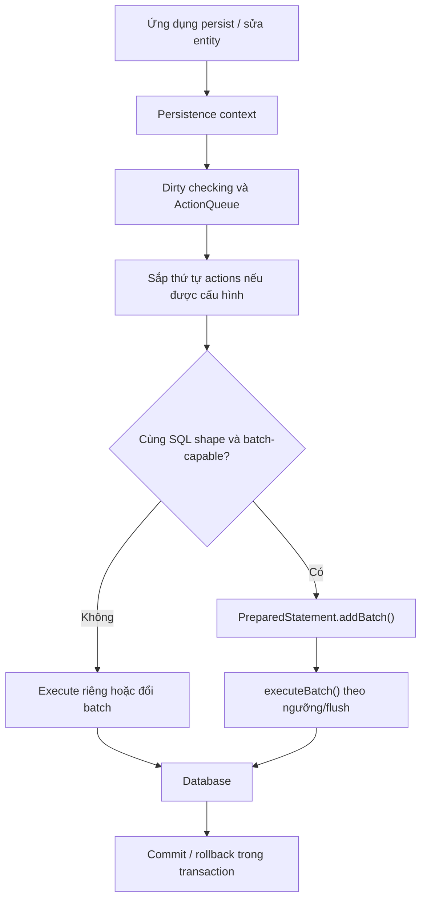
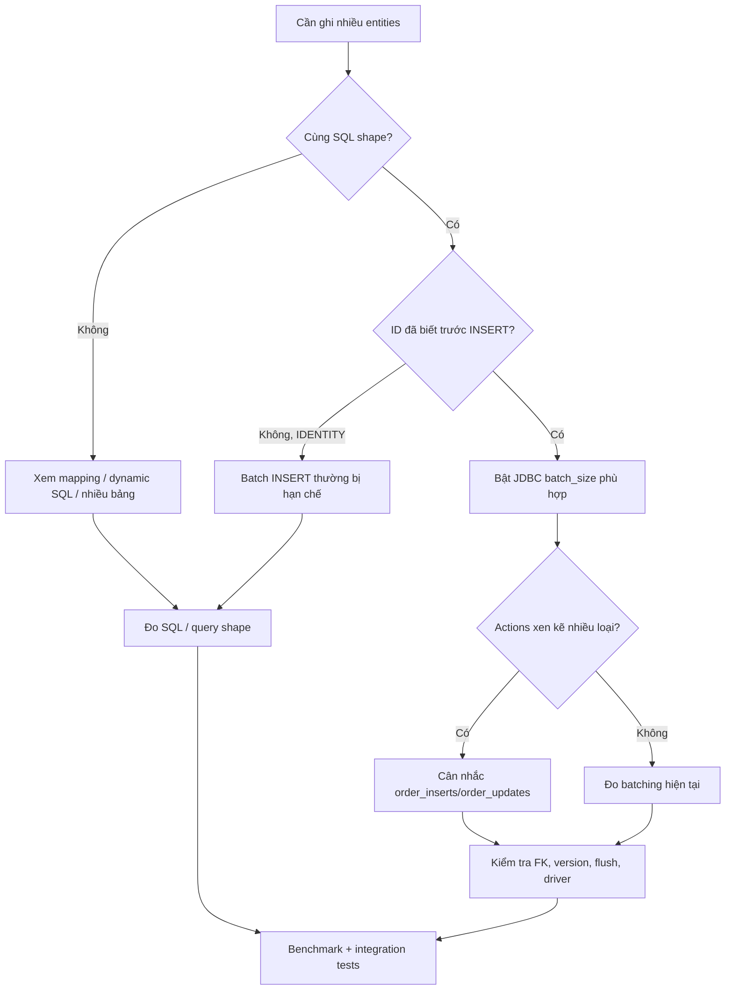

# Thứ tự INSERT hoặc UPDATE và khả năng gom câu lệnh trong Hibernate

Trong ứng dụng dùng Hibernate, một transaction có thể tạo hoặc sửa hàng trăm đến hàng nghìn entity. Cùng là 1.000 thao tác `persist()` hay 1.000 lần thay đổi field, nhưng chi phí làm việc với cơ sở dữ liệu có thể khác nhau rất lớn tùy **thứ tự Hibernate phát SQL**, **số mẫu câu lệnh SQL khác nhau** và **khả năng JDBC driver gom các lần thực thi thành batch**.

Hai setting quan trọng là:

```properties
hibernate.jdbc.batch_size=50
hibernate.order_inserts=true
hibernate.order_updates=true
```

Setting đầu thiết lập kích thước batch JDBC; hai setting sau cho Hibernate cơ hội **sắp lại các thao tác INSERT/UPDATE đang chờ trong quá trình flush** để nhiều câu SQL có cùng cấu trúc nằm gần nhau và tận dụng batch tốt hơn. Chúng không biến một giao dịch thành một câu `INSERT` duy nhất, không loại bỏ mọi round-trip, không sửa lỗi mapping, và không bảo đảm mọi loại INSERT/UPDATE đều được batch.

Bài học này giải thích **từ lời gọi Java đến câu lệnh JDBC và SQL thực tế**, vì sao thứ tự thao tác quan trọng, các điều kiện cần để batch thành công, cách xử lý khóa ngoại và optimistic locking, cùng cách kiểm chứng trên ứng dụng thật.

## 1. Ba lớp cần tách biệt

Trước hết phải phân biệt ba loại “thứ tự” và “gom câu lệnh”:

1. **Thứ tự code Java:** thời điểm ứng dụng gọi `persist()`, sửa field, `remove()`.
2. **Thứ tự action trong Hibernate flush:** thứ tự ActionQueue thực hiện INSERT/UPDATE và các thao tác collection để thỏa mapping và các quy tắc nội bộ.
3. **Thứ tự gọi JDBC/SQL:** các lệnh `PreparedStatement.addBatch()` và `executeBatch()`, sau đó driver gửi yêu cầu tới database.

Ví dụ:

```java
entityManager.persist(customerA);
entityManager.persist(orderA);
entityManager.persist(customerB);
entityManager.persist(orderB);
```

Không nên kết luận SQL bắt buộc phải là:

```sql
INSERT INTO customers ...;        -- A
INSERT INTO purchase_orders ...;  -- A
INSERT INTO customers ...;        -- B
INSERT INTO purchase_orders ...;  -- B
```

Hibernate thường có **transactional write-behind**: với nhiều loại entity, thao tác ghi được xếp vào hàng đợi và thực hiện lúc flush. SQL có thể được sắp theo nhóm entity/table hoặc ràng buộc giữa cha–con. Một số trường hợp, như ID generation dùng `IDENTITY`, có thể cần INSERT sớm để lấy ID nên hành vi khác với entity có ID được biết trước.

### 1.1. Sơ đồ dòng xử lý



**Flush không đồng nghĩa commit.** Flush đồng bộ các thao tác cần thiết thành SQL nhưng transaction có thể chưa commit; khóa và ràng buộc transaction vẫn tồn tại theo DBMS.

## 2. JDBC batching thực chất là gì?

Giả sử cần ghi ba invoice có cùng cấu trúc:

```sql
INSERT INTO invoices (id, code, total_amount)
VALUES (?, ?, ?);
```

Khi không batch, về mặt khái niệm ứng dụng có thể thực thi statement ba lần:

```java
PreparedStatement ps = connection.prepareStatement(
    "INSERT INTO invoices (id, code, total_amount) VALUES (?, ?, ?)"
);

ps.setLong(1, 1L);
ps.setString(2, "INV-001");
ps.setBigDecimal(3, new BigDecimal("100"));
ps.executeUpdate();

ps.setLong(1, 2L);
ps.setString(2, "INV-002");
ps.setBigDecimal(3, new BigDecimal("200"));
ps.executeUpdate();

ps.setLong(1, 3L);
ps.setString(2, "INV-003");
ps.setBigDecimal(3, new BigDecimal("300"));
ps.executeUpdate();
```

Với JDBC batching, cùng một `PreparedStatement` có thể nhận nhiều bộ bind values:

```java
PreparedStatement ps = connection.prepareStatement(
    "INSERT INTO invoices (id, code, total_amount) VALUES (?, ?, ?)"
);

for (InvoiceInput invoice : invoices) {
    ps.setLong(1, invoice.id());
    ps.setString(2, invoice.code());
    ps.setBigDecimal(3, invoice.total());
    ps.addBatch();
}

int[] counts = ps.executeBatch();
```

Hibernate quản lý phần lập statement/bind/batch khi cấu hình phù hợp; ứng dụng dùng ORM không cần tự gọi `addBatch()`.

**JDBC batch không nhất thiết tương đương một câu SQL nhiều VALUES**. Driver có thể gộp/lập lại nhiều lần thực thi dưới các giao thức khác nhau, hoặc tối ưu thành multi-row INSERT khi driver có hỗ trợ và cấu hình riêng. Vì thế:

- `batch_size=50` không bảo đảm đúng một network packet cho 50 INSERT.
- Không phải batch nào cũng tiết kiệm giống nhau trên PostgreSQL/MySQL/Oracle.
- Đếm số lời gọi JDBC `executeBatch()` khác với đếm SQL statements trong database log.
- Transaction vẫn xử lý từng hàng về mặt constraints và kết quả ghi.

### 2.1. Điều kiện cơ bản để gom batch

Những thao tác có khả năng gom thường cần:

- Cùng kiểu thao tác phù hợp: INSERT hoặc UPDATE.
- Cùng **SQL text/statement shape** và binding layout.
- Cùng loại batch/persister tương thích trong Hibernate.
- Driver/database hỗ trợ batching cho statement đó.
- Action chưa bị flush/execute riêng trước khi đủ nhóm.
- ID generation và mapping không bắt buộc lấy kết quả từng INSERT ngay.
- Không có lệnh khác hoặc điều kiện bắt buộc khiến batch hiện tại phải kết thúc.

**Cùng bảng chưa đủ**: hai UPDATE trên cùng bảng nhưng khác tập cột SET có thể là hai SQL shapes khác nhau.

## 3. Thứ tự câu lệnh tạo khác biệt lớn

Giả sử có hai entity `Invoice` và `Payment`, mỗi loại cần INSERT nhiều bản ghi.

Nếu action được thực thi theo thứ tự xen kẽ:

```text
INSERT Invoice(1)
INSERT Payment(1)
INSERT Invoice(2)
INSERT Payment(2)
INSERT Invoice(3)
INSERT Payment(3)
...
```

Hibernate phải chuyển qua lại giữa những SQL statements khác nhau:

```sql
INSERT INTO invoices (...) VALUES (...);
INSERT INTO payments (...) VALUES (...);
```

Điều này có thể làm batch cho SQL trước bị thực thi/kết thúc khi statement thay đổi, khiến kích thước batch thực nhỏ hơn `hibernate.jdbc.batch_size` rất nhiều.

Nếu các thao tác tương thích được xếp gần nhau:

```text
INSERT Invoice(1)
INSERT Invoice(2)
INSERT Invoice(3)
...
INSERT Payment(1)
INSERT Payment(2)
INSERT Payment(3)
...
```

thì Hibernate có cơ hội gom thành các batch lớn hơn.

### 3.1. So sánh mang tính minh họa

Giả sử 6 invoices, 6 payments, batch size 10 và không có ràng buộc khác:

| Thứ tự action | Mẫu lệnh | Cơ hội batching |
|---|---|---|
| A, B, A, B, A, B... | Luân phiên hai SQL statements | Mỗi nhóm có thể kết thúc rất sớm |
| A, A, A, A, A, A, B, B, B, B, B, B | Hai nhóm SQL đồng nhất | Có cơ hội tạo khoảng hai batch lớn |

Đây là **mô hình khái niệm**. Số lần `executeBatch()` thực tế còn phụ thuộc mapping, Hibernate version, callbacks, identity generation, phân đoạn transaction và JDBC driver.

### 3.2. Giới hạn dưới lý thuyết

Nếu có \(n\) thao tác cùng SQL shape, batch size là \(b\), không bị ngắt batch, số lần thực thi batch lý tưởng gần:

\[
\left\lceil\frac{n}{b}\right\rceil
\]

Nếu có nhiều nhóm SQL shapes, tính riêng cho từng nhóm. Công thức không thể dùng để khẳng định chính xác số round-trip mạng vì driver có thể xử lý batching theo cách khác.

## 4. hibernate.jdbc.batch_size

Setting căn bản:

```properties
hibernate.jdbc.batch_size=50
```

Trong Spring Boot:

```properties
spring.jpa.properties.hibernate.jdbc.batch_size=50
```

Nó thiết lập kích thước batch JDBC mặc định của Hibernate SessionFactory. Giá trị dương là số lượng operation tối đa Hibernate sẽ gom trong một batch phù hợp; giá trị 0 thường có nghĩa tắt JDBC batching.

Một cấu hình phát triển minh họa:

```properties
spring.jpa.properties.hibernate.jdbc.batch_size=30
spring.jpa.properties.hibernate.order_inserts=true
spring.jpa.properties.hibernate.order_updates=true
```

**Không có con số tốt cho mọi ứng dụng.** Batch size quá nhỏ để lại nhiều round-trip; quá lớn có thể tăng memory/buffers, payload, thời gian nắm giữ connection và chi phí retry nếu lỗi.

### 4.1. Batch size không phải kích thước transaction

`batch_size=50` không có nghĩa cứ đủ 50 entity Hibernate sẽ commit transaction. Commit chỉ xảy ra theo transaction boundary của application hoặc transaction manager.

Có thể có:

- 1 transaction chứa 5.000 INSERT.
- 100 JDBC batches, mỗi batch tối đa 50 operations.
- 1 lần commit ở cuối.

Ngược lại, 100 transactions riêng, mỗi transaction lưu một entity, gần như không có cơ hội gom 100 INSERT thành một JDBC batch.

### 4.2. Batch size không phải số lượng SQL row của multi-value INSERT

Driver có thể rewrite batch thành dạng:

```sql
INSERT INTO invoices (id, code)
VALUES (?, ?), (?, ?), (?, ?);
```

nhưng đây là **driver optimization**, không phải cam kết chung của `hibernate.jdbc.batch_size`. Không kiểm tra hiệu năng chỉ bằng việc tìm SQL nhiều VALUES trong log Hibernate.

### 4.3. Session-specific override

Trong một số phiên bản Hibernate, có thể điều chỉnh batch size theo Session:

```java
Session session = entityManager.unwrap(Session.class);
session.setJdbcBatchSize(50);
```

Điều này chỉ tác động trong phạm vi Session đó và phụ thuộc API Hibernate đang dùng. Hãy tránh thay đổi một Session chia sẻ giữa nhiều luồng; `Session`/`EntityManager` không được thiết kế là thread-safe.

## 5. hibernate.order_inserts

Cấu hình:

```properties
hibernate.order_inserts=true
```

Mục đích là cho Hibernate **sắp thứ tự INSERT actions** để tăng khả năng batching. Nó thường nhóm các INSERT tương thích theo entity type/table và còn phải tôn trọng các phụ thuộc cần thiết để giữ tính hợp lệ quan hệ.

### 5.1. Trước và sau, mang tính khái niệm

Code:

```java
for (int i = 0; i < 100; i++) {
    entityManager.persist(new Invoice(/* ... */));
    entityManager.persist(new AuditEntry(/* ... */));
}
```

Nếu các entity có identifiers phù hợp cho write-behind, không có bắt buộc insert riêng, thứ tự ứng dụng xen kẽ hai loại entity có thể khiến batch nhỏ.

Với `order_inserts=true`, Hibernate có thể lên kế hoạch:

```text
Invoice INSERT x100
AuditEntry INSERT x100
```

thay vì:

```text
Invoice, AuditEntry, Invoice, AuditEntry, ...
```

Khi SQL shape đồng nhất và batch size 50, mỗi nhóm 100 actions **có cơ hội** tạo hai batch thay vì nhiều batch nhỏ.

### 5.2. Có phải luôn bật order_inserts?

Không phải. Ordering có chi phí sắp xếp và có thể không cải thiện được gì nếu:

- Chỉ persist một entity type trong mỗi transaction.
- IDENTITY generator buộc INSERT riêng.
- Mỗi thao tác có SQL khác nhau.
- Batch size không được bật hoặc driver không tận dụng.
- Dataset rất nhỏ, chi phí sort đáng kể so với lợi ích.

Cần benchmark trên workload cụ thể. Hibernate thường không bật ordering mặc định để tránh chi phí cho những ứng dụng không hưởng lợi.

### 5.3. Không thể bỏ qua khóa ngoại

Giả sử:

```text
Customer 1 ---< Invoice A
Customer 2 ---< Invoice B
```

Nếu `invoice.customer_id` là khóa ngoại NOT NULL, database phải có Customer tương ứng trước khi INSERT Invoice nếu không có deferred constraint hoặc cơ chế đặc biệt.

Hibernate không được phép tùy ý sắp xếp mọi invoice trước mọi customer rồi gây lỗi FK. Action ordering tôn trọng dependency graph theo khả năng Hibernate hiểu từ mapping; mapping không đúng hoặc cycle constraints vẫn có thể tạo vấn đề.

**`order_inserts=true` không thay thế việc ánh xạ đúng owning side, cascade và khóa ngoại.**

## 6. hibernate.order_updates

Cấu hình:

```properties
hibernate.order_updates=true
```

Hibernate có thể sắp xếp UPDATE actions theo entity type và primary key để các câu UPDATE có cấu trúc giống nhau gần nhau hơn. Ngoài cơ hội batching, thứ tự khóa nhất quán hơn trong một số workload còn **có thể giảm khả năng deadlock** do các transaction update nhiều row theo thứ tự ngược nhau.

### 6.1. Ví dụ nhiều entity bị thay đổi

```java
List<Customer> customers = loadCustomers();
List<Invoice> invoices = loadInvoices();

for (int i = 0; i < customers.size(); i++) {
    customers.get(i).rename(/*...*/);
    invoices.get(i).changeStatus(/*...*/);
}
```

Nếu tất cả entities managed và transaction có commit/flush, Hibernate dirty checking phát hiện thay đổi. Khi order_updates bật, các actions có thể được nhóm theo entity type và identifier, giúp giảm chuyển đổi SQL statement.

### 6.2. Thứ tự khóa và deadlock

Hai transaction:

```text
Transaction T1: UPDATE account 1; UPDATE account 2
Transaction T2: UPDATE account 2; UPDATE account 1
```

Nếu mỗi transaction giữ lock rồi chờ row của transaction kia, deadlock có thể xảy ra tùy DBMS/isolation.

Khi các UPDATE được thực thi theo thứ tự identifier ổn định, một số tình huống khóa ngược thứ tự có thể ít xảy ra hơn.

Tuy nhiên:

- Ordering không bảo đảm loại bỏ mọi deadlock.
- Các bảng/constraints/triggers khác có thể lấy khóa theo thứ tự riêng.
- SQL query update trực tiếp hoặc native SQL ngoài Hibernate không chịu tác động của setting.
- Concurrency và isolation, index, FK và transaction duration vẫn quyết định phần lớn deadlock behavior.

### 6.3. UPDATE SQL shape quyết định batch

Nếu entity A và B cùng bảng nhưng có UPDATE khác tập cột:

```sql
UPDATE invoices SET status = ? WHERE id = ?;
UPDATE invoices SET total_amount = ? WHERE id = ?;
```

chúng không phải cùng prepared SQL statement. Sắp identifier không giúp hai statement khác cấu trúc trở thành một batch duy nhất.

## 7. ActionQueue và flush ordering

Hibernate quản lý các entity actions trong một hàng đợi nội bộ trước khi flush. Trạng thái entity và các association có thể tạo các loại action khác nhau:

- Entity insert.
- Entity update.
- Orphan removal.
- Collection remove/update/recreate.
- Entity delete.

Thứ tự thực thi actions trong flush tuân theo cơ chế nội bộ và mapping, **không nhất thiết trùng với thứ tự các lời gọi Java**.

Ví dụ:

```java
entityManager.remove(oldInvoice);
entityManager.persist(newInvoice);
entityManager.flush();
```

Không được giả định DELETE oldInvoice luôn chạy trước INSERT newInvoice chỉ vì code gọi remove trước. Trong nhiều trường hợp Hibernate thực hiện entity inserts trước entity deletes trong flush pipeline. Với một unique constraint bị dùng lại, điều này có thể gây lỗi:

```text
oldInvoice.code = "INV-001"
newInvoice.code = "INV-001"

DELETE oldInvoice rồi INSERT newInvoice (ý định code)
Nhưng flush có thể INSERT trước DELETE
=> unique constraint violation
```

Đây là vấn đề **action category order**, không chỉ `order_inserts`/`order_updates`. Nếu nghiệp vụ cần thay hàng có unique value, cần thiết kế transaction và flush boundaries cẩn thận; đôi khi cần flush DELETE trước INSERT hoặc xử lý UPDATE phù hợp, nhưng việc flush sớm có tác động tới lock/consistency.

### 7.1. Flush triggers

Hibernate có thể flush:

- Khi transaction commit.
- Khi gọi `entityManager.flush()` trực tiếp.
- Trước một số query cần đồng bộ pending changes theo flush mode và query spaces.
- Theo các điểm xử lý khác của Session/transaction provider.

Nếu flush xuất hiện nhiều lần xen giữa thao tác, các nhóm INSERT/UPDATE bị chia nhỏ; mỗi nhóm chỉ batch được phần actions đang chờ lúc đó.

### 7.2. Không lạm dụng flush()

Ví dụ phá khả năng batch:

```java
for (Invoice invoice : invoices) {
    entityManager.persist(invoice);
    entityManager.flush(); // Ép xử lý từng entity.
}
```

Dù `hibernate.jdbc.batch_size=50`, code flush sau mỗi persist có thể kết thúc mỗi batch quá sớm.

Thường tốt hơn:

```java
for (Invoice invoice : invoices) {
    entityManager.persist(invoice);
}

entityManager.flush();
```

Với tập dữ liệu rất lớn, cần flush/clear định kỳ để kiểm soát first-level cache; việc này được giải thích ở phần sau.

## 8. Identifier generation: IDENTITY so với SEQUENCE

Đây là một trong những nguyên nhân quan trọng khiến batch INSERT không hiệu quả.

### 8.1. GenerationType.IDENTITY

```java
@Id
@GeneratedValue(strategy = GenerationType.IDENTITY)
private Long id;
```

Với identity/autoincrement ID, database sinh ID tại thời điểm INSERT. Hibernate thường cần chạy INSERT để biết identifier của entity, vì vậy **Hibernate thường không thể tận dụng JDBC insert batching theo cơ chế write-behind thông thường cho những entity dùng IDENTITY**.

Hệ quả:

- Dù đã bật `hibernate.jdbc.batch_size` và `order_inserts`, INSERT có thể vẫn chạy từng entity.
- Một số bản Hibernate/driver có cơ chế riêng cho generated keys hoặc các tình huống đặc biệt; không suy ra khả năng batch cho entity IDENTITY nếu chưa đo.
- Khi bulk ingest thực sự quan trọng, cân nhắc chiến lược ID khác phù hợp DBMS.

### 8.2. GenerationType.SEQUENCE

```java
@Id
@GeneratedValue(
    strategy = GenerationType.SEQUENCE,
    generator = "invoice_seq"
)
@SequenceGenerator(
    name = "invoice_seq",
    sequenceName = "invoice_seq",
    allocationSize = 50
)
private Long id;
```

Với sequence-based ID, Hibernate có thể có identifier **trước khi thực hiện INSERT**. Do đó INSERT có thể xếp vào write-behind queue và được batch nếu các điều kiện khác phù hợp.

`allocationSize=50` là **chiến lược phân bổ ID**, không phải batch size JDBC. Nó giúp giảm tần suất lấy giá trị sequence khi optimizer phù hợp; không phải mỗi lần lấy sequence thì chắc chắn có đúng 50 INSERT trong một batch.

Cần cấu hình database sequence increment, Hibernate optimizer và migration nhất quán. Với DB không hỗ trợ sequence thực, phải chọn generator phù hợp thay vì giả định `SEQUENCE` dùng được ở mọi nơi.

### 8.3. GenerationType.TABLE hoặc UUID

Một generator dùng table để cấp ID có thể tạo contention và thêm SQL/locking. UUID được tạo phía application không cần INSERT để lấy ID, nên có thể hỗ trợ write-behind/batching ở mặt identifier, nhưng còn ảnh hưởng đến kích thước index, locality và performance.

Chọn identifier strategy theo **domain, DBMS, indexing và write throughput**, không chỉ vì một benchmark batch.

### 8.4. Bảng tổng hợp

| ID strategy | ID biết trước INSERT? | Cơ hội JDBC INSERT batch |
|---|---|---|
| `IDENTITY` | Thường không | Thường hạn chế hoặc không batch theo cơ chế thông thường |
| `SEQUENCE` | Có thể có | Thường phù hợp |
| Assigned ID | Có | Có nếu SQL shapes phù hợp |
| UUID phía ứng dụng | Có | Có nếu SQL shapes phù hợp |
| TABLE generator | Có thể có, cần SQL cấp ID | Có thể batch INSERT nhưng phát sinh chi phí cấp ID |

## 9. SQL shape: vì sao cùng entity type vẫn không gom được?

Một JDBC batch chủ yếu gom các lần thực thi của cùng SQL statement. Dù cùng entity/table, Hibernate có thể tạo các SQL khác nhau do mapping.

### 9.1. @DynamicInsert

```java
@Entity
@DynamicInsert
public class Product {
    @Id
    private Long id;

    private String code;
    private String description;
    private BigDecimal price;
}
```

Giả sử các entity có các cột null khác nhau. Hibernate có thể tạo:

```sql
INSERT INTO products (id, code, price)
VALUES (?, ?, ?);

INSERT INTO products (id, code, description, price)
VALUES (?, ?, ?, ?);
```

Hai statement có SQL shape khác nhau, nên không nằm trong cùng một `PreparedStatement` batch.

`@DynamicInsert` có lợi khi muốn bỏ các cột null để database default thực sự được áp dụng hoặc giảm cột ghi. Nhưng nó có thể **giảm tính đồng nhất của INSERT** khi dữ liệu sparse, từ đó giảm batch efficiency.

Không nên loại `@DynamicInsert` chỉ để batch nếu nghiệp vụ phụ thuộc database defaults. Cần đo trade-off và hiểu generated columns.

### 9.2. @DynamicUpdate

```java
@Entity
@DynamicUpdate
public class Product {
    @Id
    private Long id;

    private String name;
    private BigDecimal price;
    private int stock;
}
```

Khi một entity chỉ đổi price, một entity khác chỉ đổi stock:

```sql
UPDATE products SET price = ? WHERE id = ?;
UPDATE products SET stock = ? WHERE id = ?;
```

Các UPDATE khác SQL text nên **không gom cùng batch**.

Không có `@DynamicUpdate`, Hibernate có thể dùng SQL UPDATE cố định theo mapping (ngoại trừ các yếu tố khác), tăng cơ hội batch nhưng có thể ghi nhiều cột hơn. `@DynamicUpdate` giúp giảm cột SET cho một lần cập nhật và đôi khi giảm cạnh tranh/chi phí DB, nhưng có thể làm batch kém hiệu quả khi tập field bị thay đổi không đồng nhất.

### 9.3. Secondary tables và joined inheritance

Entity có `@SecondaryTable` hoặc `JOINED` inheritance có thể phát nhiều SQL tới các bảng khác nhau. Hibernate phải thực hiện những group/batch riêng theo statement và phụ thuộc FK, không được giả định “mỗi entity = một câu SQL”.

### 9.4. Custom SQL và generated columns

Mapping có `@SQLInsert`, `@SQLUpdate`, database-generated properties, trigger, returning clauses hoặc yêu cầu đọc giá trị ngay sau ghi có thể làm shape/lifecycle khác nhau. Khả năng batch phải kiểm chứng theo mapping và Hibernate version.

### 9.5. Optimistic version columns

Entity có `@Version` thường tạo UPDATE dạng:

```sql
UPDATE invoices
SET status = ?, version = ?
WHERE id = ? AND version = ?;
```

Nhiều UPDATE với cùng SQL text có thể batch, nhưng Hibernate cần biết row count của từng UPDATE để phát hiện optimistic lock conflict. Phần tiếp theo giải thích điều kiện này.

## 10. Versioned updates và hibernate.jdbc.batch_versioned_data

Ví dụ entity có optimistic locking:

```java
@Entity
public class Invoice {
    @Id
    private Long id;

    @Version
    private long version;

    private InvoiceStatus status;
}
```

Hibernate muốn bảo đảm không ghi đè thay đổi concurrent. SQL có thể dùng:

```sql
UPDATE invoices
SET status = ?, version = ?
WHERE id = ? AND version = ?;
```

Nếu một transaction khác đã tăng version của row, UPDATE có thể ảnh hưởng 0 hàng. Hibernate phát hiện xung đột và báo optimistic locking failure.

**JDBC batch complicates row counts**: Khi nhiều UPDATE được gửi bằng `executeBatch()`, Hibernate cần driver báo update counts đúng/đủ để xác định một statement có ảnh hưởng 0 rows hay không.

Setting liên quan trong các Hibernate releases:

```properties
hibernate.jdbc.batch_versioned_data=true
```

Trong nhiều phiên bản Hibernate hiện đại, hành vi batching versioned data được bật mặc định nếu driver xử lý row counts phù hợp. Tuy nhiên, **cần đọc tài liệu đúng Hibernate release** vì setting/default có thể thay đổi và driver có thể trả số lượng ảnh hưởng không đáng tin cậy với batch.

### 10.1. Vì sao nên kiểm tra optimistic locking dưới batch?

Giả sử:

1. Transaction T1 đọc invoice id 1 version 4.
2. T2 cập nhật invoice id 1, version thành 5 và commit.
3. T1 thay đổi invoice id 1 và nhiều invoices khác.
4. T1 flush batch UPDATE có điều kiện `WHERE version = 4`.
5. UPDATE của id 1 ảnh hưởng 0 rows.

Ứng dụng phải nhận một optimistic locking failure và transaction nên rollback theo chính sách phù hợp, không được âm thầm coi là thành công chỉ vì batch chứa các UPDATE khác thành công.

### 10.2. Test cần bao gồm driver thật

Không chỉ nhìn SQL log. Viết integration test dùng hai transactions riêng và database production-like; xác nhận concurrent update conflict được phát hiện với batching đang bật. Nếu driver trả `SUCCESS_NO_INFO` hoặc có hành vi update count đặc biệt, kiểm tra tài liệu driver/Hibernate tương ứng.

## 11. Quan hệ cha–con, cascade và thứ tự INSERT

Giả sử một đơn hàng có nhiều dòng hàng:

```java
@Entity
public class PurchaseOrder {
    @Id
    @GeneratedValue(
        strategy = GenerationType.SEQUENCE,
        generator = "purchase_order_seq"
    )
    @SequenceGenerator(
        name = "purchase_order_seq",
        sequenceName = "purchase_order_seq",
        allocationSize = 50
    )
    private Long id;

    @OneToMany(
        mappedBy = "order",
        cascade = CascadeType.PERSIST
    )
    private List<OrderLine> lines = new ArrayList<>();

    public void addLine(OrderLine line) {
        lines.add(line);
        line.setOrder(this);
    }
}

@Entity
public class OrderLine {
    @Id
    @GeneratedValue(strategy = GenerationType.SEQUENCE)
    private Long id;

    @ManyToOne(fetch = FetchType.LAZY, optional = false)
    @JoinColumn(name = "order_id", nullable = false)
    private PurchaseOrder order;

    void setOrder(PurchaseOrder order) {
        this.order = order;
    }
}
```

Tạo 100 orders, mỗi order 10 lines:

```java
for (int i = 0; i < 100; i++) {
    PurchaseOrder order = new PurchaseOrder();

    for (int j = 0; j < 10; j++) {
        order.addLine(new OrderLine());
    }

    entityManager.persist(order);
}
```

Có tối đa 100 root INSERT và 1.000 child INSERT, chưa tính các câu SQL sinh ID, index và triggers. Khi bật `order_inserts`, Hibernate có thể nhóm các INSERT của orders và lines theo SQL shape, đồng thời phải giữ được FK dependencies.

### 11.1. Không có cascade cũng vẫn có thể batch

Cascade PERSIST quyết định việc truyền thao tác vòng đời từ order sang line. Nó **không phải điều kiện bắt buộc cho JDBC batching**. Nếu ứng dụng gọi `persist(line)` riêng, các INSERT vẫn có thể batch khi cấu hình phù hợp.

### 11.2. Owning side phải được cập nhật đúng

`PurchaseOrder.lines` khai `mappedBy = "order"` là inverse side. Phía chứa FK là `OrderLine.order`. Nếu chỉ `order.getLines().add(line)` mà không set `line.order`, SQL có thể không có `order_id` đúng hoặc vi phạm `NOT NULL`. Batch ordering không sửa lỗi này.

### 11.3. Chu kỳ FK và constraints

Nếu schema có quan hệ hai chiều với hai FK NOT NULL tạo vòng phụ thuộc, không thể tự sắp xếp INSERT đơn giản để cả hai FK cùng hợp lệ nếu DB không có deferred constraints hoặc thiết kế khác. `order_inserts` không giải được bài toán schema không có thứ tự INSERT hợp lệ.

### 11.4. Unique constraints và thay thế entity

Với remove + insert dùng lại cùng unique key, flush action ordering có thể INSERT trước DELETE. Không gán cho `order_inserts` khả năng tự đảm bảo “xóa trước để nhường unique value”. Cần giải quyết bằng nghiệp vụ/transaction boundaries thích hợp và kiểm thử trên DB thật.

## 12. Flush và clear theo lô khi ghi dữ liệu lớn

Persistence context giữ managed objects, snapshots và action state. Nếu persist 100.000 entities trong một transaction mà không clear, ứng dụng có thể tốn nhiều memory dù JDBC batch size chỉ 50.

Một pattern thường dùng:

```java
@Transactional
public void importInvoices(
        List<InvoiceInput> inputs) {

    final int chunkSize = 50;

    for (int i = 0; i < inputs.size(); i++) {
        Invoice invoice = mapToInvoice(inputs.get(i));
        entityManager.persist(invoice);

        if ((i + 1) % chunkSize == 0) {
            entityManager.flush();
            entityManager.clear();
        }
    }

    entityManager.flush();
    entityManager.clear();
}
```

Ở đây:

- `flush()` thực thi các pending inserts/updates để không giữ action queue vô hạn.
- `clear()` detach tất cả managed entities, giảm kích thước first-level cache.
- `chunkSize` là kích thước nhóm của **application**, không bắt buộc bằng `hibernate.jdbc.batch_size`.
- Vì toàn bộ method chạy trong một `@Transactional`, **các flush không commit từng chunk**. Một transaction dài vẫn có thể giữ locks/resource cho tới commit.

### 12.1. Đừng clear trước flush

Sai:

```java
entityManager.clear();
entityManager.flush();
```

`clear()` detach managed entities và có thể bỏ những pending changes chưa được flush. Nếu cần giữ dữ liệu, flush trước rồi clear.

### 12.2. Chú ý reference đến entity đã detached

Sau `clear()`, các entity cũ không còn managed. Không tiếp tục sửa chúng và mong Hibernate tự dirty-check; nếu cần liên kết tới entity đã tồn tại, dùng managed reference phù hợp trong context mới.

### 12.3. Chunk size và transaction size khác nhau

Một transaction import 100.000 hàng với flush/clear mỗi 50 vẫn có thể:

- Nắm giữ locks lâu.
- Tăng redo/WAL/undo.
- Làm rollback rất tốn chi phí.
- Tác động connection pool vì một connection bị dùng lâu.

Nếu use case cho phép commit từng chunk, dùng **transaction boundaries thực sự** theo từng nhóm và thiết kế idempotency/retry. Cách đó không còn atomic all-or-nothing cho cả import, nên cần business contract rõ ràng.

## 13. UPDATE hàng loạt với managed entities

Một transaction sửa nhiều managed entities:

```java
@Transactional
public void confirmInvoices(List<Long> ids) {
    List<Invoice> invoices = entityManager.createQuery(
        """
        select i
        from Invoice i
        where i.id in :ids
        """,
        Invoice.class
    )
    .setParameter("ids", ids)
    .getResultList();

    for (Invoice invoice : invoices) {
        invoice.confirm();
    }
}
```

Hibernate dirty checking nhận biết những field bị thay đổi và lên lịch UPDATE lúc flush. Với `order_updates=true` và SQL shape tương tự, có cơ hội JDBC batching.

Lưu ý:

- UPDATE một entity nhiều lần trước flush thường chỉ cần SQL cuối cùng phản ánh state cuối.
- Dirty checking có thể không phát UPDATE nếu state không thay đổi, tùy mapping.
- `@DynamicUpdate` có thể làm SQL shapes khác nhau.
- `@Version` đòi hỏi update count/optimistic lock kiểm soát đúng.
- Entity lifecycle callbacks và interceptors có thể thay đổi dữ liệu trước khi SQL được tạo.

### 13.1. HQL bulk UPDATE là cách khác

Nếu tất cả các invoice cần cùng trạng thái, có thể dùng set-based update:

```java
int affected = entityManager.createQuery(
    """
    update Invoice i
    set i.status = :status
    where i.id in :ids
    """
)
.setParameter("status", InvoiceStatus.CONFIRMED)
.setParameter("ids", ids)
.executeUpdate();
```

Đây thường là **một bulk SQL UPDATE** hoặc một số SQL do mapping, **không phải JDBC batch của N entity UPDATE**.

Bulk update bỏ qua dirty checking/callbacks trên từng managed entity và có thể khiến persistence context stale. Nó cũng không tự dùng optimistic version checks giống managed entity updates trừ khi query/ORM extension biểu đạt rõ. Đừng thay mọi cập nhật entity bằng HQL bulk để “nhanh hơn” mà bỏ qua business invariants.

### 13.2. So sánh

| Managed entity updates + JDBC batch | Bulk HQL/Criteria UPDATE |
|---|---|
| N thao tác lifecycle entity, có thể batch SQL | Set-based DML trực tiếp |
| Dirty checking và mapping/callbacks | Bỏ qua một phần lifecycle entity |
| `@Version` optimistic locking thông thường | Phải chủ động xem version semantics |
| Nhiều bind sets | Một WHERE ảnh hưởng nhiều rows |
| Thường thuận tiện với domain methods | Phù hợp chuyển trạng thái đồng nhất |
| Memory tốn theo managed entities | Không cần hydrate toàn bộ affected entities |
| Batch size ảnh hưởng | Batch size JDBC không phải yếu tố chính |

## 14. Spring Data JPA saveAll() có tự gom batch không?

Một nhầm lẫn phổ biến:

```java
invoiceRepository.saveAll(invoices);
```

Không thể kết luận chỉ vì method tên `saveAll` nên Hibernate sẽ phát một batch JDBC. Spring Data thường lặp qua entities và gọi persist/merge tương ứng theo new/existing detection. Việc batching phụ thuộc:

- Đang có transaction chung không.
- Hibernate JDBC batch size.
- `IDENTITY` hay `SEQUENCE`/ID assigned.
- Thứ tự INSERT/UPDATE.
- SQL shape.
- Flush boundaries.
- Driver/database.
- Các quan hệ cascade.

Nếu mỗi `save(...)` được gọi trong transaction riêng, batch giữa nhiều transactions không hình thành. Nếu `saveAllAndFlush(...)` flush ngay sau nhóm, nó có thể hữu ích để buộc SQL chạy, nhưng cũng có thể làm batch sớm kết thúc và không phải giải pháp cho identifier/mapping.

### 14.1. Nên kiểm tra persistence state

`saveAll` có thể gọi `merge()` cho entity có ID hiện hữu hoặc bị nhận diện nhầm new/existing. Merge có thể phát thêm SELECT/SQL hoặc thao tác managed copy; benchmark phải gồm cả chi phí đó.

Với import entities mới, đảm bảo new-state detection đúng và ID generation phù hợp nếu muốn tối ưu throughput.

## 15. JDBC driver và DBMS ảnh hưởng ra sao?

Hibernate chỉ là một phần của pipeline. JDBC driver quyết định cách thực thi batch qua giao thức với DBMS.

### 15.1. PostgreSQL JDBC

PostgreSQL JDBC driver có option thường gặp `reWriteBatchedInserts=true` để tối ưu một số batch INSERT thành dạng nhiều VALUES theo khả năng driver.

Ví dụ JDBC URL minh họa:

```properties
spring.datasource.url=jdbc:postgresql://localhost:5432/shop?reWriteBatchedInserts=true
```

Option này không thay thế `hibernate.jdbc.batch_size`, cũng không bảo đảm rewrite mọi INSERT (generated keys, SQL shape, constraints và driver version có thể giới hạn). Cần benchmark và xem tài liệu PostgreSQL JDBC của version đang chạy.

### 15.2. MySQL Connector/J

MySQL Connector/J có option `rewriteBatchedStatements` trong nhiều phiên bản, ảnh hưởng việc driver tối ưu batch khi có thể.

```properties
spring.datasource.url=jdbc:mysql://localhost:3306/shop?rewriteBatchedStatements=true
```

Tên option, behavior và SQL rewrite phụ thuộc driver version. Các tình huống generated keys, ON DUPLICATE KEY, RETURNING hoặc mixed SQL shapes có thể khác nhau. Đừng copy URL parameter một cách mù quáng giữa DBMS.

### 15.3. Oracle, SQL Server và DB khác

JDBC driver mỗi vendor có cách batching và giới hạn parameter/statement riêng. Có driver hỗ trợ array binding hoặc dạng batch tối ưu khác; cũng có trường hợp batch insert được hỗ trợ nhưng row count trả về khác kỳ vọng.

Luôn xác nhận trên DBMS/driver version thật của môi trường triển khai. Không dùng một benchmark H2 duy nhất làm bằng chứng cho production throughput.

## 16. Batch và connection pool, transaction, locks

Batching có thể giảm round-trips, nhưng không tự đảm bảo transaction ngắn.

Nếu một job giữ connection suốt 20 phút để ghi dữ liệu:

- Connection pool mất một connection trong toàn bộ thời gian.
- Database có thể giữ locks/undo/WAL lâu.
- Transaction rollback có thể nặng nếu batch thứ 10.000 lỗi.
- Một ứng dụng khác có thể bị chờ lock hoặc hết pool.

Batch size 50 chỉ là cách nhóm JDBC operations, không phải giới hạn transaction duration.

### 16.1. Chunk transaction nếu domain cho phép

Một job import có thể chia:

```text
File 100.000 rows
  -> Chunk 1: transaction commit
  -> Chunk 2: transaction commit
  -> Chunk 3: transaction commit
  ...
```

Nhưng khi một chunk thất bại, chunks trước đã commit. Cần có:

- Idempotency key hoặc upsert policy.
- Checkpoint progress.
- Retry với backoff.
- Xác định duplicate handling.
- Ghi lỗi đủ thông tin để khôi phục.
- Business contract về partial success.

Không chia transaction tùy tiện nếu nghiệp vụ yêu cầu toàn bộ dữ liệu được commit hoặc rollback cùng nhau.

### 16.2. Ordering và deadlocks

`order_updates=true` có thể giúp nhiều transactions lấy row locks theo thứ tự ID nhất quán, giảm một số tình huống deadlock. Tuy nhiên vẫn cần:

- Transaction càng ngắn càng tốt.
- Index hỗ trợ WHERE/foreign keys.
- Tránh lock order trái ngược trong native SQL.
- Timeout và retry strategy cho deadlock/serialization failures.
- Quan sát DB lock graph, không suy từ JVM logs duy nhất.

## 17. Hiệu năng: đừng tối ưu chỉ số lượng câu SQL

Một benchmark cần tách:

1. Số lần `persist()`/số entities.
2. Số INSERT/UPDATE SQL operations.
3. Số lần JDBC `addBatch()` và `executeBatch()`.
4. Số network round-trips nếu đo được.
5. Tổng thời gian transaction, commit, lock waits.
6. CPU/memory của Hibernate flush và ordering.
7. Throughput rows/second.
8. Tỉ lệ errors, retry và deadlocks.

`hibernate.generate_statistics=true` giúp xem một số chỉ số ORM như entity inserts/updates và prepared statements. Tuy nhiên, không nên mặc định một chỉ số `prepareStatementCount` chính xác bằng số lần `executeBatch()`; muốn đếm JDBC batch calls, có thể dùng datasource proxy/metrics hoặc instrumentation của driver phù hợp.

### 17.1. SQL logging

Spring Boot + Hibernate 6:

```properties
logging.level.org.hibernate.SQL=DEBUG
spring.jpa.properties.hibernate.generate_statistics=true
```

Với bind values trong Hibernate 6:

```properties
logging.level.org.hibernate.orm.jdbc.bind=TRACE
```

Bind TRACE có thể làm lộ dữ liệu cá nhân, số thẻ, email hoặc secrets, nên chỉ bật có kiểm soát. SQL log thường in mẫu SQL một lần hoặc nhiều lần tùy logger; nó **không chứng minh** driver đã hoặc chưa rewrite batch thành một wire operation.

### 17.2. Quan sát batch bằng datasource proxy

Một công cụ theo dõi JDBC có thể cho biết:

```text
Prepared SQL:
  insert into invoices (id, code, total) values (?, ?, ?)

addBatch calls: 50
executeBatch calls: 1
batch parameter sets: 50
```

Đây là ví dụ định dạng thống kê minh họa, không phải output bắt buộc của Hibernate. Công cụ/driver cụ thể có thể hiển thị các trường khác.

### 17.3. Benchmark có đối chứng

Dùng cùng tập dữ liệu và môi trường:

| Cấu hình | Mục tiêu so sánh |
|---|---|
| batch_size = 0 | Baseline không JDBC batch |
| batch_size = 20 | Tác động batching vừa phải |
| batch_size = 50 | Tác động batch lớn hơn |
| batch_size = 50 + order_inserts | Lợi ích nhóm INSERT |
| batch_size = 50 + order_updates | Lợi ích nhóm UPDATE |
| batch_size = 50 + cả hai | Đánh giá phối hợp |

Cần reset trạng thái DB và warm-up JVM, đo nhiều lần, kiểm soát trigger/index, transaction size, pool, caches, key generation và network latency. Nếu benchmark thay đổi đồng thời nhiều yếu tố, không thể quy kết tốc độ tăng chỉ cho ordering.

## 18. Minh họa cụ thể hai loại INSERT

Giả sử ứng dụng có `Order` và `AuditEvent` được persist xen kẽ:

```java
@Transactional
public void createOrders(int count) {
    for (int i = 0; i < count; i++) {
        entityManager.persist(
            new PurchaseOrder("PO-" + i)
        );
        entityManager.persist(
            new AuditEvent("ORDER_CREATED", i)
        );
    }
}
```

Với cả hai dùng ID được cấp trước khi INSERT và SQL shapes đồng nhất:

```text
Không sắp insert:
  Order, Audit, Order, Audit, Order, Audit

Có cơ hội sắp:
  Order, Order, Order, Audit, Audit, Audit
```

Nếu AuditEvent dùng `IDENTITY` hoặc có generated-value readback bắt buộc, kết quả có thể không giống ví dụ. Nếu AuditEvent có FK tới PurchaseOrder, Hibernate còn cần giữ quan hệ khóa ngoại hợp lệ khi sắp.

## 19. Minh họa UPDATE theo khóa chính

Giả sử ba transactions độc lập cập nhật các dòng account:

```java
Account a100 = em.find(Account.class, 100L);
Account a300 = em.find(Account.class, 300L);
Account a200 = em.find(Account.class, 200L);

a300.updateDisplayName("C");
a100.updateDisplayName("A");
a200.updateDisplayName("B");
```

Trong một flush, `order_updates=true` có thể sort UPDATE actions theo entity type và PK. Nó không cần tuân thủ thứ tự gọi setter là 300 → 100 → 200. SQL shapes giống nhau tạo cơ hội batching và thứ tự khóa đồng nhất hơn.

Nhưng điều này không bảo đảm `UPDATE` được phát cho mọi object: nếu giá trị mới bằng giá trị snapshot cũ, dirty checking có thể bỏ thao tác. Nếu có `@DynamicUpdate` và các field thay đổi khác nhau, SQL shapes có thể khác nhau dù cùng entity type.

## 20. Kiểm thử đúng thay vì đoán

Một integration test cho batch insert có thể chạy trên target DBMS với entity dùng sequence ID:

```java
@Test
@Transactional
void persistsManyInvoices() {
    for (int i = 0; i < 100; i++) {
        entityManager.persist(
            new Invoice("INV-" + i)
        );
    }

    entityManager.flush();
    entityManager.clear();

    Long count = entityManager.createQuery(
        "select count(i) from Invoice i",
        Long.class
    ).getSingleResult();

    assertEquals(100L, count);
}
```

Test trên chỉ xác nhận 100 rows được lưu, **không tự chứng minh JDBC batching**. Muốn kiểm tra batch efficiency phải dùng metrics/instrumentation của datasource hoặc driver, cùng cấu hình Hibernate cụ thể.

### 20.1. Kiểm tra optimistic locking với versioned batch

Thiết lập T1/T2:

1. T1 đọc invoice version 1.
2. T2 cập nhật và commit thành version 2.
3. T1 sửa invoice cũ cùng nhiều invoices khác rồi flush batch.
4. Xác nhận T1 nhận optimistic locking exception/rollback thích hợp.

Test trên DB/driver production-like để bảo đảm update count qua batch không che mất xung đột.

### 20.2. Kiểm tra lỗi FK/unique

Thử parent–child mapping có FK NOT NULL, và tình huống DELETE/INSERT dùng lại unique key trong cùng flush. Kết quả giúp quyết định có cần explicit flush boundaries hoặc thay đổi nghiệp vụ thay vì giả định `order_inserts` tự sửa mọi thứ.

### 20.3. Kiểm tra throughput

Dùng tập dữ liệu đủ lớn để JDBC overhead đáng kể. Ghi riêng:

- Rows/second.
- Batch executions.
- Total elapsed.
- DB CPU, WAL/redo.
- Memory của JVM.
- Lock waits và deadlocks.

Cùng lúc, so sánh `IDENTITY` và `SEQUENCE` ở schema phù hợp nếu đang chọn ID strategy cho hệ thống ghi lớn.

## 21. Những sai lầm thường gặp

### 21.1. “Chỉ cần batch_size=50 là tất cả 50 INSERT sẽ gom”

Sai. Phải cùng SQL shape, phù hợp Hibernate batching, driver, flush và ID generation. Các statement khác cấu trúc sẽ không thành một batch duy nhất.

### 21.2. “order_inserts=true bảo đảm thứ tự insert giống thứ tự Java”

Ngược lại, nó cho Hibernate cơ hội **đổi thứ tự** để gom thao tác. Không phụ thuộc SQL insertion order để suy ra thứ tự nghiệp vụ. Muốn query có thứ tự ổn định, dùng `ORDER BY` theo field nghiệp vụ.

### 21.3. “order_updates=true chữa mọi deadlock”

Sai. Nó có thể giảm một số deadlock do lock order nhưng không ngăn triggers/FK/native SQL hoặc transaction dài gây deadlock.

### 21.4. “saveAll() nghĩa là một SQL statement”

Sai. `saveAll()` là API repository; phía dưới có thể có nhiều persist/merge calls và nhiều SQL executions. JDBC batch cũng không nhất thiết thành một SQL nhiều VALUES.

### 21.5. “@BatchSize giúp INSERT/UPDATE batch”

Sai. Hibernate `@BatchSize` chủ yếu điều khiển batch fetching khi đọc lazy entities/collections qua SELECT. Nó khác hoàn toàn với `hibernate.jdbc.batch_size` cho DML.

### 21.6. “IDENTITY vẫn batch y hệt SEQUENCE”

Thường sai với Hibernate ORM. IDENTITY yêu cầu lấy ID sau INSERT nên insert batching thông thường bị hạn chế. Cần đo theo version/driver.

### 21.7. “Có DynamicUpdate thì tất cả UPDATE sẽ nhẹ hơn”

Chưa chắc. Ghi ít cột hơn có thể có lợi, nhưng thay đổi SQL shapes làm batching kém. Đo cả số statements/batches và DB execution cost.

### 21.8. “Flush là commit”

Sai. Flush đồng bộ SQL trong transaction; commit mới hoàn tất transaction. Flush mỗi 50 không biến một transaction 100.000 rows thành 2.000 transactions.

### 21.9. “Bật order_inserts sẽ tự xử lý khóa ngoại sai mapping”

Sai. Owning side, cascade, FK/nullability phải đúng. Ordering không thay thế thiết kế quan hệ hợp lệ.

### 21.10. “Bulk HQL UPDATE cũng tuân theo JDBC batch_size”

Không theo nghĩa N managed entity updates. Bulk HQL thường là set-based DML trực tiếp, có semantics khác về callback, version và persistence context.

### 21.11. “SQL log chỉ in một lần nghĩa database chỉ thực thi một lần”

Không nhất thiết. Logging có thể in prepared SQL template trong khi nhiều parameter sets được batch. Ngược lại, có nhiều log dòng nhưng driver vẫn có tối ưu. Cần metrics JDBC/DB.

### 21.12. “Batch càng lớn càng nhanh”

Không phải trong mọi workload. Batch lớn có thể tăng memory, thời gian giữ connection, chi phí lỗi/retry, timeout và DB resource contention. Benchmark nhiều sizes.

## 22. Bảng quyết định cấu hình

| Bối cảnh | Khuyến nghị cần cân nhắc |
|---|---|
| Nhiều entity INSERT cùng SQL shape | Bật JDBC batching, đo batch size |
| INSERT nhiều entity types xen kẽ | Cân nhắc `order_inserts=true` |
| UPDATE nhiều managed entities cùng type | Cân nhắc `order_updates=true` |
| UPDATE concurrent nhiều rows, deadlock theo lock order | Cân nhắc sort UPDATE theo PK cùng transaction design |
| Entity dùng IDENTITY | Xem lại ID strategy nếu cần throughput INSERT cao |
| Entity dùng SEQUENCE | Có cơ hội batch, xem pooled sequence allocation |
| Có `@DynamicInsert`/`@DynamicUpdate` | Đo SQL shapes và chi phí batch bị phân mảnh |
| Có `@Version` | Kiểm chứng row counts/optimistic locking với driver |
| Có cascade parent–child | Bảo đảm owning side/FK đúng, hiểu dependency order |
| Ghi hàng trăm nghìn entity | Flush/clear theo chunk, xem transaction boundaries |
| SaveAll trong Spring Data | Không giả định đã batch; kiểm tra SQL/JDBC metrics |
| Cập nhật đồng nhất rất nhiều rows | Cân nhắc bulk HQL/Criteria UPDATE nếu lifecycle cho phép |
| DB hỗ trợ driver rewrite | Benchmark driver setting riêng ngoài Hibernate batching |

## 23. Quy trình triển khai có kiểm soát

1. **Xác định workload:** INSERT hay UPDATE, số entity types, số SQL shapes, average transaction size.
2. **Kiểm tra ID strategy:** nếu dùng IDENTITY, hiểu giới hạn insert batching trước.
3. **Bật `hibernate.jdbc.batch_size` vừa phải:** ví dụ 20–50 như điểm khởi đầu, không xem là giá trị cố định cho production.
4. **Cân nhắc `hibernate.order_inserts`/`order_updates`:** bật khi nhiều actions xen kẽ hoặc cập nhật cùng type.
5. **Xem SQL mapping:** `@DynamicInsert`, `@DynamicUpdate`, secondary tables, version, custom SQL.
6. **Kiểm tra FK/unique/cascade:** ràng buộc và dependency thực phải hợp lệ.
7. **Kiểm tra flush points:** tránh flush sau từng entity; flush/clear theo chunk nếu cần.
8. **Xem transaction scope:** phân biệt batch JDBC với commit, thiết kế retry/idempotency.
9. **Kiểm tra driver:** options tối ưu batching theo DBMS thực tế.
10. **Đo JDBC batch calls và SQL execution plans:** không chỉ `List.size()` hoặc log INSERT.
11. **Kiểm thử concurrency:** optimistic lock, deadlock, FK/unique violation.
12. **Benchmark có đối chứng:** tắt/mở từng setting để biết cải thiện do đâu.



## 24. Kết luận

**Khả năng JDBC batching phụ thuộc nhiều hơn việc đặt một giá trị `batch_size`.** Hibernate chỉ có thể gom những thao tác tương thích đang chờ, thường là các INSERT/UPDATE có cùng SQL statement shape. Thứ tự actions quyết định liệu những thao tác này nằm cạnh nhau hay bị chia thành nhiều batch nhỏ.

- `hibernate.jdbc.batch_size` đặt kích thước batch.
- `hibernate.order_inserts=true` giúp gom các INSERT tương thích và vẫn phải tôn trọng phụ thuộc dữ liệu.
- `hibernate.order_updates=true` giúp nhóm UPDATE theo entity type/identifier, đôi khi giảm deadlock do thứ tự khóa nhất quán hơn.
- `IDENTITY`, `@DynamicInsert`, `@DynamicUpdate`, multiple table mappings, versioned updates, flush sớm và driver behavior có thể giới hạn batching.
- `flush` không phải `commit`; `saveAll` không tự bảo đảm batching; `@BatchSize` dành cho SELECT fetching.
- Bulk DML và JDBC entity batching là **hai cơ chế khác nhau** với tác động khác nhau lên lifecycle, version và persistence context.

Cách tiếp cận bền vững là chọn cấu hình theo mapping và workload, rồi **đo số lần JDBC executeBatch, throughput, SQL plan và correctness** trên DBMS thực tế thay vì suy từ số lời gọi `persist()` hoặc `saveAll()`.

### Tài liệu tham khảo

- [Hibernate ORM User Guide — JDBC batching](https://docs.jboss.org/hibernate/orm/current/userguide/html_single/Hibernate_User_Guide.html#batch) — `hibernate.jdbc.batch_size`, `hibernate.order_inserts`, `hibernate.order_updates`, persist batching và session processing.
- [Hibernate ORM User Guide — Flushing](https://docs.jboss.org/hibernate/orm/current/userguide/html_single/Hibernate_User_Guide.html#flushing) — ActionQueue, flush order và transaction synchronization.
- [Hibernate ORM Javadocs](https://docs.jboss.org/hibernate/orm/current/javadocs/) — Session, annotations, identifier generators và API batching theo phiên bản.
- [Jakarta Persistence Specification](https://jakarta.ee/specifications/persistence/) — entity lifecycle, persistence context, transaction, optimistic locking và flush semantics.
- [PostgreSQL JDBC Documentation](https://jdbc.postgresql.org/documentation/) — batching/reWriteBatchedInserts theo driver version.
- [MySQL Connector/J Documentation](https://dev.mysql.com/doc/connector-j/en/) — batching/rewriteBatchedStatements và driver configuration.

**Lưu ý về phiên bản:** behavior và default của một số settings, identifier generation và batch row count có thể khác giữa Hibernate 5.x, 6.x, 7.x và driver/database versions. Hãy đối chiếu tài liệu đúng release đang dùng và kiểm tra thực nghiệm trước khi thay đổi cấu hình production.
