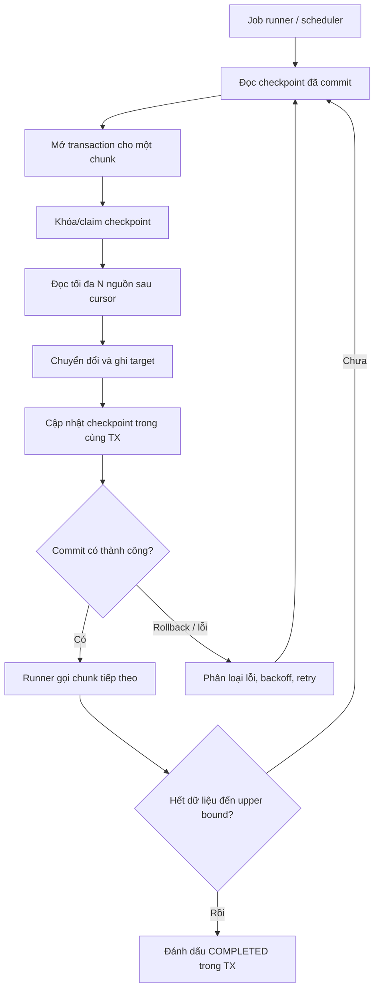

# Chia giao dịch, lưu điểm tiếp tục và chạy lại sau lỗi khi ghi hàng loạt bằng Hibernate

Các tác vụ ghi hàng loạt (*batch write*) thường phải xử lý hàng chục nghìn đến hàng triệu bản ghi: nhập dữ liệu từ hệ thống cũ, đồng bộ dữ liệu theo lô, chuyển đổi schema, tạo bản ghi tổng hợp hoặc cập nhật trạng thái định kỳ. Khác với một request CRUD đơn lẻ, một tác vụ như vậy có thể chạy nhiều phút hoặc nhiều giờ. Nếu ứng dụng bị dừng, database hết kết nối, một hàng dữ liệu không hợp lệ hoặc transaction gặp deadlock, hệ thống cần biết **phần nào đã được ghi bền vững** và **nên chạy lại từ đâu**.

Một thiết kế an toàn cần kết hợp ba ý tưởng:

1. **Chia công việc thành nhiều giao dịch ngắn**: mỗi chunk có transaction riêng, thay vì giữ một transaction khổng lồ.
2. **Lưu checkpoint/điểm tiếp tục**: theo dõi vị trí nguồn đã xử lý và chỉ xác nhận khi dữ liệu đích tương ứng đã commit.
3. **Chạy lại có kiểm soát sau lỗi**: retry ở ranh giới transaction, không gây ghi trùng hoặc bỏ sót dữ liệu.

Với Hibernate, cần hiểu thêm persistence context, `flush()`, `clear()`, JDBC batching, identifier generation, optimistic/pessimistic locking và cách `@Transactional` hoạt động.

**Nguyên tắc xuyên suốt bài:**

> Nếu dữ liệu đích và checkpoint ở **cùng database và cùng transaction**, hãy commit chúng **nguyên tử**. Sau lỗi, đọc lại checkpoint đã commit và tiếp tục. Nếu chúng ở hai hệ thống không có distributed transaction, phải bổ sung idempotency, outbox/inbox hoặc giao thức phục hồi riêng; không được giả định có exactly-once tự động.

## 1. Vì sao không ghi một triệu bản ghi trong một transaction?

Ví dụ đơn giản nhưng rủi ro:

```java
@Transactional
public void importAll(List<LegacyCustomer> source) {
    for (LegacyCustomer item : source) {
        entityManager.persist(convert(item));
    }
}
```

Với `source` chứa một triệu phần tử, có thể gặp:

- Persistence context giữ quá nhiều managed entity và snapshot, gây tăng heap/GC.
- Hibernate cần flush lượng lớn entity và collection.
- Transaction tồn tại lâu, giữ lock/connection và kéo dài thời gian recovery.
- Một lỗi ở bản ghi cuối có thể làm rollback toàn bộ công việc.
- Sau khi process crash, không có mốc nào chứng minh phần nào được commit.
- Retry lại toàn bộ có thể gây trùng dữ liệu nếu có side effect hoặc commit ở nơi khác.

Chỉ tăng `hibernate.jdbc.batch_size` **không giải quyết** việc transaction quá dài. JDBC batching giảm round-trip cho một số statement; transaction chunking quyết định phạm vi commit/rollback.

### 1.1. Phân biệt ba kích thước

| Khái niệm | Ví dụ | Điều khiển điều gì? |
|---|---:|---|
| **Job size** | 1.000.000 records | Tổng khối lượng công việc |
| **Transaction chunk size** | 500 records | Số bản ghi được xử lý trong một transaction |
| **JDBC batch size** | 50 statements | Số statement tương thích mà Hibernate/driver có thể gom khi gửi JDBC batch |
| **Flush interval** | 50–500 entities | Khi nào Hibernate đồng bộ SQL pending với database |

Chunk 500 có thể được gửi thành các JDBC batch khoảng 50 statement tùy SQL shape, driver, ID strategy và cấu hình. `flush()` có thể xảy ra trong chunk nhưng **không phải commit**. Các kích thước không bắt buộc trùng nhau.

## 2. Mục tiêu nhất quán: hoàn thành được, không làm trùng, không bỏ sót

Giả sử có 1.200 customer nguồn, ID tăng dần. Mỗi chunk tối đa 500 bản ghi:

```text
Nguồn:          1 ... 500 | 501 ... 1000 | 1001 ... 1200
Transaction:       TX 1  |     TX 2     |      TX 3
Checkpoint:      last=500 | last=1000    | last=1200
```

Nếu TX 2 lỗi trước khi commit:

```text
TX 1: COMMITTED   -> target có 1..500, checkpoint=500
TX 2: ROLLED BACK -> target không có 501..1000, checkpoint vẫn 500
TX 2 retry        -> đọc tiếp source ID > 500
```

Nếu checkpoint được ghi **trước** hoặc **ở transaction khác** với dữ liệu đích, có thể xảy ra:

- Checkpoint đã tăng lên 1.000, nhưng target chỉ có dữ liệu đến 500 → **mất dữ liệu** khi resume.
- Target đã commit đến 1.000, checkpoint vẫn 500 → retry **ghi trùng** hoặc lỗi unique constraint.

Mục tiêu của thiết kế là tránh cả hai tình huống này trong phạm vi có thể đảm bảo.

## 3. Thuật ngữ quan trọng

| Thuật ngữ | Ý nghĩa |
|---|---|
| **Chunk** | Đơn vị công việc nhỏ, có giới hạn số record |
| **Transaction boundary** | Ranh giới all-or-nothing của một chunk |
| **Checkpoint** | Trạng thái bền vững cho biết phần nguồn đã được commit |
| **Cursor / resume token** | Khóa hoặc vị trí dùng để đọc tiếp |
| **High watermark / upper bound** | Mốc giới hạn tập dữ liệu của một lượt chạy |
| **Idempotency** | Lặp lại một operation không tạo hiệu ứng ngoài mong muốn |
| **At-least-once processing** | Công việc có thể được thực hiện lại sau lỗi |
| **Exactly-once effect** | Kết quả nghiệp vụ được áp dụng đúng một lần trong phạm vi giao thức đã thiết kế |
| **Poison record** | Bản ghi liên tục gây lỗi không thể xử lý bằng retry thông thường |
| **Retryable failure** | Lỗi tạm thời có khả năng thành công khi chạy lại |
| **Commit uncertainty** | Client không biết transaction đã commit hay chưa do mất kết nối/phản hồi |

Một checkpoint chỉ có giá trị nếu được **gắn với transaction đã hoàn tất**. “Đã gọi `persist()`” hoặc “đã chạy `flush()`” không đủ để công bố record đã được xử lý bền vững.

## 4. Kiến trúc tổng quát



**Job runner không giữ một transaction bao trùm toàn bộ job**. Mỗi lời gọi `processChunk(...)` là một unit of work riêng. Sau khi method transaction hoàn tất, runner mới gọi chunk tiếp theo.

Nếu nguồn/đích cùng database, có thể khóa checkpoint và cập nhật dữ liệu đích trong cùng transaction. Nếu nguồn là một hệ thống khác, phần đọc có thể không nằm trong cùng transaction nhưng checkpoint + target writes vẫn cần một giao thức đảm bảo không bỏ sót và chống trùng.

## 5. Thiết kế ví dụ: di chuyển customer trong cùng database

Để có một ví dụ nhất quán, giả sử:

- Bảng `legacy_customer` là nguồn.
- Bảng `normalized_customer` là đích.
- Cả hai bảng và bảng checkpoint nằm trong **cùng một database**.
- Source ID là `BIGINT` duy nhất, ổn định, có thể sắp tăng.
- Job được khởi tạo một lần với `jobId` riêng và giới hạn `upperBoundId`.
- Mỗi source ID sẽ tạo một target row mang cùng source ID.
- Ứng dụng không ghi thêm side effect ngoài database trong transaction import.

DDL minh họa:

```sql
CREATE TABLE legacy_customer (
    id BIGINT PRIMARY KEY,
    full_name VARCHAR(200) NOT NULL,
    email VARCHAR(255) NOT NULL
);

CREATE TABLE normalized_customer (
    source_id BIGINT PRIMARY KEY,
    display_name VARCHAR(200) NOT NULL,
    email VARCHAR(255) NOT NULL
);

CREATE TABLE import_checkpoint (
    job_id VARCHAR(100) PRIMARY KEY,
    status VARCHAR(24) NOT NULL,
    last_committed_id BIGINT NOT NULL,
    upper_bound_id BIGINT NOT NULL,
    processed_count BIGINT NOT NULL,
    version BIGINT NOT NULL
);
```

Target dùng `source_id` làm khóa chính ổn định. Điều này giúp database ngăn ghi trùng cùng source ID. Khóa chính không tự giải quyết toàn bộ idempotency trong mọi nghiệp vụ, nhưng tạo một lớp bảo vệ quan trọng.

### 5.1. Entity nguồn

```java
import jakarta.persistence.*;

@Entity
@Table(name = "legacy_customer")
public class LegacyCustomer {

    @Id
    private Long id;

    @Column(name = "full_name", nullable = false)
    private String fullName;

    @Column(nullable = false)
    private String email;

    protected LegacyCustomer() {}

    public Long getId() {
        return id;
    }

    public String getFullName() {
        return fullName;
    }

    public String getEmail() {
        return email;
    }
}
```

Dữ liệu nguồn không được sửa bởi job trong ví dụ. Nếu source có thay đổi đồng thời, cần thêm chính sách snapshot; phần sau sẽ giải thích.

### 5.2. Entity đích

```java
@Entity
@Table(name = "normalized_customer")
public class NormalizedCustomer {

    @Id
    @Column(name = "source_id")
    private Long sourceId;

    @Column(name = "display_name", nullable = false)
    private String displayName;

    @Column(nullable = false)
    private String email;

    protected NormalizedCustomer() {}

    public NormalizedCustomer(
            Long sourceId,
            String displayName,
            String email) {

        this.sourceId = sourceId;
        this.displayName = displayName;
        this.email = email;
    }
}
```

Không dùng IDENTITY generator trong ví dụ này; ID đích lấy trực tiếp từ source, nên nhiều INSERT có thể được JDBC batch nếu những điều kiện khác phù hợp.

### 5.3. Entity checkpoint

```java
import jakarta.persistence.*;

public enum ImportStatus {
    RUNNING, COMPLETED, FAILED, PAUSED
}

@Entity
@Table(name = "import_checkpoint")
public class ImportCheckpoint {

    @Id
    @Column(name = "job_id", length = 100)
    private String jobId;

    @Enumerated(EnumType.STRING)
    @Column(nullable = false, length = 24)
    private ImportStatus status;

    @Column(name = "last_committed_id", nullable = false)
    private long lastCommittedId;

    @Column(name = "upper_bound_id", nullable = false)
    private long upperBoundId;

    @Column(name = "processed_count", nullable = false)
    private long processedCount;

    @Version
    @Column(nullable = false)
    private long version;

    protected ImportCheckpoint() {}

    public ImportCheckpoint(String jobId, long upperBoundId) {
        this.jobId = jobId;
        this.upperBoundId = upperBoundId;
        this.lastCommittedId = 0L;
        this.processedCount = 0L;
        this.status = ImportStatus.RUNNING;
    }

    public ImportStatus getStatus() {
        return status;
    }

    public long getLastCommittedId() {
        return lastCommittedId;
    }

    public long getUpperBoundId() {
        return upperBoundId;
    }

    public long getProcessedCount() {
        return processedCount;
    }

    public void commitProgress(long sourceId, long rows) {
        if (sourceId < lastCommittedId) {
            throw new IllegalArgumentException(
                "Cursor cannot move backwards"
            );
        }
        this.lastCommittedId = sourceId;
        this.processedCount += rows;
    }

    public void complete() {
        this.status = ImportStatus.COMPLETED;
    }
}
```

Ví dụ khởi đầu tại `lastCommittedId = 0` giả định mọi source ID hợp lệ đều **lớn hơn 0**. Nếu source có ID âm, bằng 0 hoặc khóa khác kiểu, phải dùng cursor nullable/sentinel ngoài miền giá trị và query so sánh phù hợp.

`@Version` giúp phát hiện cập nhật checkpoint cạnh tranh khi dùng optimistic locking. Trong phần xử lý chunk, chúng ta còn khóa checkpoint bằng pessimistic lock để tránh hai worker đọc cùng cursor đồng thời.

## 6. Khởi tạo job và đóng khung dữ liệu nguồn

Một job cần biết xử lý đến đâu. Nếu liên tục đọc mọi record mới phát sinh, job có thể chạy không kết thúc hoặc số liệu tổng thay đổi liên tục.

Tại thời điểm khởi tạo, lấy `MAX(id)` làm **upper watermark**:

```java
@Service
public class ImportJobService {

    @PersistenceContext
    private EntityManager em;

    @Transactional
    public void start(String jobId) {
        Long maxId = em.createQuery(
            "select max(c.id) from LegacyCustomer c",
            Long.class
        ).getSingleResult();

        long upper = maxId == null ? 0L : maxId;

        em.persist(new ImportCheckpoint(jobId, upper));
    }
}
```

Bảng checkpoint lưu:

```text
job_id = import-customers-2026-11
last_committed_id = 0
upper_bound_id = 1200
status = RUNNING
processed_count = 0
```

Nếu trong lúc chạy có source ID 1.201, job này sẽ không lấy nó; có thể dành cho lượt sau.

### 6.1. Upper watermark không phải snapshot hoàn chỉnh

`MAX(id)` chỉ tạo giới hạn khóa. Nó **không bảo đảm** trạng thái dữ liệu nguồn “đúng tại thời điểm start” nếu:

- Một source row có ID nhỏ hơn upper bound được thêm muộn bằng backfill.
- Row nguồn bị cập nhật/xóa trong lúc job chạy.
- ID không được cấp theo thứ tự commit.
- Query còn lọc theo trạng thái mutable.

Với yêu cầu snapshot chính xác, cân nhắc chụp danh sách source ID và phiên bản vào **staging table**, dùng cơ chế consistent snapshot/CDC hoặc định nghĩa quy tắc phiên bản rõ. Cursor là giải pháp đọc tiếp, không tự tạo tính nhất quán thời gian cho nguồn dữ liệu động.

## 7. Đọc tiếp bằng keyset cursor, không bằng OFFSET

Truy vấn nguồn cho mỗi chunk:

```hql
select c
from LegacyCustomer c
where c.id > :lastCommittedId
  and c.id <= :upperBoundId
order by c.id
```

Gắn `setMaxResults(chunkSize)` để chỉ lấy một đoạn.

Ví dụ:

```java
List<LegacyCustomer> source = em.createQuery(
    """
    select c
    from LegacyCustomer c
    where c.id > :last
      and c.id <= :upper
    order by c.id
    """,
    LegacyCustomer.class
)
.setParameter("last", checkpoint.getLastCommittedId())
.setParameter("upper", checkpoint.getUpperBoundId())
.setMaxResults(chunkSize)
.getResultList();
```

Nếu cursor là 500, truy vấn lấy các source ID lớn hơn 500 (tối đa upper). Các khoảng ID bị thiếu không gây vấn đề: cursor lưu **ID cuối đã xử lý**, không lưu “số bản ghi đã xử lý”.

### 7.1. Vì sao không dùng `OFFSET page * size`?

Giả sử đọc:

```sql
SELECT ...
FROM legacy_customer
ORDER BY id
LIMIT 500 OFFSET 500;
```

Nếu nguồn có hàng mới được chèn, xóa hoặc thay đổi thứ tự, các trang OFFSET có thể lặp hoặc bỏ sót. Offset lớn còn có thể làm database phải duyệt/bỏ qua nhiều hàng.

Keyset:

```sql
WHERE id > :cursor
ORDER BY id
LIMIT :chunkSize
```

thường ổn định hơn khi khóa sắp xếp **duy nhất và không đổi**, đồng thời có index phù hợp.

### 7.2. Không dùng ID không ổn định làm cursor

Các giá trị như `updatedAt` không đủ an toàn nếu record có thể đổi thời gian trong lúc job chạy. Nếu phải đọc theo timestamp, thường cần khóa tổng hợp:

```text
(lastTimestamp, lastId)
```

với điều kiện:

```sql
WHERE updated_at > :lastTime
   OR (updated_at = :lastTime AND id > :lastId)
ORDER BY updated_at, id
```

Nhưng nếu `updated_at` vẫn thay đổi sau khi cursor đi qua, phải có protocol snapshot/CDC hoặc cơ chế tránh bỏ sót riêng. Thêm `id` chỉ giải quyết tie-break, không tự giải quyết biến động thứ tự của source.

## 8. Transaction chunk hoàn chỉnh bằng Hibernate và Spring

Trong ứng dụng Spring Boot/JPA, có thể tạo worker xử lý **một chunk mỗi lần gọi**.

```java
public record ChunkResult(
    int processed,
    long lastCommittedId,
    boolean finished
) {}
```

Implementation:

```java
import jakarta.persistence.EntityManager;
import jakarta.persistence.LockModeType;
import jakarta.persistence.PersistenceContext;
import org.springframework.stereotype.Service;
import org.springframework.transaction.annotation.Transactional;

import java.util.List;

@Service
public class CustomerChunkWorker {

    @PersistenceContext
    private EntityManager em;

    @Transactional
    public ChunkResult processChunk(
            String jobId,
            int chunkSize) {

        if (chunkSize < 1 || chunkSize > 1000) {
            throw new IllegalArgumentException(
                "chunkSize must be in 1..1000"
            );
        }

        // Khóa job row để các worker không xử lý
        // cùng khoảng cursor của một job.
        ImportCheckpoint job = em.find(
            ImportCheckpoint.class,
            jobId,
            LockModeType.PESSIMISTIC_WRITE
        );

        if (job == null) {
            throw new IllegalArgumentException(
                "Unknown import job: " + jobId
            );
        }

        if (job.getStatus() == ImportStatus.COMPLETED) {
            return new ChunkResult(
                0, job.getLastCommittedId(), true
            );
        }

        if (job.getStatus() != ImportStatus.RUNNING) {
            throw new IllegalStateException(
                "Import is not running"
            );
        }

        List<LegacyCustomer> rows = em.createQuery(
            """
            select c
            from LegacyCustomer c
            where c.id > :cursor
              and c.id <= :upper
            order by c.id
            """,
            LegacyCustomer.class
        )
        .setParameter("cursor", job.getLastCommittedId())
        .setParameter("upper", job.getUpperBoundId())
        .setMaxResults(chunkSize)
        .getResultList();

        if (rows.isEmpty()) {
            job.complete();
            em.flush();
            return new ChunkResult(
                0, job.getLastCommittedId(), true
            );
        }

        long maxProcessedId = job.getLastCommittedId();

        for (LegacyCustomer source : rows) {
            NormalizedCustomer target =
                new NormalizedCustomer(
                    source.getId(),
                    source.getFullName().strip(),
                    source.getEmail()
                );

            em.persist(target);
            maxProcessedId = source.getId();
        }

        // Cùng transaction với target INSERTs.
        job.commitProgress(maxProcessedId, rows.size());

        // Đồng bộ SQL, nhưng CHƯA commit.
        em.flush();

        // Giải phóng managed objects ở cuối chunk.
        // Toàn bộ thay đổi cần ghi đã flush.
        em.clear();

        // Spring transaction interceptor sẽ commit
        // sau khi method hoàn tất bình thường.
        return new ChunkResult(
            rows.size(), maxProcessedId, false
        );
    }
}
```

### 8.1. Vì sao checkpoint được cập nhật trong cùng transaction?

Nếu mọi INSERT đích và UPDATE checkpoint cùng sử dụng `EntityManager`/transaction/database connection do Spring quản lý, chúng là một transaction database:

```text
BEGIN
  SELECT checkpoint ... FOR UPDATE
  SELECT source ... WHERE id > cursor LIMIT N
  INSERT normalized_customer ...
  INSERT normalized_customer ...
  UPDATE import_checkpoint SET last_committed_id = ...
COMMIT
```

Nếu transaction rollback, các INSERT lẫn checkpoint update đều bị hủy. Nếu commit thành công, cả hai cùng bền vững.

### 8.2. Tại sao có `em.flush()`?

`persist()` không có nghĩa mọi INSERT đã được gửi ngay. Hibernate có thể giữ thay đổi pending trong persistence context và gửi SQL tại flush. Explicit `flush()` giúp phát hiện một số lỗi trước khi kết thúc method, và có thể điều khiển thời điểm JDBC batching.

Nhưng **`flush()` không phải `commit()`**. Nếu sau flush transaction rollback, SQL đã gửi vẫn phải bị rollback theo semantics database transaction.

### 8.3. Tại sao có `em.clear()`?

`clear()` detach entity khỏi persistence context, tránh giữ tham chiếu/snapshot quá nhiều. Trong ví dụ, nó được gọi **sau** khi mọi INSERT và checkpoint update đã flush, nên không làm mất thay đổi pending.

Nếu gọi `clear()` trước khi flush, thay đổi chưa đồng bộ có thể bị bỏ khỏi persistence context, và checkpoint có thể bị detach khiến phần cập nhật sau đó không được ghi. Cần kiểm soát thứ tự.

Với chunk nhỏ và transaction kết thúc ngay sau method, `clear()` không phải lúc nào cũng cần; nó minh họa lifecycle quản lý memory. Nếu flush/clear nhiều lần trong cùng chunk, phải tính tới việc checkpoint bị detach và nguồn entity lazy có thể không dùng được sau clear.

### 8.4. Điều gì xảy ra sau khi method return?

Trong Spring proxy transaction bình thường, advice `@Transactional` sẽ thực hiện commit sau khi method target kết thúc thành công và trước khi **caller nhận kết quả hoàn chỉnh**. Nếu commit thất bại, caller thường nhận exception thay vì một thành công chắc chắn.

Không gọi log “chunk committed” ngay **bên trong** method trước khi commit thực sự xảy ra. Ở trong method, trạng thái đúng nhất là “đã flush/chuẩn bị commit”.

### 8.5. Vì sao không có một transaction bao toàn bộ vòng lặp?

Worker chỉ xử lý **một** chunk. Một runner khác gọi lại method nhiều lần. Mỗi lời gọi có transaction độc lập, giúp checkpoint có ý nghĩa sau từng chunk.

## 9. Orchestrator nằm ngoài transaction

Một runner có thể thực hiện các chunk liên tiếp:

```java
@Component
public class ImportRunner {

    private final CustomerChunkWorker worker;

    public ImportRunner(CustomerChunkWorker worker) {
        this.worker = worker;
    }

    // KHÔNG đặt @Transactional trên method này.
    public void run(String jobId) {
        while (true) {
            ChunkResult result =
                worker.processChunk(jobId, 500);

            if (result.finished()) {
                return;
            }

            System.out.println(
                "Committed through source ID "
                    + result.lastCommittedId()
            );
        }
    }
}
```

Ở đây `ImportRunner` và `CustomerChunkWorker` là hai Spring beans khác nhau. Lời gọi `worker.processChunk(...)` đi qua transaction proxy để mở và commit transaction cho từng chunk.

### 9.1. Pitfall: self-invocation làm `@Transactional` không có hiệu lực như mong muốn

Sai kỳ vọng:

```java
@Service
public class ImportService {

    public void run(String jobId) {
        while (...) {
            processChunk(jobId); // Lời gọi nội bộ this.processChunk.
        }
    }

    @Transactional
    public void processChunk(String jobId) {
        // ...
    }
}
```

Trong cấu hình Spring AOP proxy thông thường, lời gọi nội bộ cùng bean có thể **bỏ qua proxy**, khiến annotation ở method được gọi không tạo transaction mới như người viết kỳ vọng.

Hãy gọi qua bean khác, dùng `TransactionTemplate` hoặc thiết kế transaction boundary chủ động theo framework thay vì dựa vào self-invocation.

### 9.2. Pitfall: transaction của runner bao trùm chunk

Nếu runner đã nằm trong `@Transactional`, method chunk với propagation mặc định `REQUIRED` có thể **join transaction bên ngoài** thay vì tạo transaction mới. Khi đó 100 chunk có thể vẫn chỉ commit một lần, checkpoint không được lưu bền vững sau từng chunk.

Các lựa chọn:

- Runner không có transaction; worker `@Transactional` thông thường.
- Nếu phải gọi từ context có transaction, cân nhắc `Propagation.REQUIRES_NEW` ở một bean được gọi qua proxy, cùng đánh giá connection pool và semantics.
- Dùng `TransactionTemplate` để đánh dấu ranh giới mỗi chunk rõ ràng.

Không đặt `REQUIRES_NEW` ở khắp nơi mà không hiểu chi phí connection/lock và cách transaction bên ngoài vẫn tồn tại.

## 10. Spring `TransactionTemplate`: ranh giới rõ bằng mã

Nếu không muốn phụ thuộc vào AOP method boundary, có thể chủ động chia transaction:

```java
@Service
public class ImportCoordinator {

    private final TransactionTemplate txTemplate;
    private final ChunkProcessor processor;

    public ImportCoordinator(
            PlatformTransactionManager txManager,
            ChunkProcessor processor) {

        this.txTemplate = new TransactionTemplate(txManager);
        this.processor = processor;
    }

    public void run(String jobId) {
        while (true) {
            ChunkResult result = txTemplate.execute(
                status -> processor.processOneChunk(jobId, 500)
            );

            if (result.finished()) {
                return;
            }
        }
    }
}
```

Trong ví dụ ý tưởng, `ChunkProcessor.processOneChunk` phải sử dụng persistence context do transaction manager hiện tại quản lý và không tự khởi tạo transaction xung đột. `TransactionTemplate` mặc định có propagation `REQUIRED`; nếu gọi từ transaction bên ngoài, nó cũng có thể join transaction đó. Cần đảm bảo runner không giữ outer transaction hoặc cấu hình propagation phù hợp.

Điểm quan trọng không phải “annotation hay template tốt hơn”; mà là **mỗi chunk thực sự commit riêng**.

## 11. JDBC batching trong mỗi chunk

Cấu hình Hibernate điển hình:

```properties
hibernate.jdbc.batch_size=50
hibernate.order_inserts=true
hibernate.order_updates=true
```

Trong Spring Boot:

```properties
spring.jpa.properties.hibernate.jdbc.batch_size=50
spring.jpa.properties.hibernate.order_inserts=true
spring.jpa.properties.hibernate.order_updates=true
```

Batching có thể gom các INSERT/UPDATE có SQL shape tương thích để giảm round-trip. Số statement/batch thực tế phụ thuộc mapping, driver, flush order và ID generation strategy.

### 11.1. IDENTITY có thể hạn chế insert batching

Nếu entity dùng:

```java
@Id
@GeneratedValue(strategy = GenerationType.IDENTITY)
private Long id;
```

Hibernate thường cần INSERT để biết identity do database cấp và có thể không batch INSERT cho entity đó theo cách mong muốn. Với workload cần insert batching, cân nhắc SEQUENCE với allocation/optimizer phù hợp (nếu DBMS hỗ trợ) hoặc khóa định danh được cấp từ nguồn như trong ví dụ.

Không đổi chiến lược ID chỉ để benchmark nhanh hơn nếu nó vi phạm thiết kế khóa hoặc portability. Hãy đo trên DBMS/driver thực tế.

### 11.2. Batch size khác transaction size

`hibernate.jdbc.batch_size=50` không có nghĩa cứ 50 record database commit một lần. Commit do transaction manager quyết định.

```text
Transaction chunk: 500 records
JDBC batch:         up to 50 statements
Flush:              cuối chunk
Commit:             1 lần sau khi chunk hoàn tất
```

JDBC driver có thể xử lý batch không chính xác theo chia 50/50 hoặc có statement khác chen vào. Đừng viết logic correctness phụ thuộc số lần `executeBatch`.

### 11.3. Batching với optimistic version

Khi batch UPDATE entity có `@Version`, Hibernate vẫn cần xác định rows affected để phát hiện stale update. Driver/DBMS có thể trả batch update counts khác nhau; behavior và một số setting legacy thay đổi theo Hibernate version.

Nên kiểm tra optimistic locking bằng integration test trên DBMS/driver đang dùng, đặc biệt sau nâng Hibernate. Không tắt version check chỉ để tăng throughput.

## 12. Flush/clear định kỳ trong chunk lớn

Nếu chunk cần xử lý 5.000–10.000 records nhưng không muốn giữ tất cả managed entities, có thể flush/clear theo nhịp nhỏ hơn. Nhưng phải quản lý checkpoint và entity references cẩn thận.

Mẫu ý tưởng:

```java
int flushedSinceLastClear = 0;

for (LegacyCustomer source : sources) {
    entityManager.persist(convert(source));
    flushedSinceLastClear++;

    if (flushedSinceLastClear >= 100) {
        entityManager.flush();
        entityManager.clear();
        flushedSinceLastClear = 0;
    }
}

// Flush những thay đổi còn pending.
entityManager.flush();
```

**Không copy nguyên ví dụ này vào method đang giữ managed checkpoint rồi tiếp tục sửa checkpoint mà không reload/reattach**, vì `clear()` detach cả checkpoint và source entities. Có thể:

- Dùng chunk transaction nhỏ để không cần clear giữa vòng lặp.
- Chỉ xử lý scalar/DTO nguồn đã đọc thay vì entity lazy.
- Sau khi clear, load lại checkpoint theo ID trong cùng transaction rồi cập nhật cuối chunk.
- Tổ chức persistence context và các object đang managed theo ranh giới flush.

Một lần `flush()` giữa chunk không tạo checkpoint trung gian đã commit. Nếu exception xảy ra sau đó, **toàn bộ transaction chunk rollback**, kể cả các SQL đã flush trước đó.

## 13. Checkpoint nên lưu những trường gì?

Một bảng checkpoint tối thiểu nên có:

| Trường | Ý nghĩa |
|---|---|
| `job_id` | Danh tính duy nhất của lượt chạy |
| `status` | `RUNNING`, `PAUSED`, `FAILED`, `COMPLETED` |
| `last_committed_id` | Cursor nguồn đã được commit thành công |
| `upper_bound_id` | Giới hạn nguồn của lượt chạy |
| `processed_count` | Số record đã được ghi thành công theo protocol |
| `version` | Phát hiện cập nhật checkpoint cạnh tranh |

Trong sản phẩm thật có thể bổ sung:

- `started_at`, `updated_at`, `completed_at`.
- `last_error_code`, `last_error_at`.
- `attempt_count` và `retry_after_at`.
- `worker_id` hoặc `lease_owner`.
- `heartbeat_at`, `lease_expires_at`.
- `source_snapshot_id`/`schema_version`/`transform_version`.
- `failed_count`, `skipped_count` và reason audit.

Không đưa toàn bộ stack trace lớn vào một cột checkpoint. Log/trace có thể lưu chi tiết, checkpoint chỉ cần metadata đủ cho điều phối và phục hồi.

### 13.1. Cursor là vị trí, count là số lượng

Nếu source ID là:

```text
10, 20, 21, 100, 150
```

sau ba record, cursor phải là `21`, không phải `3`. `processed_count=3` chỉ dùng thống kê; khi resume, truy vấn `WHERE id > 21`.

Không dùng `processed_count` làm OFFSET để tiếp tục trên tập nguồn đang biến đổi.

## 14. Ma trận lỗi và trạng thái cần có sau recovery

| Thời điểm lỗi | Target writes | Checkpoint đã commit | Hành động khi chạy lại |
|---|---|---|---|
| Trước khi bắt đầu chunk | Chưa có | Cursor cũ | Chạy chunk bình thường |
| Sau khi đọc source, trước persist | Không có write bền vững | Cursor cũ | Đọc lại chunk |
| Giữa vòng persist nhưng trước commit | Rollback cùng transaction | Cursor cũ | Retry nguyên chunk |
| Sau `flush()` nhưng trước commit | SQL đã gửi nhưng rollback nếu TX lỗi | Cursor cũ | Retry nguyên chunk |
| Trong `commit()`, client mất kết nối | **Không chắc** commit hay rollback | **Phải đọc lại từ DB** | Reload checkpoint, không đoán |
| Commit thành công, trước khi runner nhận ACK | Writes và checkpoint đều đã commit | Cursor mới | Đọc checkpoint mới và tiếp tục |
| Sau khi hoàn tất, process crash | Dữ liệu đã commit | `COMPLETED` | Không chạy lại job như job mới |

Với cùng database transaction, commit của target và checkpoint có tính nguyên tử. Khi client không biết outcome, đọc trạng thái được lưu bền vững từ database thay vì tăng cursor bằng biến local.

### 14.1. Đừng tăng cursor trong RAM rồi coi là thành công

Sai:

```java
lastProcessedId = source.getId();
entityManager.persist(target);
// Vòng lặp hoàn tất rồi gửi message "done" trước commit.
```

`lastProcessedId` trong Java chỉ là trạng thái tạm. Nó không chứng minh database đã commit. Khi process chết, biến mất; khi commit thất bại, giá trị đó không còn đúng.

Checkpoint phải được lưu và xác nhận **trong transaction của dữ liệu đích**.

## 15. Retry phải bắt đầu ở ranh giới transaction mới

Sau một lỗi database, transaction hiện tại có thể đã bị đánh dấu rollback-only. Không nên bắt exception trong cùng `@Transactional` rồi tiếp tục persist các record còn lại như chưa có gì xảy ra.

Anti-pattern:

```java
@Transactional
public void writeChunk(List<Item> items) {
    for (Item item : items) {
        try {
            entityManager.persist(convert(item));
            entityManager.flush();
        } catch (PersistenceException ex) {
            // Bỏ qua rồi tiếp tục: rất nguy hiểm.
        }
    }
}
```

Sau lỗi constraint/JDBC, trạng thái Hibernate Session và transaction có thể không còn phù hợp để dùng tiếp. Đặc biệt, flush exception không nên được xử lý như một cảnh báo đơn giản để “cố ghi phần còn lại”.

### 15.1. Mô hình retry an toàn

1. Cho chunk transaction hiện tại rollback.
2. Để exception thoát ra ngoài transactional boundary.
3. Phân loại lỗi ở runner.
4. Nếu retryable, backoff **ngoài** transaction.
5. Mở transaction mới.
6. Đọc lại checkpoint đã commit.
7. Query lại source sau cursor.
8. Ghi lại chunk.

Không reuse `EntityManager`/Session đã lỗi hoặc `Predicate`/managed object của transaction cũ cho lần retry mới.

## 16. Phân loại lỗi transient và permanent

Một retry policy thực tế cần phân biệt:

**Lỗi có thể tạm thời:**

- Deadlock victim hoặc serialization failure.
- Lock timeout do cạnh tranh.
- Mất kết nối tạm thời.
- Database failover ngắn.
- Một số lỗi tài nguyên có thể phục hồi.

**Lỗi thường không tự hết khi retry cùng dữ liệu:**

- Unique constraint vì source/target mapping sai.
- NOT NULL/foreign-key violation do dữ liệu hỏng.
- Giá trị vượt cột `VARCHAR` hoặc numeric overflow.
- Bug trong hàm chuyển đổi.
- SQL syntax error.
- Thiếu bảng/cột hoặc migration chưa chạy.
- Một source record vi phạm business rule.

Không retry vô hạn mọi `RuntimeException`.

### 16.1. SQLState và vendor code chỉ là gợi ý

SQLException có `SQLState` và vendor-specific error code. Chúng hữu ích để nhận biết deadlock, serialization failure hoặc connection problem, nhưng không có một classifier portable hoàn hảo cho mọi DBMS/driver.

Ví dụ SQLState class `40` thường liên quan transaction rollback, `08` liên quan connection exception theo phân loại SQLState. Tuy nhiên, cần kiểm tra vendor error code và exception translation của framework; **không retry tự động mọi lỗi có prefix đó mà chưa hiểu idempotency**.

Một service có thể dùng Spring `DataAccessException` hierarchy hoặc Retry library, nhưng cần test policy với driver thật.

## 17. Bounded retry và exponential backoff

Pseudo-code runner với retry:

```java
int maxRetries = 5;
int failures = 0;

while (true) {
    try {
        ChunkResult result =
            chunkWorker.processChunk(jobId, 500);

        failures = 0; // Chunk này đã commit.

        if (result.finished()) {
            break;
        }
    } catch (RuntimeException ex) {
        if (!retryPolicy.isRetryable(ex)
                || failures >= maxRetries) {
            throw ex;
        }

        failures++;

        Duration delay =
            retryPolicy.backoffWithJitter(failures);

        sleeper.sleep(delay); // Ở NGOÀI transaction.
    }
}
```

`retryPolicy` và `sleeper` là những thành phần ứng dụng cần triển khai; ví dụ diễn đạt luồng xử lý, không phải API có sẵn của Hibernate.

Nên dùng:

- Số lần retry tối đa.
- Exponential backoff có giới hạn.
- Jitter để các worker không cùng retry một lúc.
- Timeout toàn job hoặc từng chunk.
- Cancellation/PAUSED state.
- Metrics cho retry và lỗi.

**Không sleep khi đang giữ transaction và database lock**, nếu có thể tránh.

### 17.1. Vì sao đặt `failures = 0` sau chunk thành công?

Retry count cần gắn với một chunk/lỗi liên tiếp. Một job kéo dài có thể thỉnh thoảng gặp transient failure; không nên cộng dồn mọi lỗi lịch sử để khiến retry thứ năm ở cuối job bị từ chối vô lý.

Ngoài ra, nếu cùng chunk liên tục lỗi permanent, classifier phải dừng sớm thay vì để runner xử lý vòng lặp vô hạn.

## 18. “Commit outcome unknown”: tình huống cần idempotency

Giả sử ứng dụng gọi `commit()`, database commit thành công nhưng network đứt trước khi client nhận phản hồi.

Client thấy exception. Điều nguy hiểm là không biết có nên ghi lại chunk không.

Với **target và checkpoint trong cùng transaction**, có thể giải quyết như sau:

1. Bỏ Session/connection bị lỗi.
2. Mở transaction/session mới.
3. Đọc `ImportCheckpoint` từ primary database với policy nhất quán.
4. Nếu cursor đã tiến, nghĩa là checkpoint + target đã cùng commit.
5. Nếu cursor chưa tiến, chunk chưa được xác nhận; retry từ cursor cũ.
6. Nếu trạng thái database không thể xác minh, giữ job ở trạng thái cần điều tra thay vì ghi mù.

Nếu database có replica lag, tránh quyết định commit outcome chỉ từ replica có thể đang chậm. Đọc nguồn nhất quán phù hợp, thường là primary hoặc cơ chế read-your-writes đáng tin cậy.

### 18.1. Không dựa vào response của worker như checkpoint duy nhất

Nếu message queue/HTTP runner không nhận được ACK, nó có thể gửi yêu cầu lại. Checkpoint bền vững và idempotent target key phải là cơ chế tự bảo vệ, không chỉ một biến `processed=true` ở caller.

## 19. Idempotency: lặp lại không tạo thêm hiệu ứng

Một phép xử lý là idempotent nếu lặp cùng input có cùng tác động nghiệp vụ như thực hiện một lần.

Trong ví dụ:

```sql
normalized_customer.source_id BIGINT PRIMARY KEY
```

Một source ID chỉ có một target row. Nhưng **unique constraint không tự biến `persist()` lặp lại thành thành công**: INSERT lần hai thường ném duplicate-key exception và rollback chunk. Nó ngăn dữ liệu trùng chứ chưa bảo đảm rerun suôn sẻ.

Có những lựa chọn:

### 19.1. Dựa vào atomic checkpoint cho cùng job

Nếu mỗi chunk commit target + cursor cùng transaction, khi retry **cùng job ID** sau lỗi không rõ outcome, runner đọc checkpoint mới rồi không gửi lại chunk đã commit. Trong luồng chuẩn, không gặp duplicate INSERT do replay.

Đây là thiết kế đơn giản nhất khi nguồn/đích/checkpoint cùng database và chỉ một writer hợp lệ cho job.

### 19.2. Dùng upsert theo khóa nghiệp vụ

Nếu job có thể chạy lại từ đầu hoặc nhiều job trùng phạm vi, dùng thao tác ghi theo khóa ổn định:

```sql
-- Ví dụ PostgreSQL; không portable nguyên văn.
INSERT INTO normalized_customer (
    source_id, display_name, email
)
VALUES (:id, :name, :email)
ON CONFLICT (source_id)
DO UPDATE SET
    display_name = EXCLUDED.display_name,
    email = EXCLUDED.email;
```

Upsert làm operation có tính lặp lại hơn **nếu** mapping deterministic, không có side effect ẩn và semantics update là điều ứng dụng mong muốn.

MySQL, SQL Server, Oracle và DBMS khác có cú pháp/edge cases riêng. Không dán `ON CONFLICT` vào HQL/JPA rồi giả định Hibernate tự chuẩn hóa trên mọi DBMS.

### 19.3. Dùng bảng dedup/processed ledger

Có thể lưu:

```sql
CREATE TABLE processed_record (
    job_id VARCHAR(100) NOT NULL,
    source_id BIGINT NOT NULL,
    processed_at TIMESTAMP NOT NULL,
    PRIMARY KEY (job_id, source_id)
);
```

Ledger hữu ích khi mỗi record có trạng thái riêng hoặc khi chunk chứa các item đã được xử lý theo một giao thức at-least-once. Nhưng ledger phải được cập nhật nguyên tử với target effect hoặc có quy tắc bù trừ/outbox; một bảng “đã xử lý” commit riêng không tự bảo đảm đúng.

### 19.4. Không dùng `find()` trước mỗi INSERT chỉ vì sợ trùng

```java
if (em.find(NormalizedCustomer.class, sourceId) == null) {
    em.persist(new NormalizedCustomer(...));
}
```

Cách này có thể thêm N lần SELECT, tạo race giữa check và insert, và giảm throughput. Chỉ dùng khi semantics và workload phù hợp; uniqueness/upsert/atomic checkpoint thường là lựa chọn dễ chứng minh hơn.

## 20. Idempotency với update và delete

Batch job không chỉ INSERT. Khi UPDATE, cần hỏi:

- Update là **gán một trạng thái cố định** hay **tăng/giảm một giá trị**?
- Nếu chạy lại, kết quả có thay đổi lần nữa không?
- Có trigger hoặc audit ghi thêm event không?
- Có optimistic version guard không?

Ví dụ tương đối idempotent:

```sql
UPDATE purchase_order
SET status = 'ARCHIVED'
WHERE id = :id
  AND status = 'CANCELLED';
```

Sau lần đầu, bản ghi không còn CANCELLED, lần chạy lại có thể ảnh hưởng 0 hàng. Nhưng audit trigger hoặc business event có thể làm semantics tổng thể phức tạp hơn.

Ví dụ **không idempotent**:

```sql
UPDATE account
SET balance = balance + 100
WHERE id = :id;
```

Chạy hai lần làm tăng 200. Muốn bảo đảm chỉ cộng một lần, cần idempotency key/ledger giao dịch hoặc protocol riêng. Không thể dựa vào checkpoint đơn giản nếu side effect commit tách rời.

DELETE cũng cần xét foreign key, soft delete, audit và cascade. Chạy lại DELETE có thể ảnh hưởng 0 hàng nhưng vẫn cần phân biệt “đã xóa đúng” với “ID không tồn tại từ đầu”.

## 21. Khi checkpoint và target ở hai hệ thống

Một trường hợp thường gặp:

```text
Source:     Kafka / S3 / REST API / DB A
Target:     DB B
Checkpoint: Redis / file / DB C
```

Không có một local database transaction duy nhất bao trùm toàn bộ các hệ thống. Khi đó:

- Commit target rồi update checkpoint có thể crash ở giữa.
- Update checkpoint rồi commit target có thể làm bỏ sót dữ liệu.
- Ghi file checkpoint bằng local filesystem không đồng nghĩa atomic với database commit.
- Publish message bên ngoài transaction có thể xảy ra nhưng transaction database rollback.

### 21.1. Phân biệt các bảo đảm

| Thiết kế | Bảo đảm điển hình |
|---|---|
| Target + checkpoint trong cùng DB transaction | Atomic commit trong DB đó |
| Target DB và checkpoint ngoài DB, không coordination | Có cửa sổ lỗi giữa hai lần ghi |
| At-least-once + unique/upsert/ledger | Có thể đạt hiệu ứng không trùng với operation được thiết kế |
| Transactional outbox + idempotent consumer | Giảm rủi ro dual-write và hỗ trợ replay |
| Distributed transaction/XA | Có thể cung cấp atomicity across participants khi triển khai đúng, với chi phí và giới hạn riêng |

Đừng gọi toàn bộ job “exactly-once” nếu chỉ chứng minh được “mỗi chunk có một DB transaction”. Exactly-once end-to-end còn phụ thuộc source delivery, target effects, outbox, consumer và external systems.

### 21.2. Transactional outbox cho side effect bên ngoài

Nếu sau khi ghi target cần publish event, tránh:

```java
em.persist(target);
emailService.sendWelcomeEmail(...); // Side effect ngoài DB.
```

Nếu transaction rollback sau khi email đã gửi, retry có thể gửi email lần nữa.

Thay thế điển hình:

1. Trong cùng transaction, ghi target và **outbox event** với idempotency key.
2. Commit transaction.
3. Dispatcher độc lập gửi outbox event.
4. Consumer xử lý idempotent/dedup theo event ID.
5. Đánh dấu trạng thái delivery với retry riêng.

Outbox giúp bảo vệ dual-write ở nguồn, nhưng **không tự làm việc gửi đến consumer exactly-once**: consumer vẫn cần idempotency cho delivery có thể lặp.

## 22. Đồng thời nhiều worker: tránh xử lý trùng chunk

Nếu hai worker đồng thời đọc checkpoint `last=500` rồi cùng xử lý `501..1000`, có thể ghi trùng hoặc tranh chấp.

Trong ví dụ `processChunk`, mỗi worker dùng:

```java
ImportCheckpoint job = em.find(
    ImportCheckpoint.class,
    jobId,
    LockModeType.PESSIMISTIC_WRITE
);
```

Lệnh này yêu cầu khóa phù hợp lên checkpoint row trong transaction. Worker thứ hai thường phải chờ hoặc nhận lock timeout tùy DBMS/isolation.

### 22.1. Một checkpoint row serialize một job

Đây là thiết kế đơn giản và chắc chắn cho một job có cursor duy nhất:

- Tại mỗi thời điểm chỉ một worker thực thi chunk tiến cursor.
- Không chia cùng job cho nhiều worker thực sự song song.
- Nhiều job khác nhau vẫn có thể chạy đồng thời.
- Cần giữ chunk ngắn để không giữ khóa lâu.

Nếu muốn song song bên trong một job, phải chuyển sang mô hình **partition/range claim** hoặc per-item ledger với trạng thái riêng, không chỉ một cursor toàn cục.

### 22.2. Partitioning theo ID range

Ví dụ:

```text
Worker A: ID 1..10000
Worker B: ID 10001..20000
Worker C: ID 20001..30000
```

Mỗi partition có checkpoint riêng:

```text
(job_id, partition_id, last_committed_id, status)
```

Trong mỗi partition, cursor tăng độc lập. Khi ghép kết quả hoặc đánh dấu toàn job COMPLETED, phải đảm bảo mọi partition đã hoàn tất và không còn record lỗi chưa xử lý.

### 22.3. Claim queue với lease

Một mô hình khác là lưu từng work item/range có `READY`, `CLAIMED`, `DONE`, `FAILED` và lease expiration.

Một số DBMS hỗ trợ `FOR UPDATE SKIP LOCKED` để nhiều worker claim work mà tránh đụng nhau. Tuy nhiên cú pháp, fairness và semantics phụ thuộc DBMS/Dialect.

Lease hết hạn có thể khiến một item được claim lại khi worker cũ còn chạy. Vì vậy **lease không thay thế idempotency**; worker phải kiểm tra fencing/version hoặc bảo vệ target effect trước replay.

## 23. Checkpoint và trạng thái `FAILED`/`PAUSED`

Khi chunk lỗi, transaction đó nên rollback, giữ cursor không đổi. Nếu muốn đánh dấu job `FAILED` hoặc ghi lỗi cuối cùng, thao tác ghi trạng thái cần nằm trong **transaction khác** sau khi chunk thất bại.

Ví dụ luồng:

```text
Chunk TX:
    -> INSERT/UPDATE target
    -> lỗi
    -> ROLLBACK

Runner:
    -> phân loại lỗi
    -> nếu hết retry:
         mở TX mới
         đọc/khóa checkpoint
         cập nhật FAILED + error summary
         COMMIT
```

Nếu cố `job.status=FAILED` **trong transaction đã rollback**, thay đổi trạng thái cũng rollback, và database vẫn có thể giữ `RUNNING`.

### 23.1. Không đánh dấu FAILED mù khi có worker khác

Trước khi cập nhật FAILED bằng transaction mới, cần kiểm tra checkpoint version/trạng thái và ownership. Có thể worker khác đã commit chunk tiếp theo. Tránh một runner lỗi cũ ghi `FAILED` đè lên job đã COMPLETED.

### 23.2. PAUSED nên ở ranh giới chunk

Nếu người vận hành yêu cầu tạm dừng:

1. Lưu yêu cầu PAUSE theo state/flag được đồng bộ.
2. Cho chunk đang chạy hoàn tất hoặc rollback an toàn.
3. Không bắt đầu chunk mới sau khi nhìn thấy PAUSED.
4. Giữ checkpoint đã commit.
5. Khi resume, kiểm tra yêu cầu và tiếp tục từ cursor.

Không dùng `Thread.stop()` hoặc kill database transaction tùy tiện như cơ chế tạm dừng bình thường.

## 24. Poison record: không retry mãi một hàng lỗi

Giả sử source ID 847 có email vượt giới hạn cột. Chunk `501..1000` liên tục lỗi ở cùng record. Nếu retry nguyên chunk vô hạn, job không tiến.

Các hướng xử lý:

1. **Fail-fast:** dừng job, thông báo source ID/constraint, yêu cầu sửa dữ liệu rồi resume.
2. **Quarantine:** đưa record lỗi sang bảng reject/parking lot, có lý do và audit; chỉ được tiến cursor khi chính sách nghiệp vụ cho phép bỏ record.
3. **Split chunk:** thu nhỏ chunk để cô lập record gây lỗi, sau đó xử lý riêng.
4. **Data repair:** sửa input hoặc mapping, chạy lại từ checkpoint cũ.
5. **Manual approval:** với dữ liệu tài chính/pháp lý, không được tự skip record chỉ vì gây lỗi.

### 24.1. “Bỏ qua và tăng cursor” có thể làm mất dữ liệu

Nếu ID 847 lỗi và job đặt `last_committed_id=1000` mà không lưu trạng thái xử lý record 847, về sau query `id > 1000` sẽ không bao giờ quay lại.

Nếu skip được phép, phải có **durable reject record/ledger** và semantics rõ:

```text
source_id=847
status=QUARANTINED
reason=EMAIL_TOO_LONG
retry_policy=MANUAL_REVIEW
```

Checkpoint “đã giải quyết đến ID 1000” khi đó có thể bao gồm những record đã thành công **hoặc được xử lý ngoại lệ một cách bền vững theo hợp đồng**; không được đánh đồng với “tất cả target đã insert”.

### 24.2. Không giữ transaction lỗi để “cứu từng record”

Sau một `PersistenceException` từ flush hoặc JDBC constraint failure, Session/transaction có thể không còn an toàn để tiếp tục. Nếu cần cô lập lỗi, rollback chunk và thực hiện **transaction mới** ở kích thước nhỏ hơn.

## 25. Khối lượng công việc thay đổi trong khi job chạy

Khi source bị cập nhật trong thời gian chạy, keyset cursor một chiều có thể bỏ qua cập nhật mới cho các ID đã đi qua.

Ví dụ:

```text
T0: ID 10 status=NEW; job đã xử lý ID 10.
T1: ID 10 đổi status=PAID.
T2: job đang ở cursor ID 500, không quay lại ID 10.
```

Nếu job cần “trạng thái tại thời điểm start”, phải có source snapshot có thể kiểm chứng. Nếu job cần “mọi thay đổi liên tục”, cursor theo source ID không đủ; cần CDC, event log hoặc cơ chế lấy theo version/update sequence.

### 25.1. Snapshot bằng staging table

Có thể tạo danh sách work item tại lúc job start:

```sql
CREATE TABLE import_work_item (
    job_id VARCHAR(100) NOT NULL,
    source_id BIGINT NOT NULL,
    source_version BIGINT,
    status VARCHAR(24) NOT NULL,
    PRIMARY KEY (job_id, source_id)
);
```

Nếu chỉ lưu ID, staging cố định **danh sách ID** nhưng không cố định nội dung mỗi record. Nếu cần nội dung tại T0, phải snapshot payload hoặc dùng database snapshot/temporal version phù hợp.

### 25.2. Dữ liệu mới đến sau upper bound

Chính sách thường là:

- Job hiện tại chỉ xử lý dữ liệu đến `upperBoundId`.
- Job kế tiếp lấy khoảng sau upper bound.
- Đảm bảo khoảng giữa hai job không bị bỏ sót và không trùng, kể cả source ID được cấp không theo thứ tự commit.

Nếu database cấp ID trước commit và transaction commit lệch thứ tự, `MAX(id)` có thể không phản ánh ranh giới committed-prefix. Với yêu cầu correctness nghiêm ngặt, dùng change sequence/commit log hoặc work item snapshot thay vì chỉ dựa vào ID tăng.

## 26. Transaction isolation và nguồn dữ liệu

Isolation level ảnh hưởng những row mà mỗi chunk nhìn thấy:

- `READ_COMMITTED`: mỗi query có thể thấy trạng thái commit mới giữa các chunk, tùy DBMS.
- `REPEATABLE_READ`: snapshot có thể ổn định trong **một transaction**, nhưng mỗi chunk là transaction khác.
- `SERIALIZABLE`: bảo vệ mạnh hơn trong một số workload nhưng có thể tăng contention/serialization failures.
- Snapshot isolation có chi tiết và anomaly riêng theo DBMS.

Không thể chỉ đặt `REPEATABLE_READ` cho từng chunk rồi khẳng định toàn job nhìn cùng một snapshot trong nhiều giờ. Muốn snapshot xuyên nhiều transaction, cần một protocol nguồn dữ liệu cho việc đó.

### 26.1. Không giữ một transaction dài chỉ để giữ snapshot

Giữ một transaction vài giờ chỉ để có ảnh chụp nhất quán có thể làm tăng MVCC bloat, lock và recovery cost. Nếu nghiệp vụ cần snapshot dài, cân nhắc xuất dữ liệu snapshot vào staging/object storage hoặc sử dụng DB feature chuyên dụng rồi xử lý theo chunk.

## 27. Hibernate `StatelessSession` và batch write

Hibernate còn có `StatelessSession` cho một số workload bulk/streaming. Nó khác `Session` thông thường:

- Không có persistence context thông thường theo cùng cách.
- Không quản lý dirty checking/first-level cache giống stateful Session.
- Một số lifecycle, association, cascading và cache semantics khác.
- Có API insert/update/delete chuyên biệt tùy Hibernate version.

Ví dụ ý tưởng:

```java
try (StatelessSession session =
        sessionFactory.openStatelessSession()) {

    Transaction tx = session.beginTransaction();

    try {
        for (NormalizedCustomer target : chunk) {
            session.insert(target);
        }

        tx.commit();
    } catch (RuntimeException ex) {
        tx.rollback();
        throw ex;
    }
}
```

Đây là hướng khái niệm, **không phải thay trực tiếp vào code checkpoint dùng `EntityManager`**. Để bảo đảm atomicity, checkpoint và target phải đi qua **cùng transaction/connection** được tổ chức rõ ràng. API `StatelessSession`, batching và callback semantics khác nhau theo Hibernate series; cần xem Javadoc đúng version.

Nếu ứng dụng cần cascade, entity listeners, dirty checking hoặc các quan hệ phức tạp, stateful `Session`/`EntityManager` có thể phù hợp hơn. Không chọn StatelessSession chỉ vì tên nghe “nhẹ” mà bỏ qua correctness.

## 28. Bulk HQL/Criteria UPDATE cũng phải chia transaction

Với hàng loạt UPDATE, có thể dùng:

```java
int affected = entityManager.createQuery(
    """
    update PurchaseOrder o
    set o.status = :next
    where o.id >= :fromId
      and o.id < :toId
      and o.status = :current
    """
)
.setParameter("next", OrderStatus.ARCHIVED)
.setParameter("current", OrderStatus.CANCELLED)
.setParameter("fromId", fromId)
.setParameter("toId", toId)
.executeUpdate();
```

Bulk DML có thể xử lý nhiều hàng bằng một SQL, nhưng:

- Không chạy lifecycle/dirty checking per-entity như setter managed entity.
- Không tự tăng `@Version` như thông thường trừ khi dùng extension/quy tắc cụ thể.
- Persistence context có thể stale.
- Update target phải được phối hợp với checkpoint trong cùng transaction.
- Cần xác định ý nghĩa `affected` nếu điều kiện trạng thái đã thay đổi.
- Một SQL UPDATE hàng triệu row vẫn là transaction lớn nếu không chia range.

### 28.1. Range cursor cho bulk SQL

Một job bulk update có thể lưu `lastRangeEnd` và mỗi transaction cập nhật phạm vi:

```text
[1, 10001)
[10001, 20001)
[20001, 30001)
```

Nhưng range-based checkpoint phải phản ánh **phạm vi đã hoàn tất**, không nhất thiết số hàng affected. Nếu hàng ID có khoảng trống, vẫn có thể coi range đã giải quyết; nếu nguồn thay đổi đồng thời, cần chính sách chụp phạm vi như phần trước.

## 29. Tránh tác động side effect trong transaction xử lý chunk

Một chuyển đổi nguồn → target nên càng deterministic càng tốt:

```java
NormalizedCustomer convert(LegacyCustomer source) {
    return new NormalizedCustomer(
        source.getId(),
        source.getFullName().strip(),
        source.getEmail()
    );
}
```

Tránh trong cùng hàm:

```java
NormalizedCustomer convert(LegacyCustomer source) {
    paymentGateway.charge(source.getId()); // Không an toàn khi retry.
    sendEmail(source);                      // Không rollback với DB.
    return ...;
}
```

Nếu có tương tác API bên ngoài, cần idempotency key, outbox hoặc Saga/compensation theo semantics. Database rollback không thu hồi một email đã gửi hay thanh toán đã thực hiện.

### 29.1. Thời gian của transform ảnh hưởng lock

Nếu transform cần gọi API chậm, giữ `PESSIMISTIC_WRITE` trên checkpoint trong suốt network call sẽ làm các worker khác phải chờ và kéo dài transaction.

Có thể tách:

1. Claim source range bằng transaction ngắn.
2. Thực hiện transform tốn thời gian bên ngoài transaction.
3. Ghi kết quả + đánh dấu claim hoàn tất trong transaction.
4. Sử dụng lease/fencing/idempotency để xử lý crash giữa claim và completion.

Thiết kế này phức tạp hơn checkpoint đơn; chỉ dùng khi workload cần.

## 30. Chọn chunk size theo thực nghiệm

Không có một chunk size chung cho mọi hệ thống. Cần cân bằng:

- Số transaction/round-trip.
- Thời gian giữ lock.
- Kích thước persistence context.
- Số statement trong JDBC batch.
- Memory và GC.
- Độ trễ rollback sau lỗi.
- Khả năng retry lặp lại khối lượng công việc.
- Tải database và connection pool.

Ví dụ lựa chọn thử nghiệm:

| Chunk size | Ưu điểm | Nguy cơ |
|---:|---|---|
| 10–50 | Rollback nhanh, ít memory | Commit overhead cao |
| 100–500 | Thường là điểm khởi đầu dễ đo | Phải chọn batch/flush phù hợp |
| 1.000–5.000 | Ít lần commit hơn | Lock dài hơn, memory/rollback tăng |
| 10.000+ | Có thể phù hợp cho bulk SQL chuyên dụng | Dễ trở thành transaction lớn, khó phục hồi |

Các khoảng trên chỉ minh họa, không phải ngưỡng tối ưu cố định. Với payload chứa LOB/JSON lớn, chunk 50 đã có thể nặng; với một câu SQL range UPDATE indexed, 5.000 rows có thể rất nhẹ.

### 30.1. Quy tắc bắt đầu đo

Đặt mục tiêu vận hành cho **thời gian một chunk**, ví dụ transaction không giữ lock quá lâu, rồi điều chỉnh size theo p95, rows/bytes và rollback cost. Nếu hệ thống chạy chung với traffic online, ưu tiên chunk nhỏ hơn để giảm contention.

## 31. Theo dõi progress đúng nghĩa

Một dashboard nên hiển thị:

- `jobId` và status.
- Cursor/upper watermark.
- Số source records đã giải quyết.
- Số thành công, thất bại, quarantine.
- Throughput (records/s) và batch latency p50/p95.
- Retry count theo loại lỗi.
- Last commit timestamp.
- Số transaction commit/rollback.
- JDBC batch execution và SQL statement count.
- DB CPU/IO, lock wait, connection pool wait.
- Thời gian từ checkpoint gần nhất.

### 31.1. Không lấy cursor chia upper bound làm phần trăm nếu ID có lỗ

Nếu source ID có khoảng trống lớn:

```text
Source IDs = 1, 1000, 5000
UpperBoundId = 5000
Cursor sau 2 records = 1000
```

`cursor / upperBound` = 20%, nhưng thực tế 2/3 source records đã xử lý. Muốn progress chính xác theo số record, cần snapshot/count của tập nguồn hoặc tổng số work item được đóng khung và quy định cách cập nhật khi source thay đổi.

### 31.2. Progress cập nhật sau commit

Nếu hệ thống gửi metric “đã commit 500 bản ghi” trước khi transaction commit, dashboard có thể báo sai khi rollback. Đặt metric confirmed progress ở bên ngoài transactional method sau khi nó return thành công, hoặc dựa vào checkpoint đã đọc từ database.

Metrics attempt và confirmed progress có thể tách riêng để chẩn đoán retry.

## 32. Dừng và resume sau deploy/crash

Khi process khởi động lại:

1. Tìm các job `RUNNING` hoặc `PAUSED` theo chính sách điều phối.
2. Xác định job có worker khác đang sở hữu không.
3. Đọc checkpoint bền vững từ database.
4. Xác nhận version của logic transform/schema còn tương thích với job đang dở.
5. Khôi phục retry state/lease nếu có.
6. Mở transaction mới cho chunk tiếp theo.
7. Lặp đến upper bound hoặc đến khi có lỗi không thể phục hồi.

Không tạo job ID mới mỗi lần restart nếu mục đích là **resume cùng lượt chạy**; tạo job mới có thể khiến target gặp duplicate hoặc xử lý lại phạm vi cũ.

### 32.1. Version hóa transformation

Giả sử job đã ghi 500 records theo logic `normalizeName V1`, sau deploy logic chuyển thành V2. Resume ở ID 501 tạo target gồm hai dạng transform.

Một thiết kế production cần quy định:

- Job dùng transform version đã chốt lúc start.
- Hay migrate/reprocess phần đã commit với cơ chế idempotent upsert.
- Hay dừng job cũ và chạy job mới trên snapshot riêng.

Lưu `transform_version`/`schema_version` trong checkpoint và từ chối resume nếu không tương thích là biện pháp hữu ích.

## 33. Test quan trọng: rollback không được tiến checkpoint

Một integration test dùng DBMS thật có thể chủ động tiêm lỗi giữa chunk:

```java
@Test
void failedChunkRollsBackWritesAndCheckpoint() {
    String jobId = "test-failure";

    // Arrange: tạo source, checkpoint=0.
    // Act: worker tiêm exception sau một số persist
    //      nhưng trước commit.
    assertThrows(
        RuntimeException.class,
        () -> failingWorker.processChunk(jobId, 100)
    );

    // Assert trong persistence context/transaction mới:
    // - Không có target rows từ chunk vừa lỗi.
    // - lastCommittedId vẫn bằng 0.
}
```

Điểm cần xác minh là **trạng thái database đã commit** chứ không phải giá trị của object managed đang còn trong context test.

### 33.1. Không để test transaction bao ngoài làm sai phép đo

Nhiều test Spring dùng `@Transactional` trên test method và rollback khi test kết thúc. Nếu test transaction bao ngoài khiến worker `REQUIRED` join vào cùng transaction, bạn sẽ không thực sự kiểm tra được commit-per-chunk.

Hãy thiết kế test runner không có outer transaction, dùng `TransactionTemplate` hoặc kiểm tra qua transaction mới; nếu cần `REQUIRES_NEW`, phải cấu hình/call qua proxy đúng.

### 33.2. Test sau `flush()` nhưng trước commit

Tiêm exception sau khi `em.flush()` đã gửi SQL. Kỳ vọng vẫn phải rollback target và checkpoint. Test này giúp phát hiện nhầm lẫn “flush = commit”.

## 34. Test commit success nhưng ACK bị mất

Cần mô phỏng tình huống chunk transaction đã commit, nhưng runner không nhận ACK hoặc bị crash ngay sau commit.

Cách kiểm thử:

1. Chạy một chunk thành công.
2. Ghi nhận checkpoint từ transaction khác.
3. Giả lập runner không biết kết quả cũ.
4. Gọi lại `processChunk(jobId, size)`.
5. Xác nhận nó lấy từ cursor đã commit, không insert lại chunk trước.
6. Xác nhận tổng target rows và processed_count đúng.

Nếu source ID 1..1000 và chunk size 500:

```text
Sau commit #1: checkpoint=500, target rows=500
Retry do ACK thất lạc:
    query WHERE id > 500
    -> xử lý 501..1000
```

Tình huống này không giống rollback trước commit, nhưng checkpoint nguyên tử giúp phân biệt cả hai bằng cách đọc trạng thái database.

## 35. Test concurrency hai worker

Tạo hai worker cùng gọi `processChunk(jobId, 500)` gần như đồng thời:

- Nếu dùng checkpoint lock đúng, hai transaction không được cùng commit phạm vi 1..500.
- Một worker có thể chờ khóa, sau đó thấy cursor=500 và xử lý phạm vi tiếp.
- Nếu lock timeout, retry policy phải mở transaction mới.
- Unique key trên target giúp phát hiện duplicate ngoài mong đợi.

Kiểm tra:

```text
Target IDs duy nhất: 1..1000
Checkpoint: 1000
Processed count: 1000
Không có duplicate/skip
```

Số lần gọi method không phải bằng số chunk thành công; phải đo commit bền vững. Dùng fixture đủ lớn và synchronization barrier trong integration test để tạo race có chủ đích.

## 36. Test poison record và quarantine

Giả sử ID 87 có email dài hơn giới hạn cột.

Bài test cần xác minh:

1. Chunk chứa ID 87 rollback hoàn toàn.
2. Cursor không vượt ID 87.
3. Bounded retry không lặp vô hạn.
4. Runner phân loại permanent failure.
5. Nếu policy là fail-fast, job chuyển FAILED ở transaction riêng.
6. Nếu policy là quarantine, record lỗi được lưu bền vững với reason/identity.
7. Không tiến cursor nếu record chưa được ghi hoặc được xử lý ngoại lệ theo policy chính thức.
8. Sau data repair, resume không ghi trùng các record trước đó.

Đừng thiết kế test chỉ assert exception rồi bỏ qua trạng thái checkpoint.

## 37. Test tính đúng khi nguồn có khoảng trống hoặc thay đổi

Fixture:

```text
Source IDs: 1, 2, 10, 100, 1000
Chunk size: 2
Upper bound: 1000
```

Kỳ vọng checkpoint:

```text
Chunk 1 -> 2
Chunk 2 -> 100
Chunk 3 -> 1000
Chunk 4 -> COMPLETED
```

`processed_count` cuối là 5, không phải 1000.

Nếu nguồn có INSERT/UPDATE trong lúc chạy, test phải phản ánh chính sách đã chọn:

- High watermark theo ID.
- Snapshot staging.
- CDC.
- Không hỗ trợ mutation cho job hiện tại.

Không thể vừa cho source thay đổi tùy ý vừa kỳ vọng cursor đơn luôn cung cấp snapshot nhất quán.

## 38. Các lỗi thường gặp và cách xử lý

| Triệu chứng | Nguyên nhân thường gặp | Hướng xử lý |
|---|---|---|
| Một lỗi làm rollback toàn bộ triệu rows | Một transaction bao job | Chia commit theo chunk |
| Heap tăng dần mỗi chunk | Session/persistence context giữ entity | TX riêng, flush/clear phù hợp |
| SQL nhiều INSERT riêng | Chưa bật batch hoặc IDENTITY hạn chế batch | Kiểm tra JDBC batching, identifier strategy |
| Cursor đã tiến nhưng target thiếu rows | Checkpoint ghi khác transaction | Atomic target+checkpoint; sửa protocol |
| Target có rows nhưng cursor cũ | Commit tách rời/ACK lost | Reload checkpoint, idempotency/upsert |
| Retry gây duplicate key | Ghi lại work đã commit hoặc job mới | Stable key, atomic checkpoint, upsert khi cần |
| Lỗi DB rồi tiếp tục dùng Session | Transaction/Session đã lỗi | Rollback và mở transaction mới |
| `@Transactional` không chia chunk | Self-invocation hoặc outer TX | Proxy bean khác / TransactionTemplate |
| Chunk bị deadlock liên tục | Lock contention hoặc lock order | Giảm size, retry bounded, xem index/order |
| Một record lỗi chặn cả job | Poison record | Quarantine/fail-fast/split chunk theo policy |
| Nhiều worker xử lý cùng cursor | Checkpoint không khóa/claim | `PESSIMISTIC_WRITE`, partition, lease/fencing |
| Pagination bỏ sót record | OFFSET trên tập nguồn biến đổi | Keyset cursor ổn định hoặc snapshot |
| Job không bao giờ kết thúc | Không có upper bound / nguồn cập nhật | Chốt watermark/snapshot |
| Progress phần trăm sai | Cursor ID được dùng như count | Lưu count riêng/tổng work items |
| Restart thay đổi output giữa job | Transform version thay đổi | Ghim version hoặc reprocess có kiểm soát |
| Email/thanh toán bị lặp | Side effect ngoài transaction | Outbox/idempotency key/consumer dedup |
| Query batch UPDATE làm entity stale | Bulk DML bỏ qua context state | Flush/clear/refresh phù hợp |
| Completed bị đổi thành FAILED | Runner cũ ghi status muộn | Lock/version/ownership check khi ghi trạng thái |

## 39. Checklist vận hành trước khi chạy production

Một job batch write cần trả lời được:

- [ ] Đơn vị chunk và transaction boundary là gì?
- [ ] Ai là nơi thực sự commit transaction?
- [ ] Có outer transaction vô tình bao các chunk không?
- [ ] Checkpoint được commit nguyên tử với target effect không?
- [ ] Cursor là khóa duy nhất, ổn định và có thứ tự không?
- [ ] Có upper watermark/snapshot phù hợp không?
- [ ] Nếu source ID có lỗ, cursor có vẫn đúng không?
- [ ] Nếu source thay đổi sau khi job bắt đầu, semantics được quy định chưa?
- [ ] Có unique/idempotency key bảo vệ ghi trùng không?
- [ ] Sau lỗi commit outcome unknown, có cách reload trạng thái bền vững không?
- [ ] Retry chỉ chạy trong transaction mới, có bounded backoff/jitter không?
- [ ] Lỗi permanent/poison record có chính sách xử lý rõ không?
- [ ] Có cơ chế tránh hai worker claim cùng chunk không?
- [ ] Có xử lý paused/cancelled/restart/versioned transform không?
- [ ] Side effect ngoài database có outbox/idempotency protocol chưa?
- [ ] JDBC batch size, flush interval và chunk size đã được benchmark chưa?
- [ ] Có theo dõi SQL statement, rows, heap, lock wait, throughput và retry không?
- [ ] Đã test rollback sau flush, ACK lost, concurrent worker và poison record chưa?
- [ ] Đã chạy test trên cùng DBMS/driver/Hibernate version với production chưa?

Không nên đánh dấu tất cả là đạt chỉ vì một vòng lặp `persist()` chạy thành công trên dữ liệu test nhỏ.

## 40. Bài thực hành A — Chia 2.350 record thành giao dịch

Giả sử nguồn có ID 1..2350, chunk size 500. Job dùng cùng database transaction cho target và checkpoint.

**Câu hỏi:**

1. Cần bao nhiêu chunk có dữ liệu?
2. Cursor sau từng chunk sẽ là bao nhiêu?
3. Nếu chunk thứ ba rollback, giá trị cursor đã commit còn bao nhiêu?
4. Tại sao `flush()` trong chunk ba không làm checkpoint tiến?
5. Nếu runner retry chunk ba, nó nên đọc từ đâu?

**Gợi ý đáp án:**

- Có 5 chunk chứa dữ liệu: 500, 500, 500, 500, 350.
- Cursor sau từng chunk: 500, 1000, 1500, 2000, 2350.
- Nếu chunk ba rollback, cursor vẫn là 1000.
- Flush không commit; target và checkpoint rollback cùng transaction.
- Retry đọc `id > 1000`, tối đa 500 record.
- Nếu logic chỉ đánh dấu COMPLETED khi query trả rỗng, sẽ có một lời gọi chunk cuối không có dữ liệu để chuyển trạng thái.

## 41. Bài thực hành B — Tìm lỗi trong thiết kế checkpoint

Đoạn code:

```java
void processChunk(List<SourceRow> rows) {
    checkpointRepository.saveLastId(
        rows.get(rows.size() - 1).id()
    );

    for (SourceRow row : rows) {
        targetRepository.insert(convert(row));
    }
}
```

Giả sử `saveLastId` và `insert` mỗi cái dùng transaction riêng hoặc auto-commit.

**Câu hỏi:**

1. Nếu target INSERT thứ 200 lỗi thì dữ liệu bị mất như thế nào khi resume?
2. Vì sao thứ tự “ghi target trước, checkpoint sau” cũng chưa đủ nếu hai transaction tách rời?
3. Cách sửa trong một database?
4. Cách xử lý khi checkpoint và target ở hai hệ thống?

**Gợi ý đáp án:** Đưa target writes + checkpoint update vào cùng một transaction database. Nếu không thể atomic commit across systems, dùng stable idempotency key, upsert/ledger, outbox/inbox hoặc protocol replay có kiểm chứng. Không tăng checkpoint chỉ dựa trên số item đã duyệt.

## 42. Bài thực hành C — `@Transactional` và self-invocation

Ứng dụng:

```java
@Service
class JobService {

    void run() {
        for (...) {
            processChunk(); // Lời gọi nội bộ.
        }
    }

    @Transactional
    void processChunk() {
        // Persist 500 entity.
    }
}
```

**Câu hỏi:**

1. Annotation có chắc tạo transaction mới cho mỗi lần gọi không?
2. Điều gì xảy ra nếu `run` còn được đánh dấu `@Transactional`?
3. Nêu hai cách sửa mà không dựa vào self-invocation.
4. Khi nào nên cân nhắc `REQUIRES_NEW`?

**Gợi ý:** Spring AOP proxy có thể bị bypass khi gọi nội bộ. Tách bean chunk worker hoặc dùng TransactionTemplate. Đảm bảo runner không giữ outer transaction; dùng REQUIRES_NEW có chủ đích khi cần transaction độc lập và đã hiểu chi phí.

## 43. Bài thực hành D — Thiết kế retry cho deadlock

Một chunk bị deadlock ba lần nhưng lần thứ tư chạy thành công.

**Câu hỏi:**

1. Có nên retry trong transaction đã deadlock không?
2. Vì sao phải backoff ngoài transaction?
3. Làm sao phân biệt deadlock với duplicate-key error?
4. Nếu commit có kết quả không rõ do mất kết nối, làm gì trước khi replay?
5. Sau chunk thành công, retry count có cần reset không?

**Gợi ý:** Rollback, mở transaction mới, dùng classifier SQLState/vendor code và bounded exponential backoff có jitter. Với commit uncertainty, reload checkpoint từ database trước khi quyết định chunk tiếp theo.

## 44. Bài thực hành E — Ghi external event sau batch

Job nhập customer cần gửi event `CustomerImported` tới message broker.

**Yêu cầu:**

1. Chỉ ra cửa sổ lỗi nếu gọi broker ngay sau `persist` nhưng trước DB commit.
2. Chỉ ra cửa sổ lỗi nếu commit DB rồi gọi broker.
3. Đề xuất transactional outbox.
4. Quy định một event ID/idempotency key ổn định.
5. Nêu vì sao consumer vẫn có thể nhận cùng event nhiều lần.

**Gợi ý:** Ghi target + outbox event trong cùng transaction. Dispatcher gửi có thể retry; consumer dùng event ID và dedup/idempotent processing. Outbox không bảo đảm một network delivery duy nhất.

## 45. Bài thực hành F — Resume theo cursor tổng hợp

Nguồn được đọc theo `(created_at, id)` với nhiều record trùng timestamp.

**Yêu cầu:**

1. Viết điều kiện keyset đúng cho thứ tự tăng.
2. Lưu cả timestamp và ID trong checkpoint.
3. Giải thích vì sao chỉ lưu timestamp có thể bỏ sót record cùng thời điểm.
4. Giải thích vì sao việc `created_at` thay đổi sau khi đã đi qua vẫn có thể gây vấn đề.
5. Đề xuất staging snapshot nếu source cần thay đổi đồng thời.

Điều kiện minh họa:

```sql
WHERE created_at > :last_time
   OR (
       created_at = :last_time
       AND id > :last_id
   )
ORDER BY created_at, id
```

Nếu có high watermark tổng hợp, cần giới hạn cả cặp khóa bằng điều kiện tương ứng. Thực thi trên DBMS đích và kiểm tra null ordering/time precision.

## 46. Tổng kết

Chia giao dịch, lưu checkpoint và retry là một thiết kế **nhất quán dữ liệu**, không chỉ là tối ưu throughput.

Những nguyên tắc cần ghi nhớ:

1. **Chia job thành chunk nhỏ**, mỗi chunk có transaction độc lập.
2. **Phân biệt JDBC batch, flush interval và transaction chunk size.** Chúng tối ưu các tầng khác nhau.
3. **Checkpoint chỉ tiến khi target effect được commit thành công**; tốt nhất cùng DB transaction khi có thể.
4. **Flush không phải commit**. Rollback sau flush phải hủy cả target writes lẫn checkpoint.
5. **Runner nằm ngoài transaction**, worker chunk được gọi qua transaction boundary thật (proxy hoặc template).
6. **Đọc tiếp bằng keyset cursor ổn định**, không dùng OFFSET/processed count trên nguồn biến động.
7. **Đóng khung nguồn bằng upper watermark hoặc snapshot**, đồng thời thừa nhận watermark ID không phải snapshot đầy đủ.
8. **Retry trong transaction mới**, có classifier, backoff, giới hạn lần thử và chính sách poison record.
9. **Khi commit outcome không rõ, đọc lại checkpoint bền vững** thay vì đoán hoặc tăng cursor trong RAM.
10. **Idempotency khác unique constraint**: unique chỉ ngăn trùng, còn replay suôn sẻ cần cursor protocol/upsert/ledger thích hợp.
11. **Không chạy external side effects tùy tiện trong transaction DB**; dùng outbox và idempotent consumer khi cần.
12. **Đồng thời nhiều worker cần lock/claim/partition**, và lease không thay thế fencing/idempotency.
13. **Source thay đổi đòi hỏi chính sách snapshot/CDC** nếu mục tiêu là đúng theo thời điểm.
14. **Test crash ở nhiều điểm**, kể cả sau flush, trong commit, sau commit trước ACK và khi nhiều worker cạnh tranh.
15. **Theo dõi tiến độ từ checkpoint đã commit**, không từ số record vừa duyệt trong RAM.

Khi target và checkpoint được commit nguyên tử cho từng chunk, Hibernate có thể xử lý khối lượng lớn mà vẫn tiếp tục được sau rollback hoặc restart. Với hệ thống phân tán, phải mở rộng cơ chế này bằng idempotency và giao thức giao nhận đáng tin cậy. Thành công không chỉ là “ghi nhanh”, mà là **có thể chạy lại một cách có thể chứng minh được: không bỏ sót và không tạo hiệu ứng trùng ngoài hợp đồng nghiệp vụ**.
