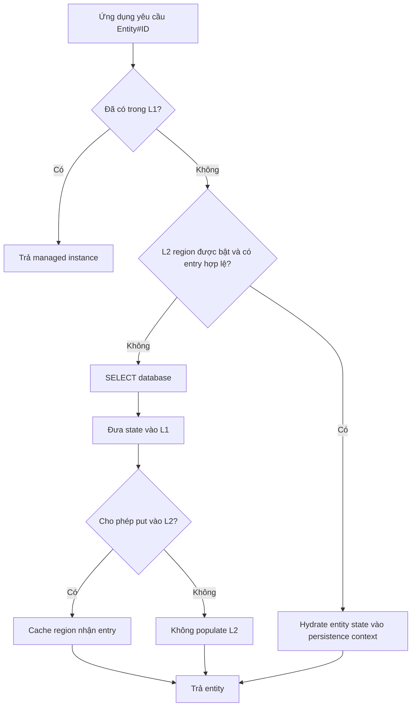
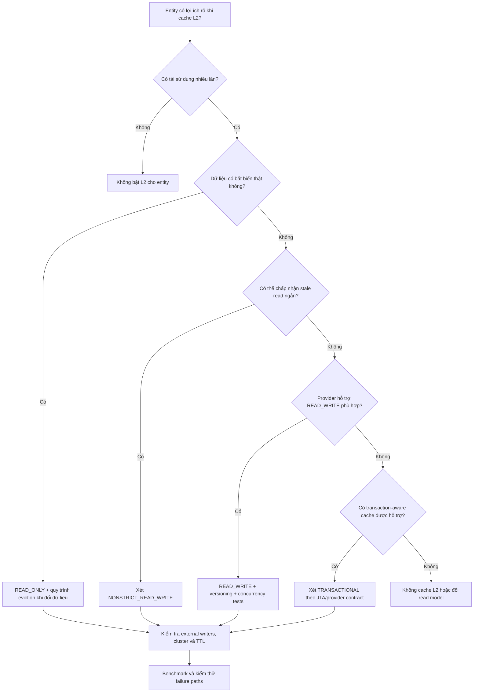

# Chiến lược chỉ đọc hoặc đọc ghi theo khả năng bảo đảm của bộ cung cấp

Trong Hibernate ORM, **second-level cache (L2 cache)** giúp tái sử dụng trạng thái entity và collection giữa nhiều `Session` hoặc `EntityManager`. Thay vì luôn đọc lại database, Hibernate có thể lấy dữ liệu từ cache region khi bản ghi đã được lưu và còn hợp lệ. Khả năng này đặc biệt hữu ích với dữ liệu ít thay đổi nhưng được truy cập thường xuyên, chẳng hạn danh mục quốc gia, loại thuế, cấu hình nghiệp vụ hoặc một số bảng tham chiếu.

Tuy nhiên, việc bật cache không chỉ là quyết định hiệu năng. Nếu một entity có thể thay đổi, hệ thống phải trả lời: **Khi transaction cập nhật hoặc xóa entity, các Session khác được phép thấy giá trị cũ trong bao lâu? Cache có thể biết transaction đã commit hay rollback không? Trong cụm nhiều node, dữ liệu trên mỗi node được đồng bộ bằng cơ chế nào?**

Hibernate cung cấp những **cache concurrency strategies** thường gặp:

- `READ_ONLY` — dành cho dữ liệu thực sự không thay đổi qua đường ORM.
- `NONSTRICT_READ_WRITE` — chấp nhận cửa sổ dữ liệu cũ, thường dùng khi cập nhật hiếm.
- `READ_WRITE` — phối hợp chặt chẽ hơn với ORM transaction bằng cơ chế khóa mềm/invalidation, nhưng không tương đương mọi mức cô lập database.
- `TRANSACTIONAL` — dựa trên cache provider có khả năng tham gia vào ngữ nghĩa transaction cần thiết, thường liên quan tới JTA/transaction-aware cache.

Tên strategy chỉ là **một phần hợp đồng**. Mức bảo đảm cuối cùng còn phụ thuộc Hibernate version, cache provider, cấu hình region, topology một node hay nhiều node, cách ghi dữ liệu, transaction manager và mức độ đồng bộ của cache cluster. Bài học này phân biệt các strategy, chỉ ra những gì chúng *có* và *không* hứa hẹn, và trình bày cách lựa chọn an toàn cho ứng dụng thật.

## 1. Trước hết phải phân biệt ba lớp cache

Hibernate có nhiều cơ chế lưu lại dữ liệu, nhưng chúng không cùng phạm vi.

| Lớp | Phạm vi | Mục đích chính | Ai quản lý? |
|---|---|---|---|
| First-level cache (L1) | Một `Session`/`EntityManager` | Identity map và managed entity state | Hibernate persistence context |
| Second-level cache (L2) | Thường xuyên suốt `SessionFactory` và qua nhiều Session | Tái sử dụng entity/collection data | Hibernate phối hợp cache provider |
| Query cache | Theo cache region/query metadata | Tái sử dụng kết quả của query phù hợp | Hibernate và provider |

### L1 cache không phải tùy chọn L2

Giả sử trong cùng một persistence context:

```java
Customer first = entityManager.find(Customer.class, 42L);
Customer again = entityManager.find(Customer.class, 42L);

assert first == again;
```

Thông thường, Hibernate trả về cùng một managed instance nhờ identity map. Điều này vẫn có thể xảy ra **ngay cả khi L2 cache tắt hoàn toàn**.

L1 cache còn gắn với dirty checking, flush, entity identity và lifecycle. Khi `clear()`, entity trở thành detached; khi đóng Session, persistence context kết thúc.

### L2 cache chia sẻ được qua nhiều Session

```text
Session A -----\
                \                 +-------------+
Session B ------> Hibernate ------> L2 cache     |
                /                 +-------------+
Session C -----/                         |
                                         v
                                     Database
```

Nếu Country#VN được tải trong Session A và đưa vào L2 cache, Session B sau đó có thể tái sử dụng cache entry mà không cần SELECT database, **nếu region được cấu hình, entry còn hợp lệ và provider hỗ trợ access path đó**.

L2 cache thường chứa biểu diễn trạng thái persistent được Hibernate quản lý, không phải một Java managed instance có thể dùng tự do giữa các Session. Khi materialize, mỗi Session có identity map và lifecycle riêng.

### Query cache không thay thế entity cache

Query cache có thể ghi nhớ IDs, scalars hoặc biểu diễn kết quả phù hợp với Hibernate version và loại query. Một cache hit của query không nhất thiết có nghĩa việc tạo toàn bộ entity graph không cần truy cập database. Nếu kết quả chứa entity references nhưng entity state không có trong L2, Hibernate vẫn có thể cần tải các entities đó.

Vì vậy, khi hỏi “read-only hay read-write”, trước tiên phải xác định **đang nói đến concurrency strategy của L2 entity/collection region**, không phải `setReadOnly(true)` của một query hay read-only transaction.

## 2. Câu hỏi chính: cache hứa hẹn mức nhất quán nào?

Một entry `Product#101` trong database có giá 100.000 đồng. Cache đang giữ cùng giá trị.

Transaction A đổi giá lên 120.000 đồng. Trong lúc A chưa commit, transaction B đọc Product#101. Sau đó A commit, transaction C đọc lại.

Các câu hỏi cần trả lời:

1. B có được thấy giá chưa commit không?
2. Sau commit, cache entry giá cũ được invalidated hoặc cập nhật lúc nào?
3. Nếu A rollback, cache có khôi phục trạng thái trước giao dịch không?
4. Nếu B và C chạy trên hai application nodes khác nhau, thông điệp invalidation đến node kia lúc nào?
5. Nếu database được cập nhật bởi một ứng dụng ngoài Hibernate, cache biết chuyện đó bằng cách nào?
6. Nếu network partition làm cache cluster chậm hoặc mất kết nối, dữ liệu có thể stale không?

Không thể trả lời bằng tên `READ_WRITE` một mình. Cần đọc **contract của Hibernate strategy và capabilities thật của cache provider**.

### Các trục độc lập

- **Tính nhất quán dữ liệu:** ứng dụng chấp nhận stale values trong thời gian nào?
- **Transaction integration:** cache có biết commit/rollback hay chỉ nhận lời gọi put/remove?
- **Cluster coherence:** cache region được replication/invalidation qua các nodes ra sao?
- **Nguồn ghi:** mọi mutation có đi qua Hibernate hay còn JDBC, batch jobs, triggers, ETL?
- **Versioning:** entity có `@Version` để hỗ trợ optimistic concurrency không?
- **Expiration/eviction:** entry tồn tại bao lâu và bị đẩy khỏi cache bằng chính sách nào?

Một strategy phù hợp với dữ liệu chỉ đọc trên một node không tự trở thành an toàn cho giá bán biến động nhanh trong một cụm phân tán.

## 3. Bốn chiến lược concurrency phổ biến

| Strategy | Kiểu dữ liệu phù hợp | Khi ghi qua ORM | Mức kỳ vọng nhất quán | Điều kiện cần chú ý |
|---|---|---|---|---|
| `READ_ONLY` | Dữ liệu bất biến | Không hỗ trợ cập nhật bình thường vào entry đã cache | Rất dễ quản lý nếu dữ liệu thật sự bất biến | External DB writes vẫn có thể làm stale |
| `NONSTRICT_READ_WRITE` | Thay đổi hiếm, có thể chịu stale ngắn | Chủ yếu vô hiệu hóa hoặc phối hợp cache theo cách ít nghiêm ngặt | Cho phép cửa sổ stale | Không dùng cho correctness nhạy cảm |
| `READ_WRITE` | Entity mutable, cần phối hợp cache với Hibernate transaction | Dùng cơ chế bảo vệ/invalidation khi transaction cập nhật | Chặt chẽ hơn nonstrict, nhưng không phải serializable | Phụ thuộc provider, transaction và cluster semantics |
| `TRANSACTIONAL` | Mutable data, môi trường có transaction-aware cache phù hợp | Cache tham gia transaction theo khả năng provider | Theo transaction guarantees đã cấu hình | Không phải provider nào cũng hỗ trợ |

Bảng mô tả ý định của các strategies, **không phải cam kết mọi provider sẽ đạt cùng độ nhất quán trong mọi topology**.

Một số Hibernate versions và integrations hỗ trợ subset strategies. Khi cấu hình strategy không được provider hỗ trợ, ứng dụng có thể lỗi khi bootstrap, cảnh báo hoặc phải điều chỉnh region factory/transaction setup. Không mặc định mọi combination đều hợp lệ.

## 4. READ_ONLY: lựa chọn mặc định tốt cho dữ liệu bất biến

Ví dụ hệ thống có danh sách quốc gia:

```java
import jakarta.persistence.Entity;
import jakarta.persistence.Id;
import jakarta.persistence.Table;
import org.hibernate.annotations.Cache;
import org.hibernate.annotations.CacheConcurrencyStrategy;
import org.hibernate.annotations.Immutable;

@Entity
@Table(name = "countries")
@Immutable
@Cache(
    usage = CacheConcurrencyStrategy.READ_ONLY,
    region = "reference.countries"
)
public class Country {

    @Id
    private String code;

    private String name;

    protected Country() {}

    public String getCode() {
        return code;
    }

    public String getName() {
        return name;
    }
}
```

Ở đây:

- `@Cache(usage = READ_ONLY)` yêu cầu Hibernate dùng strategy chỉ đọc cho entity region.
- `@Immutable` thể hiện với Hibernate rằng entity không cần dirty checking/update bình thường.
- Không công khai setter giúp API domain hạn chế mutation.
- Region name `reference.countries` cho phép cấu hình capacity, TTL hoặc monitoring độc lập.

### Khi nào READ_ONLY thực sự hợp lý?

- Mã quốc gia hoặc mã trạng thái được phát hành như dữ liệu phiên bản.
- Bảng tham chiếu gần như bất biến trong vòng đời ứng dụng.
- Dữ liệu được cập nhật bằng deployment/migration có quy trình evict/warm cache rõ ràng.
- Nếu có cập nhật ngoài ứng dụng, quy trình cập nhật biết phải invalidation cache.

### Khi nào READ_ONLY không hợp lý?

- Product price, inventory count, account balance.
- User profile có thể chỉnh sửa.
- Feature flag thay đổi thường xuyên mà cần thấy tác động ngay.
- Quyền truy cập hay chính sách bảo mật có thể bị thu hồi tức thời.

**READ_ONLY không có nghĩa “Hibernate tự biến database thành read-only”.** Nó giới hạn cách cache region phối hợp với entity mutation qua ORM; nó không chặn administrator hoặc ứng dụng khác chạy SQL UPDATE trên bảng.

## 5. Điều gì xảy ra nếu cập nhật entity nằm trong READ_ONLY region?

Xét:

```java
Country country = entityManager.find(Country.class, "VN");

// Giả sử code vẫn có cách thay đổi field:
country.rename("Tên mới");

entityManager.flush();
```

Nếu entity cached READ_ONLY nhưng được phép ORM phát hiện update, đường cập nhật cache có thể bị strategy từ chối hoặc gây exception theo Hibernate/provider/version. Với `@Immutable`, Hibernate có thể bỏ qua dirty checking/update của entity như một cơ chế riêng. Vì vậy kết quả cụ thể tùy mapping và update path.

Đừng dựa vào một trong các hành vi này để bảo vệ dữ liệu nghiệp vụ. Các lớp bảo vệ khác vẫn cần:

- API không cho mutation tùy tiện.
- Role database hạn chế quyền UPDATE/DELETE khi thích hợp.
- Migration thay đổi tham chiếu có kế hoạch.
- Eviction sau deployment.
- Integration test chứng minh cách Hibernate và provider đang xử lý thay đổi.

**READ_ONLY là lời hứa của ứng dụng rằng dữ liệu phù hợp để cache như bất biến; không phải một ràng buộc database tự động.**

## 6. `@Immutable` và READ_ONLY không phải cùng một annotation

`@Immutable` và cache concurrency strategy có mục đích khác nhau:

| Cấu hình | Ảnh hưởng chính |
|---|---|
| `@Immutable` | Hibernate xem entity/mapping là bất biến trong quá trình quản lý state |
| `@Cache(usage = READ_ONLY)` | Cách Hibernate L2 cache region quản lý dữ liệu đã cache |
| Không có `@Cache` | Không nhất thiết entity được L2 cache, dù entity có `@Immutable` |
| `@Cacheable` của JPA | Tham gia chính sách shared cache; không tự xác định mức concurrency strategy của Hibernate |

Một entity có thể immutable nhưng không dùng L2 cache. Một entity có `@Cache(READ_ONLY)` cần được thiết kế theo giả định dữ liệu không thay đổi, kể cả khi API Java vẫn có setter.

Ví dụ không nên làm:

```java
@Entity
@Cache(usage = CacheConcurrencyStrategy.READ_ONLY)
public class Product {

    @Id
    private Long id;

    private BigDecimal price;

    public void changePrice(BigDecimal price) {
        this.price = price;
    }
}
```

Product có method đổi giá nên không phù hợp với lời hứa READ_ONLY, trừ khi đó chỉ là data snapshot/version không bao giờ được cập nhật in-place.

## 7. READ_ONLY có còn cần TTL hay eviction không?

Có. Ngay cả dữ liệu được coi là bất biến vẫn cần quản lý dung lượng cache.

Các lý do entry rời cache:

- Region đầy, provider áp dụng capacity eviction.
- Entry hết TTL/TTI theo cấu hình provider.
- Operator chủ động evict khi deployment.
- Cache node khởi động lại, mất dữ liệu in-memory.
- Version ứng dụng thay đổi serialization/mapping.
- Cache cluster rebalances hoặc một node bị lỗi.

Điều quan trọng: **TTL không thay thế tính đúng đắn của chiến lược cache**. Nếu external writer sửa country name giữa hai lần hết hạn TTL, client có thể thấy giá trị cũ cho tới khi entry hết hạn hoặc được evict.

Nếu dữ liệu phải đồng bộ ngay sau migration, đừng chỉ đặt TTL 24 giờ rồi hy vọng mọi node kịp cập nhật. Hãy có bước invalidation region hoặc làm mới cache được kiểm chứng.

## 8. READ_WRITE: dành cho entity có thay đổi qua ORM

Ví dụ Product có giá mutable:

```java
import jakarta.persistence.*;
import org.hibernate.annotations.Cache;
import org.hibernate.annotations.CacheConcurrencyStrategy;

@Entity
@Table(name = "products")
@Cache(
    usage = CacheConcurrencyStrategy.READ_WRITE,
    region = "catalog.products"
)
public class Product {

    @Id
    private Long id;

    @Version
    private long version;

    @Column(nullable = false)
    private String name;

    @Column(nullable = false, precision = 19, scale = 2)
    private BigDecimal price;

    protected Product() {}

    public Product(Long id, String name, BigDecimal price) {
        this.id = id;
        this.name = name;
        this.price = price;
    }

    public Long getId() {
        return id;
    }

    public long getVersion() {
        return version;
    }

    public BigDecimal getPrice() {
        return price;
    }

    public void reprice(BigDecimal newPrice) {
        if (newPrice == null || newPrice.signum() < 0) {
            throw new IllegalArgumentException("price must be nonnegative");
        }
        this.price = newPrice;
    }
}
```

Chú ý: ví dụ dùng assigned identifier để minh họa entity, không phải mẫu ID generation bắt buộc. Trong ứng dụng thật có thể dùng `@GeneratedValue` phù hợp database.

### Tư tưởng READ_WRITE

Khi một transaction cập nhật entity cached, Hibernate phối hợp region strategy để không đơn giản ghi đè giá trị mới vào cache trước khi database commit. Trong các triển khai phổ biến, có cơ chế **soft lock**/marker để kiểm soát một entry đang được cập nhật, kết hợp invalidation hoặc cập nhật lại cache sau transaction.

Điều này giúp tránh nhiều trường hợp cache trả dữ liệu chưa commit và phối hợp tốt hơn khi có concurrent writers.

Nhưng nó không bảo đảm rằng:

- Mọi read từ mọi node đều tuyến tính hóa ngay tại commit.
- Cache áp dụng cùng isolation level với database.
- External SQL writers tự làm cache invalidation.
- Mọi provider đều hỗ trợ cùng thuật toán và mức nhất quán.

## 9. READ_WRITE và soft lock: mô hình trực quan

Giả sử Product#101 có giá 100.000 đồng.

```text
T0: Database = 100000, L2 cache = 100000

T1: Transaction A bắt đầu sửa Product#101
    Hibernate/region strategy có thể đánh dấu entry đang bị update

T2: Transaction B đọc Product#101
    Entry đang bị bảo vệ: provider có thể bỏ qua cache
    và tải DB hoặc áp dụng thuật toán riêng

T3: A flush UPDATE trong transaction
    Database có thể chứa dữ liệu A chưa commit cho chính A,
    transaction khác quan sát theo DB isolation

T4: A commit
    Hibernate/region strategy kết thúc update protocol,
    invalidates hoặc cập nhật cache theo implementation

T5: Transaction C đọc
    L2 hit nếu entry hợp lệ; nếu miss sẽ load database
```

Đây là **mô hình khái niệm**, không phải trace SQL/cache API cố định của một provider. Chi tiết soft-lock timeout, token, invalidation và after-transaction completion phụ thuộc Hibernate strategy/provider.

### Soft lock khác database row lock

Soft lock là cơ chế phối hợp cache entry. Database row lock do DBMS thực hiện. Không nên hiểu soft lock như một distributed database lock cung cấp serializability.

Một cache read miss trong lúc soft lock cũng không chắc chắn chờ lock xong: tùy triển khai, nó có thể đọc DB và xử lý entry theo protocol riêng.

## 10. READ_WRITE có đồng nghĩa strong consistency không?

Không nên dùng từ “strongly consistent” nếu chưa xác định chính xác ý nghĩa và cấu hình.

READ_WRITE hướng tới cách quản lý cached mutable entities chặt chẽ hơn NONSTRICT_READ_WRITE, nhưng bảo đảm thực tế phụ thuộc:

- Hibernate version và `RegionFactory`.
- Atomicity hoặc compare-and-swap mà provider cung cấp.
- Cách cluster phát thông báo invalidation/replication.
- Transaction completion callbacks có đúng thứ tự không.
- Node restart, network partition, clock skew hoặc failover.
- Database isolation và `@Version`.
- Mọi mutation có đi qua ORM/cache-aware path không.

Ngay cả khi tất cả application nodes dùng cùng distributed cache, lời hứa “đọc ngay sau commit ở mọi node chắc chắn thấy giá mới” phải được **chứng minh bởi provider documentation và integration tests**, không suy từ enum `READ_WRITE`.

### Vai trò của `@Version`

`@Version` giúp Hibernate áp dụng optimistic locking cho entity mutations. Một transaction update stale version có thể thất bại thay vì âm thầm ghi đè giá trị mới. Cache strategy cần phối hợp với version metadata và transaction outcome theo mapping.

Tuy nhiên, `@Version` không thay thế cache invalidation khi database bị sửa trực tiếp bằng SQL. Một external writer có thể cập nhật cả version mà Hibernate vẫn không biết cache entry đang stale.

## 11. NONSTRICT_READ_WRITE: đổi nhất quán lấy hiệu năng/đơn giản

Một mapping ví dụ:

```java
@Entity
@Cache(
    usage = CacheConcurrencyStrategy.NONSTRICT_READ_WRITE,
    region = "catalog.descriptions"
)
public class ProductDescription {

    @Id
    private Long id;

    @Version
    private long version;

    private String summary;

    protected ProductDescription() {}

    public void rewrite(String text) {
        this.summary = text;
    }
}
```

Strategy `NONSTRICT_READ_WRITE` thường phù hợp khi dữ liệu **có thể thay đổi nhưng không thường xuyên**, và ứng dụng chấp nhận cửa sổ một số reads vẫn có thể nhìn thấy dữ liệu cũ.

Ví dụ:

- Mô tả sản phẩm marketing cập nhật vài lần mỗi tháng.
- Thông tin hiển thị công khai không dùng tính tiền.
- Nội dung tham khảo mà độ trễ cập nhật ngắn không gây sai quyết định quan trọng.

Không nên dùng cho:

- Số dư tài khoản và dòng tiền.
- Giới hạn tín dụng.
- Inventory mà oversell không được chấp nhận.
- Quyền truy cập cần thu hồi ngay.
- Trạng thái giao dịch quyết định có được xử lý lần hai hay không.

### Tại sao có stale window?

Không có protocol bảo vệ mạnh như READ_WRITE trên mọi đường update. Invalidation có thể diễn ra vào thời điểm không hoàn toàn ngăn một concurrent reader/cache population nhìn thấy phiên bản cũ. Trong clustered cache, thông điệp còn có latency.

Tốc độ và độ dài cửa sổ stale không có một hằng số chuẩn trong JPA hoặc Hibernate. Phải kiểm tra thuật toán của provider/version, TTL và topology.

## 12. NONSTRICT_READ_WRITE không phải READ_ONLY

Dù hai strategy đều có thể nhanh với workload đọc nhiều, chúng mang ý nghĩa rất khác:

- `READ_ONLY`: ứng dụng không nên thay đổi cached entity qua đường lifecycle bình thường.
- `NONSTRICT_READ_WRITE`: ứng dụng **có thể sửa dữ liệu**, nhưng chấp nhận mức nhất quán cache lỏng hơn.
- `READ_WRITE`: ứng dụng sửa dữ liệu và yêu cầu cache phối hợp chặt hơn với transaction.

Đừng chọn NONSTRICT chỉ vì tên nghe “ít khóa hơn” nếu tác động của một stale read có thể gây lỗi nghiệp vụ.

Một câu hỏi kiểm tra: *Nếu sau khi quản trị viên đổi giá sản phẩm, một người dùng khác nhìn thấy giá cũ trong thời gian ngắn, hệ thống có chịu được không?* Nếu không, NONSTRICT_READ_WRITE không phù hợp cho trường giá dùng tính tiền.

## 13. TRANSACTIONAL: khi cache provider tham gia transaction

Ví dụ mapping:

```java
@Entity
@Cache(
    usage = CacheConcurrencyStrategy.TRANSACTIONAL,
    region = "financial.contracts"
)
public class Contract {

    @Id
    private Long id;

    @Version
    private long version;

    private ContractStatus status;

    protected Contract() {}
}
```

`TRANSACTIONAL` hướng tới các môi trường cache provider có khả năng **transaction-aware** phù hợp, thường được triển khai cùng JTA hoặc một cơ chế tích hợp transaction được hỗ trợ.

Điểm cốt lõi: cache provider phải có khả năng phối hợp cache operations với transaction outcome theo hợp đồng mà Hibernate yêu cầu. Không thể chỉ đổi enum từ READ_WRITE sang TRANSACTIONAL rồi mặc định mọi cache backend trở thành transactional.

### JTA và XA

Một số provider/topology dùng JTA và có thể tích hợp cache như transactional resource. Nhưng không nên phát biểu “mọi TRANSACTIONAL cache đều đòi XA hai pha” hoặc “mọi JTA setup đều bảo đảm XA trên DB và cache”. Độ mạnh của atomic commit, cách enlist resources và failure handling phụ thuộc provider, transaction manager và cấu hình.

Cần xác minh:

1. Cache provider có hỗ trợ Hibernate `TRANSACTIONAL` strategy không?
2. Transaction manager và region factory được hỗ trợ chính thức không?
3. Cache operations có tham gia cùng transaction boundary không?
4. Khi database commit thành công nhưng cache node lỗi, behavior được bảo đảm là gì?
5. Trong multi-node cluster, read isolation và replication semantics cụ thể ra sao?
6. Startup có fail fast khi không tương thích hay silently degrade?

Nếu không có tài liệu và kiểm thử chứng minh, **không quảng bá TRANSACTIONAL là bảo đảm ACID toàn hệ thống**.

## 14. Strategy không thay thế database transaction isolation

Database thường cung cấp các isolation levels như READ COMMITTED, REPEATABLE READ hoặc SERIALIZABLE, với chi tiết engine-specific. L2 cache là một hệ thống trạng thái bổ sung.

Ví dụ một transaction database ở READ COMMITTED có thể thực hiện hai SELECT và thấy dữ liệu thay đổi giữa chúng; còn một Hibernate Session có identity map và có thể trả lại cùng managed entity đã load trước đó.

```java
Account account1 = em.find(Account.class, id);

// Một transaction khác commit thay đổi trong DB.

Account account2 = em.find(Account.class, id);

// Trong cùng persistence context, thường là cùng managed instance.
assert account1 == account2;
```

Đó là hành vi identity map của Hibernate, không đồng nghĩa database isolation đã chuyển thành REPEATABLE READ hoặc SERIALIZABLE.

Ngược lại, cache hit giữa hai Session khác nhau không chứng minh các transaction của chúng có cùng snapshot database.

**Phải đánh giá L1 identity semantics, L2 concurrency strategy và DB isolation tách biệt.**

## 15. Một hình dung về đường đọc và ghi



Đường ghi có những bước khác nhau tùy READ_ONLY, NONSTRICT_READ_WRITE, READ_WRITE hay TRANSACTIONAL. Quan trọng nhất là cache entry không được coi như một bảng database thứ hai có thể cập nhật tự do mà bỏ qua transaction protocol.

## 16. Cache provider quyết định những khả năng nào?

Hibernate thường cung cấp integration thông qua `RegionFactory`, còn cache provider chịu trách nhiệm các tính năng lưu trữ và phân tán dữ liệu.

Những khả năng cần kiểm tra:

| Khả năng provider | Tại sao quan trọng? |
|---|---|
| Key/value storage và expiry | Lưu dữ liệu, quản lý TTL/capacity |
| Concurrency primitives | Hỗ trợ soft-lock/atomic cache operations |
| Cluster topology | Đảm bảo các node phối hợp entries |
| Replication/invalidation semantics | Cửa sổ thấy stale data |
| Transaction-aware operations | Điều kiện của TRANSACTIONAL |
| Serialization/versioning | Đọc cached values giữa các nodes/version ứng dụng |
| Eviction APIs | Dọn vùng cache khi deploy, bulk jobs hoặc external updates |
| Monitoring/metrics | Biết cache hit/miss/put/eviction và latency |
| Failure semantics | Điều gì xảy ra khi cache unavailable hoặc partitioned |
| Hibernate integration version | Tương thích với APIs và region semantics |

Không thể thay thế việc đọc tài liệu của **đúng phiên bản** bằng một ma trận chung. Một provider hỗ trợ `READ_WRITE` trong local cache không nhất thiết hỗ trợ cùng guarantee khi chuyển sang distributed cluster.

## 17. Phân biệt Ehcache, Infinispan, JCache và Hibernate

Các tên công nghệ có thể nằm ở những lớp khác nhau:

- **Hibernate ORM:** quản lý entity state, L2 cache access strategies và transaction callbacks.
- **JCache (JSR-107):** một API cache chuẩn với abstraction cho cache provider.
- **Ehcache:** một cache implementation; khả năng và integration phụ thuộc major version/configuration.
- **Infinispan:** một hệ thống cache/data grid có những mode cluster và transaction khác nhau.
- **Hibernate region factory/integration module:** cầu nối giữa Hibernate và cache implementation.

Sử dụng JCache API **không có nghĩa provider bất kỳ hỗ trợ mọi cache concurrency strategy với cùng semantics**. Provider có thể hỗ trợ local cache, distributed cache hoặc transactional modes theo cấu hình riêng.

Tương tự, dùng Infinispan hoặc Ehcache không tự làm application immutable hay transactional. Cần đọc Hibernate integration documentation tương ứng.

## 18. Cấu hình L2 cache trong một ứng dụng Hibernate

Một cấu hình khái niệm cho Hibernate với JCache integration:

```properties
hibernate.cache.use_second_level_cache=true
hibernate.cache.region.factory_class=org.hibernate.cache.jcache.internal.JCacheRegionFactory
```

Trong Spring Boot có thể truyền thành:

```properties
spring.jpa.properties.hibernate.cache.use_second_level_cache=true
spring.jpa.properties.hibernate.cache.region.factory_class=org.hibernate.cache.jcache.internal.JCacheRegionFactory
```

Đoạn này chỉ minh họa loại cấu hình. Muốn chạy được cần:

- Module Hibernate JCache phù hợp chính xác Hibernate version.
- JCache API và một provider implementation tương thích.
- Region/cache configuration, capacity, expiry và provider-specific settings.
- Kiểm tra package/region factory class còn đúng ở version sử dụng.
- Xác định provider được chọn khi classpath có nhiều implementations.

Không thêm cấu hình “đúng tên class” rồi mặc định cache đã hoạt động; cần đo cache hit/miss và quan sát SQL.

### Hibernate 5, 6 và 7 có thể khác nhau

Coordinates, property defaults, Jakarta/Javax package compatibility, region factory availability và query cache internals có thể đổi giữa major versions. Đặc biệt, tên `JCache` không có nghĩa mọi phần API đều đổi namespace đồng loạt theo Jakarta Persistence. Hãy dùng dependency/plugin config đúng version của dự án thay vì sao chép một file properties cũ.

## 19. Annotation `@Cache` và shared-cache mode

Hibernate-specific annotation:

```java
@Cache(
    usage = CacheConcurrencyStrategy.READ_WRITE,
    region = "catalog.products"
)
```

lựa chọn strategy và region cho entity/collection mapping.

Jakarta Persistence có `@Cacheable`:

```java
@Entity
@Cacheable
public class Country {
    @Id
    private String code;
}
```

Nó thể hiện ý định tham gia shared cache theo `SharedCacheMode` của persistence unit, nhưng **không chỉ định READ_ONLY hay READ_WRITE như annotation Hibernate**.

Các giá trị `SharedCacheMode` gồm `ALL`, `NONE`, `ENABLE_SELECTIVE`, `DISABLE_SELECTIVE` và `UNSPECIFIED`. Khi cần cache có chủ đích, `ENABLE_SELECTIVE` thường dễ kiểm soát hơn cache tất cả entities.

Ví dụ trong `persistence.xml`:

```xml
<persistence-unit name="appPU">
    <shared-cache-mode>ENABLE_SELECTIVE</shared-cache-mode>
</persistence-unit>
```

Tùy Hibernate configuration, annotation `@Cache` và shared-cache mode có thể tương tác với policy bật/tắt L2. Không nên giả định một annotation đơn lẻ luôn đủ để tạo region trên mọi stack.

## 20. Không cache tất cả entities chỉ vì có L2

Giả sử một hệ thống có:

- `Country`: 250 rows, hầu như không đổi.
- `ProductDescription`: 80.000 rows, cập nhật mỗi tuần.
- `Product`: 5 triệu rows, giá thay đổi thường xuyên.
- `InventoryBalance`: biến động liên tục.
- `PaymentAttempt`: insert thường xuyên, trạng thái được cập nhật nhiều lần.
- `UserAuthorization`: quyền có thể bị thu hồi tức thời.

L2 cache hiệu quả nhất khi có **data reuse** giữa các Sessions. Nếu mỗi record chỉ được đọc một lần, chi phí lưu, invalidation và eviction có thể cao hơn lợi ích.

Một bảng lớn với keyspace vô hạn có thể làm cache thrashing: entries bị đẩy ra ngay sau khi nạp. Cần xét:

- Working set size.
- Read/write ratio.
- Reuse distance.
- Cấu trúc index/query.
- Chi phí một DB SELECT so với cache lookup/network call.
- Entry size và serialization overhead.
- Staleness tolerance.
- Số application nodes và cache topology.

**“Bật L2 cho mọi entity để giảm DB load” không phải chiến lược hợp lý mặc định.**

## 21. Quyết định theo tính chất dữ liệu

| Loại dữ liệu | Strategy nên cân nhắc | Điều kiện / ngoại lệ |
|---|---|---|
| Mã quốc gia bất biến | `READ_ONLY` | External migration cần eviction |
| Danh mục loại thuế versioned không update in-place | `READ_ONLY` | Dùng row mới khi đổi định nghĩa |
| Nội dung giới thiệu sản phẩm cập nhật hiếm | `NONSTRICT_READ_WRITE` | Chấp nhận stale một thời gian |
| Product metadata mutable, đọc nhiều, ghi ít | `READ_WRITE` | Provider cluster semantics phù hợp |
| Hợp đồng mutable với transaction-aware cache | `TRANSACTIONAL` nếu hỗ trợ | Kiểm chứng JTA/provider guarantees |
| Số dư tài khoản | Thường không cache L2 | Correctness/concurrent writes nhạy cảm |
| Số lượng hàng tồn kho | Thường hạn chế/không cache L2 | Tính nhất quán quan trọng hơn hit ratio |
| Quyền truy cập thời gian thực | Cực kỳ thận trọng | Không dựa vào stale cached authorization |
| Dữ liệu log append-only ít đọc lại | Thường không cache entity | Working set reuse thấp |

Đây là định hướng, không phải luật cứng. Nếu một ứng dụng có authoritative external cache, read models bất biến hoặc cơ chế versioning đặc thù, lựa chọn có thể khác.

## 22. READ_ONLY với dữ liệu thực sự phiên bản hóa

Thay vì UPDATE cùng một row:

```text
tax_rate id=7, value=0.08
   UPDATE value=0.10
```

có thể tạo một bản version mới:

```text
tax_rate_revision:
    id=7, revision=1, value=0.08
    id=7, revision=2, value=0.10
```

Mỗi revision row là immutable, rất phù hợp READ_ONLY. Nhưng cần lưu ý:

- Entity `TaxRateRevision` có thể READ_ONLY.
- Bản ghi hoặc pointer “revision nào đang active” vẫn mutable và có thể cần cache strategy khác hoặc không cache.
- Query tìm current revision cần được invalidated khi active pointer thay đổi.
- Database uniqueness/validity constraints vẫn phải bảo vệ không có hai current revisions trái phép.

**Bất biến hóa dữ liệu theo version** là một cách giảm độ phức tạp cache consistency thay vì cố làm READ_WRITE cache đối với mọi field.

## 23. READ_WRITE và transaction rollback

Giả sử Transaction A gọi:

```java
Product p = entityManager.find(Product.class, 101L);
p.reprice(new BigDecimal("120000.00"));
entityManager.flush();

throw new RuntimeException("Rollback");
```

Database transaction rollback, nên giá mới không được coi là commit thành công. Cache coordination của READ_WRITE phải xử lý transaction outcome: không đơn giản publish giá 120.000 thành dữ liệu authoritative trong L2 trước khi commit.

Đây là lý do READ_WRITE cần protocol phức tạp hơn “cache.put() ngay khi setter chạy”.

Tuy nhiên, chi tiết khi transaction thất bại giữa database flush và cache completion, hoặc khi cluster node mất kết nối, phụ thuộc integration. Cần kiểm thử rollback/failure path của provider thực.

### Không cache trực tiếp managed Java object ngoài Hibernate

Một anti-pattern:

```java
Map<Long, Product> cache = new ConcurrentHashMap<>();
cache.put(product.getId(), product);
```

Đây không phải Hibernate L2 cache. Nó lưu Java object có thể còn managed hoặc detached mà không có các bảo đảm identity, version, lazy loading, invalidation hoặc transaction coordination của Hibernate. Với object mutable, nhiều threads còn có data races.

Nếu cần application cache riêng, thường nên cache immutable DTO/projection với contract invalidation rõ thay vì entity managed.

## 24. Cập nhật từ ứng dụng khác: điểm mù quan trọng

Giả sử backend A dùng Hibernate và cache Product#101 giá 100.000. Hệ thống ERP bên ngoài chạy:

```sql
update products
set price = 120000.00,
    version = version + 1
where id = 101;
```

Database đã đổi, nhưng **Hibernate L2 cache không tự nhận được thông báo** chỉ vì một ứng dụng khác ghi SQL.

READ_ONLY, NONSTRICT_READ_WRITE và READ_WRITE đều có thể giữ stale entry nếu việc ghi diễn ra ngoài cache-coordinated path. `TRANSACTIONAL` cũng không tự giải quyết external writers không tham gia cùng cache/transaction integration.

Biện pháp có thể chọn:

- Bắt mọi ghi qua service được quản lý bởi Hibernate.
- Gửi eviction/invalidation event sau external update.
- Dùng outbox hoặc CDC để đồng bộ cache theo commit.
- Đặt TTL ngắn nếu chấp nhận stale.
- Không dùng L2 đối với bảng bị nhiều ứng dụng ngoài sửa.
- Dùng database làm nguồn đọc quyết định cho những thông tin cần nhất quán tức thời.

Nếu dùng CDC, phải xác định thứ tự events, retries, duplicate events và độ trễ propagation. “Có CDC” không tự đồng nghĩa strong consistency.

## 25. Bulk HQL/JPQL UPDATE và DELETE ảnh hưởng cache ra sao?

Ví dụ:

```java
int count = entityManager.createQuery("""
    update Product p
    set p.price = p.price * :factor
    where p.category.id = :categoryId
    """)
    .setParameter("factor", new BigDecimal("1.05"))
    .setParameter("categoryId", categoryId)
    .executeUpdate();
```

Bulk DML bỏ qua entity lifecycle từng instance và không tự cập nhật các managed Product objects. Hibernate có thông tin query spaces/entity mappings trong nhiều HQL/JPQL mutation paths để thực hiện cache cleanup/invalidation phù hợp. Nhưng **không giả định mọi cached object, collection và query result được đồng bộ chính xác như khi gọi setter từng entity**.

Cần phân biệt:

1. **L1:** vẫn có thể giữ Product stale; cần `refresh` hoặc `clear`/context riêng.
2. **L2:** provider/Hibernate có thể invalidation các regions liên quan theo query spaces; phạm vi phụ thuộc strategy/version.
3. **Query cache:** cached query results cũng có cơ chế freshness/invalidation liên quan tables.
4. **Collection cache:** quan hệ có thể thay đổi do bulk/native SQL mà ORM không quan sát đầy đủ.
5. **Native SQL / external SQL:** ít metadata hơn hoặc không tham gia ORM integration, cần synchronization/eviction chủ động.

## 26. Native SQL và stored procedures là rủi ro cache riêng

Ví dụ:

```java
entityManager.createNativeQuery("""
    update products
    set price = price * 1.05
    where category_id = :categoryId
    """)
    .setParameter("categoryId", categoryId)
    .executeUpdate();
```

Hoặc:

```java
entityManager.createStoredProcedureQuery("reprice_products")
    .execute();
```

Hibernate không thể suy luận mọi side effect từ nội dung một stored procedure; SQL native cũng có thể thiếu thông tin mapping/query spaces tùy đường API.

Nếu stored procedure thay đổi cả `products`, `product_categories` và bảng audit, việc evict một Product đơn lẻ sẽ không đủ.

Các lựa chọn:

- Sau operation, evict toàn bộ entity/collection/query regions có liên quan.
- Khai báo synchronized entity/query spaces khi API Hibernate version đó hỗ trợ.
- Chạy procedure ở boundary riêng và tránh dùng managed entities stale.
- Không cache bảng có write path mà ORM không thể quan sát.
- Xây dựng event invalidation sau commit.

Không nhầm `entityManager.clear()` với L2 eviction: clear chỉ xử lý persistence context hiện tại.

## 27. Eviction qua JPA Cache API

Jakarta Persistence cung cấp cache access từ `EntityManagerFactory`:

```java
EntityManagerFactory emf = entityManager.getEntityManagerFactory();

// Evict một entity instance cụ thể khỏi shared cache:
emf.getCache().evict(Product.class, 101L);

// Evict mọi cache entries của một entity class:
emf.getCache().evict(Product.class);

// Evict các entity data trong shared cache:
emf.getCache().evictAll();
```

Đây là ví dụ API portable để evict entity shared cache. Nó không hứa rằng mọi query cache region và collection region của Hibernate đều được xóa theo đúng phạm vi mà bạn mong muốn.

Hibernate `SessionFactory.getCache()` có APIs Hibernate-specific cho entity, collection và query region eviction. Tên method cụ thể nên kiểm tra theo major version.

### Eviction không cập nhật object đã managed

```java
Product cachedInSession = entityManager.find(Product.class, 101L);

emf.getCache().evict(Product.class, 101L);

Product again = entityManager.find(Product.class, 101L);
```

Trong cùng EntityManager, `again` thường vẫn là `cachedInSession` vì L1 identity map. Muốn thấy database state mới, dùng `refresh()` khi phù hợp hoặc tạo persistence context mới.

## 28. CacheMode và cache hints không phải concurrency strategy

Hibernate có `CacheMode` và APIs liên quan để kiểm soát việc đọc/ghi cache trong một Session hoặc query. Jakarta Persistence cũng có cache hints như `CacheRetrieveMode` và `CacheStoreMode`.

Ví dụ:

```java
Map<String, Object> hints = Map.of(
    "jakarta.persistence.cache.retrieveMode",
    CacheRetrieveMode.BYPASS
);

Product product = entityManager.find(
    Product.class,
    101L,
    hints
);
```

Cách này yêu cầu bypass shared-cache retrieval theo JPA semantics. Tuy nhiên, **nếu entity đã managed trong L1**, `find` thường vẫn trả managed instance; bypass L2 không phải lệnh force refresh.

So sánh:

- `CacheConcurrencyStrategy.READ_WRITE`: protocol của region dành cho mutable cached entities.
- `CacheRetrieveMode.BYPASS`: điều khiển đường lấy dữ liệu shared cache.
- `CacheStoreMode.BYPASS`: điều khiển việc ghi cache theo semantics JPA.
- Hibernate `CacheMode.IGNORE`/`GET`/`PUT`/`REFRESH`: điều khiển behavior cache trong phạm vi Hibernate-specific.

Không dùng `CacheMode.IGNORE` như giải pháp thay thế cho thiết kế concurrency/invalidations sai.

## 29. Query cache là một layer khác

Để cache query results, Hibernate có thể dùng:

```properties
hibernate.cache.use_query_cache=true
```

Ví dụ Hibernate-specific API:

```java
Session session = entityManager.unwrap(Session.class);

List<Product> products = session.createSelectionQuery("""
    from Product p
    where p.category.id = :categoryId
    order by p.name
    """, Product.class)
    .setParameter("categoryId", categoryId)
    .setCacheable(true)
    .getResultList();
```

Query cache không tự suy ra từ `@Cache(READ_ONLY)` trên entity. Một entity có thể cache ở L2 nhưng query vẫn chạy database để biết tập IDs matching predicate. Ngược lại, query cache hit mà entity cache miss vẫn có thể dẫn đến SELECT.

### Freshness của query cache

Hibernate có cơ chế theo dõi dữ liệu/query spaces đã thay đổi để quyết định cached result có còn hợp lệ hay không. Tên vùng timestamp/query cache, dữ liệu được lưu và invalidation internals có thể khác nhau qua Hibernate versions.

Nếu cấu hình TTL cho vùng timestamp/update tracking không phù hợp so với query-result regions, có thể phát sinh kết quả stale. Vì vậy **không áp cùng chính sách TTL bất kỳ cho mọi region** mà không đọc tài liệu Hibernate/provider.

## 30. READ_ONLY entity không đồng nghĩa query result luôn cố định

Giả sử từng `Country` là bất biến, nhưng query tìm danh sách countries đang active:

```java
select c from Country c where c.active = true
```

Nếu administrator thêm country mới, hoặc trạng thái active được quản lý ngoài Hibernate, tập kết quả query thay đổi dù những entities cũ là immutable.

READ_ONLY entity region bảo vệ giả định **mỗi row cached không thay đổi**, không bảo đảm **membership của một query result set không thay đổi**.

Nếu query cache được bật, cần invalidation phù hợp khi insert/delete rows có thể ảnh hưởng tập kết quả. Nếu bảng có ngoại lệ external writers, cần design freshness riêng.

## 31. Cache collection: thành viên thay đổi thì sao?

Entity parent có collection:

```java
@Entity
public class Catalog {

    @Id
    private Long id;

    @OneToMany(mappedBy = "catalog")
    @Cache(usage = CacheConcurrencyStrategy.READ_WRITE)
    private List<Product> products = new ArrayList<>();
}
```

Cache collection có thể lưu membership/identifiers và metadata theo mapping, không chỉ state của từng Product. Cần phân biệt:

- Product entity cache region.
- Catalog entity cache region.
- Catalog.products collection cache region.

Nếu một SQL trực tiếp thay đổi `products.catalog_id`, database association đã khác nhưng cached collection membership có thể stale. Evict Product entity region một mình có thể chưa đủ.

### Những câu hỏi cần hỏi trước khi cache collection

- Collection có thay đổi thường xuyên không?
- Bao nhiêu phần tử? Có thể quá lớn không?
- Có cần preserve ordering không?
- Có many-to-many join table không?
- Mọi thay đổi association có đi qua ORM không?
- Bulk/native SQL/stored procedure có sửa membership không?
- Strategy/cache provider có hỗ trợ đúng collection access semantics không?

Trong nhiều trường hợp, tối ưu query/fetch plan phù hợp hơn cache một collection cực lớn.

## 32. Tính nhất quán khi có nhiều application nodes

Xét hai ứng dụng:

```text
                 +-------------------+
 Node A -------->| L2 cache node A   |
                 +-------------------+
                        |
                        | cluster communication
                        |
                 +-------------------+
 Node B -------->| L2 cache node B   |
                 +-------------------+
                        |
                     Database
```

Nếu Node A cập nhật Product#101, Node B có thể cần nhận invalidation/replication. Một provider có thể chạy:

- **Local-only cache:** mỗi node có bộ nhớ riêng, không có coordination tự động.
- **Distributed/partitioned cache:** keys nằm trên một tập nodes, có ownership/rebalancing.
- **Replicated cache:** nhiều nodes giữ copies.
- **Invalidation mode:** một node ghi làm nodes khác invalidates entries.

Tên mode và guarantee phụ thuộc provider. READ_WRITE trong local-only cache **không thể tự bảo đảm các node khác biết update** nếu không có kênh invalidation.

### Cluster delay là một phần của SLA

Nếu nghiệp vụ chấp nhận stale 1–5 giây, một số asynchronous invalidation topology có thể phù hợp. Nếu không chấp nhận stale ngay sau commit, cần provider mode, transaction integration và test chứng minh điều đó hoặc tránh caching dữ liệu ấy.

Không dùng TTL như cơ chế duy nhất để giải quyết invalidation giữa nodes nếu dữ liệu nhạy cảm với độ trễ.

## 33. Network partition và cache failure

Ngay cả trong cluster được cấu hình tốt, có các tình huống:

- Một node không liên lạc với cụm cache.
- Network latency tăng mạnh.
- Cluster đang rebalance.
- Một node restart sau khi commit chưa nhận đủ messages.
- Provider timeout hoặc trả errors.
- Cache service unavailable.

Các hệ thống có thể chọn ưu tiên availability hoặc consistency khác nhau khi network partition xảy ra. Hibernate concurrency strategy không tự định nghĩa chính sách này cho mọi cache provider.

Vì vậy, cần:

1. Hiểu failure behavior từ provider docs.
2. Test failover và partition nơi có thể.
3. Xác định có fallback đọc database hay fail closed.
4. Xem dữ liệu nào không được dùng khi cache nghi stale.
5. Thiết lập health checks, metrics, alerting và circuit-breaker thích hợp.

Với thông tin tài chính/authorization, **thà từ chối thao tác hoặc đọc nguồn authoritative hơn là dùng stale value mà hệ thống không thể chấp nhận**.

## 34. TTL, TTI và capacity không phải transaction protocol

TTL (time-to-live) định nghĩa thời gian entry tồn tại từ mốc được provider quy định. TTI (time-to-idle) dựa trên thời gian không được truy cập, nếu provider hỗ trợ.

Ví dụ region mô tả chính sách:

```text
reference.countries:
    maxEntries: 1000
    timeToLive: 24 hours

catalog.products:
    maxEntries: 100000
    timeToLive: 5 minutes
```

Đây là ví dụ cấu hình **khái niệm**, không phải YAML hợp lệ cho mọi provider.

TTL giúp hạn chế thời gian stale do external writes trong một số tình huống và quản lý dung lượng. Nhưng:

- TTL 5 phút không có nghĩa chắc chắn mọi reader thấy update trong 5 phút nếu query cache hoặc L1 giữ state khác.
- TTL rất ngắn có thể làm cache hit ratio thấp.
- Entry có thể bị evict sớm hơn TTL do memory pressure.
- TTI có thể làm hot stale key ở lại lâu nếu không có invalidation.
- Region timestamps/query metadata có thể cần policy khác entity regions.

Do đó, phải thiết kế **invalidation correctness** trước rồi mới tinh chỉnh TTL cho hiệu năng.

## 35. Cache stampede và hot keys

Khi một key phổ biến hết hạn, hàng nghìn requests có thể cùng truy vấn database để nạp lại. Đây là **cache stampede** hoặc thundering herd.

Ví dụ Product#101 được xem 20.000 lần/phút. TTL hết hạn đồng loạt ở nhiều nodes có thể tạo đỉnh traffic.

Các lựa chọn:

- Provider có request coalescing/single-flight nếu được hỗ trợ.
- Thêm jitter cho expiry trong các cache có thể cấu hình, tránh đồng bộ hết hạn.
- Warm-up theo workload.
- Dùng capacity sizing phù hợp.
- Giữ fetch/query paths hiệu quả ngay cả khi cache miss.
- Hạn chế cache những keys có chi phí invalidate cao hơn lợi ích.

Không phải mọi cache backend có khả năng lock một key trong lúc load. “READ_WRITE” không tự bảo đảm chống stampede cho mọi application query.

## 36. Multi-tenancy và cache key isolation

Một hệ thống multi-tenant có thể có Product#101 ở tenant A và Product#101 ở tenant B. Nếu cache key chỉ dùng numeric ID, dữ liệu của hai tenants có nguy cơ va chạm.

Hibernate hỗ trợ multi-tenancy qua các cơ chế và cache key management phù hợp, nhưng cấu hình thực tế cần được kiểm chứng. Không tự tạo cache phụ bên ngoài với key `productId` nếu dữ liệu còn phụ thuộc tenant.

Ví dụ key đúng về mặt khái niệm:

```text
(tenantId, entityType, entityId)
```

Ngoài tenant, đôi khi dữ liệu còn phụ thuộc role, locale, currency hoặc authorization scope. Không đưa dữ liệu user-specific vào shared entity/query cache nếu cache key và authorization boundary không phản ánh đầy đủ phạm vi đó.

### Cache là một ranh giới bảo mật

Sai cache isolation có thể rò rỉ thông tin giữa tenants. Đây là vấn đề correctness/security chứ không chỉ performance. Test phải bao gồm việc hai tenants có cùng entity IDs và dùng chung cache cluster.

## 37. Cache serialization và rolling deployment

Nếu cluster gồm Node A chạy phiên bản ứng dụng cũ và Node B chạy phiên bản mới, cached value có thể mang schema/serialization format cũ.

Rủi ro:

- Entity mapping thêm/bỏ field.
- Đổi type enum hoặc converter.
- Đổi cache key format.
- Đổi Java serialization format.
- Đổi Hibernate/provider major version.
- Dùng chung region name giữa hai loại dữ liệu không tương thích.

Các cách giảm rủi ro:

- Phiên bản hóa cache regions hoặc cache namespace khi cần.
- Có chiến lược evict/warm-up lúc deployment.
- Không giả định cached representations portable giữa Hibernate versions.
- Test rolling deployment nếu hệ thống zero-downtime.
- Tránh lưu managed entity object trực tiếp trong cache tự chế.

Một L2 cache hit sai schema có thể tệ hơn cache miss. Khi nghi không tương thích, evict đúng region an toàn hơn tiếp tục tái sử dụng dữ liệu cũ.

## 38. Audit và dữ liệu nhạy cảm

Cache có thể giữ bản sao của dữ liệu quan trọng trong RAM/disk/network. Trước khi bật L2 cho entity, đánh giá:

- Có thông tin cá nhân nhạy cảm không?
- Có yêu cầu xóa dữ liệu theo chính sách retention/erasure không?
- Cache backend có ghi dữ liệu xuống disk không?
- Có encryption at rest/in transit hoặc access control phù hợp không?
- Log/metrics có làm lộ keys/values không?
- Khi xóa record, mọi vùng cache liên quan có được evict không?
- Query cache hoặc các application caches khác có còn sao lưu kết quả không?

READ_ONLY/READ_WRITE là concurrency strategies, **không phải security classifications**. Chọn cache provider và deployment topology cần tuân thủ chính sách dữ liệu của hệ thống.

## 39. Quan sát cache bằng Hibernate statistics

Bật thống kê trong môi trường test:

```properties
hibernate.generate_statistics=true
```

Hoặc với Spring Boot:

```properties
spring.jpa.properties.hibernate.generate_statistics=true
```

Ví dụ đọc counters từ `SessionFactory`:

```java
SessionFactory sessionFactory =
    entityManagerFactory.unwrap(SessionFactory.class);

Statistics stats = sessionFactory.getStatistics();

long hits = stats.getSecondLevelCacheHitCount();
long misses = stats.getSecondLevelCacheMissCount();
long puts = stats.getSecondLevelCachePutCount();

System.out.printf(
    "L2 hits=%d, misses=%d, puts=%d%n",
    hits, misses, puts
);
```

Imports:

```java
import org.hibernate.SessionFactory;
import org.hibernate.stat.Statistics;
```

Tên APIs và cách thu thập region-level statistics có thể đổi theo Hibernate major version. Counters là tín hiệu quan trọng nhưng không đủ:

- Hit rate cao không chứng minh dữ liệu tươi.
- Miss rate cao có thể do working set quá lớn, TTL quá ngắn hoặc không có reuse.
- Cần đo DB queries, cache lookup latency, heap/network traffic, evictions và transaction throughput.
- Statistics có overhead và không nên bật toàn bộ trong production nếu chưa đánh giá.

## 40. Kiểm thử READ_ONLY bằng hai EntityManager

Một integration test ý tưởng:

```java
@Test
void immutableCountryCanBeReusedAcrossSessions() {
    // Fixture phải có Country("VN", "Việt Nam").
    EntityManager first = emf.createEntityManager();
    try {
        Country country = first.find(Country.class, "VN");
        assertNotNull(country);
    } finally {
        first.close();
    }

    EntityManager second = emf.createEntityManager();
    try {
        Country again = second.find(Country.class, "VN");
        assertEquals("Việt Nam", again.getName());
    } finally {
        second.close();
    }

    // Quan sát L2 cache hit và SQL count bằng instrumentation.
}
```

Không chỉ assert getter vì query vẫn có thể chạy database. Để chứng minh cache hoạt động, cần:

- L2 region thực sự được bật.
- Session/EntityManager độc lập.
- Statistics hoặc SQL capture.
- Provider configuration được load đúng.
- Test không có L1 reuse vô tình.

Nếu cần kiểm thử READ_ONLY mutation, chạy một test riêng có transaction, mapping và provider thật; không giả định một exception class chính xác cho mọi version.

## 41. Kiểm thử READ_WRITE update/commit và rollback

Thiết kế test:

1. Mở Session A, đọc Product#101 để populate L2.
2. Đóng A.
3. Mở Session B trong transaction, đổi giá và commit.
4. Mở Session C, đọc lại Product#101.
5. So sánh giá đọc được với database committed state và quan sát cache stats.
6. Lặp lại với B rollback sau flush; bảo đảm C không thấy giá chưa commit.

Ví dụ khung:

```java
// 1. Cache warm-up ở một transaction riêng.
readProduct(101L);

// 2. Update qua Hibernate lifecycle và commit.
transactionTemplate.executeWithoutResult(status -> {
    Product p = entityManager.find(Product.class, 101L);
    p.reprice(new BigDecimal("120000.00"));
});

// 3. Dùng persistence context mới để tránh L1 stale.
BigDecimal current = readProductPriceInNewTransaction(101L);

assertEquals(0, new BigDecimal("120000.00").compareTo(current));
```

Các helper trong ví dụ là placeholders của test infrastructure. Không dùng cùng EntityManager suốt mọi bước rồi kết luận đã test L2 concurrency.

### Test rollback

Trong transaction B: cập nhật Product, flush, đánh dấu rollback-only. Sau transaction, Session C đọc Product ở context mới. Trạng thái từ transaction rollback không được coi là giá trị committed.

### Test concurrent writers

Dùng `@Version` và hai transactions để tạo conflict. Kết quả optimistic locking phải phù hợp DB/ORM semantics; kiểm tra cache sau conflict không chứa giá trị do transaction thất bại ghi.

## 42. Kiểm thử đúng cache provider và topology

Một test chạy với in-memory provider trên một JVM không thể chứng minh cluster consistency cho Infinispan distributed hoặc Ehcache clustered deployment.

Test nên phù hợp môi trường thực:

- Cùng major versions Hibernate, cache provider và JDBC driver.
- Cùng region/access strategy.
- Cùng JTA/transaction manager nếu dùng TRANSACTIONAL.
- Hai hoặc nhiều application nodes khi cần kiểm tra multi-node.
- Chạy update/commit/rollback đồng thời.
- Thử node restart và cache invalidation propagation.
- Thử external SQL writer.
- Thử bulk HQL/JPQL và native SQL updates.
- Thử cache eviction theo ID/region.
- Thử rolling deployment nếu chia sẻ cached values giữa versions.

Không thể chứng minh mọi failure mode bằng một integration test, nhưng những đường ghi chính phải có bằng chứng quan sát được thay vì kỳ vọng chỉ dựa trên tên strategy.

## 43. Một anti-pattern: dùng READ_WRITE để “sửa” thiết kế write path

Giả sử ứng dụng có ba nguồn ghi Product:

```text
Admin UI --Hibernate--> products table
ERP ------JDBC--------> products table
Batch ----stored proc--> products table
```

Sau đó developer thêm:

```java
@Cache(usage = CacheConcurrencyStrategy.READ_WRITE)
```

Việc này không tự đồng bộ dữ liệu từ ERP và stored procedure với L2 cache. Nếu hai nguồn kia không phát invalidation, cache có thể giữ stale entries.

Cách tiếp cận đúng:

1. Lập bản đồ mọi write paths.
2. Quy định nguồn authoritative và transaction boundaries.
3. Chọn ORM caching nếu mọi writes được cache-aware hoặc có invalidation protocol.
4. Nếu không kiểm soát được external writers, dùng TTL/stale policy được nghiệp vụ chấp nhận hoặc bỏ L2 cho entity đó.
5. Kiểm thử end-to-end bằng đúng các hệ thống ghi thực tế.

**Concurrency strategy không phải một dịch vụ đồng bộ thay đổi dữ liệu tự động cho mọi actor.**

## 44. Một anti-pattern: dùng NONSTRICT_READ_WRITE cho authorization

Giả sử quyền của User#99 bị thu hồi ở database, nhưng một node vẫn giữ cached authorization state. Nếu ứng dụng dùng cached value để cấp quyền mới sau khi thu hồi, stale read trở thành lỗ hổng bảo mật.

Với dữ liệu authorization nhạy cảm, cần cơ chế đảm bảo thu hồi quyền theo SLA, có thể gồm:

- Đọc nguồn authoritative tại bước quyết định quan trọng.
- Versioned permissions hoặc signed tokens với thời hạn ngắn và revocation checks phù hợp.
- Invalidation event có xác nhận và failure policy.
- Không dùng L2 cho quyền truy cập cần mạnh hơn guarantees của provider.

Đừng lấy “cache hit ratio cao” làm lý do giảm correctness của quyền truy cập.

## 45. Một anti-pattern: cache không bounded

Region có hàng triệu Product entries và mỗi entry chứa nhiều fields, trong khi heap/cache node có hạn. Nếu không đặt capacity/eviction phù hợp, cache có thể:

- Tăng memory pressure hoặc gây OOM.
- Tạo network traffic lớn khi replication.
- Làm GC latency tăng.
- Giảm hit ratio vì thrashing.
- Làm startup/warmup kéo dài.
- Khiến failover/rebalance tốn thời gian.

Chọn region capacity theo working set, entry size, replication factor và query reuse, không theo tổng số rows trong database.

Đối với `READ_ONLY` reference tables nhỏ, capacity dễ kiểm soát. Với `READ_WRITE` product data lớn, chi phí invalidation/replication có thể áp đảo lợi ích.

## 46. Lựa chọn khi cần bảo đảm rất mạnh

Nếu tính đúng đắn yêu cầu “mỗi quyết định phải dựa trên trạng thái mới nhất đã commit và không được dùng stale value dù ngắn”, L2 cache thường không phải điểm bắt đầu thích hợp trừ khi provider/topology cung cấp guarantee đã được chứng minh.

Các hướng:

- Không cache entity/field đó ở L2.
- Đọc database trong transaction với isolation/locking phù hợp.
- Dùng optimistic `@Version` hoặc pessimistic locks khi cần.
- Thiết kế command/aggregate boundary rõ ràng.
- Có thể dùng transactional cache **chỉ khi** provider hỗ trợ đầy đủ contract cần thiết.
- Dùng immutable snapshots/versioned data nếu domain cho phép.

L2 cache là công cụ tối ưu đọc. Nó không nên trở thành nơi lưu “sự thật” thứ hai cạnh tranh với database mà không có giao thức nhất quán được định nghĩa.

## 47. Checklist chọn concurrency strategy

Trước khi đánh dấu entity bằng `@Cache`, hãy trả lời:

1. Entity có thực sự được đọc lại thường xuyên giữa các Sessions không?
2. Có bao nhiêu rows trong working set và kích thước cache entry?
3. Dữ liệu là immutable hay mutable?
4. Mọi write paths có đi qua Hibernate không?
5. Có bulk JPQL, native SQL, JDBC, stored procedure, ETL hoặc admin scripts không?
6. Có thể chấp nhận stale read trong bao lâu?
7. Có `@Version` và transaction concurrency policy không?
8. Có những transactions rollback và retry thường xuyên không?
9. Cache provider có hỗ trợ strategy đã chọn theo tài liệu version không?
10. Region chạy local hay clustered; cluster mode gì?
11. Invalidation giữa nodes đồng bộ hay bất đồng bộ?
12. Provider phản ứng thế nào với node failure/network partition?
13. Cấu hình capacity, TTL, eviction và serialization đã rõ chưa?
14. Entity có collection cache hoặc query cache phụ thuộc không?
15. Multi-tenant keys và authorization boundaries có an toàn không?
16. Có kế hoạch evict khi migration/rolling deployment không?
17. Có metrics đo hit/miss/put/eviction và DB query load không?
18. Có test commit, rollback, concurrent writers và external writes không?
19. Nếu cache unavailable, ứng dụng có fallback/fail policy rõ không?
20. Phần dữ liệu nào nên bỏ cache để ưu tiên correctness?

## 48. Ma trận quyết định thực dụng



Sơ đồ là một công cụ suy nghĩ, không phải thứ tự “nâng cấp” cố định. `TRANSACTIONAL` không phải fallback tự nhiên mỗi khi READ_WRITE không khả dụng; nó đòi infrastructure đặc thù. Nếu consistency không đủ, lựa chọn thường an toàn hơn là **không cache entity đó**.

## 49. Tổng kết: chọn strategy theo dữ liệu và guarantees thật

Trong Hibernate, chiến lược cache L2 vừa ảnh hưởng hiệu năng vừa xác định cách cache tham gia vào vòng đời entity:

- **READ_ONLY:** ưu tiên dữ liệu thật sự bất biến. Dễ quản lý và hiệu quả cho reference data, nhưng external writers vẫn cần eviction.
- **NONSTRICT_READ_WRITE:** dành cho dữ liệu sửa ít và nghiệp vụ chấp nhận stale window. Không dùng cho quyết định correctness nhạy cảm.
- **READ_WRITE:** phối hợp mutable entity updates với cache bằng protocol nghiêm ngặt hơn. Nó không tự bảo đảm serializability, linearizability hoặc coherence hoàn hảo trong mọi cluster.
- **TRANSACTIONAL:** chỉ chọn khi cache provider, region factory và transaction manager hỗ trợ semantics cần thiết; không coi enum này là lời bảo đảm XA/ACID mặc định.

Những nguyên tắc xuyên suốt:

1. **L1, L2 và query cache là ba cơ chế khác nhau.** `clear()` không đồng nghĩa evict L2.
2. **`@Immutable` khác `@Cache(READ_ONLY)`.** Một cái mô tả entity state, một cái mô tả cache concurrency.
3. **`@Version` hữu ích cho mutable entities nhưng không tự invalidation external writes.**
4. **Hibernate biết một số ORM mutation paths, không biết mọi SQL bên ngoài.** Bulk/native/stored procedure cần chiến lược cache synchronization rõ.
5. **TTL chỉ giới hạn retention theo provider, không thay transaction protocol hoặc event invalidation.**
6. **Cluster topology và failure behavior có thể quyết định correctness.** Một strategy hoạt động tốt trên một node không tự đảm bảo ở nhiều nodes.
7. **Query/collection regions có invariants riêng**, không được suy từ entity cache strategy.
8. **Cache provider support là điều kiện tiên quyết.** Cần tài liệu đúng version, cấu hình thực tế và test commit/rollback/concurrency.
9. **Đừng cache dữ liệu nhạy cảm với stale read chỉ để tăng hit ratio.** Đôi khi SELECT database là quyết định đúng.
10. **Đo hit/miss/put, SQL load và tail latency cùng lúc**, vì cache hữu ích phải vừa nhanh vừa đúng.

Bài toán cache không bắt đầu bằng câu hỏi “Chọn READ_ONLY hay READ_WRITE?”. Nó bắt đầu bằng việc xác định **dữ liệu có thay đổi không, ai được phép thay đổi, ứng dụng có thể chịu stale đến mức nào và provider thật sự bảo đảm được gì**. Khi trả lời được bốn câu hỏi đó, chọn strategy mới là một quyết định kiến trúc có cơ sở — không phải một annotation đặt theo cảm tính.
