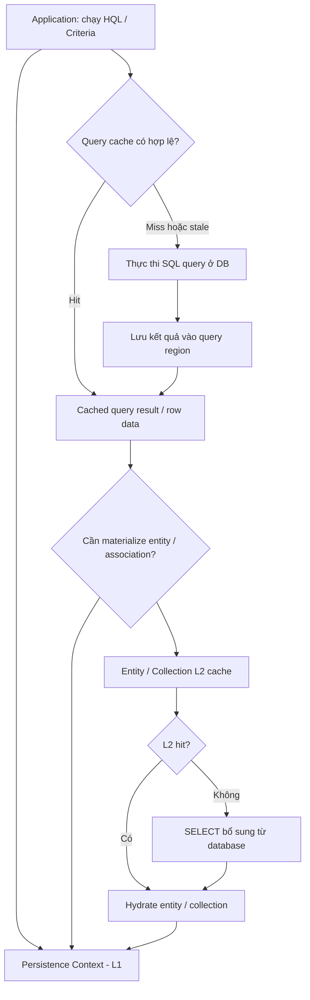
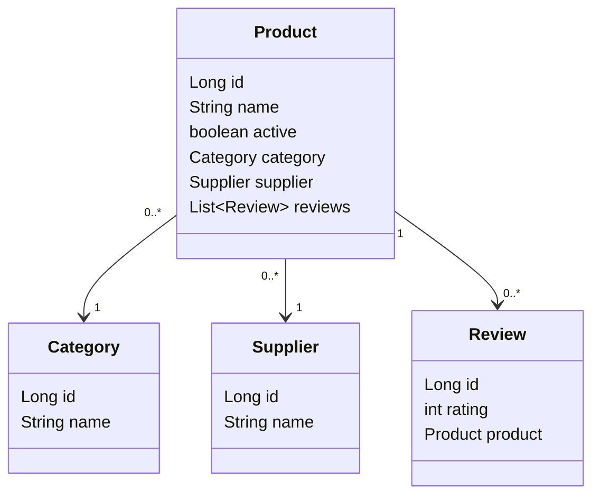
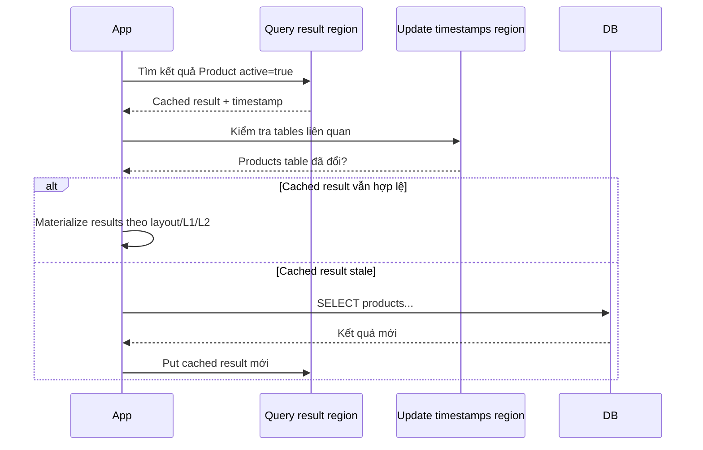

# Query cache khác với lưu toàn bộ đồ thị thực thể trong Hibernate

Một câu truy vấn Hibernate có thể trả về danh sách `Product`, mỗi sản phẩm tham chiếu `Category`, có nhiều `Review` và có thêm `Supplier`. Khi bật **query cache**, nhiều người dễ suy luận rằng: “Hibernate đã cache truy vấn lấy sản phẩm, vậy lần sau mọi thông tin của sản phẩm, category, reviews và supplier đều có sẵn trong bộ nhớ đệm.”

Suy luận đó **không đúng**.

**Query cache lưu kết quả của một lần thực thi truy vấn theo một cache key**. Tùy phiên bản và cấu hình, kết quả được lưu có thể gồm **identifier của entity/collection** hoặc **trạng thái đầy đủ của những entity/collection đã được truy vấn fetch**. Nhưng nó **không tự duyệt và sao chép toàn bộ object graph** từ root entity qua mọi association, đặc biệt là những quan hệ `LAZY` chưa được tải.

Ví dụ:

```java
List<Product> products = session.createSelectionQuery(
        """
        select p
        from Product p
        where p.active = :active
        order by p.id
        """,
        Product.class
    )
    .setParameter("active", true)
    .setCacheable(true)
    .getResultList();

for (Product product : products) {
    System.out.println(product.getName());
}
```

Lần chạy tiếp theo có thể **hit query cache**, không phải chạy lại SQL lọc sản phẩm. Nhưng nếu code sau đó gọi:

```java
for (Product product : products) {
    System.out.println(product.getCategory().getName());
    System.out.println(product.getReviews().size());
}
```

thì Hibernate **vẫn có thể cần SELECT bổ sung** để khởi tạo `category` hoặc `reviews` nếu chúng chưa được fetch và không có trong những cache có thể phục vụ việc tải đó.

Bài học giải thích mối quan hệ giữa **persistence context (first-level cache)**, **second-level cache của entity/collection**, **query results cache**, cách Hibernate 6.x thay đổi định dạng lưu kết quả, cơ chế kiểm tra dữ liệu cũ (*staleness*), và cách đo hiệu quả thật thay vì chỉ nhìn một chỉ số “query cache hit”.

---

## 1. Ba loại cache thường bị nhầm với nhau

Trong Hibernate, nên phân biệt ít nhất ba tầng:

1. **First-level cache (L1)**: persistence context của từng `Session`/`EntityManager`.
2. **Second-level cache (L2)**: vùng cache trạng thái entity/collection được chia sẻ ở phạm vi `SessionFactory` theo cấu hình provider.
3. **Query cache**: vùng cache kết quả truy vấn cho các query được đánh dấu cacheable.

Ngoài ra, ứng dụng có thể có **application cache** như Redis cache DTO hoặc HTTP response cache; đó lại là một tầng khác, không tự đồng nghĩa với Hibernate query cache.



Sơ đồ là **mô hình khái niệm**, không phải từng bước bắt buộc của mọi query: trình tự nội bộ phụ thuộc cache layout, association fetch plan, trạng thái L1, second-level cache và phiên bản Hibernate. Đặc biệt, khi query cache dùng layout `FULL`, một số dữ liệu entity/collection đã fetch có thể được materialize trực tiếp từ query cache mà không cần truy cập L2 hay DB để lấy chính các trường đó.

### 1.1. Bảng so sánh nhanh

| Khía cạnh | L1 / persistence context | L2 entity/collection cache | Query cache |
|---|---|---|---|
| Phạm vi | Một `Session`/`EntityManager` | Nhiều sessions dùng cùng `SessionFactory` | Nhiều query executions theo region |
| Đơn vị chính | Managed entity instance + trạng thái | Entity ID hoặc collection role + owner key | Query key và kết quả tương ứng |
| Kích hoạt | Mặc định | Cần provider + mapping/chính sách phù hợp | Cần bật query cache và opt-in query |
| Cùng query nhiều lần | Có thể tái sử dụng managed instances | Có thể phục vụ entity/collection data | Có thể bỏ chạy lại SQL query gốc |
| Tự cache mọi quan hệ LAZY? | Không | Không | Không |
| Dirty checking | Có với managed entities | Không phải nơi dirty checking | Không phải nơi dirty checking |
| Thời hạn sống | Trong vòng đời persistence context | Theo cache policy/region | Theo validity, timestamps và region policy |
| Dữ liệu được chia sẻ giữa transactions | Không trực tiếp | Có, theo consistency strategy | Có, theo query cache policy |

**Điểm cần nhớ:** query cache là cơ chế tối ưu **việc thực thi truy vấn**, không phải tính năng lưu bất kỳ object graph nào thành một snapshot bất biến có thể sử dụng hoàn toàn offline.

## 2. Dữ liệu ví dụ: Product, Category, Review, Supplier

Giả sử một catalog có mô hình:



Mapping giản lược:

```java
import jakarta.persistence.*;
import java.util.ArrayList;
import java.util.List;

@Entity
@Table(name = "products")
public class Product {
    @Id
    private Long id;

    private String name;
    private boolean active;

    @ManyToOne(fetch = FetchType.LAZY, optional = false)
    @JoinColumn(name = "category_id", nullable = false)
    private Category category;

    @ManyToOne(fetch = FetchType.LAZY)
    @JoinColumn(name = "supplier_id")
    private Supplier supplier;

    @OneToMany(mappedBy = "product", fetch = FetchType.LAZY)
    private List<Review> reviews = new ArrayList<>();

    protected Product() {}

    public Long getId() { return id; }
    public String getName() { return name; }
    public Category getCategory() { return category; }
    public Supplier getSupplier() { return supplier; }
    public List<Review> getReviews() { return reviews; }
}

@Entity
@Table(name = "categories")
public class Category {
    @Id
    private Long id;
    private String name;

    protected Category() {}

    public String getName() { return name; }
}

@Entity
@Table(name = "suppliers")
public class Supplier {
    @Id
    private Long id;
    private String name;

    protected Supplier() {}

    public String getName() { return name; }
}

@Entity
@Table(name = "reviews")
public class Review {
    @Id
    private Long id;

    @ManyToOne(fetch = FetchType.LAZY)
    private Product product;

    private int rating;

    protected Review() {}
}
```

Mỗi public class/enum thực tế cần file riêng; imports, setters và business methods được lược bớt. Các association `LAZY` được khai rõ để nhấn mạnh rằng **lấy Product không có nghĩa đã lấy Category, Supplier và Reviews**.

Một query chỉ chọn products:

```java
select p
from Product p
where p.active = true
order by p.id
```

không chứa chỉ thị `JOIN FETCH`. Tùy cấu hình và query plan, Hibernate có thể materialize Product và để các association ở trạng thái chưa khởi tạo.

## 3. Query cache thực sự cache cái gì?

Trước tiên, query cache cần biết **đầu vào của query** và **kết quả đã trả**.

Một cache key mang tính khái niệm có thể gồm:

```text
Query / SQL plan:
    select p from Product p
    where p.active = :active order by p.id

Bound parameters:
    active = true

Row selection:
    firstResult = 0
    maxResults = 20

Other execution context:
    relevant filters / tenant / query options
```

Các thành phần cụ thể của internal query key thay đổi theo Hibernate version. Không dùng danh sách minh họa này để tự viết logic cache key thay thế Hibernate.

Kết quả được lưu có thể là:

- Các giá trị scalar/tuple đã chọn.
- Các giá trị của một projection được Hibernate hỗ trợ cache.
- Với entity/collection results: **ID hoặc dữ liệu đã fetch**, phụ thuộc query cache layout và Hibernate release.

Điểm quan trọng nhất là **query cache lưu những gì truy vấn đã xác định là kết quả/fetched data**, không tự truy cập các getter của mọi association LAZY để mở rộng thành toàn bộ graph.

### 3.1. Cache query và cache entity là hai bước khác nhau

Một truy vấn:

```java
select p
from Product p
where p.active = true
```

trả danh sách các entity Product phù hợp. Cache query cần giúp Hibernate không chạy lại truy vấn lọc đó. Khi materialize Product từ cached result, Hibernate có thể:

- Tái sử dụng instance đã có trong L1.
- Đọc trạng thái entity từ L2 nếu layout/reference phù hợp.
- Khôi phục dữ liệu Product đã có trong query result `FULL`.
- Đọc database theo ID nếu cache chỉ có ID mà state không nằm trong L1/L2.

Cùng lúc, `product.getReviews()` vẫn có thể là collection lazy chưa khởi tạo.

### 3.2. Cache một danh sách ID không phải cache toàn bộ danh sách đối tượng

Hãy tưởng tượng query cache chứa:

```text
Query key: active=true, page=0, size=3
Result references: [Product#10, Product#20, Product#30]
```

Đây là ví dụ của dạng `SHALLOW`. Thông tin trên giúp biết **ba sản phẩm nào đã match query**, nhưng chưa cung cấp name/price/category/review text nếu dữ liệu đó chưa có ở cache tương ứng.

Hibernate cần bước **materialization** để trả các `Product` Java objects. Ở một phiên bản/layout `FULL`, một phần hoặc toàn bộ state của các kết quả đã fetch có thể được lưu chung trong query region, nhưng vẫn không tự mở rộng mọi lazy association.

## 4. Điểm rất quan trọng: query cache layout thay đổi giữa Hibernate 5 và 6

Không nên dạy một quy tắc tuyệt đối rằng “Hibernate query cache chỉ chứa entity IDs”. Điều này **đã thay đổi giữa các release**.

Theo Hibernate ORM 6.5 Migration Guide:

| Hibernate release | Query cache layout cho entity/collection | Hệ quả |
|---|---|---|
| Hibernate 5.x và cũ hơn | Thường theo cách `SHALLOW` | Query results dùng các identifiers; trạng thái entity lấy từ L1/L2/DB |
| Hibernate 6.0–6.4 | Chuyển sang cách lưu `FULL` cho fetched entity/collection data | Có thể rematerialize join-fetched data từ query cache nhưng tốn memory hơn |
| Hibernate 6.5+ | Có cơ chế cấu hình `AUTO`, `FULL`, `SHALLOW`, `SHALLOW_WITH_DISCRIMINATOR` | Chọn trade-off theo L2 cacheability và đặc tính workload |

### 4.1. FULL nghĩa là gì?

`FULL` có nghĩa query cache lưu **full state của entity hoặc collection được fetch trong query result** theo cấu trúc mà Hibernate cần để rematerialize dữ liệu đó.

Ví dụ:

```java
select p
from Product p
join fetch p.category
where p.active = true
```

Trong layout `FULL`, những dữ liệu Product và Category **đã được fetch bởi query** có thể nằm trong kết quả cached, giúp Hibernate tránh đọc lại phần dữ liệu đó từ database khi cache hit hợp lệ.

Nhưng:

```java
p.getReviews()
p.getSupplier()
```

không được bảo đảm đã tải chỉ vì query cache là `FULL`. Nếu query không fetch Reviews hoặc Supplier và mapping vẫn LAZY, chúng không tự trở thành một phần của “toàn bộ graph” được lưu.

**FULL là layout của fetched query result, không phải lệnh `deepCloneEntireObjectGraph()`.**

### 4.2. SHALLOW nghĩa là gì?

`SHALLOW` lưu identifier của entity hoặc owner key của collection, cùng metadata cần thiết trong những trường hợp phù hợp. Hibernate sau đó tìm trạng thái đối tượng trong L1/L2 hoặc đọc database.

Ưu điểm:

- Query region thường nhỏ hơn.
- Ít lặp dữ liệu giữa query region và L2 entity/collection regions.
- Phù hợp khi entity/collection có xác suất L2 cache hit rất cao.

Nhược điểm:

- Khi L2 thiếu entry hoặc entity không được cache, query hit có thể kéo theo nhiều SELECT theo ID.
- Có thể gặp hiện tượng **query cache hit nhưng tổng số DB SELECT vẫn cao**.

### 4.3. SHALLOW_WITH_DISCRIMINATOR

Ở các query đa hình (*polymorphic queries*), việc biết entity ID mà thiếu subtype/discriminator có thể khiến ORM phải truy vấn thêm để xác định class/entity phù hợp.

`SHALLOW_WITH_DISCRIMINATOR` lưu identifier kèm discriminator khi cần, giúp giảm một số truy vấn xác định subtype. Nó không có nghĩa cache toàn bộ inherited graph.

### 4.4. AUTO từ Hibernate 6.5

Từ Hibernate ORM 6.5, setting:

```properties
hibernate.cache.query_cache_layout=AUTO
```

lựa chọn layout:

- `SHALLOW` cho entity/collection được cấu hình second-level-cacheable.
- `FULL` cho entity/collection không được second-level-cacheable.

Đây là heuristic: khi entity có L2 cache, query result chỉ cần giữ ID và tận dụng cache đó; khi không có L2 cache, lưu full fetched state có thể tránh phải đọc lại entity theo ID.

Có thể chỉ định:

```properties
hibernate.cache.query_cache_layout=FULL
```

hoặc:

```properties
hibernate.cache.query_cache_layout=SHALLOW
```

Không dùng setting này trên Hibernate 6.4 hoặc cũ hơn nếu release đó chưa hỗ trợ. Ngay cả trên 6.5+, cấu hình phải tương thích với provider và đặc điểm cache hit thực tế.

### 4.5. @QueryCacheLayout theo entity/collection

Từ Hibernate 6.5 có annotation Hibernate-specific:

```java
import org.hibernate.annotations.CacheLayout;
import org.hibernate.annotations.QueryCacheLayout;

@Entity
@QueryCacheLayout(layout = CacheLayout.SHALLOW)
public class Product {
    @Id
    private Long id;
}
```

Nó có thể được áp dụng ở class hoặc persistent collection attribute theo API tương ứng để điều chỉnh layout cho những đối tượng được lưu vào query cache.

**Quan trọng:** `@QueryCacheLayout` chỉ chọn *cách biểu diễn kết quả của entity/collection trong query cache*. Nó không tự bật `hibernate.cache.use_query_cache`, không tự làm một query `cacheable`, không tự bật L2 cache cho entity và không quyết định toàn bộ fetch plan.

### 4.6. Kết luận về layout

Một phát biểu đúng cho mọi trường hợp là:

> **Query cache không đồng nghĩa lưu toàn bộ object graph.** Nó cache kết quả theo query plan/fetch plan; cách lưu entity/collection data có thể là FULL hoặc SHALLOW tùy Hibernate version và cấu hình.

Vì vậy, khi gỡ lỗi hoặc tối ưu cache, cần biết chính xác phiên bản Hibernate trước khi kết luận một query hit có cần SELECT entity theo ID hay không.

## 5. Bật query cache: phải cấu hình và đánh dấu query

Query cache không được bật toàn cục mặc định. Cấu hình cơ bản:

```properties
hibernate.cache.use_query_cache=true
```

Trong Spring Boot:

```properties
spring.jpa.properties.hibernate.cache.use_query_cache=true
```

Cần một Hibernate cache region provider tương thích. Ví dụ nếu dùng Hibernate JCache integration thì cấu hình thêm dependency `hibernate-jcache` và một provider JCache thực tế, rồi chỉ định region factory theo version:

```properties
spring.jpa.properties.hibernate.cache.region.factory_class=org.hibernate.cache.jcache.internal.JCacheRegionFactory
spring.jpa.properties.hibernate.cache.use_second_level_cache=true
spring.jpa.properties.hibernate.cache.use_query_cache=true
```

Đây là **cấu hình minh họa**, chưa đầy đủ provider-specific caches, TTL/eviction, dependency versions và chiến lược consistency. Không dùng trong production nếu chưa cấu hình các regions theo chính sách dữ liệu và đo hiệu quả.

### 5.1. Bật toàn cục không làm mọi query được cache

`hibernate.cache.use_query_cache=true` mới bật cơ sở hạ tầng. Mỗi query muốn sử dụng query cache cần opt-in.

Hibernate native:

```java
List<Product> result = session.createSelectionQuery(
        """
        select p
        from Product p
        where p.active = :active
        order by p.id
        """,
        Product.class
    )
    .setParameter("active", true)
    .setCacheable(true)
    .getResultList();
```

Có thể đặt region:

```java
List<Product> result = session.createSelectionQuery(
        "from Product p where p.active = :active order by p.id",
        Product.class
    )
    .setParameter("active", true)
    .setCacheable(true)
    .setCacheRegion("catalog.active-products")
    .getResultList();
```

Query không gọi `setCacheable(true)` không được tự đưa vào query cache chỉ vì `@Cacheable` có trên Product.

### 5.2. JPA query hint

Dùng `EntityManager`:

```java
List<Product> result = entityManager.createQuery(
        """
        select p
        from Product p
        where p.active = :active
        order by p.id
        """,
        Product.class
    )
    .setParameter("active", true)
    .setHint("org.hibernate.cacheable", true)
    .getResultList();
```

Hint `org.hibernate.cacheable` là **Hibernate-specific**, không phải standard JPA query hint. Với API có `HibernateHints.HINT_CACHEABLE` trong release tương ứng, dùng constant giúp tránh gõ sai literal.

### 5.3. Spring Data JPA query hints

Ví dụ:

```java
@Query("""
    select p
    from Product p
    where p.active = true
    order by p.id
    """)
@QueryHints(
    @QueryHint(
        name = "org.hibernate.cacheable",
        value = "true"
    )
)
List<Product> findActiveProductsCached();
```

Đây là ví dụ Spring Data JPA + Hibernate, yêu cầu import `org.springframework.data.jpa.repository.Query`, `QueryHints` và `jakarta.persistence.QueryHint`. Tùy repository infrastructure, transaction/cache mode vẫn có thể tác động đến việc đọc/ghi cache. Không nhầm Spring Cache `@Cacheable` với JPA `@Cacheable` hoặc Hibernate query hint.

## 6. L2 entity cache: lưu dữ liệu theo entity identity

Second-level entity cache lưu trạng thái entity theo khóa định danh, không theo câu query gốc.

Ví dụ:

```java
import jakarta.persistence.Cacheable;
import org.hibernate.annotations.Cache;
import org.hibernate.annotations.CacheConcurrencyStrategy;

@Entity
@Table(name = "products")
@Cacheable
@Cache(
    usage = CacheConcurrencyStrategy.READ_WRITE,
    region = "catalog.products"
)
public class Product {
    @Id
    private Long id;

    private String name;
    private boolean active;
}
```

Ở một provider và cache configuration phù hợp, entity Product ID 10 có thể có cache entry tương ứng với persistent state của Product#10. Truy cập `session.find(Product.class, 10L)` trong Session mới có thể lấy state từ L2 thay vì DB.

`@Cacheable` của Jakarta Persistence đánh dấu entity cacheability; `@Cache` của Hibernate chỉ định usage strategy/region. Chi tiết cấu hình có thể khác theo shared-cache-mode và Hibernate/cache provider version.

### 6.1. Entity cache không cache toàn bộ associations

Product có:

```java
@ManyToOne(fetch = FetchType.LAZY)
private Category category;
```

Entry L2 của Product có thể chứa khóa liên kết/giá trị ánh xạ cần thiết, nhưng **không có nghĩa toàn bộ Category entity state được nhét vào entry Product**. Category thường được materialize như một entity khác bằng identity riêng, qua L1/L2/DB.

Nếu Category cũng cacheable, có thể có một entry L2 riêng cho `Category#5`. Nếu chưa cache, truy cập `category.getName()` có thể phát SELECT.

### 6.2. Chọn concurrency strategy theo dữ liệu

Một vài lựa chọn Hibernate:

- `READ_ONLY`: phù hợp với dữ liệu thực sự bất biến hoặc không được cập nhật qua ORM.
- `READ_WRITE`: phù hợp với dữ liệu mutable cần chiến lược cache consistency của provider.
- `NONSTRICT_READ_WRITE`: cân nhắc khi chấp nhận cửa sổ dữ liệu cũ và yêu cầu cập nhật thấp.
- `TRANSACTIONAL`: cần provider và môi trường hỗ trợ thích hợp.

Không chọn `READ_ONLY` cho Product đang cập nhật thường xuyên chỉ để benchmark cache hit đẹp. Cache consistency là quyết định nghiệp vụ, không chỉ hiệu năng.

## 7. L2 collection cache khác entity cache và query cache

Một `Product` có collection reviews:

```java
@OneToMany(mappedBy = "product", fetch = FetchType.LAZY)
private List<Review> reviews = new ArrayList<>();
```

Collection `reviews` có một **collection role** ví dụ `Product.reviews` và một **owner key** là Product ID. Hibernate có thể cache dữ liệu collection role theo owner ID nếu mapping và provider hỗ trợ.

Để cache collection:

```java
@OneToMany(mappedBy = "product", fetch = FetchType.LAZY)
@Cache(
    usage = CacheConcurrencyStrategy.READ_WRITE,
    region = "catalog.product-reviews"
)
private List<Review> reviews = new ArrayList<>();
```

Với collection entity elements, collection cache thường lưu thông tin membership/element identifiers của collection, **không tự đồng nghĩa cache toàn bộ persistent state của mọi Review entity**. Nếu Review được truy cập để đọc rating/text và entry Review không có trong L1/L2, Hibernate vẫn có thể phải SELECT từng Review hoặc theo batch plan.

### 7.1. Collection cache có mục tiêu khác query cache

- Query cache: “Danh sách Product IDs/rows thỏa truy vấn active=true là gì?”
- Collection cache: “Product#10 có những Review identifiers nào?”
- Entity cache: “Review#101 có state gì?”
- L1: “Trong Session này, Review#101 đang là object managed nào?”

Bốn câu hỏi khác nhau, nên kết hợp cache regions phải theo dữ liệu thực sự được yêu cầu.

### 7.2. Dùng collection cache không nhất thiết loại N+1

Giả sử query trả 50 products. Màn hình gọi:

```java
for (Product product : products) {
    for (Review review : product.getReviews()) {
        System.out.println(review.getRating());
    }
}
```

Nếu collection cache misses và Review entity cache misses, Hibernate có thể tạo nhiều SELECT. Cấu hình `@BatchSize` hoặc `FetchMode.SUBSELECT` cho collections, dùng query fetch plan có kiểm soát hoặc DTO projection khi chỉ cần số lượng/rating tổng hợp.

Query cache của Product không tự sửa mô hình N+1 này.

## 8. Ba tình huống: cùng một cache hit, SQL khác nhau

Hãy giả sử truy vấn Product cacheable đã chạy ít nhất một lần, và query result entry còn hợp lệ.

### 8.1. Trường hợp A — SHALLOW, không có L2 entry

Query cache chứa references:

```text
Active Product query result:
[Product#10, Product#20, Product#30]
```

Ở lần request tiếp theo, Hibernate tìm thấy danh sách IDs trong query cache và **không cần chạy lại SQL `where active = true`**. Nhưng các Product objects chưa có trong L1, và L2 không chứa state tương ứng.

Hibernate có thể cần:

```sql
SELECT ... FROM products WHERE id = 10;
SELECT ... FROM products WHERE id = 20;
SELECT ... FROM products WHERE id = 30;
```

Thực tế có thể batch load hoặc tối ưu theo plan/version, nhưng bài học là **query cache hit không đồng nghĩa zero SQL statements**.

Nếu trước đó SQL gốc chỉ là một câu query trả ba rows, mà kết quả shallow lại dẫn tới nhiều SELECT theo ID, tổng hiệu năng có thể **tệ hơn không cache query**.

### 8.2. Trường hợp B — SHALLOW kết hợp L2 entity cache

Giả sử cache result vẫn chứa `[Product#10, Product#20, Product#30]`, và L2 có state Product#10/#20/#30.

Khi query hit:

1. Query cache trả danh sách identities.
2. Hibernate tìm entities trong L1 hoặc L2.
3. L2 hits cung cấp Product state.
4. Không cần chạy lại root query.
5. Association `category`/`reviews` vẫn tải theo fetch plan khi được dùng.

Đây là tình huống mà shallow layout có thể hoạt động hiệu quả: query result entry nhỏ, entity cache có hit rate cao, association requests được tối ưu riêng.

### 8.3. Trường hợp C — FULL có dữ liệu đã fetch

Giả sử query:

```java
select p
from Product p
join fetch p.category
where p.active = true
order by p.id
```

và query cache layout là `FULL` cho những entity/collection được fetch.

Ở lần cache hit phù hợp, Hibernate có thể materialize Product và Category đã fetch từ query result data mà không query lại phần đó.

Nhưng:

- `p.reviews` vẫn có thể LAZY và chưa được tải.
- `p.supplier` vẫn có thể LAZY và chưa được tải.
- Các association tiếp theo của Category (ví dụ parentCategory) cũng chưa chắc có.
- Query có thể chứa dữ liệu lặp của Category khi nhiều products cùng category.
- Dung lượng cached result có thể tăng đáng kể.

**FULL giải quyết nhu cầu khôi phục những gì query đã fetch, chứ không làm graph vô hạn trở thành một snapshot trong cache.**

## 9. Query cache không thay thế fetch plan

Một fetch plan quyết định **association nào được tải**, query cache quyết định **có thể dùng lại kết quả query đó hay không**. Đây là hai trục tối ưu độc lập.

### 9.1. JOIN FETCH

```java
List<Product> products = session.createSelectionQuery(
        """
        select p
        from Product p
        join fetch p.category
        where p.active = true
        order by p.id
        """,
        Product.class
    )
    .setCacheable(true)
    .getResultList();
```

Query trên yêu cầu Category được fetch. Nhưng Reviews vẫn chưa được yêu cầu. Query cache có thể lưu data của fetched result theo layout hiện hành, không được tự hiểu “fetch thêm reviews”.

### 9.2. EntityGraph

```java
EntityGraph<Product> graph =
    entityManager.createEntityGraph(Product.class);

graph.addAttributeNodes("category");

List<Product> products = entityManager.createQuery(
        "select p from Product p where p.active = true",
        Product.class
    )
    .setHint("jakarta.persistence.fetchgraph", graph)
    .setHint("org.hibernate.cacheable", true)
    .getResultList();
```

`EntityGraph` chỉ định fetch requirements của query. Dùng graph vẫn không đảm bảo query cache lưu mọi association chưa có trong graph. Hibernate có thể chọn SQL JOIN hoặc SELECT phụ theo plan/metadata, không nhất thiết luôn một SQL.

### 9.3. Lazy loading và ranh giới Session

```java
List<Product> products = productService.findActiveProducts();
// Session/EntityManager đã đóng

String categoryName =
    products.get(0).getCategory().getName();
```

Nếu Category chưa được khởi tạo, truy cập có thể ném `LazyInitializationException`. **Query cache không giữ một Session mở, không attach detached entities và không làm lazy loading hoạt động ngoài persistence context**.

Giải pháp là chọn fetch plan phù hợp trong transaction rồi map DTO cần thiết, không bật query cache như một cách “chữa” LazyInitializationException.

### 9.4. DTO projection thường tốt hơn khi chỉ cần vài cột

Nếu màn hình danh sách chỉ cần ID, tên và category name:

```java
public record ProductRow(
    Long id,
    String name,
    String categoryName
) {}

List<ProductRow> rows = entityManager.createQuery(
        """
        select new com.example.ProductRow(
            p.id,
            p.name,
            c.name
        )
        from Product p
        join p.category c
        where p.active = true
        order by p.id
        """,
        ProductRow.class
    )
    .setHint("org.hibernate.cacheable", true)
    .getResultList();
```

Query chỉ chọn các fields cần thiết. Query cache với scalar/DTO projection có thể lưu result values phù hợp theo khả năng version/provider, nhưng **DTO không phải entity managed**, không có dirty checking và không có `getReviews()` lazy association.

Đây là một ranh giới quan trọng: cache dữ liệu đọc phẳng cho UI thường đơn giản hơn cache cả entity graph nếu không cần thao tác domain trên entities.

## 10. Query key: cùng HQL nhưng khác tham số là kết quả khác

Hãy xét:

```java
List<Product> active = session.createSelectionQuery(
        "from Product p where p.active = :active",
        Product.class
    )
    .setParameter("active", true)
    .setCacheable(true)
    .getResultList();

List<Product> inactive = session.createSelectionQuery(
        "from Product p where p.active = :active",
        Product.class
    )
    .setParameter("active", false)
    .setCacheable(true)
    .getResultList();
```

Hai query có cùng HQL text nhưng tham số khác nhau, nên không thể dùng cùng cached result entry như thể hai tập sản phẩm bằng nhau.

Tương tự:

- `categoryId=5` khác `categoryId=8`.
- `page=0, size=20` khác `page=1, size=20`.
- Sort theo `price asc` khác `createdAt desc`.
- Enabled filters/multi-tenancy có thể làm kết quả khác nhau và cần được tính đúng trong cơ chế cache của Hibernate.

### 10.1. Nhiều biến thể filter làm giảm hit ratio

Một trang tìm kiếm có 20 filter tùy chọn, nhập keyword tự do, khoảng giá tùy ý và nhiều cách sort có thể tạo lượng lớn query keys. Mỗi tổ hợp xuất hiện một lần rồi hết hạn thì query cache chỉ tăng footprint mà ít đem lại hit.

Query cache thường phù hợp hơn với truy vấn có **parameters ổn định, ít biến thể, chạy lặp thường xuyên và bảng ít thay đổi**.

### 10.2. Pagination vẫn có thể tạo nhiều entries

`setFirstResult(0).setMaxResults(20)` và `setFirstResult(20).setMaxResults(20)` là hai row selections khác nhau. Dữ liệu cache cho trang đầu không tự chứa mọi trang.

Nếu nhiều người dùng cùng xem trang đầu của danh mục ổn định, query caching có thể đáng thử. Nếu mỗi người truy vấn một trang sâu với filter riêng, hit ratio thấp và vùng cache phình nhanh.

### 10.3. Không xây cache key bằng tay để vượt qua Hibernate

Không cố ép hai queries có input khác nhau về cùng key để tăng hit: trả nhầm kết quả có thể gây lỗi nghiệp vụ, rò thông tin tenant hoặc bypass filter quyền truy cập.

Các chính sách multi-tenancy, access control và filters phải được kiểm tra ở tầng ứng dụng và ORM, không suy đoán rằng cache region mặc định sẽ cô lập mọi ngữ cảnh tự chế.

## 11. Cache regions: query results và update timestamps

Hibernate query cache thường sử dụng hai loại region có vai trò khác nhau:

- `default-query-results-region`: lưu kết quả query mặc định nếu không chỉ định named region khác.
- `default-update-timestamps-region`: lưu logical timestamps cho các bảng/query spaces được cập nhật, giúp xác định cached query result còn hợp lệ hay đã stale.

Một query có thể chọn custom region:

```java
session.createSelectionQuery(
        "from Product p where p.active = true",
        Product.class
    )
    .setCacheable(true)
    .setCacheRegion("catalog.active-products")
    .getResultList();
```

Region `catalog.active-products` có thể có TTL/size policy khác một query report khác. **Tách region không tự thay đổi cách invalidation theo dữ liệu**; nó là cách tổ chức/lập chính sách cache entries.

### 11.1. Logical timestamp, không phải đồng hồ hệ thống thông thường

Khi cached query result được tạo, Hibernate ghi một giá trị logic tương ứng thời điểm kết quả hợp lệ. Nếu một bảng liên quan được cập nhật thông qua các thao tác Hibernate được đồng bộ đúng, update timestamps region ghi nhận bảng đó có thay đổi.

Khi đọc query cache, Hibernate so sánh tuổi của result với timestamps của các **query spaces** liên quan. Nếu result quá cũ, ORM bỏ kết quả cached và thực thi query lại.



### 11.2. Tại sao một update không liên quan cũng có thể invalidate query?

Giả sử cached query `where active=true`. Ứng dụng cập nhật giá của một Product đang inactive. Vì update tác động bảng `products` — một query space liên quan — cached query result có thể bị xem là stale **dù tập active products không thay đổi**.

Cơ chế invalidation này dựa trên **tables/query spaces**, không cố suy luận chính xác predicate của mọi cached query. Do đó, bảng ghi rất thường xuyên làm query cache hit rate thấp hơn kỳ vọng.

### 11.3. Update timestamps region rất quan trọng

Không cấu hình update timestamps region bị expire/evict trước các query result regions còn sống. Nếu các timestamp cần thiết bị mất, hệ thống có thể không xác định đúng staleness theo contract mong đợi.

Tài liệu Hibernate khuyến nghị **không dùng time-based expiration hoặc size-based eviction cho update timestamps region**, và không dùng LRU cho region này.

Nếu provider buộc có expiration, tuổi dữ liệu timestamps phải dài hơn các query regions tương ứng; cách an toàn hơn là cấu hình region timestamps tồn tại ổn định theo hướng dẫn provider/Hibernate release.

## 12. Invalidation và thay đổi dữ liệu từ bên ngoài Hibernate

Một điểm quan trọng của mọi cache: **cache chỉ đúng khi cơ chế invalidation biết dữ liệu nguồn đã đổi**.

### 12.1. Thay đổi do Hibernate quản lý

```java
@Transactional
public void deactivateProduct(Long id) {
    Product p = entityManager.find(Product.class, id);
    p.setActive(false);
}
```

Khi flush/commit cập nhật `products`, Hibernate có thông tin về bảng bị tác động và có thể cập nhật cơ chế timestamps/invalidation theo mapping/cache configuration.

Lần sau, cached query `active=true` có thể được phát hiện stale và chạy lại.

### 12.2. Native SQL trực tiếp

```sql
UPDATE products SET active = false WHERE id = 10;
```

Nếu native SQL chạy thông qua Hibernate, việc đồng bộ query spaces/cache invalidation phụ thuộc cách Hibernate được thông báo về affected tables và query type. Không được tự giả định mọi native SQL fragment đều khai được chính xác dependency.

Với các APIs hỗ trợ, có thể khai synchronized entity/query spaces cho native queries. Cần dùng đúng method Hibernate version hiện tại và kiểm thử hiệu lực invalidation.

### 12.3. SQL từ ứng dụng khác hoặc batch jobs riêng

Nếu một service khác, ETL job, migration script hoặc database admin update `products` bên ngoài Hibernate, Hibernate query cache **không tự nhận event** chỉ vì database đã commit.

Hậu quả có thể là query cache hoặc L2 entity cache cung cấp dữ liệu cũ cho tới khi expiration/eviction hoặc một cơ chế đồng bộ ngoài ORM diễn ra.

Các lựa chọn thiết kế:

- Chỉ cache dữ liệu ít thay đổi hoặc chấp nhận độ trễ cập nhật.
- Dùng region TTL phù hợp với SLA dữ liệu.
- Chủ động evict/invalidate sau external writes thông qua integration/CDC/event.
- Bypass cache cho các use cases cần dữ liệu mới nhất.
- Thiết kế ownership dữ liệu rõ ràng giữa các services.
- Theo dõi cache staleness trong integration tests.

**Đừng tuyên bố query cache có tính nhất quán mạnh với mọi external writer.** Cache consistency cần được thiết kế, không tự phát sinh từ `setCacheable(true)`.

## 13. Query cache không phải ảnh chụp transaction nhất quán của toàn graph

Một object graph có thể bao gồm Product → Category → Reviews → Authors → Profiles. Các thành phần đó có thể được tải ở **những thời điểm khác nhau** và theo nhiều query/cache entries khác nhau.

Ví dụ:

1. Query trả Product được cache tại thời điểm A.
2. Product Category được tải lazy ở thời điểm B.
3. Reviews collection được tải ở thời điểm C.
4. Review Author được tải ở thời điểm D.

Cache một query ở bước 1 không bảo đảm tất cả dữ liệu ở B/C/D xuất phát từ cùng database snapshot. Transaction isolation, refresh rules, L1/L2 cache consistency và thời gian ghi từ transaction khác đều ảnh hưởng kết quả.

### 13.1. Session state ưu tiên quan trọng

Nếu Product#10 đã managed trong persistence context, Hibernate có thể tiếp tục trả **instance hiện tại** của Product#10. Nó không có nghĩa mỗi lần query cache hit sẽ áp state cached lên object managed và ghi đè mọi field.

Tương tự, thay đổi pending trong Session chưa flush có thể tương tác với query flush mode và kết quả query. **Query cache không thay thế logic transaction/flush/refresh.**

### 13.2. Query cache không phải công cụ cho read-your-writes ở mọi bối cảnh

Nếu một transaction vừa cập nhật Product, query sau đó phải tuân theo transactional visibility/flush rules. ORM có thể flush trước khi chạy query theo flush mode và query spaces, nhưng cache không phải một bản sao transaction-managed có thể bỏ qua tất cả cơ chế đó.

Đối với workflow cần đảm bảo đọc trạng thái vừa ghi, thiết kế transaction và dùng managed entities là ưu tiên; không dùng query cache như nguồn dữ liệu có thẩm quyền.

## 14. Query result cache có thể chứa scalars và projections

Không phải mọi cached query result đều là danh sách entity.

### 14.1. Scalar

```java
List<String> names = session.createSelectionQuery(
        """
        select p.name
        from Product p
        where p.active = true
        order by p.name
        """,
        String.class
    )
    .setCacheable(true)
    .setCacheRegion("catalog.active-product-names")
    .getResultList();
```

Kết quả là những `String` values. Ở dạng này, query cache có thể lưu các values được chọn; không cần materialize managed Product chỉ để trả `name`.

Đổi tên Product ở database khiến cached names cần được invalidated theo query-space/version behavior. Không có entity graph nào tự được tải chỉ vì kết quả chứa tên sản phẩm.

### 14.2. Count/aggregate

```java
Long activeCount = session.createSelectionQuery(
        """
        select count(p)
        from Product p
        where p.active = true
        """,
        Long.class
    )
    .setCacheable(true)
    .getSingleResult();
```

Một cached count là kết quả aggregate, không phải một collection ẩn của Product. Nếu bảng products thay đổi thường xuyên, cached count có thể bị invalidated thường xuyên, làm lợi ích cache thấp.

### 14.3. DTO projection

```java
public record ProductCard(
    Long id,
    String name,
    String categoryName
) {}

List<ProductCard> cards = session.createSelectionQuery(
        """
        select new com.example.ProductCard(
            p.id, p.name, c.name
        )
        from Product p
        join p.category c
        where p.active = true
        """,
        ProductCard.class
    )
    .setCacheable(true)
    .getResultList();
```

Khả năng cache và cách khôi phục constructor projections phụ thuộc Hibernate version và result mapping. Nếu supported, cached result đại diện cho các values cần tạo DTO, không phải các Product/Category managed entities với toàn bộ associations.

Đối với API list/search, projection có thể giúp giảm hydration/GC overhead hơn so với tối ưu query cache cho một entity graph lớn.

## 15. Cacheable query với JOIN FETCH collection

Một query:

```java
List<Product> products = session.createSelectionQuery(
        """
        select p
        from Product p
        left join fetch p.reviews
        where p.active = true
        """,
        Product.class
    )
    .setCacheable(true)
    .getResultList();
```

có những đặc điểm quan trọng:

- SQL JOIN có thể trả nhiều hàng cho cùng Product vì một Product có nhiều Reviews.
- Hibernate 6 xử lý duplicate root entity results do collection fetch join ở mức kết quả Java.
- Layout `FULL` có thể lưu fetched query rows/state cần để khôi phục Product và Reviews theo semantics của query.
- Layout `SHALLOW` có thể cần tra L2 collection/entity caches hoặc DB để khởi tạo fetched data, nhưng query result vẫn phải tôn trọng yêu cầu JOIN FETCH.
- Product → Supplier hoặc Review → Author chưa được fetch thì không mặc nhiên được cache cùng.

### 15.1. FULL và row multiplication

Một Product có 500 Reviews tạo ra nhiều rows SQL chứa Product columns lặp lại. FULL query cache có thể tốn bộ nhớ lớn hơn SHALLOW, nhất là nhiều fetched associations và large result sets.

Nếu join hai collections, số hàng có thể tăng theo tích cardinalities, và Hibernate có thể gặp `MultipleBagFetchException` khi fetch nhiều bag collections đồng thời. Query cache **không chữa** row multiplication.

### 15.2. Pagination collection fetch join

```java
session.createSelectionQuery(
        """
        select p
        from Product p
        left join fetch p.reviews
        order by p.id
        """,
        Product.class
    )
    .setFirstResult(0)
    .setMaxResults(20)
    .setCacheable(true)
    .getResultList();
```

Đây là mẫu query nguy hiểm cho phân trang root: SQL join nhân hàng, Hibernate có thể phải phân trang trong memory hoặc ném lỗi nếu cấu hình fail-on-pagination-over-collection-fetch được bật.

Cache query không tự biến 20 joined rows thành 20 distinct Products có Reviews đầy đủ.

Thay vào đó:

1. Query page Product IDs có order ổn định.
2. Fetch Product và associations cho đúng IDs đó.
3. Sắp lại theo ID list ban đầu nếu cần.
4. Dùng batch fetching/subselect cho các collections khác.

Không dùng cache để che lỗi fetch plan.

## 16. Query cache hit không có nghĩa hết N+1 queries

Một ví dụ:

```java
List<Product> products = cachedActiveProducts();

for (Product product : products) {
    System.out.println(
        product.getCategory().getName()
    );
}
```

Nếu Product roots đến từ query cache nhưng Category references là lazy proxies, mỗi Category ID chưa có trong L1/L2 có thể tạo SELECT. Khi 100 products tham chiếu 100 categories khác nhau, tổng số SELECT có thể rất lớn.

### 16.1. Batch fetching

Có thể cấu hình batch trên Category:

```java
@Entity
@BatchSize(size = 20)
public class Category {
    @Id
    private Long id;
    private String name;
}
```

Hoặc:

```properties
hibernate.default_batch_fetch_size=20
```

Hibernate có thể gom việc khởi tạo nhiều proxies/collections vào những SELECT có `IN (...)` thay vì từng query. Cấu hình này liên quan **SELECT lazy fetching**, không phải JDBC DML `hibernate.jdbc.batch_size`.

### 16.2. JOIN FETCH to-one

Nếu màn hình luôn cần Category, có thể dùng:

```java
select p
from Product p
join fetch p.category
where p.active = true
```

và cache query đó khi phù hợp. Việc tải Category cùng query là **fetch-plan decision**; query cache chỉ giúp sử dụng lại dữ liệu kết quả theo layout/version.

### 16.3. Aggregate thay vì tải collection

Nếu chỉ hiển thị `reviewCount`, đừng tải 1.000 Review entities mỗi Product chỉ để gọi `size()`. Dùng aggregate query/DTO:

```java
select p.id, count(r.id)
from Product p
left join p.reviews r
group by p.id
```

Sau đó cân nhắc cache kết quả aggregate nếu bảng reviews đủ ổn định và queries được lặp lại nhiều. Một bảng reviews cập nhật liên tục có thể làm aggregate query cache kém hiệu quả do invalidation.

## 17. Vì sao query cache đôi khi làm hệ thống chậm hơn?

Query cache có chi phí:

- Lookup cache key.
- Serialize/deserialize cached result.
- Lưu timestamp và kiểm tra các query spaces.
- Memory của query regions.
- Network round-trips tới cache provider phân tán (nếu có).
- GC/eviction overhead.
- Invalidation và cache repopulation khi dữ liệu thay đổi.
- Materialization entities/collections từ IDs hoặc cached full state.

### 17.1. Query ít lặp lại

Một search theo keyword tự do có hàng nghìn parameter combinations: mỗi request có thể là một cache miss và thêm overhead ghi cache entry chẳng bao giờ đọc lại.

### 17.2. Bảng ghi thường xuyên

Một report dùng bảng orders được update liên tục có thể invalidated ngay sau khi cache được tạo. Query cache miss rate cao khiến overhead lớn hơn lợi ích.

### 17.3. SHALLOW nhưng L2 miss cao

Query cache hit trả IDs, sau đó mỗi entity vẫn cần SELECT vì L2 không có state. Đây là trường hợp quan trọng nhất khi tối ưu: **tăng query-cache hit ratio mà không giảm database work**.

### 17.4. FULL với graph fetched lớn

Query cache FULL có thể tiêu tốn nhiều memory do fetched rows/state lớn. Nếu cache backend phân tán, mỗi cache hit còn cần tải payload lớn qua network. Có thể chi phí cao hơn chạy query đơn giản có index tốt trên database.

### 17.5. Thiếu region TTL/chính sách eviction

Một catalog query ổn định nhưng cache quá nhiều pages/filter combinations có thể chiếm bộ nhớ và đẩy các entries hữu ích ra khỏi cache. Cần định nghĩa giới hạn theo use case, đo hit ratio và quan sát eviction.

## 18. Cấu hình query cache layout có chủ đích

Từ Hibernate 6.5:

```properties
# Heuristic theo L2 cacheability
hibernate.cache.query_cache_layout=AUTO
```

Nếu chọn `FULL`:

```properties
hibernate.cache.query_cache_layout=FULL
```

Điều này có thể giảm SELECT materialization trong một số queries, nhưng tăng query region size.

Nếu chọn `SHALLOW`:

```properties
hibernate.cache.query_cache_layout=SHALLOW
```

Cách này có thể hợp lý khi entities và collections liên quan được L2 cache tốt, nhưng cần kiểm chứng không làm phát thêm nhiều SELECT theo ID.

Nếu cần kiểm soát polymorphic query:

```properties
hibernate.cache.query_cache_layout=SHALLOW_WITH_DISCRIMINATOR
```

Giá trị này hữu ích trong một số truy vấn inheritance khi cần discriminator, nhưng không thay thế entity cache. Không dùng chỉ vì tên nghe “nâng cao” hơn.

### 18.1. Cân nhắc theo từng entity/collection

Hibernate 6.5+ có `@QueryCacheLayout` để khai layout riêng cho entity hoặc collection attribute được đưa vào query cache:

```java
@Entity
@QueryCacheLayout(layout = CacheLayout.FULL)
public class Product {
    @Id
    private Long id;

    @OneToMany(mappedBy = "product")
    @QueryCacheLayout(layout = CacheLayout.SHALLOW)
    private List<Review> reviews;
}
```

Đoạn ví dụ giải thích cơ chế annotation, không phải khuyến nghị sử dụng FULL cho mọi Product và SHALLOW cho mọi Reviews. Chọn theo hit rate, data size, quan hệ có được L2-cacheable không và query fetch plan.

### 18.2. Version matrix ngắn

| Version | Lựa chọn cần hiểu |
|---|---|
| 5.x | Query cache shallow-style theo model cũ |
| 6.0–6.4 | FULL-style query cache, có thể chứa fetched state |
| 6.5+ | Có `hibernate.cache.query_cache_layout` và `@QueryCacheLayout` |
| 6.5+ mặc định | `AUTO` chọn SHALLOW cho L2-cacheable, FULL cho phần không L2-cacheable |

Khi nâng Hibernate, một ứng dụng có thể đổi hành vi memory và số DB SELECT dù code HQL không đổi. Đặc biệt khi chuyển 6.4 → 6.5, cần đo query cache payload, L2 hit rate và số SQL statements.

## 19. Cache consistency và bảo mật dữ liệu

### 19.1. Dữ liệu nhạy cảm và multi-tenancy

Query result có thể bao gồm các fields nhạy cảm. Nếu cache backend dùng chung nhiều tenants/environments, cần bảo đảm Hibernate multi-tenant identifiers, cache region configuration và application access controls đúng.

Không tự triển khai query key thiếu tenant/user context. Không cache những query phụ thuộc quyền truy cập thay đổi theo người dùng mà không kiểm soát cách quyền/filter ảnh hưởng đến key và invalidation.

### 19.2. Cache không tự mã hóa dữ liệu

Việc dữ liệu được lưu vào L2 hoặc query cache không bảo đảm provider tự mã hóa/ẩn dữ liệu nhạy cảm. Cần đánh giá access control của cache backend, network transport, persistence-to-disk, backups, log trace và retention.

### 19.3. READ_WRITE không đảm bảo mọi external write đồng bộ

Ngay cả L2 cache dùng `READ_WRITE`, một DB update từ service khác có thể bỏ qua thông báo tới cache. Cần chính sách TTL/eviction hoặc một cơ chế message/CDC invalidation phù hợp nếu nhiều writers cùng sở hữu dữ liệu.

### 19.4. Long-running transaction và cache visibility

Một transaction có snapshot/isolation riêng. Query cache không nên được coi là công cụ giúp transaction này thấy commit mới từ transaction khác trái với isolation semantics. Đồng thời, stale reads vẫn có thể xảy ra nếu invalidation policy không đồng bộ với external writers.

## 20. Quan sát query cache bằng Hibernate statistics

Bật statistics trong môi trường phát triển/thử nghiệm:

```properties
hibernate.generate_statistics=true
```

Spring Boot:

```properties
spring.jpa.properties.hibernate.generate_statistics=true
logging.level.org.hibernate.SQL=DEBUG
```

API:

```java
import org.hibernate.SessionFactory;
import org.hibernate.stat.Statistics;

SessionFactory sessionFactory =
    entityManagerFactory.unwrap(SessionFactory.class);

Statistics stats =
    sessionFactory.getStatistics();

long queryHits = stats.getQueryCacheHitCount();
long queryMisses = stats.getQueryCacheMissCount();
long queryPuts = stats.getQueryCachePutCount();

long l2Hits = stats.getSecondLevelCacheHitCount();
long l2Misses = stats.getSecondLevelCacheMissCount();

long preparedStatements =
    stats.getPrepareStatementCount();

System.out.println("Query hits: " + queryHits);
System.out.println("Query misses: " + queryMisses);
System.out.println("Query puts: " + queryPuts);
System.out.println("L2 hits: " + l2Hits);
System.out.println("L2 misses: " + l2Misses);
System.out.println("Prepared statements: " + preparedStatements);
```

Một số metrics/counters có thể khác theo Hibernate release, và `Statistics` là số liệu cấp `SessionFactory`, có thể chịu tác động của requests khác chạy song song. Với integration tests, cần cô lập môi trường và reset/đo delta phù hợp.

### 20.1. Vì sao chỉ đo queryHits là chưa đủ?

Giả sử:

```text
Query cache hits: 100
Query cache misses: 1
Second-level cache misses: 300
Additional SQL SELECT by id: many
```

Query cache hit rate cao, nhưng database vẫn làm nhiều việc. Ngược lại, layout FULL có thể giảm các SELECT nhưng tăng memory và traffic tới distributed cache.

Bộ chỉ số thực sự nên theo dõi gồm:

- Query cache hit/miss/put counts.
- L2 entity cache hit/miss counts.
- Collection cache hit/miss counts nếu áp dụng.
- Tổng SQL statements, số rows returned, latency.
- Query cache region size/memory/evictions.
- DB CPU, index reads, network overhead.
- End-to-end request latency.

### 20.2. SQL logging

Với Hibernate 6:

```properties
logging.level.org.hibernate.SQL=DEBUG
logging.level.org.hibernate.orm.jdbc.bind=TRACE
```

Bind tracing có thể ghi dữ liệu cá nhân/secrets; chỉ bật có kiểm soát. SQL log không nhất thiết thể hiện chính xác số JDBC rows hay bytes. Dùng datasource proxy/DB metrics nếu cần quan sát sâu.

## 21. Integration test: query hit nhưng graph chưa tải

Một test thiết kế tốt cần chạy ở **hai persistence contexts khác nhau**. Nếu chạy cùng `EntityManager`, L1 có thể che mọi SQL và khiến ta lầm tưởng query cache đang làm việc hiệu quả.

Ví dụ pseudo-integration test với Hibernate Session:

```java
@Test
void queryCacheDoesNotAutomaticallyFetchReviews() {
    // Fixture Product có Category và Reviews đã được commit.

    try (Session session = sessionFactory.openSession()) {
        Transaction tx = session.beginTransaction();

        session.createSelectionQuery(
                "from Product p where p.active = true",
                Product.class
            )
            .setCacheable(true)
            .getResultList();

        tx.commit();
    }

    try (Session session = sessionFactory.openSession()) {
        Transaction tx = session.beginTransaction();

        List<Product> products =
            session.createSelectionQuery(
                    "from Product p where p.active = true",
                    Product.class
                )
                .setCacheable(true)
                .getResultList();

        Product product = products.get(0);

        // Query hit có thể xảy ra ở đây.
        // Nhưng reviews không nhất thiết được khởi tạo.
        boolean initialized =
            Hibernate.isInitialized(product.getReviews());

        System.out.println(initialized);

        // Truy cập sau đây có thể tạo SELECT bổ sung.
        int reviewCount = product.getReviews().size();

        tx.commit();
    }
}
```

Đoạn test là skeleton: fixtures, cache provider, data seeding và initial state phải được cấu hình trước. `Hibernate.isInitialized` không phải chứng cứ duy nhất về query-cache hit; phải kết hợp statistics.

### 21.1. Tránh kết luận sai do L1 cache

Nếu lần một và lần hai chạy cùng Session:

```java
List<Product> a = queryActive(session);
List<Product> b = queryActive(session);
```

Hibernate có thể tái sử dụng managed instances từ L1. Điều này **không chứng minh** rằng query cache trả đầy đủ state trong mọi Session khác.

### 21.2. Tránh kết luận sai do L2 warm cache

Nếu entity Product, Category và Reviews đã được đọc gần đây, L2 có thể có entries. Một query cache hit kết hợp L2 hits có thể không cần SQL; trong môi trường cold cache, cùng query có thể cần SELECT theo ID.

Nên benchmark cả:

- Cold query cache, cold L2.
- Warm query cache, cold L2.
- Warm query cache, warm L2.
- Warm query cache, L2 eviction/miss.
- Sau update invalidate query space.

Đây là các trường hợp khác nhau và giúp tách lợi ích của từng cache.

### 21.3. Kiểm tra layout FULL và SHALLOW

Với Hibernate 6.5+:

1. Dùng query có một to-one `JOIN FETCH`.
2. Bật `FULL`, thực thi hai Sessions liên tiếp, đo SQL và memory.
3. Đổi sang `SHALLOW` với L2 enabled, đo lại.
4. Evict L2 entries có kiểm soát, giữ query results cache, đo SELECT bổ sung.
5. Đổi sang `AUTO`, đo trên mapping cacheable và không cacheable.

Không thể so sánh công bằng nếu thay đổi đồng thời fixture, query shape, TTL, provider hay DB load.

## 22. Khi nào query cache đáng dùng?

| Tình huống | Query cache có đáng cân nhắc? | Vì sao |
|---|---|---|
| Danh mục dữ liệu tương đối tĩnh, nhiều requests cùng filter | Có | Query key lặp lại, ít invalidation |
| Lookup nhóm danh mục theo trạng thái cố định | Có | Tập kết quả nhỏ, hot query |
| Trang đầu của catalog ít thay đổi | Có thể | Nhiều người xem cùng query và page |
| Số liệu thống kê chỉ thay đổi theo batch hằng ngày | Có thể | Aggregate tốn chi phí, có chu kỳ cập nhật rõ |
| Search keyword tự do hàng trăm nghìn biến thể | Thường không | Hit ratio thấp, nhiều cache keys |
| Bảng events/orders cập nhật liên tục | Thường không | Query-space invalidation thường xuyên |
| Query trả hàng trăm nghìn entity + nhiều collections | Thận trọng | FULL payload/hydration, L2 miss và memory lớn |
| Dữ liệu yêu cầu thấy external changes tức thì | Thận trọng/không | Cần invalidation đa writer đáng tin cậy |
| API chỉ cần vài scalar fields | Cân nhắc projection trước | Ít data cần hydrate; query cache chỉ có ích nếu lặp lại |
| N+1 do truy cập Reviews | Không phải giải pháp chính | Cần fetch plan, batching hoặc aggregate query |

### 22.1. Kiểm tra chi phí trước

Nếu một SQL query có index tốt, trả 10 rows trong thời gian rất ngắn, query cache có thể không đáng overhead. Ngược lại, một aggregate phức tạp lặp lại hàng nghìn lần mỗi phút trên dữ liệu ít thay đổi có thể hưởng lợi.

Cần đo:

\[
\text{Lợi ích ròng}
=
\text{chi phí DB tránh được}
-
\text{chi phí cache lookup, materialization, invalidation}
\]

Đây là mô hình định tính, không phải công thức benchmark đầy đủ. Với cache phân tán, network latency/cache serialization có thể chiếm tỷ trọng lớn.

## 23. Những cách hiểu sai thường gặp

### 23.1. “Query cache lưu toàn bộ entity graph”

Sai. Nó lưu **query results và fetched data theo layout**; không tự traverse tất cả lazy associations.

### 23.2. “Query cache luôn chỉ lưu IDs”

Sai với Hibernate 6.0–6.4 và các cấu hình `FULL` của Hibernate 6.5+. Cần xem phiên bản/layout.

### 23.3. “Query cache hit nghĩa là không còn SELECT nào”

Sai. Có thể cần SELECT để materialize shallow IDs, L2 misses hoặc khởi tạo lazy associations không nằm trong fetch plan.

### 23.4. “@Cacheable trên Product làm mọi HQL query Product được cache”

Sai. Entity cacheability và query cacheability là hai chính sách khác nhau. Query cần `setCacheable(true)` hoặc hint tương ứng.

### 23.5. “Bật use_query_cache tự động cache mọi query”

Sai. Tính năng phải được bật và từng query phải được chọn cacheable.

### 23.6. “Entity cache của Product chứa luôn Category và Reviews”

Sai. Association thường cần entry/cache riêng. Collection cache membership khác cache state của từng Review.

### 23.7. “FULL nghĩa là materialize toàn bộ các lazy relationships”

Sai. FULL liên quan full state của **fetched** entities/collections, không ép những association chưa được query fetch.

### 23.8. “Query cache giải quyết N+1”

Sai. N+1 có thể tiếp tục khi truy cập lazy associations hoặc khi shallow cache có L2 misses.

### 23.9. “Evict một query region là đủ để sửa mọi stale entity”

Không chắc. Query results và entity/collection L2 caches có lifecycle/regions riêng. Cần xác định vùng dữ liệu nào stale và invalidation nào cần thiết.

### 23.10. “Timestamps region cũng được TTL ngắn như query region”

Rất nguy hiểm. Hibernate khuyến nghị timestamps region không expire/evict; nếu cache provider áp TTL/eviction không hợp lý, staleness checking có thể bị ảnh hưởng.

### 23.11. “Hibernate biết mọi thay đổi từ SQL bên ngoài”

Không tự động. External writers phải có chính sách thông báo/eviction hoặc chấp nhận staleness.

### 23.12. “Query cache luôn tăng throughput”

Không. Hit ratio thấp, writes nhiều, FULL results lớn hoặc SHALLOW L2 misses cao có thể làm performance tệ hơn.

## 24. Quy trình thiết kế cache cho một API đọc

Giả sử endpoint `GET /products?active=true` đang chậm.

**Bước 1 — Xác định dữ liệu cần trả.** Nếu chỉ cần ID, tên và category name, ưu tiên DTO projection thay vì hydrate toàn graph.

**Bước 2 — Xem SQL và số rows.** Nếu N+1 do Category, sửa fetch plan trước. Nếu query chính chậm vì thiếu index, xử lý query/index trước.

**Bước 3 — Đánh giá tính ổn định.** Query params có lặp lại không? Bảng products cập nhật bao lâu một lần? Có external writers không?

**Bước 4 — Chọn L2 policy.** Product/Category có nên cache theo ID không? Reviews có vòng đời và tần suất ghi thế nào?

**Bước 5 — Chọn query cache.** Nếu result lặp lại đủ nhiều, bật query cache và mark query cacheable. Đặt named region khi cần TTL riêng.

**Bước 6 — Chọn layout theo version.** Hibernate 6.5+ có AUTO/FULL/SHALLOW; đo memory, L2 hits và SQL materialization.

**Bước 7 — Bảo đảm invalidation.** Timestamps region ổn định; external writes có eviction/TTL strategy.

**Bước 8 — Test trong Sessions khác nhau.** Một test dùng cùng Session dễ bị L1 che đi chi phí tải data.

**Bước 9 — Benchmark end-to-end.** So sánh latency, cache hits, SQL statements, memory, data correctness.

**Bước 10 — Theo dõi production.** Hit ratio không phải KPI duy nhất; kiểm tra stale responses và cache/provider resource usage.

## 25. Kết luận

**Hibernate query cache và lưu toàn bộ đồ thị thực thể là hai ý tưởng khác nhau.** Query cache tối ưu việc **dùng lại kết quả của một truy vấn**. Persistence context quản lý entity instances đang sống trong Session; second-level entity/collection caches lưu dữ liệu theo identity hoặc collection owner/role; các lazy associations vẫn được tải theo fetch plan và trạng thái cache riêng.

Đặc biệt, không thể phát biểu query cache chỉ lưu ID trên mọi phiên bản:

- Hibernate 5.x dùng cách lưu shallow-style cho entity/collection results.
- Hibernate 6.0–6.4 chuyển sang lưu full fetched state trong query cache.
- Từ Hibernate 6.5 có `AUTO`, `FULL`, `SHALLOW` và `SHALLOW_WITH_DISCRIMINATOR`; `AUTO` dựa vào khả năng L2 cache của entity/collection.

Nhưng ngay cả `FULL` cũng chỉ có nghĩa dữ liệu **đã được fetch bởi query** có thể được lưu đầy đủ cho những result objects đó. Nó **không tự tải toàn bộ Category → ParentCategory → Supplier → Reviews → ReviewAuthor...** hay bảo đảm mọi graph node được đồng bộ theo cùng database snapshot.

Hãy bắt đầu từ truy vấn và fetch plan đúng, cấu hình L2 và query cache theo dữ liệu thật, kiểm soát invalidation/update timestamps, sau đó **đo cả query-cache hits lẫn SQL/materialization costs**. Khi hiểu ba tầng cache khác nhau, ứng dụng tránh được cả N+1 bị che bởi cache hit và tình trạng cache đầy mà DB vẫn phải làm nhiều việc.

### Tài liệu tham khảo

- [Hibernate ORM 6.5 Migration Guide — Configurable Query Cache Layout](https://docs.hibernate.org/orm/6.5/migration-guide/) — mốc chuyển shallow → full và khả năng chọn AUTO/FULL/SHALLOW từ 6.5.
- [Hibernate ORM 6.6 User Guide — Caching](https://docs.hibernate.org/orm/6.6/userguide/html_single/) — L1/L2, query result regions, timestamps region, query cache layout.
- [Hibernate ORM 6.6 Introduction — Caching query result sets](https://docs.hibernate.org/orm/6.6/introduction/html_single/) — bật query cache, `setCacheable(true)` và query regions.
- [Hibernate ORM 6.6 Javadocs — CacheLayout](https://docs.hibernate.org/orm/6.6/javadocs/org/hibernate/annotations/CacheLayout.html) — `AUTO`, `FULL`, `SHALLOW`, `SHALLOW_WITH_DISCRIMINATOR`.
- [Hibernate ORM 6.6 Javadocs — QueryCacheLayout](https://docs.hibernate.org/orm/6.6/javadocs/org/hibernate/annotations/QueryCacheLayout.html) — cấu hình layout trên entity/collection.
- [Hibernate ORM 6.6 Javadocs — Statistics](https://docs.hibernate.org/orm/6.6/javadocs/org/hibernate/stat/Statistics.html) — query cache và second-level cache metrics.
- [Jakarta Persistence Specification](https://jakarta.ee/specifications/persistence/) — persistence context, entity lifecycle, cacheability và query hints.

Các API và cache layout thay đổi theo Hibernate version, provider, Dialect và concurrency strategy. Trước khi thay đổi cấu hình production, hãy đối chiếu tài liệu đúng **artifact version** thực tế và kiểm chứng trên DB/cache provider đang triển khai.
