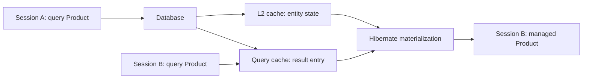
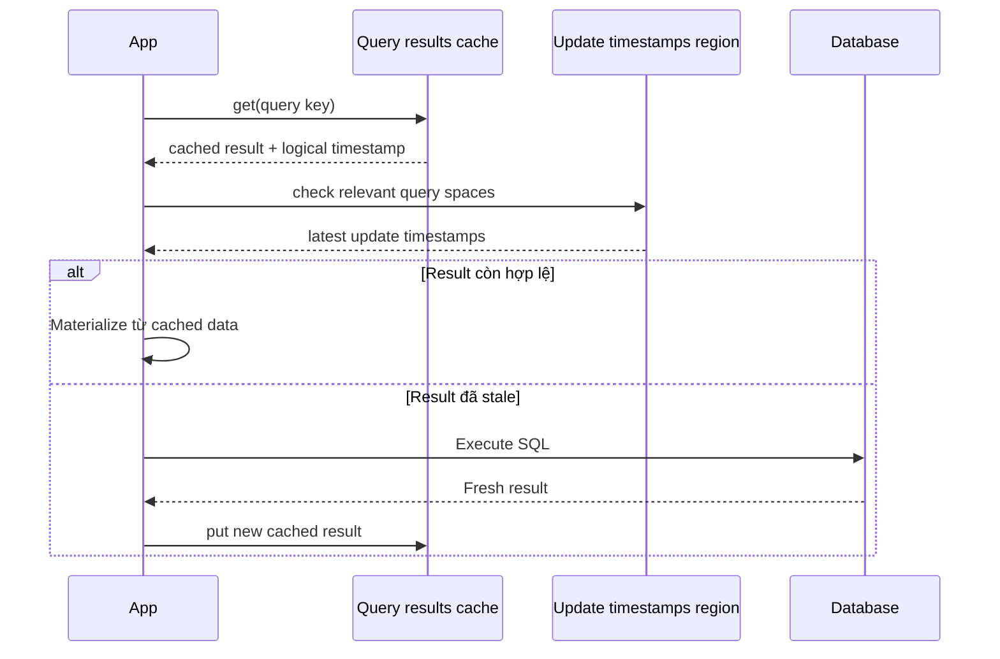

# Bố cục dữ liệu query cache và cấu hình phụ thuộc phiên bản Hibernate

**Query cache** của Hibernate là một cơ chế lưu lại **kết quả của truy vấn** để các lần thực thi sau với cùng đặc trưng truy vấn có cơ hội sử dụng dữ liệu đã cache thay vì luôn chạy lại SQL. Nghe có vẻ đơn giản, nhưng một câu hỏi rất quan trọng thường bị bỏ qua:

> Khi cache một query trả entity hoặc collection, Hibernate thực sự cất **identifier** hay **toàn bộ state đã fetch** vào cache?

Câu trả lời **phụ thuộc phiên bản Hibernate và cấu hình query cache layout**. Những khác biệt này tác động trực tiếp đến dung lượng cache, chi phí truy vấn lại database, hiệu quả second-level cache (L2), khả năng cache kết quả fetch join và tải JVM khi dữ liệu lớn.

Một ví dụ thường gặp:

```java
List<Product> products = session.createQuery(
        "select p from Product p where p.active = true",
        Product.class
    )
    .setCacheable(true)
    .getResultList();
```

Cùng một câu HQL nhưng tùy thế hệ Hibernate, kết quả cache có thể mang kiểu dữ liệu khác:

- Với Hibernate 5.x, entity trong query cache thường được biểu diễn theo **identifier** (*shallow*).
- Hibernate 6.0–6.4 thay đổi sang biểu diễn **đầy đủ state** (*full*) cho entity và collection được select/fetch trong query cache.
- Từ Hibernate 6.5, ứng dụng có thể cấu hình `FULL`, `SHALLOW`, `SHALLOW_WITH_DISCRIMINATOR` hoặc `AUTO` bằng property và annotation. Với `AUTO`, Hibernate chọn dạng thích hợp theo khả năng cache L2 của entity/collection.

Không nên suy luận một phiên bản khác cũng lưu đúng cùng định dạng với phiên bản mình từng dùng. **Đây là thay đổi về bố cục dữ liệu nội bộ, không chỉ thay đổi tên property.**

Bài này giải thích cấu trúc query cache, cơ chế vô hiệu hóa, cách kiểm tra layout theo phiên bản, cấu hình cụ thể, cách lựa chọn FULL/SHALLOW/AUTO theo workload, và cách đo xem một “query cache hit” thực sự có giảm SQL hay không.

---

## 1. Phân biệt ba cơ chế: L1, L2 và query cache

Hibernate có nhiều cơ chế cache, phục vụ những câu hỏi khác nhau.

| Cơ chế | Phạm vi | Đơn vị truy xuất điển hình | Bật/tắt |
| --- | --- | --- | --- |
| First-level cache (L1) | Một `Session`/`EntityManager` | Entity theo identifier trong Persistence Context | Gắn với Session, luôn là cơ chế cốt lõi |
| Second-level cache (L2) | `SessionFactory`, tùy provider có thể phân tán | State entity/collection theo khóa cache | Cần provider và mapping/cache policy phù hợp |
| Query results cache | `SessionFactory` và cache region | Kết quả của query theo khóa truy vấn/parameters | Mặc định không cache mọi query; phải bật và chọn query |
| Query plan cache | Hibernate engine | Kế hoạch phân tích/biên dịch HQL/Criteria | Cơ chế riêng, không lưu result rows |

**L1 trả lời:** “Trong Session này đã có entity ID=42 chưa?”

**L2 trả lời:** “Có state của entity hoặc collection tương ứng trong cache dùng chung không?”

**Query cache trả lời:** “Lần trước chạy truy vấn tương đương với bộ tham số này, danh sách/kết quả được tính là gì và nó còn hợp lệ không?”

### Query cache không phải query plan cache

Một ứng dụng có thể parse HQL một lần, reuse query plan nhưng vẫn thực thi SQL mỗi lần. Đó không phải query results cache hit.

Ngược lại, một query cache hit có thể giúp tránh thực thi SQL gốc, nhưng khi dùng `SHALLOW` còn có thể cần truy vấn theo entity ID để dựng kết quả.

Không gộp các metrics query plan cache và query results cache thành một chỉ số “Hibernate cache hit”.

## 2. Mô hình ví dụ

Ta xét hai entity đơn giản: Product và Category.

```java
import jakarta.persistence.*;
import java.math.BigDecimal;

@Entity
@Table(name = "categories")
public class Category {

    @Id
    private Long id;

    @Column(nullable = false)
    private String name;

    protected Category() {}

    public Long getId() { return id; }
    public String getName() { return name; }
}
```

```java
import jakarta.persistence.*;
import java.math.BigDecimal;

@Entity
@Table(name = "products")
public class Product {

    @Id
    private Long id;

    @Column(nullable = false)
    private String sku;

    @Column(nullable = false)
    private String name;

    @Column(precision = 19, scale = 2)
    private BigDecimal price;

    @Column(nullable = false)
    private boolean active;

    @ManyToOne(fetch = FetchType.LAZY)
    @JoinColumn(name = "category_id")
    private Category category;

    @Version
    private long version;

    protected Product() {}

    public Long getId() { return id; }
    public String getSku() { return sku; }
    public String getName() { return name; }
    public BigDecimal getPrice() { return price; }
    public boolean isActive() { return active; }
    public Category getCategory() { return category; }
}
```

Giả sử có 3 sản phẩm đang hoạt động:

| ID | SKU | Tên | Giá |
| ---: | --- | --- | ---: |
| 11 | P-11 | Bàn | 500 |
| 12 | P-12 | Ghế | 200 |
| 13 | P-13 | Đèn | 150 |

Một query:

```hql
select p
from Product p
where p.active = true
order by p.id
```

trả về ba `Product` entity.

Trong phần tiếp theo, ta so sánh query trả **entity**, query trả **scalar/DTO** và query **JOIN FETCH association**. Ba dạng này không có bố cục cache hoàn toàn giống nhau.

## 3. Bật query cache cần nhiều hơn một cờ

Trong Hibernate, thường cần các yếu tố sau:

1. Có **cache region provider** tương thích được cấu hình.
2. Bật `hibernate.cache.use_query_cache=true`.
3. Chọn cụ thể những query cần cache, ví dụ `setCacheable(true)` hoặc Hibernate query hint.
4. Nếu sử dụng layout `SHALLOW` để tận dụng L2, entity/collection liên quan cần thực sự được cache ở L2 với hit rate đủ cao.
5. Cấu hình cache regions và timestamp metadata để việc vô hiệu hóa kết quả hoạt động đúng.

Ví dụ khung cấu hình Spring Boot:

```properties
spring.jpa.properties.hibernate.cache.use_second_level_cache=true
spring.jpa.properties.hibernate.cache.use_query_cache=true
spring.jpa.properties.hibernate.generate_statistics=true
```

Đây **chưa phải toàn bộ cấu hình chạy được**: cần thêm provider/RegionFactory và dependency phù hợp với Hibernate/Java/Spring Boot version, ví dụ Hibernate JCache module cùng một JCache caching provider.

Nếu không có provider cache hiệu quả, bật query cache property không tự tạo một distributed cache. Với Hibernate phiên bản khác nhau, tên class của RegionFactory, phụ thuộc module và schema XML cache provider có thể khác nhau.

### Ví dụ cấu hình JCache ở mức khái niệm

```properties
# Chỉ là ví dụ khung; cần provider JCache trên classpath.
spring.jpa.properties.hibernate.cache.region.factory_class=org.hibernate.cache.jcache.internal.JCacheRegionFactory
spring.jpa.properties.hibernate.cache.use_second_level_cache=true
spring.jpa.properties.hibernate.cache.use_query_cache=true
```

Trong ứng dụng thực, cần cấu hình riêng cache provider, eviction policy, TTL, region sizes, serialization và môi trường cluster. Không sao chép nguyên một đoạn properties rồi cho rằng tất cả môi trường sẽ hoạt động giống nhau.

### Mặc định không phải mọi query đều cache

Ngay cả sau khi đặt `use_query_cache=true`, Hibernate không cache mọi truy vấn một cách tự động. Query muốn tham gia cần được đánh dấu **cacheable**.

Điều này có chủ đích: cache query có chi phí ghi entry và theo dõi vô hiệu hóa; nhiều truy vấn dữ liệu biến động hoặc tham số có cardinality cao không có lợi.

## 4. Bật cache cho một truy vấn bằng Hibernate native API

```java
import org.hibernate.Session;

Session session = entityManager.unwrap(Session.class);

List<Product> products = session.createQuery(
        """
        select p
        from Product p
        where p.active = :active
        order by p.id
        """,
        Product.class
    )
    .setParameter("active", true)
    .setCacheable(true)
    .getResultList();
```

`setCacheable(true)` yêu cầu Hibernate sử dụng query results cache nếu global configuration cho phép.

Từ lần gọi thứ hai với cùng đặc trưng cache key và entry còn hợp lệ, Hibernate có thể lấy lại query result từ cache.

### Chọn cache region riêng

```java
List<Product> products = session.createQuery(
        "select p from Product p where p.active = :active",
        Product.class
    )
    .setParameter("active", true)
    .setCacheable(true)
    .setCacheRegion("catalog.active-products")
    .getResultList();
```

`catalog.active-products` là tên region của ứng dụng. Nên dùng tên ổn định, có ý nghĩa, không đặt một region mới theo từng user/request.

Chia region có thể giúp chọn TTL/size/eviction phù hợp theo loại query, nhưng không làm biến mất cơ chế update timestamps hoặc chi phí invalidation.

## 5. Bật cache cho JPA query bằng Hibernate hint

Khi chỉ có `EntityManager`:

```java
import jakarta.persistence.TypedQuery;
import org.hibernate.jpa.HibernateHints;

TypedQuery<Product> query = entityManager.createQuery(
    """
    select p
    from Product p
    where p.active = :active
    order by p.id
    """,
    Product.class
);

query.setParameter("active", true);
query.setHint(HibernateHints.HINT_CACHEABLE, true);
query.setHint(
    HibernateHints.HINT_CACHE_REGION,
    "catalog.active-products"
);

List<Product> products = query.getResultList();
```

Các hằng `HibernateHints` nằm trong API Hibernate, không phải các hints portable bắt buộc cho mọi Jakarta Persistence provider.

Có thể thấy những chuỗi cũ như `org.hibernate.cacheable` trong tài liệu Hibernate; dùng constant của đúng Hibernate version giúp tránh typo và làm code rõ nguồn gốc.

### Named query

```java
@NamedQuery(
    name = "Product.activeCatalog",
    query = """
        select p
        from Product p
        where p.active = true
        order by p.id
        """,
    hints = {
        @QueryHint(
            name = "org.hibernate.cacheable",
            value = "true"
        ),
        @QueryHint(
            name = "org.hibernate.cacheRegion",
            value = "catalog.active-products"
        )
    }
)
```

Ví dụ dùng chuỗi Hibernate hint phổ biến để minh họa annotation; hãy xác minh giá trị hằng `HibernateHints.HINT_CACHEABLE`/`HINT_CACHE_REGION` trong dependency đang dùng. Khi có thể, ưu tiên import các hằng từ cùng phiên bản Hibernate để không phụ thuộc việc nhớ chuỗi.

## 6. Query cache key gồm những gì?

Một query result cache entry phải phân biệt các lần gọi **có thể cho kết quả khác nhau**.

Ở mức khái niệm, khóa cache có thể phụ thuộc:

- Cấu trúc truy vấn được diễn giải hoặc SQL/HQL query plan.
- Giá trị và kiểu của named/positional parameters.
- Giới hạn pagination: offset và max results.
- Những filter đang enabled và tham số filter liên quan.
- Tenant identifier / ngữ cảnh phân vùng dữ liệu.
- Các đặc tính truy vấn khác tác động tới result set theo cách Hibernate implement.

Biểu diễn khái niệm:

```text
QueryCacheKey {
    query: "Product.activeCatalog",
    parameters: { active: true },
    firstResult: 0,
    maxResults: 20,
    tenant: "tenant-A",
    filters: { region: "NORTH" }
}
```

Đây **không phải** class/format chính xác Hibernate serialize. Cấu trúc key nội bộ thay đổi theo phiên bản và implementation. Không nên viết ứng dụng phụ thuộc vào bytes/Java class của một query cache key.

### Cùng HQL, khác parameter = cache key khác

```java
findProductsByCategory(10L);
findProductsByCategory(20L);
```

Nếu cả hai dùng cùng HQL nhưng category ID khác nhau, không được lấy kết quả cache của category 10 cho category 20.

### Cùng HQL, khác page = cache entry khác

```java
query.setFirstResult(0).setMaxResults(20);
query.setFirstResult(20).setMaxResults(20);
```

Đây là hai tập kết quả khác nhau. Cache pagination nhiều trang có thể tạo rất nhiều entries với hit rate thấp.

**Query cache không biến một trang đã cache thành mọi trang của cùng tập dữ liệu.**

## 7. Cache lưu “kết quả”, không lưu một Session hoặc entity Java đang managed

Một nhầm lẫn là nghĩ query cache giữ nguyên danh sách `List<Product>` và các entity Java đang attached.

Trên thực tế:

- Cache region chứa biểu diễn dữ liệu có thể dùng lại giữa các Sessions.
- Mỗi Session vẫn có Persistence Context và identity map riêng.
- Entity materialization/association handling phải phù hợp mapping và Session hiện tại.
- Query cache không mang theo một Session đang mở, JDBC ResultSet, transaction hay lazy proxy của request cũ.
- Hai lần query từ hai Sessions không nên được hiểu là nhận cùng một managed Java instance chỉ vì cùng cache entry.

Có thể dùng hình dung sau:



Tuyến Q → L2 ở sơ đồ là cơ chế có thể dùng cho `SHALLOW`; `FULL` có thể chứa đủ state đã fetch để dựng kết quả mà không cần tra L2 cho chính phần state ấy. Thực tế còn phụ thuộc query shape, fetch plan và cache validity.

## 8. Ba vùng dữ liệu quan trọng

Để hiểu query cache, cần phân biệt những nơi lưu trữ sau.

### 8.1. Query results region

Ví dụ tên vùng mặc định của các thế hệ Hibernate hiện đại:

```text
default-query-results-region
```

Nó giữ các cached result entries theo query cache key: scalar values, tuple values và dữ liệu entity/collection theo layout đang áp dụng.

### 8.2. Update timestamps region

Tên vùng mặc định thường gặp:

```text
default-update-timestamps-region
```

Nó lưu thông tin lần thay đổi gần nhất theo các **query spaces** (thường tương ứng bảng hoặc những không gian dữ liệu mà một query phụ thuộc). Hibernate sử dụng nó để kiểm tra một cached query result có bị cũ sau khi dữ liệu nguồn bị thay đổi không.

### 8.3. L2 entity/collection regions

Ví dụ:

```text
com.example.catalog.Product
com.example.catalog.Category
com.example.catalog.Product.tags
```

Tên thực tế phụ thuộc mapping/provider. Những region này chứa state của entity hoặc collection được đánh dấu cacheable.

**Query results region, timestamps region và L2 domain-data regions không đồng nhất.** Chúng có chính sách cache, kích thước và yêu cầu quản lý khác nhau.

## 9. Cơ chế invalidation bằng timestamps

Giả sử query:

```hql
select p from Product p where p.active = true
```

phụ thuộc vào bảng `products`.

Luồng khái niệm:

1. Lần đầu chạy query, Hibernate lấy kết quả từ DB và cache lại cùng timestamp logic của cached result.
2. Hibernate biết query phụ thuộc vào query space tương ứng `products`.
3. Khi Hibernate thực hiện thay đổi liên quan bảng đó, metadata update timestamps được cập nhật theo protocol cache/transaction.
4. Lần sau truy vấn trùng key, Hibernate kiểm tra cached result còn hợp lệ so với timestamps của các query spaces không.
5. Nếu còn hợp lệ, có thể dùng cache; nếu không, chạy lại truy vấn và cập nhật result cache entry.



Sơ đồ mô tả semantics, không mô tả đúng lớp nội bộ hoặc thứ tự từng lệnh cache cho mọi provider.

### Invalidation thường ở mức query space, không ở mức row ID

Ví dụ cached query chỉ lấy Product ID từ 1 tới 10; một Product ID=999 bị update cùng bảng `products`. Cơ chế timestamps có thể vẫn khiến cached query result bị coi là stale dù Product 999 không nằm trong kết quả.

Đây là cơ chế invalidation **khá thô** nhưng dễ bảo đảm hơn việc phân tích từng SQL predicate để chứng minh một update có hay không ảnh hưởng tập kết quả.

**Bảng có tốc độ UPDATE/INSERT/DELETE cao có thể làm query cache churn mạnh**, ngay cả khi từng query thực tế ít thay đổi.

## 10. Timestamps region không nên bị eviction theo kiểu thông thường

Vùng query results có thể giới hạn TTL/size theo nhu cầu. Nhưng vùng cập nhật timestamps có yêu cầu riêng: Hibernate phải biết khi nào kết quả trở nên stale.

Nếu timestamps entries bị hết hạn hoặc loại bỏ sớm hơn những query results mà chúng có trách nhiệm bảo vệ, hệ thống có nguy cơ không đủ metadata để đánh giá freshness như kỳ vọng.

Tài liệu Hibernate khuyến cáo:

- Không đặt thời gian hết hạn timestamps region ngắn hơn query results regions.
- Tốt nhất **không đặt time-based expiration** cho update timestamps region.
- Không dùng size-based eviction/LRU thông thường cho vùng timestamps.

Ví dụ policy khái niệm:

```text
query region "catalog.active-products":
    TTL = 5 phút, bounded size theo workload

timestamp region "default-update-timestamps-region":
    không áp TTL ngắn / không LRU eviction
    duy trì entries theo contract Hibernate-provider
```

Đây là khung thiết kế, không phải cấu hình XML của một provider cụ thể.

### Không coi TTL là giải pháp đồng bộ dữ liệu

TTL chỉ giới hạn thời gian cache giữ entry. Query cache còn cần update timestamps, L2 invalidation và transaction/cache consistency. Nếu có job bên ngoài cập nhật DB mà Hibernate không biết, cache có thể stale ngay cả trước khi TTL hết hạn.

## 11. Layout SHALLOW: lưu biểu diễn nông

Trong bố cục `SHALLOW`, query cache giữ identifier của entity hoặc collection owner key, và các metadata cần thiết theo kiểu dữ liệu/version, thay vì toàn bộ fetched entity state.

Ví dụ kết quả HQL:

```hql
select p from Product p where p.active = true order by p.id
```

Mô hình minh họa:

```text
Query result entry (SHALLOW)
  queryKey = (HQL + parameters + page + ...)
  result = [Product#11, Product#12, Product#13]
```

Đây là biểu diễn trực quan; định dạng thực còn có metadata/version-specific fields và có thể có discriminator.

Khi phục hồi:

1. Query cache trả danh sách IDs.
2. Hibernate cần dựng Product tương ứng trong Session hiện tại.
3. Nó có thể tìm Product state trong L1/L2.
4. Nếu không có ở cache, Hibernate phải tải từ database bằng ID.

### Ưu điểm

- Query result entry thường nhỏ hơn khi entity có nhiều field.
- Tránh lặp full entity state giữa query cache và L2.
- Hợp lý nếu Product vốn được cache L2 với hit rate cao.
- Giảm áp lực heap/cache provider khi nhiều query trả cùng entity.

### Nhược điểm

- Một **query cache hit không bảo đảm không có SQL**.
- Khi L2 entity state thiếu, Hibernate có thể phải SELECT từng ID hoặc theo chiến lược batch loading.
- Nếu L2 hit rate thấp, tổng chi phí có thể tệ hơn chạy query gốc.
- Với fetch join collection, có thể cần tải thêm association nếu state không sẵn trong L2.

**SHALLOW có giá trị nhất khi tỷ lệ truy cập L2 của entity/collection tương ứng thực sự cao.**

## 12. Layout FULL: lưu dữ liệu đã fetch đầy đủ hơn

`FULL` lưu fetched data của entity/collection trong cached query result, thay vì chỉ lưu ID.

Vẫn query Product 11,12,13, bố cục khái niệm:

```text
Query result entry (FULL)
  queryKey = (HQL + parameters + page + ...)
  result = [
     Product#11 {sku="P-11", name="Bàn", price=500, ...},
     Product#12 {sku="P-12", name="Ghế", price=200, ...},
     Product#13 {sku="P-13", name="Đèn", price=150, ...}
  ]
```

Dữ liệu thực không nhất thiết là các Java objects hoặc JSON như ví dụ. Hibernate serialize/cache những dạng nội bộ và dữ liệu JDBC đã được xử lý theo mapping.

### Ưu điểm

- Có thể tái dựng fetched entity data mà không cần tải lại từng entity từ DB.
- Có ích nếu kết quả entity query không được cache L2.
- Có thể hỗ trợ re-materialization của join-fetched data từ query cache mà không cần quay lại DB.
- Trong một số workload, giảm số SQL so với SHALLOW khi L2 miss nhiều.

### Nhược điểm

- Result cache entries lớn hơn; nhiều query có thể lặp cùng dữ liệu entity.
- Tốn heap/off-heap/network khi cache phân tán.
- Có thể tăng memory pressure và garbage collection.
- Khi bảng thay đổi thường xuyên, entries lớn bị invalidated/recomputed liên tục.
- Một result row lớn chứa nhiều field/LOB/association có thể làm tổng dung lượng cache tăng mạnh.

**FULL không phải “tốt hơn” SHALLOW theo mọi tiêu chí.** Nó đánh đổi kích thước entry lấy khả năng tránh những lần materialize state riêng biệt.

## 13. SHALLOW_WITH_DISCRIMINATOR dành cho trường hợp nào?

Với entity inheritance/polymorphic query:

```hql
select p
from PaymentMethod p
where p.active = true
```

một ID có thể cần thông tin về concrete subtype. Khi `SHALLOW` chỉ lưu ID, Hibernate có thể phải xác định subtype trong quá trình load, đôi khi cần truy vấn thêm nhiều bảng tùy inheritance mapping.

`SHALLOW_WITH_DISCRIMINATOR` giữ ID **và discriminator thích hợp** để hỗ trợ dựng đúng loại entity mà không phải thực hiện một số bước xác định subtype tốn kém khi L2 miss.

| Layout | Thông tin entity trong cached result | Tình huống |
| --- | --- | --- |
| `SHALLOW` | Identifier | Entity/collection có L2 hit rate rất cao |
| `SHALLOW_WITH_DISCRIMINATOR` | Identifier + discriminator khi cần | Polymorphic entity hierarchy |
| `FULL` | Fetched state | L2 không bao phủ tốt, cần tránh secondary loads |
| `AUTO` | Hibernate chọn theo cacheability | Mặc định cân bằng của 6.5+ |

Không dùng discriminator mode như một cách sửa mọi vấn đề inheritance mà không đo. Nó không thay thế L2 và không bảo đảm không có SQL sau query cache hit.

## 14. AUTO chọn layout như thế nào?

Từ Hibernate ORM 6.5, `hibernate.cache.query_cache_layout` mặc định là `AUTO`.

Theo tài liệu Hibernate 6.5 và các User Guide thế hệ mới:

- Entity/collection **cacheable ở L2** → thường chọn `SHALLOW`.
- Entity/collection **không cacheable ở L2** → thường chọn `FULL`.

Lý do:

- Nếu L2 có khả năng giữ state, query cache không cần nhân bản tất cả state lần nữa.
- Nếu L2 không giữ state, chỉ cache ID có thể khiến Hibernate tải lại nhiều entity, nên FULL có thể giúp tránh điều đó.

### “Cacheable” không đồng nghĩa “cache hit chắc chắn”

AUTO dựa vào **cấu hình khả năng cache L2**, không biết trước rằng mọi entity của mỗi lần query đều đang có trong L2.

Do đó, entity được đánh dấu cacheable nhưng L2 thường miss vẫn có thể làm AUTO/SHALLOW phát thêm SQL. Muốn tối ưu, phải đo query hit rate cùng L2 hit/miss, không chỉ nhìn annotation.

### AUTO không có nghĩa tối ưu hóa tự học liên tục

Không nên hiểu AUTO là thuật toán liên tục đánh giá throughput rồi tự đổi FULL ↔ SHALLOW theo workload. Theo mô tả tài liệu, nó lựa chọn dựa trên cacheability của entity/collection.

## 15. Bảng phiên bản: thay đổi quan trọng nhất của query cache

| Nhánh phiên bản | Bố cục entity/collection trong query cache | Có `hibernate.cache.query_cache_layout`? | Điều cần lưu ý |
| --- | --- | --- | --- |
| Hibernate 5.x | Chủ yếu dạng SHALLOW / identifiers | Chưa có API layout 6.5 | L2 hit rate quyết định chi phí materialize |
| Hibernate 6.0–6.4 | Chuyển sang FULL cho entity/collection results | Chưa có lựa chọn layout chuẩn 6.5 | Dung lượng query cache có thể tăng rõ khi nâng từ 5 |
| Hibernate 6.5+ | FULL, SHALLOW, SHALLOW_WITH_DISCRIMINATOR, AUTO | Có | AUTO mặc định, chọn theo L2 cacheability |
| Hibernate 7.x được tài liệu hỗ trợ | Tiếp tục mô hình layout cấu hình theo entity/collection | Có trong User Guide của dòng 7.x | Kiểm tra User Guide/Javadocs đúng patch/version |

Đây là **bảng diễn giải về bố cục của entity/collection**, không khẳng định tất cả loại scalar/DTO query ở các đời đều tuân theo cùng biến đổi.

### Vì sao Hibernate 6.0 chuyển sang FULL?

Migration Guide 6.5 giải thích rằng thay đổi từ shallow sang full ở 6.0 hỗ trợ việc **re-materialize dữ liệu đã join fetch từ query cache mà không phải quay về database**. Nhược điểm là tăng memory consumption và có thể gây thêm GC.

### Vì sao 6.5 bổ sung cấu hình?

Từ 6.5, ứng dụng có thể chọn bố cục phù hợp với cache strategy:

- FULL khi muốn ưu tiên tránh secondary loads.
- SHALLOW khi có L2 mạnh.
- AUTO để Hibernate chọn theo cacheability.
- Per-entity/collection override khi một global setting không phù hợp mọi mapping.

**Không gắn `@QueryCacheLayout` vào dự án Hibernate 6.2 và mong nó hoạt động:** annotation được giới thiệu từ 6.5.

## 16. Cấu hình layout toàn cục từ Hibernate 6.5+

Dùng property:

```properties
hibernate.cache.query_cache_layout=AUTO
```

Trong Spring Boot:

```properties
spring.jpa.properties.hibernate.cache.query_cache_layout=AUTO
```

Các lựa chọn:

```properties
# Giữ layout đầy đủ giống hướng 6.0–6.4:
spring.jpa.properties.hibernate.cache.query_cache_layout=FULL
```

```properties
# Gần với cách biểu diễn nông ở Hibernate 5:
spring.jpa.properties.hibernate.cache.query_cache_layout=SHALLOW
```

```properties
# Mặc định từ 6.5: chọn theo entity/collection L2 cacheability:
spring.jpa.properties.hibernate.cache.query_cache_layout=AUTO
```

Chỉ thiết lập **một** giá trị thực tế trong cấu hình ứng dụng. Các đoạn trên là lựa chọn thay thế, không phải ba dòng cùng được bật.

### Khi muốn thêm discriminator

Với một số trường hợp polymorphic entities:

```properties
spring.jpa.properties.hibernate.cache.query_cache_layout=SHALLOW_WITH_DISCRIMINATOR
```

Đây là quyết định toàn cục khá mạnh. Thường chỉ nên cân nhắc nếu đặc điểm model và benchmark chứng minh có ích. Không cấu hình chỉ vì tên dài có vẻ “an toàn hơn”.

### Đây là setting Hibernate-specific

Không có một chuẩn Jakarta Persistence bắt buộc tất cả providers hiểu `hibernate.cache.query_cache_layout`. Khi đổi sang EclipseLink hoặc Hibernate version cũ, code/config không portable.

## 17. Cấu hình layout trên từng entity với `@QueryCacheLayout`

Từ Hibernate 6.5 có annotation:

```java
import org.hibernate.annotations.CacheLayout;
import org.hibernate.annotations.QueryCacheLayout;

@Entity
@QueryCacheLayout(layout = CacheLayout.SHALLOW)
public class Product {
    @Id
    private Long id;
    // ...
}
```

Ý nghĩa: khi Product được biểu diễn trong cached query results, Hibernate có thể dùng layout SHALLOW theo cấu hình của loại entity này.

### Override cho entity không được cache L2

```java
@Entity
@QueryCacheLayout(layout = CacheLayout.FULL)
public class LargeReportRow {
    @Id
    private Long id;
    // ...
}
```

Ví dụ nhằm minh họa annotation layout, không khuyến nghị cache mọi LargeReportRow. Nếu row lớn, kết quả thay đổi nhanh hoặc không lặp query, FULL vẫn có thể tốn memory mà không mang lại lợi ích.

### Annotation là cấu hình layout, không bật cache query

`@QueryCacheLayout` **không thay thế**:

- `hibernate.cache.use_query_cache=true`.
- `query.setCacheable(true)`.
- Cấu hình RegionFactory/cache provider.
- L2 entity cache mapping nếu muốn khai thác SHALLOW.

Nó chỉ điều chỉnh cách entity/collection được biểu diễn **khi một cacheable query thực sự lưu kết quả**.

## 18. Layout trên collection attribute

Annotation có thể đặt trên persistent collection field/getter:

```java
import jakarta.persistence.*;
import org.hibernate.annotations.CacheLayout;
import org.hibernate.annotations.QueryCacheLayout;

@Entity
public class Category {

    @Id
    private Long id;

    @OneToMany(mappedBy = "category")
    @QueryCacheLayout(layout = CacheLayout.SHALLOW)
    private List<Product> products = new ArrayList<>();
}
```

Để SHALLOW collection hiệu quả, collection cần L2 cache phù hợp; chỉ đặt `@QueryCacheLayout` không làm collection trở thành L2 cacheable.

Ví dụ có thể thêm Hibernate `@Cache` trên collection khi chính sách của ứng dụng cho phép:

```java
@OneToMany(mappedBy = "category")
@org.hibernate.annotations.Cache(
    usage = CacheConcurrencyStrategy.READ_WRITE
)
@QueryCacheLayout(layout = CacheLayout.SHALLOW)
private List<Product> products = new ArrayList<>();
```

Trong dự án thật, phải cân nhắc cả cache L2 của element entity và collection, quan hệ sở hữu, consistency/cascade, khả năng invalidation và tỷ lệ đọc/ghi. Không coi mọi collection mutable đều thích hợp với cache.

### Collection cache và entity cache không phải một thứ

Collection cache có thể giữ tập IDs/membership của các phần tử; entity cache giữ state của từng Product. Với collection chứa entity, quá trình dựng danh sách có thể cần cả hai loại dữ liệu.

Nếu chỉ cache collection membership mà không cache state của Product, Hibernate vẫn có thể truy vấn để tải Product. Vì vậy, khi đo SHALLOW, hãy xem cả collection L2 và entity L2 hit/miss.

## 19. Ví dụ cacheable entity ở L2

Một Product ít thay đổi có thể được đánh dấu cacheable:

```java
import jakarta.persistence.Cacheable;
import jakarta.persistence.Entity;
import jakarta.persistence.Id;
import org.hibernate.annotations.Cache;
import org.hibernate.annotations.CacheConcurrencyStrategy;

@Entity
@Cacheable
@Cache(usage = CacheConcurrencyStrategy.READ_WRITE)
public class Product {

    @Id
    private Long id;

    private String name;

    private boolean active;

    // ...
}
```

`READ_WRITE` là chiến lược concurrency của Hibernate L2, không đồng nghĩa entity read-only. Với danh mục bất biến, một chiến lược khác như `READ_ONLY` có thể phù hợp nếu mapping/data thực sự immutable theo contract.

Khi Product có L2:

- AUTO có thể chọn SHALLOW.
- Query cache giữ danh sách identifiers.
- L2 giữ state Product.
- Cache hit cả hai tầng có thể tránh SQL để dựng kết quả.

Nhưng nếu L2 có eviction mạnh hoặc region quá nhỏ, entity state thường không có lúc query cache được đọc. Khi đó query cache hit có thể dẫn tới SQL tải Product theo ID.

## 20. Quy trình một query với layout SHALLOW

Giả sử query trả Product IDs `[11, 12, 13]`.

### Lần thứ nhất — query cache miss

```text
Hibernate query key lookup -> MISS
SELECT ... FROM products WHERE active = true
Store query result as IDs: [11,12,13]
Optionally populate L2 states if entities cacheable
Return managed Product objects
```

### Lần thứ hai — query cache hit, L2 đủ dữ liệu

```text
Hibernate query key lookup -> HIT
Validate timestamps -> valid
Get IDs: [11,12,13]
L2 lookup Product#11, #12, #13 -> HIT
Rebuild managed Product objects in current Session
Không cần SELECT query gốc, không cần SELECT theo IDs
```

### Lần thứ ba — query cache hit, L2 bị evict

```text
Hibernate query key lookup -> HIT
Validate timestamps -> valid
Get IDs: [11,12,13]
L2 lookup Product#11, #12, #13 -> MISS
Hibernate phải nạp state bằng ID từ DB
Có thể phát thêm SELECT/batch SELECT
```

Đây là lý do rất quan trọng:

> **Query cache hit count tăng không chứng minh số SQL đã giảm về 0.** Cần quan sát cả L2 hit/miss và SQL executions.

## 21. Quy trình một query với layout FULL

Vẫn query ba Product:

```text
Hibernate query key lookup -> HIT
Validate timestamps -> valid
Read fetched Product state from query cache entry
Re-materialize result state theo Session hiện tại
Return Product instances
```

Với phần dữ liệu đã nằm trong entry, Hibernate có thể tránh việc chạy lại query gốc và tránh secondary entity loads chỉ để khôi phục dữ liệu ấy.

Nhưng:

- Các association LAZY **không được fetch** vẫn có thể phát SQL khi được truy cập sau này.
- Entity chưa có dữ liệu cần thiết theo fetch plan không tự trở thành “fully initialized mọi quan hệ”.
- DB có thể vẫn được truy cập vì association khác, query khác, flush, cache invalidation hoặc L1/L2 state.
- FULL không có nghĩa cache một object graph vô hạn.

**FULL** ở đây là **full fetched data trong query result**, không phải “toàn bộ database row và mọi relationship trong entity graph”.

## 22. Trường hợp JOIN FETCH và layout

Xét query:

```hql
select distinct c
from Category c
left join fetch c.products
where c.id = :id
```

Query trả Category và fetched products.

### Với FULL

Cached result có thể giữ thông tin đầy đủ hơn của entity và fetched collection, phục vụ tái dựng join fetched result ở lần gọi sau mà ít cần đi DB hơn.

### Với SHALLOW

Cached result chủ yếu chứa identifier/owner keys; Hibernate vẫn phải tôn trọng yêu cầu eager initialization do `join fetch`. Nếu Product/Category/collection không có trong L2, Hibernate có thể phải SELECT bổ sung để dựng state đã fetch.

Tài liệu migration Hibernate 6.5 nhấn mạnh rằng chọn SHALLOW **không đổi semantics fetch**: association được yêu cầu fetch vẫn phải được initialized. Khác biệt là chi phí tải từ cache hay DB.

### Cẩn thận với collection lớn

Nếu Category có 50.000 Products, cache một query join fetch toàn bộ có thể tạo entry rất lớn ở FULL hoặc gây nhiều secondary loads ở SHALLOW.

Không giải quyết bài toán bằng cách tùy tiện chọn layout. Có thể cần thiết kế API phân trang Product/DTO thay vì fetch cả collection.

## 23. Query cache với scalar và aggregate

Không phải query nào cũng trả entity:

```hql
select count(p)
from Product p
where p.active = true
```

Kết quả là `Long`.

```hql
select p.id, p.name, p.price
from Product p
where p.active = true
order by p.id
```

Kết quả là các scalar tuples.

Với các query như vậy, cached result cần chứa các **giá trị kết quả**. Không thể dùng Product ID đơn thuần để tái dựng một aggregate `COUNT` hoặc một tuple chỉ chứa những field đã SELECT mà không có một cơ chế tính toán khác.

### FULL/SHALLOW chủ yếu phân biệt entity và collection state

Global layout setting và per-entity/collection annotation mô tả cách Hibernate biểu diễn **entities/collections** trong query cache. Không nên diễn giải rằng đặt SHALLOW khiến `count(p)` được cache thành một identifier.

Với scalar/aggregate, điều cần đo thường là:

- Có cùng query key/parameters lặp lại không?
- Dữ liệu nguồn có thường xuyên thay đổi không?
- Aggregate có đắt tới mức cache có lợi không?
- Entry có bị invalidated thường xuyên không?

### Cache count không phải lúc nào cũng hợp lý

Một dashboard chạy `count(*)` trên bảng ghi liên tục có thể gặp cache invalidation sau mỗi transaction thay đổi bảng đó, khiến hit rate thấp. Một bảng summary cập nhật theo lịch có thể hiệu quả hơn query cache nếu nhu cầu báo cáo chấp nhận độ trễ.

## 24. Query cache với DTO projection

Ví dụ DTO:

```java
public record ProductCard(
    Long id,
    String sku,
    String name,
    BigDecimal price
) {}
```

Query:

```java
List<ProductCard> cards = session.createQuery(
        """
        select new com.example.catalog.ProductCard(
            p.id, p.sku, p.name, p.price
        )
        from Product p
        where p.active = true
        order by p.id
        """,
        ProductCard.class
    )
    .setCacheable(true)
    .setCacheRegion("catalog.cards")
    .getResultList();
```

Nếu Hibernate phiên bản đang dùng cho phép cache kết quả query tương ứng, cache giữ thông tin cần dựng kết quả projection theo cơ chế provider. DTO không phải entity managed và không có L2 entity lifecycle tự thân.

### Vì sao DTO query đôi khi tốt hơn FULL entity query?

- Chỉ chọn 4 cột thay vì toàn bộ entity state.
- Không materialize entity/proxy chỉ để trả JSON.
- Dữ liệu cached result có thể nhỏ hơn nếu Product có nhiều field lớn.
- Không cần tải association lazy sau khi ra khỏi service.
- Có thể thuận lợi cho API danh sách và báo cáo.

Nhưng DTO query vẫn cần invalidation đúng, và nếu query có nhiều tham số khác nhau, hit rate vẫn thấp.

**Projection chọn đúng dữ liệu là quyết định ở tầng query; layout là quyết định cách cache biểu diễn entity/collection results.** Hai kỹ thuật có thể bổ trợ, không thay thế nhau.

## 25. AUTO + DTO: không nên gắn nhầm kỳ vọng

Nếu query trả toàn scalar/DTO, việc đổi Product entity từ `@QueryCacheLayout(SHALLOW)` sang `FULL` không bảo đảm tự làm query DTO nhanh hơn. DTO result không nhất thiết phải reconstruct Product entity từ L2 như entity query.

Khi đánh giá:

- Entity query: đo query cache + L2 + secondary loads.
- DTO/scalar query: đo query cache key hit/miss, invalidation và SQL gốc.
- Fetch join: đo cả collection state/row explosion.
- Projection aggregate: đo query cost, frequency và update rate.

Chọn cache strategy theo **result shape**, không chỉ theo tên entity trong FROM.

## 26. Query cache key có thể phân mảnh bởi tham số

Ví dụ người dùng tìm kiếm sản phẩm theo từ khóa:

```hql
select p from Product p
where lower(p.name) like :keyword
order by p.name
```

Mỗi keyword khác nhau có thể tạo entry riêng:

```text
"ban" -> query key A
"ghe" -> query key B
"den" -> query key C
"ban goc" -> query key D
...
```

Nếu có hàng chục nghìn từ khóa riêng biệt, hit rate có thể rất thấp trong khi cache tiêu tốn nhiều memory.

### Pagination làm tăng số entries

Với page size 20:

```text
status=PAID, page=0 -> entry 1
status=PAID, page=1 -> entry 2
status=PAID, page=2 -> entry 3
...
```

Nếu người dùng có hàng trăm trang và dữ liệu thay đổi nhanh, query cache có thể thành một vùng chứa kết quả hiếm khi được dùng lại.

### Truy vấn ít tham số, dữ liệu ít thay đổi

Ví dụ `find active product categories` hoặc `find country codes` thường có kết quả ổn định, số biến thể nhỏ, nhiều request lặp lại — dễ là ứng viên cache tốt hơn.

**Không nên cache theo cảm giác “query nào chạy cũng đắt”**; phải xét khả năng lặp cùng cache key và chi phí duy trì entries.

## 27. Region riêng không có nghĩa mỗi query được vô hiệu hóa tinh vi hơn

Giả sử:

```text
catalog.active-products
catalog.featured-products
reports.monthly-sales
```

là ba query cache regions.

Mỗi region có thể có TTL/size/eviction policy riêng. Tuy nhiên, cơ chế timestamps vẫn dựa trên query spaces liên quan.

Nếu cả hai catalog queries phụ thuộc bảng `products`, một update bảng `products` có thể khiến cached results ở **cả hai regions** bị coi là stale, ngay cả khi chỉ thay đổi một Product không nằm trong kết quả featured.

Region separation hữu ích để quản lý tài nguyên và policy, nhưng **không biến invalidation thành row-level predicate-aware cache**.

## 28. External writes và dữ liệu stale

Hibernate có thể nhận biết các thay đổi được thực hiện thông qua ORM hoặc những query được đồng bộ đúng theo cơ chế provider. Nhưng nếu một ứng dụng khác viết trực tiếp vào bảng:

```sql
UPDATE products
SET price = 99.00
WHERE id = 11;
```

Hibernate của ứng dụng hiện tại không nhất thiết biết update này đã diễn ra.

Các trường hợp thường gây stale cache:

- Batch job ngoài Hibernate dùng JDBC thuần.
- Script SQL/manual DBA thay đổi bảng.
- Microservice khác cập nhật chung database nhưng dùng cache infrastructure khác.
- Native SQL/Stored procedure không đăng ký query spaces/invalidation thích hợp.
- Read replica lag/cluster cache propagation chậm.
- Cache provider bị partition hoặc đồng bộ metadata không phù hợp.

### Hướng giải quyết

- Dùng cơ chế invalidation/eviction phù hợp sau những out-of-band writes.
- Thiết kế owner của dữ liệu rõ ràng, hạn chế nhiều writer độc lập.
- Nếu native query qua Hibernate, cấu hình synchronization/query spaces theo API/version khi cần.
- Với báo cáo không cần nhất quán tức thời, đặt TTL/snapshot policy có chủ đích.
- Nếu yêu cầu dữ liệu mới nhất tuyệt đối, cân nhắc bypass query cache cho use case đó.

Đừng giả định `hibernate.cache.use_query_cache=true` tự theo dõi mọi thay đổi từ mọi hệ thống nối vào database.

## 29. Native SQL và query synchronization

Hibernate có các API giúp khai báo những entity/query spaces liên quan tới native query, ví dụ trên Hibernate native query:

```java
session.createNativeQuery(
        "select id, name from products where active = :active"
    )
    .addSynchronizedEntityClass(Product.class);
```

Ví dụ chỉ minh họa ý nghĩa khai báo entity/table liên quan. Native SQL dùng trong thực tế còn cần result mapping, parameter binding và thực thi query.

Điều này có thể hỗ trợ Hibernate xác định query spaces để xử lý flush/invalidation phù hợp theo khả năng phiên bản và query type.

Nhưng:

- Đăng ký synchronization ở một SELECT không tự cập nhật timestamps cho các writes ngoài Hibernate.
- Một stored procedure có thể thay nhiều bảng ngoài danh sách đã đăng ký.
- DDL, triggers và database jobs có semantics riêng.
- Với JDBC `Session.doWork`, raw SQL không tự đi qua mọi ORM cache invalidation mechanism.

Không coi một lệnh `addSynchronizedEntityClass` là giải pháp tổng quát cho mọi external update.

## 30. Cache eviction, refresh và lựa chọn phạm vi

Khi muốn bỏ cached query results, Hibernate có API qua `SessionFactory.getCache()`.

Ví dụ:

```java
SessionFactory factory =
    entityManagerFactory.unwrap(SessionFactory.class);

factory.getCache().evictQueryRegion(
    "catalog.active-products"
);
```

Thao tác này nhắm vào một query cache region. Một số API phiên bản có thể evict toàn bộ query regions hoặc data regions khác.

### Evict query region khác evict entity L2 region

- Evict query region: bỏ các cached result entries của query trong region.
- Evict entity L2: bỏ cached entity state theo entity type/ID.
- Evict collection L2: bỏ cached collection state.
- Clear Persistence Context: detach managed entities trong Session hiện tại.

Đây là **bốn việc khác nhau**.

### Đổi layout không phải chỉ “đổi cờ runtime”

Query cache entry format là chi tiết nội bộ, có thể không tương thích khi nâng phiên bản hoặc thay layout. Khi rollout thay Hibernate version/layout, nên lập kế hoạch invalidate/rotate regions/cache namespace theo hướng dẫn provider và release notes, thay vì dùng lại dữ liệu serialized cũ không có bảo đảm tương thích.

## 31. Query cache refresh theo lượt gọi

Hibernate hỗ trợ các cơ chế cache mode, ví dụ native API:

```java
List<Product> products = session.createQuery(
        "from Product p where p.active = true",
        Product.class
    )
    .setCacheable(true)
    .setCacheRegion("catalog.active-products")
    .setCacheMode(CacheMode.REFRESH)
    .getResultList();
```

`CacheMode.REFRESH` yêu cầu không dùng cached result cũ theo semantics của cache mode và cập nhật cache từ dữ liệu mới trong trường hợp phù hợp.

Qua JPA, có thể gặp:

```java
query.setHint(
    "jakarta.persistence.cache.storeMode",
    CacheStoreMode.REFRESH
);
```

Hành vi chi tiết phụ thuộc Hibernate version và cách cache modes tương tác với query region/second-level cache.

**Không coi REFRESH là thay thế transaction consistency** hoặc bằng chứng database không có replica lag. Nó chỉ điều chỉnh caching behavior trong phạm vi Hibernate.

## 32. Cấu hình Hibernate 5 và sự khác nhau về tên region

Tên query cache regions có thay đổi theo lịch sử Hibernate.

Tài liệu Hibernate 5.0 từng mô tả những tên region/class như:

```text
org.hibernate.cache.internal.StandardQueryCache
org.hibernate.cache.spi.UpdateTimestampsCache
```

Những tài liệu Hibernate 5.x về sau và Hibernate 6/7 dùng tên mặc định:

```text
default-query-results-region
default-update-timestamps-region
```

Vì vậy **không sao chép tên region mặc định từ một hướng dẫn Hibernate cũ sang mọi bản mới** mà không kiểm tra config/provider đang dùng.

### Vì sao tên region quan trọng?

Cache provider có thể cấu hình TTL, size và expiry theo region name. Nếu cấu hình nhầm tên:

- Policy định áp dụng cho query region có thể không được dùng.
- Timestamp region có thể nhận policy eviction không phù hợp.
- Một vùng mới có thể được tạo với default config ngoài dự kiến.
- Memory limit/metrics không phản ánh vùng ứng dụng tưởng đang quản lý.

Khi nâng Hibernate, nên kiểm tra region names thực tế và provider cache manager để tránh sai lệch.

## 33. Cấu hình ví dụ theo mục tiêu

### Trường hợp A: Hibernate 5.x, catalog L2 mạnh

Không sử dụng `hibernate.cache.query_cache_layout` vì API này chưa có ở 5.x.

Định hướng:

```properties
hibernate.cache.use_second_level_cache=true
hibernate.cache.use_query_cache=true
# RegionFactory và provider theo Hibernate 5.x tương ứng.
```

Đánh dấu Product cacheable L2 và những query lặp lại cacheable. Theo dõi L2 hit rate, query hit rate và SELECT by ID.

### Trường hợp B: Hibernate 6.0–6.4, FULL cố định của dòng đó

Định hướng:

```properties
hibernate.cache.use_query_cache=true
# Chưa có property query_cache_layout 6.5.
```

Nếu thấy memory/query cache tăng mạnh sau nâng cấp từ Hibernate 5, kiểm tra việc query cache đã chuyển sang full fetched state. Không copy property 6.5 vào 6.2 rồi kỳ vọng thay đổi layout.

Có thể thay đổi query shape/projection, thu hẹp regions, giảm số cached queries hoặc nâng lên phiên bản hỗ trợ cấu hình layout theo lộ trình release được đánh giá.

### Trường hợp C: Hibernate 6.5+, để AUTO

```properties
hibernate.cache.use_query_cache=true
hibernate.cache.query_cache_layout=AUTO
```

Chọn L2 mapping có chủ đích; quan sát có giảm SQL và memory không.

### Trường hợp D: Hibernate 6.5+, ưu tiên SHALLOW

```properties
hibernate.cache.use_query_cache=true
hibernate.cache.query_cache_layout=SHALLOW
```

Phù hợp để **thử nghiệm** khi các entity/collection liên quan có L2 hiệu quả. Nếu entity không nằm L2, có thể bị nhiều SQL tải từng ID.

### Trường hợp E: Hibernate 6.5+, ưu tiên FULL

```properties
hibernate.cache.use_query_cache=true
hibernate.cache.query_cache_layout=FULL
```

Thử khi L2 ít có dữ liệu hoặc cần giữ fetched entity state để tránh tải lại, nhưng phải đo kích thước cache và GC.

**Không có đoạn config nào là “best practice tuyệt đối”**: việc chọn layout luôn phụ thuộc kết quả query, L2 policy, số lượt đọc/ghi và cache provider.

## 34. AUTO hay FULL khi entity không cache L2?

Giả sử Product không có `@Cacheable`/`@Cache` và L2 không lưu state Product.

Với query cache dạng SHALLOW, Hibernate lấy IDs rồi có thể phải truy vấn DB để có Product state. Nếu có 100 IDs, việc khôi phục state có thể tạo nhiều SQL, tùy batching.

Với FULL, query cache có thể giữ fetched state nên tránh tải lại theo ID cho chính những field đã fetch.

AUTO chọn FULL cho entity/collection không cacheable là một lựa chọn hợp lý từ Hibernate 6.5. Tuy nhiên:

- Nếu query trả hàng chục nghìn entity với field lớn, full entry có thể rất nặng.
- Dữ liệu thường xuyên cập nhật có thể invalidated nhanh.
- Caching một query cực ít khi lặp vẫn có thể vô ích.

Vì vậy không nên kết luận “L2 không bật → bật FULL query cache cho mọi entity query”. Có thể tốt hơn là **không cache query**, dùng DTO projection hoặc tối ưu SQL.

## 35. AUTO hay SHALLOW khi entity cache L2?

Giả sử Product có L2 cache:

```java
@Cacheable
@Cache(usage = CacheConcurrencyStrategy.READ_WRITE)
@Entity
public class Product {
    // ...
}
```

Một catalog query lặp lại thường xuyên có thể tận dụng SHALLOW:

- Query cache giữ IDs, entry nhỏ.
- L2 cache giữ entity state.
- Query cache hit và L2 hit cùng xảy ra nhiều lần.
- DB traffic giảm.

Nhưng nếu có 100.000 Product và L2 chỉ giữ 500 entries, phần lớn query cache hits có thể cần SELECT nạp entity. AUTO vẫn biết Product **có cấu hình cacheable**, không biết region thực tế thường evict vì quá nhỏ.

Khi đó nên cân nhắc tăng L2 capacity, đổi query projection, thu hẹp catalog hoặc thử FULL và benchmark. Đừng đổi chỉ dựa vào một hit ratio.

## 36. Giữa FULL và SHALLOW có đánh đổi về network không?

Với cache provider phân tán:

- FULL entry có thể gửi nhiều bytes qua network khi put/get.
- SHALLOW entry nhỏ hơn nhưng có thể phát thêm L2 lookups theo từng entity.
- L2 state có thể cũng nằm trên remote node.
- Miss ở L2 có thể dẫn tới round-trip database.
- Update/invalidation có thể phải truyền metadata giữa nodes.

Một lựa chọn tốt trên local in-memory cache không nhất thiết tốt trên cluster.

Ví dụ:

```text
FULL:
    1 lần đọc query cache entry lớn
    Có thể không cần L2 lookups cho fetched state

SHALLOW:
    1 lần đọc query cache entry nhỏ
    + nhiều L2 lookups
    + có thể có DB loads nếu L2 miss
```

Đây là mô hình chi phí, không phải số network calls được đảm bảo. Provider có thể batch reads hoặc sử dụng near cache.

**Benchmark phải chạy với topology cache thực tế**: single-node, multi-node, JVM memory, serialization và network latency.

## 37. Query cache và tính nhất quán transaction

Cache không phải một bản sao transaction snapshot có khả năng thay thế database isolation.

Một số điểm cần lưu ý:

- Session hiện tại có thể đã giữ entity state trong L1.
- Database isolation quyết định dữ liệu mà transaction được phép nhìn thấy.
- L2 và query cache có concurrency/invalidation semantics riêng.
- Trường hợp ghi đồng thời, cluster propagation hoặc out-of-band update có thể gây khoảng trễ.
- Query cache không đảm bảo mức serializable isolation.
- Read replica có thể trả dữ liệu chậm hơn primary, và cache trên đó không tự làm dữ liệu mới hơn.

Với nghiệp vụ cần tính nhất quán mạnh — ví dụ kiểm tra tồn kho tại thời điểm đặt hàng, chống bán quá số lượng, xác thực số dư — không dùng query cache như nguồn sự thật.

Một query cache tốt cho màn hình đọc có thể không phù hợp với bước validation trước khi commit.

## 38. Multi-tenancy và phân vùng cache

Trong hệ thống nhiều tenant, hai tenant có thể cùng Product ID=11 nhưng dữ liệu khác nhau.

Query cache key và L2 key phải bảo đảm không lẫn tenant theo cơ chế multi-tenancy/provider tương ứng. Không tự build cache key chỉ từ HQL + ID rồi bỏ tenant.

Ví dụ sơ đồ:

```text
tenant-A, query active-products -> [11,12,13]
tenant-B, query active-products -> [11,16]
```

Không được trả danh sách tenant-A cho tenant-B chỉ vì HQL giống nhau.

### Shared schema với tenant predicate

Nếu ứng dụng dùng shared schema:

```hql
select p
from Product p
where p.tenantId = :tenantId
  and p.active = true
```

(`tenantId` là property giả định được thêm vào Product ở ứng dụng thật.)

Parameter tenant phải được bind từ security context đáng tin. Ngay cả khi query cache key phân biệt parameter, bỏ predicate tenant là **lỗi authorization và query semantics**, không thể giải quyết bằng cache.

### Tenant filter và cacheability

Hibernate filters, soft delete hoặc security filters có thể ảnh hưởng query result. Query cache cần được dùng đúng với filter state; hãy kiểm tra behavior/version tương ứng, nhất là với native SQL, custom loaders và cache region sharing.

## 39. Vùng dữ liệu query cache có “nội dung raw SQL” không?

Không nên hiểu query cache là nơi lưu lại nguyên SQL text và một JDBC ResultSet còn mở.

Nó lưu **biểu diễn dữ liệu kết quả** có thể tái sử dụng, cùng metadata cần thiết cho việc tra cứu/đánh giá freshness theo thiết kế Hibernate.

Với query trả entity, cách biểu diễn entity chính là trọng tâm `FULL` / `SHALLOW`.

Với scalar/tuple, các giá trị có thể được cache theo dạng tương ứng.

Không lưu `ResultSet`, cursor, Connection hoặc Session Java để dùng về sau.

### Không duyệt trực tiếp cache entry như API ổn định

Cache provider có thể cho xem object serialized trong region, nhưng không nên viết nghiệp vụ đọc một entry query cache rồi cast sang nội bộ Hibernate. Cấu trúc class/serialization có thể thay đổi giữa phiên bản.

Dùng Hibernate Query API để thực thi query; dùng cache metrics và eviction API để quản trị.

## 40. Cache layout và bộ nhớ JVM

Một số dấu hiệu FULL có chi phí cao:

- Query cache region chiếm nhiều heap/off-heap hơn sau khi bật.
- Thời gian GC tăng.
- Số allocations/serialization bytes tăng.
- Cache eviction xảy ra thường xuyên.
- Query cache put nhiều nhưng hit ít.
- Throughput giảm dù SQL count giảm.

Một số dấu hiệu SHALLOW chưa phù hợp:

- Query cache hit cao nhưng SQL count vẫn cao.
- L2 cache miss nhiều.
- DB xuất hiện nhiều SELECT theo primary key sau cache hit.
- Latency tăng do các loads phân tán.
- L2 region liên tục evict vì thiếu capacity.

### Đo đồng thời ba nhóm metric

1. **Query cache:** hit, miss, put, invalidation/eviction nếu provider hỗ trợ.
2. **L2:** entity/collection cache hit/miss/put theo region.
3. **Database/JVM:** prepared statements, query latency, rows read, memory, GC.

Một chỉ số đơn lẻ hiếm khi đủ để quyết định layout.

## 41. Hibernate Statistics: lấy số liệu query cache

Bật thống kê trong môi trường kiểm thử:

```properties
spring.jpa.properties.hibernate.generate_statistics=true
```

Lấy Hibernate `SessionFactory`:

```java
import org.hibernate.SessionFactory;
import org.hibernate.stat.Statistics;

SessionFactory sf =
    entityManagerFactory.unwrap(SessionFactory.class);

Statistics stats = sf.getStatistics();

long queryHits = stats.getQueryCacheHitCount();
long queryMisses = stats.getQueryCacheMissCount();
long queryPuts = stats.getQueryCachePutCount();

long l2Hits = stats.getSecondLevelCacheHitCount();
long l2Misses = stats.getSecondLevelCacheMissCount();

long statements = stats.getPrepareStatementCount();
```

Tên getters ở đây phù hợp với Hibernate ORM hiện đại; luôn đối chiếu Javadocs đúng version.

### Tính tỷ lệ hit

```java
long lookups = queryHits + queryMisses;

double queryHitRatio = lookups == 0
    ? 0.0
    : (double) queryHits / lookups;
```

Cần hiểu:

- Hit ratio cao nhưng DB SQL nhiều có thể do SHALLOW + L2 miss.
- Hit ratio thấp có thể do query keys phân mảnh hoặc invalidate liên tục.
- Put nhiều mà hit ít có thể là chi phí cache vô ích.
- L2 hit ratio cao nhưng query cache miss vẫn phải chạy SQL gốc để tìm IDs phù hợp.

### Cẩn thận với statistics toàn cục

`Statistics` thường gắn với SessionFactory và có thể tổng hợp nhiều request. Không reset stats toàn cục trong production để đo một request đang chạy đồng thời. Trong integration test tuần tự, có thể clear trước từng kịch bản nếu được cô lập.

## 42. Thực nghiệm phân biệt FULL và SHALLOW

Để biết layout có ích hay không, dựng một bài đo lặp lại được:

### Dữ liệu

- 1.000 Products đang active.
- Category/Product association thực tế.
- Một số Product có nhiều thuộc tính.
- Có hoặc không L2 cache theo kịch bản.
- Query trả cùng tập Product qua nhiều Sessions.

### Thử A — FULL

1. Bật query cache.
2. Chọn `query_cache_layout=FULL` nếu version hỗ trợ.
3. Chạy query một lần để warm.
4. Đóng Session, mở Session mới.
5. Chạy lại query cùng parameters.
6. Đếm query hit, L2 hit/miss, SQL, cache entry size, GC, latency.

### Thử B — SHALLOW

Lặp cùng điều kiện nhưng chọn `SHALLOW`. Thực hiện cả hai biến thể:

- L2 đủ lớn, hit rate cao.
- L2 bị evict một phần hoặc cố tình tạo miss.

### Thử C — AUTO

Lặp lại khi Product cacheable và khi Product không cacheable, kiểm tra lựa chọn có phù hợp không.

### So sánh kết quả

| Chỉ tiêu | FULL | SHALLOW | AUTO |
| --- | --- | --- | --- |
| Query cache hit/miss | Đo | Đo | Đo |
| L2 hit/miss | Đo | Đo | Đo |
| SQL sau cache hit | Đo | Đo | Đo |
| Kích thước cached entries | Đo | Đo | Đo |
| Latency p50/p95/p99 | Đo | Đo | Đo |
| JVM allocations/GC | Đo | Đo | Đo |
| Tác động update/invalidation | Đo | Đo | Đo |

Không tự điền kết quả “FULL luôn 0 SQL” hoặc “SHALLOW luôn ít memory hơn tổng thể hệ thống”; đó là kết quả cần kiểm chứng theo workload.

## 43. Vì sao test cần Session mới?

Nếu chạy hai query liên tiếp trong cùng Session:

```java
List<Product> first = query.list();
List<Product> second = query.list();
```

Persistence Context L1 đã có nhiều Product ở lần đầu. Ngay cả khi query cache trả IDs, Hibernate có thể dùng entity từ L1 và không cần L2/DB, che giấu hành vi thật của SHALLOW trong request mới.

Kịch bản đúng hơn:

```java
try (Session s1 = sf.openSession()) {
    s1.createQuery(hql, Product.class)
      .setCacheable(true)
      .getResultList();
}

try (Session s2 = sf.openSession()) {
    s2.createQuery(hql, Product.class)
      .setCacheable(true)
      .getResultList();
}
```

Có thể cần transaction/read-only boundary tùy cấu hình. Hãy dùng cùng parameters và đảm bảo không có writes invalidate giữa hai lượt.

### Kiểm soát cache warm/cold

- Session mới để loại ảnh hưởng L1.
- L2 warm/cold theo mục tiêu thử nghiệm.
- Query cache warm/cold theo mục tiêu thử nghiệm.
- Không thay cùng lúc nhiều biến khi muốn so sánh layout.
- Đo ngoài thời gian JVM/JIT warmup nếu benchmark latency nghiêm túc.

## 44. Kiểm thử invalidation do thay đổi dữ liệu

Một bài test nên chứng minh query cache không trả cached results cũ sau một ORM update ảnh hưởng tập dữ liệu.

Kịch bản:

```text
T1: INSERT Product#11 active=true; commit.
T2: Query active products cacheable; cache miss -> result có #11.
T3: Query giống hệt; cache hit.
T4: UPDATE Product#11 active=false bằng Hibernate; commit.
T5: Query giống hệt trong Session mới.
    -> Result không còn #11.
```

Đo:

- Query cache hit/miss/put biến động thế nào?
- Query có bị invalidate sau T4 không?
- SQL có chạy lại sau update không?
- Dữ liệu trả về có đúng không?

Nếu test không phát hiện T4 cập nhật, kiểm tra transaction boundary, query spaces, timestamp region, cache provider và L1 cache của Session test.

### External SQL test

Nếu có writer ngoài Hibernate, thêm kịch bản update qua cơ chế ngoài rồi kiểm tra chính sách cache application đã thiết kế: evict/refresh, TTL hoặc orchestration. **Không coi đây là hành vi tự động được Hibernate bảo đảm.**

## 45. Query cache với kết quả rỗng

Giả sử query:

```hql
select p from Product p where p.sku = :sku
```

không tìm được Product.

Một cached query result rỗng vẫn là kết quả của một query, và có thể được reuse theo cơ chế/provider.

Điều này hữu ích khi ứng dụng lặp đi lặp lại câu hỏi về một key không tồn tại, nhưng cũng có rủi ro:

- Khi Product mới được INSERT, cached empty result phải bị invalidate đúng.
- External writer có thể làm stale empty result nếu không đồng bộ cache.
- Query key có tham số SKU khác nhau rất nhiều sẽ làm cache chứa hàng loạt misses ít lặp.
- Với key-value lookup theo ID tự nhiên, natural-id cache hoặc API truy xuất trực tiếp có thể phù hợp hơn query cache tùy mapping.

Không cache mọi negative lookup chỉ vì “kết quả rỗng rất nhỏ”.

## 46. Query cache không tự sửa N+1 lazy associations

Query:

```java
List<Product> products = session.createQuery(
        "from Product p where p.active = true",
        Product.class
    )
    .setCacheable(true)
    .getResultList();

for (Product p : products) {
    System.out.println(p.getCategory().getName());
}
```

Ngay cả khi query cache hit, `category` có thể là lazy proxy chưa initialized. Nếu Category không được L2 cached hoặc fetch trước, vòng lặp có thể phát thêm SELECT.

Đây là **N+1 do fetch plan**, không phải bằng chứng query cache “hỏng”.

Các hướng phù hợp:

- DTO projection chọn `category.name`.
- JOIN FETCH to-one khi trả entity.
- EntityGraph theo use case.
- Batch fetching cho association.
- L2 cache Category nếu danh mục ổn định và hit rate phù hợp.

FULL layout cho Product query không tự biến mọi association LAZY thành fetched state.

## 47. Query cache và paginated fetch collection

Một query như:

```hql
select distinct c
from Category c
left join fetch c.products
order by c.id
```

kết hợp `setFirstResult`/`setMaxResults` có thể làm provider phân trang trong memory vì JOIN to-many nhân SQL rows. Caching không làm lỗi thiết kế pagination biến mất.

Nếu API danh sách chỉ cần Category ID/name và productCount, nên cân nhắc DTO/aggregate query. Nếu phải fetch Products cho một trang Categories, có thể phân trang IDs trước rồi fetch collections theo tập IDs, sau đó map DTO.

Không bật query cache với FULL layout chỉ để che chi phí của một SQL fetch join collection có cardinality lớn.

## 48. Natural-id cache, entity cache và query cache khác nhau

Ví dụ Product có SKU duy nhất:

```java
@NaturalId
private String sku;
```

Hibernate có natural-id caching theo mapping và cấu hình phù hợp. Với lookup bằng SKU có tính lặp cao, cơ chế natural-id có thể phù hợp hơn một query cache entry cho mỗi HQL parameter.

Khác biệt:

- Natural-id cache ánh xạ natural ID tới entity identifier.
- Entity L2 cache lưu entity state theo ID.
- Query results cache lưu kết quả của những truy vấn tổng quát.

Không dùng query cache làm giải pháp duy nhất cho mọi key lookup nếu Hibernate đã có API cache chuyên biệt phù hợp.

## 49. Các trường hợp nên cân nhắc query cache

Query cache thường đáng thử khi:

- Query có tập tham số ít biến thể.
- Result set ổn định trong một khoảng thời gian đáng kể.
- Nhiều request lặp lại query tương đương.
- SQL gốc tương đối đắt.
- Dữ liệu nguồn không bị update quá thường xuyên.
- Cache region có đủ memory và cấu hình timestamps đúng.
- Có metrics chứng minh giảm latency/DB load tổng thể.

Ví dụ:

- Danh mục Category active.
- Danh sách mã quốc gia, tỉnh/thành ít thay đổi.
- Một số catalog filters cố định.
- Báo cáo snapshot đã chốt số liệu.
- Thông tin công khai ít biến động với query shape ổn định.

## 50. Những trường hợp thường không phù hợp

Query cache có thể vô ích hoặc gây tác động xấu khi:

- Search text rất nhiều keyword khác nhau.
- Pagination sâu với offset khác nhau liên tục.
- Bảng dữ liệu có tần suất update cao.
- Query không đắt và DB đã có index tốt.
- Result chứa hàng nghìn entity/collection lớn.
- FULL entries tiêu tốn nhiều memory và GC.
- SHALLOW cần tải lại rất nhiều entity do L2 miss.
- Hệ thống nhiều writer ngoài Hibernate và không có invalidation policy.
- Query dùng dữ liệu nhạy cảm hoặc cần strong consistency đặc thù.
- Cache cluster không bảo đảm metadata timestamp propagation theo yêu cầu.

**Không cache query chỉ để đạt hit ratio đẹp**. Mục tiêu là giảm tổng chi phí của request và giữ kết quả đúng theo freshness policy.

## 51. Rủi ro nâng cấp Hibernate

Khi nâng Hibernate 5 → 6 hoặc 6.4 → 6.5+, cần chú ý:

### 51.1. Entry layout thay đổi

Hibernate 5 shallow và Hibernate 6.0–6.4 full có memory profile khác nhau. Hibernate 6.5+ default AUTO còn có thể tạo layout khác giữa các entity cacheable và non-cacheable.

### 51.2. Metadata/cache entry compatibility

Không có bảo đảm ứng dụng phiên bản mới có thể đọc mọi cached query entry được serialize bởi phiên bản cũ trong shared cache. Khi rolling upgrade, cần xem compatibility của Hibernate, cache provider, serialization và cache namespace.

Nếu không có hỗ trợ mixed-version rõ ràng, cân nhắc xóa/rotate query regions trước khi chuyển sang layout mới.

### 51.3. Region names và configuration

Một số hướng dẫn cũ dùng tên lớp region; những hướng dẫn mới mô tả default-query-results-region và default-update-timestamps-region. Kiểm tra actual region names và TTL/eviction policies sau nâng cấp.

### 51.4. Namespace Jakarta

Hibernate 6 đi cùng chuyển đổi Jakarta Persistence trong nhiều stack, nên `jakarta.persistence.*` thay `javax.persistence.*`. Đổi package không có nghĩa cache layout tự tương thích; đây là hai thay đổi độc lập.

### 51.5. Query shape/fetch behavior

Ngay cả khi HQL không đổi, SQL generation, fetch plan, entity materialization và cache internals có thể khác. Cần regression test data, SQL count và cache metrics trên version mục tiêu.

## 52. Quy trình chọn layout khi nâng cấp

Một quy trình thực tế:

1. Ghi lại Hibernate core version, Spring Boot version, JPA/Jakarta namespace.
2. Xác định provider/RegionFactory và cache mode hiện tại.
3. Liệt kê những query đang `cacheable` và query regions.
4. Phân loại query: entity, collection fetch, scalar/DTO, aggregate.
5. Xác định entity/collection có L2 cacheable thật hay không.
6. Đo query cache hit/miss/put và L2 hit/miss.
7. Đo SQL thực thi, memory, GC và latency trên workload có dữ liệu đại diện.
8. Nếu nâng 5 → 6, đối chiếu sự khác biệt shallow/full.
9. Nếu nâng 6.4 → 6.5+, thử AUTO trước, sau đó benchmark FULL/SHALLOW có chủ đích.
10. Lập kế hoạch cache clear/region rotation cho migration nếu format không tương thích.
11. Kiểm tra timestamp region policy, especially cluster replication/eviction.
12. Regression test kết quả sau INSERT/UPDATE/DELETE và external writes.
13. Đưa ra rollout/rollback plan dựa trên metrics, không chỉ việc app khởi động thành công.

Dù tên layout có vẻ là chi tiết nhỏ, nó thay đổi kích thước object trong cache và số lần Hibernate cần nạp state, nên nên được xem là một quyết định hiệu năng/vận hành.

## 53. Những lỗi thường gặp

### Lỗi 1: tin rằng query cache luôn chỉ lưu IDs

Điều này phản ánh cách hiểu đúng ở Hibernate 5 và SHALLOW, nhưng sai nếu Hibernate 6.x dùng FULL.

**Cách xử lý:** kiểm tra version và layout trước khi kết luận.

### Lỗi 2: tin rằng query cache luôn chứa full entity

Không đúng với Hibernate 5 hoặc 6.5+ SHALLOW/AUTO cho entity cacheable.

**Cách xử lý:** phân biệt các đời cache layout.

### Lỗi 3: dùng `query_cache_layout` ở Hibernate 6.2

Setting layout được giới thiệu từ 6.5.

**Cách xử lý:** chỉ dùng với version hỗ trợ; không giả định cấu hình version cũ sẽ hiểu.

### Lỗi 4: nhầm query cache với L2 entity cache

Query cache trả kết quả truy vấn; L2 trả entity/collection state.

**Cách xử lý:** đo metrics riêng và hiểu SHALLOW cần L2.

### Lỗi 5: query cache hit nhưng nghĩ không còn SQL

Với SHALLOW và L2 miss, có thể có SELECT theo IDs.

**Cách xử lý:** đo SQL count và L2 misses cùng query hits.

### Lỗi 6: bật `use_query_cache` nhưng không đánh dấu query cacheable

Mặc định không tự cache mọi query.

**Cách xử lý:** dùng `setCacheable(true)` hoặc hint phù hợp.

### Lỗi 7: chưa cấu hình cache provider

Bật properties nhưng không có RegionFactory/provider đúng, query cache có thể không hoạt động như mong đợi.

**Cách xử lý:** kiểm tra dependency, RegionFactory và regions thực tế.

### Lỗi 8: cấu hình timestamps region TTL ngắn

Có thể làm metadata freshness không đủ bền theo yêu cầu.

**Cách xử lý:** không dùng time/size eviction thông thường cho timestamps region theo hướng dẫn Hibernate.

### Lỗi 9: dùng LRU cho timestamps

Tài liệu Hibernate không khuyến nghị LRU eviction cho timestamps region.

**Cách xử lý:** cấu hình timestamps region riêng với policy phù hợp.

### Lỗi 10: dùng SHALLOW trong khi L2 luôn miss

Query cache lưu IDs, sau đó Hibernate lại SELECT rất nhiều entity.

**Cách xử lý:** tăng L2 effectiveness, thử AUTO/FULL, hoặc bỏ cache query.

### Lỗi 11: dùng FULL cho rất nhiều kết quả lớn

Cache entries lớn, tăng memory và GC.

**Cách xử lý:** giới hạn query shape, projection, TTL/region size và benchmark.

### Lỗi 12: coi AUTO là cơ chế tự học từ hit ratio

AUTO chọn theo cacheability, không phải đo liên tục workload rồi tự điều chỉnh.

**Cách xử lý:** quyết định override dựa trên benchmark.

### Lỗi 13: gắn `@QueryCacheLayout` rồi nghĩ query đã bật cache

Annotation chỉ điều chỉnh layout khi query cache được sử dụng.

**Cách xử lý:** vẫn cần global enable, provider và cacheable query.

### Lỗi 14: đọc cache provider object như API ổn định

Internal entry/key format có thể đổi.

**Cách xử lý:** dùng Hibernate query APIs và metrics.

### Lỗi 15: đổi layout mà vẫn giữ cached entries của bản cũ

Có thể gây incompatibility khi mixed versions.

**Cách xử lý:** đánh giá cache migration và namespace/region rotation.

### Lỗi 16: cache query search với keyword gần như duy nhất

Nhiều entries nhưng ít reuse.

**Cách xử lý:** chỉ cache query có locality/cùng parameters lặp lại.

### Lỗi 17: không tính pagination vào cache key fragmentation

Mỗi page có thể trở thành entry khác.

**Cách xử lý:** xem hit ratio theo query và page, không chỉ theo endpoint.

### Lỗi 18: quên invalidation của external SQL

Hibernate không tự biết mọi thay đổi của writer khác.

**Cách xử lý:** có cache eviction/refresh policy hoặc bypass khi cần.

### Lỗi 19: tin rằng custom query region loại bỏ invalidation mức bảng

Timestamps vẫn được dùng theo query spaces.

**Cách xử lý:** hiểu tính thô của invalidation và update rate.

### Lỗi 20: dùng cache để che một query N+1

Lazy association vẫn có thể phát secondary SELECT.

**Cách xử lý:** sửa fetch plan/projection trước.

### Lỗi 21: lấy cache hits từ một Session duy nhất

L1 có thể che L2 misses.

**Cách xử lý:** test nhiều Sessions độc lập.

### Lỗi 22: chỉ đo query hit ratio

Không biết chi phí L2 miss, bytes hoặc GC.

**Cách xử lý:** xem SQL, L2 metrics, memory và latency.

### Lỗi 23: dùng query cache cho kiểm tra tồn kho cần nhất quán mạnh

Cache có semantics transaction/invalidation riêng, không thay DB locks/version checks.

**Cách xử lý:** dùng transaction/concurrency control phù hợp.

### Lỗi 24: chia sẻ cache sai tenant

Nguy cơ trộn kết quả giữa tenants.

**Cách xử lý:** dùng Hibernate multi-tenancy đúng, tenant predicates và namespace policy.

### Lỗi 25: đẩy mọi kết quả báo cáo vào một region

Một báo cáo nặng có thể evict nhiều kết quả catalog hữu ích.

**Cách xử lý:** dùng regions theo workload và quan sát memory/invalidation.

### Lỗi 26: chọn FULL/SHALLOW mà không kiểm tra fetch joins

Kết quả join-fetched collection có chi phí materialization khác entity đơn giản.

**Cách xử lý:** đo cả fetched collection, L2 cache và số SQL.

## 54. Bài thực hành 1: xác định version

Trong project của bạn, tìm phiên bản `hibernate-core` được thực sự load tại runtime (không chỉ khai báo trực tiếp trong Gradle/Maven).

Phân loại:

- 5.x: hành vi shallow truyền thống.
- 6.0–6.4: hành vi full của dòng đó.
- 6.5+: có property layout và annotation.
- 7.x: đối chiếu User Guide/Javadocs của đúng bản đang chạy.

Không sao chép cấu hình trước khi xác định dependency resolution.

## 55. Bài thực hành 2: bật query cache và đánh dấu query

Thiết kế một query catalog nhỏ có kết quả ít thay đổi.

```java
List<Product> products = session.createQuery(
        "from Product p where p.active = :active",
        Product.class
    )
    .setParameter("active", true)
    .setCacheable(true)
    .setCacheRegion("catalog.active-products")
    .getResultList();
```

Chạy trong hai Sessions độc lập, quan sát query cache hits/misses. Ghi lại bộ parameters, region name và SQL được phát.

## 56. Bài thực hành 3: SHALLOW + L2 hit

Trên Hibernate 6.5+:

```properties
hibernate.cache.query_cache_layout=SHALLOW
```

Bật L2 cho Product với cache concurrency strategy phù hợp. Làm warm query cache và L2; chạy cùng query trên Session mới. Đo số SELECT và L2 hits.

Sau đó cố tình evict Product L2 state theo API/cache policy thích hợp, giữ query cache entry nếu có thể; chạy lại và so sánh số SQL.

## 57. Bài thực hành 4: FULL vs SHALLOW

Giữ cùng dữ liệu và query, lần lượt chạy FULL và SHALLOW.

Lập bảng:

| Thử nghiệm | Query hits | L2 misses | SQL count | Query region bytes |
| --- | ---: | ---: | ---: | ---: |
| FULL | Tự đo | Tự đo | Tự đo | Tự đo |
| SHALLOW | Tự đo | Tự đo | Tự đo | Tự đo |

Giải thích vì sao query hit bằng nhau nhưng SQL và memory có thể khác nhau.

## 58. Bài thực hành 5: AUTO và cacheable entity

Trên Hibernate 6.5+, để:

```properties
hibernate.cache.query_cache_layout=AUTO
```

Lần lượt thử Product có và không có L2 cache mapping. Dùng profiling/metrics để xác nhận behavior phù hợp với dự đoán SHALLOW/FULL theo cacheability.

## 59. Bài thực hành 6: join fetched collection

Tạo Category với 5 Products, query:

```hql
select distinct c
from Category c
left join fetch c.products
where c.id = :id
```

Bật query cache, so sánh FULL/SHALLOW ở 6.5+ với L2 collection/entity cache được bật/tắt. Kiểm tra association vẫn được initialized theo fetch semantics, nhưng SQL thực tế có thể khác.

## 60. Bài thực hành 7: invalidation

1. Cache query Product active.
2. Chạy lại để thấy hit.
3. Update một Product bằng ORM trong transaction mới.
4. Chạy lại query từ Session mới.
5. Xác nhận kết quả và cache metrics.
6. Giải thích vì sao update một Product ngoài tập result vẫn có thể invalidate query dựa trên `products`.

## 61. Bài thực hành 8: cache key fragmentation

Thử query có tham số `:keyword` và trang `offset`:

- 1 keyword, cùng page, lặp 100 lần.
- 100 keywords, mỗi keyword một lần.
- Cùng keyword, 100 pages khác nhau.

So sánh put/hit/miss, query region size và tổng latency. Giải thích tại sao cùng số request nhưng hiệu quả cache rất khác.

## 62. Bài thực hành 9: DTO projection

Tạo `ProductCard` và query `select new ...` chỉ lấy ID, name, price. So sánh:

- Entity query FULL.
- Entity query SHALLOW + L2.
- DTO query cacheable.

Đo số bytes, SQL và materialization overhead. Nhận xét vì sao projection và cache layout là hai quyết định khác nhau.

## 63. Bài thực hành 10: timestamp region policy

Trong cache provider đang dùng, kiểm tra:

- Tên timestamps region thực tế.
- TTL và eviction policy.
- Query results TTL.
- Cluster replication settings.
- Cách xử lý after-commit timestamp update.

Đảm bảo timestamps region không bị cấu hình LRU/TTL ngắn như region kết quả thông thường.

## 64. Bài thực hành 11: nâng cấp version

Lập checklist từ Hibernate 5.x hoặc 6.2 lên 6.5+/7.x:

- Review change về shallow/full/auto.
- Review region names và provider dependency.
- Lên kế hoạch rotate/evict regions khi đổi format.
- So sánh SQL count, GC, cache bytes, hit/miss.
- Test external writes và transaction invalidation.

## 65. Câu hỏi tự kiểm tra

**1. Query cache khác L1 ở đâu?**

L1 quản lý entity trong một Session; query cache lưu kết quả của những cacheable queries dùng lại giữa các Sessions theo provider/configuration.

**2. Query cache khác L2 entity cache ở đâu?**

Query cache trả lời một truy vấn với bộ parameters; L2 lưu entity/collection state theo cache key.

**3. Query plan cache có lưu data rows không?**

Không. Nó phục vụ parse/compile query, không thay query results cache.

**4. Bật `hibernate.cache.use_query_cache=true` đã cache mọi query chưa?**

Chưa. Query cụ thể cần được đánh dấu cacheable.

**5. Hibernate 5 thường dùng kiểu entity representation nào?**

Dạng shallow/identifier.

**6. Hibernate 6.0–6.4 thay đổi gì?**

Dùng full entity/collection fetched state trong query cache để hỗ trợ re-materialization tốt hơn, đổi lại tiêu tốn nhiều memory.

**7. Từ phiên bản nào có `hibernate.cache.query_cache_layout`?**

Hibernate 6.5.

**8. Giá trị mặc định layout từ Hibernate 6.5 là gì?**

`AUTO`.

**9. AUTO chọn SHALLOW khi nào?**

Khi entity/collection được cấu hình cacheable L2 theo cơ chế Hibernate.

**10. AUTO chọn FULL khi nào?**

Khi entity/collection không cacheable L2.

**11. SHALLOW lưu gì?**

Thông tin định danh của entity/collection thay cho full fetched state, cùng metadata cần thiết theo trường hợp.

**12. FULL lưu gì?**

Fetched data của entity/collection cần để re-materialize cached query result.

**13. SHALLOW_WITH_DISCRIMINATOR hữu ích khi nào?**

Khi cần giữ thông tin concrete subtype của polymorphic entity để giảm một số truy vấn xác định subtype.

**14. Vì sao query cache hit vẫn có thể phát SQL?**

Với SHALLOW, Hibernate có thể phải tải entity/collection state nếu L1/L2 không có.

**15. Query cache FULL có phải tự tải mọi lazy association không?**

Không. Nó giữ fetched state theo query, không biến toàn bộ lazy graph thành eager.

**16. `@QueryCacheLayout` có bật query cache không?**

Không. Nó chỉ cấu hình layout cho entity/collection được cache trong query result khi query cache đang hoạt động.

**17. Timestamps region dùng để làm gì?**

Giữ metadata những lần thay đổi query spaces để kiểm tra cached query results có stale không.

**18. Vì sao không nên TTL/LRU-evict timestamps region?**

Vì có thể làm mất metadata cần để đánh giá freshness của cached query results.

**19. Invalidation của query cache thường ở mức row hay table/query space?**

Thường theo query space, khá thô; một update cùng bảng có thể invalidate nhiều results.

**20. External SQL update có tự invalidate query cache không?**

Không bảo đảm. Cần cơ chế đồng bộ/eviction phù hợp.

**21. Vì sao không cache mọi keyword search?**

Mỗi bộ parameters có thể tạo entry riêng và ít được dùng lại, làm hit ratio thấp.

**22. Pagination có ảnh hưởng query cache key không?**

Có thể: offset/limit khác nhau đại diện result sets khác nhau.

**23. Query cache scalar `count(p)` có được lưu thành Product IDs không?**

Không nên hiểu như vậy; scalar aggregate result cần được cache như giá trị kết quả, khác representation entity/collection.

**24. Region riêng có ngăn một update Product invalidate cả hai Product queries không?**

Không nhất thiết; timestamps invalidation vẫn dựa trên query spaces.

**25. Khi nâng Hibernate 5 → 6, điều gì đáng đo nhất?**

Memory/cache size, GC, SQL count và query result re-materialization do thay đổi shallow → full.

**26. Vì sao test phải mở Session mới?**

L1 trong cùng Session có thể che giấu chi phí L2 miss/SELECT by ID khi SHALLOW.

**27. Tại sao không thể quyết định bằng query cache hit ratio đơn lẻ?**

Vì SHALLOW có thể hit query cache nhưng vẫn gây SQL; cần L2 metrics, DB calls, memory và latency.

**28. Query cache có thay thế authorization/tenant isolation không?**

Không. Dữ liệu và cache key phải tuân theo tenant/security scope; query vẫn phải lọc đúng quyền.

**29. Query cache có thay thế transaction isolation không?**

Không. Cache consistency phụ thuộc provider/invalidation và không bảo đảm mọi isolation property.

**30. Khi nào nên bỏ cache một query?**

Khi ít query key được dùng lại, dữ liệu update liên tục, cache churn/memory/SQL phụ lớn hơn lợi ích đo được.

## 66. Ghi nhớ cốt lõi

- **Query cache lưu kết quả truy vấn**, L2 lưu entity/collection state, L1 gắn với Persistence Context, query plan cache lưu kế hoạch query.
- **Hibernate 5.x dùng representation nông truyền thống**, **Hibernate 6.0–6.4 chuyển sang FULL**, và **Hibernate 6.5+ cho phép chọn layout**, mặc định `AUTO`.
- **`FULL`** lưu fetched entity/collection state, có thể tránh secondary loads nhưng tốn memory/GC.
- **`SHALLOW`** lưu IDs/owner keys; hiệu quả khi L2 hit rate cao, nhưng query cache hit vẫn có thể dẫn tới SQL.
- **`SHALLOW_WITH_DISCRIMINATOR`** hỗ trợ một số truy vấn entity đa hình.
- **`AUTO`** chọn SHALLOW cho entity/collection L2-cacheable và FULL cho loại không cacheable; không phải hệ thống tự học theo runtime hit ratio.
- **`hibernate.cache.query_cache_layout` và `@QueryCacheLayout` chỉ có từ Hibernate 6.5**; không áp dụng máy móc cho 5.x/6.2.
- **Cache query cần global enable + provider + per-query cacheable**, không chỉ một annotation layout.
- **Query results region và update timestamps region có vai trò khác nhau**; timestamps không nên bị time/size eviction kiểu thông thường.
- **Invalidation ở mức query spaces** có thể làm cache churn khi bảng nguồn thay đổi nhiều.
- **Cache key phân biệt query, parameters, pagination và ngữ cảnh liên quan**, nên keyword search hoặc deep paging thường có khả năng reuse thấp.
- **Query cache hit không chứng minh SQL bằng 0**, nhất là với SHALLOW và L2 miss.
- **Projection DTO/scalar và fetch plan tốt** có thể mang lại lợi ích lớn hơn việc cache toàn bộ entity graph.
- **Không dùng query cache cho dữ liệu cần consistency mạnh** khi chưa đánh giá transaction/cache provider/cluster semantics.
- **Nâng phiên bản cần xem tương thích cached entries, region names và benchmark**, không chỉ kiểm tra application startup.
- **Đo đồng thời query hits, L2 hits, SQL count, memory, GC và latency** rồi mới chọn FULL/SHALLOW/AUTO.

Điểm quan trọng nhất là **query cache không có một “bố cục dữ liệu cố định” xuyên suốt mọi phiên bản Hibernate**. Khi hiểu Hibernate đang lưu **identifier** hay **fetched state**, ứng dụng có thể lựa chọn layout phù hợp với L2, kiểm soát chi phí cache và tránh kết luận sai rằng một query cache hit đồng nghĩa không có SQL. Thiết kế hiệu quả luôn bắt đầu từ đặc trưng truy vấn, tính thay đổi của dữ liệu và kiểm chứng trên đúng phiên bản Hibernate, provider và workload thực tế.

---

## Tài liệu tham khảo chính thức

1. [Hibernate ORM 6.5 Migration Guide — Configurable Query Cache Layout](https://docs.hibernate.org/orm/6.5/migration-guide/) — mô tả thay đổi SHALLOW (Hibernate 5) → FULL (6.0) và cấu hình AUTO/FULL/SHALLOW từ 6.5.
2. [Hibernate ORM 6.5 Javadocs — CacheLayout](https://docs.hibernate.org/orm/6.5/javadocs/org/hibernate/annotations/CacheLayout.html) — các giá trị AUTO, SHALLOW, SHALLOW_WITH_DISCRIMINATOR, FULL.
3. [Hibernate ORM 7.2 User Guide — Caching / Query cache layout](https://docs.hibernate.org/orm/7.2/userguide/html_single/#caching-query) — query result cache, regions, timestamps và mô tả layout trong Hibernate 7.x.
4. [Hibernate ORM 5.0 User Guide — Caching](https://docs.hibernate.org/orm/5.0/userguide/html_single/chapters/caching/Caching.html) — tư liệu cho cache behavior và tên region đời cũ.

Khi triển khai, ưu tiên đọc tài liệu đúng **minor/patch version** đang sử dụng, không lấy ví dụ của một đời Hibernate làm giả định cho tất cả đời khác.
