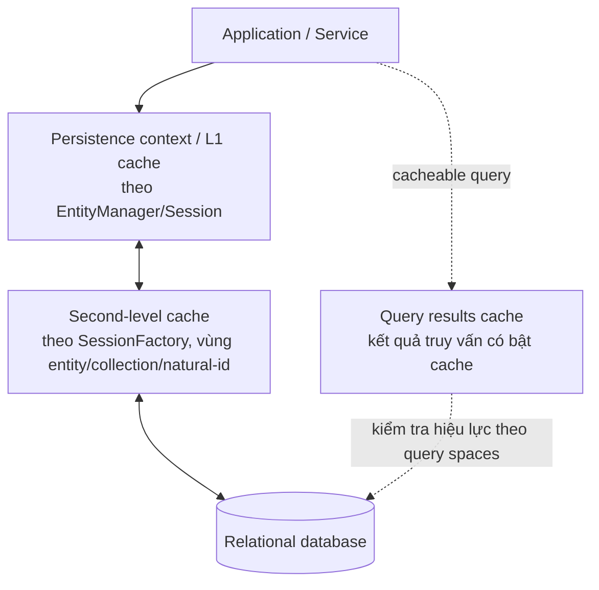
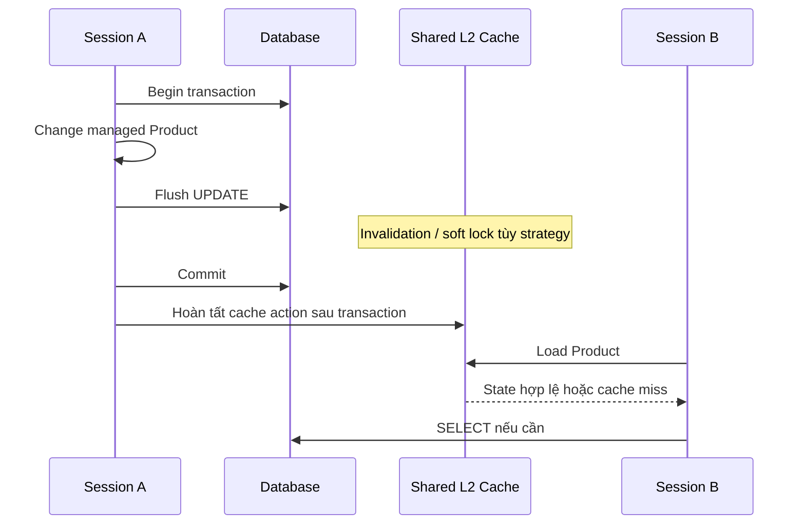

# Mất hiệu lực bộ nhớ đệm khi dữ liệu được thay đổi qua Hibernate

## 1. Vì sao có cache invalidation?

Ứng dụng ORM thường đọc lại cùng một loại dữ liệu: thông tin sản phẩm, danh mục, hồ sơ người dùng, cấu hình nghiệp vụ hoặc danh sách đơn hàng. Hibernate có nhiều cơ chế lưu tạm dữ liệu để tránh phải chạy lại SQL hoặc hydrate lại entity không cần thiết.

Nhưng giả sử một sản phẩm đã được đọc và được lưu trong cache:

```text
Database: Product#101.price = 100
                 |
                 v
       Cache ghi nhớ giá 100
                 |
       Ứng dụng sửa giá thành 120
                 |
                 v
Database: Product#101.price = 120
                 |
                 ?
       Cache còn giữ giá 100?
```

Nếu cache không được cập nhật hoặc làm mất hiệu lực đúng lúc, lần đọc sau có thể nhận **dữ liệu cũ (stale data)**. Đây là vấn đề *cache invalidation* — xác định dữ liệu cache nào không còn đáng tin sau khi một transaction thay đổi database.

Trong Hibernate, câu hỏi không đơn giản là “Hibernate có xóa cache sau INSERT/UPDATE/DELETE hay không?”. Cần xem **loại cache, đường đi cập nhật, transaction, concurrency strategy và dữ liệu liên quan**.

Bài học này giải thích:

- Sự khác nhau giữa **persistence context (first-level cache)**, **second-level cache (L2)** và **query results cache**.
- Việc ghi qua `persist`, dirty checking, `merge`, `remove`, thay đổi association và HQL bulk DML ảnh hưởng mỗi lớp cache thế nào.
- Thời điểm flush/commit/rollback và việc cập nhật hoặc vô hiệu hóa cache.
- Query cache nhận biết bảng/query space bị sửa ra sao.
- Những trường hợp Hibernate **không thể tự biết** dữ liệu đã đổi, như JDBC thực thi trực tiếp, hệ thống ngoài, trigger hoặc SQL native không khai báo tác động rõ.
- Cách dùng `refresh`, `clear` và eviction API; cách đo, tái hiện và khắc phục dữ liệu stale.

**Thông điệp chính:** thay đổi dữ liệu qua ORM Hibernate theo vòng đời entity thông thường thường được phối hợp với các cache do Hibernate quản lý. Nhưng không có nghĩa **mọi cache ở mọi nơi** sẽ luôn tự nhất quán sau bất kỳ SQL nào.

## 2. Ba lớp cache cần phân biệt

Sơ đồ khái niệm:



Đây là sơ đồ ý niệm, không phải chuỗi gọi cố định của mọi query. Hibernate có thể phát SQL trực tiếp, dùng query cache để tìm khóa định danh rồi lấy entity qua persistence context/L2/database, hoặc truy vấn projection với dạng lưu cache khác nhau.

### 2.1. First-level cache (L1): bắt buộc, thuộc một Session

Mỗi `Session`/`EntityManager` có một **persistence context** quản lý entity theo identity.

```java
Product first = em.find(Product.class, 101L);
Product second = em.find(Product.class, 101L);

System.out.println(first == second); // Thường true trong cùng context.
```

Nếu entity đã managed trong cùng persistence context, Hibernate thường tái sử dụng object đó thay vì tạo object thứ hai cho cùng entity key.

L1 không phải cache dùng chung nhiều request. Nó tồn tại theo vòng đời Session, chịu ảnh hưởng của `clear`, `detach`, `refresh` và close Session. Nó không có một cơ chế “TTL” tự động cho entity managed.

### 2.2. Second-level cache (L2): tùy chọn, dùng chung giữa các Session

L2 có thể lưu state entity, collection và natural-id resolution trong các **cache regions**. Cache vùng entity có thể được đọc ở nhiều Session do cùng `SessionFactory` quản lý.

Không phải mọi entity đều được L2-cache. Việc bật L2 ở cấp cấu hình, chính sách shared-cache, annotation mapping và provider đều ảnh hưởng điều gì được lưu. Không giả định `@Entity` đồng nghĩa với “đã có L2 cache”.

### 2.3. Query cache: lưu kết quả truy vấn, không đồng nhất L2

Query results cache lưu kết quả của **các query được đánh dấu cacheable**, thường phân biệt query text, parameter values, pagination và các yếu tố liên quan. Nó không tự động bật cho mọi HQL query.

Ví dụ Hibernate-native:

```java
List<Product> products = session.createQuery(
        """
        select p
        from Product p
        where p.active = :active
        order by p.id
        """,
        Product.class
    )
    .setParameter("active", true)
    .setCacheable(true)
    .getResultList();
```

Một update tới bảng Product có thể khiến kết quả query này không còn đúng. Hibernate dùng cơ chế theo dõi **query spaces / update timestamps** để biết cached result có cần bỏ hay không.

**Query plan cache** là chuyện khác: nó giữ phần parse/plan của HQL, không phải các row dữ liệu. Invalidation dữ liệu trong query cache không đồng nghĩa “xóa toàn bộ query plans”.

## 3. “Mất hiệu lực” không nhất thiết là xóa vật lý

Sau khi database đổi, một cache entry có thể được xử lý bằng nhiều cách:

1. **Eviction:** bỏ entry; lần đọc tiếp theo phải lấy lại state.
2. **Update/put:** ghi state mới vào cache khi transaction và concurrency strategy cho phép.
3. **Soft lock hoặc marker:** tạm ngăn đọc giá trị cũ trong quá trình transaction thay đổi.
4. **Logical invalidation:** entry cũ vẫn có thể tồn tại vật lý nhưng bị coi là không dùng được vì timestamp hoặc version không còn hợp lệ.
5. **Region invalidation:** một thay đổi khó định vị có thể khiến cả vùng dữ liệu bị đánh dấu stale/evict thay vì chỉ một key.

Vì thế, cụm “Hibernate invalidate cache” là mô tả về **tính hợp lệ của dữ liệu**; nó không có nghĩa luôn chạy một lệnh `cache.remove(key)` ngay tại `persist()`.

### 3.1. Ví dụ có các kết quả cache khác nhau

Giả sử các Session truy cập `Product#101`:

- Khi `Product#101.price` đổi qua managed entity, region entity có thể nhận state mới hoặc entry cũ bị làm mất hiệu lực theo concurrency strategy.
- Khi tạo một Product mới, cached query “tất cả sản phẩm active” có thể stale dù nó trước đó **không chứa** Product mới; phải invalidate kết quả truy vấn.
- Khi di chuyển Product sang Category khác, cache collection `Category.products` ở cả Category cũ và mới có thể cần điều chỉnh, dù Product ID không đổi.
- Nếu chỉ một Session đã giữ entity cũ trong L1, eviction L2 không tự thay state của object đã managed trong Session đó.

Do đó, phải xác định **lớp cache** trước khi áp dụng bất kỳ giải pháp nào.

## 4. Entity ví dụ và cấu hình cache

Giả sử hệ thống quản lý danh mục và sản phẩm:

```java
package com.example.catalog;

import jakarta.persistence.*;
import org.hibernate.annotations.Cache;
import org.hibernate.annotations.CacheConcurrencyStrategy;
import java.math.BigDecimal;

@Entity
@Table(name = "products")
@Cacheable
@Cache(usage = CacheConcurrencyStrategy.READ_WRITE, region = "catalog.products")
public class Product {

    @Id
    @GeneratedValue(strategy = GenerationType.SEQUENCE)
    private Long id;

    @Version
    private long version;

    @Column(nullable = false, unique = true)
    private String sku;

    @Column(nullable = false, precision = 14, scale = 2)
    private BigDecimal price;

    @Column(nullable = false)
    private boolean active;

    @ManyToOne(fetch = FetchType.LAZY)
    @JoinColumn(name = "category_id")
    private Category category;

    protected Product() {}

    public Long getId() { return id; }
    public BigDecimal getPrice() { return price; }
    public Category getCategory() { return category; }

    public void changePrice(BigDecimal nextPrice) {
        if (nextPrice == null || nextPrice.signum() < 0) {
            throw new IllegalArgumentException("Invalid price");
        }
        this.price = nextPrice;
    }

    public void changeCategory(Category next) {
        this.category = next;
    }
}
```

Category có collection cache riêng:

```java
package com.example.catalog;

import jakarta.persistence.*;
import org.hibernate.annotations.Cache;
import org.hibernate.annotations.CacheConcurrencyStrategy;
import java.util.ArrayList;
import java.util.List;

@Entity
@Table(name = "categories")
@Cacheable
@Cache(usage = CacheConcurrencyStrategy.READ_WRITE)
public class Category {
    @Id
    private Long id;

    private String name;

    @OneToMany(mappedBy = "category", fetch = FetchType.LAZY)
    @Cache(usage = CacheConcurrencyStrategy.READ_WRITE)
    private List<Product> products = new ArrayList<>();

    protected Category() {}

    public Long getId() { return id; }
    public List<Product> getProducts() { return products; }
}
```

Ở mapping trên:

- `Product` có entity cache region dành cho state Product.
- `Category` có entity cache region của Category.
- `Category.products` là **collection cache** riêng; entry collection thường biểu diễn membership/identifiers của association, không đồng nhất entity region của Product.
- `@Version` hỗ trợ optimistic locking cho thay đổi entity thông thường.
- `@Cacheable` là annotation JPA; `@Cache` của Hibernate chọn concurrency strategy/region. Cấu hình cache provider vẫn cần được bật đúng.

### 4.1. Ví dụ cấu hình với JCache

Hibernate 6 có integration với JCache khi thêm module cache thích hợp và một JCache provider thực tế. Ví dụ properties minh họa:

```properties
hibernate.cache.use_second_level_cache=true
hibernate.cache.region.factory_class=jcache
hibernate.cache.use_query_cache=true

hibernate.generate_statistics=true
```

Cấu hình provider JCache, tên vùng, TTL, memory limit và clustering là việc riêng của từng provider. Đây không phải một chương trình chạy hoàn chỉnh chỉ với ba property trên; cần thư viện `hibernate-jcache` và provider như Ehcache/Infinispan phù hợp, đồng thời thống nhất cấu hình tại build/runtime.

Một số ứng dụng dùng Spring Boot properties tương ứng, nhưng các tiền tố Spring không làm thay đổi semantics cache Hibernate.

### 4.2. Cache không lưu mọi thứ “tự động”

Không đặt cả graph entity vào L2 cache chỉ vì một entity có `@Cache`. Association đa trị muốn cache thường cần mapping collection cache phù hợp. Ngược lại, một collection cache có thể lưu danh sách entity IDs, còn mỗi entity con vẫn đọc từ L2 hoặc database theo chính sách riêng.

**Bật cache phải là một lựa chọn theo access pattern và dữ liệu**, không phải bật tất cả rồi hy vọng Hibernate luôn giải quyết mọi invalidation.

## 5. Thay đổi entity managed: cơ chế phổ biến

Xét service sửa giá sản phẩm:

```java
public void changePrice(
        EntityManager em,
        Long productId,
        BigDecimal newPrice
) {
    Product product = em.find(Product.class, productId);
    if (product == null) {
        throw new EntityNotFoundException("Product not found");
    }

    product.changePrice(newPrice);
    // Không cần gọi merge vì product đang managed.
}
```

Giả sử method được gọi trong transaction hợp lệ.

### 5.1. Ở tầng L1

`em.find` trả entity managed. `changePrice` sửa object Java đang nằm trong persistence context. Lần đọc tiếp theo trong **chính context này** sẽ thấy giá mới ngay trên cùng object:

```java
Product a = em.find(Product.class, 101L);
a.changePrice(new BigDecimal("120.00"));

Product b = em.find(Product.class, 101L);
System.out.println(a == b); // true
System.out.println(b.getPrice()); // 120.00
```

Đây không phải một lần “invalidate rồi fetch lại L1”. Object managed đã bị sửa. Hibernate có thể phát hiện thay đổi bằng dirty checking tại flush.

### 5.2. Ở tầng database và L2

Trong transaction, Hibernate có thể phát SQL:

```sql
UPDATE products
SET price = ?, version = ?
WHERE id = ? AND version = ?;
```

Khi entity được flush và transaction hoàn tất, Hibernate phối hợp cache provider theo concurrency strategy để tránh cho transaction khác tiếp tục tin vào state cũ. Với `READ_WRITE`, thường có soft-lock và bước cập nhật/evict cache theo giao thức của strategy.

Không khẳng định rằng **ngay tại dòng `changePrice()`** cache L2 đã bị xóa. Hibernate còn chờ thời điểm flush/transaction completion và cần xử lý rollback.

### 5.3. Cái gì xảy ra nếu transaction rollback?

```java
EntityTransaction tx = em.getTransaction();
tx.begin();

Product product = em.find(Product.class, 101L);
product.changePrice(new BigDecimal("120.00"));

tx.rollback();
```

Database không nên giữ UPDATE đã rollback. Cache concurrency strategy có nhiệm vụ bảo toàn semantics phù hợp khi transaction kết thúc thất bại. Tuy nhiên Java object trong persistence context đã bị thay đổi trong bộ nhớ; sau rollback, việc tiếp tục sử dụng cùng Session/EntityManager có thể không an toàn theo trạng thái persistence. Thông thường nên kết thúc đơn vị công việc và mở context mới.

Không xem rollback là thao tác tự động đưa mọi field của Java object về giá trị cũ.

### 5.4. L2 eviction không thay thế managed object trong L1

Giả sử Session A đã đọc Product với giá 100. Session B sửa và commit giá 120. L2 có thể đã được cập nhật hoặc invalidated. Nhưng Session A vẫn giữ Product object cũ ở L1:

```java
Product old = emA.find(Product.class, 101L);

// Session B cập nhật và commit ...

Product same = emA.find(Product.class, 101L);
// Thường same == old; object có thể còn giữ giá 100.
```

L2 không có chức năng đẩy thay đổi vào mọi managed object trong tất cả Session đang mở. Để nhận lại state mới theo nhu cầu, Session A cần `refresh` hoặc kết thúc/mở persistence context mới, đồng thời xét transaction isolation của database.

Đây là nguyên nhân phổ biến của cảm giác “Hibernate cache không invalidate” trong khi thực tế dữ liệu stale nằm ở **L1** chứ không phải L2.

## 6. Flush, commit và thời điểm mất hiệu lực

### 6.1. Flush không phải commit

`EntityManager.flush()` yêu cầu đồng bộ state đã thay đổi với database trong transaction. `commit()` hoàn tất transaction.

```java
tx.begin();

Product product = em.find(Product.class, 101L);
product.changePrice(new BigDecimal("120.00"));

em.flush(); // SQL có thể đã chạy, transaction vẫn chưa commit.
tx.commit();
```

Nếu cache shared được cập nhật công khai trước khi transaction chắc chắn commit, transaction khác có nguy cơ đọc state sau đó bị rollback. Vì vậy cache concurrency strategies dùng cơ chế đồng bộ transaction/locks khác nhau.

### 6.2. Tại sao timeline quan trọng?



Sơ đồ mô tả luồng phổ biến, không hứa hẹn đúng thứ tự các callback nội bộ của mọi cache provider. Điều quan trọng là hệ thống không được công bố state uncommitted theo cách phá vỡ consistency promise của concurrency strategy.

### 6.3. Mối liên hệ với isolation

Cache invalidation không thay thế database transaction isolation. Ví dụ với REPEATABLE READ, một transaction có thể tiếp tục nhìn snapshot dữ liệu cũ dù transaction khác đã commit. Với READ COMMITTED, query mới có thể nhận giá trị đã commit khác nhau qua thời gian.

Nếu cần semantics “sau khi tôi sửa thì request kế tiếp chắc chắn thấy ngay” trên cluster, phải tính cả commit visibility, replica lag, node propagation và chính sách cache, không chỉ gọi `evict`.

## 7. Persist entity mới ảnh hưởng cache thế nào?

Tạo sản phẩm mới:

```java
Product product = new Product(/* sku, price, active ... */);
em.persist(product);
```

Với entity mới, có thể **chưa có entry L2 của ID đó để xóa**. Hibernate có thể đưa state của entity mới vào cache theo mapping và concurrency strategy sau khi persistence operation/transaction phù hợp.

Nhưng điều quan trọng hơn là **query cache**. Truy vấn cũ:

```hql
select p from Product p where p.active = true
```

đã cache danh sách Product IDs trước khi sản phẩm mới được tạo. Nếu Product mới active, danh sách cũ giờ thiếu một ID. Hibernate phải khiến cached query result tương ứng bị coi là stale, dù bản thân Product mới chưa từng có entry trong entity cache.

**Entity cache theo ID** và **query cache theo kết quả truy vấn** phải được invalidated theo những nguyên tắc khác nhau.

## 8. Remove entity ảnh hưởng cache thế nào?

Xóa entity managed:

```java
Product product = em.find(Product.class, productId);
if (product != null) {
    em.remove(product);
}
```

Hibernate sẽ phối hợp DELETE với entity cache entry của ID đó, và đánh dấu những cached query results phụ thuộc vùng/table liên quan là không còn hợp lệ theo query spaces. Nếu entity thuộc một cached collection association, membership của collection cũng có thể cần thay đổi.

Không kết luận rằng “`remove` tự động xóa mọi cache key chứa chuỗi ID của Product” ở các hệ thống khác. Hibernate chỉ quản lý những cache regions và dependencies nó biết; các cache Redis/HTTP/CDN tự xây hoặc DTO cache trong service khác cần integration invalidation riêng.

## 9. Thay đổi bằng merge hoặc cascade

### 9.1. merge

```java
Product detached = ...; // Được tải ở context trước.
detached.changePrice(new BigDecimal("120.00"));

Product managed = em.merge(detached);
```

`merge` sao chép state của detached vào một managed instance; Hibernate theo dõi managed instance trong persistence context. Nếu thay đổi cần UPDATE, đường flush/transaction completion sẽ phối hợp cache tương tự entity update thông thường.

**Không tiếp tục tin detached instance là managed.** Giá trị trả về của `merge` là instance managed được dùng tiếp. Và `merge` không phải một giải pháp tự động kiểm tra conflict với những bản ghi đã thay đổi; dùng optimistic locking và business validation khi cần.

### 9.2. Cascade

`CascadeType.PERSIST`, `MERGE` hay `REMOVE` có thể làm nhiều entity được thêm/cập nhật/xóa. Hibernate xử lý từng entity/collection region tương ứng theo các action được biết. Cascade là **lan truyền thao tác ORM**, không phải hành động “invalidate toàn bộ cache graph” không phân biệt.

Một thay đổi trên parent có thể không tác động entity cache của child nếu child state không đổi; nhưng collection membership hoặc các query kết hợp vẫn cần được đánh giá riêng.

## 10. Collection cache: thay đổi quan hệ khác thay đổi entity

Một `@OneToMany` hoặc `@ManyToMany` được cache không chỉ phụ thuộc scalar fields của parent/child. Nó phụ thuộc **membership**.

Ví dụ Category#10 có các Product IDs:

```text
Collection cache Category#10.products = [101, 102, 103]
```

Nếu Product#103 được chuyển qua Category#20, cache của hai collection có thể cần được cập nhật/làm mất hiệu lực:

```text
Category#10.products: [101, 102]
Category#20.products: [..., 103]
```

Nhưng entity cache `Product#103` cũng cần phản ánh FK category mới. Đây là **hai vấn đề khác nhau**.

### 10.1. Cập nhật cả hai phía quan hệ hai chiều

Trong mô hình đã nêu, `Product.category` là owning side chứa FK. `Category.products` là inverse side với `mappedBy`.

Helper có thể được thiết kế:

```java
public void moveProduct(Product product, Category nextCategory) {
    Category previous = product.getCategory();

    if (previous != null) {
        previous.getProducts().remove(product);
    }

    product.changeCategory(nextCategory);

    if (nextCategory != null) {
        nextCategory.getProducts().add(product);
    }
}
```

Đây là helper khái niệm; trong domain thực tế nên tránh duplicate và xử lý equality/identity khi thao tác collection.

Chỉ gọi `product.changeCategory(nextCategory)` mà không đồng bộ inverse collection trong bộ nhớ có thể khiến graph Java ở cùng Session không nhất quán. Hơn nữa, tùy mapping/Hibernate version và cách thay đổi owning side, invalidation của cached inverse collection **không nên được mặc định đoán là hoàn hảo** nếu Hibernate không quan sát được mutation collection theo cách bạn nghĩ.

Nếu có cache collection, cần test các đường **thêm, xóa, chuyển owner, bulk FK update và orphanRemoval** bằng Session mới sau commit.

### 10.2. Collection cache thường lưu membership, không lưu child state

Một cached collection như `Category.products` có thể lưu danh sách child IDs, còn `Product#101.price` nằm trong entity cache riêng. Sửa giá Product#101 không nhất thiết đòi xóa toàn bộ danh sách ID của Category#10, bởi membership không đổi.

Ngược lại, chuyển FK category khiến membership thay đổi ngay cả khi các scalar fields khác của Product không đổi.

### 10.3. Đối với ManyToMany

Thay đổi join table làm membership của cả hai phía ảnh hưởng tùy mapping. `@ManyToMany` có thể có collection cache riêng cho từng association role. Tối ưu không nên chỉ tập trung region entity mà quên join table và collection region.

## 11. Concurrency strategies của L2 và invalidation

Hibernate hỗ trợ nhiều strategy khi mapping entity/collection cache. Tên điển hình:

- `READ_ONLY`
- `NONSTRICT_READ_WRITE`
- `READ_WRITE`
- `TRANSACTIONAL`

Các strategy mang **mức kỳ vọng consistency khác nhau** và có yêu cầu cache provider riêng.

| Strategy | Phù hợp khi | Quan hệ với thay đổi dữ liệu |
|---|---|---|
| `READ_ONLY` | Dữ liệu về cơ bản bất biến | Không dùng để update entity đã cache; update có thể không được hỗ trợ hoặc gây lỗi |
| `NONSTRICT_READ_WRITE` | Chấp nhận một khoảng stale nhỏ | Thường invalidation mềm hơn; có cửa sổ đọc cũ khi concurrency |
| `READ_WRITE` | Có ghi và muốn consistency mạnh hơn theo giao thức cache Hibernate | Phối hợp soft-lock/update/evict với transaction; không thay thế DB isolation |
| `TRANSACTIONAL` | Provider cache có tích hợp transaction tương ứng | Dựa vào transactional cache integration; cần stack/provider phù hợp |

Không có strategy “mạnh nhất luôn đúng cho mọi hệ thống”. `READ_WRITE` không biến ORM cache thành hệ phân tán linearizable; `TRANSACTIONAL` chỉ phù hợp khi provider và transaction manager hỗ trợ.

### 11.1. READ_ONLY: đừng sửa dữ liệu thường xuyên

```java
@Cache(usage = CacheConcurrencyStrategy.READ_ONLY)
@Entity
class CountryCode {
    // Dữ liệu chuẩn hóa, về cơ bản không đổi.
}
```

Nếu ứng dụng lại cần cập nhật CountryCode hàng ngày, `READ_ONLY` là lựa chọn sai; đừng giải quyết bằng cách catch lỗi cache rồi bỏ qua.

### 11.2. NONSTRICT_READ_WRITE và stale window

Strategy này có thể phù hợp với dữ liệu ít thay đổi, nơi business chấp nhận một khoảng dữ liệu cũ ngắn. Không dùng cho số dư, inventory reservation hoặc quyền truy cập đòi nhất quán chặt nếu chưa thiết kế consistency đầy đủ.

### 11.3. READ_WRITE và soft lock

Giao thức READ_WRITE có thể đánh dấu entry đang được chỉnh sửa để transaction khác không dùng state cũ như một giá trị hợp lệ trong lúc update. Sau transaction, cache sẽ được xử lý theo cơ chế provider/strategy.

Không nên cố tính chính xác timestamp mà một entry vật lý biến mất bằng giả thuyết từ tên strategy; cần kiểm tra behavior thực tế.

### 11.4. TRANSACTIONAL đòi provider/transaction đúng

Mapping `TRANSACTIONAL` không biến một cache local không có transaction support thành cache phân tán giao dịch. Nếu cấu hình provider không hỗ trợ, Hibernate có thể từ chối cấu hình hoặc semantics khác dự kiến.

## 12. Optimistic locking bằng @Version bổ trợ, không thay cache invalidation

Entity đã có:

```java
@Version
private long version;
```

Một update thông thường có thể dùng optimistic check:

```sql
UPDATE products
SET price = ?, version = ?
WHERE id = ? AND version = ?;
```

Nếu hai transaction cùng sửa từ version cũ, một transaction có thể gặp optimistic locking failure. Điều này giúp tránh lost update ở tầng entity, nhưng **không tự giải quyết mọi cache invalidation**.

Đặc biệt:

- Một HQL bulk UPDATE thường **không tự tăng version** theo semantics thông thường.
- Raw JDBC ngoài Hibernate không tự phối hợp với L2 cache.
- Query results cache phụ thuộc tập kết quả; chỉ kiểm tra `@Version` ở từng entity không đủ để biết sản phẩm mới đã thỏa WHERE hay chưa.
- Nhiều Session giữ managed entity cũ vẫn chịu ảnh hưởng L1.

Versioning và invalidation là hai lớp bảo vệ khác nhau, nên được thiết kế cùng nhau.

## 13. Query results cache được invalidated ra sao?

Giả sử query sau đã bật cache:

```java
List<Product> rows = session.createQuery(
        """
        select p
        from Product p
        where p.active = :active
        order by p.id
        """,
        Product.class
    )
    .setParameter("active", true)
    .setCacheable(true)
    .getResultList();
```

Hibernate cần biết cached result phụ thuộc dữ liệu nào. Nó quản lý thông tin về **query spaces** (thường gắn với bảng hoặc tập bảng liên quan) và **update timestamps** cho những space đã thay đổi.

### 13.1. Minh họa query space

```text
Query: "active Products"
    dependency: products table/query space

Cached result: IDs [101, 104, 109]
    timestamp khi kết quả hợp lệ: T1

Transaction: UPDATE products ...
    query space "products" được đánh dấu thay đổi tại T2

Lần đọc kế tiếp:
    T2 mới hơn mốc cache result
    -> cached result không dùng được
    -> query được thực thi lại
```

Đây là mô hình logic. Cấu trúc cache entry và version/time handling có thể thay đổi giữa Hibernate versions và cache provider. Điểm quan trọng là **thao tác ghi vào dữ liệu liên quan làm cached result bị coi là stale**, không nhất thiết xóa mọi cache entry bằng key.

### 13.2. Không phải mọi query đều bị invalidated

Query đếm Product có thể phụ thuộc query space `products`. Query về bảng CountryCode độc lập có thể vẫn hợp lệ nếu Product thay đổi. Tính đúng đắn của nhận diện query spaces quan trọng hơn giả thuyết “bất kỳ UPDATE nào cũng xóa toàn bộ query cache”.

### 13.3. Query cache không chỉ chứa entity rows

Hibernate query cache có thể lưu information để tái tạo result, như entity IDs và scalar/tuple result data, tùy query shape và Hibernate version. Nó không giống một map đơn giản từ HQL tới `List<Product>` chứa cùng Java object managed.

Nếu result là entity IDs, Hibernate còn cần giải quyết state entity qua L1/L2/database. Query cache hit không đồng nghĩa không có SELECT nào khác.

### 13.4. Query cache có thể làm thêm overhead

Nếu query được invalidated thường xuyên (bảng Product có hàng nghìn update/phút), kết quả cache gần như luôn stale, dẫn đến cache misses và overhead. Không bật query cache cho mọi truy vấn theo thói quen.

Với query phụ thuộc bảng thay đổi liên tục, có thể cần:

- Không cache query đó.
- Giảm tần suất write hoặc cân nhắc cache khác theo consistency contract.
- Dùng read model riêng hoặc materialized view theo yêu cầu.
- Đo hit/miss/invalidation rate thực tế.

### 13.5. Update timestamps cache quan trọng

Hibernate cần lưu update timestamp đủ lâu để biết cached result có stale hay không. Cấu hình cache provider với TTL/max-idle không phù hợp cho vùng timestamp có thể phá khả năng xác định hiệu lực của query cache.

Trong các cấu hình query cache, vùng timestamp thường cần chính sách không bị expire tùy tiện trước cached query entries; đọc hướng dẫn tương ứng của Hibernate version và cache provider.

## 14. HQL bulk UPDATE/DELETE: ngoại lệ đặc biệt

Thay đổi thông qua entity managed:

```java
Product p = em.find(Product.class, 101L);
p.changePrice(new BigDecimal("120.00"));
```

khác căn bản với bulk DML:

```java
int changed = em.createQuery(
        """
        update Product p
        set p.price = p.price * :factor
        where p.active = true
        """
    )
    .setParameter("factor", new BigDecimal("1.10"))
    .executeUpdate();
```

Bulk HQL update/delete được thực thi trực tiếp ở database, **bỏ qua dirty checking và lifecycle state của từng managed entity**, không tự gọi callback update/remove cho từng entity như khi thay đổi từng object.

### 14.1. Hibernate biết query space bị thay đổi

Vì Hibernate parse HQL mutation, nó có thông tin về target entity/table, và có cơ chế bulk-operation cache cleanup để làm mất hiệu lực các vùng L2/query cache liên quan theo khả năng nhận diện.

Tuy nhiên, **độ chính xác có thể rộng hơn một ID**: khi thực thi `update Product ... where active=true`, Hibernate có thể không biết chính xác từng cached key bị thay đổi trước/sau SQL, nên evict region/tập region tương ứng thay vì cập nhật từng entry.

Đừng tự suy luận “bulk DML tự cập nhật chính xác cache entry của mọi Product khớp WHERE”. Nó có thể chỉ invalidated vùng đủ rộng để tránh dùng dữ liệu cũ.

### 14.2. Persistence context hiện tại không tự đồng bộ

Đây là bẫy quan trọng:

```java
Product product = em.find(Product.class, 101L);
BigDecimal before = product.getPrice();

em.createQuery(
        "update Product p set p.price = :price where p.id = :id"
    )
    .setParameter("price", new BigDecimal("120.00"))
    .setParameter("id", 101L)
    .executeUpdate();

System.out.println(product.getPrice());
// Có thể vẫn là giá trước bulk UPDATE.
```

Bulk update không sửa Java object đang managed. L2/query cache invalidation **không làm object `product` trong L1 tự đổi field**.

### 14.3. Quy trình bulk mutation có kiểm soát

```java
public int changeActiveProductsPrice(
        Session session,
        BigDecimal factor
) {
    // Xử lý thay đổi entity managed còn treo trước bulk DML.
    session.flush();

    int affected = session.createMutationQuery(
            """
            update Product p
            set p.price = p.price * :factor
            where p.active = true
            """
        )
        .setParameter("factor", factor)
        .executeUpdate();

    // Để lần đọc entity sau trong cùng Session không dùng state cũ.
    session.clear();

    return affected;
}
```

Đoạn code cần chạy trong transaction do caller quản lý; `flush` và `clear` không tự commit. Chỉ dùng `clear` khi nghiệp vụ chấp nhận detach tất cả entity đang managed. Nếu context đang còn state quan trọng chưa xử lý hoặc references đang được dùng ở nhiều nơi, hãy cô lập bulk mutation vào transaction/Session riêng.

### 14.4. Bulk UPDATE và @Version

Theo quy tắc HQL bulk update thông thường, version column không được tăng giống dirty checking entity. Hibernate có cú pháp `update versioned` chuyên biệt trong những phiên bản hỗ trợ, nhưng đây là extension và có hạn chế kiểu version.

Nếu optimistic locking quan trọng, không dùng bulk update trừ khi đã thiết kế lại version semantics và xử lý stale managed entities.

### 14.5. Bulk DELETE

```java
int deleted = em.createQuery(
        "delete from Product p where p.active = false"
    )
    .executeUpdate();
```

Bulk DELETE cũng bypass per-entity lifecycle/cascades ở tầng ORM; database FK constraints có thể chặn lệnh hoặc có hành vi theo `ON DELETE`. Hibernate có thể invalidate cache vùng entity liên quan, nhưng application phải xem xét collection associations, orphan logic và query results.

Không dùng bulk DELETE như một phép thay thế trong suốt cho `em.remove` trên từng entity.


## 15. Native SQL đi qua Hibernate: phải xác định vùng dữ liệu bị tác động

HQL UPDATE:

```hql
update Product p set p.active = false where p.id = :id
```

cho Hibernate thông tin entity Product. Với native SQL:

```java
session.createNativeMutationQuery(
        "update products set active = false where id = :id"
    )
    .setParameter("id", productId)
    .executeUpdate();
```

SQL native là text theo schema DB. Không phải mọi trường hợp Hibernate đều suy luận chính xác được **những query spaces, entity regions hoặc collection regions** bị thay đổi.

### 15.1. Hibernate có thể invalidated quá rộng

Tùy API/Hibernate version và việc có khai báo synchronization, native mutation không xác định affected entities có thể gây invalidation ở phạm vi rộng, thậm chí ảnh hưởng nhiều vùng L2 cache. Đây là lựa chọn bảo thủ để tránh stale data, nhưng có thể làm mất hit rate.

Không hứa native SQL “không invalidate gì” hoặc “chỉ invalidate một Product entry” cho mọi cấu hình.

### 15.2. Khai báo synchronized query spaces/entity classes khi API hỗ trợ

Hibernate NativeQuery có các API để khai báo query spaces/entity mappings cần đồng bộ, ví dụ:

```java
import org.hibernate.query.NativeQuery;

NativeQuery<?> query = session.createNativeQuery(
        "update products set active = false where id = :id"
    );

query.addSynchronizedEntityClass(Product.class);
query.setParameter("id", productId);
int affected = query.executeUpdate();
```

Tùy phiên bản, có overload `addSynchronizedQuerySpace("products")` và API native mutation riêng. Ý tưởng là cho Hibernate biết SQL ảnh hưởng dữ liệu nào để quản lý flush/invalidation liên quan, giảm phạm vi invalidate không cần thiết.

**Cảnh báo:** synchronized query spaces là metadata Hibernate-specific. Khai báo sai hoặc thiếu bảng/association liên quan có thể dẫn đến kết quả cache stale. Với SQL ảnh hưởng nhiều bảng thông qua trigger, phải tính các side effects; không chỉ khai báo bảng xuất hiện trong câu UPDATE một cách máy móc.

### 15.3. Native SELECT cũng liên quan query cache

Native SELECT được bật query cache cần query spaces chính xác để Hibernate biết khi nào cached result stale. Nếu Hibernate không biết những bảng mà native SELECT phụ thuộc, cần thêm synchronization/affected spaces phù hợp. Nếu khai báo thiếu, cached query có thể được dùng quá lâu.

### 15.4. Sau native mutation, L1 có thể vẫn stale

Dù native SQL chạy từ chính `Session`, các entity đã managed trước đó có thể không được cập nhật field. Sau mutation, dùng `refresh` hoặc `clear`/mở context mới theo phạm vi cần thiết.

### 15.5. Nếu gọi JDBC bằng doWork hoặc connection trực tiếp

```java
session.doWork(connection -> {
    try (PreparedStatement ps = connection.prepareStatement(
            "update products set active = false where id = ?"
    )) {
        ps.setLong(1, productId);
        ps.executeUpdate();
    }
});
```

Vì SQL được chạy trực tiếp qua JDBC callback, Hibernate không nhất thiết nhận được một semantic mutation event để cập nhật cache regions/query timestamps. Cần **chủ động phối hợp invalidation** nếu thay đổi sẽ ảnh hưởng Hibernate-managed caches.

Cách an toàn phụ thuộc use case:

- Ưu tiên HQL/managed entity update nếu có thể.
- Nếu bắt buộc JDBC, nêu rõ affected tables/entities/collections.
- Chọn eviction scope đủ an toàn ở L2/query cache.
- Đảm bảo transaction lifecycle và timing eviction phù hợp.
- Kết thúc hoặc refresh persistence context đã chứa state cũ.

## 16. Thay đổi ngoài Hibernate: database không tự thông báo cache ORM

Có những thay đổi không đi qua Hibernate:

- Migration script hoặc DBA chạy SQL trực tiếp.
- ETL job, CDC consumer, stored procedure.
- Ứng dụng khác cùng ghi bảng.
- Trigger cập nhật bảng phụ.
- Service dùng JDBC/JOOQ hoặc driver khác.
- Replication/restore dữ liệu ngoài vòng đời SessionFactory.

Nếu Hibernate không thấy mutation và cache provider không có integration đồng bộ, L2/query cache có thể giữ dữ liệu stale.

### 16.1. Ví dụ trigger cập nhật bảng khác

```text
Hibernate UPDATE products
      |
      v
Database trigger UPDATE product_summary
      |
      v
Hibernate biết products bị thay đổi
nhưng không mặc nhiên biết product_summary bị trigger sửa.
```

Nếu application cache entity/report/query phụ thuộc `product_summary`, cần thiết kế invalidation bổ sung hoặc hạn chế cache cho dữ liệu đó.

### 16.2. Các lựa chọn kiến trúc

- **Một đường ghi thống nhất** qua ORM/HQL có khai báo dependencies rõ.
- **Chủ động evict/invalidate** sau external writes với event hoặc transaction boundary phù hợp.
- **TTL ngắn** nếu business chấp nhận eventual consistency; TTL không thay thế đảm bảo đọc mới ngay sau commit.
- **Cache provider phân tán** có cơ chế invalidation/replication giữa node.
- **Không cache** bảng/association bị cập nhật ngoài ORM thường xuyên khi khó đảm bảo consistency.
- **Outbox/event-driven invalidation** khi nhiều service quản lý dữ liệu; cần xử lý retries/idempotency, message delay và eventual consistency.

Nếu yêu cầu là strong consistency, event bất đồng bộ có độ trễ không thể tự đảm bảo “mọi node nhìn giá mới ngay sau commit”.

## 17. Eviction API: xóa dữ liệu đúng lớp cache

Hibernate/JPA có API quản lý cache, nhưng cần phân biệt scope.

### 17.1. JPA Cache API ở L2

```java
jakarta.persistence.Cache cache =
        entityManagerFactory.getCache();

cache.evict(Product.class, productId); // Một entity key trong L2.
cache.evict(Product.class);            // Entity region Product.
cache.evictAll();                      // Phạm vi shared cache do API quy định.
```

`entityManagerFactory.getCache()` thao tác với provider shared cache, **không tự xóa managed objects trong mọi EntityManager đang mở**.

### 17.2. Hibernate Cache API

```java
SessionFactory sessionFactory =
        entityManagerFactory.unwrap(SessionFactory.class);

org.hibernate.Cache cache = sessionFactory.getCache();

cache.evictEntityData(Product.class, productId);
cache.evictEntityData(Product.class);
cache.evictCollectionData("com.example.catalog.Category.products");
cache.evictQueryRegions();
```

Các API trên là ví dụ Hibernate 6; tên/signature vùng và các method có thể thay đổi giữa phiên bản. Collection role thường là tên đầy đủ của declaring entity cộng tên property. Query cache regions là một miền cache riêng với entity/collection regions.

**Một lỗi rất thường gặp:** chỉ gọi `evictEntityData(Product.class, 101L)` nhưng quên cached collection membership hoặc query result phụ thuộc bảng Product. Lần đọc query cache có thể vẫn cần được invalidated; không kết luận “evict một entity key đủ cho mọi consumer”.

### 17.3. Không lạm dụng evictAll

`cache.evictAll()` hoặc eviction tất cả regions có thể là biện pháp phục hồi sau bulk external update lớn, nhưng nó cũng làm mất toàn bộ hit rate và tạo read load lớn đột ngột.

Ưu tiên phạm vi hẹp **chỉ khi biết đủ dependency**; nếu không chắc chắn, lựa chọn rộng hơn có thể cần để bảo đảm đúng dữ liệu. Đo ảnh hưởng khi cache miss tăng đồng loạt (cache stampede).

### 17.4. Timing eviction khi có transaction

Nếu ứng dụng tự evict shared cache **trước khi transaction commit**, một request khác có thể cache lại giá trị cũ trong khoảng transaction chưa commit, rồi để lại stale entry sau commit nếu không có invalidation tiếp theo.

Với application-managed eviction cho JDBC/external write, cần thiết kế thời điểm invalidation (thường sau successful commit hoặc qua transaction-synchronized callback) cùng cơ chế chống race phù hợp. Việc evict ngay sau gọi SQL không luôn bảo đảm đúng dưới concurrency.

## 18. refresh, clear và detach: sửa L1, không đồng nghĩa sửa L2

### 18.1. refresh: tải lại state của một entity managed

```java
Product product = em.find(Product.class, productId);

// Có thay đổi hợp lệ từ transaction khác đã commit.
em.refresh(product);

System.out.println(product.getPrice());
```

`refresh` yêu cầu provider đồng bộ lại state của entity managed với database theo semantics API. Trước khi dùng, phải xét state chưa flush trong context: refresh có thể ghi đè các thay đổi Java đang giữ.

`refresh` không phải cách invalidate toàn bộ cached query results hoặc mọi collection region. Hành vi với các association theo cascade refresh/fetch plan phụ thuộc mapping/provider.

### 18.2. clear: bỏ toàn bộ managed state trong context

```java
em.clear();
Product reloaded = em.find(Product.class, productId);
```

`clear` detach các entity trong L1. Nhưng lần `find` sau vẫn có thể lấy state từ L2 nếu L2 entry stale do một đường ghi ngoài Hibernate.

**clear không evict L2.** Nếu nguồn stale là shared cache, clear đơn lẻ không đủ.

### 18.3. detach: bỏ một entity khỏi L1

```java
Product product = em.find(Product.class, productId);
em.detach(product);
```

Đối tượng vẫn là Java object trong biến `product` nhưng không còn managed; muốn đọc mới thì phải load lại entity thích hợp. `detach` không tự xóa shared cache.

### 18.4. Evict L2: không thay state object L1

```java
emf.getCache().evict(Product.class, productId);
```

Nếu `em` vẫn quản lý Product#101 cũ, `em.find(Product.class, 101L)` thường trả cùng object cũ. Muốn thay state của object đó, cần `refresh` hoặc tạo context mới.

### 18.5. Bảng lựa chọn

| Mục tiêu | API/cách xử lý | Tầng tác động |
|---|---|---|
| Đọc lại state của một entity managed | `em.refresh(entity)` | Entity trong L1, database theo semantics refresh |
| Bỏ toàn bộ managed entities trong Session | `em.clear()` | L1 |
| Bỏ một managed entity | `em.detach(entity)` | L1 |
| Bỏ một cached entity key | `emf.getCache().evict(Entity.class, id)` | L2 entity |
| Bỏ toàn bộ entity region | `sessionFactory.getCache().evictEntityData(Entity.class)` | L2 entity region |
| Bỏ một collection region | `evictCollectionData(role)` | L2 collection region |
| Bỏ query result regions | `evictQueryRegions()` | Query cache |
| Đồng bộ ORM cache sau JDBC ngoài | Evict affected L2/query regions đúng timing và refresh L1 | Có thể nhiều tầng |

### 18.6. Tại sao nên cô lập transaction?

Nếu một service vừa giữ nhiều managed entities, vừa bulk HQL update, vừa raw JDBC, vừa cache query results, việc “dọn sạch” state rất dễ sai. Một hướng thiết kế là đặt bulk mutation trong transaction/Session riêng và không giữ managed graph xuyên qua thao tác đó. Nếu cần read-your-writes, sử dụng unit of work rõ ràng và refresh có chủ đích.


## 19. Natural-id cache cũng cần invalidation

Hibernate hỗ trợ natural identifier, ví dụ SKU là khóa nghiệp vụ:

```java
@Entity
@Cacheable
@Cache(usage = CacheConcurrencyStrategy.READ_WRITE)
@NaturalIdCache
public class Product {

    @Id
    private Long id;

    @NaturalId(mutable = true)
    private String sku;

    // ...
}
```

Mapping ở đây là **minh họa riêng** về natural-id cache (không ghép nguyên văn với entity Product ở phần đầu). Cần import `org.hibernate.annotations.NaturalId`, `NaturalIdCache`, và mapping/DDL uniqueness phù hợp.

Natural-id cache có thể lưu ánh xạ:

```text
SKU-OLD -> Product#101
```

Nếu SKU chuyển thành `SKU-NEW`, Hibernate phải bảo đảm mapping natural-id cũ không tiếp tục trỏ tới entity sai và mapping mới được xử lý phù hợp. Với `@NaturalId(mutable = true)` và thay đổi entity qua cơ chế ORM thông thường, Hibernate có cơ chế quản lý natural-id synchronization/cache.

Nhưng:

- Không phải mọi natural ID đều nên mutable; khóa nghiệp vụ bất biến thường dễ quản lý hơn.
- Bulk HQL update hoặc JDBC raw có thể không đồng bộ natural-id state trong managed entities.
- Khi cache natural ID stale do external SQL, chỉ evict entity cache có thể chưa đủ; cần kiểm tra natural-id cache region.
- Có natural-id cache không có nghĩa database unique constraint không cần thiết.

Đối với immutable natural ID, việc tự ý đổi cột bằng raw SQL làm mất giả định quan trọng của application mapping.

## 20. Multi-node cache: những gì Hibernate biết trong một JVM không đủ cho toàn cụm

Một hệ thống có nhiều application instances:

```text
                   Database
                   /      \
                Node A    Node B
                L2 A      L2 B
```

Nếu mỗi node dùng **cache local riêng** và không có cơ chế đồng bộ, Hibernate ở Node A có thể xử lý L2 của Node A nhưng Node B vẫn giữ state cũ.

### 20.1. Shared Cache provider và invalidation cluster

Một số provider hỗ trợ distributed/replicated cache, invalidation messages hoặc transactional cache integration. Phải cấu hình cụ thể topology, region factory, transport, serialization, cache key và transaction semantics.

Không xem việc hai node dùng **cùng annotation `@Cache`** là bằng chứng chúng chia sẻ trạng thái hoặc tự nhận message invalidation.

### 20.2. Cache key cần phân biệt tenant

Trong multi-tenant application, cùng entity ID có thể tồn tại ở các tenant khác nhau. Cache key phải được provider/Hibernate cấu hình đúng theo tenant identifier; không tự triển khai cache key chỉ bằng `id` nếu dữ liệu nhiều tenant.

Cache invalidation sai tenant có thể gây mất hit rate; cache đọc sai tenant nghiêm trọng hơn vì rò rỉ dữ liệu. Phải test isolation giữa tenant ở cả L1/L2 và query caches.

### 20.3. Node restart và cache warm-up

Sau restart hoặc eviction diện rộng, tỷ lệ cache miss tăng và database load có thể đột ngột cao. Có thể cần warm-up, rate limiting hoặc giới hạn số entry/TTL. Nhưng warm-up không thay thế chính sách consistency; chỉ nạp những dữ liệu đã có quyền và state hợp lệ.

## 21. Một số anti-pattern thường gặp

### 21.1. Tự xóa query cache cho mọi managed update

Nếu Hibernate đã biết thay đổi và có query space tracking phù hợp, gọi `evictQueryRegions()` sau mọi lần `persist()` có thể chỉ tăng miss rate. Chỉ chủ động evict khi có lý do cụ thể như native/externally managed writes hoặc cache bug đã xác nhận.

### 21.2. Tin rằng @Cacheable làm cache tự đồng bộ với database

`@Cacheable` không khiến database push mọi thay đổi SQL vào Hibernate. Hibernate quản lý những thay đổi nó biết; external actors cần integration.

### 21.3. Đặt cache READ_ONLY cho entity hay đổi giá

Dùng `READ_ONLY` để cố tăng tốc một entity thường xuyên cập nhật là chọn sai contract. Cần thay strategy hoặc không cache entity đó.

### 21.4. Giữ Session dài qua nhiều request

Session giữ state trong L1; khi người dùng mở màn hình nhiều phút, entity managed cũ có thể không phản ánh thay đổi ở request khác. Tách transaction/unit of work ngắn và tránh session sống quá lâu.

### 21.5. Clear để “reset toàn bộ Hibernate cache”

`em.clear()` chỉ giải phóng L1. Shared L2/query cache vẫn có thể tồn tại. Đừng nhầm nó với `emf.getCache().evictAll()`.

### 21.6. Dùng @Version để chữa mọi stale read

`@Version` giúp optimistic locking cho writes; nó không tự xóa query cache sau raw SQL ngoài Hibernate hay làm managed object của Session khác được cập nhật lập tức.

### 21.7. Chỉ invalidate một Product key sau khi thêm Product

Một Product mới có thể làm query “top sản phẩm” hoặc “count sản phẩm active” thay đổi dù không có Product ID cũ nào bị sửa. Query cache dependencies mới là điểm quan trọng.

### 21.8. Thao tác inverse collection mà quên owning side

Nếu chỉ gọi `category.getProducts().add(product)` nhưng không đặt `product.category`, FK có thể không đổi. Khi đó người học có thể tưởng cache stale nhưng thực tế **database relation không được cập nhật**. Kiểm tra SQL và mapping trước khi kết luận do cache.

### 21.9. Xóa cache ngay trước commit trong luồng concurrent

Thread khác có thể đọc lại database giá cũ và cache lại trước khi transaction commit. Hãy thiết kế transaction-aware invalidation, không chỉ “evict càng sớm càng tốt”.

### 21.10. Tin query cache hit đồng nghĩa không có SQL nào

Query cache có thể lưu entity identifiers; resolution entity state vẫn có thể cần SELECT. Nên đo thống kê L2 và query cache tách biệt.

## 22. Quan sát invalidation qua Hibernate Statistics

### 22.1. Bật thống kê trong môi trường thử nghiệm

```properties
hibernate.generate_statistics=true
```

Khi cần:

```java
import org.hibernate.SessionFactory;
import org.hibernate.stat.Statistics;

SessionFactory sf = emf.unwrap(SessionFactory.class);
Statistics statistics = sf.getStatistics();

statistics.setStatisticsEnabled(true);
statistics.clear();
```

Chạy một workload đọc -> update -> commit -> đọc bằng Session khác, sau đó lấy thống kê:

```java
System.out.println("L2 hits: "
        + statistics.getSecondLevelCacheHitCount());
System.out.println("L2 misses: "
        + statistics.getSecondLevelCacheMissCount());
System.out.println("L2 puts: "
        + statistics.getSecondLevelCachePutCount());

System.out.println("Query cache hits: "
        + statistics.getQueryCacheHitCount());
System.out.println("Query cache misses: "
        + statistics.getQueryCacheMissCount());
System.out.println("Query cache puts: "
        + statistics.getQueryCachePutCount());
```

Các API thống kê ví dụ tương ứng Hibernate 6.x; một số metrics, region statistics và log category thay đổi theo phiên bản. Đọc javadocs của phiên bản triển khai.

### 22.2. Statistics không phải bảng sự thật toàn cục

L2 miss tăng sau update **có thể** là cache entry đã được invalidated. Nhưng miss cũng có thể do region chưa warm-up, TTL eviction, cache capacity, khác key/tenant, hoặc statistic bị request khác làm nhiễu.

Để hiểu nguyên nhân, phối hợp:

- SQL logging (trong môi trường không chứa dữ liệu nhạy cảm).
- Hibernate Statistics theo workload cô lập.
- Datasource/JDBC proxy nếu cần đo SELECT thực tế.
- Cache provider metrics: hit/miss/eviction, region size, replication.
- Timestamps/sự kiện mutation theo transaction và node.
- Test đọc ở **EntityManager mới** để loại nhiễu L1.

Không suy luận invalidation chỉ từ một số đếm duy nhất.

### 22.3. Quan sát query cache bằng hai lần đọc

```java
try (Session session = sf.openSession()) {
    session.createQuery(
            "from Product p where p.active = true order by p.id",
            Product.class
        )
        .setCacheable(true)
        .getResultList();
}

try (Session session = sf.openSession()) {
    session.createQuery(
            "from Product p where p.active = true order by p.id",
            Product.class
        )
        .setCacheable(true)
        .getResultList();
}
```

Nếu cấu hình đúng và dữ liệu không đổi, lần đọc thứ hai có thể tạo query cache hit. Sau một transaction cập nhật Product active/INSERT/DELETE, kết quả query cũ phải được đánh giá stale theo query spaces; test tiếp bằng Session mới để quan sát miss và kết quả mới.

Không giả định mọi provider luôn tạo một cache hit chỉ vì hai HQL string giống nhau; còn phụ thuộc key, hints, pagination, cache policy và các transaction đã diễn ra.

## 23. Integration test cho thay đổi qua Hibernate

### 23.1. Test entity cache khi thay đổi giá

Một kịch bản tốt:

1. Tạo Product#101 và commit.
2. Mở Session A, đọc Product#101 để warm L2; đóng Session A.
3. Mở Session B, đọc Product#101, sửa price qua managed entity, commit; đóng Session B.
4. Mở Session C, đọc Product#101 và xác nhận giá mới.
5. Quan sát L2 hit/miss/put và SQL, không chỉ đọc lại trong Session B.

Điểm cần chú ý: yêu cầu mạnh nhất là **không trả sai state sau commit theo consistency contract của strategy/provider**, không phải nhất thiết thấy một số eviction cụ thể.

### 23.2. Test query cache sau INSERT

1. Query `active=true` và bật cache; ghi nhận danh sách IDs.
2. Tạo Product active mới, commit.
3. Mở Session mới, chạy lại cùng query/params.
4. Xác nhận danh sách có Product mới.
5. Quan sát query cache invalidation/miss.

### 23.3. Test query cache sau DELETE

1. Warm query “active products”.
2. Xóa một Product active bằng `em.remove` và commit.
3. Chạy query lại bằng Session mới.
4. Xác nhận Product đã xóa không còn trong kết quả.

### 23.4. Test collection cache khi đổi category

1. Warm `Category#10.products` và `Category#20.products`.
2. Trong transaction mới, chuyển Product từ Category#10 sang #20 và đồng bộ hai phía.
3. Commit, mở Session khác rồi tải lại hai collection.
4. Xác nhận membership đúng.
5. Nếu dùng bulk FK update thay vì cập nhật relationship qua ORM, test thêm cách clear L1 và eviction/region cleanup phù hợp.

### 23.5. Test bulk HQL và L1 stale

1. Tải Product vào Session A.
2. Trong cùng Session A chạy HQL bulk UPDATE Product.
3. Kiểm tra object managed có thể vẫn cũ.
4. Gọi `refresh` hoặc `clear` rồi reload và xác nhận giá mới.
5. Session B mới phải thấy state committed đúng sau transaction.

### 23.6. Test JDBC ngoài Hibernate

1. Warm entity L2 và query cache.
2. Chạy SQL UPDATE bằng kết nối JDBC không thông báo cho Hibernate.
3. Mở Session mới, quan sát kết quả có thể stale.
4. Thêm cơ chế transaction-aware eviction và lặp lại.
5. Nếu hệ thống nhiều node, thử trên node khác để xác nhận propagation.

Các kịch bản này kiểm tra đúng trách nhiệm của các lớp cache; chúng không thay thế test concurrency/transaction isolation riêng.

## 24. Tình huống thực tế: hệ thống cập nhật giá từ ERP

Giả sử Product được L2-cache ở ứng dụng bán hàng. Một job ERP cứ mỗi 5 phút chạy SQL cập nhật giá trực tiếp.

**Tình huống A:** Job cập nhật bằng Spring/JPA managed entity trong cùng Hibernate SessionFactory. Hibernate nhận biết các entity update; cache provider và query spaces có thể phối hợp theo strategy.

**Tình huống B:** Job chạy raw JDBC trên connection độc lập. Hibernate không nhất thiết biết Product nào thay đổi; cache có thể stale. Cần event/invalidation hoặc không L2-cache giá.

**Tình huống C:** Job cập nhật bằng HQL bulk. Hibernate biết target Product, có thể làm mất hiệu lực region liên quan; nhưng Session đang giữ Product managed vẫn có thể stale và callback entity không được gọi.

**Tình huống D:** Job gửi message “giá mới” tới nhiều node. Đây là cơ chế eventual consistency nếu message có độ trễ. Cần mô tả SLA freshness và xử lý message mất/thứ tự sai.

Nếu giá thay đổi thường xuyên và đúng thời điểm rất quan trọng, một cache TTL dài dù hit rate cao có thể không phù hợp. Không tối ưu hiệu năng đọc bằng cách đánh đổi tính đúng đắn mà không có business acceptance.

## 25. Bảng quyết định nhanh

| Thay đổi hoặc triệu chứng | Hibernate biết thay đổi? | Lớp có nguy cơ stale | Hướng xử lý |
|---|---|---|---|
| Sửa scalar trên managed entity | Thường có | L2/query result trong giai đoạn transaction; L1 Session khác | Để ORM xử lý theo strategy; Session khác cần lifecycle/refresh |
| Persist Product mới | Có | Query results và collection liên quan | Invalidation qua query spaces; kiểm tra membership |
| `em.remove(Product)` | Có | Entity L2, query results, collection | ORM removal và cache coordination |
| Chuyển FK giữa hai Category | Có với owning-side mutation; inverse collection còn phụ thuộc cách cập nhật | Entity/collection cache và L1 graph | Đồng bộ hai phía, test collection membership |
| HQL bulk UPDATE/DELETE | Có thông tin target query spaces | L1 managed objects; L2/query regions | Bulk cache cleanup + `clear`/`refresh` theo ngữ cảnh |
| Native SQL qua Session | Có SQL nhưng dependency có thể không rõ | L1/L2/query cache | Khai báo synchronized spaces, kiểm tra invalidation |
| Raw JDBC `doWork` | Không mặc định theo dõi semantic mutation | L1/L2/query cache | Invalidation thủ công đúng timing |
| DBA/ETL/trigger cập nhật | Thường không | L2/query cache ở nhiều node | Event-driven invalidation hoặc không cache |
| `em.clear()` nhưng vẫn đọc giá cũ | Clear chỉ L1 | L2/shared cache | Kiểm tra external writes, evict L2 cần thiết |
| `evictEntityData(id)` mà query vẫn sai | Chỉ xóa entity key | Query cache / collection | Xem query spaces, query/collection eviction |
| Node A đúng, Node B cũ | Cache đồng bộ cluster có vấn đề | L2/query ở Node B | Kiểm tra provider, topology, invalidation transport |

## 26. Bài tập thực hành

**Bài 1 — Phân biệt L1 và L2.** Mở hai EntityManager; Session thứ nhất đọc Product, Session thứ hai update và commit. Đọc lại trong Session thứ nhất, sau đó `refresh` và so sánh.

**Bài 2 — @Cache READ_WRITE.** Bật L2 cho Product và viết test read-update-read bằng ba Session khác nhau. Quan sát hit/miss và SQL.

**Bài 3 — Query cache INSERT.** Cache query tìm sản phẩm active, thêm một sản phẩm active, commit rồi chạy query lại bằng Session mới.

**Bài 4 — Query cache DELETE.** Warm query Product theo category, xóa Product và kiểm tra query result mới.

**Bài 5 — Collection cache.** Cache Category.products, di chuyển Product giữa hai category bằng helper đồng bộ association; kiểm tra membership sau commit.

**Bài 6 — Bulk HQL UPDATE.** Tải entity managed rồi chạy bulk UPDATE trong cùng Session. Giải thích tại sao managed state còn cũ và cách xử lý.

**Bài 7 — READ_ONLY.** Cấu hình entity immutable với READ_ONLY, thử update trong test và ghi nhận failure/semantics của provider.

**Bài 8 — JDBC ngoài ORM.** Dùng JDBC trực tiếp sửa cột, quan sát cache stale; thêm eviction đúng vùng và transaction timing.

**Bài 9 — Native synchronization.** Dùng NativeQuery khai báo synchronized entity/query space; so invalidation scope và các kết quả khi không khai báo.

**Bài 10 — Natural ID.** Cache SKU natural ID, thay mutable SKU qua managed entity và kiểm tra tra cứu theo SKU cũ/mới.

**Bài 11 — Multi-node.** Dùng hai instances với cache local hoặc clustered; thử update từ Node A rồi read từ Node B, xác nhận consistency promise.

**Bài 12 — Rollback.** Trong transaction đổi Product price, flush rồi rollback. Với Session mới, xác nhận database và cached state phản ánh rollback đúng.

**Bài 13 — Query plan cache.** Phân biệt việc invalidated query results với việc HQL vẫn có plan được tái sử dụng.

**Bài 14 — TTL và external write.** Giảm TTL L2 trên môi trường test rồi xem stale window; giải thích tại sao TTL không thay thế invalidation sau commit cho strong consistency.

## 27. Câu hỏi tự kiểm tra

**1. L1 cache nằm ở đâu?**

Trong mỗi `Session`/`EntityManager`; không phải shared cache giữa mọi request.

**2. L2 cache là gì?**

Shared cache do `SessionFactory`/provider quản lý, có thể lưu entity, collection hoặc natural-id data khi được cấu hình.

**3. Query cache khác L2 entity cache thế nào?**

Query cache giữ kết quả của query được bật cache; entity cache giữ state entity theo identifier. Cached result có thể stale khi một entity mới thỏa WHERE, dù không entry entity cũ nào bị sửa.

**4. Sửa managed entity có làm L1 bị xóa không?**

Không. Object managed đang có state mới trong cùng context; dirty checking/flush phối hợp database và cache.

**5. Evict L2 có cập nhật object managed trong Session khác không?**

Không. Managed objects đã tồn tại trong L1 có thể giữ state cũ; dùng lifecycle/refresh khi cần.

**6. Flush có phải commit không?**

Không. Flush đẩy SQL trong transaction; commit mới hoàn tất transaction.

**7. HQL bulk UPDATE có đồng bộ managed entity trong L1 không?**

Không. Nó bypass dirty checking của từng entity, nên có thể cần `clear`/`refresh`.

**8. Hibernate có biết SQL do ứng dụng khác chạy không?**

Không mặc định. Cần integration invalidation, shared provider phù hợp hoặc chính sách không cache.

**9. Query space/update timestamp giải quyết vấn đề gì?**

Giúp đánh giá cached query result còn hợp lệ không khi bảng/space liên quan được sửa.

**10. `@Version` có thay thế cache invalidation không?**

Không. Nó giải quyết optimistic locking cho thay đổi entity; cache/query/result consistency còn có vấn đề riêng.

**11. `em.clear()` có evict L2 không?**

Không. Nó chỉ detach các entity trong persistence context hiện tại.

**12. Vì sao READ_ONLY không thích hợp cho giá bán thường xuyên đổi?**

Vì strategy giả định entity được cache là bất biến; update không nằm trong contract của nó.

**13. Khi nào cần chủ động evict query regions?**

Khi Hibernate không nhận biết mutation/query dependencies hoặc có một invalidation chủ động được thiết kế, không phải sau mọi managed update.

**14. Node A đã commit nhưng Node B vẫn đọc stale do đâu?**

Có thể do local cache không được đồng bộ, invalidation message delay/loss, L1 sống lâu, DB replica lag hoặc transaction isolation.

## 28. Ghi nhớ

- **Mất hiệu lực cache** là làm dữ liệu cũ không còn được dùng; có thể thông qua eviction, update, soft-lock hoặc logical timestamp validation.
- L1 theo `Session`; L2 theo `SessionFactory`; query cache giữ results của query cacheable. Mỗi lớp có cách stale/invalidation riêng.
- Thay đổi entity qua `persist`/dirty checking/`remove` thường được Hibernate theo dõi và phối hợp L2/query caches khi flush/commit phù hợp.
- Thay đổi qua HQL bulk DML có thể invalidated L2/query regions nhưng **không cập nhật managed objects đã nằm trong L1**.
- Native SQL và raw JDBC cần đặc biệt chú ý affected query spaces, eviction scope và transaction timing.
- Collection cache phụ thuộc membership; sửa FK/association khác sửa một scalar property.
- `READ_ONLY`, `NONSTRICT_READ_WRITE`, `READ_WRITE`, `TRANSACTIONAL` mang consistency contracts khác nhau; chọn theo yêu cầu dữ liệu.
- `@Version` bổ trợ optimistic locking, không thay Query Cache invalidation hay đồng bộ cluster.
- `refresh`/`clear` xử lý L1; `evictEntityData`/`evictCollectionData`/`evictQueryRegions` xử lý shared caches.
- External changes (DBA, ETL, triggers, service khác) không được Hibernate tự theo dõi; cần event/invalidation architecture hoặc chính sách không cache.
- Kiểm chứng bằng Session mới, transaction rõ và Hibernate Statistics/JDBC/cache-provider metrics; chỉ SQL log không đủ để xác nhận mọi vùng cache đã đồng bộ.

### Tài liệu tham khảo

- [Hibernate ORM 6.6 User Guide — Caching](https://docs.jboss.org/hibernate/orm/6.6/userguide/html_single/Hibernate_User_Guide.html#caching)
- [Hibernate ORM 6.6 User Guide — Query Cache](https://docs.jboss.org/hibernate/orm/6.6/userguide/html_single/Hibernate_User_Guide.html#caching-query)
- [Hibernate ORM 6.6 User Guide — Bulk update and delete](https://docs.jboss.org/hibernate/orm/6.6/userguide/html_single/Hibernate_User_Guide.html#batch-bulk-hql)
- [Hibernate ORM 6.6 JavaDoc — Cache API](https://docs.jboss.org/hibernate/orm/6.6/javadocs/org/hibernate/Cache.html)
- [Hibernate ORM 6.6 JavaDoc — Statistics](https://docs.jboss.org/hibernate/orm/6.6/javadocs/org/hibernate/stat/Statistics.html)
- [Hibernate ORM 6.6 JavaDoc — NativeQuery](https://docs.jboss.org/hibernate/orm/6.6/javadocs/org/hibernate/query/NativeQuery.html)
- [Jakarta Persistence 3.1 Specification](https://jakarta.ee/specifications/persistence/3.1/jakarta-persistence-spec-3.1)

