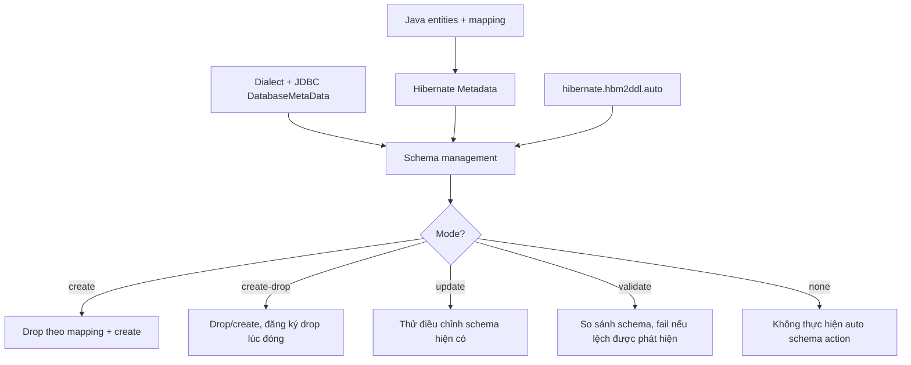
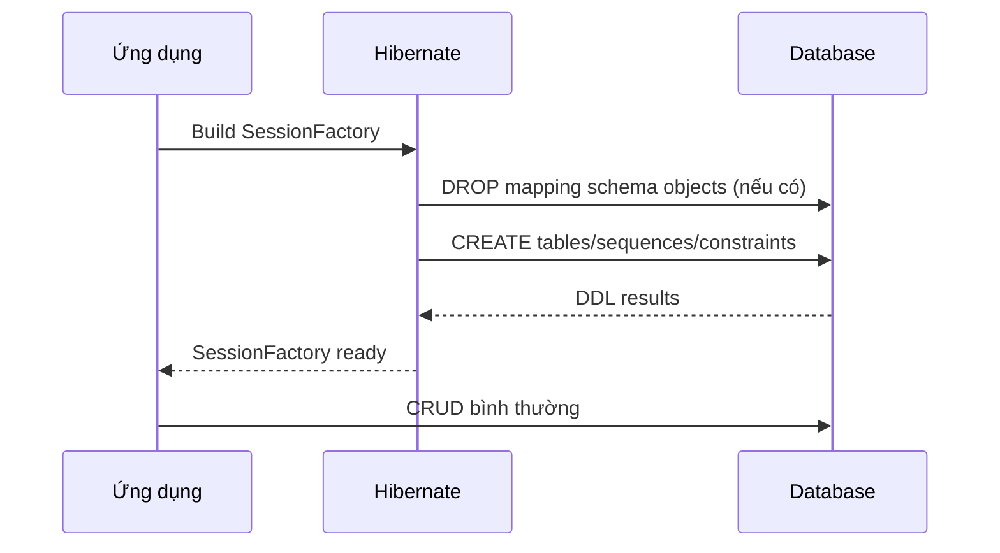
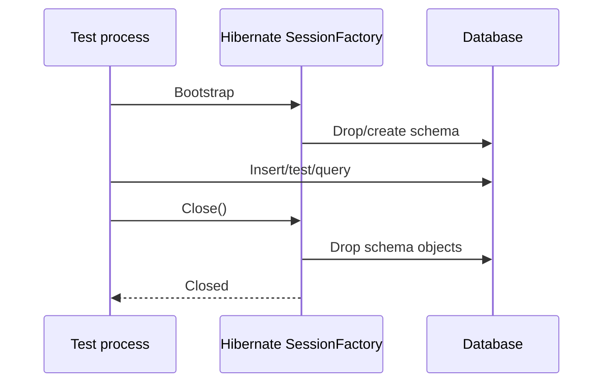
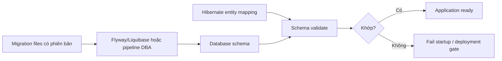

# Phân biệt `create`, `create-drop`, `update` và `validate` theo môi trường trong Hibernate

Khi bắt đầu một dự án Hibernate, ta thường gặp cấu hình:

```properties
hibernate.hbm2ddl.auto=update
```

Hoặc khi dùng Spring Boot:

```yaml
spring:
  jpa:
    hibernate:
      ddl-auto: update
```

Chỉ một giá trị cấu hình có thể quyết định Hibernate sẽ **xóa bảng cũ**, **tạo schema mới**, **thử bổ sung đối tượng còn thiếu**, **chỉ kiểm tra sự tương thích**, hay **không thực hiện thao tác schema** lúc ứng dụng khởi động. Vì thế, đây không phải một thiết lập tiện ích vô hại: đặt sai giá trị trên database chứa dữ liệu thật có thể dẫn tới mất dữ liệu, startup thất bại hoặc drift giữa mô hình entity và database.

Bốn giá trị cần phân biệt nhất là:

- `create`: **tạo lại schema từ đầu**, thường bắt đầu bằng việc drop các đối tượng thuộc schema do Hibernate quản lý, rồi tạo mới.
- `create-drop`: tạo lại schema như `create` khi khởi động, đồng thời **cố gắng drop khi SessionFactory/EntityManagerFactory đóng bình thường**.
- `update`: so sánh metadata entity với database và **thử cập nhật schema còn thiếu**; không phải hệ thống migration tổng quát hay cơ chế an toàn để đổi tên/thay đổi dữ liệu.
- `validate`: **kiểm tra** schema hiện có có đáp ứng một số yêu cầu mapping hay không; không chủ động sửa schema.

Trong hệ thống thực tế còn có `none`: Hibernate không tự tạo/sửa/kiểm tra schema theo cơ chế auto-DDL này. Với production, cách phổ biến là quản lý thay đổi schema bằng migration có phiên bản (Flyway/Liquibase hoặc quy trình DBA) và dùng `validate` hoặc `none` tùy chính sách startup.

> **Nguyên tắc cốt lõi:** `create`/`create-drop` chỉ phù hợp khi dữ liệu có thể bỏ; `update` thích hợp nhất cho thử nghiệm cục bộ có kiểm soát; `validate` là một lớp phát hiện lệch mapping, **không thay thế migration**; production nên có quy trình migration được kiểm thử, quản lý phiên bản và rollback/forward-fix rõ ràng.

Bài học giải thích cơ chế, thứ tự thao tác, tình huống sử dụng theo dev/test/staging/production, rủi ro thay đổi entity, cách kết hợp với Spring Boot và migration tool, kiểm thử startup và những kịch bản lỗi dễ gặp.

## 1. Schema là gì và Hibernate biết schema từ đâu?

Trong database quan hệ, **schema** bao gồm nhiều loại đối tượng: bảng, cột, khóa chính, khóa ngoại, unique constraint, index, sequence, view, trigger, check constraint, kiểu dữ liệu và quyền truy cập. Không phải toàn bộ đối tượng này đều do Hibernate mapping trực tiếp hoặc quản lý đầy đủ.

Ví dụ một entity:

```java
import jakarta.persistence.*;
import java.math.BigDecimal;
import java.time.Instant;

@Entity
@Table(name = "product")
public class Product {

    @Id
    @GeneratedValue(strategy = GenerationType.SEQUENCE)
    private Long id;

    @Column(name = "sku", nullable = false, unique = true, length = 64)
    private String sku;

    @Column(name = "display_name", nullable = false, length = 200)
    private String displayName;

    @Column(name = "unit_price", nullable = false, precision = 18, scale = 2)
    private BigDecimal unitPrice;

    @Column(name = "created_at", nullable = false)
    private Instant createdAt;

    protected Product() {}
}
```

Hibernate đọc các annotation và metadata Java để xây **mô hình mapping**. Với một Dialect cụ thể, Hibernate có thể sinh DDL tương tự:

```sql
CREATE SEQUENCE product_seq START WITH 1 INCREMENT BY 50;

CREATE TABLE product (
    id BIGINT NOT NULL,
    sku VARCHAR(64) NOT NULL,
    display_name VARCHAR(200) NOT NULL,
    unit_price NUMERIC(18, 2) NOT NULL,
    created_at TIMESTAMP NOT NULL,
    PRIMARY KEY (id),
    UNIQUE (sku)
);
```

Đây chỉ là **DDL minh họa**. Tên sequence, increment, timestamp type, constraint name, thứ tự statement và SQL syntax thay đổi theo Hibernate version, naming strategy, Dialect và database. Không lấy ví dụ này làm script triển khai mặc định cho mọi DBMS.

### 1.1. Metadata mapping không phải toàn bộ thiết kế database

Hibernate hiểu các đối tượng được biểu đạt qua mapping, nhưng ứng dụng có thể dùng thêm:

- Partial/functional index.
- Materialized view.
- Trigger, stored procedure và extension.
- Row-level security.
- Partitioning và tablespace.
- Advanced check constraint.
- Database-specific JSON/array/vector types.
- Custom grant/role và policy.
- Audit/history tables ngoài mapping.

Một tính năng `hbm2ddl.auto` không thể thay thế công cụ quản lý toàn bộ thiết kế này.

## 2. `hibernate.hbm2ddl.auto` điều khiển điều gì?

`hibernate.hbm2ddl.auto` là property quen thuộc của Hibernate schema-management tooling. Khi xây dựng `SessionFactory`, Hibernate có thể thực hiện hành động schema tương ứng.

```properties
hibernate.hbm2ddl.auto=validate
```

Cách cấu hình cụ thể có thể đến từ Hibernate native bootstrap, persistence unit, Spring Boot hoặc framework khác. **Giá trị hiệu lực tại runtime** mới quan trọng; không chỉ một dòng trong file config.

Sơ đồ khái niệm:



### 2.1. Không nhầm schema tooling với DML bình thường

Cấu hình này tác động chủ yếu đến **DDL** (*Data Definition Language*): `CREATE TABLE`, `ALTER TABLE`, `DROP TABLE`, tạo sequence/constraint và các thao tác tương tự.

Còn DML (*Data Manipulation Language*) như `INSERT`, `UPDATE`, `DELETE` vẫn phát sinh do `persist`, dirty checking, HQL bulk DML hoặc JDBC, bất kể `ddl-auto=validate` hay `none`.

Ví dụ `validate` **không khóa** ứng dụng thành read-only. Nó chỉ nói Hibernate không tự thay đổi schema theo cơ chế startup schema management. Transaction CRUD vẫn có thể ghi dữ liệu nếu database cho phép.

## 3. Bảng so sánh nhanh các chế độ

| Mode | Khi khởi động | Khi đóng bình thường | Tác động đến dữ liệu cũ | Dùng phổ biến |
|---|---|---|---|---|
| `create` | Drop schema objects do mapping quản lý rồi create lại | Không có hành động drop bổ sung của mode này | **Có nguy cơ xóa dữ liệu ngay từ startup** | Dev/test với DB có thể bỏ |
| `create-drop` | Drop rồi create lại | Cố gắng drop những objects đã tạo | **Xóa dữ liệu ở startup; schema cũng có thể bị xóa ở shutdown** | Test cô lập, demo tạm |
| `update` | Kiểm tra metadata và thử thay đổi một phần schema | Không tự drop lúc đóng | Không chủ ý xóa tất cả, **nhưng không được coi là migration an toàn** | Prototype/dev cục bộ có backup |
| `validate` | Kiểm tra schema, thường fail startup khi phát hiện mismatch | Không tự drop | Không sửa schema | Test môi trường giống prod, staging/prod |
| `none` | Bỏ qua auto schema management | Không tự drop | Không đổi schema | Production có migration riêng |

Cả `create` và `create-drop` có thể phá hủy dữ liệu cũ **ngay khi ứng dụng khởi động**. Khác biệt đáng nhớ nhất giữa chúng là `create-drop` còn đăng ký bước cleanup khi factory đóng bình thường.

**Quan trọng:** `create-drop` không bảo đảm database sẽ được dọn sạch sau crash, kill process, mất điện hoặc lỗi network; shutdown hook có thể không chạy hoặc không được DB cho phép. Muốn test isolation chắc chắn, dùng database/schema được tạo riêng cho từng test run hoặc container có lifecycle riêng.

## 4. Mode `create`: tạo lại từ đầu

Cấu hình:

```properties
hibernate.hbm2ddl.auto=create
```

Vòng đời khái niệm:



### 4.1. Ý nghĩa “create” dễ gây hiểu nhầm

Nhiều người đọc từ `create` rồi nghĩ Hibernate chỉ thêm bảng nếu chưa có. Trong cấu hình legacy `hbm2ddl.auto=create`, semantics thông dụng là **drop-and-create** cho schema objects Hibernate quản lý, không phải “create only if missing”.

Nếu muốn tạo schema mà không drop, một số Hibernate version có mode `create-only` hoặc Jakarta Persistence schema-generation action phù hợp; cần xác minh **đúng version và bootstrap API**. Không đổi từ `create` sang `create-only` chỉ bằng suy đoán tên vì hỗ trợ mode có thể khác nhau theo series.

### 4.2. Dùng khi nào?

`create` phù hợp khi:

- Mỗi lần chạy muốn bộ dữ liệu sạch.
- Database chỉ chứa dữ liệu demo hoặc test.
- Schema tạo ra từ mapping đủ cho test.
- Việc mất dữ liệu là điều đã được chấp nhận.
- Có môi trường cô lập, không dùng chung với ứng dụng khác.

Không phù hợp khi:

- Database có dữ liệu sản xuất.
- Database dùng chung nhiều service hoặc test suite.
- Có migration history cần giữ.
- Dữ liệu đang được người dùng nhập.
- Có bảng phụ, trigger hoặc feature database không được Hibernate mapping đầy đủ.
- Quyền DROP của tài khoản ứng dụng không được cho phép.

### 4.3. Điều gì xảy ra với dữ liệu seed?

Sau khi Hibernate tạo schema mới, test có thể nạp dữ liệu seed bằng fixture, script hoặc code khởi tạo. Dữ liệu seed cần chạy **sau khi schema tồn tại** và trước khi test sử dụng.

Ví dụ:

```sql
INSERT INTO product (id, sku, display_name, unit_price, created_at)
VALUES (1, 'SKU-001', 'Demo keyboard', 450000.00, CURRENT_TIMESTAMP);
```

Tùy ID generation/sequence, thêm ID thủ công có thể gây xung đột với sequence khi test `persist` tiếp theo. Test fixture phải quản lý sequence và ID nhất quán; không mặc định SQL seed chạy được trên mọi dialect.

## 5. Mode `create-drop`: schema theo vòng đời factory

Cấu hình:

```properties
hibernate.hbm2ddl.auto=create-drop
```

Khác với `create`, Hibernate không chỉ tạo lại ở startup mà còn cố drop schema do tooling quản lý khi `SessionFactory`/`EntityManagerFactory` đóng bình thường.



### 5.1. Ví dụ cho integration test cô lập

```properties
# Chỉ trong profile test với database bỏ được:
spring.jpa.hibernate.ddl-auto=create-drop
```

Kịch bản:

1. Test framework mở ApplicationContext.
2. Hibernate bootstraps và tạo schema.
3. Các test insert fixture, chạy assertions.
4. ApplicationContext đóng.
5. Hibernate cố gắng drop schema.

**Chú ý:** nếu test framework **cache ApplicationContext** giữa nhiều test class, vòng đời create-drop là vòng đời factory/context, **không tự reset schema trước từng test method**. Mỗi test cần isolation dữ liệu bằng transaction rollback, SQL fixture cleanup hoặc database riêng theo chính sách test.

### 5.2. Những nguy cơ điển hình

- Một test trỏ nhầm đến database của dev → mất dữ liệu.
- Hai test chạy song song dùng chung schema → một test đóng factory làm rớt bảng của test kia.
- Nhiều application instances dùng cùng schema → một instance shutdown làm drop schema đang được instance khác dùng.
- Process crash → cleanup không chạy, để lại schema.
- DB user không có quyền DROP → shutdown sinh lỗi.
- Database chứa bảng không thuộc mapping → trạng thái cleanup có thể không như người viết kỳ vọng.

**Tuyệt đối không dùng `create-drop` trong môi trường dùng chung hoặc production.**

### 5.3. Schema trống sau khi test không phải tiêu chí duy nhất

Nếu mục tiêu là test migration và khả năng triển khai trên schema có dữ liệu thật, `create-drop` không phù hợp vì nó chỉ kiểm tra một schema được tái tạo từ mapping, không kiểm tra lịch sử migration hay khả năng nâng cấp dữ liệu hiện hữu.

Dùng `create-drop` cho test logic repository/mapping ở môi trường bỏ được; dùng migration-based test riêng cho tiến trình nâng version schema.

## 6. Mode `update`: tự điều chỉnh schema có giới hạn

Cấu hình:

```properties
hibernate.hbm2ddl.auto=update
```

Hibernate cố so sánh mapping hiện tại với metadata database, rồi phát hành một số DDL cần thiết để schema phù hợp hơn.

Ví dụ entity được thêm field:

```java
@Column(name = "description", length = 500)
private String description;
```

Nếu cột chưa có, Hibernate có thể tạo SQL kiểu:

```sql
ALTER TABLE product ADD COLUMN description VARCHAR(500);
```

Đây là một **tiện ích trong vòng lặp phát triển**, không phải một engine migration có thể bảo đảm mọi thay đổi entity sẽ được dịch thành một upgrade chính xác và an toàn.

### 6.1. Update có thể làm gì?

Tùy Hibernate version, Dialect, JDBC metadata và schema hiện tại, nó có thể:

- Tạo bảng mới chưa có.
- Thêm một số cột còn thiếu.
- Tạo sequence hoặc một số đối tượng mapping cần thiết.
- Thử bổ sung constraints/index theo metadata và chiến lược schema tooling.
- Trong một số version/dialect, thử thay đổi kiểu/độ dài cột.

**Không có cam kết** tất cả các trường hợp trên đều xảy ra theo cùng cách ở mọi database. Khi cần kết quả chắc chắn, hãy viết migration SQL có kiểm thử.

### 6.2. Update không hiểu ý định rename

Ban đầu:

```java
@Column(name = "full_name")
private String fullName;
```

Sau refactor:

```java
@Column(name = "display_name")
private String displayName;
```

Hibernate thấy metadata mới cần cột `display_name`. Nó không thể biết chắc lập trình viên muốn:

- Rename `full_name` thành `display_name`.
- Giữ `full_name` để tương thích với hệ thống cũ.
- Tạo một trường hoàn toàn mới.
- Chuyển dữ liệu giữa hai định dạng.
- Tách trường thành hai cột.

Với `update`, database có thể nhận cột mới trống, trong khi dữ liệu cũ vẫn ở `full_name`. Code Java đọc `display_name` và nhận NULL; dữ liệu cũ **không tự di chuyển**.

Migration đúng cần biểu đạt ý định:

```sql
-- Ví dụ cú pháp PostgreSQL:
ALTER TABLE customer
RENAME COLUMN full_name TO display_name;
```

Với DBMS khác có thể có cú pháp khác. Nếu rename ảnh hưởng nhiều service, còn cần kế hoạch *expand-and-contract* thay vì đổi một bước.

### 6.3. Update không phải công cụ chuyển dữ liệu

Ví dụ thay:

```java
private String status;
```

bằng:

```java
@Enumerated(EnumType.STRING)
private OrderStatus status;
```

Không có gì bảo đảm các giá trị string cũ tương ứng với enum mới, không có giá trị legacy hay spelling sai.

Một migration thực sự có thể cần:

```sql
UPDATE purchase_order
SET status = 'SHIPPED'
WHERE status = 'SENT';

-- Sau khi dữ liệu được chuẩn hóa và app tương thích
-- mới siết constraint hoặc thay kiểu cột.
```

Hibernate `update` không thể tự suy ra `SENT -> SHIPPED` là quy tắc nghiệp vụ.

### 6.4. Update có thể thất bại giữa chừng

Nếu Hibernate đã tạo bảng A nhưng lỗi khi thêm constraint B, database có thể giữ một phần DDL trước đó, tùy DBMS và transactional DDL support.

Không được coi mọi auto-DDL là một transaction lớn có rollback toàn bộ. Một số DBMS implicit-commit DDL hoặc có semantics riêng. Vì thế có thể xuất hiện **partial schema update** sau startup thất bại.

### 6.5. “Không xóa tất cả” không đồng nghĩa “không mất dữ liệu”

`update` không chủ trương drop toàn bộ schema như `create`, nhưng các thay đổi cột/constraint có thể:

- Bị từ chối vì dữ liệu cũ không hợp lệ.
- Làm startup thất bại do độ dài/kiểu không tương thích.
- Gây ảnh hưởng tới index, lock hoặc hiệu năng.
- Khiến ứng dụng không còn đọc được cột cũ.
- Làm metadata và dữ liệu lệch nhau.
- Tạo schema drift giữa các developer machines.

Hãy coi `update` là **tiện ích thử nghiệm có kiểm soát**, không phải lời bảo đảm bảo toàn dữ liệu.

## 7. Mode `validate`: kiểm tra, không sửa

Cấu hình:

```properties
hibernate.hbm2ddl.auto=validate
```

Khi bootstrap, Hibernate kiểm tra mapping với schema database hiện có. Nếu một điều kiện được validator hỗ trợ không phù hợp — chẳng hạn thiếu bảng hoặc cột, kiểu cột không tương thích — bootstrap có thể thất bại.

Ví dụ entity yêu cầu cột:

```java
@Column(name = "unit_price", precision = 18, scale = 2)
private BigDecimal unitPrice;
```

Nhưng bảng `product` chưa có `unit_price`. Ở chế độ `validate`, Hibernate có thể ném `SchemaManagementException` hoặc lỗi bootstrap liên quan, thay vì tự thêm cột.

### 7.1. Vì sao validate hữu ích?

- Phát hiện ứng dụng chạy trên schema chưa được migrate.
- Cung cấp một lớp kiểm soát trước khi phục vụ traffic.
- Giảm rủi ro code mới âm thầm tự sửa schema.
- Kiểm tra một phần mapping/entity compatibility sau migration.
- Hữu ích trong CI, staging, môi trường có schema được quản lý bằng migration.

### 7.2. Validate không bảo đảm database hoàn toàn đúng

`validate` thường không chứng minh được mọi vấn đề:

- Không kiểm tra đầy đủ dữ liệu cũ có tuân thủ quy tắc domain mới không.
- Không thay thế kiểm tra unique/index/foreign key/check constraint với toàn bộ semantics.
- Không xác minh trigger, procedure, grant, row-level security hoặc extension.
- Không bảo đảm collation/timezone/default value đúng yêu cầu.
- Không chứng minh query có execution plan tốt.
- Không đảm bảo stored data có giá trị enum hợp lệ.
- Không chạy migration và không sửa cột sai.

Kiểm tra chính xác được những đối tượng/độ chi tiết nào phụ thuộc Hibernate version, Dialect và schema validator implementation.

**`validate` là smoke check của mapping-vs-schema, không phải full database acceptance test.**

## 8. Mode `none`: tắt auto schema management

Ví dụ:

```properties
hibernate.hbm2ddl.auto=none
```

Với mode này, Hibernate không tự động drop/create/update/validate schema theo property trên. Nhưng Hibernate vẫn sử dụng mapping để chạy CRUD, HQL, Criteria và các operation bình thường.

### 8.1. Khi nào chọn none thay vì validate?

`none` phù hợp khi:

- Schema được tạo/đổi bởi migration pipeline độc lập.
- Ứng dụng không được phép chạy metadata introspection hoặc schema validation khi khởi động.
- DB user chỉ có quyền DML và môi trường được kiểm soát bằng test/deployment gate khác.
- Hệ thống nhiều service chia sẻ database, validator của riêng một service không đủ làm acceptance gate.

Đánh đổi: app có thể khởi động dù schema không phù hợp rồi chỉ lỗi ở truy vấn đầu tiên. Vì thế nếu chọn `none`, cần **test migration + smoke query + readiness gate** theo quy trình triển khai.

### 8.2. Bỏ cấu hình không phải lúc nào cũng như none

Hibernate native và Spring Boot có thể áp default khác nhau theo môi trường, embedded database và những công cụ schema manager được phát hiện. **Không giả định việc xóa dòng cấu hình chắc chắn có nghĩa `none`**.

Với môi trường quan trọng, hãy đặt giá trị **tường minh** và xác minh cấu hình runtime hiệu lực.

## 9. Ví dụ ứng dụng thay đổi entity qua ba phiên bản

Giả sử `Product` V1:

```java
@Entity
@Table(name = "product")
public class Product {

    @Id
    private Long id;

    @Column(name = "name", nullable = false, length = 100)
    private String name;
}
```

V2 thêm field:

```java
@Column(name = "price", precision = 18, scale = 2)
private BigDecimal price;
```

V3 đổi tên field, siết constraint:

```java
@Column(name = "display_name", nullable = false, length = 200)
private String displayName;

@Column(name = "price", nullable = false, precision = 18, scale = 2)
private BigDecimal price;
```

Dưới các mode:

| Thay đổi | `create`/`create-drop` | `update` | `validate` |
|---|---|---|---|
| Khởi động V1 ở DB trống | Tạo bảng V1 | Có thể tạo bảng V1 | Thất bại nếu bảng chưa có |
| V1 → V2, thêm cột nullable | Xóa rồi tạo V2; **mất dữ liệu V1** | Có thể thêm cột | Fail nếu thiếu cột |
| V2 → V3, rename `name` | Xóa rồi tạo V3 | Có thể thêm `display_name`, giữ `name`; không migrate dữ liệu | Fail nếu thiếu `display_name` |
| V2 → V3, `price` thành NOT NULL | Tạo bảng mới NOT NULL, mất dữ liệu | Không đảm bảo siết constraint hay backfill | Không bảo đảm kiểm đầy đủ nullability |
| Rollback V3 → V2 | Lại drop/create V2 | Không có rollback migration thực sự | Có thể fail hoặc pass tùy schema |
| Bổ sung index đặc thù | Chỉ phần schema mapping/tool hỗ trợ | Không bảo đảm change chuẩn | Không bảo đảm phát hiện |

Bài học: **chế độ schema tooling không chứa tri thức về hành trình chuyển dữ liệu từ V1 sang V2 sang V3**. Đó là trách nhiệm của migration có phiên bản.

## 10. DDL ở startup là một hoạt động vận hành, không chỉ Java annotation

Đổi `@Column(nullable=false)` trong source có vẻ là một refactor Java nhỏ. Nhưng ở database thật, việc thay đổi NOT NULL có thể yêu cầu:

- Kiểm tra hàng triệu row có NULL.
- Backfill dữ liệu.
- Lock bảng hoặc rebuild table/index.
- Cân nhắc replication lag.
- Cập nhật ứng dụng cũ còn ghi NULL.
- Kiểm tra thời gian giữ lock.
- Triển khai đúng thứ tự giữa ứng dụng và schema.

Hibernate `update` không thể tự đưa ra chiến lược vận hành tối ưu dựa trên dữ liệu, tải hệ thống và yêu cầu zero-downtime.

### 10.1. Một phương án migrate đúng

Thay vì siết `NOT NULL` ngay:

1. Thêm cột nullable bằng migration.
2. Deploy code ghi giá trị mới song song với compatibility cũ.
3. Backfill dữ liệu cũ theo batch.
4. Kiểm tra không còn NULL.
5. Siết NOT NULL bằng migration có kế hoạch lock.
6. Dọn compatibility code sau khi mọi instance đã nâng.

Đây là ví dụ **expand-and-contract**. Không áp dụng từng bước máy móc cho mọi DBMS; cần kiểm tra DDL locking và các ràng buộc cụ thể.

## 11. Cấu hình Hibernate thuần

Khi bootstrap Hibernate không qua Spring Boot, có thể thiết lập qua property:

```properties
hibernate.connection.url=jdbc:postgresql://localhost:5432/app_dev
hibernate.connection.username=app_user
hibernate.connection.password=...
hibernate.hbm2ddl.auto=validate
```

Ví dụ lập trình:

```java
StandardServiceRegistry registry =
    new StandardServiceRegistryBuilder()
        .applySetting(
            "hibernate.hbm2ddl.auto",
            "validate"
        )
        .build();
```

Snippet chỉ minh họa cách truyền property; để bootstrap đầy đủ còn cần JDBC datasource/connection provider, mapping metadata, service registry lifecycle và xử lý tài nguyên.

### 11.1. Tránh nhiều nguồn cấu hình xung đột

Một dự án có thể khai báo property ở:

- `hibernate.cfg.xml`.
- `persistence.xml`.
- JVM/system properties hoặc environment.
- Spring Boot `application.yml`.
- Deployment chart/Helm/Kubernetes ConfigMap.
- Test property overrides.
- Code bootstrap.

Khi hành vi runtime bất ngờ, kiểm tra **effective configuration** theo ưu tiên của framework/version. Một file source đúng không chứng minh container production đang dùng đúng profile.

Không ghi password database thật vào repository hoặc log chỉ để chẩn đoán mode.

## 12. Cấu hình Spring Boot: `spring.jpa.hibernate.ddl-auto`

Spring Boot phổ biến sử dụng:

```yaml
spring:
  jpa:
    hibernate:
      ddl-auto: validate
```

Giá trị cấu hình `spring.jpa.hibernate.ddl-auto` được Spring Boot dùng để điều khiển Hibernate schema tooling. Trong Spring Boot, cũng có thể thấy:

```properties
spring.jpa.properties.hibernate.hbm2ddl.auto=validate
```

**Không đặt hai đường cấu hình với giá trị đối lập**. Chọn một cách nhất quán, dùng profiles và kiểm tra runtime config. Cơ chế bind/ưu tiên cần dựa trên Spring Boot version thực tế.

### 12.1. Profile local

```yaml
# application-local.yml
spring:
  jpa:
    hibernate:
      ddl-auto: update
```

Dùng khi database local có thể khôi phục, mọi developer hiểu giới hạn của `update` và thay đổi schema thực sự được commit bằng migration trước khi merge/release.

Nếu development team cần đồng nhất, dùng migration ngay cả trên local thường tốt hơn `update` để tránh mỗi máy một trạng thái.

### 12.2. Profile test dùng DB tạm

```yaml
# application-test.yml
spring:
  jpa:
    hibernate:
      ddl-auto: create-drop
```

Chỉ an toàn khi datasource **chắc chắn** trỏ tới database/schema dành riêng cho test và có thể xóa. Với Testcontainers, nên pin DBMS version và tránh dùng chung schema cho test chạy song song.

### 12.3. Staging/production

```yaml
# application-prod.yml
spring:
  jpa:
    hibernate:
      ddl-auto: validate
```

Khi sử dụng migration tool, cần bảo đảm migration chạy **trước Hibernate validation** và trước khi app sẵn sàng nhận traffic. Nếu có trường hợp validator không phù hợp với một loại schema đặc thù đã được quản lý riêng, cân nhắc `none` cùng acceptance tests rõ ràng thay vì bật `update` để “tự sửa”.

## 13. Đừng dựa vào default của Spring Boot theo cảm tính

Trong những dòng Spring Boot thông dụng, default của Hibernate DDL mode có thể khác tùy datasource có phải embedded database (như H2/HSQLDB/Derby), có Flyway/Liquibase/schema manager hay không, và phiên bản Boot. Các trường hợp phổ biến có hành vi kiểu:

- Database nhúng dùng cho demo/test, không có schema manager: Boot có thể chọn `create-drop`.
- Database bên ngoài: Boot thường không tự drop/create schema nếu không cấu hình.
- Có Flyway/Liquibase: Boot thay đổi cách khởi tạo schema để tránh trùng trách nhiệm.

Nhưng **không coi đây là hợp đồng bất biến cho mọi Spring Boot version**. Trong ứng dụng quan trọng, đặt `ddl-auto` tường minh cho từng profile và kiểm tra startup logs.

### 13.1. Thay datasource có thể đổi hành vi

Một test ban đầu dùng H2 embedded. Sau đó CI chuyển sang PostgreSQL container. Nếu project dựa vào default chứ không đặt `ddl-auto`, cùng test có thể:

- Trước đó được tự tạo schema.
- Sau khi đổi datasource, Hibernate không tạo schema.
- Test thất bại vì thiếu bảng.

Đây là vấn đề cấu hình môi trường, không nhất thiết do mapping sai.

## 14. Tách trách nhiệm schema: Hibernate và migration tool

Một kiến trúc dễ vận hành:



Các vai trò:

- **Migration tool:** quản lý *lịch sử thay đổi*, version, checksum, ordering, rollback/forward-fix policies.
- **Hibernate mapping:** định nghĩa object model và cách ánh xạ dữ liệu.
- **Hibernate validate:** kiểm tra một phần điều kiện tương thích mapping với schema.
- **Database constraints:** bảo vệ tính toàn vẹn dữ liệu khi app chạy.
- **Deployment pipeline:** quyết định thời điểm migration, rollback, traffic cutover.

Không để Hibernate `update` cạnh tranh với Flyway/Liquibase để tạo cùng bảng/cột.

## 15. Ví dụ Flyway migration đầu tiên

Giả sử dùng PostgreSQL. Một migration có tên:

```text
src/main/resources/db/migration/V1__create_product_table.sql
```

Nội dung minh họa:

```sql
CREATE TABLE product (
    id BIGINT PRIMARY KEY,
    sku VARCHAR(64) NOT NULL,
    display_name VARCHAR(200) NOT NULL,
    unit_price NUMERIC(18, 2) NOT NULL,
    created_at TIMESTAMP NOT NULL,
    CONSTRAINT uk_product_sku UNIQUE (sku)
);

CREATE SEQUENCE product_seq
    START WITH 1
    INCREMENT BY 50;
```

Cần đồng bộ tên/optimizer/sequence mapping thật với Hibernate version và DBMS. Đừng mặc định sequence increment 50 phù hợp nếu entity mapping dùng allocationSize khác.

### 15.1. Migration thêm cột

```text
V2__add_product_description.sql
```

```sql
ALTER TABLE product
ADD COLUMN description VARCHAR(500);
```

Migration là một bước rõ ràng, có thể review SQL và đánh giá tác động. Sau khi V2 chạy, Hibernate `validate` có thể giúp phát hiện mapping mới không tương thích với schema vừa migrate.

### 15.2. Migration chỉnh dữ liệu

```text
V3__backfill_product_description.sql
```

```sql
UPDATE product
SET description = 'Chưa có mô tả'
WHERE description IS NULL;
```

Với bảng rất lớn, chạy UPDATE toàn bộ trong một transaction có thể gây lock/bloat và ảnh hưởng traffic; cần thiết kế backfill theo batch và kiểm tra DBMS. Migration version chỉ là **đơn vị điều phối thay đổi**, không tự làm mọi DML an toàn hoặc nhanh.

## 16. Vì sao không nên vừa `update` vừa Flyway/Liquibase?

Giả sử entity V2 cần thêm cột `description`, nhưng migration V2 chưa được áp dụng.

Nếu app khởi động với `update` trước khi migration tool chạy, Hibernate có thể tự tạo cột đó. Sau đó migration:

```sql
ALTER TABLE product ADD COLUMN description VARCHAR(500);
```

bị lỗi vì cột đã tồn tại. Hoặc tool đánh dấu version khác với trạng thái schema thực, khiến lịch sử thay đổi không còn phản ánh database.

Ngay cả khi migration viết `ADD COLUMN IF NOT EXISTS` và bỏ qua lỗi, quản lý schema vẫn bị chia đôi:

- Ai có quyền tạo cột?
- Migration checksum lịch sử có ý nghĩa gì?
- Có thể tái tạo schema từ migration không?
- Ai tạo constraint/index và dữ liệu backfill?
- Làm sao chứng minh staging giống prod?

Nguyên tắc: **một chủ sở hữu cho DDL ứng dụng trên từng môi trường**. Với môi trường được quản lý, migration pipeline là chủ sở hữu; Hibernate chỉ validate hoặc không can thiệp.

## 17. Schema validation nên diễn ra sau migration

Một thứ tự boot/deploy hợp lý:

```text
Provision database
    ↓
Apply migration V1..Vn
    ↓
Start application with ddl-auto=validate
    ↓
Hibernate checks mapped schema
    ↓
Health/readiness checks
    ↓
Route traffic
```

Trong Spring Boot, integration giữa Flyway/Liquibase và JPA thường tổ chức thứ tự khởi tạo phù hợp, nhưng còn phụ thuộc phiên bản/cấu hình. Nếu migration chạy như job bên ngoài, phải quản lý dependency rõ để application không start sớm trên schema cũ.

### 17.1. Khi validate fail

Không phản ứng bằng cách đổi `validate` thành `update` cho production để “ứng dụng chạy được”. Hãy:

1. Xác định DB URL/schema/catalog và credential runtime.
2. Kiểm tra migration version đã áp dụng.
3. Xem lỗi Hibernate nói thiếu/mismatch đối tượng nào.
4. So sánh entity mapping và migration.
5. Kiểm tra naming strategy/Dialect/version.
6. Sửa migration hoặc mapping đúng chủ đích.
7. Chạy lại test trên database có dữ liệu mẫu.
8. Khởi động lại với `validate`.

Chỉ đổi sang `none` nếu có lý do và acceptance gate thay thế, không phải để che mismatch.

## 18. `create`/`create-drop` và `import.sql`

Hibernate có cơ chế import script dùng cùng schema creation trong một số cấu hình/version, thường được nhắc qua file `import.sql` trên classpath. Với schema tạo từ đầu, script có thể được chạy sau khi tables được tạo.

Nhưng cần chú ý:

- Điều kiện kích hoạt import script phụ thuộc Hibernate version/config.
- Script seed có thể chạy ngoài dự kiến nếu được package vào production artifact.
- Nếu schema bị drop/recreate, dữ liệu seed sẽ được nạp lại.
- Script SQL phải phù hợp Dialect và ID generation.
- Hành vi khác với Spring Boot `data.sql` hoặc Flyway migration.
- Test có thể thất bại nếu seed dùng schema chưa tạo xong.

**Không đưa dữ liệu sản xuất hoặc secret vào `import.sql`.** Nên đặt fixture trong test resources hoặc migration được quản lý, tránh seed ngẫu nhiên khi app khởi động.

### 18.1. Dễ nhầm ba cơ chế seed

| Cơ chế | Ai chạy? | Mục đích thích hợp |
|---|---|---|
| Hibernate `import.sql` / import tooling | Hibernate schema generation theo cấu hình hỗ trợ | Demo hoặc test khi schema tạo mới |
| Spring Boot `schema.sql`/`data.sql` | Spring SQL initialization | Bootstrap DB đơn giản theo profile |
| Flyway/Liquibase data migration | Migration runner | Dữ liệu tham chiếu/biến đổi có version và audit |

Không bật cả ba mà không xác định thứ tự và trách nhiệm; có thể tạo bảng/cột/hàng trùng hoặc gặp lỗi do schema chưa sẵn sàng.

## 19. Spring `schema.sql`, `data.sql` và thứ tự khởi tạo

Spring Boot hỗ trợ SQL initialization cho datasource với những property như:

```properties
spring.sql.init.mode=always
```

Trong một số cấu hình/version, còn có:

```properties
spring.jpa.defer-datasource-initialization=true
```

Property thứ hai ảnh hưởng thứ tự SQL initialization so với JPA initialization. Cần kiểm tra tài liệu chính xác của Spring Boot version đang dùng.

Nếu Hibernate `create` và `schema.sql` cùng có `CREATE TABLE product`, có thể xảy ra lỗi bảng đã tồn tại. Nếu `data.sql` chạy trước khi Hibernate tạo bảng, có thể lỗi relation/table not found.

Với ứng dụng nghiêm túc dùng Flyway/Liquibase, nên tránh để SQL init song song tạo schema chính, trừ khi có mục đích test và thứ tự đã được kiểm soát.

## 20. Vai trò của Dialect và naming strategy

Một entity Java:

```java
@Column(name = "created_at")
private Instant createdAt;
```

Hibernate sử dụng Dialect để chọn kiểu SQL và cách quote identifier. Naming strategy có thể biến tên Java thành tên database khi mapping không đặt tên tường minh.

Ví dụ:

```java
private String displayName;
```

Một naming strategy có thể tạo cột `display_name`; strategy khác có thể giữ `displayName`.

### 20.1. Vì sao validate fail dù “cột đã có”?

Các nguyên nhân:

- App kết nối nhầm database.
- Default schema/catalog khác.
- Naming strategy ở test và prod khác nhau.
- Đặt `@Column(name = "...")` sai.
- Identifier được quote hoặc database đổi chữ hoa/thường.
- DBMS type khác expectation của Dialect/version.
- Hibernate sau nâng cấp kỳ vọng sequence/identity khác.
- User database không có quyền đọc metadata cần thiết.

Không đổi database DDL theo cảm tính trước khi xác nhận schema thực mà ứng dụng kết nối đến.

### 20.2. Hibernate version có thể thay đổi SQL mapping

Khi nâng Hibernate ORM, mặc định type mapping có thể thay đổi (ví dụ một số loại thời gian, enum, UUID hoặc sequence strategy). Một schema được `validate` chấp nhận bởi phiên bản cũ có thể bị phiên bản mới đánh giá khác.

Vì vậy, regression test khi nâng Hibernate cần **migration + validate** trên DBMS mục tiêu, không chỉ unit test Java.

## 21. Không coi H2 giống hệt production DBMS

Một test với H2 và `create-drop` chứng minh Hibernate có thể tạo schema tương ứng trong H2 ở cấu hình đó. Nó không bảo đảm:

- PostgreSQL có cùng kiểu dữ liệu.
- MySQL hiểu cùng check constraint.
- Oracle xử lý identifier length giống nhau.
- SQL Server cho phép cùng ALTER COLUMN.
- Index/collation/NULL semantics giống nhau.
- Migration production chạy được.
- DDL transactional behavior giống nhau.

Với các tính năng schema/DDL quan trọng, dùng integration test trên **DBMS family/version phù hợp với production**, chẳng hạn Testcontainers. Không mặc định container chạy tag `latest` là đủ để tái hiện môi trường.

### 21.1. Một ma trận test hữu ích

| Test | Database | Schema strategy |
|---|---|---|
| Unit test không cần DB | Không DB | Không liên quan |
| Repository test nhanh | H2/HSQL hoặc DB container riêng | `create-drop` nếu dữ liệu bỏ được |
| Hibernate mapping smoke test | DBMS mục tiêu | Migration + `validate` |
| Migration test từ V(n-1) sang Vn | DBMS mục tiêu có dữ liệu fixture | Apply migration + `validate` |
| Staging deployment test | Database staging độc lập | Migration pipeline + `validate`/`none` |
| Production | Database production | Migration có phê duyệt, app `validate`/`none` |

Cần phân biệt **test mapping mới** và **test nâng cấp database đang có dữ liệu**. Hai bài toán đó không tương đương.

## 22. Thiết lập theo môi trường: ma trận quyết định

| Môi trường | Mode nên cân nhắc | Lý do |
|---|---|---|
| Prototype local mới, dữ liệu bỏ được | `create` hoặc `create-drop` | Tạo schema nhanh, dễ reset |
| Local thường xuyên giữ dữ liệu cá nhân | Migration + `validate`; `update` chỉ khi chấp nhận rủi ro | Giữ dữ liệu và giảm drift |
| Automated tests có DB ephemeral | `create-drop` hoặc migration + cleanup | Cô lập test rõ |
| CI chạy test schema/migration | Migration + `validate` | Đảm bảo scripts và mappings đồng bộ |
| Staging/pre-production | Migration + `validate` | Mô phỏng luồng release |
| Production | Migration + `validate` hoặc `none` | Không cho app tự thay đổi schema |
| Database dùng chung nhiều dịch vụ | Migration do chủ sở hữu schema quản lý, `validate`/`none` | Tránh app tự drop/alter bảng dịch vụ khác |
| Data warehouse/reporting readonly | Thường `none`, hoặc `validate` nếu phù hợp | Không cấp quyền DDL cho ứng dụng |

Đây là **khuyến nghị kiến trúc**, không phải luật máy móc. Một team có thể chọn `none` cho production vì validation cần quyền metadata mà runtime role không có. Điều quan trọng là có quy trình kiểm chứng ngoài Hibernate.

## 23. Example Spring Boot profiles

Cấu trúc:

```text
src/main/resources/
    application.yml
    application-local.yml
    application-test.yml
    application-staging.yml
    application-prod.yml
```

Cấu hình cơ sở:

```yaml
# application.yml
spring:
  jpa:
    open-in-view: false
    hibernate:
      ddl-auto: validate
```

Profile local:

```yaml
# application-local.yml
spring:
  jpa:
    hibernate:
      ddl-auto: update
```

Profile test, chỉ database ephemeral:

```yaml
# application-test.yml
spring:
  jpa:
    hibernate:
      ddl-auto: create-drop
```

Profile production:

```yaml
# application-prod.yml
spring:
  jpa:
    hibernate:
      ddl-auto: validate
```

Giả sử production migration tool chạy trước app startup. Một số hệ thống muốn `none` để không phụ thuộc startup schema validation; khi đó cần gate khác như integration migration verification hoặc smoke query.

### 23.1. Những điều cần xác nhận

- Profile đang active thật sự là gì?
- Cấu hình trong container/cloud có override file không?
- Datasource URL trỏ đến DB nào?
- Có nhiều datasource/EntityManagerFactory không?
- Có Spring test properties override `ddl-auto` không?
- Migration tool có được bật trong đúng profile không?
- Có dynamic tenant schema không?

Không dùng profile tên “test” như bằng chứng DB là test; **địa chỉ DB và quyền DDL mới quyết định rủi ro thực**.

## 24. Guardrail chống chạy nhầm mode phá dữ liệu

Vì một giá trị `create` có thể gây hậu quả lớn, nên tạo nhiều lớp bảo vệ:

1. **Production role không có quyền DROP/ALTER/CREATE** khi không cần.
2. Production config đặt `validate` hoặc `none` tường minh.
3. CI/deployment policy từ chối các giá trị `create`/`create-drop`/`update` trên môi trường production.
4. Tách database và credential cho test/dev/prod.
5. Database test có tên/namespace và lifecycle riêng.
6. Secrets được inject theo môi trường, không đặt trong test resources.
7. Migration runner dùng credential riêng có DDL, app runtime dùng DML privilege tối thiểu.
8. Log effective mode và JDBC database identity nhưng không log secret.
9. Có backup/snapshot và drill khôi phục.
10. Có quy trình review những thay đổi Hibernate mapping và migration.

### 24.1. Ví dụ guard trong startup

Ý tưởng kiểm tra cấu hình:

```java
String activeEnvironment = environmentName;
String ddlMode = configuredDdlMode;

if ("production".equals(activeEnvironment)
        && Set.of("create", "create-drop", "update")
                 .contains(ddlMode)) {
    throw new IllegalStateException(
        "Unsafe Hibernate schema mode in production"
    );
}
```

Đây là pseudo-application guard: `environmentName` và `configuredDdlMode` phải được lấy từ nguồn cấu hình **hiệu lực**, và guard phải chạy **trước khi Hibernate SessionFactory khởi tạo DDL**. Nếu tạo guard quá muộn (sau bean JPA), schema có thể đã bị drop. Guardrail mạnh nhất vẫn là **DB permissions + deployment policy**.

## 25. Multiple instances và concurrent startup

Giả sử service có 5 replicas dùng cùng database. Khi rollout, cả 5 instance khởi động gần nhau.

Với `create` hoặc `create-drop`:

- Instance A drop/create.
- Instance B cũng drop/create.
- Instance C có thể đang query lúc bảng bị drop.
- Khi A shutdown, create-drop có thể xóa schema của cả cluster.

Với `update`:

- Nhiều instance có thể phát cùng DDL.
- Race giữa check metadata và ALTER TABLE.
- Một instance thấy bảng chưa có và tạo, instance khác cũng cố tạo.
- Database lock/migration conflict có thể khiến startup fail.

Vì vậy, trong hệ thống nhiều replicas, **schema migration nên được điều phối một lần** theo cơ chế locking/serialization của migration tool hoặc deployment pipeline, không giao cho từng app instance tự cập nhật schema.

### 25.1. Validate trên nhiều instances

`validate` không chủ động ALTER schema, nên thường ít rủi ro hơn khi nhiều instances start. Nhưng vẫn có chi phí đọc metadata, và nếu schema đang trong quá trình migrate, một số instance có thể fail startup do mismatch. Điều phối thứ tự migration và rollout vẫn cần thiết.

## 26. Zero-downtime deployment và tương thích ngược

Trong hệ thống deploy rolling, old app và new app có thể chạy đồng thời. Migrations cần xét **compatibility window**.

Ví dụ rename `product.name` thành `product.display_name`:

**Không an toàn khi chỉ đổi Java mapping:**

```text
Old app -> đọc/write cột name
New app -> đọc/write cột display_name
DB -> chỉ còn một cột
```

Trong rolling deployment, ít nhất một phiên bản có thể lỗi.

### 26.1. Expand-and-contract

Một chiến lược minh họa:

1. Migration thêm `display_name` nullable, giữ `name`.
2. New app tương thích với cả hai cột hoặc dual-write có kiểm soát.
3. Backfill từ `name` sang `display_name`.
4. Deploy đủ instances dùng cột mới.
5. Kiểm tra dữ liệu và đường đọc/ghi.
6. Migration siết constraint mới khi an toàn.
7. Migration drop `name` trong release sau.

Hibernate `update` không tự quản lý compatibility giữa hai phiên bản đang chạy. `create` càng không phù hợp.

### 26.2. Migration rollback không chỉ là đảo DDL

Nếu đã xóa cột chứa dữ liệu, câu `ALTER TABLE ADD COLUMN` không phục hồi dữ liệu cũ. Nếu đã transform dữ liệu, bản cũ có thể không còn diễn giải được.

Nhiều nhóm chọn **forward-fix** thay vì tự động rollback mọi migration. Dù chọn chiến lược nào, phải có backup/restore rehearsal và test deployment logic.

## 27. Validate có phát hiện schema drift không?

`validate` có thể phát hiện **một số** khác biệt giữa entity metadata và DB schema. Nhưng nếu database có một cột thừa không được entity mapping, Hibernate thường không xem đó là lỗi bắt buộc. Nó cũng có thể không kiểm tất cả index/constraint chi tiết.

Ví dụ:

```sql
ALTER TABLE product ADD COLUMN obsolete_flag BOOLEAN;
```

Nếu mapping không dùng `obsolete_flag`, validator có thể vẫn pass. Vì vậy validate không chứng minh database đã được dựng từ chính xác migration history hiện tại.

Để phát hiện drift đầy đủ hơn, có thể:

- Đối chiếu migration history/checksum.
- Snapshot schema qua database tooling.
- So sánh schema dump/canonical model.
- Kiểm tra constraints/indexes quan trọng bằng integration tests.
- Kiểm soát quyền DDL và manual change.
- Theo dõi drift alerts trong quản trị database.

**Mục tiêu validate là tương thích ORM ở mức tooling hỗ trợ, không phải xác nhận “mọi DDL của DB chuẩn 100%”.**

## 28. Quan sát schema tool đang làm gì

Trong môi trường dev/test, có thể bật logging phù hợp để xem DDL Hibernate sinh ra. Cần phân biệt:

- SQL DDL do schema management chạy lúc boot.
- SQL DML do ứng dụng chạy khi request/transaction thực thi.
- SQL migration do Flyway/Liquibase chạy riêng.
- SQL init scripts do Spring Boot chạy.

Ví dụ:

```properties
hibernate.show_sql=true
hibernate.format_sql=true
```

Với Spring Boot, có thể cấu hình logger của Hibernate schema tooling theo version đang dùng. Tên category khác nhau theo series, nên đối chiếu tài liệu runtime nếu cần log chi tiết.

### 28.1. Những thông tin nên ghi nhận trong một incident

- Hibernate ORM version.
- Spring Boot/framework version.
- Effective `ddl-auto` mode.
- Datasource URL đã che credentials.
- Database product/version.
- Dialect class.
- Default schema/catalog.
- Migration tool/version và migration history.
- Exact SQL gây lỗi.
- Có bao nhiêu objects đã thay đổi trước failure.
- Backup/snapshot gần nhất.
- Có bao nhiêu app replicas cùng startup.

Không bật logging toàn bộ bind values nhạy cảm chỉ để chẩn đoán schema.

## 29. Khi ứng dụng gặp lỗi “table already exists”

Một số nguyên nhân điển hình:

- `create`/`create-drop` bị chạy trên schema có object mà drop không xử lý được.
- Spring `schema.sql` và Hibernate cùng tạo bảng.
- Flyway migration và `update` cùng tạo cột.
- Hai app instances cùng chạy schema update.
- Manual DDL trước đó tạo bảng cùng tên nhưng casing/schema khác.
- Hibernate mapping tên bảng trùng với object có sẵn.
- Quyền DROP không đủ nên cleanup thất bại, sau đó CREATE bị trùng.

Hướng xử lý:

1. Xác minh database/schema đích.
2. Xác minh chủ sở hữu DDL.
3. Đọc DDL SQL và log migration.
4. Kiểm tra quyền database.
5. Tách cơ chế init trùng lặp.
6. Không drop tùy tiện trên DB có dữ liệu.

Không kết luận “Hibernate lỗi” chỉ từ câu “table already exists”.

## 30. Khi ứng dụng gặp lỗi “missing column” ở validate

Ví dụ lỗi minh họa:

```text
Schema-validation: missing column [display_name]
in table [customer]
```

Cần phân biệt các tình huống:

- Migration tương ứng chưa chạy.
- App kết nối sai DB/schema.
- Mapping dùng naming strategy khác migration.
- Table đang nằm trong catalog/schema khác.
- Column thực có tên khác do quoted identifier/case.
- Entity version mới không tương thích DB version đang deploy.
- Validation chạy trước migration.

Không giải quyết bằng `ddl-auto=update` ở production. Hãy tìm **mismatch chính xác**, sửa migration hoặc mapping, chạy kiểm thử trên database copy/staging rồi deploy.

### 30.1. Sequence mismatch

Nếu DB thiếu sequence entity yêu cầu, Hibernate có thể fail validation hoặc lỗi lúc insert tùy version và validator capability. Khi chuyển identifier strategy từ identity sang sequence, cần migration đặc biệt và cân nhắc giá trị ID hiện có.

Một tên sequence mặc định do Hibernate sinh có thể thay đổi theo naming strategy hoặc version. Để tránh bất ngờ, định nghĩa `@SequenceGenerator` tường minh khi phù hợp với domain:

```java
@Id
@GeneratedValue(
    strategy = GenerationType.SEQUENCE,
    generator = "product_id_gen"
)
@SequenceGenerator(
    name = "product_id_gen",
    sequenceName = "product_seq",
    allocationSize = 50
)
private Long id;
```

Migration phải cấu hình sequence/allocator phù hợp. Không dựa vào `validate` để kiểm chứng tất cả tình huống sequence allocation và concurrent writers.

## 31. Tạo schema bằng script nhưng không apply ngay

Một số tổ chức không cho ứng dụng runtime chạy DDL. Hibernate/Jakarta Persistence có API và property để **sinh script schema** thay vì thực thi trực tiếp trên database trong một số phiên bản/bootstrap.

Những key chuẩn Jakarta Persistence thường gặp gồm:

```properties
jakarta.persistence.schema-generation.database.action=none
jakarta.persistence.schema-generation.scripts.action=create
jakarta.persistence.schema-generation.scripts.create-target=build/generated-schema.sql
```

Đây là ví dụ về hướng cấu hình. Giá trị và cách chỉ định target/resource có thể khác theo provider, môi trường build và version; phải đối chiếu tài liệu Jakarta Persistence/Hibernate tương ứng.

### 31.1. Script sinh ra để review, không phải migration tự động

Ngay cả khi script tạo schema có thể chạy trên database trống, nó **không diễn đạt cách nâng cấp** database chứa dữ liệu. Để biến script thành migration, cần:

- Kiểm tra diff từ schema hiện tại.
- Xác định rename/data backfill.
- Review SQL DDL/locking/index.
- Xác định thứ tự và preconditions.
- Kiểm thử trên dữ liệu đại diện.
- Đưa vào hệ thống versioning.

Không dùng `generated-schema.sql` của entity V3 như một file thay thế toàn bộ schema production V2.

### 31.2. Tránh cấu hình schema generation song song gây nhầm

Hibernate-specific `hibernate.hbm2ddl.auto` và standard `jakarta.persistence.schema-generation.*` có thể cùng được cung cấp. Precedence, hành động và khả năng kết hợp phụ thuộc provider/version. Nếu một nơi yêu cầu `none` nhưng nơi khác yêu cầu `create`, kết quả có thể bất ngờ.

Trong dự án thực tế, chọn một cơ chế quản lý schema rõ và kiểm tra effective settings, không rải property mâu thuẫn ở nhiều lớp.

## 32. Các mode ít gặp: `create-only`, `drop` và JPA `drop-and-create`

Ngoài bốn mode chính, một số Hibernate series có thể chấp nhận những hành động khác của schema management, ví dụ:

- `none`.
- `create-only`: tạo schema mà không drop trước theo semantics của mode tương ứng.
- `drop`: chỉ drop schema objects.
- `create` và `create-drop`.
- `update` và `validate`.

Trong Jakarta Persistence schema generation, tên action có thể gồm `none`, `create`, `drop` và `drop-and-create`. **Đừng nhầm trực tiếp tên action của JPA với value `hbm2ddl.auto` của Hibernate.** Cùng chữ `create` ở hai cơ chế cấu hình có thể có quy tắc khác nhau về việc drop trước.

Các mode đặc biệt này thường phục vụ tooling, test hoặc tạo script. Với môi trường dữ liệu quan trọng, ưu tiên migration được điều phối.

## 33. Database permissions và nguyên tắc tối thiểu

Một thiết kế production thường dùng **hai loại tài khoản**:

| Role | Quyền gợi ý | Mục đích |
|---|---|---|
| Migration role | Quyền DDL cần thiết theo migration | Thực thi thay đổi schema được phê duyệt |
| Application role | Quyền DML và SELECT trên các đối tượng cần dùng | Phục vụ traffic bình thường |
| Read-only/report role | SELECT cần thiết | Báo cáo, analytics, truy vấn đọc |

Không cấp `DROP TABLE`/`ALTER TABLE` cho application role nếu không cần. Khi đó, dù config bị sửa nhầm thành `create`, database có thể từ chối DDL. Điều này giảm hậu quả nhưng **không thay thế** kiểm soát config: startup vẫn lỗi và DDL có thể đã thực hiện một phần nếu role còn quyền trên vài objects.

### 33.1. Quyền metadata cho validate

`validate` cần đọc metadata schema. Hầu hết hệ thống có thể cho app đọc metadata cần thiết, nhưng trong môi trường hạn chế quyền có thể gặp lỗi introspection. Nếu không phù hợp với policy, chọn `none` và đưa việc validate schema vào pipeline với credential riêng.

Không cấp quyền DDL trên production chỉ vì một validator lỗi do không thấy metadata; xác định thiếu quyền nào trước.

## 34. Nhiều schema, catalog và multi-tenancy

Một ứng dụng có thể dùng:

- Một database, một schema.
- Nhiều schema trong cùng database.
- Nhiều database theo tenant.
- Nhiều persistence units/datasources.

Cấu hình `default_schema`/`default_catalog` hoặc cơ chế multi-tenancy có thể ảnh hưởng nơi Hibernate tìm/bỏ/tạo bảng.

### 34.1. Vì sao đặc biệt nguy hiểm với create-drop?

Nếu một `EntityManagerFactory` dùng schema chung hoặc cấu hình default schema sai, `create-drop` có thể thao tác lên schema không được dành cho test đó.

Với multi-tenancy schema-per-tenant, việc migrate mỗi tenant đòi hỏi một quy trình riêng: danh sách tenant, migration version, lock, monitoring và xử lý tenant lỗi. Hibernate boot-time auto-DDL trên một schema mặc định không tự giải quyết vòng đời migration của mọi tenant.

### 34.2. Checklist định danh schema

Trước mọi DDL:

1. Database server và port.
2. Database/catalog.
3. Schema mặc định.
4. Database role/current user.
5. Danh sách tables thuộc ứng dụng.
6. Có object dùng chung không?
7. Migration history table nằm ở schema nào?
8. Có tenant khác dùng cùng server/schema không?

Đặc biệt khi environment dùng naming mặc định giống nhau, chỉ nhìn table name không đủ để nhận diện target an toàn.

## 35. Khôi phục sau khi chạy nhầm `create`

Giả sử production instance vô tình khởi động với `ddl-auto=create` và làm mất bảng/dữ liệu do Hibernate quản lý.

Cần xử lý như **sự cố dữ liệu**, không phải một lỗi build thông thường.

### 35.1. Các bước ứng phó ở mức khái niệm

1. **Dừng các instance** đang dùng mode phá dữ liệu để không tiếp tục gây thay đổi.
2. Hạn chế traffic/write mới và cô lập phạm vi ảnh hưởng.
3. Kiểm tra SQL DDL đã chạy và schema hiện tại.
4. Bảo toàn logs, timestamps và backup metadata phục vụ phân tích.
5. Xác định snapshot/point-in-time recovery phù hợp.
6. Khôi phục vào môi trường cách ly trước để kiểm tra độ đầy đủ.
7. Xây kế hoạch cutover và reconciliation của các writes phát sinh sau sự cố.
8. Xác minh ràng buộc, row counts và nghiệp vụ quan trọng.
9. Chỉ mở traffic sau khi đã kiểm tra với người chịu trách nhiệm dữ liệu.
10. Thêm deployment guardrail/permissions để ngăn tái diễn.

**Không khuyên chạy `update` lên database vừa bị drop như cách khôi phục dữ liệu.** Auto schema generation chỉ tạo cấu trúc, không phục hồi các rows bị mất. Tùy DBMS, cần backup restore/PITR và reconciliation.

### 35.2. Vì sao DDL rollback không đáng tin?

Một số DBMS có transactional DDL trong phạm vi nhất định; số khác implicit commit hoặc có giới hạn. Hibernate schema tooling không phải transaction coordinator cho toàn bộ chuỗi DDL kiểu migration. Đừng coi “startup exception” là bằng chứng database đã trở về trạng thái ban đầu.

## 36. Backups và migration test trước khi deploy

Một quy trình migration an toàn cần:

- Backup hoặc snapshot được xác minh.
- Test restore được thực hiện định kỳ.
- Thời gian recovery phù hợp RTO/RPO.
- Versioned migration có review.
- Test forward migration trên schema có dữ liệu.
- Test với database version production.
- Kiểm tra thời gian lock và tài nguyên.
- Phương án khi migration fail giữa chừng.
- Phương án tương thích app old/new.
- Monitoring sau deploy.

### 36.1. Database copy test quan trọng hơn schema trống

Một migration có thể chạy được trên database trống nhưng lỗi trên production vì:

- Có row NULL vi phạm NOT NULL.
- Có duplicate values vi phạm UNIQUE.
- Có FK orphan.
- Có giá trị enum cũ.
- Table quá lớn gây timeout/lock.
- Index build tiêu tốn nhiều dung lượng.
- Trigger/extension tạo side effects.
- Quyền/owner khác môi trường test.

Hibernate `create-drop` không phát hiện được những vấn đề này vì nó xóa lịch sử dữ liệu cũ. Vì vậy migration test cần fixture có các edge cases thực tế.

## 37. So sánh đặc thù qua các tình huống

### 37.1. Tạo mới bảng `audit_event`

- `create`: tạo bảng sau khi xóa các mapped objects cũ; nguy cơ mất dữ liệu không liên quan.
- `create-drop`: tương tự và cleanup khi factory đóng.
- `update`: có thể thêm bảng còn thiếu trong dev.
- `validate`: fail nếu mapping mới cần bảng chưa tồn tại.
- **Migration:** thêm `V4__create_audit_event.sql` có review, áp vào DB hiện có.

### 37.2. Tăng độ dài cột `sku` từ 64 lên 128

- `create`: tạo mới đúng chiều dài mới nhưng mất dữ liệu cũ.
- `update`: không có bảo đảm thay đổi chiều dài đúng trên mọi DBMS/version.
- `validate`: mức độ phát hiện length mismatch phụ thuộc validator, không nên chỉ dựa vào đây.
- **Migration:** explicit `ALTER COLUMN` phù hợp Dialect và lock policy.

### 37.3. Thêm unique constraint vào dữ liệu có duplicate

- `create`: bảng mới trống nên constraint thường tạo được, nhưng không kiểm tra dữ liệu thực.
- `update`: có thể cố thêm constraint rồi bị từ chối do duplicate; schema cập nhật một phần.
- `validate`: không đủ để thay data quality test cho constraint.
- **Migration:** dò duplicate, sửa dữ liệu, tạo constraint/index theo quy trình phù hợp.

### 37.4. Rename table `user_order` thành `purchase_order`

- `create`: xóa và tạo bảng mới; dữ liệu cũ không được preserve.
- `update`: không hiểu chắc đây là rename; có thể tạo thêm bảng mới.
- `validate`: phát hiện thiếu mapped table mới.
- **Migration:** explicit rename/data move và compatibility plan.

### 37.5. Drop cột đã không còn dùng

- `update` thường không được xem là cơ chế tự drop cột an toàn vì không biết dữ liệu có còn cần không.
- `validate` có thể không fail chỉ vì database còn cột thừa.
- **Migration:** kiểm chứng mọi service không còn đọc/ghi, backup, sau đó drop theo release phù hợp.

Những ví dụ này cho thấy mapping hiện tại không chứa toàn bộ ý định thay đổi lịch sử.

## 38. Bài thực hành A — Chọn mode đúng cho bốn môi trường

Một ứng dụng thương mại điện tử có:

1. Máy cá nhân chạy H2 file và dữ liệu chỉ dùng demo.
2. Integration test dùng PostgreSQL container riêng cho mỗi test run.
3. Staging có dữ liệu mô phỏng được tạo từ production đã ẩn danh.
4. Production có Flyway và nhiều application replicas.

**Yêu cầu:** đề xuất mode và giải thích.

**Gợi ý:**

- Local demo: `create` hoặc `create-drop` nếu chấp nhận mất dữ liệu; `update` chỉ khi muốn giữ một ít dữ liệu thử nghiệm và hiểu giới hạn.
- Test ephemeral: `create-drop` cho mapping/repository tests; migration+`validate` cho migration tests.
- Staging: migration+`validate`, không dùng auto-update.
- Production: migration+`validate` hoặc `none` cùng gate thay thế, app role không có quyền DDL.

**Câu hỏi mở rộng:** Nếu staging có data production đã ẩn danh, có nên dùng `create-drop` để “reset cho nhanh” không? Chỉ khi thực sự chủ động xóa dữ liệu staging theo quy trình, không khi cần test nâng cấp schema trên dữ liệu hiện hữu.

## 39. Bài thực hành B — Phân tích lỗi đổi tên cột

Entity V1:

```java
@Column(name = "full_name")
private String fullName;
```

Entity V2:

```java
@Column(name = "display_name")
private String displayName;
```

Database có 1 triệu customer đã lưu `full_name`.

**Câu hỏi:**

1. `update` có bảo đảm chuyển dữ liệu từ cột cũ sang cột mới không?
2. Vì sao Hibernate không thể tự kết luận đây là rename?
3. `create` có giải quyết được về mặt dữ liệu không?
4. Viết migration/expand-and-contract phù hợp.
5. Làm sao hỗ trợ rolling deployment với app V1 và V2 cùng chạy?
6. `validate` có vai trò gì sau migration?

**Gợi ý:** Không dùng update để rename. Tách schema expand, backfill, code tương thích và contract sau khi các instance cũ ngừng dùng cột cũ. `validate` giúp phát hiện mapping/schema mismatch, không tự backfill.

## 40. Bài thực hành C — Hai nguồn tạo schema xung đột

Ứng dụng có:

```yaml
spring:
  jpa:
    hibernate:
      ddl-auto: update
  flyway:
    enabled: true
```

Migration V5 thêm cột `description`, entity cũng vừa thêm field này.

**Câu hỏi:**

1. Ai nên là chủ sở hữu schema?
2. Nếu Hibernate tạo cột trước, Flyway có thể gặp gì?
3. Cấu hình thay thế cho staging/production?
4. Làm sao kiểm thử trên DB mới và DB upgrade V4 → V5?
5. Nên lưu schema migration history/checksum ở đâu?

**Gợi ý:** Flyway quản lý migration; Hibernate ở `validate` hoặc `none`. Test migration trên DBMS mục tiêu rồi kiểm tra mapping. Không để `update` và migration cùng cố sửa schema.

## 41. Bài thực hành D — Test `create-drop` và ApplicationContext cache

Một suite gồm 20 test classes dùng chung Spring ApplicationContext và H2. Developer nghĩ `create-drop` sẽ xóa database sau mỗi test method.

**Câu hỏi:**

1. Schema được tạo/drop theo vòng đời gì?
2. Nếu context được cache, dữ liệu của test A có thể ảnh hưởng test B không?
3. Cần thêm cơ chế isolation nào?
4. Chạy test song song trên cùng schema có nguy cơ gì?
5. Nếu process bị kill, có bảo đảm cleanup không?

**Gợi ý:** `create-drop` gắn với factory/context lifecycle, không phải mỗi test method. Dùng transaction rollback, fixture cleanup, schema/database riêng hoặc context isolation theo thiết kế. Cleanup không được bảo đảm sau crash.

## 42. Bài thực hành E — Production guardrail

Một dịch vụ có 6 replicas, chung PostgreSQL database. Cấu hình production vô tình bị override thành `ddl-auto=create`.

**Yêu cầu:**

1. Xác định hậu quả nếu application role có quyền DROP.
2. Đề xuất ít nhất ba lớp phòng vệ độc lập.
3. Chỉ ra thời điểm startup guard phải chạy.
4. Giải thích vì sao `validate` không thể tự sửa schema.
5. Thiết kế quy trình xử lý nếu DDL đã chạy.

**Gợi ý:** DB DML-only role, CI/CD policy từ chối mode phá dữ liệu, tách secrets/datasource và profile rõ, monitoring mode trước JPA bootstrap, backup/PITR và incident response. Không tìm cách restore bằng `update`.

## 43. Bài thực hành F — Schema pass validate nhưng logic vẫn sai

Một app đã chuyển enum `PENDING` thành `NEW`. Database còn 20.000 rows có `status='PENDING'`, cột kiểu VARCHAR và mapping enum mới vẫn tồn tại.

**Câu hỏi:**

1. `validate` có nhất thiết phát hiện 20.000 giá trị enum cũ không?
2. Lỗi có thể xuất hiện ở lúc nào?
3. Migration cần làm gì?
4. Có nên bật `update` để “đổi enum” không?
5. Test dữ liệu nào giúp phát hiện sớm?

**Gợi ý:** Validator tập trung schema mapping, không chứng minh mọi value trong bảng hợp lệ với enum Java mới. Cần data migration/backfill, constraint/test và query thực tế trên dataset đại diện.

## 44. Bài thực hành G — Rà soát schema trước khi nâng Hibernate

Giả sử dự án nâng Hibernate ORM major version trong khi production có Flyway và dùng `ddl-auto=validate`.

**Yêu cầu:**

1. Ghi version Hibernate cũ/mới và resolved dependencies.
2. Xác định Dialect/DBMS/driver thực tế.
3. Chạy migration + validate trên database test giống production.
4. So sánh type/sequence/identifier/naming semantics.
5. Kiểm tra schema DDL/metadata mismatch.
6. Đánh giá các native queries, enum, temporal/UUID mappings quan trọng.
7. Chạy smoke tests đọc/ghi thực tế.
8. Có release rollback/forward-fix plan.

**Gợi ý:** Một dự án nâng ORM có thể cần migration dù entity Java nhìn không đổi; `validate` chỉ là một gate và không thay thế behavioral tests.

## 45. Checklist quyết định mode trước khi merge/deploy

- [ ] Tôi biết giá trị `ddl-auto` **hiệu lực ở runtime**, không chỉ trong source config.
- [ ] Tôi biết database URL/schema/catalog và role mà ứng dụng dùng.
- [ ] Tôi biết DB này có dữ liệu có thể bỏ hay không.
- [ ] Tôi đã phân biệt `create` với “create only if missing”.
- [ ] Tôi hiểu `create-drop` có cleanup theo factory lifecycle, không phải mỗi test method.
- [ ] Tôi không dùng `create`/`create-drop` trên database dùng chung hoặc production.
- [ ] Tôi không dùng `update` thay thế migration cho production.
- [ ] Tôi có migration có version cho rename, backfill, constraint và data transform.
- [ ] Tôi không để Hibernate schema auto-update cạnh tranh với Flyway/Liquibase.
- [ ] Tôi đã kiểm tra Spring Boot profile/default/init scripts theo version.
- [ ] Tôi đã pin/test trên DBMS/Dialect phù hợp production.
- [ ] Tôi đã kiểm tra thứ tự migration → validation → readiness.
- [ ] Tôi hiểu `validate` chỉ kiểm tra được một phần schema consistency.
- [ ] Tôi có test nâng cấp schema từ version cũ với dữ liệu fixture.
- [ ] Tôi có DB permissions tối thiểu và deployment guardrail.
- [ ] Tôi đã đánh giá multi-replica startup và zero-downtime compatibility.
- [ ] Tôi có backup/restore procedure cho migration rủi ro.
- [ ] Tôi không coi startup failure là bằng chứng DDL được rollback hoàn toàn.
- [ ] Tôi đã quy định ai chịu trách nhiệm xử lý drift hoặc migration failure.

Checklist dùng để kiểm soát quyết định triển khai; không thay thế quy trình test migration và backup thực tế.

## 46. Kết luận: chọn mode theo vòng đời dữ liệu

Khi học Hibernate, `create`, `create-drop`, `update` và `validate` có thể trông như bốn lựa chọn tương đương để “đồng bộ entity với database”. Trên thực tế, chúng giải quyết **những mục tiêu hoàn toàn khác nhau**:

- **`create`** phục vụ khởi tạo lại schema ở môi trường dữ liệu bỏ được.
- **`create-drop`** phục vụ schema tạm gắn với vòng đời `SessionFactory`, đặc biệt cho test cô lập.
- **`update`** là cơ chế điều chỉnh metadata có giới hạn, hữu ích khi thử nghiệm local nhưng không đủ an toàn/đầy đủ cho upgrade database thật.
- **`validate`** kiểm tra một phần sự tương thích mapping/schema và không phát DDL sửa lỗi.
- **`none`** để quyền quản lý schema cho pipeline bên ngoài, đổi lại ứng dụng không có gate validation của Hibernate.

Khi đi từ local sang staging và production, ưu tiên không còn là “để Hibernate tự tạo bảng cho nhanh”, mà là **bảo toàn dữ liệu, kiểm soát lịch sử thay đổi, hỗ trợ rolling deployment và khả năng phục hồi sau lỗi**. Vì thế, migration có phiên bản, phân quyền DDL, kiểm thử trên dữ liệu hiện hữu và cơ chế backup/restore là những thành phần bắt buộc của một chiến lược schema đáng tin cậy.

**Quy tắc ngắn gọn để nhớ:** *Dữ liệu bỏ được thì có thể tái tạo schema; dữ liệu cần giữ thì phải migrate có chủ đích; muốn kiểm tra mà không tự sửa thì dùng validate; và đừng coi update là phép màu chuyển đổi dữ liệu.*
