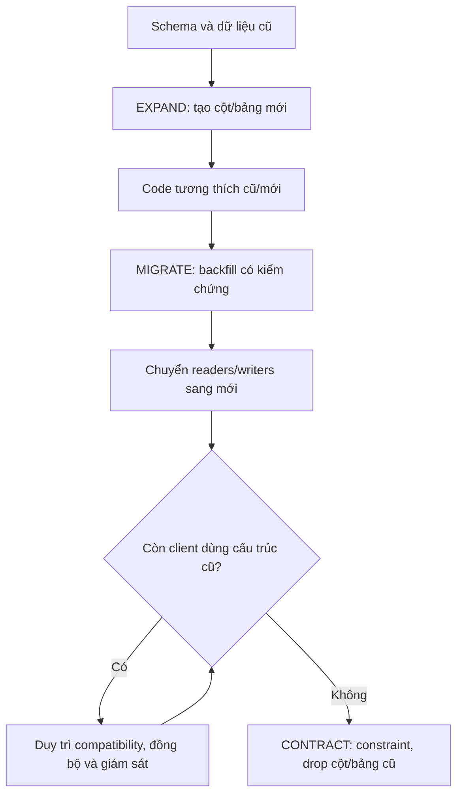

# Giới hạn của tự cập nhật lược đồ khi cần bảo toàn dữ liệu

## 1. Vấn đề: thay đổi entity không đồng nghĩa chuyển đổi dữ liệu

Trong giai đoạn học Hibernate, một cấu hình rất tiện:

```properties
hibernate.hbm2ddl.auto=update
```

hoặc với Spring Boot:

```properties
spring.jpa.hibernate.ddl-auto=update
```

Khi lập trình viên thêm field vào entity hoặc tạo một entity mới, Hibernate có thể cố điều chỉnh cấu trúc database theo metadata của các mapping. Cách làm này giúp prototype nhanh nhưng dễ tạo một ngộ nhận:

> Nếu Hibernate có thể tự cập nhật bảng, nó cũng có thể tự chuyển schema mà không làm mất dữ liệu cũ.

Đây **không phải bảo đảm của schema update**. Hibernate hiểu tên entity, thuộc tính, kiểu dữ liệu và nhiều quy tắc mapping. Nó không thể tự suy ra toàn bộ **ý nghĩa nghiệp vụ** của dữ liệu đã lưu.

Ví dụ:

```java
@Entity
@Table(name = "customers")
public class Customer {
    @Id
    private Long id;

    @Column(name = "full_name")
    private String fullName;
}
```

Sau refactor:

```java
@Entity
@Table(name = "customers")
public class Customer {
    @Id
    private Long id;

    @Column(name = "display_name", nullable = false)
    private String displayName;
}
```

Hibernate có thể nhận thấy mapping mới yêu cầu `display_name` trong khi bảng đang có `full_name`. Nhưng không có thông tin nào khẳng định rằng đây là thao tác **rename cột** thay vì **thêm một khái niệm mới**.

Một kết quả có thể gặp:

```text
Trước:
customers
  id | full_name
  1  | "Nguyễn An"
  2  | "Lê Bình"

Sau một thay đổi schema kiểu thêm cột:
customers
  id | full_name   | display_name
  1  | "Nguyễn An" | NULL
  2  | "Lê Bình"   | NULL
```

Dữ liệu ở cột cũ vẫn nằm đó nhưng application code mới có thể đọc `display_name = NULL`. Nếu cột mới được yêu cầu `NOT NULL` ngay, ALTER có thể thất bại vì các hàng đã tồn tại.

Mục tiêu của bài: hiểu những giới hạn này, biết khi nào dùng `update`/`validate`, và thiết kế migration **có chủ đích, có version, có kiểm chứng** để bảo toàn dữ liệu trong hệ thống Hibernate.

## 2. Ba lớp cần phân biệt: mapping, schema và data

Không nên coi entity class là toàn bộ database.

| Lớp | Bao gồm | Ai chịu trách nhiệm chính? |
|---|---|---|
| Java/ORM mapping | Entity, field, annotation, association, inheritance, ID generator | Ứng dụng và Hibernate |
| Database schema | Bảng, cột, kiểu dữ liệu, index, FK, CHECK, sequence, trigger, view, quyền truy cập | Database/migration tool |
| Dữ liệu lịch sử | Hàng, giá trị, quan hệ, trạng thái nghiệp vụ, phiên bản dữ liệu | Nghiệp vụ và migration logic |

Ví dụ annotation:

```java
@Column(
    name = "email",
    length = 254,
    nullable = false,
    unique = true
)
private String email;
```

Annotation cho biết schema mục tiêu cần cột email không NULL và unique. Nhưng nó **không nói**:

- Nếu hàng cũ có `email IS NULL`, phải xử lý ra sao?
- Hai tài khoản trùng email được phép gộp hay không?
- Email có cần trim, lowercase, chuẩn hóa Unicode?
- Nếu tồn tại email dài hơn 254 ký tự, có được cắt không?
- Khi ứng dụng cũ còn ghi, constraint mới có làm lỗi request cũ?
- Có dashboard, ETL, CDC hoặc service khác đang dùng cột này không?

Đó là những quyết định data migration, không thể tự suy ra chỉ từ annotation.

## 3. Hibernate schema management thực hiện nhiệm vụ gì?

Hibernate có công cụ quản lý lược đồ, thường được gọi qua cấu hình `hibernate.hbm2ddl.auto`. Khi khởi tạo SessionFactory/EntityManagerFactory, công cụ có thể đọc mapping và JDBC database metadata để sinh hay kiểm tra một số DDL.

Các giá trị thường gặp:

| Giá trị | Hành vi khái quát | Phù hợp khi nào? |
|---|---|---|
| `none` | Không tự tạo, sửa hay kiểm tra schema theo chế độ này | Schema do công cụ khác quản lý |
| `validate` | Kiểm tra mức độ phù hợp của những phần schema mà validator hỗ trợ; không tự sửa | Production sau migration |
| `update` | Thử cập nhật một số khác biệt cấu trúc từ mapping | Dev/prototype có dữ liệu không quan trọng |
| `create` | Tạo schema mới; có thể drop/recreate objects cũ | Database test tạm, không có data cần giữ |
| `create-drop` | Tạo lúc khởi tạo và drop theo lifecycle đóng SessionFactory | Test database có thể hủy |

Hibernate còn có nhiều schema tooling/action và chuẩn Jakarta Persistence schema generation khác. Bảng trên chỉ tóm tắt các chế độ thường thấy.

### Hai điều quan trọng

1. **`update` không phải là một engine suy luận data migration.**
2. Hành vi DDL cụ thể phụ thuộc **phiên bản Hibernate, SQL dialect, JDBC metadata và database hiện tại**.

Không kết luận “Hibernate không bao giờ thay kiểu cột” hoặc “Hibernate luôn tạo index X”. Một số phiên bản/dialect có thể thực hiện những ALTER cụ thể. Điều không có là **bảo đảm tổng quát** rằng tất cả dữ liệu và các ràng buộc nghiệp vụ được chuyển đổi an toàn.

## 4. update có thể xử lý những gì?

Khi sửa mapping, Hibernate có thể nhận biết rằng bảng hoặc cột nào đó chưa có, rồi phát DDL bổ sung nếu được hỗ trợ. Một số khác biệt về sequence, constraint hoặc kiểu có thể được xử lý tùy phiên bản/dialect.

Ví dụ một entity hoàn toàn mới:

```java
@Entity
@Table(name = "categories")
public class Category {
    @Id
    private Long id;

    @Column(nullable = false)
    private String name;
}
```

Trên database dev chưa có bảng `categories`, cơ chế tự tạo/cập nhật có thể tạo bảng tương ứng. Đây là trường hợp **ít cần chuyển đổi dữ liệu cũ**, nên tiện lợi.

Trái lại, thay `VARCHAR` chứa các giá trị lịch sử thành một enum/business model mới không chỉ là câu lệnh DDL. Dù công cụ đổi được kiểu vật lý, nó chưa chắc chuyển **giá trị** đúng.

### Không nên kỳ vọng từ auto-update

- Nhận biết một column đổi tên thay vì được thêm mới.
- Chuyển dữ liệu khi tách/gộp hai bảng.
- Loại bỏ duplicate trước khi tạo UNIQUE.
- Tự chọn giá trị hợp lệ cho hàng cũ khi thêm NOT NULL.
- Làm sạch orphan references trước khi tạo foreign key.
- Giữ độ chính xác khi chuyển amount/date/enum.
- Phối hợp schema cũ và mới trong rolling deployment.
- Tạo cơ chế backfill theo batch, checkpoint và rollback nghiệp vụ.
- Chạy DDL không chặn traffic trên bảng lớn.
- Giữ versioned history và review về schema.

**Không dựa vào auto-update để quyết định những việc chỉ business owner mới biết.**

## 5. Đổi tên Java field không luôn đòi đổi tên SQL column

Nếu chỉ refactor code:

```java
// Trước
@Column(name = "full_name")
private String fullName;

// Sau
@Column(name = "full_name")
private String displayName;
```

thì cột `full_name` trong database vẫn được dùng. Nếu semantics không đổi, việc đổi tên thuộc tính Java có thể thực hiện **không cần DDL**.

Đây là lợi ích của ORM mapping: tên trong code và tên vật lý có thể khác nhau.

HQL/Criteria dùng tên thuộc tính Java mới `displayName`, trong khi native SQL vẫn dùng cột `full_name`. Những query cụ thể cần cập nhật khi refactor, nhưng không nên đổi cột DB chỉ để đạt sự đồng nhất hình thức nếu không đem lại lợi ích thực.

## 6. Khi thật sự rename column, Hibernate không hiểu ý định

Mapping cũ:

```java
@Column(name = "full_name")
private String fullName;
```

Mapping mới:

```java
@Column(name = "display_name")
private String displayName;
```

Một công cụ nhìn schema cuối không thể biết đây là:

1. Rename `full_name` thành `display_name` và giữ nguyên values.
2. Tạo một field mới `display_name` với business semantics khác.
3. Tách tên đầy đủ thành field display-only đã được tính từ nhiều nguồn.

Nếu không có phiên bản app cũ dùng cột cũ, một migration PostgreSQL có thể là:

```sql
ALTER TABLE customers
RENAME COLUMN full_name TO display_name;
```

Nhưng trong rolling deployment, application version cũ còn truy vấn `full_name` sẽ lỗi ngay. Do đó phải cân nhắc **compatibility window** và có thể dùng phương án thêm cột mới/backfill/dual-write trước khi bỏ cột cũ.

## 7. Thêm cột NOT NULL vào bảng đang có dữ liệu

Giả sử:

```java
@Column(name = "sync_status", nullable = false)
private String syncStatus;
```

Trên bảng có hàng cũ, câu:

```sql
ALTER TABLE customers
ADD COLUMN sync_status VARCHAR(20) NOT NULL;
```

có thể bị database từ chối vì không thể gán một giá trị hợp lệ cho những hàng đã lưu. Hibernate không biết khách hàng cũ phải là `SYNCED`, `PENDING` hay `UNKNOWN`.

### Mẫu triển khai ba bước

**Expand — thêm nullable**

```sql
ALTER TABLE customers
ADD COLUMN sync_status VARCHAR(20);
```

**Backfill — chuyển dữ liệu theo quy tắc đã được quyết định**

```sql
UPDATE customers
SET sync_status = 'PENDING'
WHERE sync_status IS NULL;
```

Đây chỉ là quy tắc minh họa. Trong domain thật, nếu từng customer có trạng thái khác, cần tính theo dữ liệu nguồn đúng.

**Enforce — xác minh rồi siết constraint**

```sql
SELECT COUNT(*)
FROM customers
WHERE sync_status IS NULL;

ALTER TABLE customers
ALTER COLUMN sync_status SET NOT NULL;
```

SQL dùng PostgreSQL làm ví dụ. Với bảng lớn, mỗi bước có thể tốn locks và I/O. Cần xác minh mọi writer mới đều tạo `sync_status` hợp lệ trước khi siết NOT NULL.

### Vì sao thêm DEFAULT chưa chắc giải quyết?

`DEFAULT 'PENDING'` có thể cho hàng cũ/mới một giá trị, tùy cách DDL và phiên bản database xử lý. Nhưng đó không chứng minh PENDING là trạng thái **đúng về nghiệp vụ** cho toàn bộ dữ liệu lịch sử.

## 8. Thu hẹp VARCHAR có nguy cơ làm mất dữ liệu

Mapping ban đầu:

```java
@Column(name = "description", length = 1000)
private String description;
```

Mapping mới:

```java
@Column(name = "description", length = 200)
private String description;
```

Trước khi đổi, phải phân tích:

```sql
SELECT id, LENGTH(description) AS actual_length
FROM products
WHERE LENGTH(description) > 200;
```

Nếu có chuỗi vượt 200:

- Database có thể từ chối ALTER.
- Một conversion/truncation được chọn có thể làm mất phần đuôi.
- Ứng dụng mới có thể đọc/ghi lỗi nếu schema chưa đổi.

Không tự dùng:

```sql
UPDATE products
SET description = SUBSTRING(description FROM 1 FOR 200);
```

chỉ để làm cho migration thành công. Nếu phải rút gọn, cần quy tắc nghiệp vụ, lưu giữ giá trị gốc và kế hoạch phục hồi.

## 9. Đổi kiểu String sang Integer cần data conversion

Giả sử cột `score` có các giá trị:

```text
"10"
"25"
"N/A"
""
NULL
"120 points"
```

Entity đổi từ:

```java
private String score;
```

sang:

```java
private Integer score;
```

Những câu hỏi không thể giải quyết tự động:

- `"N/A"` là NULL hay lỗi?
- `""` có nghĩa không có dữ liệu hay 0?
- `"120 points"` là 120 hay dữ liệu không hợp lệ?
- Có cho phép điểm âm không?
- Những hàng bị từ chối sẽ nằm trong bảng quarantine nào?

Nếu mọi giá trị đều chắc chắn hợp lệ trên PostgreSQL, có thể cần:

```sql
ALTER TABLE ratings
ALTER COLUMN score TYPE INTEGER
USING score::INTEGER;
```

Nhưng với dữ liệu thực, thường an toàn hơn khi thêm một cột numeric mới, chuyển và kiểm tra từng tập dữ liệu, rồi mới bỏ cột text. Thao tác đổi kiểu tại chỗ còn có thể rewrite table và giữ lock.

## 10. Numeric precision và scale có ý nghĩa nghiệp vụ

Thay:

```java
@Column(precision = 18, scale = 2)
private BigDecimal amount;
```

bằng:

```java
@Column(precision = 10, scale = 0)
private BigDecimal amount;
```

không phải chỉ đổi số trong DDL.

Phải xác định:

- Có hàng vượt phạm vi numeric mới không?
- Phần lẻ được làm tròn hay loại bỏ?
- Đơn vị lưu trữ mới có khác không?
- Dữ liệu báo cáo/đối soát cần chuyển theo cách nào?
- Có yêu cầu giữ amount gốc để audit không?

**Không để conversion mặc định của database tự quyết định cách làm tròn số tiền.** Nếu cần chuyển currency units hoặc scale, chạy reconciliation trước và sau theo business key, tổng tiền và các trường hợp biên.

## 11. Thay đổi enum mapping có thể đọc sai dữ liệu cũ

Ví dụ:

```java
@Enumerated(EnumType.ORDINAL)
private OrderStatus status;
```

Ban đầu:

```java
enum OrderStatus { NEW, PAID, SHIPPED }
```

Dữ liệu lưu:

```text
0 = NEW
1 = PAID
2 = SHIPPED
```

Sau khi chèn enum ở giữa:

```java
enum OrderStatus { NEW, CANCELLED, PAID, SHIPPED }
```

giá trị cũ `1` có thể bị đọc thành CANCELLED. Schema vẫn có thể là cột số, nên validator cũng chưa chắc phát hiện **lỗi ngữ nghĩa này**.

### Chuyển sang STRING

```java
@Enumerated(EnumType.STRING)
private OrderStatus status;
```

Không chỉ đổi annotation. Cần mapping dựa trên **thứ tự enum đã dùng ở thời điểm dữ liệu được ghi**, ví dụ `0 -> NEW`, `1 -> PAID`, `2 -> SHIPPED`, rồi migration các values.

Nếu thứ tự enum từng thay đổi nhiều lần trong lịch sử, phải khôi phục mapping theo các release cũ. Ngay cả khi lưu STRING, đổi tên enum constant vẫn có thể đòi migration hoặc compatibility handling.

## 12. Đổi quan hệ và khóa ngoại không đơn giản là tạo bảng mới

Giả sử mô hình cũ:

```text
order_lines.order_id -> orders.id
```

Mô hình mới dùng join table:

```text
order_line_links(order_id, line_id)
```

Hibernate có thể nhìn thấy bảng mới được mapping, nhưng không thể tự quyết định:

- Sinh row nào trong `order_line_links` từ foreign key cũ.
- Cách xử lý orphan rows.
- Có được chia sẻ một line giữa nhiều order không.
- Thứ tự collection khi dùng `@OrderColumn`.
- Khi nào drop foreign key cũ.

Cần một data migration từ mô hình cũ sang mô hình mới, đối soát số liên kết và kiểm tra constraints. Một ORM association mapping không chứa toàn bộ quy tắc chuyển quan hệ.

## 13. Thêm UNIQUE constraint phải xử lý duplicate trước

Mapping:

```java
@Column(name = "external_key", unique = true)
private String externalKey;
```

Nếu bảng có:

```text
id = 1, external_key = "ABC"
id = 2, external_key = "ABC"
id = 3, external_key = "abc"
```

thì UNIQUE thông thường có thể thất bại với hai row `ABC`. Nếu business rule không phân biệt hoa/thường, `ABC` và `abc` cũng có thể trùng.

Truy vấn phát hiện:

```sql
SELECT external_key, COUNT(*)
FROM entities
WHERE external_key IS NOT NULL
GROUP BY external_key
HAVING COUNT(*) > 1;
```

Với normalization:

```sql
SELECT LOWER(TRIM(external_key)) AS normalized_key,
       COUNT(*)
FROM entities
WHERE external_key IS NOT NULL
GROUP BY LOWER(TRIM(external_key))
HAVING COUNT(*) > 1;
```

Những câu SQL này **không quyết định** có được xóa record nào, FK liên quan phải trỏ về đâu hoặc có cần merge lịch sử nghiệp vụ. Không tự xóa các row duplicate để tạo constraint thành công mà chưa được phê duyệt.

## 14. NOT NULL, CHECK và foreign key đều cần kiểm tra data

Thêm CHECK:

```sql
ALTER TABLE orders
ADD CONSTRAINT chk_total_nonnegative
CHECK (total_amount >= 0);
```

Nếu có `total_amount < 0`, cần giải quyết nguồn và ý nghĩa của các hàng đó. Có thể đó là refund, discount hoặc dữ liệu sai.

Thêm foreign key:

```sql
ALTER TABLE orders
ADD CONSTRAINT fk_order_customer
FOREIGN KEY (customer_id) REFERENCES customers(id);
```

Nếu có orphan `customer_id`, migration có thể thất bại hoặc đòi dùng cơ chế validation theo database.

Không thể suy từ annotation:

- FK orphan nên được xóa, cập nhật hay giữ lại?
- Có cần tạo “unknown customer” hợp lệ?
- Có thể thay đổi dữ liệu tham chiếu trong khi constraint được tạo không?

Khi siết invariant, nên thống nhất data repair policy, logging và khả năng audit.

## 15. Index được tạo không đồng nghĩa đã tối ưu

JPA mapping:

```java
@Table(
    name = "orders",
    indexes = @Index(
        name = "ix_orders_status_created",
        columnList = "status, created_at"
    )
)
```

Hibernate schema tooling có thể sinh một số indexes từ metadata. Nhưng production workload có thể cần:

- Index có thứ tự `DESC`.
- Partial/filtered index.
- Functional/expression index.
- INCLUDE columns, BRIN, GIN hoặc cơ chế vendor-specific.
- Online/concurrent index creation.

Ví dụ PostgreSQL:

```sql
CREATE INDEX CONCURRENTLY ix_orders_status_created
ON orders(status, created_at DESC, id DESC);
```

`CREATE INDEX CONCURRENTLY` không được chạy trong transaction block thông thường của PostgreSQL. Tool migration phải được cấu hình cho thao tác này. DDL thất bại còn có thể để lại index invalid cần xử lý.

Không kỳ vọng `ddl-auto=update` tự chọn một chiến lược index build không chặn traffic, và không kết luận index có ích trước khi kiểm tra query plan trên dữ liệu thực.

## 16. Identifier generation và sequence migration

Entity:

```java
@Id
@GeneratedValue(strategy = GenerationType.SEQUENCE)
@SequenceGenerator(
    name = "order_seq",
    sequenceName = "order_sequence",
    allocationSize = 50
)
private Long id;
```

Đổi generator hoặc sequence có thể dẫn đến:

- Sequence chưa tồn tại hoặc dùng sai schema.
- Giá trị tiếp theo thấp hơn ID hiện tại, có nguy cơ duplicate.
- Physical increment không tương ứng pooled generator optimization.
- Phiên bản ứng dụng cũ/mới dùng ID allocation khác nhau.
- Batch insert thay đổi đặc tính vì IDENTITY/SEQUENCE có yêu cầu khác.

Một bước preflight có thể là:

```sql
SELECT MAX(id) FROM orders;
```

nhưng điều chỉnh sequence cần lệnh đúng dialect, phù hợp transaction/concurrency. Không tự thay `allocationSize` rồi tin Hibernate update sẽ luôn duy trì uniqueness qua tất cả writers.

## 17. Thêm @Version: phải xử lý hàng cũ và writers cũ

Entity mới:

```java
@Version
@Column(name = "version", nullable = false)
private Long version;
```

Một migration PostgreSQL minh họa:

```sql
ALTER TABLE orders ADD COLUMN version BIGINT;

UPDATE orders SET version = 0
WHERE version IS NULL;

ALTER TABLE orders
ALTER COLUMN version SET NOT NULL;
```

Giá trị khởi tạo phải phù hợp mapping Hibernate thực tế. Ngoài ra, nếu phiên bản cũ của ứng dụng còn update `orders` mà không tăng version, cơ chế optimistic locking có thể không nhất quán với phiên bản mới.

**Không coi việc tạo cột version là bảo đảm concurrency đã hoàn thiện.** Cần kế hoạch rollout khiến mọi writer quan trọng tuân thủ cùng version protocol, và test concurrent updates.

## 18. Những database objects nằm ngoài entity metadata

Database production thường có thêm:

- Views, materialized views và indexed views.
- Triggers, stored procedures và functions.
- Database-level permissions, roles, grants.
- Row-Level Security policies.
- Partitions và tablespaces.
- Custom types, JSONB/arrays, full-text indexes.
- Constraints có trạng thái validation riêng.
- Replication, CDC và audit configuration.

Một cột bị đổi tên có thể phá view, trigger hoặc ETL dù Hibernate entity đã khởi động đúng. Một schema migration phải xem **toàn bộ consumers** của cấu trúc dữ liệu, không chỉ một SessionFactory.

## 19. create và create-drop không phù hợp database cần giữ dữ liệu

```properties
hibernate.hbm2ddl.auto=create
hibernate.hbm2ddl.auto=create-drop
```

Các mode này có thể hữu ích trên database test tạm, nhưng rất nguy hiểm nếu vô tình trỏ vào database dùng thật:

- Schema objects có thể bị drop/recreate.
- Dữ liệu hiện hữu có thể mất.
- Custom triggers/views/indexes không chắc được tạo lại.
- `create-drop` có thể drop schema khi SessionFactory đóng.

### Bảo vệ môi trường

- Test database tách riêng, credentials khác production.
- Production role không có quyền DROP/ALTER nếu không cần.
- Không để development profile `create-drop` được kích hoạt trong release build.
- Kiểm tra target JDBC URL/schema/role trước deploy.
- Nếu validation thất bại, **không đổi sang create** để buộc app khởi động.

Trong production, phản ứng đúng với một schema mismatch là điều tra migration nào thiếu hoặc schema nào lệch, không tự hủy schema.

## 20. validate: lựa chọn hữu ích nhưng không phải phép thử toàn diện

```properties
hibernate.hbm2ddl.auto=validate
```

Chế độ này yêu cầu Hibernate kiểm tra những phần schema được validator hỗ trợ mà không tự sửa dữ liệu.

Flow thường gặp:

```text
Flyway/Liquibase migration
           |
           v
Database schema theo version
           |
           v
Hibernate validate
           |
           v
Application phục vụ request
```

Nếu cột/bảng quan trọng không khớp, ứng dụng có thể fail fast. Đây là lợi ích lớn.

**Nhưng validate không chứng minh:**

- Dữ liệu backfill đúng.
- Không còn duplicate theo quy tắc normalize.
- Triggers/indexes/RLS/grants đều đúng.
- DDL an toàn về locks và query performance.
- App V1 vẫn hoạt động cùng schema mới.
- Dữ liệu lịch sử không mất precision.

`validate` là một tầng phát hiện mismatch, không thay thế integration tests và data reconciliation.

### none khác validate

`none` để Hibernate không chạy schema action này. Nếu schema sai, lỗi có thể chỉ xuất hiện khi truy vấn. Vì vậy một số hệ thống chọn `validate` để phát hiện sớm sau migrations.

## 21. Flyway và Liquibase quản lý thay đổi có version

Thay vì dựa vào schema diff mỗi khi app khởi động, một migration tool quản lý chuỗi thay đổi:

```text
V1: tạo bảng customers
V2: thêm display_name
V3: backfill display_name
V4: tạo constraint cuối cùng
V5: bỏ full_name khi an toàn
```

Ví dụ Flyway:

```text
db/migration/
  V1__create_customers.sql
  V2__add_display_name.sql
  V3__backfill_display_name.sql
  V4__enforce_display_name.sql
```

Flyway quản lý migration history, version và checksum theo cơ chế của nó. Liquibase quản lý changesets và changelog với những định dạng thích hợp.

Điểm quan trọng:

- Mỗi thay đổi được review như code.
- Có thứ tự thực thi, preconditions và lịch sử.
- Các môi trường có thể tái tạo schema từ đầu.
- Công cụ xác định migrations đã áp dụng.
- Có thể test nâng cấp database cũ qua nhiều phiên bản.

Không sửa migration đã áp dụng ở production để “sửa lịch sử” tùy tiện; nên tạo migration mới/forward fix hoặc xử lý theo quy trình của tool.

### Chú ý rollback

Một rollback SQL của Liquibase/Flyway hoặc script thủ công không thể tự khôi phục dữ liệu đã bị cắt, gộp, xóa hoặc chuyển đổi không đảo được. Cần phân biệt **undo DDL** với **khôi phục dữ liệu nghiệp vụ**.

## 22. Spring Boot: schema tool nên có một chủ sở hữu

Khi dùng Flyway:

```properties
spring.flyway.enabled=true
spring.jpa.hibernate.ddl-auto=validate
```

Khi dùng Liquibase:

```properties
spring.liquibase.enabled=true
spring.jpa.hibernate.ddl-auto=validate
```

Đây là ví dụ; dự án cần dependencies, datasource, migration paths và startup ordering phù hợp.

Không để đồng thời:

```properties
spring.flyway.enabled=true
spring.jpa.hibernate.ddl-auto=update
```

trở thành mặc định production nếu chưa có lý do quản lý cụ thể. Hibernate có thể thay schema **ngoài lịch sử Flyway**, khiến environments drift và migration tương lai dựa trên trạng thái sai.

Nguyên tắc: **một nguồn quản lý schema có version**, Hibernate mapping chịu trách nhiệm truy cập dữ liệu và có thể validate sau bước migration.

## 23. Expand–migrate–contract: mô hình thay đổi bảo toàn dữ liệu

Trong hệ thống có nhiều instance và rolling deployment, không nên drop/rename ngay mọi thứ trong một release.



### Expand

Thêm cột/tables/constraints có tính tương thích. Không xóa dữ liệu cũ.

### Migrate

Ứng dụng mới có thể dual-write, read-fallback hoặc dùng trigger đồng bộ trong giai đoạn chuyển. Chạy backfill và đối soát dữ liệu.

### Contract

Chỉ drop cột cũ, siết NOT NULL hoặc loại bỏ API/mapping cũ khi không còn readers/writers cần cấu trúc cũ và đã có kế hoạch rollback/forward-fix.

Không phải hệ thống nào cũng cần nhiều release. Nếu chỉ có một app instance, maintenance window có thể đủ. Nhưng với nhiều service/rolling deploy, compatibility là yêu cầu quan trọng ngang với DDL đúng.

## 24. Ví dụ đầy đủ: đổi full_name thành display_name an toàn

Schema hiện tại:

```sql
CREATE TABLE customers (
    id BIGINT PRIMARY KEY,
    full_name VARCHAR(255) NOT NULL
);
```

### Bước 1: thêm cột mới, chưa áp NOT NULL

```sql
ALTER TABLE customers
ADD COLUMN display_name VARCHAR(255);
```

### Bước 2: triển khai code tương thích

```java
@Entity
@Table(name = "customers")
public class Customer {
    @Id
    private Long id;

    @Column(name = "full_name")
    private String fullName;

    @Column(name = "display_name")
    private String displayName;

    public String getNameForDisplay() {
        return displayName != null ? displayName : fullName;
    }

    public void changeName(String name) {
        this.fullName = name;
        this.displayName = name;
    }
}
```

Ứng dụng mới có thể ghi cả hai cột. Tuy nhiên, **instance V1 cũ có thể chỉ cập nhật `full_name`**.

Nếu V1 vẫn tồn tại sau backfill, hai cột có thể lệch. Cần:

- Chờ V1 writers dừng trước khi final reconciliation, hoặc
- Thiết kế trigger/CDC/đồng bộ tạm có kiểm thử, hoặc
- Có cơ chế conflict resolution và retry backfill để bắt updates còn sót.

Không coi dual-write từ V2 là đủ trong khi V1 vẫn được phép ghi dữ liệu.

### Bước 3: chuyển dữ liệu theo từng lô

Một câu SQL đơn giản:

```sql
UPDATE customers
SET display_name = full_name
WHERE display_name IS NULL;
```

Với bảng lớn có thể chạy theo range:

```sql
UPDATE customers
SET display_name = full_name
WHERE id >= :fromId
  AND id < :toId
  AND display_name IS NULL;
```

Các ký hiệu `:fromId` và `:toId` mô tả bound parameters của migration runner, không phải câu SQL paste vào psql nguyên văn.

### Bước 4: đối soát

```sql
SELECT COUNT(*) AS null_new_names
FROM customers
WHERE display_name IS NULL;

SELECT COUNT(*) AS mismatched_names
FROM customers
WHERE display_name IS DISTINCT FROM full_name;
```

`IS DISTINCT FROM` là phép so sánh NULL-safe của PostgreSQL. Nếu có business transformation khác như trim/normalize, cần đối chiếu theo **quy tắc chuyển đổi đã định nghĩa**, không nhất thiết so sánh raw text.

### Bước 5: chuyển read/write hoàn toàn

Khi backfill, monitoring và writers đã ổn:

- Các read paths chuyển sang cột mới.
- Các writes luôn tạo giá trị mới.
- Downstream ETL/reporting đã cập nhật.
- Có giai đoạn quan sát không còn dùng cột cũ.

### Bước 6: áp NOT NULL và drop cột cũ

```sql
ALTER TABLE customers
ALTER COLUMN display_name SET NOT NULL;

-- Chỉ làm trong contract release sau khi đã hết phụ thuộc.
ALTER TABLE customers
DROP COLUMN full_name;
```

Không gộp hai thao tác vào một deploy nếu giai đoạn rollback code còn cần `full_name`. Drop cột cũ thường là bước có rủi ro phục hồi cao nhất.

## 25. Backfill theo batch và tính idempotent

Một lệnh:

```sql
UPDATE customers
SET display_name = full_name;
```

trên hàng trăm triệu rows có thể tốn nhiều WAL/redo, locks, replication traffic và rollback cost.

Một job migration tốt nên:

1. Đọc theo range ID/business key hoặc phân đoạn phù hợp.
2. Chuyển dữ liệu theo quy tắc định nghĩa.
3. Commit từng chunk có kích thước đã thử.
4. Chỉ đánh dấu checkpoint sau commit.
5. Có thể chạy lại chunk nếu bị ngắt.
6. Đếm số hàng đã chuyển, còn lỗi, đã bỏ qua.
7. Theo dõi DB load/replication lag.

### Idempotent không tự giải quyết concurrent writes

Điều kiện:

```sql
WHERE display_name IS NULL
```

giúp không ghi đè dữ liệu mới nếu cột đã có giá trị. Nhưng nếu app V1 cập nhật `full_name` **sau** khi backfill một hàng, giá trị `display_name` cũ không NULL nên lần chạy lại có thể bỏ qua hàng sai lệch.

Để an toàn cần đồng bộ writers, trigger tạm hoặc reconciliation sau khi V1 dừng. Đây là phần không thể tự suy ra từ Hibernate mapping.

## 26. Đổi schema trong rolling deployment

Hệ thống có nhiều instance:

```text
App V1 -----+
App V1 -----+----> Database S1
App V2 -----+
```

Nếu V2 bật `ddl-auto=update` trong startup:

- V2 có thể thay schema khi V1 còn chạy.
- V1 có thể không hiểu schema mới.
- Hai instance V2 có thể đồng thời cố phát DDL.
- Rollback code V2 không tự rollback schema.
- DDL có thể chạy ngay lúc traffic đang cao.

Do đó production nên tách migration thành bước triển khai có điều phối, với một actor/job được quyền DDL, hơn là để mọi application instance tự thay schema khi khởi động.

### Phân chia quyền

Một mô hình:

```text
Migration role:
  CREATE / ALTER / DROP theo phạm vi phê duyệt

Application runtime role:
  SELECT / INSERT / UPDATE / DELETE theo nhu cầu
  Không có quyền ALTER/DROP nếu không cần
```

Giới hạn quyền DDL giúp giảm hậu quả từ cấu hình sai hoặc code startup ngoài ý muốn.

## 27. Rollback code, rollback schema và rollback data khác nhau

Giả sử:

```text
V1 dùng full_name
V2 dùng display_name
```

Khi đã drop `full_name`:

- Quay lại V1 binary có thể lỗi dù `display_name` vẫn còn data.
- Đảo `DROP COLUMN` bằng `ADD COLUMN` không tự phục hồi giá trị cũ.
- Restore DB về một thời điểm có thể làm mất các giao dịch mới sau thời điểm ấy.

Vì thế phải phân biệt:

1. **Code rollback**: chạy phiên bản ứng dụng cũ.
2. **Schema rollback**: đưa DDL trở lại cấu trúc cũ.
3. **Data rollback**: khôi phục các giá trị/ngữ nghĩa cũ.

Các việc này không thể mặc nhiên gộp vào một nút “Undo”.

### Forward fix

Trong hệ thống đã nhận writes trên schema mới, một migration sửa tiếp có thể an toàn hơn cố rollback data. Chiến lược thực tế:

- Giữ schema expand tương thích để rollback code trong một giai đoạn.
- Khi bug xuất hiện, ưu tiên rollback code nếu schema vẫn tương thích.
- Viết forward-fix migration để sửa data/schema.
- Dùng backup/PITR cho thảm họa có đánh giá RPO, không như thao tác undo tùy tiện.

## 28. Backup phải đi kèm restore test

Trước migration có rủi ro:

- Có backup/snapshot đúng thời điểm.
- Biết RTO (thời gian phục hồi), RPO (mức mất dữ liệu có thể chấp nhận).
- Đã thử restore trên môi trường kiểm soát.
- Biết dữ liệu ghi sau snapshot sẽ xử lý thế nào.
- Có kế hoạch phục hồi app schema và các consumers tương ứng.

Chỉ có một bản dump mà chưa từng phục hồi thử không phải bằng chứng đủ mạnh rằng rollback dữ liệu có thể thực hiện đúng.

### Point-in-time recovery không phải undo một cột

PITR đưa database về một snapshot/time point; nó có thể làm mất các transaction mới nếu không có giải pháp replay/reconciliation. Không coi PITR là cách undo một migration column rename dễ dàng trong hệ thống đang có giao dịch liên tục.

## 29. DDL transactions khác nhau theo database

PostgreSQL hỗ trợ transaction cho nhiều DDL, nhưng một số command như `CREATE INDEX CONCURRENTLY` không chạy trong transaction block thông thường.

Một số DDL trên MySQL có implicit commit; Oracle, SQL Server và các hệ khác có quy tắc online DDL, isolation/locking và rollback khác nhau.

Không giả định rằng:

```sql
BEGIN;
ALTER TABLE ...;
UPDATE ...;
ROLLBACK;
```

sẽ hoàn tác mọi thứ giống nhau trên mọi database/version.

Trước triển khai phải xác nhận:

1. DDL đó có transactional không?
2. Lệnh có làm table rewrite không?
3. Khóa nào được giữ và trong bao lâu?
4. Có online/concurrent alternative không?
5. Migration tool có bọc transaction mặc định không?
6. Nếu bước thứ ba lỗi, hai bước đầu còn hiệu lực không?

## 30. Locks và hiệu năng trên bảng lớn

```sql
ALTER TABLE orders
ALTER COLUMN amount TYPE NUMERIC(24, 4);
```

Lệnh này có thể nhanh trên bảng nhỏ nhưng gây tác động lớn trên bảng 100 triệu rows tùy database/version:

- Giữ lock ảnh hưởng ghi/đọc.
- Table rewrite hoặc scan lớn.
- Tăng WAL/redo và replication lag.
- Transaction kéo dài, làm đầy connection pool.
- Timeout/rollback tốn thời gian.

### Kế hoạch triển khai

- Chạy trên database test cùng engine/version với dữ liệu đại diện.
- Xem DDL documentation về locking/table rewrite.
- Dùng maintenance window khi cần.
- Chọn lock/statement timeout phù hợp.
- Backfill theo chunk.
- Dùng online index/constraint validation khi database hỗ trợ.
- Theo dõi latency, replication lag và errors.
- Chuẩn bị điểm dừng và phương án xử lý thất bại.

Hibernate entity annotations không tự thiết kế operational plan này.

## 31. Thay đổi schema ảnh hưởng nhiều consumers

Một cột có thể được dùng bởi:

- Các microservices khác.
- REST APIs và native SQL reporting.
- ETL/data warehouse.
- BI dashboards.
- CDC stream/replication.
- Batch jobs.
- Database views/triggers.
- Audit, security và monitoring queries.

Nếu chỉ cập nhật entity của một service, những consumers này có thể vẫn lỗi khi column bị drop/rename.

Trước contract migration:

1. Tìm dependencies.
2. Gán owners.
3. Thông báo thời gian tương thích.
4. Nâng consumer trước hoặc tạo compatibility view.
5. Theo dõi còn reads/writes cũ không.
6. Chỉ drop sau khi có bằng chứng không còn phụ thuộc.

Database schema là **hợp đồng chia sẻ**, không chỉ là chi tiết implementation của entity Java.

## 32. Multi-tenant và quản lý migration theo tenant

Kiến trúc multi-tenant có thể dùng:

- Shared table với `tenant_id`.
- Mỗi tenant một schema.
- Mỗi tenant một database.

Với schema-per-tenant, migration cần biết:

- Tenant nào đã upgrade thành công.
- Tenant nào bị drift hoặc offline.
- Nếu migration lỗi ở tenant thứ 200 thì có dừng tất cả không?
- App version nào hỗ trợ đồng thời schema cũ và mới.
- Bao nhiêu DDL jobs được chạy song song.

Auto-update lúc app startup không thay thế migration scheduler/registry cho hàng trăm schemas.

Với shared-table, backfill và reconciliation cần giữ tenant scope; một UPDATE thiếu `tenant_id` có thể gây lỗi cô lập dữ liệu nghiêm trọng.

## 33. Schema drift: cùng một code nhưng các môi trường khác nhau

Giả sử:

```text
Developer A:
  đã dùng update khi đổi tên field
  còn full_name và display_name

Developer B:
  tự rename cột bằng SQL
  chỉ còn display_name

QA:
  database trống được tạo bằng create

Production:
  migrations chạy theo lịch sử
```

Cùng entity code, schema thực tế có thể khác nhau. Khi deploy migration mới, assumptions của script chỉ đúng ở một số môi trường.

### Giảm drift

- Tất cả môi trường chạy cùng versioned migration chain.
- Test tạo database từ migrations thay vì tự update ngẫu nhiên.
- Startup dùng `validate`.
- Không sửa tay production mà bỏ qua migration history.
- Nếu cần DBA hotfix, reconcile thay đổi vào lịch sử có kiểm soát.
- Tái tạo schema từ trống là một phép thử quan trọng.

**Database trống tạo được không chứng minh database cũ nâng cấp được.** Phải test cả hai đường.

## 34. Vì sao không nên dùng create để chữa lỗi validate?

Ví dụ startup:

```text
Schema-validation: missing column [display_name]
```

Phản ứng sai:

```properties
spring.jpa.hibernate.ddl-auto=create
```

Điều này có thể phá dữ liệu.

Phản ứng rủi ro:

```properties
spring.jpa.hibernate.ddl-auto=update
```

Điều này có thể thêm cột mới mà không chuyển dữ liệu và không ghi migration history.

Phản ứng phù hợp:

1. Xác nhận đang nối đúng JDBC URL/schema và database role.
2. Kiểm tra version migrations đã chạy.
3. So sánh expected schema với mapping.
4. Xác định migration nào còn thiếu hoặc lỗi.
5. Viết/sửa migration theo quy trình review và backup.
6. Chạy trên bản sao/test DB có dữ liệu.
7. Triển khai migration rồi chạy lại `validate`.

Fail-fast validation là tín hiệu lỗi cần điều tra, không phải lý do bật auto-destructive DDL.

## 35. Hibernate schema generation vẫn có ích

Không vì giới hạn của auto-update mà phủ nhận giá trị schema tooling.

Ứng dụng hợp lý:

- Tạo schema tạm cho unit/integration tests có dữ liệu bỏ được.
- Bootstrap prototype.
- Quan sát entity mapping dự kiến sinh loại cột/DDL gì.
- Sinh DDL tham khảo khi viết migration.
- Validate schema sau khi migrations chạy.

Jakarta Persistence hỗ trợ schema script generation, ví dụ những property dạng:

```properties
jakarta.persistence.schema-generation.scripts.action=create
jakarta.persistence.schema-generation.scripts.create-target=target/generated-schema.sql
```

Tùy provider/version còn cần cấu hình source và các schema generation options. Script sinh từ **mapping hiện tại** là tài liệu tham khảo tạo schema, không phải tự động là script chuyển dữ liệu từ một schema cũ.

Nếu tái dùng DDL generated cho production, phải review, bổ sung conversion/backfill/compatibility và test migration thật.

## 36. Data migration cần đối soát giá trị, không chỉ cột

Sau migration:

```sql
SELECT COUNT(*) FROM customers;

SELECT COUNT(*)
FROM customers
WHERE display_name IS NULL;

SELECT COUNT(*)
FROM customers
WHERE display_name IS DISTINCT FROM full_name;
```

Đây là các phép kiểm tra minh họa. Nếu migration chuẩn hóa bằng trim/lowercase, cần đối soát theo công thức chuyển đổi chứ không so sánh raw values.

Với dữ liệu tài chính có thể kiểm tra:

- Tổng số rows và số rows biến đổi.
- Tổng tiền trước/sau theo business rule.
- Các outliers/rounding.
- Các IDs không chuyển được.
- FK integrity và duplicate.
- Sample theo tenant và business key.
- Checksum hoặc aggregate đối soát nếu phù hợp.

Một migration có trạng thái SUCCESS nhưng sai 1% giá trị tên/email/amount vẫn là **migration sai**.

## 37. Integration test migration trên schema cũ có dữ liệu thật đại diện

Hai luồng test khác nhau:

**Luồng A — Tạo schema mới:**

```text
Empty database -> run V1..Vn -> Hibernate validate -> run queries
```

**Luồng B — Nâng database cũ:**

```text
Old schema + old historical data
        -> run V(k+1)..Vn
        -> reconcile values
        -> Hibernate validate
        -> test old/new app compatibility
```

Luồng A không thay thế luồng B.

Test cases:

- Hàng NULL/duplicate/orphan.
- String vượt giới hạn.
- Giá trị enum cũ.
- Precision/scale cực trị.
- Diacritics/Unicode.
- Hàng bị update trong lúc backfill.
- Rollback/retry từng chunk.
- Locks/timeout khi dataset lớn.

Với PostgreSQL/MySQL, Testcontainers hoặc DB test thật cùng vendor/version thường phản ánh ALTER/constraints tốt hơn H2. Không dùng kết quả H2 để kết luận tất cả DDL trên production database là an toàn.

## 38. Migration workflow đề xuất trong một đội phát triển

```text
Yêu cầu thay đổi domain
        |
        v
Phân loại: rename / add / split / merge / type / constraint
        |
        v
Data profiling + dependency inventory
        |
        v
Versioned migration scripts + backfill code
        |
        v
Review migration + backup/rollback plan
        |
        v
Test trên old schema và dữ liệu đại diện
        |
        v
Apply EXPAND migration
        |
        v
Deploy compatible app + backfill + reconciliation
        |
        v
Deploy final app/read paths
        |
        v
Apply CONTRACT khi không còn clients cũ
        |
        v
Hibernate validate + monitor
```

Không phải tất cả thay đổi đều cần nhiều đợt release. Nhưng ít nhất phải xác định thay đổi có **data semantics** hay không và có **khả năng phá compatibility** hay không trước khi chạy DDL.

## 39. Bài thực hành 1: rename giữ dữ liệu

Tạo:

```sql
CREATE TABLE customers (
    id BIGINT PRIMARY KEY,
    full_name VARCHAR(255) NOT NULL
);

INSERT INTO customers(id, full_name) VALUES
    (1, 'Nguyễn An'),
    (2, 'Lê Bình'),
    (3, 'Trần Cường');
```

Yêu cầu:

1. Đổi tên Java property nhưng giữ `@Column(name = "full_name")`; quan sát có cần DDL không.
2. Đổi `@Column` sang `display_name`; thử `update` trên DB test **không có dữ liệu thật**.
3. Quan sát những cột được tạo và dữ liệu cũ còn ở đâu.
4. Viết migration add/backfill/validate/contract.
5. Mô phỏng app V1 vẫn ghi `full_name` khi V2 dual-write.
6. Thiết kế reconciliation cho writes xảy ra sau backfill.
7. Chỉ drop cột cũ khi không còn consumers.

Giải thích vì sao “đổi Java field”, “rename SQL column” và “data conversion” là ba quyết định khác nhau.

## 40. Bài thực hành 2: thêm NOT NULL trên bảng cũ

Tạo 100.000 customers chưa có `sync_status`:

1. Thử thêm cột NOT NULL trên DB test.
2. Thêm nullable column.
3. Chọn business rule cho hàng cũ.
4. Backfill theo ID ranges/transactions.
5. Thử ngắt job giữa chừng và chạy lại.
6. Kiểm tra rows còn NULL.
7. Bật NOT NULL sau khi writers mới đã tương thích.
8. Chạy Hibernate validate.
9. Quan sát locks, WAL/redo và replication lag trên DB test.

Mục tiêu là phân biệt **DDL thành công** với **dữ liệu được chuyển đúng**.

## 41. Bài thực hành 3: UNIQUE trên dữ liệu trùng

Seed:

```text
id=1 email='A@example.com'
id=2 email='a@example.com'
id=3 email=NULL
id=4 email='  a@example.com  '
```

Yêu cầu nghiệp vụ: email chuẩn hóa không phân biệt case và không được trống.

Thực hiện:

1. Đếm NULL/blank/duplicate theo quy tắc normalize.
2. Xác định cách giải quyết duplicate có audit.
3. Chuyển dữ liệu theo kế hoạch.
4. Thêm constraint/index phù hợp DB.
5. Kiểm thử insert trùng bị từ chối.
6. Kiểm tra foreign keys và lịch sử các tài khoản được gộp nếu có.

Không xóa record chỉ vì email “trông giống nhau”; phải xác định chủ sở hữu dữ liệu và invariant.

## 42. Bài thực hành 4: chuyển enum và numeric

1. Seed enum `ORDINAL` với mapping lịch sử 0/1/2.
2. Chèn enum constant vào giữa và quan sát state đọc.
3. Viết migration ordinal → STRING dựa trên mapping cũ.
4. Kiểm tra cả những dữ liệu không hợp lệ.
5. Thử đổi `NUMERIC(18,2)` thành `NUMERIC(10,0)`.
6. So sánh tổng amount và các giá trị bị rounding/out-of-range.
7. Chỉ áp conversion khi quy tắc nghiệp vụ đã được phê duyệt.

## 43. Bài thực hành 5: schema cũ và rolling deployment

Viết V1 đọc/ghi `full_name` và V2 đọc `display_name` có fallback, ghi cả hai.

1. Apply expand migration.
2. Cho V1 và V2 chạy đồng thời.
3. Chạy backfill.
4. Cho V1 cập nhật một hàng sau backfill.
5. Phát hiện hai cột lệch.
6. Chọn cách sync/resolve.
7. Đợi V1 dừng hoàn toàn.
8. Reconcile và chuyển reads.
9. Apply constraint/drop khi an toàn.
10. Thử rollback V2 → V1 ở từng giai đoạn.

Xác định chính xác release nào khiến rollback code cũ không còn an toàn.

## 44. Bài thực hành 6: database mới so với database cũ

Tạo hai bộ integration test:

- **A**: database mới, chạy toàn bộ migrations.
- **B**: old schema có dữ liệu lịch sử, chỉ chạy migration nâng cấp.

Với cả A và B:

1. Hibernate validate.
2. Chạy HQL/Criteria quan trọng.
3. Kiểm tra constraint/index.
4. Đối soát giá trị sau migration.
5. Thử null/duplicate/orphan data.
6. Thử migration failure và retry policy.
7. Xác nhận schema history nhất quán.

Hai bộ tests phải hướng tới cùng expected schema nhưng **B còn phải chứng minh dữ liệu lịch sử không bị làm sai**.

## 45. Câu hỏi tự kiểm tra

1. Vì sao `ddl-auto=update` không thể tự phân biệt rename column với add new column?
2. Đổi tên Java field có nhất thiết cần ALTER TABLE không?
3. Thêm NOT NULL vào bảng có rows hiện hữu cần làm gì trước?
4. Vì sao thêm DEFAULT có thể không đúng nghiệp vụ?
5. Điều gì xảy ra nếu thu hẹp VARCHAR khi có dữ liệu dài?
6. Chuyển enum ORDINAL sang STRING có cần data migration không?
7. Vì sao UNIQUE trên email cần xử lý normalization/duplicate trước?
8. Một FK mới có thể gặp dữ liệu orphan như thế nào?
9. Sequence migration cần kiểm tra gì để tránh ID trùng?
10. Có `@Version` là đủ khi app V1 vẫn update không increment version không?
11. `validate` có chứng minh data backfill đúng không?
12. Vì sao nên có một migration tool sở hữu schema production?
13. Expand–migrate–contract giải quyết vấn đề gì?
14. Dual-write từ app V2 có bảo đảm đồng bộ khi app V1 vẫn ghi cột cũ không?
15. Rollback code, rollback DDL và rollback dữ liệu có cùng một nghĩa không?
16. Tại sao backup cần restore test?
17. DDL transaction behavior có giống nhau giữa PostgreSQL/MySQL/Oracle không?
18. Vì sao nên backfill theo chunk trên bảng lớn?
19. Chỉ test database trống có đủ để chứng minh migration an toàn không?
20. Khi Hibernate validate thất bại, vì sao không bật create để sửa?

**Gợi ý:** (1) metadata không biết ý định; (2) không nếu giữ mapping cột; (3) backfill và writer compatibility; (4) default có thể sai semantics; (5) lỗi/truncate; (6) có; (7) xử lý invariant và rows cũ; (8) references chưa có target; (9) MAX(ID)/allocation/sequence state; (10) không; (11) không; (12) version/history/review; (13) rolling deploy tương thích; (14) không; (15) không; (16) chứng minh khôi phục; (17) không; (18) giảm locks/redo/retry cost; (19) không; (20) có thể làm mất dữ liệu.

## 46. Nguyên tắc cần ghi nhớ

1. **Hibernate auto-update là công cụ đồng bộ metadata/schema, không phải data migration engine.**
2. **Thay đổi schema có thể thay đổi hoặc phá hủy ý nghĩa dữ liệu cũ.** DDL thành công không đủ để kết luận an toàn.
3. **Rename, split, merge, type conversion, enum, amount precision và constraints cần migration tường minh.**
4. **Không chạy create/create-drop trên database có dữ liệu cần giữ.**
5. **Trong production, dùng versioned migrations và để Hibernate validate thay vì tự update schema khi startup.**
6. **Expand–migrate–contract giúp duy trì compatibility giữa nhiều phiên bản app.** Đừng drop cấu trúc cũ trước khi hết old readers/writers.
7. **Backfill cần chính sách nghiệp vụ, batching, idempotency và reconciliation.** Không tự làm tròn tiền hoặc xóa duplicate.
8. **Rollback code không tự rollback schema hay data.** Có forward fix, backup/PITR và restore tests.
9. **DDL locks và transactional behavior phụ thuộc database/version.** Đo trên workload thật.
10. **Một schema có nhiều consumers và tenant.** Migration phải nhìn ngoài entity class của một service.
11. **Kiểm thử trên old schema có dữ liệu đại diện**, không chỉ tạo database trống rồi Hibernate validate.
12. **Giữ schema history, ownership và quyền DDL rõ ràng** để migration có thể tái tạo, review và audit.

Khi database đã chứa dữ liệu nghiệp vụ cần bảo toàn, hãy thay câu hỏi **“Hibernate có thể tự thêm cột này không?”** bằng **“Dữ liệu hiện hữu được chuyển đổi thế nào, ứng dụng cũ còn hoạt động được không, và chúng ta kiểm chứng/khôi phục bằng cách nào?”**. Những câu trả lời đó thuộc trách nhiệm của quy trình migration có version, chứ không thể giao toàn bộ cho `hibernate.hbm2ddl.auto=update`.

### Tài liệu tham khảo chính thức

- [Hibernate ORM User Guide — Schema generation](https://docs.jboss.org/hibernate/orm/current/userguide/html_single/Hibernate_User_Guide.html#schema-generation)
- [Hibernate ORM Javadocs — Schema tooling Action](https://docs.jboss.org/hibernate/orm/current/javadocs/org/hibernate/tool/schema/Action.html)
- [Jakarta Persistence Specification — Schema generation](https://jakarta.ee/specifications/persistence/)
- [Spring Boot Reference — Database initialization](https://docs.spring.io/spring-boot/reference/how-to/data-initialization.html)
- [Flyway Documentation](https://documentation.red-gate.com/fd/)
- [Liquibase Documentation](https://docs.liquibase.com/)
- [PostgreSQL Documentation — ALTER TABLE](https://www.postgresql.org/docs/current/sql-altertable.html)
- [PostgreSQL Documentation — CREATE INDEX](https://www.postgresql.org/docs/current/sql-createindex.html)
- [PostgreSQL Documentation — Transaction Isolation](https://www.postgresql.org/docs/current/transaction-iso.html)
