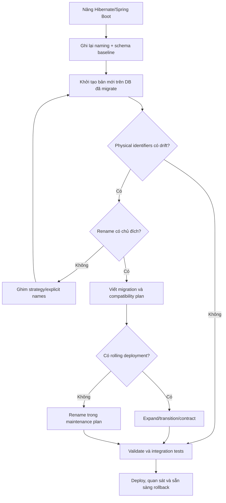

# Naming strategy và tránh đổi tên ngoài dự kiến khi nâng cấp Hibernate

Một ứng dụng Hibernate có thể chạy ổn định nhiều năm với các bảng `purchase_order`, `order_item` và cột `customer_id`. Sau khi nâng Spring Boot, Hibernate ORM hoặc thay cấu hình naming strategy, ứng dụng bất ngờ sinh SQL tới `purchase_orders`, `order_item_id` hay `customerId`. Database vẫn giữ tên cũ; chỉ có **mô hình tên mà Hibernate kỳ vọng đã thay đổi**. Hậu quả là lỗi “relation/table/column does not exist”, schema validation thất bại, hoặc — nghiêm trọng hơn — công cụ schema update tự tạo object mới, khiến dữ liệu cũ dường như biến mất.

Chủ đề này cần phân biệt:

1. **Logical name:** tên do mapping cung cấp hoặc Hibernate suy ra.
2. **ImplicitNamingStrategy:** cách suy ra tên khi mapping không ghi tường minh.
3. **PhysicalNamingStrategy:** cách chuyển logical identifiers sang tên vật lý.
4. **Database identifier rules:** quoting, case folding, reserved words và giới hạn chiều dài.
5. **Schema migration:** cách thay đổi cơ sở dữ liệu thật, không phải chỉ thay annotations.
6. **Upgrade compatibility:** cách giữ tên bảng, cột, khóa ngoại, sequence và các object khác ổn định qua các phiên bản Hibernate/Spring Boot.

Nguyên tắc xuyên suốt: **tên object database là một phần của hợp đồng dữ liệu giữa ứng dụng và schema. Không để nâng cấp thư viện âm thầm thay đổi hợp đồng đó.**

## 1. Vì sao Hibernate cần naming strategy?

Java thường dùng PascalCase cho class và camelCase cho fields. Database nhiều dự án lại dùng lowercase snake_case.

| Java | Database theo một convention phổ biến |
|---|---|
| `PurchaseOrder` | `purchase_order` |
| `createdAt` | `created_at` |
| `customerId` | `customer_id` |
| `OrderLine` | `order_line` |
| `billingAddress` | `billing_address` |

Không phải mọi tên đều được ghi trong annotations:

```java
@Entity
public class PurchaseOrder {

    @Id
    private Long id;

    private Instant createdAt;

    @ManyToOne(fetch = FetchType.LAZY)
    private Customer customer;
}
```

Không thể kết luận chắc chắn table cuối cùng tên `PurchaseOrder`, `purchase_order` hay `purchase_orders` nếu chưa biết naming strategies và Hibernate bootstrap configuration. Tương tự, tên FK association phụ thuộc implicit naming cùng referenced PK column và physical transformation.

Cần phân biệt tên Hibernate định dùng trong SQL với tên database thực đang có. **Đổi naming strategy không tự RENAME TABLE hoặc RENAME COLUMN ở database.**

## 2. Hai giai đoạn: logical rồi physical

```text
Entity class / @Table / @Column / @JoinColumn ...
                     |
                     v
              Logical identifier
                ^           ^
                |           |
    Explicit annotation     |
                  ImplicitNamingStrategy
                  (chỉ khi thiếu tên)
                     |
                     v
             PhysicalNamingStrategy
                     |
                     v
              Physical identifier
                     |
                     v
          SQL do Dialect/database xử lý
```

- `ImplicitNamingStrategy` trả lời: **“Tên logical nên là gì nếu chưa khai báo?”**
- `PhysicalNamingStrategy` trả lời: **“Logical identifier này thành identifier vật lý nào?”**

Một chiến lược không thể được thay bằng chiến lược kia. Đổi implicit strategy thường tác động nhiều nhất đến tên thiếu annotation; đổi physical strategy có thể tác động cả tên explicit.

## 3. Ví dụ suy ra tên khi không có annotations

```java
@Entity
public class CustomerOrder {

    @Id
    private Long orderId;

    private Instant submittedAt;
}
```

Giả sử implicit naming chọn `CustomerOrder`, `orderId` và `submittedAt`; physical naming đổi camelCase/PascalCase thành lowercase snake_case:

| Java element | Logical identifier | Physical identifier |
|---|---|---|
| Class `CustomerOrder` | `CustomerOrder` | `customer_order` |
| Property `orderId` | `orderId` | `order_id` |
| Property `submittedAt` | `submittedAt` | `submitted_at` |

Đây là **kết quả theo giả định cấu hình**. Hibernate core với standard physical strategy không mặc nhiên biến mọi PascalCase thành snake_case; còn Spring Boot có thể áp dụng strategy khác theo version.

## 4. Explicit name không nhất thiết bỏ qua physical strategy

```java
@Entity
@Table(name = "OrderHeader")
public class PurchaseOrder {

    @Id
    @Column(name = "OrderID")
    private Long id;

    @Column(name = "SubmittedAt")
    private Instant submittedAt;
}
```

Annotation cung cấp tên logical, nhưng một physical strategy có thể chuyển:

```text
@Table("OrderHeader")
     -> logical OrderHeader
     -> physical order_header

@Column("SubmittedAt")
     -> logical SubmittedAt
     -> physical submitted_at
```

`OrderID` có thể được chuyển thành `order_id` hoặc dạng khác tùy thuật toán xử lý acronym. Vì vậy, **đã có `@Column(name=...)` không đồng nghĩa chắc chắn identifier SQL bằng nguyên chuỗi đó**.

Nếu muốn giữ tên physical đúng từng ký tự, chọn physical strategy phù hợp và kiểm tra generated SQL. Quoted identifiers cũng có tác dụng riêng nhưng không phải cơ chế universal buộc mọi custom strategy bỏ qua biến đổi.

## 5. Các API naming chính của Hibernate

Các interface/class quen thuộc trong `org.hibernate.boot.model.naming` gồm:

```java
org.hibernate.boot.model.naming.ImplicitNamingStrategy
org.hibernate.boot.model.naming.PhysicalNamingStrategy
org.hibernate.boot.model.naming.Identifier
org.hibernate.boot.model.naming.ImplicitNamingStrategyJpaCompliantImpl
org.hibernate.boot.model.naming.PhysicalNamingStrategyStandardImpl
```

Ngoài ra, tùy phiên bản có:

- `ImplicitNamingStrategyLegacyJpaImpl`.
- `ImplicitNamingStrategyLegacyHbmImpl`.
- `ImplicitNamingStrategyComponentPathImpl`.
- `CamelCaseToUnderscoresNamingStrategy`.

Không giả định mọi class tồn tại với cùng fully qualified name trong mọi Hibernate major version. Khi nâng cấp, đối chiếu dependency và Javadocs của phiên bản đích.

## 6. ImplicitNamingStrategy quyết định những gì?

Nó có thể suy ra logical identifiers cho:

- Primary table của entity.
- Basic attribute columns.
- Join columns của associations.
- Join tables many-to-many.
- Element collection tables và columns.
- Các mapping paths và implicit constraint names theo API liên quan.

Ví dụ:

```java
@Entity
public class Customer {
    @Id
    private Long id;
}

@Entity
public class PurchaseOrder {

    @Id
    private Long id;

    @ManyToOne
    private Customer customer;
}
```

Khi thiếu `@JoinColumn`, JPA naming conventions thường dựa trên association property `customer` và referenced identifier column `id`. Việc ghép tên có thể tạo logical identifier tương tự `customer_id`; physical strategy sau đó tiếp tục xử lý tên.

Đổi tên PK của Customer hoặc đổi association property có thể khiến implicit join column đổi theo. Với composite keys, nhiều join columns và embedded attributes, ảnh hưởng càng khó thấy hơn.

## 7. Legacy implicit naming và migration giữa các phiên bản

Một dự án legacy có thể dùng `ImplicitNamingStrategyLegacyJpaImpl` hoặc `ImplicitNamingStrategyLegacyHbmImpl`, trong khi bản mới dùng chiến lược JPA compliant. Các quy tắc suy ra join table, foreign-key column hoặc collection names có thể khác.

Ví dụ tình huống giả định:

```text
Old implicit strategy:
    customer_products

New implicit strategy:
    customers_products

Database:
    chỉ có customer_products
```

Khi đó Hibernate mới có thể query tên join table không tồn tại. Đây là ví dụ của hiện tượng, **không phải bảng chuyển đổi default chính xác cho tất cả versions**.

Giải pháp:

1. Xác định effective implicit strategy trước upgrade.
2. Kiểm kê mappings phụ thuộc implicit names.
3. So sánh physical schema mappings cũ và mới.
4. Muốn giữ schema: ghim strategy tương thích hoặc thêm explicit names.
5. Muốn đổi schema: thực hiện migration có chủ đích và test.

## 8. PhysicalNamingStrategyStandardImpl và case folding

`PhysicalNamingStrategyStandardImpl` về cơ bản giữ logical identifiers như đã nhận, thay vì tự sinh snake_case.

Nếu logical table là `CustomerOrder`, physical strategy standard thường giữ text `CustomerOrder`. Nhưng database còn có quy tắc parse unquoted names:

- PostgreSQL thường fold unquoted identifiers sang lowercase.
- Oracle thường fold unquoted identifiers sang uppercase.
- MySQL có behavior về table casing liên quan OS và `lower_case_table_names`.
- SQL Server có behavior về case sensitivity theo collation/config.

Vì vậy, **Hibernate giữ nguyên text** không nhất thiết đồng nghĩa **database catalog lưu đúng cùng case**. Để hiểu lỗi tên bảng, cần biết cả naming strategy lẫn quoting/case rules của DBMS.

## 9. CamelCaseToUnderscoresNamingStrategy và tên acronym

Trong những Hibernate versions hỗ trợ, `CamelCaseToUnderscoresNamingStrategy` cung cấp kiểu chuyển đổi camelCase/PascalCase sang underscore convention.

Ví dụ property:

```properties
hibernate.physical_naming_strategy=org.hibernate.boot.model.naming.CamelCaseToUnderscoresNamingStrategy
```

Nhưng không nên mặc định implementation này có ở Hibernate versions cũ. Cần kiểm tra thuật toán cụ thể cho các tên:

```text
firstName
customerID
URLValue
HTTPStatus
already_snake_case
XML2Parser
```

Các chiến lược snake_case khác nhau có thể cho output khác nhau ở acronym, số, ký tự Unicode hoặc quoted names. Spring Boot và Hibernate core cũng có thể có implementations/defaults khác nhau.

**Test `firstName` → `first_name` là chưa đủ để kết luận strategy mới giống strategy cũ.**

## 10. Spring Boot default khác Hibernate core default

Một ứng dụng bootstrap Hibernate trực tiếp có thể dùng physical strategy khác ứng dụng được Spring Boot auto-configure, dù entity classes giống hệt.

Effective configuration còn chịu ảnh hưởng:

- Spring Boot và Hibernate major versions.
- `spring.jpa.hibernate.naming.*`.
- `spring.jpa.properties.hibernate.*`.
- `HibernatePropertiesCustomizer`.
- JPA persistence-unit properties.
- Profile-specific overrides.
- Environment variables và deployment configuration.
- Library auto-configuration.

Trước nâng cấp, ghi rõ:

```text
Spring Boot version:
Hibernate ORM version:
ImplicitNamingStrategy:
PhysicalNamingStrategy:
Dialect:
DDL setting:
Identifier quoting setting:
ID generator / implicit sequence naming:
```

Sau upgrade, kiểm tra **giá trị thực sự có hiệu lực** thay vì chỉ nhìn một file `application.yml`. Một environment variable hoặc customizer có thể thay thế cấu hình trong file.

## 11. Cấu hình Hibernate thuần

Ví dụ nếu muốn dùng các strategies cụ thể:

```properties
hibernate.implicit_naming_strategy=org.hibernate.boot.model.naming.ImplicitNamingStrategyJpaCompliantImpl
hibernate.physical_naming_strategy=org.hibernate.boot.model.naming.PhysicalNamingStrategyStandardImpl
```

Cấu hình này giúp không phụ thuộc vào default bất chợt. Nhưng chỉ hợp lệ nếu class names/properties đúng với Hibernate version đang dùng.

Không đổi cả hai strategies cùng lúc trong production chỉ vì muốn sửa tên một column. Hãy tìm nguyên nhân mapping và chỉ thay phạm vi cần thiết.

## 12. Cấu hình Spring Boot

Hai hướng cấu hình thường gặp:

```properties
spring.jpa.hibernate.naming.implicit-strategy=org.hibernate.boot.model.naming.ImplicitNamingStrategyJpaCompliantImpl
spring.jpa.hibernate.naming.physical-strategy=org.hibernate.boot.model.naming.PhysicalNamingStrategyStandardImpl
```

Hoặc chuyển trực tiếp Hibernate settings:

```properties
spring.jpa.properties.hibernate.implicit_naming_strategy=org.hibernate.boot.model.naming.ImplicitNamingStrategyJpaCompliantImpl
spring.jpa.properties.hibernate.physical_naming_strategy=org.hibernate.boot.model.naming.PhysicalNamingStrategyStandardImpl
```

Chọn **một nơi authoritative** cho mỗi setting. Nếu cấu hình trùng với giá trị khác nhau, phải kiểm tra precedence trong Spring Boot version đang chạy.

Hãy test cả profile dev, test, staging, production. Một H2 local database có khả năng chấp nhận identifier khác PostgreSQL production.

## 13. Một custom PhysicalNamingStrategy

Khi organization cần convention đặc thù, có thể implement interface. Ví dụ minh họa dùng snake_case cho unquoted identifiers và giữ quoted identifiers nguyên vẹn:

```java
import java.util.Locale;
import org.hibernate.boot.model.naming.Identifier;
import org.hibernate.boot.model.naming.PhysicalNamingStrategy;
import org.hibernate.engine.jdbc.env.spi.JdbcEnvironment;

public final class CompanyNamingStrategy
        implements PhysicalNamingStrategy {

    private Identifier convert(Identifier id) {
        if (id == null || id.isQuoted()) {
            return id;
        }
        String snake = id.getText()
            .replaceAll("([A-Z]+)([A-Z][a-z])", "$1_$2")
            .replaceAll("([a-z0-9])([A-Z])", "$1_$2")
            .toLowerCase(Locale.ROOT);

        return Identifier.toIdentifier(snake, false);
    }

    @Override
    public Identifier toPhysicalCatalogName(
            Identifier name, JdbcEnvironment env) {
        return convert(name);
    }

    @Override
    public Identifier toPhysicalSchemaName(
            Identifier name, JdbcEnvironment env) {
        return convert(name);
    }

    @Override
    public Identifier toPhysicalTableName(
            Identifier name, JdbcEnvironment env) {
        return convert(name);
    }

    @Override
    public Identifier toPhysicalSequenceName(
            Identifier name, JdbcEnvironment env) {
        return convert(name);
    }

    @Override
    public Identifier toPhysicalColumnName(
            Identifier name, JdbcEnvironment env) {
        return convert(name);
    }
}
```

Đây là một **implementation minh họa**. Nó chưa xử lý va chạm tên, reserved words, độ dài identifiers, acronym convention riêng của tổ chức hoặc dialect-specific rules.

Khi xây custom strategy:

- Nhận và trả `Identifier` thay vì làm mất flag `isQuoted()`.
- Xử lý `null`.
- Dùng `Locale.ROOT` thay default locale.
- Không tự pluralize tên nếu không có contract.
- Test acronym, lowercase/uppercase, Unicode, names có underscore sẵn.
- Bảo đảm hai logical names khác nhau không trùng physical name ngoài ý muốn.
- Chú ý các method schema/catalog để tránh vô tình chuyển namespace.

Nếu strategy có dùng `JdbcEnvironment`, test phải cung cấp môi trường đúng; không giả định mọi implementation chấp nhận `null`.

## 14. Naming strategy phải ổn định qua build và môi trường

Physical naming tốt phải tạo cùng output cho cùng input bất kể:

- Máy developer hay CI.
- Locale hệ điều hành.
- Timezone.
- Thứ tự class scanning.
- Thứ tự các entity được khởi tạo.
- Node A hoặc Node B trong cluster.
- Build mới có cùng version đã ghim.

Tránh generator dựa vào runtime counters, môi trường ngẫu nhiên hoặc biến đổi case locale-dependent.

Một lỗi collision:

```java
private String orderID;
private String orderId;
```

Hai property có thể cùng thành `order_id` tùy thuật toán snake_case. Hibernate mapping có thể thất bại hoặc hai fields nhắm cùng physical column.

**Naming strategy là phép biến đổi tên, nhưng phải được thiết kế như một phần của schema contract có khả năng kiểm thử.**

## 15. Naming strategy không phải schema migration

Đổi physical strategy từ standard sang snake_case:

```text
Trước:
  Hibernate dùng table PurchaseOrder

Sau:
  Hibernate dùng table purchase_order

Database:
  vẫn tồn tại PurchaseOrder, chưa RENAME
```

Nâng cấp này **không tự đổi tên database table**. Nếu bật Hibernate `hbm2ddl.auto=update`, Hibernate có thể coi table mới là object thiếu rồi cố tạo nó, để dữ liệu thật ở bảng cũ.

Hậu quả:

- Bảng mới rỗng làm ứng dụng tưởng mất dữ liệu.
- FK/indexes vẫn gắn với bảng cũ.
- ETL hoặc báo cáo tiếp tục tham chiếu tên cũ.
- Rollback Java binary không đảo ngược DDL đã chạy.
- Dữ liệu dễ bị ghi sang hai bảng khác nhau.

Giải pháp phải là **giữ physical names cũ** hoặc **chủ động viết migration**. Không để auto-update quyết định tên mới.

## 16. Hibernate schema management: validate, update, create

Các chế độ schema management quen thuộc:

| Chế độ | Công dụng | Nhận xét khi upgrade |
|---|---|---|
| `none` | Không tác động schema | Cần migration/validation độc lập |
| `validate` | Kiểm tra một số mapping/schema expectations | Hữu ích phát hiện tên thiếu |
| `update` | Cố chỉnh schema theo metadata | Không an toàn để rename production |
| `create` | Tạo schema từ mapping | Không dùng với dữ liệu production |
| `create-drop` | Tạo và drop theo lifecycle | Chỉ phù hợp test/dev được kiểm soát |

Cấu hình thường gặp:

```properties
spring.jpa.hibernate.ddl-auto=validate
```

Hoặc Hibernate thuần:

```properties
hibernate.hbm2ddl.auto=validate
```

`validate` không phải schema diff đầy đủ cho mọi indexes, unique constraints, FK names, triggers, procedures, grants hoặc sequence settings. Vì vậy **validate pass không có nghĩa mọi DDL object giống nhau hoàn toàn**.

Đối với production, dùng Flyway/Liquibase hoặc DB migration quy trình tương đương làm nguồn quản lý schema; Hibernate validate là lớp phát hiện mapping drift.

## 17. Tác động tới join columns

```java
@Entity
public class OrderLine {

    @Id
    private Long id;

    @ManyToOne(fetch = FetchType.LAZY)
    private PurchaseOrder purchaseOrder;
}
```

Không có `@JoinColumn`, tên FK column phụ thuộc implicit naming và referenced PK column. Đổi association name từ `purchaseOrder` sang `order` có thể đổi tên implicit column ngay cả khi database schema chưa được sửa.

Giữ tên physical bằng explicit mapping:

```java
@ManyToOne(fetch = FetchType.LAZY)
@JoinColumn(
    name = "purchase_order_id",
    referencedColumnName = "id",
    foreignKey = @ForeignKey(name = "fk_order_line_purchase_order")
)
private PurchaseOrder purchaseOrder;
```

Vẫn phải xác minh physical strategy có biến đổi các tên literal hay không.

Với composite primary keys, dùng `@JoinColumns` để xác định đầy đủ cặp columns. Một refactor tên field hoặc embedded ID có thể ảnh hưởng implicit column naming nhiều nơi.

## 18. Join tables trong many-to-many

```java
@Entity
public class Student {

    @Id
    private Long id;

    @ManyToMany
    private Set<Course> courses = new HashSet<>();
}
```

Hibernate cần suy ra tên join table và cả hai foreign-key columns. Nếu naming strategy đổi, không chỉ một table mà nhiều tên có thể đổi.

Một mapping rõ ràng:

```java
@ManyToMany
@JoinTable(
    name = "student_courses",
    joinColumns = @JoinColumn(
        name = "student_id",
        referencedColumnName = "id"
    ),
    inverseJoinColumns = @JoinColumn(
        name = "course_id",
        referencedColumnName = "id"
    )
)
private Set<Course> courses = new HashSet<>();
```

Bên `mappedBy` không nên tự khai báo thêm một join table cạnh tranh. Owner association phải được xác định đúng để Hibernate không cố mapping nhầm relationship.

Khi bảng join đã có dữ liệu, đổi tên bảng/cột là data migration thật, không phải chỉ đổi Java annotations.

## 19. ElementCollection và collection tables

```java
@Entity
public class Customer {

    @Id
    private Long id;

    @ElementCollection
    private Set<String> tags = new HashSet<>();
}
```

Nếu không có `@CollectionTable`/`@Column`, Hibernate suy ra table, owner join column và value column. Để giữ schema:

```java
@ElementCollection
@CollectionTable(
    name = "customer_tags",
    joinColumns = @JoinColumn(name = "customer_id")
)
@Column(name = "tag_value", nullable = false)
private Set<String> tags = new HashSet<>();
```

Các annotations như `@OrderColumn` và `@MapKeyColumn` cũng có thể dùng implicit names. Nếu đã có column `position_index`, cần đặt `@OrderColumn(name="position_index")` nếu phù hợp.

## 20. Embeddables và AttributeOverride

Một embedded type có thể được dùng nhiều lần:

```java
@Embeddable
public class Address {
    private String city;
    private String postalCode;
}

@Entity
public class Customer {

    @Id
    private Long id;

    @Embedded
    private Address billingAddress;

    @Embedded
    private Address shippingAddress;
}
```

Cả hai embedded values có property `city` và `postalCode`. Nếu để implicit names, mapping có thể collision hoặc cần implicit naming strategy có component path. Trong những Hibernate versions phù hợp, `ImplicitNamingStrategyComponentPathImpl` là một lựa chọn, nhưng phải kiểm tra compatibility.

Mapping explicit:

```java
@Embedded
@AttributeOverrides({
    @AttributeOverride(
        name = "city",
        column = @Column(name = "billing_city")
    ),
    @AttributeOverride(
        name = "postalCode",
        column = @Column(name = "billing_postal_code")
    )
})
private Address billingAddress;

@Embedded
@AttributeOverrides({
    @AttributeOverride(
        name = "city",
        column = @Column(name = "shipping_city")
    ),
    @AttributeOverride(
        name = "postalCode",
        column = @Column(name = "shipping_postal_code")
    )
})
private Address shippingAddress;
```

Với associations trong embeddables, `@AssociationOverride` có thể cần để kiểm soát join columns.

## 21. Secondary tables và inheritance

Những mapping thường bị bỏ sót trong schema diff:

- `@SecondaryTable`/`@SecondaryTables`.
- `@PrimaryKeyJoinColumn`.
- `@Inheritance(strategy = JOINED)`.
- `@DiscriminatorColumn`.
- `TABLE_PER_CLASS` entities.
- Association/collection tables của subtypes.

Ví dụ:

```java
@Entity
@Table(name = "employees")
@SecondaryTable(
    name = "employee_details",
    pkJoinColumns = @PrimaryKeyJoinColumn(
        name = "employee_id",
        referencedColumnName = "id"
    )
)
public class Employee {

    @Id
    private Long id;

    @Column(table = "employee_details", name = "passport_no")
    private String passportNo;
}
```

Nếu physical strategy đổi, cả hai tables và primary-key join column đều cần kiểm tra. Với `JOINED` inheritance, sai tên subclass table có thể khiến một polymorphic query thất bại ở JOIN, khó phát hiện nếu chỉ test root entity có dữ liệu kiểu base.

## 22. Index, unique và foreign-key constraint names

Các tên constraint/index là một phần schema:

```java
@Entity
@Table(
    name = "users",
    uniqueConstraints = @UniqueConstraint(
        name = "uk_users_email",
        columnNames = "email"
    ),
    indexes = @Index(
        name = "ix_users_status_created",
        columnList = "status, created_at"
    )
)
public class UserAccount {

    @Id
    private Long id;

    @Column(name = "email")
    private String email;

    @Column(name = "status")
    private String status;

    @Column(name = "created_at")
    private Instant createdAt;
}
```

`@UniqueConstraint(name=...)`, `@Index(name=...)` và `@ForeignKey(name=...)` cho phép chỉ định DDL names. Tuy nhiên, generated constraint naming, hashing, dialect quoting và database normalization khác nhau giữa phiên bản và provider.

Một schema diff có thể đề xuất:

```text
DROP CONSTRAINT FK_OLD_HASH
ADD CONSTRAINT fk_order_customer
```

ngay cả khi định nghĩa FK tương đương. Trên bảng lớn, drop/recreate FK có thể khóa dữ liệu hoặc quét validation tốn kém. Cần phân biệt **rename cosmetic** với thay đổi referential semantics thật.

## 23. @Index.columnList và physical names

```java
@Table(
    name = "purchase_orders",
    indexes = @Index(
        name = "ix_orders_customer_created",
        columnList = "customer_id, created_at"
    )
)
```

Index phải trỏ đúng physical columns trong database. Nếu mapping và naming strategy đổi cột sang tên khác, annotation trên hoặc migration DDL có thể sai.

Khi schema được quản lý bằng Flyway/Liquibase, indexes có thể được định nghĩa ở migration. Không nên để annotations và migration scripts mô tả hai schemas khác nhau rồi kỳ vọng Hibernate tự giải quyết.

## 24. Hibernate 5 → 6: thay đổi implicit sequence naming

Một thay đổi đáng chú ý khi nâng Hibernate 5 lên Hibernate 6 là **tên implicit database sequence** trong một số generator configurations.

Một số ứng dụng Hibernate 5 dùng `hibernate_sequence` mặc định cho nhiều entities khi sequence-based ID generation không khai báo rõ tên sequence. Trong Hibernate 6, quy tắc mặc định cho implicit database sequence có thể chuyển sang sequence theo từng entity hierarchy.

Ví dụ minh họa:

```text
Cũ: hibernate_sequence

Mới:
  Product_SEQ
  Customer_SEQ
  PurchaseOrder_SEQ
```

Tên chính xác phụ thuộc `@GeneratedValue`, Dialect, implicit database object naming strategy và physical naming. Không giả định mọi project đều gặp đúng tên trên.

### Hậu quả

- INSERT báo “sequence does not exist”.
- Startup schema validation thất bại.
- Auto-update tạo thêm sequence mới.
- ID allocation không tương thích với dữ liệu cũ.
- Khi hai versions chạy song song, có nguy cơ các generators dùng các nguồn ID khác nhau.

### Cấu hình compatibility

Một số Hibernate 6 versions hỗ trợ:

```properties
hibernate.id.db_structure_naming_strategy=legacy
```

Tùy version, có lựa chọn strategy khác. Hãy đọc migration guide của phiên bản đích, không coi `legacy` là giải pháp universal. **Sequence naming là một trục khác với entity/table physical naming.**

## 25. Explicit SequenceGenerator và database increment

Một mapping ổn định:

```java
@Entity
public class Product {

    @Id
    @GeneratedValue(
        strategy = GenerationType.SEQUENCE,
        generator = "product_id_generator"
    )
    @SequenceGenerator(
        name = "product_id_generator",
        sequenceName = "product_id_seq",
        allocationSize = 50
    )
    private Long id;
}
```

Đối chiếu database:

- Sequence `product_id_seq` có tồn tại trong schema đúng không?
- Hibernate allocation optimizer tương thích DB sequence increment không?
- Current value/range có an toàn so với IDs đang tồn tại không?
- External writers có dùng cùng sequence không?
- Khi rolling deploy, hai versions có chia sẻ generator semantics không?

**Không tự đặt sequence value bằng `MAX(id)+1` nếu chưa hiểu pooled allocation semantics.** Khi dùng pooled optimizer và nhiều app nodes, một chỉnh sửa naïve có thể tạo ID collisions hoặc gaps. Tên sequence explicit cũng có thể đi qua physical naming transformation tùy implementation.

## 26. @GeneratedValue(AUTO) không có tên sequence cố định

`GenerationType.AUTO` để provider chọn cơ chế sinh identifier phù hợp. Hibernate có thể chọn sequence, identity hoặc cơ chế khác tùy DBMS, mapping và version.

Vì thế, khi nâng cấp:

- Kiểm tra generator strategy thực tế.
- Kiểm tra SQL phát sinh ở INSERT.
- Kiểm tra tên sequence/table generator nếu có.
- So sánh behavior với dữ liệu hiện có.
- Không mặc định mọi `AUTO` dùng cùng `hibernate_sequence`.

Với ứng dụng lâu năm, nếu generator là một phần contract chia sẻ với jobs hoặc services khác, explicit `@SequenceGenerator`/`@TableGenerator` thường dễ kiểm soát hơn.

## 27. Quoted identifiers và reserved words

Tên như `order`, `user`, `group` có thể là reserved words hoặc keywords đặc thù trong DBMS.

Mapping:

```java
@Entity
@Table(name = "order")
public class PurchaseOrder {
    @Id
    private Long id;
}
```

có thể tạo SQL sai nếu không được quote.

Hibernate hỗ trợ cơ chế quote identifier trong mapping, ví dụ dùng backtick annotation theo Hibernate:

```java
@Entity
@Table(name = "`order`")
public class PurchaseOrder {
    @Id
    private Long id;
}
```

Dấu backtick trong annotation là cách đánh dấu quoted identifier của Hibernate, không có nghĩa SQL trên mọi DBMS dùng backticks. Dialect chọn quoting đúng cú pháp target database.

### Quoted và unquoted khác nhau

Với PostgreSQL:

```sql
-- Unquoted identifier thường được lowercase:
select * from CustomerOrder;

-- Quoted identifier giữ đúng case:
select * from "CustomerOrder";
```

Hai câu trên có thể tìm hai database objects khác nhau.

### Global quoting

Một setting Hibernate trong một số versions:

```properties
hibernate.globally_quoted_identifiers=true
```

Bật global quoting có thể làm Hibernate không tìm thấy các tables trước đây được tạo dưới unquoted lowercase names. Nó còn ảnh hưởng schema/catalog, column definitions và migration scripts. Đừng bật global quoting trên production chỉ để sửa một keyword.

## 28. Giới hạn độ dài tên và collisions

DBMS giới hạn độ dài identifiers. PostgreSQL thông thường giới hạn 63 bytes cho identifiers ở cấu hình phổ biến; DBMS khác có quy định riêng theo version.

Tên rất dài:

```text
foreign_key_purchase_order_line_product_catalog_variant_composite_identifier
```

có thể bị DBMS truncate hoặc bị ORM/DDL generator xử lý theo quy tắc riêng. Nếu hai tên sau truncate trùng, constraint creation thất bại.

Rủi ro khác:

- Tên Unicode có byte length khác character count.
- Case folding làm hai identifiers trở thành cùng tên.
- Snake_case converter làm `orderID` và `orderId` trùng.
- FK/index names tự sinh bằng hash khác giữa tool versions.

Thiết kế convention giới hạn tên, dùng explicit short names cho constraints quan trọng và xác nhận trong database catalog.

## 29. Composite keys và @MapsId

```java
@Embeddable
public class OrderLineId implements Serializable {
    private Long orderId;
    private Integer lineNo;
}

@Entity
public class OrderLine {

    @EmbeddedId
    private OrderLineId id;

    @MapsId("orderId")
    @ManyToOne
    @JoinColumn(name = "order_id")
    private PurchaseOrder order;
}
```

Composite IDs khiến join/PK columns có quan hệ chặt chẽ. Đổi Java property hoặc implicit strategy có thể ảnh hưởng nhiều cột cùng lúc.

Cần kiểm tra:

- Mọi thành phần composite PK.
- Referenced PK columns của FK.
- Order của join columns.
- Indexes cho composite key.
- Physical column names và constraints.
- Không tạo hai cột khác nhau cho cùng physical key.

Đừng xem upgrade naming là thao tác cosmetic với composite-key mappings.

## 30. Phân biệt Java type, JPQL entity name và database table

```java
@Entity(name = "AccountUserEntity")
@Table(name = "users")
public class AccountUser {

    @Id
    private Long id;
}
```

Có ba tên:

- Java class: `AccountUser`.
- JPQL entity name: `AccountUserEntity`.
- Database table logical name: `users`, sau đó đi qua physical strategy.

Đổi Java class name có thể tác động implicit table name. Đổi `@Entity(name=...)` tác động JPQL query names, **không phải cơ chế đặt database table**.

Đối với code refactor:

```java
// Tên Java đổi, physical schema vẫn cố định.
@Entity
@Table(name = "users")
public class AccountUser {
    @Id
    private Long id;
}
```

Nếu giữ explicit table name, refactor Java có thể không cần migration. Ngược lại, bỏ annotation này trong một đợt cleanup có thể làm mapping trỏ sang tên khác.

## 31. Đổi Java field không bắt buộc đổi column

Trước refactor:

```java
@Column(name = "customer_id")
private Long customerId;
```

Sau:

```java
@Column(name = "customer_id")
private Long buyerId;
```

DB column vẫn có thể giữ `customer_id`, tùy physical naming transformation. Đây là cách refactor domain naming mà không làm data migration.

Nếu bỏ `@Column`:

```java
private Long buyerId;
```

Hibernate có thể dùng implicit name `buyerId` rồi physical name `buyer_id`. Việc xóa annotation đã trở thành schema-breaking change.

**Đừng “dọn” explicit annotations khỏi entity chỉ vì thấy tên gần giống convention hiện tại.**

## 32. Explicit names có phải luôn tốt hơn implicit không?

Với greenfield project, một convention ổn định giúp giảm nhiều annotations. Nhưng với schema đã dùng chung, external consumers hoặc migration scripts, physical names là một public contract.

Nên explicit cho:

- Bảng/column quan trọng có external SQL/reporting consumers.
- Join tables và join columns.
- Collection/secondary tables.
- Sequences và generators.
- Constraints/indexes có tác động vận hành.
- Inheritance mappings.
- Columns có tên ngoại lệ hoặc cần quoting.

Một hướng cân bằng:

1. Ghim naming strategies.
2. Dùng convention cho objects mới.
3. Dùng explicit names để bảo toàn legacy schema.
4. Không thay physical identifiers khi chỉ refactor Java.
5. Mọi đổi physical names phải có migration riêng.

## 33. Schema diff trước và sau upgrade

Có thể tổ chức so sánh:

```text
OLD Hibernate + old config
     |
     +--> export mapping/DDL snapshot
                     |
                     v
                Compare
                     ^
                     |
NEW Hibernate + new config
     |
     +--> export mapping/DDL snapshot
```

Các objects cần so:

- Catalog/schema names.
- Entity tables, columns, types và nullability.
- Join tables, collection tables, secondary tables.
- Composite keys, PK/FK, unique constraints.
- Index names và index columns.
- Sequences và identifier generator assumptions.
- Inheritance/discriminator mapping.
- Quoted/unquoted behavior.
- Default expressions/collations.

Mục tiêu không phải generated DDL byte-identical. Dialect có thể đổi formatting. Mục tiêu là xác định **physical schema contract có tương thích với dữ liệu hiện hữu không**.

## 34. Schema validation và integration tests

Trên một database test được tạo từ migrations production-equivalent:

1. Chạy tất cả Flyway/Liquibase migrations.
2. Khởi tạo Hibernate candidate với `ddl-auto=validate`.
3. Test persist/load entities có names explicit và implicit.
4. Test many-to-one, many-to-many, element collections.
5. Test composite keys và inheritance/secondary tables.
6. Test `@GeneratedValue`/sequences.
7. Capture SQL và quan sát physical identifiers.
8. Xác minh Hibernate không âm thầm tạo bảng/cột mới.
9. Đối chiếu database catalog với expected schema.
10. Test chính profile/config dùng production.

Nếu production là PostgreSQL, ưu tiên PostgreSQL trong integration test, chẳng hạn Testcontainers. H2 có thể không tái tạo được case folding/sequence/DDL behavior của engine production.

## 35. Một unit test cho custom physical naming

Với `CompanyNamingStrategy` ở trên:

```java
@Test
void convertsPascalCase() {
    var strategy = new CompanyNamingStrategy();

    Identifier result = strategy.toPhysicalTableName(
        Identifier.toIdentifier("PurchaseOrder"),
        null
    );

    assertEquals("purchase_order", result.getText());
}

@Test
void preservesQuotedName() {
    var strategy = new CompanyNamingStrategy();

    Identifier result = strategy.toPhysicalTableName(
        Identifier.toIdentifier("OrderHeader", true),
        null
    );

    assertEquals("OrderHeader", result.getText());
    assertTrue(result.isQuoted());
}
```

`null` cho `JdbcEnvironment` chỉ có thể chấp nhận trong ví dụ vì implementation trên không dùng nó. Custom strategy thật có thể cần Dialect/JdbcEnvironment nên phải test với metadata tương ứng.

Kiểm thử thêm:

```text
firstName          -> first_name
URLValue           -> url_value
already_snake_case -> already_snake_case
OrderID            -> order_id
quoted OrderID     -> OrderID
orderID/orderId    -> phát hiện collision nếu cùng result
```

Ngoài unit tests, integration tests mới chứng minh Hibernate metadata và DBMS xử lý kết quả đúng.

## 36. Flyway/Liquibase phải là nguồn thay đổi schema rõ ràng

Ví dụ migration rename trong PostgreSQL:

```sql
-- Chỉ minh họa khi rename là quyết định có chủ đích.
alter table purchase_order rename to purchase_orders;
alter table purchase_orders
    rename column created_at to submitted_at;
```

Không copy vào production mà không kiểm tra tên object thực tế, FK/index/triggers, quotes, privileges và downstream consumers.

Migration tốt cần:

- Có version riêng và được review.
- Test trên database clone với dữ liệu thực tế tương đương.
- Kiểm tra thứ tự deploy app/migration.
- Có rollback/roll-forward strategy.
- Không làm mất dữ liệu khi Hibernate version cũ vẫn đang chạy.
- Xem xét lock duration và table rewrite của DBMS.
- Xác nhận external SQL callers còn tương thích hoặc đã được chuyển.

Một annotation hoặc naming property **không thay thế migration script**.

## 37. Tách framework upgrade khỏi schema rename

Nâng một lúc Hibernate, Spring Boot, mapping conventions và DB schema làm phạm vi thay đổi quá rộng.

### Phase A — Nâng framework, giữ schema

- Ghim implicit/physical naming strategies.
- Giữ table/column names cũ qua explicit mappings khi cần.
- Giữ sequence/generator semantics.
- Chạy validate và integration tests.
- Không thực hiện rename chỉ để code “đẹp hơn”.

### Phase B — Rename có chủ đích

- Định nghĩa target physical names.
- Viết Flyway/Liquibase migration.
- Tìm external consumers.
- Xác định thời điểm chuyển application mappings.
- Thiết kế zero-downtime/rollback khi cần.
- Xác nhận permissions, indexes và dependencies.

Không phải lúc nào hai phase phải là hai release, nhưng tách rõ hai concerns giúp tìm nguyên nhân và giảm rủi ro.

## 38. Rolling deployment và expand-contract

Giả sử muốn đổi column `customerCode` thành `customer_code` trong khi blue/green deploy yêu cầu old/new versions chạy đồng thời.

Một mô hình:

```text
1. EXPAND:
   tạo cột mới, vẫn giữ cột cũ

2. TRANSITION:
   backfill dữ liệu và đồng bộ writes hai cột
   hoặc dùng DB view/trigger theo thiết kế đã kiểm chứng

3. SWITCH:
   app mới dùng customer_code
   app cũ tiếp tục dùng customerCode

4. CONTRACT:
   sau khi không còn app cũ, loại compatibility column
```

Expand-contract không phải lựa chọn bắt buộc cho mọi rename. Nếu có maintenance window và DBMS rename metadata nhanh, direct rename có thể đơn giản hơn. Nhưng **naming strategy không tự tạo khả năng backward compatibility khi hai application versions cùng dùng database**.

## 39. Rollback binary không rollback schema

Một release mới đổi table name qua migration. Nếu Java version mới gặp lỗi, chỉ rollback binary cũ có thể làm app cũ tìm table đã bị rename.

Vì vậy cần:

- Kế hoạch rollback DB hoặc roll-forward.
- Test version cũ trên expanded schema nếu cần rolling deploy.
- Backup/snapshot phù hợp chính sách.
- Không drop old columns/tables trước khi hết consumers.
- Không để `hbm2ddl.auto=update` tự thêm objects làm rollback khó đoán.

Một database migration đã commit có thể khó hoặc không thể đảo ngược hoàn toàn nếu có data conversion.

## 40. Case study: refactor association property

Ban đầu:

```java
@Entity
public class Invoice {

    @Id
    private Long id;

    @ManyToOne
    private Customer owner;
}
```

Database hiện có column `owner_id` do mapping cũ. Developer đổi property thành `billingCustomer`:

```java
@ManyToOne
private Customer billingCustomer;
```

Nếu không ghi `@JoinColumn`, Hibernate có thể kỳ vọng `billing_customer_id`. Refactor Java đã vô tình biến thành thay đổi DB.

Muốn giữ schema:

```java
@ManyToOne
@JoinColumn(name = "owner_id")
private Customer billingCustomer;
```

Muốn đổi tên DB thật:

- Viết migration `owner_id` → `billing_customer_id`.
- Cập nhật FK/index/queries và external callers.
- Cập nhật mapping theo deploy plan.
- Dùng compatibility migration nếu old/new app versions chạy cùng lúc.

## 41. Case study: sau nâng cấp xuất hiện bảng rỗng

Giả sử:

```text
Old app:
  logical UserProfile
  physical UserProfile

New app:
  physical user_profile

Database:
  đã có bảng cũ UserProfile với dữ liệu
```

Nếu auto-update schema được bật, Hibernate có thể cố tạo `user_profile` rỗng. Ứng dụng mới query bảng rỗng và người vận hành tưởng mất dữ liệu.

Điều tra:

1. Tắt schema auto-update trong môi trường đang phân tích.
2. Kiểm tra DB catalog: có hai tables khác nhau không?
3. Xem naming strategies trước/sau upgrade.
4. Xem generated SQL và DDL logs.
5. Xác định nguồn dữ liệu authoritative.
6. Khôi phục mapping tương thích hoặc triển khai migration an toàn.

Không vội copy hàng từ bảng cũ sang bảng mới khi chưa hiểu primary keys, foreign keys, sequences và đồng bộ writes.

## 42. Case study: mất sequence sau Hibernate 6 upgrade

```text
Database cũ:
  table orders
  sequence hibernate_sequence

Mapping:
  @GeneratedValue(strategy = SEQUENCE), không sequenceName

Sau upgrade:
  Hibernate kỳ vọng Order_SEQ hoặc tên mới tương đương
```

Kết quả có thể là lỗi lúc insert hoặc schema update tạo sequence mới với giá trị bắt đầu không phù hợp. Nếu một ứng dụng cũ và mới cùng ghi, việc dùng hai generators khác nhau càng nguy hiểm.

Cách xử lý:

- Ghim implicit generator naming strategy tương thích, hoặc explicit `sequenceName`.
- Kiểm tra DB sequence increment, allocationSize, optimizer.
- Căn sequence state theo semantics thực, không đoán.
- Test insert trên database clone có dữ liệu hiện hữu.
- Xác minh compatibility khi rolling deployment.

Đây là ví dụ vì sao chỉ so sánh table/column names là chưa đủ.

## 43. Các lỗi thường gặp

### “relation/table does not exist”

Kiểm tra physical table name, schema/search path, quoted/unquoted, Dialect, environment profile và database connection. Không kết luận dữ liệu đã bị xóa.

### “column does not exist”

Kiểm tra snake_case conversion, implicit FK naming, refactor Java field và quoted identifier case.

### “Sequence does not exist”

Kiểm tra Hibernate 6 implicit sequence naming, `@SequenceGenerator`, schema/permissions và generator config.

### “Đã có @Column nhưng vẫn bị đổi”

Explicit annotation tạo logical identifier; physical strategy vẫn có thể biến đổi tên đó.

### “Schema update tạo bảng/cột mới”

Dừng auto-update, so sánh mapping với DB; xử lý bằng compatible mapping hoặc migration chủ đích.

### “Schema validate pass mà FK/index sai”

Validation không đầy đủ cho mọi object. Dùng DB metadata và migration diff.

### “Dev pass nhưng production fail”

So sánh DBMS, identifier case sensitivity, configuration, migrations, schema, privileges và dialect.

### “Hai Java properties map chung column”

Custom snake_case conversion có thể collision; test naming strategy với acronym.

### “Refactor class làm đổi tên bảng”

Không có explicit `@Table` nên implicit table name phụ thuộc class name.

### “Foreign key bị drop/recreate dù semantics không đổi”

Constraint naming drift; phân biệt đổi tên cosmetic với thay đổi định nghĩa, đừng DDL rủi ro không cần thiết.

## 44. Checklist trước upgrade

| Nhóm | Cần kiểm tra |
|---|---|
| Versions | Hibernate ORM, Spring Boot, JDBC driver, DBMS |
| Effective config | Implicit strategy, physical strategy, Dialect, quoting |
| Core mappings | Table/column names explicit và implicit |
| Associations | Join columns, join tables, collection tables |
| Complex mappings | Embeddables, composites, inheritance, secondary tables |
| ID generators | Sequence names, allocationSize, increment/optimizer |
| Constraints | Primary key, foreign key, unique, index names/definitions |
| Case | Quoted/unquoted, DB case folding và filesystem rules |
| Migration | Flyway/Liquibase source of truth và deployed versions |
| DDL policy | Production không auto-create/update ngoài kiểm soát |
| Validation | Candidate app boot với existing migrated schema |
| Integration | CRUD, relationship và generator tests trên DBMS thật |
| Rollout | Old/new app compatibility, blue/green, rolling upgrade |
| Consumers | Reports, ETL, stored procedures, external services |
| Recovery | Rollback/roll-forward plan, backups và monitoring |

## 45. Sơ đồ quy trình quyết định



Một difference trong generated DDL không tự chứng minh migration đó là cần thiết. Phải quyết định drift là lỗi tương thích hay thay đổi được yêu cầu.

## 46. Naming convention cho dự án mới

Trước khi tạo schema mới, team nên thống nhất:

- Table names: singular/plural, lowercase snake_case.
- Column names: lowercase snake_case.
- Primary key convention: `id` hoặc `<entity>_id`.
- Foreign key columns: `<relationship>_id`.
- Join table naming: thứ tự owner/inverse ổn định.
- Sequence names: `<entity>_id_seq` nếu DBMS hỗ trợ.
- Prefix FK/unique/index: `fk_`, `uk_`, `ix_`.
- Giới hạn identifier length theo DBMS.
- Quy tắc xử lý acronym và collisions.
- Không dùng reserved words hoặc unnecessary case-sensitive quoting.
- Quyền sở hữu migration scripts và quy trình review.

Một convention không cần phải giống Hibernate default. Quan trọng là nó **ổn định, kiểm thử được và tương thích với schema đã triển khai**.

## 47. Tổng kết: giữ schema contract ổn định

Trong Hibernate:

- **ImplicitNamingStrategy** quyết định logical names khi thiếu annotations tường minh.
- **PhysicalNamingStrategy** biến logical names thành physical identifiers, có thể cả những tên khai báo explicit.
- **Database/Dialect** tiếp tục áp dụng quoting, casing và giới hạn identifier riêng.
- **Migration scripts** mới là nơi thay đổi schema thật một cách có chủ đích.

Những nguyên tắc quan trọng:

1. **Không dựa vào defaults không ghi nhận.** Hibernate core và Spring Boot có thể khác nhau qua versions.
2. **Explicit `@Table`/`@Column` chưa chắc cố định SQL name** nếu physical strategy vẫn biến đổi.
3. **Đổi Java class/property có thể làm đổi implicit schema** mà developer không chủ ý.
4. **Đánh giá toàn bộ object names**, không chỉ tables/columns: joins, collections, indexes, constraints, sequences.
5. **Nâng Hibernate 5→6 phải kiểm tra sequence naming và allocation semantics** khi dùng implicit generators.
6. **Quoting và DB case folding là vấn đề riêng**, đặc biệt với PostgreSQL, Oracle, MySQL trên các OS khác nhau.
7. **Không dùng `hbm2ddl.auto=update` làm công cụ rename production.**
8. **Ghim naming strategies hoặc explicit mappings để giữ compatibility** khi mục tiêu chỉ là upgrade framework.
9. **Khi thực sự đổi schema, dùng Flyway/Liquibase/DDL được review** cùng rollout/rollback plan.
10. **Chạy schema validation và integration tests với DBMS thật**, không suy luận an toàn từ annotations.
11. **Kiểm tra external consumers và rolling deployments** trước khi rename.
12. **Ưu tiên bảo toàn dữ liệu hơn đồng bộ tên theo phong cách mới** nếu không có lợi ích nghiệp vụ đủ lớn.

Hãy xem naming strategy như một phần của hợp đồng giữa Java application và relational database. Khi nâng Hibernate hoặc Spring Boot, mục tiêu mặc định là **không đổi các physical identifiers đã tồn tại**. Nếu muốn đổi tên, hãy thực hiện như một migration database được kiểm soát — không để thay đổi cấu hình ORM quyết định thay bạn.
