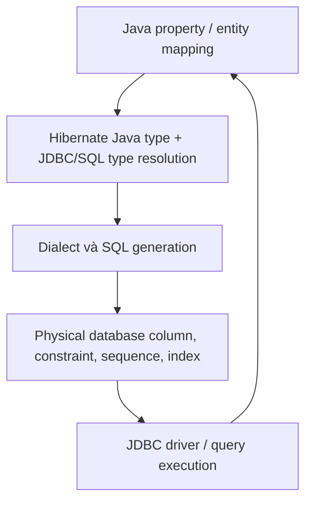
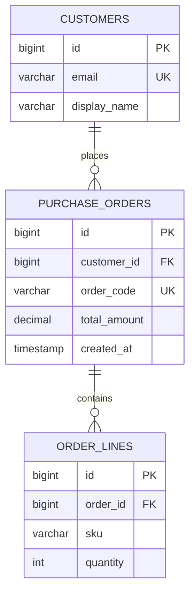
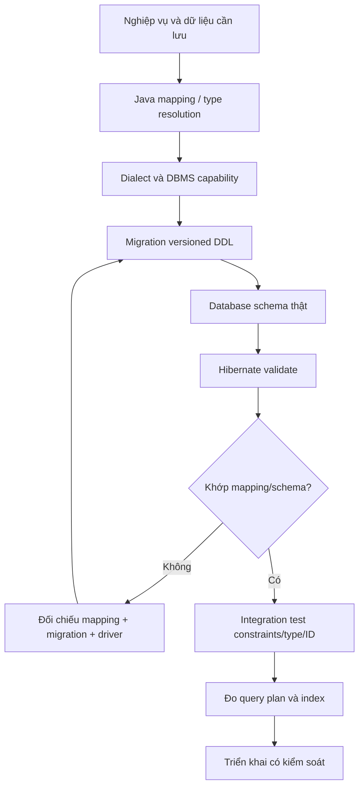

# Kiểu cột, sequence, ràng buộc, chỉ mục và khả năng của Dialect

Một entity Hibernate không tồn tại tách rời khỏi database. Khi Java khai báo `String`, `BigDecimal`, `UUID`, `Instant`, quan hệ `@ManyToOne` hay chiến lược `@GeneratedValue`, Hibernate phải chuyển những mô tả đó thành **kiểu dữ liệu SQL, khóa chính, khóa ngoại, sequence, constraints và câu lệnh phù hợp với DBMS**. Công việc này có phần được thực hiện qua **Dialect**, nhưng không phải mọi quyết định thiết kế schema đều có thể hoặc nên giao cho Hibernate tự động hóa.

Ví dụ:

```java
@Entity
@Table(name = "purchase_orders")
public class PurchaseOrder {
    @Id
    @GeneratedValue(strategy = GenerationType.SEQUENCE)
    private Long id;

    @Column(nullable = false, precision = 19, scale = 4)
    private BigDecimal total;

    @Column(nullable = false, length = 40, unique = true)
    private String orderCode;
}
```

Từ mapping này, Hibernate có thể đề xuất một bảng với cột khóa chính, một cột số thập phân, một cột chuỗi và một sequence. Tuy vậy, những câu hỏi quan trọng vẫn cần quyết định chủ động:

- `BigDecimal(19,4)` được lưu bằng `NUMERIC`, `DECIMAL` hay kiểu khác của database?
- Sequence có thực sự được DBMS hỗ trợ hay Hibernate phải dùng cơ chế ID khác?
- Giá trị `allocationSize` của `@SequenceGenerator` có khớp sequence trong database hay không?
- `unique=true` tạo constraint nào, tên gì, xử lý `NULL` như thế nào?
- Chỉ mục nào hỗ trợ truy vấn thường dùng và có phù hợp thứ tự cột không?
- Có thể nâng schema production bằng `ddl-auto=update` hay phải dùng migration versioned?
- Khi đổi từ PostgreSQL sang MySQL, DDL nào cần viết lại?
- Nếu Hibernate báo `Schema-validation: wrong column type`, có phải dữ liệu thực sự sai hay chỉ khác về representation?

Bài học trình bày cách suy luận từ Java mapping tới physical schema, khả năng và giới hạn của Hibernate Dialect, cùng phương pháp quản lý **schema evolution** an toàn bằng migration.

## 1. Ba tầng ánh xạ phải phân biệt

Một field Java đi qua nhiều tầng:



Ví dụ:

```java
@Column(precision = 19, scale = 4)
private BigDecimal totalAmount;
```

Tầng Java là `java.math.BigDecimal`. Hibernate chọn một mã/descriptor kiểu JDBC hoặc SQL phù hợp. Dialect dùng kiến thức về DBMS để chọn type name trong DDL, có thể tạo một cột `NUMERIC(19,4)`, `DECIMAL(19,4)` hoặc representation tương thích khác.

**Java type không đồng nghĩa SQL column type.** `String` có thể lưu trong `VARCHAR`, `CHAR`, `CLOB`, `NVARCHAR`, `TEXT`; `UUID` có thể lưu native UUID, binary hoặc character representation tùy mapping/Dialect.

### 1.1. Bốn nguồn định nghĩa schema

| Nguồn | Chịu trách nhiệm |
|---|---|
| Entity annotations và XML mapping | Mô tả entity, column, relationships, generators |
| Hibernate type system | Chọn Java/JDBC conversion và SQL type code |
| Dialect | Render DDL/SQL theo DBMS, các khả năng SQL và strategy |
| Migration scripts / DBA | Tạo và tiến hóa physical schema thực tế có kiểm soát |

Khi để Hibernate tự tạo schema, mapping và Dialect có ảnh hưởng mạnh đến DDL. Khi triển khai production với Flyway/Liquibase, **migration là bản ghi thay đổi schema thực tế**, còn Hibernate mapping phải tương thích với schema đó.

### 1.2. Schema generation không phải schema design

DDL tự sinh có thể tạo bảng và khóa theo mapping, nhưng không hiểu đầy đủ:

- Đặc điểm workload và index selectivity.
- Yêu cầu zero-downtime migration.
- Data backfill trong hàng triệu bản ghi.
- Legacy naming và dữ liệu bên ngoài ORM.
- Security, partitioning, replication, storage options.
- Foreign-key deferrability và các index chuyên biệt.
- Quy tắc chuyển đổi dữ liệu giữa các cột cũ/mới.

Dùng Hibernate schema generation cho khởi tạo môi trường thử nghiệm và đối chiếu mapping; không coi nó là một hệ thống migration production hoàn chỉnh.

## 2. Ví dụ nghiệp vụ thống nhất

Giả sử có `Customer`, `PurchaseOrder` và `OrderLine`:



Ví dụ mapping:

```java
@Entity
@Table(
    name = "customers",
    uniqueConstraints = {
        @UniqueConstraint(
            name = "uk_customers_email",
            columnNames = "email"
        )
    }
)
public class Customer {
    @Id
    @GeneratedValue(strategy = GenerationType.SEQUENCE,
                    generator = "customer_seq_gen")
    @SequenceGenerator(
        name = "customer_seq_gen",
        sequenceName = "customer_seq",
        allocationSize = 50
    )
    private Long id;

    @Column(nullable = false, length = 254)
    private String email;

    @Column(name = "display_name", nullable = false, length = 120)
    private String displayName;

    protected Customer() {}
}

@Entity
@Table(
    name = "purchase_orders",
    uniqueConstraints = {
        @UniqueConstraint(
            name = "uk_purchase_orders_code",
            columnNames = "order_code"
        )
    },
    indexes = {
        @Index(
            name = "ix_orders_customer_created",
            columnList = "customer_id, created_at"
        ),
        @Index(
            name = "ix_orders_status_created",
            columnList = "status, created_at"
        )
    }
)
public class PurchaseOrder {
    @Id
    @GeneratedValue(strategy = GenerationType.SEQUENCE,
                    generator = "purchase_order_seq_gen")
    @SequenceGenerator(
        name = "purchase_order_seq_gen",
        sequenceName = "purchase_order_seq",
        allocationSize = 50
    )
    private Long id;

    @Column(name = "order_code", nullable = false, length = 40)
    private String orderCode;

    @Enumerated(EnumType.STRING)
    @Column(name = "status", nullable = false, length = 24)
    private OrderStatus status;

    @Column(name = "total_amount",
            nullable = false, precision = 19, scale = 4)
    private BigDecimal totalAmount;

    @Column(name = "created_at", nullable = false)
    private Instant createdAt;

    @ManyToOne(fetch = FetchType.LAZY, optional = false)
    @JoinColumn(
        name = "customer_id",
        nullable = false,
        foreignKey = @ForeignKey(name = "fk_orders_customer")
    )
    private Customer customer;

    @OneToMany(mappedBy = "order", fetch = FetchType.LAZY)
    private List<OrderLine> lines = new ArrayList<>();

    protected PurchaseOrder() {}
}

@Entity
@Table(
    name = "order_lines",
    indexes = {
        @Index(
            name = "ix_order_lines_order",
            columnList = "order_id"
        )
    }
)
public class OrderLine {
    @Id
    @GeneratedValue(strategy = GenerationType.SEQUENCE,
                    generator = "order_line_seq_gen")
    @SequenceGenerator(
        name = "order_line_seq_gen",
        sequenceName = "order_line_seq",
        allocationSize = 50
    )
    private Long id;

    @ManyToOne(fetch = FetchType.LAZY, optional = false)
    @JoinColumn(
        name = "order_id",
        nullable = false,
        foreignKey = @ForeignKey(name = "fk_lines_order")
    )
    private PurchaseOrder order;

    @Column(nullable = false, length = 64)
    private String sku;

    @Column(nullable = false)
    private int quantity;

    protected OrderLine() {}
}
```

Mapping trên minh họa các công cụ JPA. Một ứng dụng thật cần getters, constructors/domain methods, transaction handling và các imports phù hợp; mỗi public entity thường nằm ở file riêng.

Không nên hiểu rằng script SQL tương đương chắc chắn giống nhau trên PostgreSQL, MySQL, Oracle và SQL Server. Phần tiếp theo sẽ chỉ ra những chỗ Dialect tạo khác biệt.

## 3. Kiểu cột: String, VARCHAR, CHAR, TEXT, CLOB

Hibernate nhìn `String` và metadata mapping để chọn kiểu SQL thích hợp.

### 3.1. @Column(length)

```java
@Column(name = "order_code", nullable = false, length = 40)
private String orderCode;
```

Trong nhiều DBMS, DDL có thể tương ứng:

```sql
order_code VARCHAR(40) NOT NULL
```

`length = 40` là yêu cầu độ dài cột theo mapping, không tự thay thế validation ở API/domain. Nó cũng không bảo đảm cơ chế đo độ dài chuỗi/Unicode giống nhau giữa DBMS: có hệ quản trị đếm ký tự, có trường hợp ràng buộc byte length hoặc phụ thuộc character set/collation.

### 3.2. @Column và Bean Validation khác nhau

```java
@NotBlank
@Size(max = 40)
@Column(nullable = false, length = 40)
private String orderCode;
```

Ba tầng có trách nhiệm khác nhau:

- `@NotBlank` và `@Size` có thể kiểm tra ở Java validation khi validation framework được kích hoạt.
- `@Column(nullable = false, length = 40)` cung cấp schema metadata cho ORM.
- Database `NOT NULL` và `VARCHAR(40)` ràng buộc dữ liệu bất kể request đi qua Hibernate hay một writer khác, tùy DBMS semantics.

Hibernate Validator có thể tích hợp một số metadata validation với DDL generation theo cấu hình; tuy vậy, **không nên phụ thuộc duy nhất Bean Validation để bảo đảm schema production có constraints đúng**.

### 3.3. @Lob và dữ liệu văn bản lớn

```java
@Lob
private String description;
```

Thường biểu thị dạng character large object, nhưng physical SQL type có thể là CLOB/TEXT/LOB representation khác theo Dialect. Không mặc định `@Lob` luôn là `TEXT` trên mọi database, và không dùng `@Lob` chỉ để “không giới hạn VARCHAR” khi DBMS có kiểu text riêng với semantics phù hợp hơn.

Một số DBMS/driver có đặc điểm streaming, locator và transaction scope cho LOB. Với ứng dụng cần đọc nhiều blob/text rất lớn, cân nhắc tách bảng hoặc object storage thay vì eager-loading toàn bộ cùng entity.

### 3.4. Nationalized strings

Hibernate có `@Nationalized` cho các mapping cần sử dụng kiểu nationalized character theo khả năng DBMS:

```java
@Nationalized
@Column(length = 120)
private String displayName;
```

Dialect có thể chọn NVARCHAR/NCHAR hoặc representation tương ứng. Cần kiểm tra character set/Unicode của database trước khi thêm annotation; trên các DBMS mà VARCHAR đã hỗ trợ Unicode theo collation/encoding, việc chuyển sang loại cột khác có thể không cần thiết.

### 3.5. Tránh columnDefinition vô cớ

```java
@Column(columnDefinition = "text")
private String description;
```

`columnDefinition` truyền một SQL fragment cho DDL; nó có thể hữu ích nếu cần kiểu vendor-specific. Nhưng:

- `text` có semantics khác nhau theo DBMS.
- Validator có thể cần đối chiếu kiểu thực tế.
- SQL fragment có thể không chạy trên database khác.
- Việc đổi kiểu sau này phải có migration.

Ưu tiên metadata portable như `length`, `precision`/`scale`, hoặc Hibernate type annotations chuyên dụng khi phù hợp. Chỉ dùng `columnDefinition` sau khi đã chủ động chọn một physical DBMS contract.

## 4. Numeric: BIGINT, INTEGER, DECIMAL và floating point

### 4.1. Số nguyên

| Java type | Kiểu SQL thường gặp | Chú ý |
|---|---|---|
| `short` / `Short` | SMALLINT | Phạm vi giới hạn |
| `int` / `Integer` | INTEGER/INT | Dùng cho quantity, status number có giới hạn |
| `long` / `Long` | BIGINT | Thường phù hợp ID, counter lớn |
| `BigInteger` | NUMERIC/DECIMAL tùy Dialect | Phải chỉ rõ range/precision khi cần |
| `boolean` / `Boolean` | BOOLEAN, BIT, NUMBER, TINYINT... | Representation phụ thuộc Dialect |

Physical SQL types có thể khác về tên và hành vi, dù Hibernate JDBC mapping vẫn đúng. Không ép tất cả boolean sang `BOOLEAN` nếu DBMS không có native boolean type.

### 4.2. BigDecimal và precision/scale

```java
@Column(
    name = "total_amount",
    precision = 19,
    scale = 4,
    nullable = false
)
private BigDecimal totalAmount;
```

Ý nghĩa khái quát của `DECIMAL(19,4)`:

- **Precision**: tối đa 19 chữ số có nghĩa.
- **Scale**: 4 chữ số sau dấu thập phân.
- Phần nguyên tối đa thường có 15 chữ số theo semantics DECIMAL chuẩn.

Ví dụ:

```text
123456789012345.6789  -> 19 chữ số, scale 4
1234567890123456.7890 -> 20 chữ số, có thể vượt precision
```

Không dùng `double` cho số tiền yêu cầu phép tính thập phân chính xác; double là số dấu phẩy động nhị phân, có thể sai số biểu diễn.

### 4.3. @Digits và @Column

```java
@Digits(integer = 15, fraction = 4)
@Column(precision = 19, scale = 4)
private BigDecimal totalAmount;
```

`@Digits` thuộc Bean Validation, hỗ trợ validation ở tầng ứng dụng; `@Column` dùng cho mapping/DDL. Database DECIMAL vẫn phải là ràng buộc cuối cùng với external writers.

### 4.4. Đổi precision/scale cần data migration

Nếu schema đang lưu `DECIMAL(12,2)` và muốn sang `DECIMAL(19,4)`, cần xác định:

- Có ảnh hưởng đến index/storage không?
- Dữ liệu cũ có giữ nguyên giá trị không?
- Có stored procedure/ETL liên quan không?
- Code đọc/ghi có cần thay đổi rounding policy không?
- Database thực sự hỗ trợ ALTER COLUMN trực tiếp hay phải rebuild?

Đổi annotation rồi khởi động với `ddl-auto=update` không phải chiến lược migration dữ liệu có kiểm soát.

## 5. Temporal types: DATE, TIME, TIMESTAMP và timezone

Những kiểu Java thường gặp:

| Java type | Ý nghĩa | SQL lưu trữ thường được cân nhắc |
|---|---|---|
| `LocalDate` | Ngày lịch không timezone | DATE |
| `LocalTime` | Giờ trong ngày không timezone | TIME |
| `LocalDateTime` | Date-time không gắn timezone/offset | TIMESTAMP |
| `Instant` | Điểm thời gian tuyệt đối | TIMESTAMP/TIMESTAMP WITH TIME ZONE hoặc normalization |
| `OffsetDateTime` | Date-time + offset | Tùy timezone storage strategy |
| `ZonedDateTime` | Date-time + zone semantics | Cần chủ động timezone storage |
| `java.util.Date`/`Calendar` | API legacy | Có quy tắc ánh xạ/`@Temporal` tương ứng |

Một số SQL types như PostgreSQL `TIMESTAMP WITH TIME ZONE` không lưu nguyên tên timezone IANA; chúng biểu diễn thời điểm theo semantics của database. Không suy rằng cột timestamptz có thể trả lại chính xác zone `Asia/Ho_Chi_Minh` ban đầu.

### 5.1. Thiết kế timestamp hợp lý

Với thời điểm tạo đơn:

```java
@Column(name = "created_at", nullable = false)
private Instant createdAt;
```

Cần xác định rõ:

- Database type thực tế theo Hibernate release và Dialect.
- Connection/session timezone.
- Cách application tạo `Instant` (clock/provider).
- Độ chính xác timestamp (microsecond, millisecond...).
- Migration khi đổi từ `LocalDateTime` sang `Instant`.
- So sánh/hàm sắp xếp có dùng timezone đúng không.

Các bản Hibernate mới có cơ chế timezone storage và annotation `@TimeZoneStorage` cho những kiểu thời gian có offset/zone. Chọn strategy theo yêu cầu giữ **instant** hay giữ thêm **offset/zone**; không áp đặt một lựa chọn cho mọi hệ quản trị.

### 5.2. Temporal precision

Một số mapping/DDL hỗ trợ chỉ định precision của timestamp thông qua annotation Hibernate/metadata tương ứng. Physical DBMS có giới hạn và cách làm tròn riêng. Nếu hệ thống tính idempotency hoặc optimistic concurrency bằng timestamp, phải thử nghiệm precision thật để tránh hai thời điểm rất gần nhau bị làm tròn thành cùng giá trị.

## 6. Enum, boolean, UUID, JSON và kiểu dữ liệu đặc thù

### 6.1. Enum.STRING tốt hơn Enum.ORDINAL cho nhiều domain

```java
public enum OrderStatus {
    DRAFT,
    CONFIRMED,
    SHIPPED,
    CANCELLED
}

@Enumerated(EnumType.STRING)
@Column(name = "status", nullable = false, length = 24)
private OrderStatus status;
```

`EnumType.STRING` biểu diễn tên enum, giúp tránh lỗi đổi thứ tự constants. `EnumType.ORDINAL` lưu ordinal/index; thêm enum constant vào giữa có thể làm dữ liệu cũ bị diễn giải sai.

Tuy nhiên:

- Rename enum constant là **data migration** nếu database lưu giá trị cũ.
- DDL có thể dùng VARCHAR, CHECK hoặc native enum type tùy Hibernate version/Dialect.
- Một hệ thống có writers ngoài Java nên quy định enum values là hợp đồng dữ liệu, không chỉ tên enum code.

### 6.2. UUID

```java
@Id
@GeneratedValue(strategy = GenerationType.UUID)
private UUID id;
```

Jakarta Persistence phiên bản phù hợp hỗ trợ `GenerationType.UUID`; Hibernate cũng có các generator UUID riêng theo release.

Đối với cột UUID:

- PostgreSQL có native `uuid` type.
- Một số DBMS khác dùng BINARY/VARBINARY/CHAR/VARCHAR.
- Kích thước index và thứ tự khóa phụ thuộc representation và thuật toán ID.
- Hibernate `@JdbcTypeCode` hoặc configuration có thể điều chỉnh JDBC type khi cần.

Đừng hardcode `columnDefinition = "uuid"` nếu ứng dụng phải chạy trên database không có SQL type đó.

### 6.3. JSON

Hibernate 6 có hỗ trợ explicit JSON mapping bằng:

```java
@JdbcTypeCode(SqlTypes.JSON)
@Column(name = "attributes")
private Map<String, Object> attributes;
```

Với imports:

```java
import org.hibernate.annotations.JdbcTypeCode;
import org.hibernate.type.SqlTypes;
```

Cần thư viện serializer phù hợp trên classpath và một Dialect/driver có cách bind JSON phù hợp. Physical column có thể là JSON/JSONB hoặc representation khác.

Nếu biết chắc PostgreSQL và cần cột jsonb:

```java
@JdbcTypeCode(SqlTypes.JSON)
@Column(name = "attributes", columnDefinition = "jsonb")
private Map<String, Object> attributes;
```

đó là một quyết định **vendor-specific**. Trên MySQL, `jsonb` không phải cùng type. DDL nên do migration của DBMS đích tạo, đồng thời kiểm tra Hibernate mapping khớp physical column.

JSON giúp lưu dữ liệu biến đổi nhưng không thay thế thiết kế relational khi cần FK/uniqueness/query/index chuyên sâu.

### 6.4. Array

Một số DBMS như PostgreSQL có SQL ARRAY. Hibernate có thể ánh xạ Java arrays/collections vào SQL ARRAY hoặc representation khác theo Dialect/version. Không giả định:

```java
private String[] tags;
```

sẽ luôn tạo `text[]` trên mọi DBMS. Nếu cần mảng có query/index riêng, kiểm tra type mapping và database capability; có khi bảng quan hệ `product_tags(product_id, tag)` portable hơn.

### 6.5. Binary và LOB

`byte[]`, `Byte[]` và `@Lob` có những chiến lược mapping khác nhau. Dữ liệu nhị phân lớn có thể làm entity rows, caches và backup tăng nhiều. Nếu business lưu files lớn, cân nhắc object storage và chỉ lưu metadata/URL trong DB thay vì làm CLOB/BLOB lớn trong bảng transaction chính.

## 7. @JdbcTypeCode, @JavaType và converter

Hibernate có một type system tách Java representation khỏi JDBC/SQL representation. Một thuộc tính có thể cần explicit JDBC mapping:

```java
@JdbcTypeCode(SqlTypes.JSON)
private Map<String, Object> metadata;
```

hoặc converter:

```java
@Converter(autoApply = false)
public class CurrencyCodeConverter
        implements AttributeConverter<Currency, String> {

    @Override
    public String convertToDatabaseColumn(Currency value) {
        return value == null ? null : value.getCurrencyCode();
    }

    @Override
    public Currency convertToEntityAttribute(String dbValue) {
        return dbValue == null
            ? null
            : Currency.getInstance(dbValue);
    }
}
```

Dùng:

```java
@Convert(converter = CurrencyCodeConverter.class)
@Column(name = "currency_code", length = 3)
private Currency currency;
```

Converter kiểm soát chuyển đổi **giá trị**. `@Column` và Dialect quyết định physical type/DDL trong giới hạn mapping; converter không tự tạo check constraint rằng mã tiền tệ phải thuộc bộ ISO hợp lệ.

### 7.1. Khi nào dùng native type?

Dùng type native khi nó mang lại giá trị rõ ràng: JSON query/index, UUID, spatial, range, arrays. Nhưng cần ghi nhận sự đánh đổi portability và công cụ migration. Nếu chỉ cần lưu đơn giản và nhiều DBMS phải hỗ trợ, converter + VARCHAR/DECIMAL có thể ổn định hơn.

## 8. Dialect làm gì?

Hibernate `Dialect` là lớp mô tả **ngữ pháp SQL và các khả năng của một DBMS cụ thể** để ORM tạo SQL/DDL phù hợp.

Nó ảnh hưởng đến:

- Tên kiểu dữ liệu cột khi tạo DDL.
- Cú pháp tạo sequence và lấy next value.
- Identity columns, generated keys/returning.
- Pagination (LIMIT/OFFSET, FETCH FIRST, ROW_NUMBER...).
- String concatenation, booleans, temporal và functions.
- Locking clauses, `FOR UPDATE`/lock timeouts.
- Upsert/merge hoặc SQL extension tùy release.
- Khả năng hỗ trợ checks, constraints, indexes, temporary tables.
- Generated/identity columns và một số DML optimizations.
- SQL rendering cho JSON/array/window/CTE functions nếu Hibernate hỗ trợ.

### 8.1. Ví dụ cấu hình

Trong Spring Boot/Hibernate:

```properties
spring.jpa.properties.hibernate.dialect=org.hibernate.dialect.PostgreSQLDialect
```

Trong nhiều trường hợp Hibernate **có thể tự nhận diện Dialect** từ JDBC metadata khi kết nối database. Không phải lúc nào cũng cần khai tường minh class Dialect.

Cấu hình sai có thể làm Hibernate chọn SQL syntax/type names không phù hợp với DBMS. Chỉ định Dialect cũng không có nghĩa Hibernate đã xác định chính xác **database version**; một Dialect có thể cần version information để bật/tắt tính năng tương ứng.

### 8.2. Không chọn Dialect theo tên marketing

Ví dụ một codebase dùng PostgreSQL 16 cần xem Hibernate release đang hỗ trợ phiên bản DBMS đó và dialect class hiện hành. Trong các bản Hibernate 6 mới, không nên giữ nguyên các class dialect version-specific cũ chỉ vì một hướng dẫn Hibernate 5 dùng chúng.

Các lớp như `PostgreSQLDialect`, `MySQLDialect`, `OracleDialect`, `SQLServerDialect` có thể là các tên generic thường gặp, nhưng chi tiết API, base version và community dialect modules thay đổi theo Hibernate release.

**Đọc documentation/Javadocs đúng binary version**, không dùng hướng dẫn “Hibernate current” để suy ra signature và default của bản cũ.

### 8.3. Dialect không phải trình chuyển đổi mọi schema

Dialect có thể render `DECIMAL(19,4)` khác nhau và dùng `SEQUENCE` hay identity generator phù hợp; nó không tự chuyển một partial index PostgreSQL thành một index có điều kiện tương đương trên SQL Server/MySQL, cũng không biết domain có cần tránh khóa lâu khi ALTER TABLE hàng triệu rows.

Portability cần quyết định ở schema design và migration, không thể giao hoàn toàn cho Hibernate.

## 9. Generated DDL và physical naming

Giả sử:

```java
@Table(name = "purchase_orders")
public class PurchaseOrder {
    @Column(name = "order_code", nullable = false)
    private String orderCode;
}
```

Tên `purchase_orders`/`order_code` đã được chỉ định. Nếu không khai tên, Hibernate dùng implicit naming strategy rồi có thể áp physical naming strategy để chuyển tên logic thành physical database identifier.

Trong Spring Boot, có thể có conventions chuyển camelCase sang snake_case; điều đó đến từ naming strategy và cấu hình, không phải luật cứng của Jakarta Persistence.

### 9.1. Naming strategy là hợp đồng DDL

Nếu ứng dụng hiện tại có cột `createdAt`, rồi đổi naming strategy để tạo `created_at`, schema generation/update có thể xem đây là hai cột khác nhau thay vì một thao tác rename dữ liệu an toàn.

Trong production:

- Định nghĩa naming conventions rõ ràng.
- Đặt tên constraint/index có ý nghĩa trong migrations.
- Không đổi naming strategy mà không có migration và compatibility review.
- Tránh reserved words như `order`, `user`, `group` nếu không có chiến lược quote nhất quán.

### 9.2. Identifier quoting

Hibernate có cấu hình quoting identifiers khi cần. Quoting có thể làm tên object phân biệt chữ hoa/thường trên một số DBMS và gây rắc rối khi code/migration thao tác trực tiếp.

Không bật global quoted identifiers chỉ để chữa một cột đặt tên trùng keyword nếu việc đổi tên schema an toàn hơn.

## 10. Sequence: bộ cấp ID độc lập với bảng

Sequence là đối tượng database sinh số, thường dùng để cấp primary key. Ví dụ SQL trên PostgreSQL:

```sql
CREATE SEQUENCE purchase_order_seq
    START WITH 1
    INCREMENT BY 50;
```

Hibernate mapping:

```java
@Id
@GeneratedValue(
    strategy = GenerationType.SEQUENCE,
    generator = "purchase_order_seq_gen"
)
@SequenceGenerator(
    name = "purchase_order_seq_gen",
    sequenceName = "purchase_order_seq",
    allocationSize = 50
)
private Long id;
```

Với bộ tối ưu ID phù hợp, Hibernate có thể lấy một sequence value đại diện cho một **dải identifiers**, rồi cấp nhiều ID cho các entities mà không gọi `nextval` trước từng INSERT.

### 10.1. allocationSize không phải JDBC batch size

| Setting | Điều khiển |
|---|---|
| `@SequenceGenerator(allocationSize = 50)` | Cách Hibernate phân bổ IDs qua sequence generator |
| `hibernate.jdbc.batch_size=50` | Số lần thực thi statement tương thích trong JDBC batch |
| `hibernate.order_inserts=true` | Cơ hội sắp xếp INSERT actions để gom theo SQL shape |
| `hibernate.default_batch_fetch_size=50` | Gom các SELECT lazy association khi đọc |

Ba con số cùng là 50 không có nghĩa chúng đồng bộ tự động. Chúng phục vụ các cơ chế khác nhau.

### 10.2. Đối chiếu increment của database sequence

Khi dùng pooled/pooled-lo sequence optimizer của Hibernate, `allocationSize` và physical sequence increment thường cần nhất quán theo generator configuration và optimizer strategy. Ví dụ migration khởi tạo sequence `INCREMENT BY 1` nhưng mapping khai `allocationSize = 50` có thể gây lỗi schema validation hoặc rủi ro ID allocation tùy cách Hibernate xử lý mismatch.

Không tự sửa bằng cách “tắt validation” khi thấy mismatch. Quy trình:

1. Xác định generator/optimizer đang dùng.
2. Xem DDL sequence thực tế và increment trong DB.
3. Đối chiếu `allocationSize`, tên sequence và schema.
4. Chạy migration có kiểm soát để đồng bộ.
5. Đảm bảo tương thích khi có nhiều phiên bản ứng dụng cùng ghi.
6. Kiểm chứng uniqueness với concurrency thực tế.

**Không khái quát** rằng mọi generator có `allocationSize=50` đều cần DDL `INCREMENT BY 50`; chi tiết phụ thuộc optimizer. Với cấu hình pooled phổ biến, hai giá trị phải được phối hợp chặt chẽ.

### 10.3. Sequence có gaps là bình thường

Sequence không được thiết kế để sinh dãy số nghiệp vụ liên tục không thiếu:

- Transaction rollback không “trả lại” các sequence values đã cấp.
- Sequence caching/pooling và JVM restart có thể tạo gaps.
- Nhiều application instances có thể xin những dải giá trị khác nhau.

Không dùng `id` của entity làm số hóa đơn pháp lý bắt buộc không có lỗ. Nếu nghiệp vụ cần số chứng từ theo quy tắc riêng, thiết kế một cơ chế cấp số và concurrency/transaction contract riêng.

### 10.4. Sequence và JDBC INSERT batching

Khi Hibernate có thể xác định ID trước INSERT, các entity inserts có thể được đưa vào write-behind queue và JDBC batched. Đây là lợi thế thực tế của sequence/pooled generators so với nhiều cách dùng identity.

Tuy vậy, sequence không tự bảo đảm batching: SQL shapes, flush boundaries, driver và `hibernate.jdbc.batch_size` vẫn phải phù hợp.

## 11. IDENTITY, TABLE, UUID và GeneratedValue.AUTO

### 11.1. IDENTITY

```java
@Id
@GeneratedValue(strategy = GenerationType.IDENTITY)
private Long id;
```

Với identity/autoincrement column, DB sinh ID lúc INSERT. Hibernate thường phải thực hiện INSERT sớm để nhận ID. Vì thế **JDBC insert batching thường bị hạn chế với entity dùng IDENTITY** trong Hibernate.

DDL phụ thuộc DBMS:

- PostgreSQL hỗ trợ identity columns và sequences.
- MySQL thường dùng `AUTO_INCREMENT`.
- SQL Server dùng identity syntax của nó.
- Oracle hỗ trợ identity và sequences ở các phiên bản nhất định.

Không copy trực tiếp SQL `GENERATED BY DEFAULT AS IDENTITY` sang mọi DBMS.

### 11.2. TABLE generator

```java
@TableGenerator(
    name = "order_ids",
    table = "id_allocation",
    pkColumnName = "segment_name",
    valueColumnName = "next_value",
    allocationSize = 50
)
```

TABLE generator dùng một bảng để quản lý ID. Nó có thể hoạt động trên DBMS thiếu sequence native nhưng sinh thêm locking/contention và SQL lấy ID, nhất là khi concurrency cao. Không chọn TABLE chỉ vì muốn portable mà bỏ qua throughput/locking.

### 11.3. UUID

```java
@Id
@GeneratedValue(strategy = GenerationType.UUID)
private UUID id;
```

Với Jakarta Persistence/Hibernate version hỗ trợ, UUID có thể được sinh ở phía ứng dụng, tránh cần INSERT để biết ID. Tuy nhiên, physical column có thể là native UUID, BINARY hoặc CHAR tùy Dialect/type configuration. UUID random còn có tác động đến index locality và storage.

### 11.4. AUTO không phải hợp đồng DDL cố định

`GenerationType.AUTO` cho provider lựa chọn strategy phù hợp. Nó dễ dùng ở demo, nhưng khi migration production phải biết cụ thể schema/generator nào được chọn. Nâng Hibernate hoặc đổi DBMS có thể khiến generated objects khác kỳ vọng.

Với hệ thống cần schema contract rõ, nên chọn generator chiến lược và khai tên sequence/generator có chủ đích.

## 12. Primary key: độ ổn định và naming

Mỗi entity phải có identity. Primary key vật lý có thể là:

- Surrogate key `BIGINT`/UUID.
- Natural key như country code nếu thật sự immutable và unique.
- Composite key khi domain có định danh gồm nhiều cột.

### 12.1. Surrogate key và unique business key

```java
@Id
private Long id;

@Column(name = "order_code", nullable = false)
private String orderCode;
```

`id` làm PK, còn `order_code` là khóa nghiệp vụ cần `UNIQUE` riêng. Không chỉ dựa vào kiểm tra `existsByOrderCode` ở Java vì hai transactions vẫn có thể cùng đọc “chưa tồn tại” rồi insert trùng.

### 12.2. Composite key

Jakarta Persistence hỗ trợ `@EmbeddedId`/`@IdClass` cho composite identity. Cần chú ý equals/hashCode, association mapping và cột FK khi dùng composite keys.

```java
@Embeddable
public class LineKey implements Serializable {
    private Long orderId;
    private Integer lineNumber;

    // Constructors, equals/hashCode
}

@Entity
public class OrderLine {
    @EmbeddedId
    private LineKey id;
}
```

Đoạn code chỉ minh họa composite key shape. Khi có `@MapsId`, mapping owning side và FK columns phải được khai đúng. Composite PK làm các FK/index downstream dài hơn; cân nhắc domain và storage thay vì áp dụng máy móc.

## 13. NOT NULL: Java, mapping và database

Có hai khai báo thường gặp:

```java
@Column(nullable = false)
private String orderCode;

@ManyToOne(optional = false)
@JoinColumn(nullable = false)
private Customer customer;
```

`optional=false` là metadata về relationship ở object model; `nullable=false` diễn đạt không chấp nhận NULL ở column DDL và có thể ảnh hưởng SQL/mapping validation. Nhưng **database NOT NULL constraint mới là bảo vệ cuối cùng** trước các writers không qua Hibernate.

### 13.1. Field null và schema mismatch

Nếu mapping nói `nullable=false` nhưng schema production cho phép NULL, application có thể vẫn chạy, và các external writes có thể đưa vào dữ liệu không mong muốn.

Ngược lại, mapping cho phép null nhưng DB có NOT NULL, flush có thể thất bại ở database. Không sửa vấn đề bằng cách thêm default tùy tiện: cần làm rõ business invariant.

### 13.2. Nâng cột nullable thành NOT NULL

Quy trình an toàn thường là:

1. Thêm validation ở application và chặn các writes mới tạo NULL.
2. Backfill những rows đang có NULL.
3. Xác nhận `SELECT COUNT(*) WHERE col IS NULL` trả 0.
4. Thêm database NOT NULL constraint bằng migration.
5. Cập nhật/đồng bộ Hibernate mapping.
6. Đảm bảo những phiên bản app cũ còn chạy không tiếp tục insert NULL.

Với bảng lớn, chi phí kiểm tra constraint/lock DDL phụ thuộc DBMS, cần kế hoạch rollout.

## 14. UNIQUE constraints: business invariants và SQL semantics

Trên entity:

```java
@Table(
    name = "customers",
    uniqueConstraints = {
        @UniqueConstraint(
            name = "uk_customers_email",
            columnNames = "email"
        )
    }
)
```

hoặc đơn cột:

```java
@Column(unique = true)
private String email;
```

Cả hai biểu đạt uniqueness để schema tooling có thể tạo constraint. Với production, một constraint được đặt tên rõ giúp quản lý migration/errors dễ hơn.

### 14.1. Composite uniqueness

```java
@Table(
    name = "tenant_users",
    uniqueConstraints = {
        @UniqueConstraint(
            name = "uk_tenant_username",
            columnNames = {"tenant_id", "username"}
        )
    }
)
```

Ý nghĩa: cùng một `tenant_id` không được có hai usernames giống nhau theo SQL collation/constraint semantics.

### 14.2. UNIQUE và NULL

Các database có quy tắc khác nhau về nhiều giá trị NULL trong unique constraints và indexes. Không suy rằng:

```sql
UNIQUE(email)
```

luôn cấm hai rows có `email IS NULL` như nhau. Nếu email bắt buộc có, thêm `NOT NULL`. Nếu muốn uniqueness chỉ với values non-null, có thể cần partial/filtered unique index hoặc cơ chế riêng DBMS.

### 14.3. Case-insensitive uniqueness

Yêu cầu “email không phân biệt chữ hoa/thường” không được giải quyết trọn vẹn bằng `@UniqueConstraint(columnNames="email")` trên mọi DBMS. Cần xác định collation hoặc functional unique index:

```sql
-- PostgreSQL-specific migration minh họa
CREATE UNIQUE INDEX uk_customers_email_lower
ON customers (lower(email));
```

Với MySQL/SQL Server, collation có thể tạo behavior khác. Cần normalization và business policy rõ ràng trước khi lập index; không giả định mọi địa chỉ email hoặc usernames phải lower-case theo một quy tắc chung.

### 14.4. UNIQUE là tính đúng, không chỉ tối ưu

Một unique constraint giúp DB chặn dữ liệu trùng ngay cả khi có concurrency. Một unique index cũng có thể hỗ trợ lookup, nhưng uniqueness là **business rule** và cần được xử lý transaction exception thích hợp, không thay bằng check trước ở application.

## 15. Foreign keys và quan hệ entity

```java
@ManyToOne(fetch = FetchType.LAZY, optional = false)
@JoinColumn(
    name = "customer_id",
    nullable = false,
    foreignKey = @ForeignKey(name = "fk_orders_customer")
)
private Customer customer;
```

DDL có thể tương tự:

```sql
ALTER TABLE purchase_orders
ADD CONSTRAINT fk_orders_customer
FOREIGN KEY (customer_id)
REFERENCES customers(id);
```

Với FK, database ngăn một order tham chiếu tới customer không tồn tại, kể cả khi writer không dùng Hibernate.

### 15.1. Owning side mới quyết định FK value

Trong quan hệ:

```java
@OneToMany(mappedBy = "customer")
private List<PurchaseOrder> orders;
```

collection inverse không trực tiếp lưu FK. Owning side là `PurchaseOrder.customer` với `@JoinColumn`. Nếu chỉ thêm order vào `customer.orders` mà không set `order.customer`, FK có thể NULL hoặc không đúng. Phải dùng business helper đồng bộ cả hai phía.

### 15.2. JPA cascade khác database ON DELETE CASCADE

`cascade = CascadeType.REMOVE` là hành vi ORM truyền remove operation tới entity liên quan theo mapping. Database `ON DELETE CASCADE` là hành vi constraint khi xóa row cha.

Hibernate có annotation riêng như `@OnDelete(action = OnDeleteAction.CASCADE)` để yêu cầu database-level cascade trong những mapping phù hợp, nhưng phải kiểm tra DDL, cache invalidation và lifecycle behavior. Không dùng `ON DELETE CASCADE` trên quan hệ shared `ManyToOne` nếu xóa một order không được phép xóa customer dùng chung.

### 15.3. Foreign-key columns không nhất thiết đã có index tối ưu

Một DBMS có thể tạo index cho FK ở một số tình huống; DBMS khác không tự tạo index trên referencing columns. Với query:

```sql
SELECT * FROM purchase_orders
WHERE customer_id = ?
ORDER BY created_at DESC;
```

index `(customer_id, created_at)` có thể hữu ích. Đừng suy rằng có `FOREIGN KEY` thì chắc chắn đã có physical index phù hợp trên `purchase_orders.customer_id`.

### 15.4. Deferrable constraints

Một số DBMS hỗ trợ `DEFERRABLE INITIALLY DEFERRED` cho FK/unique constraints trong những giới hạn nhất định. Đây không phải khả năng được mọi JPA annotation diễn đạt portable, và không phải mọi DBMS cùng hỗ trợ.

Nếu domain cần vòng phụ thuộc FK hoặc cập nhật nhiều rows làm ràng buộc tạm thời bị vi phạm trong transaction, phải đánh giá DBMS và migration đặc thù, không chỉ bật `hibernate.order_inserts` rồi mong Hibernate giải quyết.

## 16. CHECK constraints và domain invariants

Một CHECK constraint bảo vệ một biểu thức điều kiện ở DB:

```sql
ALTER TABLE order_lines
ADD CONSTRAINT ck_order_lines_quantity
CHECK (quantity > 0);
```

Hibernate có annotation riêng `@Check` trong các release tương ứng:

```java
import org.hibernate.annotations.Check;

@Entity
@Check(constraints = "quantity > 0")
public class OrderLine {
    @Id
    private Long id;

    private int quantity;
}
```

Tuy nhiên, syntax, tính hỗ trợ CHECK và vị trí đặt constraint có thể khác theo DBMS/Dialect/Hibernate version. Với schema production, migration DDL explicit giúp đặt tên `ck_order_lines_quantity` rõ hơn.

### 16.1. CHECK và NULL

Trong SQL three-valued logic, `CHECK (quantity > 0)` thường không tự cấm NULL vì biểu thức đánh giá UNKNOWN, không phải FALSE. Nếu quantity bắt buộc có, thêm `NOT NULL`.

### 16.2. Bean Validation không thay thế CHECK

```java
@Min(1)
@Column(nullable = false)
private int quantity;
```

`@Min` bảo vệ khi validation chạy; database CHECK bảo vệ mọi writers. Hãy giữ consistency giữa validation, mapping và migration. Nếu business rule phức tạp liên quan nhiều bảng, một CHECK một bảng không giải quyết được tất cả, có thể cần transaction logic, unique/exclusion constraints hoặc trigger theo DBMS.

### 16.3. Enum values và CHECK

Một DBMS/Dialect có thể tạo CHECK hoặc native enum representation cho `EnumType.STRING` tùy Hibernate version. Nhưng khi thêm trạng thái mới:

```java
public enum OrderStatus {
    DRAFT,
    CONFIRMED,
    SHIPPED,
    RETURNED
}
```

schema constraint/native enum phải được migration cập nhật trước khi application ghi value mới. Không giả định thêm Java enum constant tự cập nhật constraint production khi `ddl-auto=validate`.

## 17. Default values, generated columns và trạng thái entity

Database có thể khai default:

```sql
ALTER TABLE purchase_orders
ADD COLUMN created_at timestamp NOT NULL DEFAULT CURRENT_TIMESTAMP;
```

Trong Hibernate:

```java
@Column(name = "created_at", nullable = false)
private Instant createdAt;
```

**Không mặc định** database default sẽ được dùng khi Hibernate INSERT truyền giá trị `NULL` vào cột. Nhiều DBMS chỉ áp default nếu cột được bỏ khỏi INSERT (trừ khi có cú pháp DEFAULT riêng).

### 17.1. @ColumnDefault

Hibernate có:

```java
@ColumnDefault("CURRENT_TIMESTAMP")
@Column(name = "created_at", nullable = false)
private Instant createdAt;
```

`@ColumnDefault` mô tả một SQL default expression cho schema generation; nó không nhất thiết khiến Hibernate bỏ cột khỏi INSERT hoặc tự cập nhật field Java sau INSERT.

### 17.2. @DynamicInsert

```java
@Entity
@DynamicInsert
public class PurchaseOrder {
    @ColumnDefault("CURRENT_TIMESTAMP")
    private Instant createdAt;
}
```

`@DynamicInsert` làm Hibernate tạo INSERT chỉ gồm các cột cần thiết theo state/mapping, giúp DB default có cơ hội áp dụng khi field null và cột bị bỏ khỏi INSERT. Nhưng nó có thể làm SQL INSERT shapes khác nhau, giảm JDBC batching, và ứng dụng vẫn cần cơ chế đọc lại generated value nếu muốn field có dữ liệu đúng ngay sau flush.

### 17.3. @Generated và database-managed fields

Hibernate có các annotation/API như `@Generated` và các chiến lược lấy lại giá trị do DB sinh theo thời điểm INSERT/UPDATE. Dùng đúng API cho Hibernate version, hoặc `refresh()` khi cần, để tránh object Java đang giữ giá trị cũ.

Nếu một cột do trigger/stored generated expression quản lý, có thể cần `insertable = false, updatable = false`, nhưng điều này **không tự bảo đảm entity đã có giá trị mới sau UPDATE**.

### 17.4. Không dùng database default để che lỗi domain

`status DEFAULT 'DRAFT'` có thể đúng nghiệp vụ. Nhưng `customer_id DEFAULT 1` chỉ để tránh lỗi NOT NULL thường là thiết kế nguy hiểm: một order thiếu customer sẽ bị liên kết nhầm.

Default và generated column phải được giải thích bằng business invariant, không dùng để “làm schema validation xanh”.

## 18. @Index và chỉ mục B-tree phổ biến

JPA cho phép khai chỉ mục ở cấp bảng:

```java
@Table(
    name = "purchase_orders",
    indexes = {
        @Index(
            name = "ix_orders_customer_created",
            columnList = "customer_id, created_at"
        ),
        @Index(
            name = "ix_orders_status",
            columnList = "status"
        )
    }
)
```

Ý nghĩa là schema generator có thể tạo những indexes đó nếu dùng DDL generation; nó không tự tạo/đổi index trong production khi ứng dụng chỉ `validate`.

### 18.1. Thiết kế index từ query

Query:

```sql
SELECT *
FROM purchase_orders
WHERE customer_id = ?
ORDER BY created_at DESC
LIMIT 20;
```

Một composite index `(customer_id, created_at)` có thể hữu ích vì:

1. Cột đầu phục vụ điều kiện lọc equality.
2. Cột thứ hai phục vụ range/order theo customer.
3. Với B-tree, DBMS có thể quét theo thứ tự chỉ mục tùy direction/plan.

Tuy nhiên, có thêm filter status và cardinality khác có thể cần index khác. **Không có công thức index đúng tuyệt đối chỉ nhìn query text**; xem `EXPLAIN`/execution plan và dữ liệu thực.

### 18.2. Thứ tự cột trong composite index quan trọng

So sánh:

```sql
CREATE INDEX ix_a ON purchase_orders (customer_id, created_at);
CREATE INDEX ix_b ON purchase_orders (created_at, customer_id);
```

Hai index có thể phục vụ các query khác nhau. Với nhiều DBMS dùng B-tree, leading prefix ảnh hưởng mạnh đến khả năng tìm kiếm theo `customer_id`. Không viết `columnList = "created_at, customer_id"` rồi giả định tương đương về hiệu năng.

### 18.3. Index có chi phí ghi

Mỗi INSERT/UPDATE/DELETE có thể phải cập nhật index entries. Nhiều indexes:

- Tăng write amplification.
- Tốn disk/memory và làm chậm bulk import.
- Tăng thời gian xây/rebuild index.
- Có thể làm vacuum/maintenance và lock behavior phức tạp hơn.

Không thêm index cho mọi column chỉ vì Hibernate annotation cho phép.

### 18.4. Low-cardinality columns

Index đơn trên `status` (chỉ có vài giá trị) không phải lúc nào cũng được chọn nếu query trả phần lớn bảng. Composite/partial index theo workload có thể tốt hơn; planner cần statistics phù hợp. Đo với dữ liệu gần production.

## 19. @Index portable không bao trùm mọi index chuyên biệt

JPA `@Index` có thể mô tả một chỉ mục cơ bản, nhưng các tính năng sau thường cần migration vendor-specific:

- Partial/filtered index với `WHERE`.
- Functional/expression index như `lower(email)`.
- PostgreSQL GIN/GiST, operator classes, trigram, JSONB.
- Full-text search indexes theo DBMS.
- Included/covering columns như `INCLUDE`.
- Concurrent index creation.
- Index options như fillfactor, compression, tablespace.
- Một số thứ tự NULLS FIRST/LAST hoặc collation đặc thù.
- Unique indexes có semantics đặc biệt về NULL.
- Spatial indexes và vector indexes.

### 19.1. PostgreSQL partial index

```sql
-- Chỉ index những đơn chưa hoàn tất
CREATE INDEX ix_orders_open_created
ON purchase_orders (created_at DESC)
WHERE status IN ('DRAFT', 'CONFIRMED');
```

Một partial index có thể nhỏ hơn index toàn bộ bảng nếu chỉ một phần nhỏ đơn hàng còn mở. Nhưng query predicate phải đủ tương thích để planner tận dụng index; values/binds và thống kê có thể ảnh hưởng plan.

Không dùng `@Index(columnList = "created_at", ...)` rồi mong Hibernate tự hiểu thêm `WHERE status IN (...)`.

### 19.2. PostgreSQL functional unique index

```sql
CREATE UNIQUE INDEX uk_customers_email_normalized
ON customers (lower(email));
```

Thiết kế này ép uniqueness không phân biệt chữ hoa/thường theo function/collation cụ thể. Trước khi tạo index, migration phải xử lý dữ liệu trùng sau normalization, nếu không CREATE INDEX sẽ thất bại.

### 19.3. PostgreSQL JSONB GIN

```sql
CREATE INDEX ix_products_attributes_gin
ON products USING gin (attributes);
```

Có thể hữu ích cho một số toán tử JSONB, nhưng index opclass/SQL query quyết định hiệu quả. JPA `@Index` cơ bản không phải API portable mô tả GIN.

### 19.4. Tạo index không khóa lâu

Với bảng hàng chục triệu rows, tạo index có thể giữ lock, dùng IO lớn hoặc chặn writes tùy DBMS. PostgreSQL có `CREATE INDEX CONCURRENTLY` với giới hạn transaction riêng; các DBMS khác có online index operations khác.

Cần thiết kế migration index độc lập, cơ chế retry/cleanup khi thất bại và giám sát thời gian triển khai. Không dùng Hibernate `ddl-auto=update` như bộ điều phối zero-downtime index deployment.

## 20. Unique constraint khác non-unique index

| Đối tượng | Mục tiêu chính |
|---|---|
| Primary key | Đảm bảo identity duy nhất và không null |
| Unique constraint/index | Đảm bảo một quy tắc uniqueness |
| Non-unique index | Hỗ trợ truy vấn, join, sort |
| Foreign key | Bảo đảm tham chiếu tồn tại |
| Check constraint | Bảo đảm biểu thức trên row phù hợp |
| Not-null constraint | Bảo đảm giá trị không NULL |

Nhiều DBMS thực thi UNIQUE/PK bằng index, nhưng về mặt schema contract và migration cần phân biệt **business constraint** với **performance index**.

Ví dụ `@Index(unique = true)` của JPA có thể yêu cầu index unique trong schema generator, nhưng đối với một business rule cần tên constraint rõ và portability, `@UniqueConstraint` + migration được kiểm soát thường dễ bảo trì hơn. Không tạo cả hai một cách trùng lặp vô ích trên cùng cột nếu DBMS đã tạo index phục vụ constraint.

## 21. Dialect capability matrix: ví dụ các khác biệt

Bảng dưới đây mô tả xu hướng, **không phải ma trận hỗ trợ tuyệt đối cho mọi DBMS version**.

| Tính năng | PostgreSQL | MySQL | SQL Server | Oracle |
|---|---|---|---|---|
| Sequence độc lập | Có | Không theo cách native SEQUENCE phổ biến | Có ở bản hiện đại | Có |
| Identity/autoincrement | Có | `AUTO_INCREMENT` | `IDENTITY` | Có ở bản phù hợp |
| Native UUID SQL type | Có | Thường dùng binary/char | Có `uniqueidentifier` | Representation tùy version/mapping |
| JSON | JSON/JSONB | JSON | Phụ thuộc version/representation | Phụ thuộc version/representation |
| Boolean SQL type | Có | Thường biểu diễn TINYINT/BIT semantics | BIT | Tùy version |
| Partial/filtered index | Có | Không cùng cú pháp PostgreSQL | Có filtered indexes | Có các giải pháp đặc thù |
| Functional index | Có | Có theo capability/version | Có computed-column-based patterns | Có function-based indexes |
| Timestamp with time zone | Có semantics riêng | Khác biệt | `datetimeoffset` | Có types tương ứng |
| CHECK | Có | Phụ thuộc version | Có | Có |
| Online/concurrent index | `CONCURRENTLY` | Các options online DDL tùy engine | Online index options theo edition/version | Online operations tùy version/license |

Không chọn database chỉ từ bảng này; tính năng hỗ trợ, syntax, editions và licensing có thể thay đổi. Hibernate Dialect giúp tạo SQL cho subset ORM hỗ trợ nhưng không làm các capabilities của DBMS trở nên hoàn toàn tương đương.

### 21.1. Ví dụ DDL sequence PostgreSQL

```sql
CREATE SEQUENCE customer_seq START WITH 1 INCREMENT BY 50;

CREATE TABLE customers (
    id BIGINT NOT NULL PRIMARY KEY,
    email VARCHAR(254) NOT NULL,
    display_name VARCHAR(120) NOT NULL,
    CONSTRAINT uk_customers_email UNIQUE (email)
);
```

### 21.2. Ví dụ MySQL identity/autoincrement

```sql
CREATE TABLE customers (
    id BIGINT NOT NULL AUTO_INCREMENT,
    email VARCHAR(254) NOT NULL,
    display_name VARCHAR(120) NOT NULL,
    PRIMARY KEY (id),
    CONSTRAINT uk_customers_email UNIQUE (email)
);
```

Hai script này không phải full portable migrations, và mapping Hibernate phải sử dụng generator strategy phù hợp với schema thực. Nếu mapping khai `@GeneratedValue(SEQUENCE)` trên MySQL mà không có sequence native, không thể giả định Hibernate tự khớp với `AUTO_INCREMENT` đã tạo thủ công.

## 22. Schema generation settings: create, update, validate, none

Hibernate có cơ chế schema tooling; Spring Boot thường cấu hình qua:

```properties
spring.jpa.hibernate.ddl-auto=validate
```

Các giá trị thường gặp:

| Mode | Ý nghĩa chung | Môi trường |
|---|---|---|
| `create` | Tạo schema từ mapping, có thể xóa/recreate objects | Test/dev database tạm |
| `create-drop` | Tạo khi khởi động, xóa khi đóng SessionFactory | Test/embedded DB |
| `update` | Cố điều chỉnh schema theo mapping | Prototype/dev; không thay migration production |
| `validate` | Đối chiếu mapping với schema đã tồn tại | Production sau migration |
| `none` | Không tự thao tác schema | Khi tooling khác chịu trách nhiệm |

Cần kiểm tra phiên bản Hibernate/Spring Boot về exact behavior của mode, quyền DB và sequencing khi ứng dụng khởi động.

### 22.1. Vì sao update không phải migration engine?

`ddl-auto=update` thường không đủ để giải quyết:

- Rename column mà giữ nguyên dữ liệu.
- Backfill một cột mới.
- Thay đổi constraint theo giai đoạn.
- Xóa index/column cũ có kiểm soát.
- Tạo functional/partial index.
- Rebuild online cho bảng lớn.
- Di chuyển dữ liệu giữa bảng.
- Đảm bảo rollback và migration history giữa environments.

Một thao tác rename `orderCode` → `externalCode` có thể bị công cụ schema update nhìn thành thêm cột mới, chứ không biết bạn muốn di chuyển dữ liệu cũ.

### 22.2. Tại sao validate không thay integration tests?

`validate` phát hiện một số sai lệch giữa mapping và physical schema, ví dụ table/column/type/sequence increment. Nó **không chứng minh**:

- Mọi index của workload đã tối ưu.
- Mọi check/unique/FK policy khớp ý định.
- SQL queries chạy nhanh.
- Dữ liệu legacy không vi phạm rule.
- Toàn bộ migration là zero-downtime.
- Chức năng DB-specific JSON/array hoạt động đúng.

Dùng validate làm một lớp bảo vệ, không coi là chứng chỉ schema hoàn hảo.

### 22.3. JPA schema generation properties

Jakarta Persistence cũng định nghĩa các thuộc tính schema generation như:

```properties
jakarta.persistence.schema-generation.database.action=none
```

Khi chạy qua Spring Boot, cẩn thận với các nguồn cấu hình có thể tác động lẫn nhau như `spring.jpa.hibernate.ddl-auto`, JPA standard properties và config Hibernate trực tiếp. Ghi rõ một cơ chế sở hữu schema generation để tránh khởi động ứng dụng gây DDL ngoài dự kiến.

## 23. DDL output: dùng để tham khảo, không nên copy mù quáng

Hibernate có thể xuất DDL cho schema generation, hữu ích khi:

- Kiểm tra mapping nào tạo table/column/constraints.
- Quan sát tên SQL type do Dialect chọn.
- Xác định sequence/identity generator shape.
- So sánh dự kiến ORM với migration script.
- Tạo cơ sở ban đầu cho môi trường dev.

Nhưng DDL tự sinh là **đầu ra của mapping + Dialect**, không phải một bản migration production đã được duyệt. Nếu dùng nó làm khởi đầu cho migration, phải bổ sung:

- Tên object nhất quán.
- Dữ liệu legacy và backfill.
- Indexes theo workload.
- Chia bước DDL nhằm giảm lock.
- Rollout thứ tự ứng dụng/DB.
- DBMS-specific syntax, permissions và rollback plan.

Đừng dựa vào log `create table ...` rồi triển khai trực tiếp lên production mà bỏ qua migration review.

## 24. Flyway/Liquibase: quản lý schema tiến hóa

Một cách tổ chức là:

```text
db/migration/
  V1__create_customers.sql
  V2__create_purchase_orders.sql
  V3__add_order_status.sql
  V4__backfill_order_status.sql
  V5__set_order_status_not_null.sql
  V6__add_query_indexes.sql
```

Flyway hoặc Liquibase ghi nhận những changesets/migrations đã thực thi, thứ tự và tình trạng của schema theo environment.

**Không dùng đồng thời Hibernate `ddl-auto=update` và migration tool như hai chủ sở hữu ngang hàng của production schema**. Thường cấu hình Hibernate `validate` (hoặc `none` trong những trường hợp có chủ đích), để migrations tạo/đổi schema trước khi ORM chạy.

### 24.1. Ví dụ migration tạo bảng và sequence PostgreSQL

```sql
-- V1__create_orders.sql
CREATE SEQUENCE purchase_order_seq
    START WITH 1
    INCREMENT BY 50;

CREATE TABLE purchase_orders (
    id BIGINT PRIMARY KEY,
    customer_id BIGINT NOT NULL,
    order_code VARCHAR(40) NOT NULL,
    status VARCHAR(24) NOT NULL,
    total_amount NUMERIC(19,4) NOT NULL,
    created_at TIMESTAMP WITH TIME ZONE NOT NULL,

    CONSTRAINT uk_purchase_orders_code UNIQUE (order_code),
    CONSTRAINT ck_purchase_orders_total CHECK (total_amount >= 0),
    CONSTRAINT fk_orders_customer FOREIGN KEY (customer_id)
        REFERENCES customers(id)
);

CREATE INDEX ix_orders_customer_created
    ON purchase_orders (customer_id, created_at);
```

Script này giả định bảng `customers` đã tồn tại, `status` được mapping theo chuỗi và Hibernate/timezone strategy tương thích với `TIMESTAMP WITH TIME ZONE`. Nó là ví dụ **PostgreSQL-oriented**, không phải chuẩn SQL duy nhất trên mọi DBMS.

### 24.2. Sequence increment mismatch khi migration

Nếu entity đang dùng pooled generator `allocationSize=50` nhưng migration tạo sequence `INCREMENT BY 1`, Hibernate có thể báo mismatch hoặc sinh IDs không như mong đợi tùy optimizer.

Để khắc phục, cần xem lại **cấu hình optimizer và sequence thực tế**, chứ không chỉ tăng số trong annotation một cách tùy tiện khi nhiều application instances đang ghi.

### 24.3. Migration có dữ liệu

Ví dụ thêm cột `shipping_region` bắt buộc cho bảng có 10 triệu orders:

- Deploy code có thể đọc cả trạng thái cũ và mới.
- Thêm cột cho phép NULL trước.
- Backfill theo các batch phù hợp.
- Chuyển application writers sang luôn ghi giá trị mới.
- Xác nhận dữ liệu cũ đủ.
- Bật NOT NULL và constraint.
- Sau khi các phiên bản app cũ ngừng chạy, loại bỏ fallback.

Đây là cách tiếp cận **expand–migrate–contract**. Một câu ALTER trực tiếp có thể gây lock lớn hoặc không tương thích rolling deployment.

## 25. Phối hợp migration với ứng dụng: zero-downtime

### 25.1. Không deploy code đòi cột mới trước DB migration

Nếu app mới đọc `purchase_orders.shipping_region` nhưng cột chưa có, query sẽ lỗi `column does not exist`. Quy trình thông thường là tạo schema backward-compatible trước, rồi triển khai code đọc/ghi mới.

### 25.2. Không xóa cột khi app cũ còn dùng

Nếu rolling deployment còn hai version:

```text
App version A: vẫn dùng legacy_status
App version B: dùng status
```

Migration xóa `legacy_status` quá sớm có thể làm phiên bản A hỏng. Cần giai đoạn dual-read/dual-write hoặc compatibility window theo nghiệp vụ, sau đó mới contract schema.

### 25.3. Thay đổi enum và CHECK

Bổ sung enum value mới cần mở rộng constraint/DB native enum trước khi app ghi value đó. Đổi tên enum có thể cần một migration data transform.

### 25.4. Tạo index trên bảng lớn

Với Postgres, có thể cần `CREATE INDEX CONCURRENTLY` để hạn chế chặn writes, nhưng lệnh đó có giới hạn chạy bên trong transaction block. Migration tool cần cấu hình execution riêng cho migration tương ứng. Không copy nguyên lệnh vào migration transaction mặc định rồi mặc nhiên nghĩ sẽ thành công.

## 26. Đồng bộ DDL với Java: drift và validation

**Schema drift** là khi databases ở các môi trường khác nhau không còn giống migration history/mapping dự kiến:

- Dev có cột mới do Hibernate update, staging chưa có.
- Production có index DBA thêm thủ công nhưng migration không ghi nhận.
- Test dùng H2 type mapping khác production Postgres.
- Một node ứng dụng chạy Hibernate version cũ với naming strategy cũ.
- Sequence increment bị sửa trực tiếp trong DB.

### 26.1. Các dấu hiệu drift

- `Schema-validation: missing column`.
- `Schema-validation: wrong column type`.
- `Schema-validation: sequence increment mismatch`.
- SQL errors như `relation does not exist` hoặc `column does not exist`.
- Constraint violation chỉ xuất hiện production.
- Query plan khác hẳn vì thiếu index.
- Generated SQL dùng chức năng không có trên DB version.

### 26.2. Quy trình xử lý drift

1. Đọc exception và xác định table/column/sequence cụ thể.
2. Kiểm tra physical schema bằng metadata/DB tooling.
3. Đối chiếu mapping Java, Dialect và migration history.
4. Không bật `ddl-auto=update` để “chữa nhanh” production.
5. Viết migration hoặc sửa mapping có chủ đích.
6. Chạy migration trên environment giống production.
7. Chạy `validate` và integration tests.
8. Triển khai theo thứ tự compatibility plan.

### 26.3. Kiểu cột tương đương không nhất thiết giống tên

Một driver có thể report `NUMERIC` thay `DECIMAL`, `TIMESTAMP WITH TIME ZONE` thay representation khác, hoặc SQL type code khác kỳ vọng theo version. Không vội chỉnh database chỉ vì thông báo type mismatch; trước hết xem Dialect, JDBC driver metadata, Hibernate type resolution và actual data semantics.

Nhưng cũng không bỏ qua mismatch khi nó ảnh hưởng range, precision, timezone hoặc binding correctness.

## 27. Kiểm thử trên DBMS thật thay vì chỉ dùng H2

H2 tiện cho unit/integration tests nhanh, nhưng khác PostgreSQL/MySQL/SQL Server/Oracle về:

- DDL syntax và sequences/identity.
- JSON/JSONB, UUID, arrays, CLOB/LOB.
- Native enums và CHECK.
- Collation/case sensitivity.
- Generated columns/triggers.
- Locking/transaction isolation.
- Unique NULL semantics.
- Partial indexes và index plans.
- SQL functions và datetime precision.

Nếu production dùng PostgreSQL, hãy có integration tests chạy trên PostgreSQL production-like (ví dụ containerized test database) cho migrations và các mapping đặc thù.

### 27.1. Test sequence

Test tạo nhiều entities qua hai transactions/sessions, xác nhận:

- IDs không trùng.
- Generator không báo sequence increment mismatch.
- Hibernate có thể INSERT với generator đã chọn.
- Multiple app instances không cùng cấp một dải ID.
- Rollback/restart vẫn không tạo ID trùng.

Không test “ID liên tục không có gap” vì sequence không có cam kết đó.

### 27.2. Test constraints

```sql
-- DDL DB-specific, ví dụ intent
INSERT INTO order_lines (id, order_id, sku, quantity)
VALUES (100, 1, 'X', 0);
```

Nếu có `CHECK(quantity > 0)`, database phải từ chối. Test external SQL writer như vậy cho thấy integrity không chỉ dựa vào Java validation.

Tương tự, test unique email/order code bằng hai transactions cạnh tranh thay vì chỉ một flow `existsByCode` tuần tự.

### 27.3. Test index

Không chỉ kiểm tra “index tồn tại”. Với query quan trọng, chạy `EXPLAIN`/`EXPLAIN ANALYZE` theo DBMS và dữ liệu đại diện. Cần quan sát rows estimate/actual, sort, scans và planner stats, vì một index không được chọn cũng có thể là quyết định tối ưu của DBMS.

### 27.4. Test đổi schema có dữ liệu

Không chỉ test tạo schema rỗng. Phải thử migration từ database có dữ liệu legacy và ràng buộc cũ, xác nhận backfill/constraint và app compatibility.

## 28. Hibernate DDL và quyền truy cập database

Một ứng dụng production thông thường chỉ cần quyền SELECT/INSERT/UPDATE/DELETE trên các bảng của nó, tùy kiến trúc. Nếu để nó có quyền DROP/ALTER/CREATE toàn schema và khởi động với `ddl-auto=create` do cấu hình sai, rủi ro mất dữ liệu lớn.

Có thể tách:

- Migration user có quyền DDL, chạy trong deployment pipeline.
- Runtime application user có quyền DML tối thiểu cần thiết.
- Hibernate runtime `ddl-auto=validate` hoặc `none`.

Đây là biện pháp giảm thiểu sự cố, không thay thế backups, migration rollback strategy và review.

## 29. Một số lỗi triển khai thường gặp

### 29.1. “Đổi @Column(length) là production tự đổi VARCHAR”

Không khi schema được quản lý bởi migrations và Hibernate chỉ validate/none. Phải có migration ALTER phù hợp; nếu dùng update, vẫn không nên coi đó là cơ chế production an toàn.

### 29.2. “@Size(max=40) tương đương VARCHAR(40)”

Không. `@Size` là validation contract; physical column cần schema DDL riêng. Ngay cả Hibernate tích hợp Bean Validation vào DDL, không nên dựa vào hiệu ứng ngầm đó làm migration.

### 29.3. “sequence allocationSize=50 nghĩa Hibernate sẽ INSERT 50 rows một câu”

Không. Allocation size liên quan ID pool; JDBC batching liên quan statements. Hai cơ chế độc lập.

### 29.4. “IDENTITY và SEQUENCE như nhau với bulk writes”

Không. IDENTITY thường cần INSERT để lấy ID, hạn chế JDBC insert batching thông thường; SEQUENCE có thể cấp ID trước.

### 29.5. “Đặt @Index là index được tạo ngay”

Không nếu schema không được Hibernate tạo/cập nhật. Với Flyway/Liquibase, index phải có migration.

### 29.6. “FK tự động tạo index tốt nhất cho query”

Không phải mọi DBMS tự tạo referencing-side index. Composite index phù hợp WHERE/ORDER BY có thể cần thêm.

### 29.7. “@UniqueConstraint làm so sánh email case-insensitive”

Không tự động. Collation/functional index/normalization quyết định semantics.

### 29.8. “CHECK(quantity > 0) cấm NULL”

Thường không. Cần `NOT NULL` nếu quantity bắt buộc.

### 29.9. “@ColumnDefault luôn điền giá trị vào entity sau INSERT”

Không. Hibernate có thể vẫn gửi NULL; generated value re-read cần được cấu hình nếu muốn state Java đồng bộ.

### 29.10. “Dialect hỗ trợ SQL của mọi DBMS”

Không. Dialect là implementation cho một DBMS family/version, không phải universal translator.

### 29.11. “H2 chạy xanh tức schema PostgreSQL đúng”

Không. JSONB, sequences, index DDL và timezone semantics có thể khác.

### 29.12. “DDL update biết rename và backfill”

Không nên giả định. Dùng explicit versioned migrations cho những thay đổi cần giữ/biến đổi dữ liệu.

## 30. Bảng chọn công cụ theo nhu cầu

| Yêu cầu | Công cụ thường phù hợp | Ghi chú |
|---|---|---|
| Chuỗi tối đa 40 ký tự | `@Column(length=40)` + validation | Cần migration `VARCHAR(40)` tương ứng |
| Số tiền chính xác | `BigDecimal` + `precision`/`scale` | Không dùng double |
| UUID | `UUID` + JDBC type/generator phù hợp | DDL theo Dialect |
| JSON | `@JdbcTypeCode(SqlTypes.JSON)` | Xem provider/DB JSON support |
| Sequence ID | `@SequenceGenerator` | Phối hợp optimizer/physical increment |
| Identity ID | `GenerationType.IDENTITY` | Lưu ý INSERT batching |
| Unique email | `@UniqueConstraint` | Collation và NULL semantics |
| FK Customer → Order | `@ManyToOne` + `@JoinColumn` | Owning side, tên FK rõ |
| Quantity dương | Bean Validation + DB CHECK | CHECK và NOT NULL |
| Simple B-tree index | `@Table(indexes=@Index(...))` | Production dùng migration |
| Partial/functional/GIN index | Native migration SQL | DBMS-specific |
| Generated/default column | `@ColumnDefault`/`@Generated` + DDL | Kiểm tra INSERT và re-read |
| Rename/backfill column | Versioned migration | Có compatibility plan |
| Schema consistency | `ddl-auto=validate` + tests | Không thay migration |
| Tối ưu query/index | EXPLAIN, statistics, benchmarks | Không chỉ dựa annotation |

## 31. Quy trình thiết kế schema từ use case

Một quy trình thực hành:

1. **Chốt dữ liệu nghiệp vụ**: giá trị bắt buộc, giới hạn chuỗi, enum states, money precision, timestamp semantics.
2. **Chọn identifier strategy**: `Long` sequence/identity hay UUID, phù hợp DBMS và write throughput.
3. **Khai mapping JPA/Hibernate**: entity/table, columns, relationships, nullability và types.
4. **Xác định database constraints**: PK, UNIQUE, FK, NOT NULL, CHECK, defaults.
5. **Đọc query workload**: filters, joins, ordering, pagination, cardinality.
6. **Thiết kế indexes từ workload**: composite leading columns, uniqueness, specialized indexes khi cần.
7. **Xem Dialect/version matrix**: SQL types, sequences, JSON, generated columns, constraint syntax.
8. **Viết migrations**: từng thay đổi có thể triển khai, có naming rõ, có backfill.
9. **Chạy schema migration trước app**, đồng bộ `ddl-auto=validate`/`none`.
10. **Kiểm thử trên DBMS thật**: ID concurrency, constraints, type round-trip, timezone, indexes.
11. **Benchmark SQL và DDL impact**: EXPLAIN, lock duration, throughput.
12. **Theo dõi drift**: schema validation, migration checksums và observability.



## 32. Tình huống tổng hợp: triển khai đơn hàng trên PostgreSQL

### 32.1. Yêu cầu

- Mã đơn duy nhất.
- Khách hàng tồn tại trước khi đơn được tạo.
- Tổng tiền không âm, chính xác 4 chữ số thập phân.
- Mỗi đơn có trạng thái và thời điểm tạo.
- Truy vấn “20 đơn gần nhất của một khách”.
- Ghi hàng loạt nhiều orders mỗi transaction.
- Schema nâng cấp bằng migrations.

### 32.2. Mapping

```java
@Entity
@Table(name = "purchase_orders")
public class PurchaseOrder {
    @Id
    @GeneratedValue(strategy = GenerationType.SEQUENCE,
                    generator = "order_seq_gen")
    @SequenceGenerator(
        name = "order_seq_gen",
        sequenceName = "purchase_order_seq",
        allocationSize = 50
    )
    private Long id;

    @Column(name = "order_code", length = 40, nullable = false)
    private String code;

    @Column(name = "total_amount", precision = 19,
            scale = 4, nullable = false)
    private BigDecimal total;

    @Enumerated(EnumType.STRING)
    @Column(name = "status", length = 24, nullable = false)
    private OrderStatus status;

    @ManyToOne(fetch = FetchType.LAZY, optional = false)
    @JoinColumn(name = "customer_id", nullable = false)
    private Customer customer;

    @Column(name = "created_at", nullable = false)
    private Instant createdAt;
}
```

### 32.3. Migration PostgreSQL minh họa

```sql
CREATE SEQUENCE purchase_order_seq
    START WITH 1
    INCREMENT BY 50;

CREATE TABLE purchase_orders (
    id BIGINT NOT NULL,
    customer_id BIGINT NOT NULL,
    order_code VARCHAR(40) NOT NULL,
    total_amount NUMERIC(19,4) NOT NULL,
    status VARCHAR(24) NOT NULL,
    created_at TIMESTAMP WITH TIME ZONE NOT NULL,

    CONSTRAINT pk_purchase_orders PRIMARY KEY (id),
    CONSTRAINT uk_purchase_orders_code UNIQUE (order_code),
    CONSTRAINT fk_purchase_orders_customer
        FOREIGN KEY (customer_id) REFERENCES customers(id),
    CONSTRAINT ck_purchase_orders_total
        CHECK (total_amount >= 0)
);

CREATE INDEX ix_purchase_orders_customer_created
ON purchase_orders (customer_id, created_at DESC);
```

Cần kiểm tra `Instant` mapping/timezone strategy trên Hibernate version và Dialect để đảm bảo cột timestamp phù hợp. Sequence increment phải đồng bộ với generator optimizer. Không copy script nếu `customers` chưa được tạo hoặc naming conventions khác.

### 32.4. Query mục tiêu

```sql
SELECT id, order_code, total_amount, created_at
FROM purchase_orders
WHERE customer_id = ?
ORDER BY created_at DESC, id DESC
LIMIT 20;
```

Composite index `(customer_id, created_at DESC)` có thể giúp query này, nhưng `id` tie-breaker cũng cần xét. Có thể cân nhắc index `(customer_id, created_at DESC, id DESC)` nếu execution plan và workload chứng minh có lợi. Không thêm ngay mọi biến thể index vì mỗi index đều tăng chi phí ghi.

### 32.5. Nếu chuyển sang MySQL

Cần xem lại:

- Sequence native có sẵn hay phải dùng identity/assigned IDs.
- Physical timestamp/timezone representation.
- JSON storage, check constraint version, collation.
- Cú pháp DDL indexes/ALTER TABLE.
- Generator strategy và khả năng JDBC insert batching.
- Driver options và storage engine.

Không chỉ thay `hibernate.dialect` từ PostgreSQLDialect sang MySQLDialect rồi giả định migration SQL PostgreSQL vẫn dùng được.

## 33. Kết luận

Hibernate giúp ánh xạ Java entities thành database rows, nhưng **schema là một hợp đồng dữ liệu dài hạn** giữa application, DBMS và những writers khác.

- **Kiểu cột** cần xét đồng thời Java type, JDBC mapping, Dialect và giới hạn DBMS. `@Column(length/precision/scale)` không thay thế validation hay migration.
- **Sequence và identifier generation** quyết định cả tính đúng của PK và hiệu năng ghi. `allocationSize` phải phù hợp generator/physical sequence; sequence không bảo đảm ID liên tục không có gaps.
- **Ràng buộc** PK, FK, UNIQUE, NOT NULL, CHECK bảo vệ tính toàn vẹn dữ liệu ở database; Java validation/cascade là một tầng khác.
- **Chỉ mục** được thiết kế từ workload và execution plans, không từ số lượng field. `@Index` mô tả index cơ bản; partial/functional/GIN/online index thường cần migration đặc thù.
- **Dialect** giúp Hibernate tạo SQL/DDL cho DBMS, nhưng không biến mọi schema feature thành portable và không thay thế DBA/schema design.
- **Schema generation** hữu ích cho dev/test và validation. Với production, ưu tiên **versioned migrations**, compatibility rollout và kiểm thử trên DBMS thật.

Hãy coi annotation và Dialect là công cụ biểu diễn mapping; coi migration và database constraints là nguồn kiểm chứng physical schema; và coi `EXPLAIN`, integration tests cùng monitoring là cách chứng minh thiết kế thực sự đúng và hiệu quả.

### Tài liệu tham khảo

- [Hibernate ORM User Guide — Schema Generation](https://docs.hibernate.org/orm/6.6/userguide/html_single/Hibernate_User_Guide.html#schema-generation) — Hibernate schema tooling, constraints và DDL.
- [Hibernate ORM User Guide — Basic Types](https://docs.hibernate.org/orm/6.6/userguide/html_single/Hibernate_User_Guide.html#basic) — Java/JDBC types, temporal, enum, LOB, JSON và custom types.
- [Hibernate ORM User Guide — Identifiers](https://docs.hibernate.org/orm/6.6/userguide/html_single/Hibernate_User_Guide.html#identifiers) — sequence, identity và ID optimizers.
- [Hibernate ORM Javadocs — Dialect](https://docs.hibernate.org/orm/6.6/javadocs/org/hibernate/dialect/Dialect.html) — dialect capabilities/SQL rendering theo release.
- [Jakarta Persistence Specification](https://jakarta.ee/specifications/persistence/) — `@Column`, `@Table`, `@UniqueConstraint`, `@Index`, `@SequenceGenerator`, relationships và schema generation.
- [Flyway Documentation](https://documentation.red-gate.com/fd/) — versioned migrations, history và deployment workflow.
- [Liquibase Documentation](https://docs.liquibase.com/) — changesets, checksums và schema change management.
- [PostgreSQL Documentation](https://www.postgresql.org/docs/) — sequences, data types, constraints, indexes, concurrent DDL, EXPLAIN.
- [MySQL Reference Manual](https://dev.mysql.com/doc/) — data types, indexes, identity, collation và constraint behavior.

Khi áp dụng, kiểm tra **Hibernate release, JDBC driver, Dialect, database version và migration history thực tế**. Không dùng ví dụ DDL của một DBMS làm script production cho DBMS khác nếu chưa đánh giá lại semantics, performance và cách triển khai.
