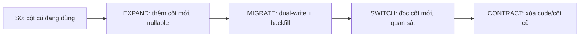

# Thay đổi ánh xạ theo chiến lược mở rộng rồi thu hẹp trong Hibernate

## 1. Bối cảnh: thay đổi schema khi hệ thống vẫn đang hoạt động

Trong ứng dụng dùng Hibernate/Jakarta Persistence, mã Java và lược đồ cơ sở dữ liệu ràng buộc với nhau qua mapping: `@Table`, `@Column`, `@JoinColumn`, `@Enumerated`, `@AttributeConverter`, khóa chính, khóa ngoại và các constraint. Một thay đổi trông rất nhỏ trong entity có thể khiến phiên bản ứng dụng cũ không còn chạy được.

Ví dụ ban đầu:

```java
@Entity
@Table(name = "customers")
public class Customer {
    @Id
    private Long id;

    @Column(name = "display_name", nullable = false)
    private String displayName;
}
```

Sau khi đổi yêu cầu, đội phát triển muốn thay tên cột `display_name` bằng `preferred_name`:

```java
@Column(name = "preferred_name", nullable = false)
private String preferredName;
```

Nếu triển khai entity mới **trước khi** database có cột `preferred_name`, Hibernate có thể phát SQL truy cập cột chưa tồn tại. Nếu đổi tên/xóa `display_name` trong database **trước khi** toàn bộ phiên bản ứng dụng cũ ngừng chạy, request xử lý bởi node cũ có thể thất bại. Điều này đặc biệt nguy hiểm khi hệ thống:

- Triển khai rolling update trên nhiều instances.
- Vẫn nhận request trong khi deploy.
- Có worker, scheduler, consumer hoặc batch job chạy version cũ.
- Có tích hợp JDBC, báo cáo, ETL hay service khác cùng đọc/ghi database.
- Cần khả năng rollback phiên bản ứng dụng sau triển khai.

**Chiến lược mở rộng rồi thu hẹp** (*expand–contract*, còn gọi là *parallel change*) giải bài toán bằng cách **tránh thay mapping và schema theo kiểu phá vỡ tương thích trong một bước**.

Tư tưởng cốt lõi:

> Trước tiên **mở rộng** schema để cả mã cũ lẫn mã mới đều có thể làm việc. Sau đó **chuyển dữ liệu và chuyển đường đọc/ghi** sang cấu trúc mới. Cuối cùng, khi không còn thành phần nào dùng cấu trúc cũ, mới **thu hẹp** schema.

Trong thực tế thường có bước trung gian quan trọng là **migrate/backfill và kiểm chứng**. Vì vậy, quy trình đầy đủ là **expand → migrate → switch → contract**.

### 1.1. Mục tiêu của bài

Sau bài này, bạn có thể:

1. Phân biệt *database schema migration* và *Hibernate mapping migration*.
2. Thiết kế một chuỗi phát hành cho phép các phiên bản ứng dụng cùng hoạt động trong giai đoạn chuyển tiếp.
3. Biết vì sao thêm cột nullable thường an toàn hơn rename/drop cột ngay.
4. Viết entity tạm thời ánh xạ cả cột cũ và cột mới; dùng dual-write và read fallback.
5. Backfill dữ liệu theo batch, chạy lại an toàn và kiểm chứng tính nhất quán.
6. Biết thời điểm chuyển read path, áp constraint, xóa mapping cũ và cuối cùng xóa cột cũ.
7. Nhận diện các bẫy với Hibernate dirty checking, JPQL/HQL, bulk updates, L2 cache, @Version, foreign keys và nhiều node.
8. Lập kế hoạch rollout, rollback, giám sát và thu hồi kỹ thuật không còn dùng.

### 1.2. Phân biệt schema và mapping

| Thành phần | Ví dụ | Ai quản lý |
|---|---|---|
| Schema thực tế | `customers.display_name`, `customers.preferred_name` | Database và migration tool |
| Entity mapping | `@Column(name = "display_name")` | Java/Hibernate |
| Repository queries | `c.displayName` trong HQL, tên cột SQL trong native query | Ứng dụng |
| Read/write behavior | Ghi một hay hai cột, ưu tiên đọc cột nào | Business/application code |
| Migration dữ liệu | Copy giá trị từ cột cũ sang cột mới | Migration/backfill job |
| Release compatibility | Node phiên bản cũ và mới chạy với schema nào | Deployment/release process |

**Chỉ thêm cột trong DB không tự làm Hibernate dùng cột mới.** Và **chỉ sửa annotation không tự làm DB được di trú an toàn**.

## 2. Vì sao “đổi tên cột ngay” dễ gây downtime?

Giả sử ban đầu có schema:

```sql
CREATE TABLE customers (
    id BIGINT PRIMARY KEY,
    display_name VARCHAR(160) NOT NULL
);
```

Mã `CustomerV1` đọc/ghi `display_name`. Trong đợt phát hành, một trong hai thứ xảy ra:

**Cách A — đổi schema trước:**

```sql
ALTER TABLE customers
RENAME COLUMN display_name TO preferred_name;
```

Trong khoảng node V1 vẫn chạy, SQL mà Hibernate phát ra có thể chứa `display_name` và thất bại do cột không tồn tại. Rolling deployment không cho phép giả định toàn bộ node đổi cùng một thời điểm.

**Cách B — đổi Java mapping trước:**

```java
@Column(name = "preferred_name")
private String preferredName;
```

Nếu database chưa có `preferred_name`, node V2 có thể fail ngay trong bootstrap validation, hoặc khi SELECT/INSERT/UPDATE đầu tiên sử dụng mapping mới.

**Cách C — ALTER COLUMN TYPE, NOT NULL hoặc DROP cột trong một bước:** tương tự có thể gây lock, lỗi đọc/ghi từ version cũ, hoặc lỗi với dữ liệu chưa được chuyển đổi.

Giải pháp không phải “deploy thật nhanh” mà là chia việc thay đổi thành những bước **có tính tương thích trong thời gian chuyển tiếp**.

## 3. Nguyên tắc tương thích: mọi phiên bản đang sống phải hiểu schema hiện tại

Hệ thống phân tán không chuyển version đồng loạt. Có thể trong vài phút hoặc vài giờ tồn tại:

```text
                      Database
                         |
            +------------+------------+
            |                         |
      Node A (V1)                Node B (V2)
      mapping cũ                mapping chuyển tiếp
            |                         |
            +---------- dữ liệu ------+
```

Schema ở một thời điểm phải hỗ trợ cả hai node. Nếu tồn tại background workers hoặc consumer cũ chưa dừng, khoảng “mixed versions” có thể còn dài hơn rolling deployment web server.

### 3.1. Ba tính chất cần kiểm soát

**Backward compatible schema:** schema mới cho phép mã cũ tiếp tục truy vấn các cột/constraint/API đã biết.

**Forward compatible app:** mã chuyển tiếp đọc/ghi dữ liệu khi schema có cả old/new và khi một phần rows chưa backfill.

**Reversibility:** có thể rollback **code** trong phạm vi hỗ trợ mà không làm mất dữ liệu vừa ghi. Rollback code an toàn không đồng nghĩa có thể rollback mọi DDL, nhất là sau khi đã drop old columns.

### 3.2. Không được giả định deploy có thứ tự toàn cục

Ngoài API server còn có job chạy ban đêm, process retry từ queue, process đang drain request và client không được cập nhật đồng bộ. Cần inventory các **readers**, **writers** và phiên bản vẫn đang tồn tại.

Một lược đồ được xem là an toàn trong mixed-version chỉ khi những thao tác thực tế của các thành phần cùng tồn tại đều tương thích — không chỉ vì ứng dụng mới start thành công.

## 4. Bốn pha triển khai



| Pha | Thao tác DB | Thao tác Hibernate/application | Điều kiện để đi tiếp |
|---|---|---|---|
| **S0 — hiện tại** | Chỉ có cột cũ | Mapping cũ | Đã hiểu readers/writers hiện tại |
| **Expand** | Thêm cột/bảng/index mới không phá cũ | Mã cũ vẫn chạy; chuẩn bị mapping mới | Schema mới tương thích với old code |
| **Migrate** | Backfill dữ liệu cũ sang cấu trúc mới | Version chuyển tiếp dual-write, đọc fallback | Không còn viết lệch không kiểm soát |
| **Switch** | Giữ cả hai cấu trúc | Đọc ưu tiên cấu trúc mới; tiếp tục ghi cả hai khi cần rollback | Dữ liệu mới đúng, đo được drift |
| **Contract** | Loại cột/constraint/bảng cũ | Code mới không còn tham chiếu cấu trúc cũ | Không còn old consumers và rollback cần old schema |

Tên pha có thể khác giữa các đội. Điều quan trọng là **mỗi bước không phá những client còn tồn tại**.

### 4.1. Một schema có thể tồn tại qua nhiều release

Không nhất thiết hoàn thành expand và contract trong cùng ngày. Thực tế có thể là:

- Release 1: chỉ thêm schema.
- Release 2: thêm dual-write, read fallback.
- Release 3: backfill và bật read từ cột mới.
- Release 4: dừng dual-write và loại mapping cũ.
- Release 5: xóa cột cũ sau khi hết rollback window.

Khoảng cách giữa các release phụ thuộc dữ liệu, quy mô traffic, số lượng service cùng truy cập và yêu cầu vận hành.

## 5. Ví dụ xuyên suốt: đổi customers.display_name sang preferred_name

Để tập trung vào *cơ chế expand–contract*, ta giả định `display_name` và `preferred_name` có cùng ý nghĩa nghiệp vụ và cùng kiểu `VARCHAR(160)`. Đây là **đổi cấu trúc lưu trữ**, không phải đổi ngữ nghĩa.

Nếu chuyển từ một `fullName` sang `firstName` + `lastName`, hai schema không tương đương hoàn toàn; cần thêm quy tắc dữ liệu và fallback riêng. Ví dụ chính dùng trường hợp tương đương để làm rõ kỹ thuật migration.

### 5.1. Trạng thái ban đầu S0

Entity đang chạy:

```java
package com.example.customer;

import jakarta.persistence.*;

@Entity
@Table(name = "customers")
public class Customer {

    @Id
    private Long id;

    @Column(name = "display_name", nullable = false, length = 160)
    private String displayName;

    protected Customer() {}

    public String getDisplayName() {
        return displayName;
    }

    public void changeDisplayName(String value) {
        this.displayName = value;
    }
}
```

Schema:

```sql
CREATE TABLE customers (
    id BIGINT PRIMARY KEY,
    display_name VARCHAR(160) NOT NULL
);
```

Ở thời điểm này, không có cột `preferred_name`. Nếu deploy một entity mapping chứa `@Column(name = "preferred_name")` khi chưa mở rộng schema, Hibernate có thể thất bại.

### 5.2. Expand schema: thêm cột không phá cột cũ

Migration SQL (minh họa trên PostgreSQL; cú pháp cụ thể tùy database):

```sql
ALTER TABLE customers
ADD COLUMN preferred_name VARCHAR(160) NULL;
```

Tại sao là `NULL`?

- Dữ liệu cũ chưa có `preferred_name`.
- Node cũ chỉ INSERT `display_name`; không biết điền `preferred_name`.
- Nếu thêm ngay `NOT NULL` không có default/compatibility plan, INSERT từ node cũ sẽ vi phạm constraint.
- Backfill dữ liệu lớn cần thực hiện dần; chưa thể bảo đảm mọi row có giá trị mới.

Schema S1:

```sql
CREATE TABLE customers (
    id BIGINT PRIMARY KEY,
    display_name VARCHAR(160) NOT NULL,
    preferred_name VARCHAR(160) NULL
);
```

Tất cả SQL của ứng dụng cũ vẫn có thể dùng `display_name`. Đây là **một expand migration**, không phải rename.

**Lưu ý:** thêm cột có thể vẫn cần DDL lock ngắn hoặc ảnh hưởng tùy database, bảng, version và default. Trong production, cần xem lock time, online DDL support, timeout và migration window; “add nullable” không phải cam kết tuyệt đối zero lock.

### 5.3. Version chuyển tiếp V1: ánh xạ cả hai cột

Khi database đã có cột mới, deploy entity:

```java
package com.example.customer;

import jakarta.persistence.*;
import java.util.Objects;

@Entity
@Table(name = "customers")
public class Customer {

    @Id
    private Long id;

    @Version
    private Long version;

    @Column(name = "display_name", nullable = false, length = 160)
    private String legacyDisplayName;

    @Column(name = "preferred_name", length = 160)
    private String preferredName;

    protected Customer() {}

    public String displayNameForRead() {
        return preferredName != null
                ? preferredName
                : legacyDisplayName;
    }

    public void changeDisplayName(String next) {
        Objects.requireNonNull(next, "name");
        if (next.isBlank()) {
            throw new IllegalArgumentException("name cannot be blank");
        }

        legacyDisplayName = next;
        preferredName = next;
    }
}
```

Phần `@Version` ở ví dụ chuyển tiếp là tùy chọn **chỉ khi schema đã có column version và mọi writer dùng hợp lệ**. Nếu hệ thống ban đầu không có `version`, **không được copy nguyên entity này và deploy trực tiếp**. Khi đó hãy **bỏ trường `@Version` khỏi ví dụ thực thi**, hoặc mở rộng schema thêm version nullable/default và di trú/version-coordination riêng trước. Mục đích nhắc `@Version` là giải thích cơ chế optimistic locking; nó không phải điều kiện tiên quyết của expand–contract.

Trong release chuyển tiếp:

- `legacyDisplayName` còn được map để tương thích đường ghi cũ.
- `preferredName` được map như cột mới có thể null.
- Getter nghiệp vụ đọc `preferredName` khi có dữ liệu, fallback về `legacyDisplayName` khi chưa backfill.
- Setter nghiệp vụ ghi **cả hai** cột trong cùng managed entity, để Hibernate flush cùng transaction.

**Lưu ý đặt tên:** hai field khác nhau ánh xạ hai cột khác nhau, không phải hai field cùng mapping một cột. Không dùng `insertable=false, updatable=false` trên cột mới nếu mục tiêu là ghi thật vào cột đó.

### 5.4. Dùng một điểm ghi nghiệp vụ

Trong service transactional:

```java
@Transactional
public void renameCustomer(Long id, String nextName) {
    Customer customer = entityManager.find(Customer.class, id);

    if (customer == null) {
        throw new EntityNotFoundException("Customer not found");
    }

    customer.changeDisplayName(nextName);
}
```

Khi flush, Hibernate dirty checking phát một UPDATE chứa các cột cần ghi theo mapping/cấu hình. Cả hai giá trị được thay đổi trong cùng transaction, nên không có trạng thái “đã commit cột mới nhưng chưa commit cột cũ” do riêng setter này.

Tuy nhiên, **code setter không tự bao phủ mọi đường ghi**: bulk HQL update, native SQL, JDBC jobs, trigger hoặc một service khác có thể vẫn chỉ viết một cột. Vì vậy phải kiểm kê cả hệ thống.

### 5.5. Đường đọc trong giai đoạn chuyển tiếp

Khi một row chưa được backfill:

```text
id=11 | display_name="Nguyễn An" | preferred_name=NULL
```

`displayNameForRead()` trả `"Nguyễn An"`.

Khi đã có cả hai:

```text
id=11 | display_name="Nguyễn An" | preferred_name="Nguyễn An"
```

Đường đọc có thể chọn cột mới. Đây là **read fallback**, không phải “các cột đã được DB giữ đồng bộ”. Tính đồng bộ cần được bảo đảm bằng quy trình ghi và reconciliation.

### 5.6. Tránh getters phơi bày hai nguồn sự thật

Đừng để nhiều service tự do gọi `getLegacyDisplayName()` hoặc `getPreferredName()` rồi quyết định theo các quy tắc khác nhau. Tạo API nghiệp vụ duy nhất như `displayNameForRead()` và `changeDisplayName()`; hạn chế setter công khai trên field raw. Khi đã cut over, loại bỏ fallback dần bằng release có kiểm soát.

## 6. Vấn đề khó nhất: mixed-version writers

Khi đang rolling deploy, có thể cùng tồn tại:

- **V0**: chỉ biết `display_name`, ghi cột cũ.
- **V1**: biết cả `display_name` và `preferred_name`, ghi đồng thời hai cột.

Giả sử row đã backfill:

```text
id=11 | display_name="An" | preferred_name="An"
```

Một request vào node V0 và đổi tên:

```text
V0 UPDATE display_name="An Nguyễn"
DB row:
id=11 | display_name="An Nguyễn" | preferred_name="An"
```

Nếu node V1 ngay sau đó đọc **ưu tiên cột mới**, nó thấy `"An"` — dữ liệu cũ. Đây là **lệch hai cột do writer version cũ**, dù bạn đã triển khai dual-write trên version mới.

### 6.1. Không cut over read quá sớm

Lộ trình an toàn đơn giản:

1. Mở rộng schema.
2. Deploy V1 dual-write lên tất cả writers, vẫn **đọc ưu tiên cột cũ** trong giai đoạn có V0.
3. Xác minh không còn V0 web nodes, workers, scheduled jobs, consumers hoặc writers ngoài ORM.
4. Backfill/reconcile những rows bị V0 ghi trong giai đoạn mixed-version.
5. Chuyển read preference sang cột mới sau khi dữ liệu đồng bộ.

Trong giai đoạn V1, có thể viết getter tạm thời:

```java
public String displayNameForRead() {
    return legacyDisplayName;
}
```

Sau khi V0 rút hết và reconciliation hoàn thành mới bật:

```java
public String displayNameForRead() {
    return preferredName != null
            ? preferredName
            : legacyDisplayName;
}
```

**Không dùng getter “new-first” ngay từ đầu nếu V0 vẫn có thể ghi old-only**, trừ khi đã có cơ chế hai chiều ở DB đáng tin cậy và đã kiểm chứng.

### 6.2. Khi bắt buộc hỗ trợ V0 lâu dài

Nếu không thể rút toàn bộ writer V0 kịp thời, có thể cần:

- Database trigger đồng bộ old → new trong cùng transaction.
- Một cơ chế capture/CDC hoặc application middleware đồng bộ có idempotency và ordering.
- Chặn chuyển read sang new cho đến khi old writers được ngừng.
- Đọc old là nguồn sự thật cho tới cutover.

Trigger có thể giúp nhưng cần thiết kế **hướng đồng bộ**, tránh vòng lặp trigger, xử lý updates đồng thời, thứ tự precedence và hiệu ứng cho mọi đường ghi. Trigger không phải giải pháp mặc định; hãy ưu tiên một đường ghi ứng dụng thống nhất nếu có thể.

### 6.3. Quản lý traffic không đồng nghĩa kiểm soát writers

Đã rollout 100% API nodes **chưa chắc** đã rút được V0:

- Worker chạy image cũ chưa restart.
- Retry message giữ old job code.
- Batch ETL dùng SQL cột cũ.
- BI dashboard và reporting đọc schema trực tiếp.
- Module nội bộ khác dùng cùng database.

Một điều kiện contract cần **inventory writers/readers**, không chỉ thống kê deployment của một service.


## 7. Backfill: điền dữ liệu mới một cách có kiểm soát

Sau khi có cột mới và các writers đã được nâng cấp, dữ liệu lịch sử vẫn cần chuyển.

### 7.1. Backfill cơ bản

SQL minh họa:

```sql
UPDATE customers
SET preferred_name = display_name
WHERE preferred_name IS NULL;
```

Về semantics, đây là bước copy giá trị cho những row chưa có cột mới. Nhưng trên bảng rất lớn, UPDATE toàn bảng có thể:

- Giữ nhiều row locks.
- Tạo nhiều WAL/redo log.
- Tăng replication lag.
- Làm bloat hoặc gây pressure lên vacuum.
- Tác động đến cache và transaction duration.
- Gây contention với traffic ghi đang diễn ra.

Không nhất thiết chạy một statement lớn trên production. Chọn kích thước batch/transaction theo DB và lưu lượng.

### 7.2. Backfill theo dải khóa

Một biến thể đơn giản cho bảng dùng numeric primary key:

```sql
UPDATE customers
SET preferred_name = display_name
WHERE id >= :start_id
  AND id <  :end_id
  AND preferred_name IS NULL;
```

Worker backfill lặp từng khoảng `[start_id, end_id)`, commit và lưu checkpoint sau mỗi batch. Mỗi batch có thể đi qua cùng một đoạn khóa mà không ghi đè row đã cập nhật, nhờ điều kiện `preferred_name IS NULL`.

**Không giả định ID liên tục.** Hệ thống vẫn có thể chia theo ranges hoặc cursor ổn định, nhưng phải xử lý khoảng trống ID và những rows mới được tạo. Không chỉ chạy đến `MAX(id)` một lần rồi mặc định mọi writer đồng bộ nếu vẫn còn code cũ.

### 7.3. Batch bằng ứng dụng Java

Ví dụ ý tưởng backfill theo một khoảng ID do job điều phối:

```java
@Transactional
public int backfillRange(long startId, long endId) {
    return entityManager.createQuery(
            """
            update Customer c
            set c.preferredName = c.legacyDisplayName
            where c.id >= :startId
              and c.id < :endId
              and c.preferredName is null
            """
        )
        .setParameter("startId", startId)
        .setParameter("endId", endId)
        .executeUpdate();
}
```

Đây là HQL bulk mutation, không tải từng Customer rồi dirty-check. Nó bypass per-entity lifecycle callbacks và không đồng bộ từng managed instance trong cùng persistence context.

Với update hàng loạt, cần tính tới `@Version`, second-level cache, query cache, concurrent writes và semantics transaction; không đem ví dụ này chạy trên production mà không thiết kế cơ chế đồng bộ.

### 7.4. Tính idempotent

Một backfill an toàn nên có thể chạy lại:

```sql
UPDATE customers
SET preferred_name = display_name
WHERE preferred_name IS NULL;
```

Nếu job chết sau 30% dữ liệu, chạy lại sẽ bỏ qua rows đã có `preferred_name`.

Nhưng **idempotent không đồng nghĩa luôn đúng dưới concurrency**. Nếu row đã có preferred_name cũ nhưng display_name mới do V0 update, điều kiện `IS NULL` sẽ không sửa mismatch. Vì vậy phải ngừng old-only writers hoặc chạy reconciliation dựa trên truth source trước khi cutover.

### 7.5. Kiểm tra lệch giá trị

Trên PostgreSQL, có thể dùng `IS DISTINCT FROM` để so sánh có tính đến NULL:

```sql
SELECT COUNT(*) AS mismatched_rows
FROM customers
WHERE preferred_name IS DISTINCT FROM display_name;
```

Cú pháp này là PostgreSQL-specific; database khác cần expression tương đương.

Nếu chưa có `IS DISTINCT FROM`, có thể xét các trường hợp:

```sql
SELECT COUNT(*)
FROM customers
WHERE (preferred_name IS NULL AND display_name IS NOT NULL)
   OR (preferred_name IS NOT NULL AND display_name IS NULL)
   OR (
       preferred_name IS NOT NULL
       AND display_name IS NOT NULL
       AND preferred_name <> display_name
   );
```

Chỉ dùng so sánh bằng khi hai field **được định nghĩa cùng ngữ nghĩa** trong migration. Với việc chuẩn hóa chuỗi, tách họ tên, thay precision hoặc đổi timezone, cần so sánh theo hàm chuyển đổi nghiệp vụ, không phải equality thô.

### 7.6. Read fallback không thay thế backfill

Một getter như:

```java
return preferredName != null ? preferredName : legacyDisplayName;
```

giúp tránh null cho dữ liệu lịch sử, nhưng không bảo đảm những consumer truy vấn trực tiếp `preferred_name` thấy đủ dữ liệu. Khi chuyển tất cả đường đọc sang new-only, dữ liệu phải đã hoàn chỉnh.

### 7.7. Backfill không được phá concurrent updates

Tình huống race:

1. Backfill đọc old value `"A"`.
2. Transaction ứng dụng cập nhật cả old/new thành `"B"` và commit.
3. Backfill cố ghi new thành `"A"` theo dữ liệu cũ.

Nếu backfill là một UPDATE atomic `SET preferred_name = display_name` trong DB, nó có thể tránh một số dạng read-then-write stale, nhưng lock ordering, isolation và các statements khác vẫn quan trọng. Hãy dùng điều kiện kiểm soát, chia batch nhỏ, theo dõi mismatch và có chiến lược retry.

Không chạy migration kiểu đọc mọi row vào Java rồi update theo danh sách detached entity mà không có optimistic checks nếu traffic ghi vẫn tiếp diễn.

## 8. Bước chuyển quyền đọc: old-primary sang new-primary

Sau khi:

- Tất cả writers cũ đã ngừng hoặc có đồng bộ DB đáng tin.
- Các writers còn sống ghi cả hai cột.
- Backfill hoàn thành.
- Drift check đạt mức yêu cầu.
- Monitoring cho thấy dữ liệu mới có thể đọc độc lập.

có thể chuyển sang **new-primary reads**:

```java
public String displayNameForRead() {
    return preferredName != null
            ? preferredName
            : legacyDisplayName;
}
```

Tạm thời vẫn giữ dual-write:

```java
public void changeDisplayName(String next) {
    legacyDisplayName = next;
    preferredName = next;
}
```

Lý do: nếu phát hiện lỗi và rollback ứng dụng về version old-primary hoặc chuyển feature flag về old read, cột cũ vẫn có dữ liệu mới nhất.

### 8.1. Dùng feature flag có giới hạn rõ

Read flag như `readPreferredName` có thể giúp giảm rủi ro cutover:

```java
public String displayNameForRead(boolean readPreferredName) {
    if (!readPreferredName) {
        return legacyDisplayName;
    }

    return preferredName != null
            ? preferredName
            : legacyDisplayName;
}
```

Feature flag không đồng nghĩa có thể bật cho ngẫu nhiên vài node mà không tính writer semantics. Các node đọc khác nhau chỉ an toàn khi dữ liệu đủ đồng bộ và các phép biến đổi không tạo hai nguồn sự thật.

Đặt tiêu chí rollback cụ thể, thời hạn xóa flag và trạng thái ưu tiên sau khi ổn định.

### 8.2. Không nên giữ hai nguồn sự thật vô thời hạn

Dual-write tăng chi phí:

- Mỗi thay đổi có thêm cột/SQL state phải duy trì.
- Có nguy cơ lệch khi writer đi đường riêng.
- HQL/DTO/analytics có thể chọn nhầm field.
- Dữ liệu phải được giữ đồng bộ nhiều năm nếu không dọn.
- Rollback càng ngày càng khó nếu new schema đã có semantics mới.

Expand–contract hướng tới **xóa bỏ cấu trúc cũ có kiểm chứng**, không phải duy trì dual-storage mãi.

## 9. Contract: xóa mapping cũ trước khi xóa cột cũ

Sau khi cutover đã ổn định và hết khoảng cần rollback về old code, nên tách contract thành ít nhất hai bước.

### 9.1. Release V3: ứng dụng new-only, database còn cả hai cột

Entity:

```java
@Entity
@Table(name = "customers")
public class Customer {

    @Id
    private Long id;

    @Column(name = "preferred_name", nullable = false, length = 160)
    private String preferredName;

    protected Customer() {}

    public String getPreferredName() {
        return preferredName;
    }

    public void changePreferredName(String next) {
        this.preferredName = next;
    }
}
```

Đây là mapping mới **không tham chiếu cột cũ**. Nhưng database vẫn còn `display_name`; nếu nó còn `NOT NULL` và không có default/trigger, INSERT của V3 chỉ ghi preferred_name sẽ vi phạm constraint cũ.

Vì thế cần xử lý cả **write compatibility với constraint cũ** trước khi dừng dual-write.

### 9.2. Xử lý constraint của cột cũ

Một phương án là thả ràng buộc `NOT NULL` trên cột cũ khi chuẩn bị V3:

```sql
ALTER TABLE customers
ALTER COLUMN display_name DROP NOT NULL;
```

Cú pháp trên là PostgreSQL-specific. Sau thay đổi, V3 có thể INSERT cột mới mà không phải ghi cột cũ.

Một phương án khác là tạm giữ dual-write thêm một release, hoặc thiết kế DB default/trigger phù hợp. Không chấp nhận mặc nhiên “entity không map cột cũ tức INSERT sẽ chạy” khi database vẫn áp constraint trên nó.

**Thứ tự cần cân nhắc:** trước V3, phải làm schema old column tương thích với writer new-only; sau đó mới deploy V3.

### 9.3. Ràng buộc NOT NULL cho cột mới

Khi chắc chắn mọi row có preferred_name hợp lệ **và mọi active writer có thể ghi preferred_name**, mới áp constraint:

```sql
ALTER TABLE customers
ALTER COLUMN preferred_name SET NOT NULL;
```

Tại sao không đặt ngay lúc thêm cột?

- Existing rows chưa backfill.
- V0 có thể INSERT old-only.
- Một số job chưa chuyển sang write-path mới.
- Validation constraint trên bảng lớn có thể gây lock hoặc scan đáng kể.

Có thể triển khai constraint từng bước bằng kỹ thuật riêng của database (ví dụ CHECK NOT VALID + VALIDATE trên PostgreSQL trong một số tình huống), nhưng cần hiểu semantics và lock behavior của dialect cụ thể.

### 9.4. Cuối cùng mới DROP old column

Sau khi:

- Không còn deployed instance chạy V0/V1/V2 mapping cũ.
- Không còn SQL, BI, ETL, export hoặc trigger tham chiếu `display_name`.
- Có đủ thời gian rollback không cần old column.
- Mọi write đã new-only và constraint mới hợp lệ.
- Backup, monitoring và kế hoạch recovery sẵn sàng.

mới thực hiện:

```sql
ALTER TABLE customers
DROP COLUMN display_name;
```

Đây là thao tác **phá tương thích (breaking change)**. Nó thường không thể rollback code cũ bằng một nút bấm. Vì vậy phải thực hiện sau giai đoạn chuyển tiếp và phải có xác nhận ownership của các consumer phụ thuộc.

### 9.5. Schema cuối S2

```sql
CREATE TABLE customers (
    id BIGINT PRIMARY KEY,
    preferred_name VARCHAR(160) NOT NULL
);
```

Trong trường hợp hệ thống thực tế có version column, audit columns, indexes hoặc FK, chúng vẫn tồn tại theo các migration riêng. DDL trong bài chỉ hiển thị phần liên quan tới đổi tên thuộc tính.


## 10. Ma trận tương thích phiên bản

Đây là bảng quan trọng nhất khi chuẩn bị rolling deployment.

Quy ước:

- **S0:** database chỉ có `display_name NOT NULL`.
- **S1:** database có `display_name NOT NULL` và `preferred_name NULL`.
- **S1b:** cả hai cột; `display_name` đã nới nullable, `preferred_name` có thể được ép NOT NULL sau khi đã rút hết old-only writers.
- **S2:** chỉ còn `preferred_name NOT NULL`.
- **V0:** code cũ chỉ đọc/ghi `display_name`.
- **V1:** code dual-write, đọc old-primary.
- **V2:** code dual-write, đọc new-primary (có fallback trong transition).
- **V3:** code new-only.

| Application | S0 | S1 | S1b | S2 |
|---|---|---|---|---|
| V0: old-only | Phù hợp | Phù hợp nếu old constraint vẫn giữ | Đọc/ghi cũ có thể chạy nhưng có rủi ro integrity của new column | **Không** |
| V1: dual-write old-primary | **Không**, thiếu new column | Phù hợp | Phù hợp nếu dữ liệu/constraint new được duy trì | **Không**, thiếu old column |
| V2: dual-write new-primary | **Không** | Phù hợp sau backfill/sync | Phù hợp | **Không**, vẫn ghi old |
| V3: new-only | **Không** | Có thể **không INSERT được** do old NOT NULL | Phù hợp nếu new constraints áp dụng hợp lệ | Phù hợp |

Bảng mô tả **compatibility kỹ thuật** theo mapping/constraint, không bảo đảm business correctness nếu dữ liệu old/new lệch.

### 10.1. Thứ tự phát hành có thể dùng

```text
S0 + V0
  |
  | DB Expand: thêm preferred_name nullable
  v
S1 + V0
  |
  | Deploy V1 dual-write, read old-primary
  v
S1 + mixed V0/V1
  |
  | Drain V0 writers; backfill/reconcile
  v
S1 + V1
  |
  | Enable new-primary reads
  v
S1 + V2
  |
  | Observation + rollback window, vẫn dual-write
  v
S1 + V2 (ổn định)
  |
  | Nới NOT NULL cột old nếu cần
  | Đảm bảo dữ liệu new đầy đủ; thêm constraint new
  v
S1b + V2
  |
  | Deploy V3 new-only
  v
S1b + V3
  |
  | Xác minh không còn V2 và không còn rollback yêu cầu old
  | DB Contract: DROP old column
  v
S2 + V3
```

**Quan trọng:** nếu triển khai `NOT NULL` cho preferred_name trong S1b, bất kỳ node V0 nào còn INSERT old-only sẽ thất bại. Do đó bước này **chỉ sau khi V0 được rút hết** và đã có bảo đảm tất cả writers mới cung cấp giá trị new.

### 10.2. Nếu cần rollback V3

Trong thời gian S1b còn old column, V3 new-only ghi giá trị new mà không ghi old; rollback sang V2 (dual-write nhưng old có thể thiếu/cũ) **không còn an toàn về dữ liệu đọc** nếu V2 sẽ ưu tiên old trong một số đường đi. Muốn rollback V3 về V2, có thể:

- Tiếp tục giữ synchronized old value bằng DB trigger/job trong một thời gian.
- Có quy trình reverse backfill `preferred_name → display_name` trước khi rollback, kèm kiểm soát race.
- Giới hạn rollback chỉ sang một phiên bản new-primary tương thích và đã được test.
- Tránh chuyển V3 cho đến khi hết nhu cầu rollback về old-primary.

**Giữ cột cũ tồn tại không đủ để đảm bảo rollback dữ liệu.** Phải giữ cả semantics và freshness của cột đó.

### 10.3. Contract là điểm không quay lại dễ dàng

Sau `DROP display_name`, rollback binary V0/V1/V2 sẽ thất bại. Phương án khôi phục lúc đó có thể là *roll-forward* (fix version mới) hoặc reverse migration phức tạp có data reconstruction. Không gọi đó là “rollback nhanh” nếu phải tái tạo dữ liệu và schema.

## 11. Flyway/Liquibase: tách thay đổi schema khỏi binary deploy

Thay đổi schema production nên được quản lý bằng migration scripts có version, review, audit, rollback plan và môi trường staging tương đương production. Các công cụ phổ biến:

- **Flyway:** migrations tuần tự, ví dụ các file `V2026_11_01__expand_customer_name.sql`.
- **Liquibase:** changelog/changeset với preconditions, migration tracking, rollback options tùy thao tác.

Ví dụ một chuỗi migration (tên chỉ là minh họa, không tạo file mới trong bài):

```text
V120__expand_customer_preferred_name.sql
V121__prepare_old_column_nullable.sql
V122__enforce_preferred_name_not_null.sql
V123__drop_legacy_display_name.sql
```

**Không đặt toàn bộ bốn việc vào cùng một migration chạy liên tục trong một deploy.** Backfill và rollouts có thể mất nhiều ngày; các bước enforce/drop cần được phê duyệt riêng sau khi điều kiện dữ liệu và version hoàn thành.

### 11.1. Ví dụ Flyway migration expand

```sql
-- V120__expand_customer_preferred_name.sql
ALTER TABLE customers
ADD COLUMN preferred_name VARCHAR(160);
```

Một số dialect dùng cú pháp `ADD COLUMN IF NOT EXISTS`, nhưng không coi điều đó là cách thay thế migration version control. Chạy migration theo contract của tooling và ghi nhận trạng thái.

### 11.2. Ví dụ Liquibase changelog ý tưởng

```xml
<databaseChangeLog
    xmlns="http://www.liquibase.org/xml/ns/dbchangelog"
    xmlns:xsi="http://www.w3.org/2001/XMLSchema-instance"
    xsi:schemaLocation="
      http://www.liquibase.org/xml/ns/dbchangelog
      https://www.liquibase.org/xml/ns/dbchangelog/dbchangelog-latest.xsd">

    <changeSet id="expand-customer-preferred-name" author="team">
        <addColumn tableName="customers">
            <column name="preferred_name" type="varchar(160)"/>
        </addColumn>
    </changeSet>

</databaseChangeLog>
```

Đây là mẫu định hướng; schemaLocation, changeSet/version và cấu hình Liquibase thực tế phải tương thích bản tooling đang dùng.

### 11.3. Hạn chế dùng hbm2ddl auto-update cho migration production

Cấu hình thường thấy:

```properties
hibernate.hbm2ddl.auto=update
```

có thể giúp development nhưng **không thay thế quy trình expand–contract** trên production. Hibernate không biết:

- Dữ liệu cũ cần backfill theo quy tắc nào.
- Version cũ còn chạy bao lâu.
- Trigger/ETL/reporting nào dùng cột cũ.
- Khi nào thích hợp enforce constraint và drop cột.
- SQL migration nào có lock/replication impact.

Trong production thường dùng migration tool để thay đổi schema và cân nhắc:

```properties
hibernate.hbm2ddl.auto=validate
```

`validate` chỉ giúp phát hiện một số mismatch schema–mapping khi bootstrap; nó không thay thế kiểm chứng data-level invariants.

### 11.4. Migration phải chạy trước code cần schema mới

Một thứ tự phổ biến:

1. Apply **additive schema migration**.
2. Xác minh cột/bảng mới thực sự tồn tại.
3. Deploy application version có mapping mới.
4. Sau đó mới bắt đầu backfill, cutover và contract.

Trong CI/CD nhiều service, migration job phải có điều phối; không để một app instance tự ý drop old column chỉ vì pod mới khởi động.

## 12. Tách thay đổi mapping khỏi thay đổi API

Đổi column `display_name` sang `preferred_name` **không buộc** phải đổi JSON field hoặc public API ngay.

Ví dụ REST DTO vẫn có:

```java
public record CustomerResponse(
        Long id,
        String displayName
) {}
```

Mapper lấy giá trị từ phương thức nghiệp vụ:

```java
return new CustomerResponse(
        customer.getId(),
        customer.displayNameForRead()
);
```

Client không cần biết database đang chứa old hay new columns. Cách này giảm số thành phần cùng phải cut over một lúc.

Nếu muốn đổi public API field từ `displayName` sang `preferredName`, đó là một **API versioning migration** riêng: có thể tạm trả cả hai field, deprecate field cũ, theo dõi consumers và thu hẹp API sau.

### 12.1. Không để database column name rò vào client

Nếu serializer trả thẳng JPA entity, đổi field Java có thể vô tình đổi JSON contract. Một read DTO ổn định giúp tách thay đổi schema khỏi API và tránh truy cập lazy association trong serialization.

### 12.2. HQL, Criteria và native SQL cần đổi ở thời điểm thích hợp

Trong code cũ:

```hql
from Customer c
where c.displayName = :name
```

Sau mapping chuyển tiếp, field `displayName` không còn tồn tại nếu bạn đổi tên property thành `legacyDisplayName`; query phải cập nhật:

```hql
from Customer c
where c.legacyDisplayName = :name
```

hoặc trong new-primary:

```hql
from Customer c
where c.preferredName = :name
```

Điều quan trọng: **JPQL/HQL tham chiếu tên thuộc tính Java**, còn native SQL tham chiếu tên cột DB. Cần kiểm kê named queries, Criteria metamodel, Spring Data derived query methods, DTO projections, sorting/property paths và native queries.

Ở giai đoạn mixed-version, một query lọc theo new column trước khi backfill hoàn chỉnh có thể bỏ sót rows null. Nếu phải dùng fallback trong HQL:

```hql
select c
from Customer c
where coalesce(c.preferredName, c.legacyDisplayName) = :name
```

`coalesce` biểu diễn new-first fallback, nhưng có thể làm SQL khó tận dụng index thông thường, và không giải quyết vấn đề V0 old-only writes tạo mismatch giữa hai cột. Chỉ dùng khi compatibility/write model đã đúng.


## 13. Khi thay đổi cả kiểu dữ liệu: shadow column migration

Không phải migration nào cũng chỉ là rename. Giả sử bảng đang có:

```sql
orders.total_text VARCHAR(40)
```

và muốn chuyển thành:

```sql
orders.total_amount DECIMAL(18, 2)
```

Một `ALTER COLUMN TYPE` trực tiếp có thể lock bảng lâu, thất bại với dữ liệu không hợp lệ hoặc khiến ứng dụng cũ không tương thích. Expand–contract gợi ý:

1. Thêm `total_amount DECIMAL(18,2) NULL`.
2. Định nghĩa logic parse/round/scale và xử lý dữ liệu không hợp lệ.
3. Deploy dual-write: giá trị cũ và số tiền mới được ghi trong cùng transaction.
4. Backfill dữ liệu lịch sử bằng batch, lưu danh sách rows parse lỗi.
5. Chuyển read path sang decimal mới sau khi reconciliation xong.
6. Enforce check/NOT NULL nếu business đòi.
7. Dừng ghi trường text cũ khi rollback requirement cho phép.
8. Drop `total_text` sau khi không còn consumer cũ.

### 13.1. Chuyển kiểu có thể không đảo ngược hoàn toàn

Một chuỗi `"1,200.00"`, `"1200.0"` và `"001200.00"` đều có thể chuyển thành một BigDecimal, nhưng formatting cũ không khôi phục được chính xác nếu không có quy tắc canonical. Nếu muốn rollback về text, cần xác định cách serialize decimal và liệu code cũ có chấp nhận định dạng mới.

Tương tự, chuyển từ timestamp không timezone sang UTC `Instant` phải định nghĩa timezone nguồn; không thể áp một cast SQL rồi mặc định dữ liệu đúng.

### 13.2. AttributeConverter không tự giải quyết migration hai cột

`@AttributeConverter` thường ánh xạ **một Java attribute** sang **một database column representation**:

```java
@Convert(converter = MoneyStringConverter.class)
@Column(name = "total_text")
private Money total;
```

Converter không mặc định điều phối dual-write giữa hai cột song song. Khi chuyển representation cần hai mapped fields, custom mapping hoặc service conversion logic rõ ràng; không giả định converter sẽ tự đồng bộ cột mới với cột cũ.

### 13.3. Tránh dùng Java double cho tiền tệ

Khi chuyển text sang decimal, `BigDecimal` thường phù hợp hơn `double`. Xác định rounding mode, scale, nullable semantics, precision và các bản ghi không thể parse. Nếu không, migration có thể thành công kỹ thuật nhưng sai số tiền.

## 14. Thay đổi quan hệ: chuyển FK theo expand–contract

Một thay đổi phức tạp hơn là chuyển khóa ngoại từ old business key sang surrogate key hoặc chuyển association sang bảng khác.

Giả sử bảng `order_lines` đang tham chiếu `orders.order_code` qua cột `order_code`, muốn đổi sang `order_id BIGINT`.

### 14.1. Expand schema

```sql
ALTER TABLE order_lines
ADD COLUMN order_id BIGINT NULL;
```

Tạo index/FK thích hợp theo migration riêng. Với bảng lớn, việc tạo index có thể yêu cầu online/concurrent index build của database; ví dụ PostgreSQL có `CREATE INDEX CONCURRENTLY` nhưng không cho chạy trong một transaction block như các DDL bình thường. Migration tool có thể cần cấu hình non-transactional step riêng.

### 14.2. Dual-write quan hệ

Trong application transitional, khi tạo order line:

```java
public void assignOrder(Order order) {
    this.orderCode = order.getCode();
    this.orderId = order.getId();
}
```

Đây là minh họa **hai scalar fields** `orderCode` và `orderId` tương ứng hai cột; trong mapping thực tế có thể dùng `@ManyToOne` cho một hoặc cả hai quan hệ theo trạng thái. Nếu dùng cả hai `@JoinColumn` trên hai associations, phải kiểm soát owning side, update behavior và không để hai relationships cùng được ghi lệch nhau.

### 14.3. Backfill theo join

```sql
UPDATE order_lines l
SET order_id = o.id
FROM orders o
WHERE l.order_code = o.order_code
  AND l.order_id IS NULL;
```

Đây là cú pháp PostgreSQL. Với các database khác, dùng `UPDATE ... JOIN` hoặc subquery tương đương.

Trước khi enforce FK/NOT NULL:

- Mọi `order_code` có xác định đúng một Order không?
- Có dữ liệu orphan hoặc duplicate business key không?
- Constraint unique trên `orders.order_code` có tồn tại không?
- Đã xử lý order lines mới được ghi trong giai đoạn backfill chưa?
- Có job nào vẫn chỉ ghi `order_code` không?

### 14.4. Cutover và contract

Khi dữ liệu đạt điều kiện:

1. Truy vấn/association mới dùng `order_id`.
2. Các writers còn có thể dual-write trong rollback window.
3. Enforce FK và `NOT NULL` theo cách online/validated nếu DB hỗ trợ.
4. Dừng dùng `order_code` cũ.
5. Drop constraint/index và cột old theo thứ tự dependencies.

Đổi FK không chỉ là đổi một `@JoinColumn`. Nó còn là migration dữ liệu quan hệ và ràng buộc tham chiếu.

## 15. Index, unique và constraints cũng phải mở rộng rồi thu hẹp

Không chỉ columns mới cần staged migration. Ví dụ muốn thay unique key từ `display_name` sang `preferred_name`:

- Trước tiên thêm cột mới và backfill.
- Xác định dữ liệu có duplicate theo business rule mới không.
- Tạo index mới, ưu tiên phương thức online của DB khi bảng lớn.
- Xác thực mới enforce unique constraint.
- Sau khi old clients không còn phụ thuộc uniqueness cũ mới cân nhắc drop old unique index/constraint.

### 15.1. Đặt constraint quá sớm

Thêm:

```sql
ALTER TABLE customers
ALTER COLUMN preferred_name SET NOT NULL;
```

trước khi dừng V0 old-only inserts sẽ gây lỗi writes. Tương tự, thêm unique constraint mới khi dữ liệu duplicate sẽ thất bại hoặc gây lock.

Constraint là **cam kết dữ liệu**; đặt nó sau khi writer semantics và dữ liệu đã tương thích.

### 15.2. Database-specific online DDL

Một số database hỗ trợ:

- Online/concurrent index creation.
- Check constraint dạng chưa validate rồi validate sau.
- Metadata-only nullable column additions trong một số trường hợp.
- Schema changes online/asynchronous.

Nhưng tên lệnh, transaction support và mức lock khác nhau theo database/version. Không copy một câu SQL của PostgreSQL cho MySQL, SQL Server hoặc Oracle mà không kiểm tra.

### 15.3. Phân biệt correctness và performance

Chuyển read query từ cột cũ sang cột mới có thể làm query plan đổi dù dữ liệu đúng. Nếu `preferred_name` được dùng trong WHERE/ORDER BY, cần tạo index phù hợp và đo query latency trước khi cutover. Read fallback bằng `COALESCE(new, old)` có thể cần function index hoặc kế hoạch tối ưu khác.

## 16. Những bẫy Hibernate-specific

### 16.1. Dirty checking và dual-write

Hibernate ghi database theo state của entity managed tại flush. Nếu setter cập nhật cả old/new thì Hibernate có thể phát UPDATE cho cả hai cột, nhưng SQL thực tế phụ thuộc `@DynamicUpdate` và dirty fields.

`@DynamicUpdate` có thể chỉ ghi các cột thay đổi. Nếu logic dual-write bỏ sót cột mới hoặc giá trị bằng snapshot, không được giả định nó luôn xuất hiện trong SQL. Điều quan trọng là state cuối cùng đúng và Hibernate nhận ra những thay đổi cần ghi.

### 16.2. insertable=false, updatable=false là read-only mapping

```java
@Column(
    name = "preferred_name",
    insertable = false,
    updatable = false
)
private String preferredName;
```

Mapping này cho phép đọc giá trị nhưng không khiến Hibernate tự INSERT/UPDATE cột. Nó **không phải dual-write mapping**.

Có thể dùng read-only mapping trong một giai đoạn dùng DB trigger để fill cột mới, nhưng khi chuyển sang application-owned dual-write phải cập nhật mapping phù hợp.

### 16.3. @PrePersist/@PreUpdate không bao phủ mọi write path

Callback lifecycle có thể đặt logic đồng bộ:

```java
@PrePersist
@PreUpdate
private void normalizeName() {
    if (preferredName == null) {
        preferredName = legacyDisplayName;
    }
}
```

Nhưng callback chỉ chạy với các thao tác lifecycle phù hợp. Nó **không chạy cho từng row trong HQL bulk UPDATE**, native SQL hoặc raw JDBC. Vì thế không thể dựa vào callback duy nhất nếu hệ thống còn nhiều đường ghi.

Ngoài ra, callback điền new khi null **không sửa được** trạng thái new non-null nhưng stale sau V0 old-only write.

### 16.4. @Formula không phải dual-write

Hibernate `@Formula` có thể tạo một thuộc tính chỉ đọc từ biểu thức SQL:

```java
@Formula("coalesce(preferred_name, display_name)")
private String resolvedName;
```

Đây là extension Hibernate, phụ thuộc SQL dialect và không tự ghi cột mới. `@Formula` có thể hữu ích để đọc chuyển tiếp, nhưng không giải quyết backfill, dual-write, index và migration contract.

### 16.5. HQL/JPQL bulk update bỏ qua entity setter

```java
entityManager.createQuery(
        """
        update Customer c
        set c.legacyDisplayName = :name
        where c.id = :id
        """
    )
    .setParameter("name", nextName)
    .setParameter("id", id)
    .executeUpdate();
```

Lệnh này không gọi `changeDisplayName()` cho từng entity, nên dễ tạo lệch old/new. Phải sửa bulk query:

```hql
update Customer c
set c.legacyDisplayName = :name,
    c.preferredName = :name
where c.id = :id
```

Hoặc thay bulk update bằng path khác trong thời gian chuyển tiếp. Cần kiểm tra optimistic locking và persistence context sau bulk DML: state managed trong cùng Session có thể stale; Hibernate bulk update thường không tự tăng `@Version` như entity dirty checking thông thường.

### 16.6. Native SQL, triggers và cache

Native SQL dùng tên cột DB, không phải Java field. Một job:

```sql
UPDATE customers
SET display_name = :name
WHERE id = :id;
```

sẽ không được tự sửa chỉ vì entity Java đã có `preferredName`. Nếu UPDATE chạy ngoài Hibernate, ORM có thể không nhận biết thay đổi để invalidate L2/query cache.

Trong hệ thống bật second-level cache, backfill bằng raw JDBC có thể khiến cache tiếp tục giữ state cũ. Cân nhắc tắt/evict vùng liên quan hoặc dùng Hibernate bulk DML với synchronization phù hợp; điều phối eviction sau commit và kiểm tra cache cluster.

### 16.7. EntityManager đang giữ L1 cũ trong quá trình backfill

`em.clear()` hoặc mở EntityManager mới có thể cần thiết khi cần đọc lại state sau bulk update trong cùng unit of work. Nhưng clear chỉ bỏ L1, không giải quyết shared cache stale do external SQL.

Không giữ Session qua nhiều phút hoặc nhiều release rồi mong các entity managed tự nhận giá trị backfill mới.

### 16.8. @Version và backfill ngoài ORM

Nếu entity có `@Version`, managed updates thường dùng optimistic concurrency. Raw SQL backfill không tăng version có thể khiến context cũ vẫn nghĩ entity chưa đổi; increment version bằng raw SQL lại có thể tạo conflict đồng loạt.

Không áp một công thức `version = version + 1` cho mọi backfill một cách máy móc. Cần thiết kế theo loại thay đổi:

- Backfill chỉ cột chưa được sử dụng và chưa ảnh hưởng business state.
- Backfill sửa giá trị mà writer khác có thể thay đồng thời.
- Trigger đồng bộ trong transaction có version hay không.
- Cách quản lý cache và stale managed entities.

Thử với concurrent transactions thực tế để xác định chính sách version.

### 16.9. Null semantics, empty string và default values

Read fallback như `new != null ? new : old` dựa trên giả định null nghĩa là “chưa có dữ liệu mới”. Nếu new có thể là chuỗi rỗng hợp lệ, null check vẫn đúng; nếu ứng dụng dùng empty string để biểu diễn “chưa di trú”, phải chuẩn hóa semantics trước.

Không thêm default `''` cho cột mới rồi dùng `IS NULL` để tìm rows chưa backfill: điều kiện đó sẽ không còn nhận diện đúng.

### 16.10. JPA schema validation không kiểm chứng dữ liệu

`hibernate.hbm2ddl.auto=validate` có thể phát hiện thiếu cột/loại mapping không khớp trong một số trường hợp; nó không thể chứng minh 100% rows đã backfill, hai cột luôn bằng nhau, không còn client cũ hay rollback khả thi.

Data checks và deployment inventory vẫn cần riêng.


## 17. Quy trình release theo từng bước

Một rollout production có thể được chuẩn hóa thành các điểm kiểm soát:

### Release A — chỉ mở rộng DB

**Thực hiện:** thêm `preferred_name NULL`, chưa đổi ứng dụng.

**Xác nhận:** V0 vẫn đọc/ghi bình thường; mức lock/latency của migration chấp nhận được; schema migration đã được áp dụng trên mọi môi trường đích.

**Rollback:** có thể chỉ rollback binary vì schema additive không phá code cũ; thường không cần vội DROP cột vừa thêm.

### Release B — dual-write, old-primary

**Thực hiện:** deploy V1 mapping cả hai field, setter ghi cả hai, getter old-primary. Cập nhật toàn bộ HQL/native SQL/jobs cùng sở hữu writes.

**Xác nhận:** lưu lượng V1/ V0 khi rolling deploy, số lượng old-only writer còn sống, write errors và kiểm tra row values. Không chuyển new-primary reads khi V0 còn cập nhật old-only.

**Rollback:** có thể trở về V0 trên schema S1 nếu old vẫn được duy trì đúng. Khi V1 ghi cả hai, V0 vẫn hiểu cột cũ.

### Release C — backfill và reconcile

**Thực hiện:** chạy job theo batches, ghi checkpoint, đo mismatch; lặp lại sau khi toàn bộ V0 writers đã rút.

**Xác nhận:** mọi row thuộc phạm vi cần thiết có new value; không còn drift hoặc đã có giải pháp cho ngoại lệ; data query mới hoạt động đúng trên dữ liệu thật.

**Rollback:** giữ schema cũ và dual-write; nếu backfill chỉ ghi cột mới, code old-primary vẫn hoạt động.

### Release D — new-primary, vẫn dual-write

**Thực hiện:** bật feature flag hoặc deploy V2 đọc new-primary, fallback old nếu cần; vẫn duy trì old/new cùng giá trị.

**Xác nhận:** tỷ lệ đọc fallback giảm về 0, drift không tăng, query latency, error rate và dữ liệu ngoài luồng đều ổn định.

**Rollback:** chuyển flag về old-primary hoặc redeploy V1 trong phạm vi rollback window, vì old vẫn được ghi.

### Release E — new-only code

**Thực hiện:** chỉ sau khi dữ liệu mới đã đầy đủ, writers cũ hết và các constraint phù hợp; nới old NOT NULL nếu cần, triển khai V3 không map/ghi cột old.

**Xác nhận:** toàn bộ active nodes thực sự là V3; không còn SQL tham chiếu old; API/service vẫn đúng. Lập kế hoạch xử lý rollback vì old không còn tự động đồng bộ sau V3 writes.

### Release F — contract DB

**Thực hiện:** xóa old column/old index/old FK và các migration scaffolding; xóa feature flags/code fallback không còn cần.

**Xác nhận:** contract migration đã chạy, new-only code ổn định, các client ngoài ORM được xác nhận, metrics và backups đúng.

**Rollback:** không giả định có thể redeploy V0/V1/V2. Ưu tiên forward-fix hoặc reverse migration có điều kiện với runbook rõ.

### 17.1. Mỗi release có điều kiện thoát rõ

Một phát hành không nên “thành công” chỉ vì pod health-check trả 200. Cần kiểm chứng tương thích dữ liệu, đường ghi, queries, metrics và trạng thái các consumers.

## 18. Quan sát, đo và điều kiện contract

Trước khi xóa cột cũ, có thể định nghĩa các tín hiệu quan sát:

| Chỉ số | Ý nghĩa | Điều kiện minh họa |
|---|---|---|
| Số writer V0 còn sống | Có thể tiếp tục ghi old-only | 0 |
| Backfill progress | Rows đã được điền new | 100% rows cần thiết |
| Count mismatched old/new | Drift trong rollback window | 0 hoặc ngoại lệ được giải thích |
| Read fallback count | New còn thiếu ở đường đọc không | 0 trong khoảng quan sát đủ |
| SQL errors do missing column | Mapping/schema compatibility | 0 |
| Constraint violations | Writers có đáp ứng new constraints | 0 |
| Read latency / slow queries | Ảnh hưởng index/new SQL | Trong SLO |
| Queue lag / scheduled jobs | Old jobs có còn chạy | Không còn old code paths |
| Cache stale incidents | External SQL/backfill có invalidation phù hợp | Không có sự cố chưa xử lý |
| Rollback window | Còn yêu cầu đọc cột old không | Đã hết/được phê duyệt đóng |
| Consumer inventory | BI/ETL/jobs còn tham chiếu old không | Hoàn tất di chuyển |

Điều kiện mang tính minh họa; doanh nghiệp có thể chấp nhận exception cụ thể nếu có xử lý đúng. Đừng áp số "0" máy móc khi dữ liệu mới có chủ ý khác dữ liệu cũ.

### 18.1. Không chỉ đếm nulls

```sql
SELECT COUNT(*)
FROM customers
WHERE preferred_name IS NULL;
```

Kết quả 0 **không chứng minh** rằng hai cột đã đồng bộ: old-only writer có thể cập nhật display_name mới trong khi preferred_name vẫn non-null nhưng cũ.

Cần thêm drift checks, kiểm soát writer versions, audit log hoặc change-data validation theo business semantics.

### 18.2. Backfill checkpoint không phải điều kiện đủ

Job báo “đã xử lý tới ID 500000” không bảo đảm rows mới/rows thay đổi sau checkpoint đều đúng. Backfill có thể phải quét bổ sung, chạy reconciliation sau khi old writers ngừng và tiếp tục quan sát trong một khoảng ổn định.

### 18.3. Audit thay đổi có thể tạo thêm tải

Ghi lại mọi dual-write và drift check giúp debugging nhưng tránh log dữ liệu nhạy cảm như tên người, địa chỉ hoặc nội dung PII ở mức không cần thiết. Ưu tiên counters, sample IDs an toàn, trace IDs và structured metrics.

## 19. Rollback và khôi phục

### 19.1. Phân biệt rollback code với rollback schema

Trong giai đoạn S1 + V1/V2, rollback về V0/V1 tương đối thuận tiện nếu old column vẫn được cập nhật đúng. Sau khi deploy V3 new-only, old column có thể stale. Sau khi DROP old column, binary cũ không còn tương thích.

**Rollback binary chỉ là một phần**. Kiểm tra cả:

- Mapping của binary mục tiêu.
- Cột/index/constraint còn tồn tại.
- Dữ liệu mà binary đó kỳ vọng có đầy đủ không.
- Các background jobs tương ứng có thể ghi hay không.
- Event/API/serialized contracts có tương thích không.

### 19.2. Nếu phát hiện mismatch sau cutover

Cần xác định **nguồn sự thật** theo từng giai đoạn:

- Trước cutover, old là nguồn sự thật.
- Sau cutover, new là nguồn sự thật.
- Trong mixed-version, không được để cả hai cột tự do cập nhật theo hai hướng không có precedence.

Một script “copy toàn bộ old → new” sau cutover có thể ghi đè những thay đổi hợp lệ chỉ có ở new. Ngược lại, “copy toàn bộ new → old” trước khi new được backfill đủ cũng có thể làm mất thông tin.

Vì vậy reconciliation phải có phase-aware rules, audit và concurrency control, không dùng một câu UPDATE vô điều kiện cho mọi tình huống.

### 19.3. Backup không đồng nghĩa rollback nhanh

Khôi phục toàn bộ database backup để lấy lại một cột có thể ảnh hưởng các giao dịch khác đã commit sau thời điểm backup. Nếu có yêu cầu rollback DDL, cần xem khả năng PITR, logical export, shadow column retention và phương án forward-fix. Đây là vấn đề của runbook vận hành, không chỉ migration annotation.

## 20. Trường hợp không phù hợp với expand–contract đơn giản

Có những thay đổi khó áp dụng đúng công thức một-cột-cũ/hai-cột-new:

- Đổi primary key của bảng rất lớn có hàng chục FK.
- Chia một bảng thành nhiều bảng/shards với backfill và dual routing.
- Chuyển encoding hoặc timezone làm mất thông tin.
- Đổi dữ liệu không có inverse transformation.
- Đổi unique/business constraints có conflicting records.
- Multi-database cutover với replication lag đáng kể.
- Chuyển association một-nhiều thành nhiều-nhiều hoặc ngược lại.
- Thay schema đồng thời với semantic API change không backward compatible.

Vẫn có thể áp nguyên tắc **additive first, dual-path, backfill, verify, remove old last**, nhưng cần thiết kế nhiều bước hơn: shadow table, change data capture, outbox, dual reads, feature gate, traffic shifting, data reconciliation và chiến lược rollback cụ thể.

## 21. Những lỗi thường gặp

| Sai lầm | Hậu quả | Cách xử lý |
|---|---|---|
| Rename/drop column trước khi retire old app | Node cũ query lỗi | Expand bằng cột mới, contract sau |
| Deploy new mapping trước DB expand | Node mới không tìm thấy cột | Chạy additive migration trước |
| Thêm new column NOT NULL ngay | Old-only inserts fail, historical rows thiếu dữ liệu | Thêm nullable, backfill, enforce sau |
| Tưởng dual-write V1 bao phủ V0 | V0 vẫn ghi old-only | Giữ old-primary tới khi retire V0 và reconcile |
| Chỉ backfill một lần khi V0 còn sống | New cột có thể stale | Reconciliation sau khi writers cũ ngừng |
| Getter new-first khi V0 ghi old-only | Mất cập nhật trong đường đọc | Delay new-primary hoặc đồng bộ DB hai chiều có kiểm soát |
| Dừng dual-write trong khi còn rollback old-primary | Old column stale | Giữ dual-write hoặc chuẩn bị reverse sync |
| Drop old NOT NULL quá muộn | V3 new-only INSERT fail | Nới constraint trước V3 |
| Enforce new NOT NULL quá sớm | V0 INSERT fail | Chỉ sau khi tất cả writers đều ghi new |
| Nghĩ clear EntityManager làm L2 hết stale | L2 vẫn chứa cache state cũ | Evict/sync L2 nếu external SQL |
| Dựa vào @PreUpdate cho mọi write | HQL bulk/JDBC bypass callback | Kiểm kê và chuyển toàn bộ write paths |
| Dùng @Column(updatable=false) mà mong dual-write | Hibernate không cập nhật field | Chọn writable mapping hoặc trigger |
| @Version không tính backfill outside ORM | Cache/concurrency bất thường | Thiết kế version strategy và transaction |
| Không kiểm tra old consumers trong BI/ETL | Contract phá báo cáo/job | Inventory all readers/writers |
| Lạm dụng hbm2ddl.auto=update ở production | Không kiểm soát data migration/ordering | Flyway/Liquibase và staged releases |
| Chỉ kiểm tra new IS NOT NULL | Non-null vẫn có thể stale | Drift check và writer control |
| Chỉ thêm index sau khi switch reads | Query mới chậm | Chuẩn bị index và đo trước |
| Rollback binary sau DROP column | Mã cũ fail | Contract là điểm đóng rollback window |

## 22. Bài tập thực hành

**Bài 1 — Rename an toàn.** Tạo bảng Customer ban đầu có `display_name NOT NULL`, viết migration thêm `preferred_name NULL`. Giải thích vì sao rename trực tiếp không phù hợp rolling deployment.

**Bài 2 — Mapping chuyển tiếp.** Viết entity có hai field mapped vào hai cột, phương thức dual-write và getter old-primary.

**Bài 3 — Mixed versions.** Mô phỏng V0 update old-only sau khi V1 đã dual-write. Quan sát mismatch rồi đưa ra điều kiện cho phép bật new-primary.

**Bài 4 — Backfill batch.** Viết SQL cập nhật theo dải ID với điều kiện chỉ cập nhật row chưa điền, thử chạy lại nhiều lần.

**Bài 5 — Drift.** Trên PostgreSQL dùng `IS DISTINCT FROM` để đếm rows có old/new lệch, sau đó viết expression tương đương cho một database khác.

**Bài 6 — Read fallback.** Tạo rows ở ba trạng thái: old-only, old/new bằng nhau, old/new lệch. Kiểm tra getter ở từng phase; giải thích vì sao read fallback không giải quyết mismatch non-null.

**Bài 7 — Cột old NOT NULL.** Deploy V3 new-only vào schema vẫn giữ old NOT NULL. Quan sát lỗi INSERT và đề xuất migration nới constraint hợp lệ.

**Bài 8 — New NOT NULL.** Thêm constraint sau khi tất cả writers mới đã được triển khai. Mô phỏng V0 còn sống để thấy nguy cơ.

**Bài 9 — HQL bulk.** Viết bulk update chỉ sửa old field, rồi sửa thành update cả old/new; kiểm tra dữ liệu và persistence context.

**Bài 10 — Native SQL.** Viết migration backfill bằng SQL trực tiếp, bật L2 cache cho Customer rồi xác minh vấn đề stale, lập kế hoạch eviction sau commit.

**Bài 11 — API contract.** Giữ JSON field `displayName` trong khi DB đổi cột; chứng minh client API không phải thay ngay.

**Bài 12 — Foreign key.** Chuyển `order_lines.order_code` sang `order_lines.order_id` qua add column, backfill join, foreign key, dual-write và contract.

**Bài 13 — Type migration.** Chuyển `total_text` sang `total_amount DECIMAL(18,2)`, ghi rõ quy tắc parse và trường hợp không thể đổi lại đúng 100%.

**Bài 14 — Rollback.** Lập bảng chỉ rõ rollback từ V2 về V1, V3 về V2 và từ S2 về S1 khác nhau thế nào.

**Bài 15 — Runbook.** Viết checklist phê duyệt trước DROP cột: writers, readers, drift, constraints, SQL logs, backups, rollback windows và on-call.

## 23. Câu hỏi tự kiểm tra

**1. Expand–contract giải quyết vấn đề gì?**

Cho phép đổi schema và mapping qua nhiều release trong khi old/new application versions có thể tồn tại đồng thời, tránh một bước phá vỡ tương thích.

**2. Vì sao bước expand thường thêm nullable column?**

Để old rows và old writers không bị buộc cung cấp dữ liệu mới ngay lập tức.

**3. Có nên đổi `@Column(name=...)` trong cùng deploy với RENAME COLUMN?**

Không nên khi rolling deployment/mixed versions có thể xảy ra; cần thêm schema compatible trước rồi chuyển mapping theo giai đoạn.

**4. Dual-write là gì?**

Cùng một thay đổi nghiệp vụ được ghi vào cả old và new storage trong cùng transaction hoặc theo cơ chế đồng bộ được thiết kế rõ.

**5. Vì sao dual-write của V1 chưa đủ khi V0 vẫn chạy?**

V0 vẫn có thể ghi old-only, làm new value stale sau lần ghi của V0.

**6. Read fallback new-first có an toàn khi V0 còn ghi old-only không?**

Không mặc định. Phải có đồng bộ đầy đủ hoặc delay cutover.

**7. Backfill dùng `WHERE new IS NULL` có đủ để bảo đảm không lệch không?**

Không, vì new có thể non-null nhưng stale sau old-only writes.

**8. Khi nào áp `NOT NULL` trên cột mới?**

Sau khi dữ liệu đã đủ và tất cả writers còn sống có thể cung cấp giá trị mới.

**9. Vì sao V3 new-only có thể fail INSERT dù cột mới tồn tại?**

Vì cột cũ còn `NOT NULL` không default, trong khi V3 không ghi nó.

**10. Hibernate `hbm2ddl.auto=validate` có thay thế data reconciliation không?**

Không. Nó kiểm tra một số khía cạnh schema mapping, không chứng minh dữ liệu old/new đồng bộ.

**11. Bulk HQL UPDATE có gọi entity setter dual-write không?**

Không. Nó bypass per-entity lifecycle và setter; bulk query phải tự xử lý đúng fields.

**12. Giữ cột cũ có luôn bảo đảm rollback không?**

Không. Cột cũ có thể stale nếu ứng dụng mới đã ngừng ghi nó.

**13. Vì sao migration tạo index cần xem database dialect?**

Online/concurrent index behavior, lock và transaction support khác nhau theo database/version.

**14. Khi nào mới nên DROP old column?**

Khi không còn consumer cũ, đã hết rollback requirement, dữ liệu/schema mới đầy đủ và đã có kế hoạch recovery.

## 24. Ghi nhớ

- **Expand–contract** không phải một câu lệnh ALTER TABLE mà là **chiến lược phối hợp schema, mappings, dữ liệu, ứng dụng và deployment qua nhiều phiên bản**.
- **Expand first:** thêm cột/bảng/index mới tương thích với old code; không DROP/RENAME phá old clients trong giai đoạn mixed versions.
- **Migrate:** dùng dual-write, read fallback theo phase, backfill theo batch và reconciliation; không chỉ chạy một script UPDATE rồi coi như xong.
- **Switch safely:** chỉ đọc new-primary khi old-only writers đã được rút hoặc có đồng bộ chính xác; giữ old storage mới nhất nếu còn cần rollback.
- **Contract last:** loại mapping cũ, nới old constraints và enforce new constraints đúng thứ tự, rồi cuối cùng mới DROP old column sau khi mọi consumer đã đổi.
- Hibernate **dirty checking** có thể ghi hai mapped fields cùng transaction, nhưng HQL bulk, native SQL, JDBC, callbacks, L2 cache và nhiều node phải được xử lý riêng.
- Flyway/Liquibase giúp quản lý migration nhưng không tự giải quyết zero-downtime data semantics; `hbm2ddl.auto=update` không thay thế release choreography.
- Rollback code, rollback dữ liệu và rollback schema là ba việc khác nhau. Sau contract, rollback về binary cũ có thể không còn khả thi.
- Kiểm chứng bằng **version inventory, drift metrics, read-fallback counts, query performance, constraints và integration tests**, không chỉ health-check của ứng dụng.

### Tài liệu tham khảo

- [Hibernate ORM User Guide — Schema generation and migration](https://docs.jboss.org/hibernate/orm/6.6/userguide/html_single/Hibernate_User_Guide.html#schema-generation)
- [Hibernate ORM User Guide — Entity mappings](https://docs.jboss.org/hibernate/orm/6.6/userguide/html_single/Hibernate_User_Guide.html#entity)
- [Hibernate ORM User Guide — HQL bulk mutations](https://docs.jboss.org/hibernate/orm/6.6/querylanguage/html_single/Hibernate_Query_Language.html#mutation-queries)
- [Jakarta Persistence 3.1 Specification](https://jakarta.ee/specifications/persistence/3.1/jakarta-persistence-spec-3.1)
- [Flyway documentation](https://documentation.red-gate.com/fd)
- [Liquibase documentation](https://docs.liquibase.com/)
- [PostgreSQL documentation — ALTER TABLE](https://www.postgresql.org/docs/current/sql-altertable.html)
- [PostgreSQL documentation — CREATE INDEX](https://www.postgresql.org/docs/current/sql-createindex.html)

