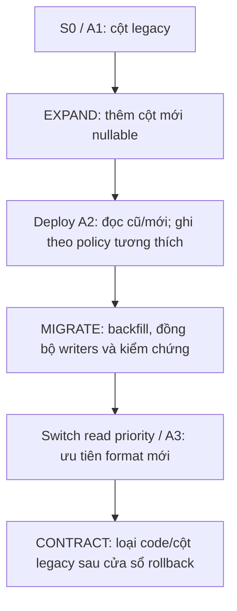

# Đọc tương thích khi dữ liệu hoặc lược đồ có nhiều phiên bản trong Hibernate

Trong một hệ thống Java dùng Hibernate, thay đổi cấu trúc cơ sở dữ liệu hiếm khi chỉ là sửa một annotation `@Column` rồi chạy lại ứng dụng. Khi triển khai liên tục, thường có một khoảng thời gian mà **ứng dụng cũ, ứng dụng mới và các hàng dữ liệu được ghi ở nhiều định dạng** cùng tồn tại.

Ví dụ: phiên bản đầu lưu giá đơn hàng vào cột `amount_cents BIGINT`, sau đó hệ thống muốn dùng `amount_decimal DECIMAL(19,2)` và `currency_code VARCHAR(3)`. Trong quá trình triển khai:

- Hàng cũ chỉ có `amount_cents`.
- Hàng mới có thể có cả hai cách biểu diễn.
- Một vài instance cũ vẫn chỉ biết cột legacy.
- Một vài instance mới muốn đọc định dạng mới.
- Background job đang chuyển dần dữ liệu.
- Tenant A đã cập nhật schema, tenant B chưa.
- Message hoặc JSON payload lưu lâu vẫn có cấu trúc cũ.

Nếu code mới chỉ gọi `order.getAmountDecimal()`, hàng cũ có thể trả `null`. Nếu code mới mapping một cột chưa tồn tại trên database, ngay cả câu `SELECT` cũng có thể thất bại. Nếu code cũ không còn đọc được hàng mới, rolling deployment có thể hỏng ngay giữa quá trình rollout.

**Đọc tương thích** là khả năng diễn giải đúng dữ liệu thuộc các phiên bản hợp lệ **trong một cửa sổ chuyển đổi được xác định**, mà không âm thầm mất nghĩa, không giả định schema đã đồng bộ ở mọi nơi và không phá tính nhất quán của những transaction đang chạy.

Bài học tập trung vào:

1. Phân biệt version của ứng dụng, schema, dữ liệu và entity.
2. Thiết kế quy trình **expand → migrate → contract** với các mốc an toàn cho cả reader và writer.
3. Xây **dual-read** có quy tắc chọn nguồn rõ ràng, không chỉ viết `COALESCE` tùy tiện.
4. Áp dụng Hibernate mapping, JPQL/Criteria projection, `AttributeConverter` và xử lý JSON phiên bản.
5. Bảo vệ dữ liệu khi rollback ứng dụng, chạy backfill song song, dùng L1/L2 cache hoặc nhiều tenant.
6. Kiểm thử ma trận phiên bản, quan sát tỷ lệ legacy-read và xác định khi nào có thể xóa nhánh tương thích.

> Phạm vi: bài viết dùng `jakarta.persistence` và các API Hibernate hiện đại. Với Hibernate 5 hoặc dự án `javax.persistence`, cần dùng import và API tương ứng. Cách triển khai migration trên PostgreSQL, MySQL, Oracle, SQL Server hay DBMS khác phải xét cú pháp và đặc điểm transaction/DDL cụ thể; không có một SQL migration portable cho mọi hệ thống.

---

## 1. Bốn loại version không được nhầm lẫn

Từ “version” thường được dùng cho nhiều thứ:

| Loại | Ví dụ | Nó trả lời câu hỏi gì? |
| --- | --- | --- |
| Application version | `order-service 2.8` | Binary này biết đọc/ghi những cấu trúc nào? |
| Database schema version | Flyway migration `V42` | Bảng, cột, index và constraint nào đã tồn tại? |
| Data representation version | `amount_format_version = 1/2` | **Hàng/payload này** đang mang ý nghĩa và format nào? |
| JPA optimistic locking version | `@Version long version` | Hàng đã bị một transaction khác thay đổi chưa? |

Đặc biệt, `@Version` của Hibernate **không phải** version của dữ liệu để lựa chọn parser.

```java
@Version
private long version;
```

Thuộc tính trên thường giúp phát hiện concurrent updates qua optimistic locking. Nếu hàng có `version = 9`, không thể suy ra nó đang chứa JSON schema v9 hoặc cột amount format v9.

### Ba câu hỏi cần hỏi trước mỗi migration

1. **Schema có cột cần đọc chưa?** Nếu chưa, HQL/SQL tham chiếu cột sẽ lỗi, bất kể hàng có dữ liệu hay không.
2. **Dữ liệu đã chuyển format chưa?** Cột tồn tại không có nghĩa mọi hàng đã backfill.
3. **Những writer nào vẫn đang hoạt động?** Nếu một binary cũ còn ghi vào cột cũ, bản mới phải hiểu và xử lý khả năng dữ liệu mới đã stale.

Chỉ khi tách ba câu hỏi đó, ta mới xây được một kế hoạch đọc tương thích thực sự.

## 2. Một tình huống xuyên suốt: đổi cách lưu số tiền

Phiên bản đầu lưu số tiền theo cent, cố định đơn vị USD:

```sql
CREATE TABLE purchase_orders (
    id             BIGINT PRIMARY KEY,
    amount_cents   BIGINT NOT NULL,
    status         VARCHAR(20) NOT NULL
);
```

Dữ liệu mẫu:

| id | amount_cents | Ý nghĩa v1 |
| ---: | ---: | --- |
| 1001 | 1299 | USD 12.99 |
| 1002 | 0 | USD 0.00 |
| 1003 | -150 | USD -1.50, nếu domain cho phép số âm |

Ứng dụng dùng:

```java
@Entity
@Table(name = "purchase_orders")
public class PurchaseOrder {
    @Id
    private Long id;

    @Column(name = "amount_cents", nullable = false)
    private long amountCents;

    // ...
}
```

Sau này sản phẩm cần lưu số thập phân và mã tiền tệ:

```sql
ALTER TABLE purchase_orders
    ADD COLUMN amount_decimal DECIMAL(19, 2);

ALTER TABLE purchase_orders
    ADD COLUMN currency_code VARCHAR(3);

ALTER TABLE purchase_orders
    ADD COLUMN amount_format_version INTEGER;
```

DDL trên chỉ minh họa ý tưởng; cú pháp, locking và tác động lên bảng lớn phụ thuộc DBMS.

Mục tiêu cuối:

| id | amount_decimal | currency_code | amount_format_version |
| ---: | ---: | --- | ---: |
| 1001 | 12.99 | USD | 2 |
| 1002 | 0.00 | USD | 2 |
| 1003 | -1.50 | USD | 2 |

Nhưng trong giai đoạn chuyển đổi, cùng một bảng có thể chứa cả hàng v1 và v2.

## 3. Các trạng thái schema và dữ liệu

Nên đặt tên cho các trạng thái rollout:

| Trạng thái | Schema | Dữ liệu |
| --- | --- | --- |
| S0 — Legacy | Chỉ có `amount_cents` | Tất cả ở format v1 |
| S1 — Expanded | Có cả cột cũ và cột mới, cột mới nullable | Có thể chưa backfill |
| S2 — Migrating | Vẫn có cả cột cũ/mới | Một phần v1, một phần v2, có thể còn writers cũ |
| S3 — Fully migrated | Vẫn có cả cột cũ/mới | Tất cả hàng thỏa invariant v2, writer mới đã ổn định |
| S4 — Contracted | Đã loại cột legacy | Chỉ còn format v2 |

Ứng dụng cũng có các mức năng lực:

- **A1:** chỉ biết cột `amount_cents`.
- **A2:** biết cả hai cách đọc; có chính sách ghi tương thích.
- **A3:** chỉ dùng các cột mới; không còn phụ thuộc cột cũ.

Một ma trận giản lược:

| Cặp | Có thể vận hành? | Điều kiện |
| --- | --- | --- |
| A1 + S0 | Có | Trạng thái ban đầu |
| A1 + S1/S2/S3 | Có điều kiện | Cột cũ vẫn còn và dữ liệu ghi mới vẫn giữ cột cũ đúng nghĩa |
| A1 + S4 | Không | Query cũ tham chiếu cột đã xóa |
| A2 + S0 | Thường không | Mapping/query mới tham chiếu những cột chưa tồn tại |
| A2 + S1/S2/S3 | Có | Dual-read và writer compatibility được thiết kế đúng |
| A2 + S4 | Thường không | Binary còn mapping/tham chiếu cột cũ |
| A3 + S1/S2 | Chưa chắc | Có thể vẫn còn hàng chỉ có v1 |
| A3 + S3/S4 | Có | Dữ liệu và constraints đã đáp ứng format v2 |

**Quan trọng:** A2 không “tự động chạy trên S0” chỉ nhờ câu Java `if (newAmount != null)`. Nếu SQL đã SELECT một cột `amount_decimal` chưa tồn tại, JDBC sẽ báo lỗi trước khi Java có cơ hội vào nhánh fallback.

## 4. Backward compatibility và forward compatibility

Hai khái niệm dễ bị đảo chiều.

### Backward-compatible reader

Ứng dụng **mới** có thể đọc dữ liệu do ứng dụng **cũ** ghi.

Ví dụ A2 đọc được hàng v1 với `amount_cents=1299`.

### Forward-compatible reader

Ứng dụng **cũ hơn** có thể đọc dữ liệu được ghi theo định dạng **mới hơn** mà vẫn tồn tại trong giai đoạn rollout.

Ví dụ A1 chỉ đọc `amount_cents` vẫn cần thấy đúng USD 12.99 khi A2 ghi cột mới.

Điểm khó: code A1 không biết `currency_code` hay định dạng số thập phân; không thể kỳ vọng nó hiểu EUR hay JPY chỉ vì database có cột mới.

Do đó thường phải **giới hạn những giá trị/format mà writer mới được phép phát ra** trong giai đoạn còn A1.

### Compatibility là thuộc tính của một cặp reader–data

Không có một nhãn “backward compatible” tuyệt đối cho cả hệ thống. Hãy chỉ rõ:

- Reader phiên bản nào?
- Schema nào?
- Row/payload format nào?
- Writer nào?
- Feature nào được phép bật?
- Cần đọc, ghi hay rollback theo hướng nào?

Một hệ thống có thể backward-compatible với hàng cũ, nhưng không forward-compatible khi writer mới bắt đầu phát dữ liệu có currency khác USD.

## 5. Expand → migrate → contract

Mẫu triển khai an toàn phổ biến là **expand–migrate–contract** (cũng gọi expand-and-contract).



Các mốc:

1. **Expand database:** thêm cột/bảng/constraint mềm mà code A1 vẫn chạy được.
2. **Deploy compatible reader:** A2 hiểu các hàng v1 và v2.
3. **Ổn định chính sách writer:** không để cột cũ và mới lệch nghĩa.
4. **Backfill dữ liệu:** chuyển hàng legacy theo lô, idempotent.
5. **Kiểm chứng:** không còn hàng legacy ngoài phạm vi được chấp nhận; metrics tốt.
6. **Chuyển sang canonical v2:** các yêu cầu đọc/ghi dựa trên format mới.
7. **Contract:** loại nhánh legacy và cột legacy sau khi không còn A1/A2 phụ thuộc nó.

**Không gộp tất cả vào một release** nếu ứng dụng triển khai rolling hoặc DB có nhiều nhóm client không nâng cấp cùng lúc.

## 6. Expand phải đi trước code tham chiếu cột mới

Giả sử A2 mapping:

```java
@Column(name = "amount_decimal")
private BigDecimal amountDecimal;
```

Ngay cả khi Java có:

```java
if (amountDecimal != null) {
    return amountDecimal;
}
return legacyAmount();
```

Hibernate có thể sinh SQL:

```sql
SELECT
    id,
    amount_cents,
    amount_decimal,
    currency_code,
    amount_format_version
FROM purchase_orders
WHERE id = ?;
```

Trên S0, các cột mới chưa tồn tại, query thất bại.

**Kết luận:** fallback ở Java giải quyết **nhiều phiên bản dữ liệu trong một schema đã được mở rộng**, không tự giải quyết **một schema chưa có cột được mapping**.

### Hibernate schema validation cũng có giới hạn

`hibernate.hbm2ddl.auto=validate` có thể phát hiện sự không khớp giữa mapping và schema, nhưng nó không xác nhận mọi hàng đã backfill đúng, hay mọi writer cũ đã ngừng hoạt động.

Trong production, migration schema nên do công cụ như Flyway/Liquibase và quy trình release kiểm soát. Không dùng `hbm2ddl.auto=update` làm phương án thay thế cho kế hoạch triển khai, data backfill và rollback có kiểm chứng.

## 7. Một mô hình Money ổn định ở tầng domain

Tách **định dạng lưu trữ** khỏi **ý nghĩa nghiệp vụ** giúp code đọc tương thích dễ hơn.

```java
package com.example.orders.domain;

import java.math.BigDecimal;
import java.util.Objects;

public record Money(
    BigDecimal amount,
    String currencyCode
) {
    public Money {
        Objects.requireNonNull(amount, "amount");
        Objects.requireNonNull(currencyCode, "currencyCode");

        if (currencyCode.length() != 3) {
            throw new IllegalArgumentException(
                "Mã tiền tệ phải có 3 ký tự"
            );
        }
    }
}
```

Ở đây `Money` là giá trị nghiệp vụ, không phải JPA entity.

Lớp lưu trữ v1: `1299 cents`.

Lớp lưu trữ v2: `12.99` + `USD`.

Cả hai đều có thể được chuẩn hóa thành:

```java
new Money(
    new BigDecimal("12.99"),
    "USD"
);
```

### Không đoán ý nghĩa của dữ liệu legacy

Trong ví dụ, cột cũ được **quy ước là USD cents**. Nếu thực tế cột legacy chứa đơn vị không rõ hoặc nhiều currency, không thể tùy tiện đặt `"USD"` cho mọi hàng.

Trước khi viết converter, cần có **data contract phiên bản cũ**: scale, sign, đơn vị đo, timezone, kiểu mã và giá trị đặc biệt.

## 8. Đổi cents sang BigDecimal chính xác

Khi legacy có `Long amountCents`:

```java
static Money fromLegacyCents(long cents) {
    return new Money(
        BigDecimal.valueOf(cents, 2),
        "USD"
    );
}
```

`BigDecimal.valueOf(cents, 2)` tạo decimal với unscaled value `cents` và scale 2:

```text
1299 -> 12.99
0    -> 0.00
-150 -> -1.50
```

Không dùng:

```java
new BigDecimal((double) cents / 100);
```

cho giá trị tiền, vì bước chuyển qua floating-point có thể mang sai số biểu diễn.

### Chuyển ngược để giữ tương thích A1

Nếu v2 vẫn cần ghi cột cũ:

```java
static long toLegacyCents(Money value) {
    if (!"USD".equals(value.currencyCode())) {
        throw new IllegalArgumentException(
            "Legacy amount_cents chỉ biểu diễn USD"
        );
    }

    return value.amount()
        .movePointRight(2)
        .longValueExact();
}
```

`longValueExact()` giúp phát hiện trường hợp không thể biểu diễn chính xác, ví dụ 12.345 USD hoặc giá trị vượt giới hạn Long.

**Không âm thầm làm tròn** nếu nghiệp vụ chưa định nghĩa rounding policy. Một giá trị mới không thể biểu diễn ở schema cũ là một tín hiệu **writer đã vượt khả năng forward compatibility**.

## 9. Dual-read tại entity: hai cột và một quy tắc đọc

Entity A2 có thể mapping cả cách biểu diễn cũ và mới:

```java
import jakarta.persistence.*;
import java.math.BigDecimal;

@Entity
@Table(name = "purchase_orders")
public class PurchaseOrder {

    @Id
    private Long id;

    @Column(name = "amount_cents")
    private Long amountCentsLegacy;

    @Column(name = "amount_decimal", precision = 19, scale = 2)
    private BigDecimal amountDecimal;

    @Column(name = "currency_code", length = 3)
    private String currencyCode;

    @Column(name = "amount_format_version")
    private Integer amountFormatVersion;

    @Version
    private long rowVersion;

    protected PurchaseOrder() {}

    public Money readAmount() {
        if (Integer.valueOf(2).equals(amountFormatVersion)) {
            if (amountDecimal == null || currencyCode == null) {
                throw new IllegalStateException(
                    "Row v2 thiếu dữ liệu amount/currency"
                );
            }

            return new Money(amountDecimal, currencyCode);
        }

        if (amountFormatVersion == null ||
                Integer.valueOf(1).equals(amountFormatVersion)) {
            if (amountCentsLegacy == null) {
                throw new IllegalStateException(
                    "Row legacy thiếu amount_cents"
                );
            }

            return new Money(
                BigDecimal.valueOf(amountCentsLegacy, 2),
                "USD"
            );
        }

        throw new IllegalStateException(
            "Không hỗ trợ amount format version: " +
            amountFormatVersion
        );
    }
}
```

Ở đây:

- `null` version được xem là dấu hiệu row legacy **chỉ nếu migration contract quy định như vậy**.
- `version=2` nghĩa là các cột mới là nguồn dữ liệu có thẩm quyền.
- Nếu row v2 thiếu cột cần thiết, code báo lỗi thay vì im lặng quay về giá cũ.
- Version không được nhận biết gây lỗi có kiểm soát, không bị đoán thành v1.
- `rowVersion` của `@Version` là optimistic locking, độc lập `amountFormatVersion`.

### Vì sao dùng field nullable trong giai đoạn chuyển đổi?

Trong S1/S2, cột mới chưa có ở một số row. Nếu khai báo Java primitive `long` cho giá trị có thể NULL, mất khả năng phân biệt **không có dữ liệu** với **0**. Hãy dùng `Long`/`Integer` khi null mang ý nghĩa trạng thái migration.

## 10. Một getter đọc không đồng nghĩa một chính sách ghi

Method `readAmount()` giải quyết một bài toán: **chọn dữ liệu nào để đọc**.

Nó **không tự giải quyết** cách A1 và A2 ghi đồng thời.

Cần tách policy:

- **Read policy:** với row version này, nguồn nào có thẩm quyền?
- **Write policy:** writer phải ghi cột nào?
- **Migration policy:** job chuyển cột cũ thành cột mới như thế nào?
- **Conflict policy:** nếu hai cột chứa giá trị khác nhau thì báo lỗi, tự sửa hay chấp nhận theo version?
- **Rollback policy:** nếu quay về A1, cột legacy còn phản ánh bản ghi mới nhất không?

Nếu không xác định chúng, một getter fallback có thể trả kết quả đúng lúc đầu nhưng âm thầm trả số cũ sau khi một writer khác cập nhật.

## 11. Dual-write khi ứng dụng cũ vẫn cần đọc

Trong giai đoạn A1 còn hoạt động, A2 thường phải giữ cột legacy có nghĩa hợp lệ.

```java
public void changeAmount(Money money) {
    long cents = toLegacyCents(money);

    this.amountCentsLegacy = cents;
    this.amountDecimal = money.amount();
    this.currencyCode = money.currencyCode();
    this.amountFormatVersion = 2;
}
```

Đây là minh họa ý định **dual-write trong cùng một entity/transaction**, không phải chiến lược đúng cho mọi migration.

Điều kiện quan trọng:

- Currency phải thuộc tập v1 biểu diễn được, ví dụ USD.
- Scale 2 là hợp lệ theo nghiệp vụ.
- Cả hai biểu diễn phải ghi atomically trong cùng transaction.
- Concurrent updates phải được kiểm soát.
- Writer cũ còn ghi chỉ cột legacy thì phải có cơ chế xử lý đồng bộ hai phía.

### Mấu chốt: A1 update cột cũ sau khi A2 đã viết v2

Giả sử:

```text
T1: A2 lưu amount_cents=1200, amount_decimal=12.00, version=2
T2: A1 đổi amount_cents=1500, không biết amount_decimal
T3: A2 đọc version=2 và lấy amount_decimal=12.00
```

Kết quả A2 trả **12.00**, trong khi A1 muốn cập nhật **15.00**.

**Đây là lỗi stale dual-read**. Hai cột có dữ liệu không NULL không có nghĩa chúng còn đồng bộ.

Phải quyết định: trong khoảng A1 còn là writer, **cột nào có thẩm quyền** và ai duy trì cột còn lại.

## 12. Các chiến lược khi nhiều thế hệ writer cùng tồn tại

### Chiến lược A: cột cũ tiếp tục là source of truth

Trong thời gian A1 còn ghi, A2 đọc số tiền từ `amount_cents`; cột mới chỉ là shadow/backfill.

Ưu điểm:

- Không có trường hợp A1 ghi cột cũ nhưng A2 lại ưu tiên dữ liệu mới đã stale.
- Rollback A2 về A1 dễ hơn nếu mọi giá trị đều còn biểu diễn được ở v1.

Nhược điểm:

- Chưa khai thác được khả năng lưu currency/scale mới.
- Cột mới cần được đồng bộ trước khi chuyển hẳn.
- Mọi thay đổi A2 vẫn phải tuân theo giới hạn v1.

### Chiến lược B: trigger/database synchronization

Thiết kế trigger đồng bộ cột cũ → mới khi A1 ghi, và có thể mới → cũ khi A2 ghi.

Ưu điểm: có thể bao phủ writer cũ mà không cần thay A1.

Rủi ro:

- Trigger hai chiều dễ gây vòng lặp, thứ tự cập nhật phức tạp và khó debug.
- Logic currency/rounding có thể không biểu diễn được trong cột cũ.
- Bulk backfill, replication và transaction latency cần đo.
- Từng DBMS có semantics trigger khác nhau.

Nên có **một hướng ưu tiên rõ**, không dùng trigger đồng bộ hai chiều một cách ngây thơ.

### Chiến lược C: loại bỏ mọi writer cũ trước khi dùng v2 làm canonical

1. Expand schema.
2. Deploy A2 đọc legacy, còn ghi format cũ hoặc dual-write theo nguồn có thẩm quyền.
3. Đợi A1 rời khỏi traffic và worker queues.
4. Backfill và reconcile.
5. Chuyển A2/A3 dùng v2 làm canonical.
6. Sau rollback window, bỏ cột cũ.

Đây là chiến lược dễ suy luận hơn nếu quy trình deploy cho phép.

### Chiến lược D: CDC/outbox

Change data capture hoặc outbox có thể giữ hai representation đồng bộ theo luồng sự kiện, nhưng cần xử lý ordering, retry, idempotency và độ trễ. Không dùng khi business read cần consistency tức thời nếu pipeline bất đồng bộ chưa có guarantee phù hợp.

## 13. Quy tắc ưu tiên phải là contract, không phải may rủi

Một anti-pattern:

```java
public Money amount() {
    if (amountDecimal != null) {
        return new Money(amountDecimal, currencyCode);
    }

    return fromLegacyCents(amountCentsLegacy);
}
```

Có những trường hợp nó đúng, nhưng cũng có các vấn đề:

- `amountDecimal` có thể đã stale sau A1 update.
- `currencyCode` có thể NULL dù amount không NULL.
- Có thể có giá trị 0 mới hợp lệ.
- Format mới có thể thay đổi scale/đơn vị.
- Một writer mới có thể đánh dấu v2 nhưng thiếu dữ liệu.

Ưu tiên tốt hơn:

```text
Nếu row rõ ràng là v2 và thỏa invariant v2:
    đọc các cột v2
Nếu row rõ ràng là v1:
    chuyển từ cột legacy theo contract v1
Nếu row khai báo version không hỗ trợ:
    phát hiện và xử lý như lỗi dữ liệu/version
Nếu hai nguồn xung đột:
    áp dụng policy reconciliation đã định nghĩa
```

**Presence-check** (`newColumn != null`) chỉ nên được dùng làm version detector khi đã bảo đảm bằng migration và write policy rằng điều kiện đó luôn tương đương “row đã được chuyển đúng”.

## 14. NULL, zero và giá trị thiếu

Trong migrations, `NULL` thường bị dùng quá nhiều vai trò:

- Chưa backfill.
- Không biết số tiền.
- Giá trị nghiệp vụ thật sự không áp dụng.
- Writer lỗi nên không ghi.
- Row đã bị xóa mềm.
- Format/version chưa hỗ trợ.

Nếu một cột vừa có thể hợp lệ là NULL vừa dùng NULL làm dấu “chưa migrated”, reader không thể tự phân biệt.

Ví dụ:

```text
amount_decimal = NULL
```

có thể nghĩa:

1. Hàng v1 chưa chuyển.
2. Hàng v2 không có giá trị (nếu domain cho phép).
3. Hàng v2 lỗi, thiếu dữ liệu bắt buộc.

Giải pháp có thể là:

- `amount_format_version`.
- `migration_status` riêng.
- Một tag kiểu dữ liệu có semantics rõ.
- CHECK constraint theo version.
- Không cho phép NULL nghiệp vụ trong trường hợp thực sự không hợp lệ.

### Zero không phải missing

`BigDecimal.ZERO`, `0L` và `false` là giá trị hợp lệ. Không dùng:

```java
if (amount == 0) {
    // Chưa migrated
}
```

nếu zero là một số tiền hợp lệ. Không dùng sentinel “-1” khi giá trị âm cũng có thể hợp lệ.

## 15. `COALESCE`: ngắn gọn nhưng không biết version

Trong SQL:

```sql
SELECT
    COALESCE(amount_decimal, amount_cents / 100.0) AS amount
FROM purchase_orders;
```

Cách này đọc cột mới nếu khác NULL, ngược lại đọc legacy.

Ưu điểm:

- Dễ viết.
- Có thể dùng trong báo cáo/DTO projection.
- Hữu ích khi cột mới luôn được coi là canonical ngay sau khi được populate và không bao giờ stale.

Giới hạn:

- Không kiểm tra currency.
- Không kiểm tra version.
- Không phát hiện hai cột lệch nhau.
- Không phân biệt NULL hợp lệ với chưa backfill.
- Có thể gây conversion integer/decimal sai tùy kiểu SQL và dialect.
- Có thể làm predicate/filter kém tận dụng index.

**COALESCE không phải một protocol migration.** Nó chỉ chọn expression non-NULL đầu tiên.

### Chọn CASE theo version khi phù hợp

```sql
SELECT
    CASE
        WHEN amount_format_version = 2
            THEN amount_decimal
        WHEN amount_format_version IS NULL
          OR amount_format_version = 1
            THEN CAST(amount_cents AS DECIMAL(19,2)) / 100
        ELSE NULL
    END AS readable_amount
FROM purchase_orders;
```

SQL này vẫn cần kiểm tra dữ liệu v2 thiếu amount và xử lý version lạ ở application. Một CASE trả NULL cho version không hỗ trợ có thể che lỗi nếu caller không phân biệt với NULL nghiệp vụ.

Với dữ liệu tiền tệ, kiểu `DECIMAL`, phép chia, overflow/rounding và scale cần kiểm chứng trên DBMS thực tế.

## 16. Phân biệt schema compatibility với data compatibility

Một số team nói “reader tương thích v1/v2” nhưng chỉ kiểm tra row format, bỏ qua việc schema v1 không có cột v2.

### Data compatibility

Trên schema S1 đã có cả hai cột:

```java
if (version == 2) { readNew(); }
else { readLegacy(); }
```

có thể hoạt động.

### Schema compatibility

Trên schema S0 không có `amount_decimal`:

```sql
SELECT amount_decimal FROM purchase_orders;
```

thất bại trước bước data mapping.

Nếu một binary thật sự bắt buộc chạy với cả S0 và S1, cần kiến trúc khác, ví dụ:

- Chỉ deploy sau khi S1 đã có ở mọi DB/tenant cần phục vụ.
- Có hai bộ query/repository implementations theo schema capability được xác định tại startup hoặc routing.
- Dùng view compatibility được tạo thống nhất trước rollout.
- Tránh mapping entity của code mới vào cột chưa tồn tại trên schema cũ.
- Phân vùng rollout theo tenant/schema version rõ ràng.

Không dùng `try/catch(SQLException)` quanh từng truy vấn làm chiến lược chính để “tự đoán schema”: gây thêm round trips, không rõ behavior và dễ che lỗi quyền truy cập/migration khác.

## 17. Mapping Hibernate tĩnh: một giới hạn thực tế

Hibernate xây metadata mapping khi khởi tạo `SessionFactory`. Một entity có:

```java
@Column(name = "amount_decimal")
private BigDecimal amountDecimal;
```

sẽ gắn với cột đó theo mapping của persistence unit. Nó không tự thay tên cột theo từng hàng.

Với multi-tenancy có các tenant ở các phiên bản schema khác nhau, một `SessionFactory` dùng cùng mapping có thể không chạy được cho mọi tenant chưa được expand.

Đây là lý do nên:

- Expand schema trên toàn bộ phạm vi tenant cần phục vụ trước deploy A2; hoặc
- Có cơ chế routing/schema version riêng, với các query/mapping tương thích cho từng nhóm; hoặc
- Chạy các phiên bản ứng dụng riêng cho các cohort tenant trong thời gian chuyển đổi.

**Row-level version và mapping-level schema đều cần được quản lý.** Một `amount_format_version` trên row không thể cứu một SELECT tham chiếu cột chưa tồn tại.

## 18. Đọc tương thích bằng projection trong JPQL/HQL

Nếu application chỉ cần hiển thị một danh sách, có thể không cần materialize toàn bộ entity. Trong schema S1/S2, dùng projection lấy dữ liệu thô rồi chuẩn hóa ở service.

DTO tạm dùng để đọc:

```java
package com.example.orders.query;

import java.math.BigDecimal;

public record PriceReadRow(
    Long id,
    Integer formatVersion,
    Long legacyCents,
    BigDecimal decimalAmount,
    String currencyCode
) {}
```

Query:

```java
List<PriceReadRow> rows = em.createQuery(
    """
    select new com.example.orders.query.PriceReadRow(
        o.id,
        o.amountFormatVersion,
        o.amountCentsLegacy,
        o.amountDecimal,
        o.currencyCode
    )
    from PurchaseOrder o
    where o.status = :status
    order by o.id
    """,
    PriceReadRow.class
)
.setParameter("status", OrderStatus.PAID)
.getResultList();
```

Sau đó:

```java
public Money normalize(PriceReadRow row) {
    if (Integer.valueOf(2).equals(row.formatVersion())) {
        if (row.decimalAmount() == null
                || row.currencyCode() == null) {
            throw new IllegalStateException(
                "Invalid v2 row " + row.id()
            );
        }

        return new Money(
            row.decimalAmount(),
            row.currencyCode()
        );
    }

    if (row.formatVersion() == null
            || Integer.valueOf(1).equals(row.formatVersion())) {
        if (row.legacyCents() == null) {
            throw new IllegalStateException(
                "Invalid v1 row " + row.id()
            );
        }

        return fromLegacyCents(row.legacyCents());
    }

    throw new IllegalArgumentException(
        "Unsupported data version: " + row.formatVersion()
    );
}
```

Ưu điểm:

- Reader policy nằm trong một hàm có thể unit-test.
- DTO kết quả không chứa lazy proxy.
- SQL chỉ lấy những trường cần để chuẩn hóa.
- Khi đổi policy, có thể thay logic trong một lớp chuyên trách.

Nhược điểm: query vẫn tham chiếu toàn bộ cột S1/S2 nên không chạy trên S0; cần pagination khi tập dữ liệu lớn.

## 19. Đừng trộn version parsing vào mọi controller

Một anti-pattern:

```java
@GetMapping("/{id}")
public OrderResponse get(@PathVariable Long id) {
    PurchaseOrder o = repo.findById(id).orElseThrow();

    BigDecimal amount = o.getAmountDecimal() != null
        ? o.getAmountDecimal()
        : BigDecimal.valueOf(o.getAmountCentsLegacy(), 2);

    return new OrderResponse(...);
}
```

Nếu 15 endpoints đều lặp logic tương tự, sẽ xuất hiện 15 cách diễn giải format và 15 vị trí cần xóa sau migration.

Tách thành một **compatibility reader** hoặc domain normalization layer:

```text
Controller
   -> Application query service
      -> Repository (row/entity/raw projection)
      -> VersionedAmountReader
      -> Normalized DTO / domain Money
   -> Response DTO
```

Tầng controller chỉ nhận dữ liệu có ý nghĩa nghiệp vụ đã ổn định.

## 20. Khi nào dùng `AttributeConverter`?

JPA có:

```java
@Converter
public class MoneyConverter
        implements AttributeConverter<Money, String> {
    // ...
}
```

`AttributeConverter` rất phù hợp khi **cùng một cột database** lưu nhiều biểu diễn ở các thời kỳ, ví dụ:

```text
v1: "1299"                  (USD cents)
v2: "v2|USD|12.99"          (tag|currency|decimal)
```

Nó biến giá trị Java domain thành kiểu JDBC và ngược lại.

### Điều mà `AttributeConverter` không tự làm được

`AttributeConverter<X,Y>` thông thường nhận **một giá trị cột** thuộc kiểu Y. Nó không tự biết row ID, dữ liệu của cột bên cạnh hay database schema version.

Do đó một converter của cột `amount_decimal` không tự đọc thêm `amount_cents` nếu v2 NULL. Chuyển **giữa hai cột** thường cần entity getter, projection/service mapping hoặc mapping/converter custom mạnh hơn theo Hibernate-specific API.

## 21. Ví dụ converter đọc nhiều format trong một cột

Giả sử cột `amount_value VARCHAR(...)` từng lưu cent dưới dạng số nguyên, còn format mới lưu chuỗi có tag.

```java
import jakarta.persistence.AttributeConverter;
import jakarta.persistence.Converter;
import java.math.BigDecimal;

@Converter
public class MoneyTextConverter
        implements AttributeConverter<Money, String> {

    @Override
    public Money convertToEntityAttribute(String raw) {
        if (raw == null) {
            return null; // Chỉ khi null hợp lệ theo domain.
        }

        if (raw.startsWith("v2|")) {
            String[] parts = raw.split("\\|", 3);

            if (parts.length != 3) {
                throw new IllegalArgumentException(
                    "Invalid v2 money format"
                );
            }

            return new Money(
                new BigDecimal(parts[2]),
                parts[1]
            );
        }

        long cents = Long.parseLong(raw);
        return new Money(
            BigDecimal.valueOf(cents, 2),
            "USD"
        );
    }

    @Override
    public String convertToDatabaseColumn(Money value) {
        if (value == null) {
            return null;
        }

        return "v2|" + value.currencyCode()
            + "|" + value.amount().toPlainString();
    }
}
```

Mapping:

```java
@Convert(converter = MoneyTextConverter.class)
@Column(name = "amount_value")
private Money amount;
```

Code trên **đọc được v1 và v2**, nhưng luôn ghi v2. Đây là một **chính sách writer** cần bật đúng thời điểm.

Nếu A1 vẫn chạy và nó chỉ hiểu chuỗi số nguyên, hàng do A2 ghi theo `"v2|USD|12.99"` sẽ làm A1 lỗi. Read compatibility của A2 không tự bảo đảm forward compatibility của A1.

### Không “fallback” mọi lỗi parse sang v1

Đoạn:

```java
try {
    return parseV2(raw);
} catch (Exception ignored) {
    return parseV1(raw);
}
```

rất nguy hiểm. Một payload v2 bị hỏng có thể bị diễn giải nhầm theo v1 hoặc che mất dữ liệu lỗi.

Hãy nhận diện format rõ (prefix/version) rồi validate đúng parser của nó.

## 22. JSON có nhiều phiên bản

Dữ liệu versioned có thể nằm trong JSON/JSONB, không chỉ ở các cột relational.

Ví dụ v1:

```json
{
  "priceCents": 1299
}
```

Ví dụ v2:

```json
{
  "version": 2,
  "money": {
    "amount": "12.99",
    "currency": "USD"
  }
}
```

Một reader có thể chuẩn hóa cả hai sang `Money`.

### Java decoder theo version

Ví dụ khái niệm với Jackson `JsonNode`:

```java
public Money decode(JsonNode node) {
    JsonNode versionNode = node.get("version");

    if (versionNode == null || versionNode.isNull()) {
        JsonNode centsNode = node.get("priceCents");

        if (centsNode == null || !centsNode.canConvertToLong()) {
            throw new IllegalArgumentException(
                "Invalid legacy priceCents"
            );
        }

        return fromLegacyCents(centsNode.longValue());
    }

    int version = versionNode.intValue();

    if (version == 2) {
        JsonNode money = node.get("money");

        if (money == null || !money.isObject()
                || !money.hasNonNull("amount")
                || !money.hasNonNull("currency")) {
            throw new IllegalArgumentException(
                "Invalid v2 money payload"
            );
        }

        return new Money(
            new BigDecimal(money.get("amount").asText()),
            money.get("currency").asText()
        );
    }

    throw new UnsupportedOperationException(
        "Unsupported payload version: " + version
    );
}
```

Đây là ví dụ trình bày trọng tâm. Production parser cần validate type/version đầy đủ, length, currency code, decimal precision, scale, giá trị âm, kích thước JSON và nguồn dữ liệu untrusted.

### Vì sao amount v2 nên là chuỗi trong ví dụ?

JSON number có thể bị parser hoặc client đưa qua binary floating-point. Nếu tiền tệ cần decimal chính xác, biểu diễn `"12.99"` và parse thành `BigDecimal` tránh một bước chuyển qua `double` ngoài ý muốn.

Một hệ thống vẫn có thể dùng JSON number nếu các bên thống nhất parser decimal chính xác; điều quan trọng là **contract**, không phải bắt buộc mọi API đều encode money thành string.

## 23. Hibernate JSON mapping không giải quyết versioning thay bạn

Hibernate 6 hỗ trợ JSON mapping theo dialect và cơ chế type phù hợp, ví dụ:

```java
@JdbcTypeCode(SqlTypes.JSON)
@Column(name = "details_json")
private OrderDetails details;
```

Các import như `org.hibernate.annotations.JdbcTypeCode` và `org.hibernate.type.SqlTypes` là Hibernate-specific.

Mapping JSON không tự biết `OrderDetails` v1/v2 khác nhau thế nào. Jackson/custom deserializer, converter hoặc application decoder vẫn phải diễn giải payload có version.

Nếu định nghĩa một Java class chỉ biết v2 rồi gặp payload JSON v1 thiếu fields, có thể:

- Parse thất bại.
- Sinh object có fields null/default.
- Mất thông tin khi ghi ngược.
- Serialize lại v2 không chính xác.

Vì vậy cần parser rõ cho từng version và test vòng đọc–ghi.

## 24. Unknown fields và unknown versions

Một reader tương thích thường có hai chính sách khác nhau:

### Unknown field

Ví dụ payload v2 có thêm `"displayHint"` mà parser cũ không cần. Nếu field này không ảnh hưởng semantics, có thể cho phép bỏ qua theo contract.

### Unknown major version

Ví dụ payload v3 thay `amount` từ USD decimal thành một biểu thức chuyển đổi currency hoặc thay đơn vị đo. Reader v2 **không nên đoán** rằng v3 có thể xử lý như v2.

Các lựa chọn:

- Từ chối có kiểm soát, ghi metric và đưa record vào hàng xử lý lỗi.
- Giữ raw payload để xử lý bằng reader phiên bản mới.
- Chỉ chấp nhận unknown version nếu đã có contract forward compatibility rõ ràng.
- Không làm mất dữ liệu gốc khi không parse được.

**Tolerant reader không đồng nghĩa silent semantic corruption.**

## 25. Enum thay đổi theo thời gian

Đây là một dạng “dữ liệu có nhiều phiên bản” thường bị bỏ qua.

V1:

```java
public enum OrderStatus {
    NEW, PAID, CANCELLED
}
```

V2 đổi `NEW` thành `DRAFT`. Nếu DB vẫn có chuỗi `"NEW"` và entity dùng:

```java
@Enumerated(EnumType.STRING)
private OrderStatus status;
```

một enum V2 không còn giá trị `NEW` có thể không đọc được hàng cũ.

### Phương án 1: giữ alias trong enum tạm thời

Giữ cả `NEW` và `DRAFT` trong giai đoạn chuyển đổi, rồi chuẩn hóa ở domain/query layer.

Nhược điểm: cả hai constant có thể lan ra business logic.

### Phương án 2: converter có alias rõ

```java
@Converter
public class OrderStatusConverter
        implements AttributeConverter<OrderStatus, String> {

    @Override
    public OrderStatus convertToEntityAttribute(String db) {
        if (db == null) {
            return null;
        }

        return switch (db) {
            case "NEW", "DRAFT" -> OrderStatus.DRAFT;
            case "PAID" -> OrderStatus.PAID;
            case "CANCELLED" -> OrderStatus.CANCELLED;
            default -> throw new IllegalArgumentException(
                "Unknown status: " + db
            );
        };
    }

    @Override
    public String convertToDatabaseColumn(OrderStatus value) {
        return value == null ? null : value.name();
    }
}
```

Khi dùng converter, không kết hợp `@Convert` và `@Enumerated` trên cùng attribute như hai cơ chế song song không tương thích. Hãy chọn một mapping rõ ràng.

### Ordinal enum nguy hiểm khi migration

`@Enumerated(EnumType.ORDINAL)` lưu số thứ tự constant. Chèn/đổi thứ tự enum có thể làm dữ liệu cũ được hiểu thành trạng thái khác **mà không báo lỗi**. Trong dữ liệu sống lâu, mã ổn định bằng string/code explicit thường an toàn hơn ordinal.

## 26. Đổi kiểu timestamp, timezone và boolean

Các lỗi versioning không chỉ nằm ở Money.

| Chuyển đổi | Dữ liệu v1 | Dữ liệu v2 | Câu hỏi bắt buộc |
| --- | --- | --- | --- |
| Time | Epoch milliseconds | ISO-8601 UTC | Cùng timezone và precision không? |
| Date | `yyyy-MM-dd` | Timestamp có timezone | Ngày nghiệp vụ hay thời điểm thực? |
| Boolean | `0/1`, `Y/N` | SQL BOOLEAN | NULL nghĩa là gì? |
| Identifier | Numeric ID | UUID string | Có mapping hai chiều và collision policy không? |
| Enum | `NEW` | `DRAFT` | Alias có cùng nghĩa nghiệp vụ không? |
| Address | Text gộp | Nhiều cột có cấu trúc | Có mất thông tin khi parse ngược không? |
| Money | Cents Long | Decimal + currency | Scale/currency/rounding là gì? |
| Phone | Free text | E.164 | Số cũ có country code không? |

Không nên ép những chuyển đổi **mất thông tin** thành hàm tự động mà không có cơ chế đánh dấu “unknown/unresolved”.

### Timestamp đơn vị giây vs milliseconds

Một trường v1 ghi `1700000000` theo seconds, còn v2 dùng milliseconds. Nếu thiếu tag version, một số parser có thể dựa vào số chữ số để đoán. Cách này có thể sai với dữ liệu cũ/giá trị biên.

Tốt nhất ghi rõ format version hoặc chuẩn hóa dữ liệu trước khi bật v2 canonical.

## 27. Đổi tên cột: một migration tưởng dễ

Ví dụ từ `customer_name` sang `display_name`.

**Sai trong rolling deployment:**

```sql
ALTER TABLE customers
RENAME COLUMN customer_name TO display_name;
```

nếu A1 vẫn SELECT `customer_name`, nó lỗi ngay sau migration.

**Hướng an toàn:**

1. Add `display_name` nullable.
2. Deploy A2 hiểu cả hai.
3. Có write policy đồng bộ.
4. Backfill `display_name`.
5. Chuyển readers sang `display_name`.
6. Chỉ drop `customer_name` sau khi không còn A1/A2 cần nó.

Nếu DBMS hỗ trợ view compatibility hoặc alias ở tầng SQL, đó có thể là lựa chọn khác, nhưng cần hiểu view updateability và transaction semantics.

## 28. Tách một bảng thành hai bảng

Giả sử v1:

```text
orders
  id, customer_name, customer_email, total_amount
```

V2:

```text
orders
  id, customer_id, total_amount

customers
  id, name, email
```

Trong quá trình chuyển đổi, có thể có:

- Đơn hàng chưa có `customer_id`.
- Hàng `customers` mới được backfill cho một phần orders.
- A1 tiếp tục update `customer_name` inline.
- A2 đọc `Customer` association.

### Dual-read cần tránh mất hàng

Nếu A2 viết:

```hql
select o
from PurchaseOrder o
join o.customer c
```

thì các Order chưa có `customer_id` có thể biến mất do INNER JOIN.

Có thể cần `LEFT JOIN` và fallback từ cột legacy, tùy schema đã expanded:

```sql
SELECT
    o.id,
    CASE
      WHEN o.customer_id IS NOT NULL THEN c.name
      ELSE o.customer_name
    END AS customer_name
FROM orders o
LEFT JOIN customers c ON c.id = o.customer_id;
```

Nhưng điều này cũng phải có conflict policy: nếu A1 sửa `customer_name` sau khi `customer_id` được gán, tên nào mới là đúng?

**Tách bảng là migration về quan hệ và ownership**, không chỉ đổi danh sách cột.

## 29. Đổi cardinality và association Hibernate

Ví dụ v1 có một shipping address lưu trực tiếp trong Order; v2 hỗ trợ nhiều shipping contacts/addresses.

Một entity mapping:

```java
@OneToMany(mappedBy = "order")
private List<ShippingAddress> addresses;
```

không tự hiểu address cũ ở cột `legacy_shipping_address`.

Reader A2 có thể:

1. Query địa chỉ v2 từ bảng mới khi có marker migrated.
2. Nếu row v1, chuyển từ legacy address sang DTO address đã chuẩn hóa.
3. Không trả entity giả đã managed nếu không có row trong bảng addresses.
4. Tách read-model DTO khỏi entity association nếu cần hiển thị dữ liệu chưa migrate.

Một conversion method có thể tạo `ShippingAddressDto` mà không nhất thiết tạo `ShippingAddress` entity. Tránh gọi `entityManager.persist` chỉ để “đọc” legacy address.

## 30. `@Formula` có thể tạo read expression nhưng có giới hạn

Hibernate `@Formula` cho phép một property read-only được tính từ SQL expression:

```java
@Formula(
    "coalesce(amount_decimal, amount_cents / 100.0)"
)
private BigDecimal readableAmount;
```

Nó có thể hữu ích để đơn giản hóa read-model trên schema đã expanded.

Nhưng:

- Là Hibernate-specific.
- Expression phụ thuộc SQL dialect/kiểu dữ liệu.
- Vẫn tham chiếu **cả hai cột**: không chạy trên S0 nếu cột mới chưa tồn tại.
- Không tự xử lý currency hoặc version.
- Không định nghĩa writer policy.
- Có thể tác động index/query plan.
- Thay đổi DDL/schema vẫn đòi hỏi migration.

**`@Formula` không phải cơ chế tương thích đa schema thần kỳ.**

## 31. `@ColumnTransformer` cũng không quản lý version migration

`@ColumnTransformer` có thể chỉ định SQL read/write transform cho một property:

```java
@ColumnTransformer(
    read = "amount_cents / 100.0",
    write = "? * 100"
)
private BigDecimal amount;
```

Ý tưởng phù hợp cho một cách biểu diễn database cố định với transformation xác định. Nhưng khi chuyển từ hai cột/format khác nhau, nó không thay thế logic chọn nguồn, đồng bộ writer và data backfill.

Ngoài ra, transformation SQL có thể khác dialect và không nhất thiết giữ scale/rounding chính xác. Khi cần multi-version semantics, hãy dùng mapping/read model rõ ràng hơn thay vì nhồi mọi policy vào một annotation.

## 32. Không nhầm lazy-loading với đọc tương thích

Một entity có lazy association chưa initialized và một entity có dữ liệu legacy là hai vấn đề khác.

- **Lazy loading:** dữ liệu chưa được tải vào Persistence Context theo fetch plan.
- **Versioned data:** dữ liệu đã tải nhưng format/cột có thể thuộc phiên bản khác.

`Hibernate.initialize(...)` không chuyển cột cents thành decimal. `JOIN FETCH` không giải quyết việc dữ liệu cũ có null trong cột v2. Và dual-read không tự sửa N+1.

Nếu một DTO phải tổng hợp dữ liệu versioned từ association:

1. Tải đúng tập dữ liệu trong transaction.
2. Chuẩn hóa từng row theo version.
3. Trả DTO đã materialize.
4. Đo số SELECT và chi phí backfill/compatibility logic.

## 33. Thiết kế backfill idempotent

Sau khi có reader tương thích và writer policy ổn định, migration job chuyển rows cũ thành v2.

SQL minh họa:

```sql
UPDATE purchase_orders
SET
    amount_decimal = CAST(amount_cents AS DECIMAL(19, 2)) / 100,
    currency_code = 'USD',
    amount_format_version = 2
WHERE amount_format_version IS NULL
   OR amount_format_version = 1;
```

Đây chỉ là **minh họa một lần UPDATE**, không phải khuyến nghị chạy trên bảng production lớn. Trước khi dùng cần:

- Kiểm tra decimal precision/scale và division semantics.
- Đảm bảo writer cũ không thể thay cột legacy sau khi row được đánh dấu v2 mà không sync.
- Không overwrite giá trị v2 hợp lệ trong rerun.
- Không làm mất giá trị null/unknown cần xử lý riêng.
- Kiểm tra lock và transaction log size.

### Idempotency

Một job idempotent có thể chạy lại mà không chuyển đổi một row đã migrated thành một giá trị khác hoặc ghi đè update mới.

Điều kiện theo trạng thái version và update trong transaction là nền tảng, nhưng **không đủ** nếu concurrent writers vẫn có thể thay dữ liệu nguồn sau khi job đọc nó.

## 34. Backfill theo lô thay vì một transaction khổng lồ

Với hàng triệu hàng, một `UPDATE` duy nhất có thể giữ locks lâu, tạo nhiều WAL/redo và làm nghẽn hệ thống.

Quy trình theo lô:

```text
repeat:
    lấy một batch IDs legacy theo keyset
    lock/claim batch theo phương án DBMS
    chuyển đổi trong transaction ngắn
    ghi metrics và checkpoint
until không còn row hợp lệ để chuyển
```

SQL pseudo:

```sql
SELECT id
FROM purchase_orders
WHERE amount_format_version IS NULL
   OR amount_format_version = 1
ORDER BY id
FETCH FIRST 500 ROWS ONLY;
```

`FETCH FIRST` có cú pháp hỗ trợ khác nhau theo dialect. Sau đó UPDATE đúng batch IDs, commit và tiếp tục.

### Vì sao checkpoint quan trọng?

Nếu job chết sau batch 20, có thể chạy lại từ trạng thái ổn định mà không phải bỏ toàn bộ hoặc xử lý lại tùy tiện. Checkpoint phải phản ánh những transaction đã commit, không phải số row mới được đọc vào JVM.

### Đừng đổi 500 rows thành 500.000 chỉ vì “chạy nhanh hơn”

Batch size cần đo theo lock time, replication lag, transaction log, DB load, connection pool và SLA. Mục tiêu là migration có thể cùng tồn tại với traffic bình thường.

## 35. Race condition giữa backfill và writer

Một kịch bản:

```text
T1: Backfill đọc amount_cents = 1200.
T2: Writer A1 cập nhật amount_cents = 1500.
T3: Backfill ghi amount_decimal = 12.00, version=2.
```

Nếu không có lock/synchronization phù hợp, row v2 có thể không phản ánh bản ghi cuối.

Các cách quản lý:

- Chỉ backfill sau khi ngừng A1 writers.
- Dùng row lock/transaction isolation/optimistic predicate phù hợp để ngăn ghi xen kẽ.
- Dùng trigger đồng bộ theo một chiều rõ.
- Dùng CDC có ordering, replay và reconciliation trước cutover.
- Backfill nhiều vòng rồi đối chiếu/đánh dấu batch chỉ khi đạt invariant.
- Thiết kế version/canonical timestamp có ý nghĩa và xử lý conflict.

**Không giải quyết race bằng cách “lấy cột nào khác NULL”.** Một stale value vẫn có thể khác NULL.

## 36. Optimistic locking và migration

Trong entity:

```java
@Version
private long rowVersion;
```

Hibernate có thể tạo UPDATE với predicate version để tránh lost update:

```sql
UPDATE purchase_orders
SET amount_decimal = ?, row_version = ?
WHERE id = ? AND row_version = ?;
```

Nhưng raw SQL backfill:

```sql
UPDATE purchase_orders SET amount_decimal = ? WHERE id = ?;
```

không tự tuân thủ `@Version`.

Nếu database migration hoặc job dùng native SQL chạm cùng rows với Hibernate writers, cần thiết kế:

- Cập nhật version column phù hợp nếu semantics yêu cầu.
- Dùng WHERE predicate hoặc lock để tránh ghi đè dữ liệu đã thay.
- Xác định khi nào Hibernate managed entities trở nên stale.
- Tránh để migration job lặng lẽ thay row mà entity Session khác còn tưởng không đổi.

**`@Version` không tự bảo vệ trước mọi SQL writer ngoài ORM** nếu writer đó không tuân theo protocol optimistic locking.

## 37. Migration constraints phải theo trình tự

Không nên thêm `NOT NULL` cho `amount_decimal` ngay lúc expand nếu hàng cũ vẫn NULL.

Một thứ tự thường hợp lý:

1. Add cột mới **nullable**.
2. Deploy reader/write policy tương thích.
3. Backfill.
4. Validate số row chưa chuyển bằng 0 theo phạm vi cần thiết.
5. Bảo đảm mọi writer mới luôn ghi đúng cột.
6. Thêm CHECK/NOT NULL/foreign key constraints phù hợp khi DBMS và traffic cho phép.
7. Chỉ drop cột cũ sau cutover/rollback window.

### CHECK constraint theo version

Ví dụ ý tưởng:

```sql
CHECK (
  amount_format_version <> 2
  OR (
    amount_decimal IS NOT NULL
    AND currency_code IS NOT NULL
  )
)
```

Cần xử lý SQL three-valued logic của NULL cẩn thận: một CHECK biểu thức UNKNOWN có thể được coi là thỏa theo DBMS, nên constraint thật cần viết đúng điều kiện cho `NULL`/legacy và có thể kết hợp `NOT NULL` của version.

Các kỹ thuật như PostgreSQL `NOT VALID` / `VALIDATE CONSTRAINT` có thể giúp rollout constraint trên bảng lớn, nhưng là DB-specific, không portable sang mọi DBMS.

## 38. Khi nào đổi nguồn đọc từ cũ sang mới?

Đừng đổi sang new-preferred chỉ vì đã backfill “gần xong”.

Điều kiện cutover tham khảo:

- Toàn bộ writer A1 đã ngừng hoặc được đồng bộ qua cơ chế đáng tin.
- Số row legacy nằm trong phạm vi cần cutover bằng 0.
- Kiểm tra chênh lệch dữ liệu cũ/mới đạt ngưỡng cho phép hoặc đã xử lý.
- Tất cả tenant/partition liên quan đã đạt schema và data invariant.
- Query và API mới vượt integration/contract tests.
- Metrics legacy fallback đã ổn định.
- Rollback plan có tính đến writer compatibility.
- Cache đã được refresh/evict khi cần.
- Không còn async jobs cũ có thể ghi format v1.

Chỉ sau đó mới bật feature flag hoặc deploy binary new-only.

### Feature flag không thay DDL

Một cờ `readNewAmount=true` có thể chọn Java read policy khi **cả hai cột đã tồn tại**. Nó không thể làm một cột chưa tồn tại xuất hiện trong SQL Hibernate mapping.

## 39. Rollback ứng dụng là một bài toán writer compatibility

Giả sử A3 đã ghi EUR 10.50 vào cột mới, trong khi A1 chỉ hiểu USD cents.

Rollback code A3 → A1 không thể khôi phục ý nghĩa dữ liệu nếu không có biểu diễn v1 tương thích.

Một số lựa chọn:

- Giữ tính năng multi-currency chưa được bật cho đến sau rollback window.
- Duy trì cột cũ với giá trị hợp lệ nếu miền dữ liệu mới còn biểu diễn được ở v1.
- Không cho phép rollback về A1 sau một “point of no return” được phê duyệt.
- Có quy trình roll-forward sửa lỗi thay vì rollback schema/data khi migration không thể đảo ngược.
- Có backup và recovery plan nếu yêu cầu business bắt buộc.

**Database migration không phải lúc nào có phép nghịch đảo mất mát bằng 0.** “DROP COLUMN” có thể đảo bằng “ADD COLUMN”, nhưng dữ liệu cột cũ đã mất thì không tự trở lại.

## 40. Đọc tương thích với multi-tenancy

Trong hệ thống nhiều tổ chức:

- Tenant A có schema S2.
- Tenant B còn S1.
- Tenant C có dữ liệu v2 nhưng vẫn còn worker v1.
- Một số tenant dùng database/schema riêng.

Nếu dùng cùng một `SessionFactory` mapping tĩnh, cần chắc rằng các schema đang phục vụ chứa tất cả cột được mapping.

### Rollout theo cohort

Có thể chọn:

```text
Cohort 1: migrate schema -> deploy reader A2 -> backfill -> enable new
Cohort 2: migrate schema -> deploy reader A2 -> backfill -> enable new
Cohort 3: ...
```

Nhưng không điều hướng một request của tenant chưa expand tới một binary chỉ biết schema mới.

### Per-tenant format version khác per-tenant schema version

Một tenant đã có cột mới chưa chắc mọi row đã migrated. Các metrics/schema gates phải phản ánh cả hai điều kiện.

### Không bỏ tenant predicate trong migration/job

Backfill theo tenant phải ràng buộc tenant ID từ job context đáng tin. Không dùng một query global update mọi tenant nếu policy, schema hoặc dữ liệu không cho phép.

## 41. Phân trang khi đọc dữ liệu nhiều version

Một danh sách có 1 triệu Orders không nên:

```java
List<PurchaseOrder> all = repository.findAll();
return all.stream()
    .map(this::normalizeLegacy)
    .toList();
```

để sau đó mới phân trang. Cách này tải quá nhiều entity, dễ gây N+1 và giữ Persistence Context lớn.

### Dùng projection + pagination

```java
List<PriceReadRow> rows = em.createQuery(
    """
    select new com.example.orders.query.PriceReadRow(
        o.id, o.amountFormatVersion, o.amountCentsLegacy,
        o.amountDecimal, o.currencyCode
    )
    from PurchaseOrder o
    where o.status = :status
    order by o.id
    """,
    PriceReadRow.class
)
.setParameter("status", OrderStatus.PAID)
.setFirstResult(0)
.setMaxResults(100)
.getResultList();
```

Map mỗi row sang DTO/domain Money trong transaction phù hợp.

### Query filter phải theo giá trị đã chuẩn hóa

Nếu UI lọc “amount ≥ 20.00” nhưng code query chỉ kiểm tra `amount_decimal >= 20`, các hàng v1 chưa backfill có `amount_decimal=NULL` sẽ bị bỏ qua.

Một lựa chọn tạm thời là SQL expression theo version:

```sql
WHERE
  CASE
    WHEN amount_format_version = 2
      THEN amount_decimal
    ELSE CAST(amount_cents AS DECIMAL(19,2)) / 100
  END >= 20.00
```

Nhưng cách này có thể không tận dụng index thông thường trên cột số tiền.

**Đọc tương thích phải bao trùm cả WHERE, ORDER BY, GROUP BY và pagination**, không chỉ việc tính giá trị hiển thị sau khi SELECT.

## 42. Sắp xếp động giữa giá trị cũ và mới

Giả sử code đọc cả hai cột rồi normalize trong Java, nhưng SQL:

```sql
ORDER BY amount_decimal DESC
```

Hàng legacy có `amount_decimal=NULL` có thể bị xếp sai vị trí, làm pagination bỏ sót/hồi lặp khi user yêu cầu sắp xếp theo giá thực.

Muốn sort theo giá nghiệp vụ, query phải sort theo normalized expression, ví dụ CASE hợp lệ, hoặc bảo đảm backfill hoàn tất trước khi bật sort theo field mới.

Không làm:

```text
SQL phân trang 20 rows theo cột mới
  -> Java chuyển legacy cents
  -> Java sort lại 20 DTO
```

rồi cho rằng toàn bộ tập dữ liệu được sắp đúng. Nó chỉ sort 20 kết quả **sau khi page đã được chọn sai thứ tự**.

### Index và hiệu năng

`CASE`/`COALESCE` trong predicate/order có thể làm optimizer khó dùng index trên cột gốc. Với bảng lớn, nên cân nhắc:

- Backfill trước khi bật tính năng sort/filter mới.
- Dùng computed/indexed expression nếu DB hỗ trợ.
- Dùng bảng read model hoặc cột canonical vật lý đã materialize.
- Theo dõi query plan trước/sau migration.
- Tạm giới hạn tính năng trong cửa sổ chuyển đổi nếu cần giữ SLA.

## 43. Tổng hợp và báo cáo giữa hai phiên bản

Ví dụ doanh thu:

```sql
SELECT
    SUM(
      CASE
        WHEN amount_format_version = 2
          THEN amount_decimal
        ELSE CAST(amount_cents AS DECIMAL(19, 2)) / 100
      END
    )
FROM purchase_orders
WHERE status = 'PAID';
```

Đây là cách tổng hợp ở SQL theo normalized expression.

Nhưng:

- Nếu row v2 có currency EUR và v1 mặc định USD, **không được SUM trực tiếp chúng như cùng đơn vị**.
- Cần GROUP BY currency hoặc chuyển đổi theo tỷ giá được định nghĩa cho thời điểm nghiệp vụ.
- Nếu row v2 thiếu dữ liệu, SUM có thể bỏ qua NULL và khiến báo cáo thiếu tiền mà không báo lỗi.
- Nên có data-quality checks riêng để phát hiện row invalid.

Tương tự, COUNT theo điều kiện giá trị phải dùng normalized semantics; không chỉ đếm những hàng đã backfill.

### HQL và Criteria

Trong schema đã expanded, HQL/Criteria có thể biểu diễn `CASE`, `COALESCE` và phép toán. Nhưng không nên chuyển nguyên cú pháp PostgreSQL/MySQL-specific sang JPQL rồi mong portable. Kiểm chứng SQL được Hibernate generate trên dialect thực tế.

## 44. L1 cache làm kết quả backfill có vẻ không đổi

Hibernate Persistence Context giữ các entity managed trong một Session.

```java
PurchaseOrder order = em.find(
    PurchaseOrder.class, orderId
);

// Một JDBC job khác backfill amount_decimal.

Money amount = order.readAmount();
```

Nếu `order` đã được tải trước khi job update row, object managed vẫn có state cũ. Hibernate không tự nghe mọi JDBC UPDATE ở ngoài Session.

Cần có policy:

- Dùng `EntityManager.refresh(entity)` khi cần reload một entity.
- Dùng `clear()` hoặc Session mới sau raw SQL/bulk changes theo unit of work.
- Không gọi `refresh` bừa bãi nếu entity còn pending changes cần giữ.
- Kết thúc transaction và đọc trong Persistence Context mới để test đúng data state.

### Flush khác refresh

`flush` đẩy ORM pending changes xuống database; nó không tự đọc lại row đã bị external job sửa. `refresh` yêu cầu nạp lại state từ database theo transaction/cache semantics phù hợp.

## 45. L2 và query cache trong thời gian backfill

Backfill thường thực hiện bằng JDBC/native SQL/batch tool, có thể **không kích hoạt mọi ORM invalidation/lifecycle callback**.

Nếu Hibernate L2 cache đang giữ PurchaseOrder cũ:

- Query lấy entity ID có thể dùng state cũ từ L2.
- Query cache có thể giữ kết quả cần được invalidated.
- Một request đọc data v2 có thể nhận version/columns chưa cập nhật.

Tùy API/Hibernate version, có thể evict entity region, collection region hoặc query regions sau các batch/cutover phù hợp:

```java
SessionFactory sf =
    entityManagerFactory.unwrap(SessionFactory.class);

sf.getCache().evictEntityData(PurchaseOrder.class);
sf.getCache().evictQueryRegions();
```

Các phương thức trên minh họa API Hibernate cache quản trị hiện đại; phải xác minh version. Evict toàn region có thể tạo cache stampede và tăng DB load.

### Không trông chờ TTL sửa mọi stale read

TTL dài có thể kéo dài cửa sổ stale; TTL ngắn làm tăng DB load. Cần thiết kế invalidation, transaction boundaries và cache rollout rõ, đặc biệt khi job ngoài Hibernate thay bảng.

### Rollout có query cache shared giữa hai binary

Khi thay query shape, entity mapping hoặc cache serialization, cần đánh giá compatibility shared cache/region và có thể đổi namespace/clear regions. Không mặc định mọi cached entry nội bộ đều tương thích qua phiên bản Hibernate.

## 46. Read replica và độ trễ dữ liệu

Nếu app đọc từ replica trong khi backfill ghi primary:

```text
Primary: row migrated v2
Replica: row vẫn v1 vì replication lag
```

Reader tương thích nên đọc được cả hai trong cửa sổ replication lag. Nhưng metrics “đã migrate 100%” lấy từ primary không đảm bảo replica đã nhìn thấy toàn bộ dữ liệu mới.

Khi bật new-only reader:

- Xác nhận replication lag trong ngưỡng.
- Có gating cho replica/region rollout.
- Không bỏ fallback nếu một replica còn phục vụ dữ liệu v1.
- Kiểm tra consistent reads cho nghiệp vụ cần độ chính xác cao.

Read-after-write requirements có thể đòi đọc primary hoặc session consistency phù hợp, không phải chỉ đổi getter.

## 47. Quan sát số lần đọc legacy để biết tiến độ

Một compatibility reader nên có metrics với cardinality có kiểm soát:

```text
order_amount_read_total{format="v1"}
order_amount_read_total{format="v2"}
order_amount_read_invalid_total{reason="missing_v2_field"}
order_amount_read_invalid_total{reason="unknown_version"}
order_amount_mismatch_total
order_amount_backfill_rows_total
order_amount_backfill_retry_total
```

Không gắn `orderId`, email hoặc customer ID tùy ý vào label của metrics vì cardinality có thể bùng nổ và làm lộ dữ liệu.

### Hai loại chỉ số cần tách

- **Database coverage:** bao nhiêu rows đã migrated?
- **Traffic coverage:** bao nhiêu lượt đọc còn đi qua legacy path?

Có thể 99.9% rows đã migrated nhưng những 0.1% còn lại là records được đọc nhiều nhất. Ngược lại, metrics legacy read gần 0 không chứng minh không còn row legacy trong database.

Khi chuẩn bị contract, cần cả thống kê coverage toàn bộ dữ liệu và telemetry thực tế.

## 48. Logging lỗi dữ liệu không làm lộ thông tin

Nếu reader gặp row v2 thiếu currency:

```java
throw new InvalidVersionedDataException(
    "Invalid v2 amount for orderId=" + orderId
);
```

Có thể log ID nội bộ trong môi trường bảo vệ phù hợp, nhưng tránh log nguyên payload chứa PII, số thẻ, email, địa chỉ hoặc token.

Thông tin hữu ích:

- Data format version.
- Tên field thiếu hoặc sai kiểu.
- Loại chuyển đổi.
- Tenant/partition ở mức được phép.
- Correlation ID.
- Migration batch ID, nếu có.

Không đưa stack trace/payload nội bộ trực tiếp vào HTTP response cho user. Phân loại lỗi version như lỗi dữ liệu nội bộ, không phải “không tìm thấy Order” mặc định.

## 49. Tách lỗi không tương thích khỏi lỗi dữ liệu hỏng

Có ít nhất ba nhóm failure:

| Trường hợp | Ví dụ | Hướng xử lý |
| --- | --- | --- |
| Schema không đủ | A2 SELECT cột chưa tồn tại trên S0 | Chặn deploy/routing, chạy expand |
| Version không hỗ trợ | Reader v2 gặp row v3 | Chặn writer v3 hoặc deploy reader mới |
| Payload/row lỗi | `formatVersion=2` nhưng `currencyCode=NULL` | Phát hiện corruption, quarantine/reconcile |

Không dùng một catch-all:

```java
catch (RuntimeException ex) {
    return Money.ZERO_USD;
}
```

vì nó che mất khác biệt giữa dữ liệu v1 hợp lệ, một schema chưa migrate và dữ liệu v2 hỏng, đồng thời có thể gây sai tiền.

### Fallback được phép khi nào?

Chỉ khi fallback có **ngữ nghĩa được định nghĩa**. Ví dụ reader v2 thấy formatVersion=1 và tính từ cents theo contract là fallback hợp lệ. Còn formatVersion=2 nhưng missing amount mà tự lấy cents có thể biến một lỗi stale writer thành response sai.

## 50. Quản lý feature flag cho read path

Một quy trình có thể sử dụng flags:

```text
legacy_authoritative = true
read_v2_enabled = false
write_v2_enabled = false
new_currency_enabled = false
```

Sau đó theo từng bước:

1. Expand schema.
2. Deploy A2 hỗ trợ dual-read.
3. Bật dual-write trong phạm vi tương thích.
4. Backfill/reconcile.
5. Chuyển `legacy_authoritative` sang false sau khi không còn A1 writers.
6. Sau rollback window mới bật `new_currency_enabled`.
7. Loại flags/legacy code sau contract.

Không nên để flags mâu thuẫn, ví dụ new-only writer bật khi legacy-reader vẫn phục vụ. Nên có state machine hoặc điều kiện triển khai rõ thay vì bốn boolean độc lập bị bật tùy ý.

### Flag rollout theo cohort

Với multi-tenant, có thể bật flags theo tenant đã đạt schema/data prerequisites. Nhưng phải bảo đảm backend instance phục vụ tenant đó hỗ trợ schema tương ứng.

## 51. Compatibility view tại database

Một số hệ thống tạo view để phơi bày schema ổn định:

```sql
CREATE VIEW order_amount_read_model AS
SELECT
    id,
    CASE
      WHEN amount_format_version = 2
        THEN amount_decimal
      ELSE CAST(amount_cents AS DECIMAL(19,2)) / 100
    END AS amount,
    CASE
      WHEN amount_format_version = 2
        THEN currency_code
      ELSE 'USD'
    END AS currency_code
FROM purchase_orders;
```

Sau đó một read-only repository truy vấn view thay vì rải fallback expression trong nhiều query.

Ưu điểm:

- Một vị trí trung tâm hóa read normalization.
- Dễ hỗ trợ báo cáo/SQL consumers.
- Có thể giữ cùng API SQL khi ứng dụng chuyển đổi.

Giới hạn:

- View vẫn tham chiếu cột chỉ có ở schema expanded.
- View không tự sửa writer conflicts.
- Mapping view thành entity Hibernate có cần synthetic ID/immutability và read-only semantics phù hợp.
- Database có thể không đẩy predicate tối ưu qua view trong mọi trường hợp.
- Thay view có thể ảnh hưởng query plans và dependent objects.

Không nhầm **compatibility view** với một lớp transaction/validation toàn năng.

## 52. Migrate theo kiểu “upcaster” cho sự kiện và dữ liệu lưu lâu

Một kỹ thuật hữu ích khi event/payload có nhiều phiên bản là **upcasting**: chuyển biểu diễn cũ lên một model trung gian/canonical mới.

Ví dụ:

```text
OrderEvent v1
    { orderId, amountCents }
          |
        upcast
          v
OrderEvent v2
    { orderId, money: { amount, currency } }
          |
        decode
          v
Domain event hiện tại
```

Một upcaster cần:

- Tính quyết định: cùng input cho cùng output.
- Có contract version rõ.
- Không dựa vào service/network dễ biến động nếu có thể.
- Không làm mất raw event khi parse chưa hỗ trợ.
- Test trên dữ liệu thật của mọi đời version còn lưu.
- Không dùng “giá trị mặc định” không được domain cho phép.

### Chuỗi upcaster

Nếu có v1 → v2 → v3, có thể giữ các chuyển đổi tuần tự và chỉ expose model v3 lên business handler. Nhưng mỗi bước phải rõ đổi nghĩa gì; không nên có hàng chục converter mâu thuẫn hoặc tự động đoán version dựa vào field trùng tên.

## 53. Event consumer và rolling deployment

Không chỉ database rows, queue có thể chứa event cũ mà một consumer mới phải đọc sau nhiều giờ/ngày.

Ví dụ:

- Producer A1 ghi event v1.
- Consumer A2 đọc cả v1/v2.
- Producer A2 chuyển sang v2.
- Trong một thời gian vẫn có consumer A1.

Nếu consumer A1 không đọc được v2, producer A2 không thể phát v2 cho cùng topic/route đó mà không có compatibility strategy.

Giải pháp có thể:

- Deploy mọi consumer compatible trước producer mới.
- Dùng schema registry với compatibility mode phù hợp (Avro/Protobuf/JSON Schema).
- Phát hai event types/topics trong thời gian chuyển đổi nếu contract yêu cầu.
- Chia route theo version.
- Cho consumer xử lý unknown fields nhưng reject unknown semantics, không nuốt lỗi.

**Thứ tự nâng cấp reader trước writer** là một nguyên tắc quan trọng cả ở database và message schema.

## 54. Khi nào có thể xóa legacy read branch?

Đừng giữ compatibility code mãi nếu format cũ đã biến mất; nó làm tăng độ phức tạp và nguy cơ bug.

Điều kiện trước khi xóa:

- Không còn row/payload v1 trong phạm vi dữ liệu cần đọc.
- Không còn producer/writer v1.
- Replica, backup restore, dead-letter queue, archive import không thể đưa dữ liệu v1 trở lại mà thiếu migration.
- Đã qua rollback window mà A1 còn được phép triển khai.
- Reconciliation xác nhận cột v2 đủ/đúng, kể cả giá trị zero, null và số âm.
- Observability legacy-read không còn bất thường.
- Đã kiểm tra cache/DB replicas.
- Query/search/sort/report đều dùng v2 semantics.
- Có kế hoạch khôi phục cho dữ liệu lưu trữ lâu dài nếu audit requirements yêu cầu.

### Một điều thường bị quên: restore từ backup cũ

Sau khi loại converter v1, nếu cần restore snapshot 6 tháng tuổi chỉ có v1, ứng dụng hiện tại có thể không đọc được. Recovery plan cần chạy migration từ backup trước khi phục vụ dữ liệu, hoặc giữ tool/upcaster bên ngoài runtime ứng dụng.

## 55. Kiểm thử ma trận ứng dụng × schema × data version

Integration tests nên thể hiện chính xác cửa sổ tương thích mong muốn.

| Kịch bản | Kỳ vọng |
| --- | --- |
| A1 + S0 + v1 | Đọc/ghi theo contract cũ |
| A1 + S1 + v1 | Vẫn đọc/ghi đúng legacy |
| A2 + S1 + v1 | Đọc legacy chính xác |
| A2 + S2 + v1/v2 | Cả hai version chuẩn hóa cùng nghĩa |
| A2 + v2 thiếu currency | Báo lỗi dữ liệu/metric |
| A2 + v3 unknown | Không âm thầm coi là v1 |
| A2 + S0 | Fail rõ ở bootstrap/query hoặc bị chặn routing |
| A3 + S3 + v2 | Đọc/ghi v2 đúng |
| A1 + S4 | Không hỗ trợ, phải chặn rollback |
| A3 + restored backup v1 | Cần migration/upcaster trước |

Với rolling deploy, test thêm **A1 writer đang chạy song song A2 reader**, không chỉ các state tĩnh sau migration.

## 56. Kiểm thử chuyển đổi Money bằng unit test

Một số giá trị biên nên kiểm tra:

```java
@Test
void legacyCentsPreserveExactDecimal() {
    Money m = fromLegacyCents(1299L);

    assertEquals(
        new BigDecimal("12.99"),
        m.amount()
    );
    assertEquals("USD", m.currencyCode());
}

@Test
void zeroIsAValidAmount() {
    Money m = fromLegacyCents(0L);

    assertEquals(
        0,
        m.amount().compareTo(BigDecimal.ZERO)
    );
}

@Test
void negativeValueIsPreservedWhenDomainAllowsIt() {
    Money m = fromLegacyCents(-150L);

    assertEquals(
        new BigDecimal("-1.50"),
        m.amount()
    );
}

@Test
void currencyOutsideLegacyDomainIsRejected() {
    assertThrows(
        IllegalArgumentException.class,
        () -> toLegacyCents(
            new Money(
                new BigDecimal("10.00"),
                "EUR"
            )
        )
    );
}
```

Các ví dụ giả định test project có JUnit Jupiter và static imports tương ứng.

Cần thêm test:

- Decimal có hơn hai chữ số thập phân.
- Giá trị vượt phạm vi Long.
- Version null/v1/v2/v3.
- New amount NULL trên row v2.
- Currency rỗng/sai code.
- Dữ liệu legacy lỗi parse.
- Dấu âm/positive boundary theo domain.
- Same semantic value giữa hai formats.
- Writer cũ cập nhật sau backfill.

## 57. Integration test với database thực

Một bài test trên H2 không bảo đảm semantics của PostgreSQL/MySQL/Oracle trong production, đặc biệt với:

- DDL transactional/locking.
- CAST và integer/decimal division.
- CHECK constraints với NULL.
- Index trên expression.
- Enum/JSON type.
- Trigger order và concurrency.
- Transaction isolation.
- Generated columns.
- Identifier/collation.

Với migration quan trọng, dùng Testcontainers hoặc môi trường database cùng engine/version mục tiêu.

### Một kịch bản migration tích hợp

```text
1. Tạo S0 từ migration cũ.
2. Insert legacy rows, kể cả 0/negative/boundaries.
3. Apply expand migration -> S1.
4. Khởi động A2 mapping.
5. Đọc legacy rows và xác minh normalized Money.
6. Chạy backfill theo batch.
7. Đọc lại từ EntityManager mới.
8. Ghi row v2 rồi kiểm tra khả năng A1 đọc trong rollback window.
9. Chạy reconcile.
10. Chuyển read priority khi writers cũ đã dừng.
11. Apply constraints/contract trong môi trường thử.
12. Xác minh A3 và chặn A1 rollback sau S4.
```

Không chạy trực tiếp một test phá schema trên database production.

## 58. Test concurrency khi backfill

Một test hiệu quả có thể sử dụng hai transaction được điều phối:

```text
Transaction A: claim/read row legacy
Transaction B: update amount_cents
Transaction A: write amount_decimal/version
Commit order theo từng kịch bản
```

Các assertions quan trọng:

- Không âm thầm mất update.
- Reader không lấy amount stale khi version báo v2.
- Version/locking protocol phát hiện conflict khi áp dụng.
- Backfill retry idempotent.
- Nếu cần, row được ghi lại vào reconciliation queue.

Không kết luận “đã test migration” nếu chỉ có test tuần tự trên một thread.

## 59. Kiểm thử truy vấn lọc/sắp xếp/tổng hợp trong mixed data

Tạo fixture:

| ID | Version | Legacy cents | V2 amount | Kỳ vọng |
| ---: | ---: | ---: | ---: | ---: |
| 1 | v1 | 2500 | NULL | 25.00 |
| 2 | v2 | 1200 | 12.00 | 12.00 |
| 3 | v1 | 500 | NULL | 5.00 |
| 4 | v2 | 0 | 0.00 | 0.00 |

Thử:

- `WHERE normalizedAmount >= 10` → IDs 1,2.
- `ORDER BY normalizedAmount DESC` → 1,2,3,4.
- `SUM(normalizedAmount)` → 42.00 trong cùng currency.
- Pagination page size 2 → trang đầu chứa 1,2.
- Count query → đúng 4 hàng, không chỉ đếm v2.
- Dữ liệu version lạ → lỗi/metric theo policy, không mất khỏi báo cáo một cách âm thầm.

Cách test này phát hiện lỗi mà một unit test converter đơn lẻ không nhìn thấy.

## 60. Tác động tới query plan và index

Một query trước migration:

```sql
SELECT *
FROM purchase_orders
WHERE amount_cents >= 1000
ORDER BY amount_cents DESC;
```

có thể dùng index trên `amount_cents`.

Một query compatibility:

```sql
SELECT *
FROM purchase_orders
WHERE COALESCE(
    amount_decimal,
    CAST(amount_cents AS DECIMAL(19,2)) / 100
) >= 10.00;
```

có thể khó dùng index thông thường do có expression. Ngay cả khi đúng semantics, nó có thể chậm trên bảng lớn.

Các hướng tối ưu:

- Hoàn thành backfill sớm để query trở về predicate đơn giản trên cột canonical.
- Thử index expression/generated column theo DBMS khi giai đoạn mixed-format kéo dài.
- Phân tách query theo data version nếu cost/semantics cho phép.
- Dùng reporting read model đã chuẩn hóa.
- Không giữ query compatibility complex vô thời hạn nếu có kế hoạch contract.

**Correctness trước, rồi performance có đo lường** — nhưng cũng cần dự trù performance trước rollout lớn.

## 61. Khi nào nên dùng bulk SQL, khi nào dùng ORM để migrate?

### Bulk SQL/JDBC

Phù hợp khi:

- Chuyển đổi deterministic từ những cột cùng bảng.
- Dữ liệu rất lớn.
- Không cần chạy entity callbacks từng row.
- Có policy cache/optimistic locking/backfill concurrency rõ.
- Dễ kiểm chứng bằng SQL.

### Hibernate entity-by-entity

Phù hợp khi:

- Conversion phụ thuộc domain logic phức tạp, không tiện biểu diễn SQL.
- Cần validation/mapping nhiều association.
- Dữ liệu tương đối ít.
- Có chủ đích sử dụng entity lifecycle.

Nhược điểm entity-by-entity:

- Tốn memory và dirty checking nếu không batch/clear.
- Có thể gây N+1.
- Transaction dài nếu dùng một Session cho toàn bảng.
- Cần xử lý lỗi từng chunk và resume.

### Tránh pha cả hai thiếu ranh giới

Nếu một job vừa tải managed entities vừa bulk UPDATE cùng row bằng JDBC, phải hiểu L1/L2 stale state và flush order. Không mặc định entity manager sẽ tự phản ánh raw SQL.

## 62. Checklist thiết kế reader tương thích

Trước khi viết code:

1. Liệt kê mọi schema/data format còn tồn tại thật.
2. Định nghĩa meaning v1 và v2: scale, đơn vị, null, timezone, enum.
3. Quy định canonical domain representation.
4. Chọn version tag hay invariant nhận biết row.
5. Xác định trường hợp invalid và unknown version.
6. Xác định thứ tự deploy schema trước application.
7. Xác định ai đang ghi mỗi định dạng, kể cả jobs/consumers cũ.
8. Thiết kế dual-read với source-of-truth và conflict policy.
9. Thiết kế dual-write nếu cần rollback về A1.
10. Bảo đảm dữ liệu v2 mới không vượt khả năng v1 khi A1 còn đọc.
11. Đưa conversion vào một tầng có thể test và monitor.
12. Không tham chiếu cột chưa tồn tại trong Hibernate mapping.
13. Chuẩn hóa cả SELECT, WHERE, ORDER BY, GROUP BY và count query.
14. Dự liệu chi phí index/query plan.
15. Backfill idempotent theo batch, có checkpoint.
16. Xử lý race giữa backfill và writers.
17. Tính tới optimistic locking và raw SQL.
18. Thiết kế cache eviction/refresh, replica lag.
19. Kiểm tra mọi tenant/partition liên quan.
20. Kiểm thử application × schema × data version.
21. Quan sát legacy reads và row coverage.
22. Định nghĩa mốc switch read priority.
23. Định nghĩa mốc không còn rollback được về A1.
24. Lập quy trình restore từ backup/archive cũ.
25. Xóa compatibility logic sau cửa sổ đã cam kết.

Checklist không thay thế test và review nghiệp vụ; nó giúp biến “đọc được cả hai format” từ một `if/else` thành một kế hoạch migration rõ.

## 63. Những lỗi thường gặp

### Lỗi 1: triển khai mapping mới trước khi ADD COLUMN

Hibernate SELECT cột chưa tồn tại.

**Sửa:** expand schema trước; dùng deployment gate.

### Lỗi 2: chỉ viết fallback Java rồi nghĩ chạy được trên schema cũ

Fallback chỉ diễn ra sau khi JDBC trả row; SQL đã lỗi vì thiếu cột.

**Sửa:** phân biệt schema compatibility và data compatibility.

### Lỗi 3: dùng `@Version` làm data format version

Nhầm optimistic locking counter với schema/payload version.

**Sửa:** dùng field/tag có ý nghĩa riêng như `amountFormatVersion`.

### Lỗi 4: mặc định NULL luôn là legacy

NULL có thể là một giá trị domain hợp lệ hoặc corruption.

**Sửa:** version marker và invariants rõ ràng.

### Lỗi 5: coi zero là chưa migrated

Zero có thể là số tiền hợp lệ.

**Sửa:** dùng nullable wrapper/version tag, không dùng sentinel trùng miền giá trị.

### Lỗi 6: ưu tiên cột mới khi writer cũ vẫn cập nhật cột legacy

Cột mới có thể stale.

**Sửa:** xác định canonical source, đồng bộ writer hoặc ngừng writer cũ trước cutover.

### Lỗi 7: dual-write nhưng không kiểm tra giá trị không biểu diễn được ở v1

EUR hoặc amount 12.345 không thể giữ nguyên nghĩa trong USD cents.

**Sửa:** giới hạn feature/validate cho tới khi rollback window đóng.

### Lỗi 8: `COALESCE` được xem như migration strategy đầy đủ

Không biết version, conflict, null semantics hay currency.

**Sửa:** reader contract có version, ưu tiên và xử lý lỗi.

### Lỗi 9: converter nuốt mọi lỗi parse

Dữ liệu hỏng có thể bị hiểu nhầm thành format khác.

**Sửa:** nhận biết version trước, parse nghiêm ngặt theo version.

### Lỗi 10: enum `ORDINAL` bị đổi thứ tự

Dữ liệu cũ có thể được hiểu sai mà không ném exception.

**Sửa:** dùng stable code/string mapping.

### Lỗi 11: chỉ cập nhật DTO hiển thị mà không đổi WHERE/ORDER BY

List/filter/pagination vẫn sai với hàng legacy.

**Sửa:** normalized semantics phải có trong SQL lựa chọn result set.

### Lỗi 12: sort lại trong Java sau khi SQL đã phân trang

Chỉ sort subset, không sort toàn bộ dữ liệu.

**Sửa:** chuẩn hóa ORDER BY ở DB hoặc hoàn tất migration trước khi bật sort.

### Lỗi 13: SUM tiền nhiều loại currency

Cộng EUR/USD trực tiếp sai nghiệp vụ.

**Sửa:** group theo currency hoặc chuyển đổi theo tỷ giá có contract.

### Lỗi 14: backfill một UPDATE khổng lồ

Lock, WAL/redo, replication lag và transaction time có thể vượt SLA.

**Sửa:** chạy theo chunk có checkpoint/metrics.

### Lỗi 15: backfill idempotent nhưng không xử lý concurrent writer

Một writer mới có thể thay legacy source sau khi job đã đọc.

**Sửa:** source-of-truth, lock/version/CDC và reconciliation.

### Lỗi 16: bulk SQL không tăng/check version như protocol ORM

Hibernate writer có thể không nhận ra concurrent change.

**Sửa:** thiết kế optimistic locking và update conditions có chủ đích.

### Lỗi 17: thêm NOT NULL quá sớm

Các row legacy chưa backfill không đáp ứng constraint.

**Sửa:** constraints sau migration/validation.

### Lỗi 18: bật feature flag new reader khi một replica/tenant chưa sẵn sàng

Một số request vẫn thấy S0 hoặc v1.

**Sửa:** rollout theo cohort và kiểm tra DB/replica capability.

### Lỗi 19: migration xong nhưng L2 cache vẫn giữ row cũ

Reader có thể thấy state stale.

**Sửa:** cache invalidation/eviction/refresh plan.

### Lỗi 20: test chỉ cùng một Persistence Context

L1 che thay đổi JDBC và cache issues.

**Sửa:** test trong transaction/EntityManager mới.

### Lỗi 21: test chỉ một phiên bản application

Không phát hiện A1 writer sau A2 backfill hoặc rollback incompatibility.

**Sửa:** ma trận A1/A2/A3 × S0/S1/S2/S3/S4.

### Lỗi 22: không có telemetry legacy reader

Không biết khi nào an toàn để xóa fallback.

**Sửa:** metrics legacy/new/invalid/mismatch, kết hợp SQL row coverage.

### Lỗi 23: xóa legacy column trước khi kết thúc rollback window

A1 rollback có thể fail vì thiếu column.

**Sửa:** contract sau khi không còn A1 và đã chấp nhận điểm không quay lại.

### Lỗi 24: quên backup restore và dead-letter events cũ

Dữ liệu v1 có thể xuất hiện trở lại sau khi code fallback đã xóa.

**Sửa:** giữ migration/upcaster cho recovery và archive path.

### Lỗi 25: dùng `hbm2ddl.auto=update` thay quy trình migration

Không giải quyết ordering, backfill, rollback và correctness.

**Sửa:** versioned schema migration + test rollout.

### Lỗi 26: nghĩ nhiều phiên bản dữ liệu là lỗi lazy-loading

`JOIN FETCH` không chuyển format v1 sang v2.

**Sửa:** tách fetch plan khỏi format normalization.

## 64. Bài thực hành có hướng dẫn

### Bài 1 — Viết reader cho v1/v2

Từ:

```text
v1: amount_cents=1299
v2: amount_decimal=12.99, currency_code=USD
```

viết hàm trả `Money` và xử lý version không hỗ trợ bằng exception rõ.

### Bài 2 — Kiểm tra zero/negative

Chứng minh `0 cents` là `0.00 USD`, không phải “chưa migrated”. Thêm test nếu domain có thể có refund âm.

### Bài 3 — Phát hiện stale dual-read

Mô phỏng A2 ghi cả hai cột rồi A1 chỉ update `amount_cents`. Hãy chỉ ra tại sao new-preferred getter trả sai.

### Bài 4 — Xây ma trận triển khai

Vẽ bảng A1/A2/A3 × S0/S1/S2/S3/S4. Đánh dấu các cặp thất bại do thiếu cột, thiếu backfill hoặc không tương thích writer.

### Bài 5 — Converter một cột

Viết `AttributeConverter<Money,String>` đọc `"1299"` và `"v2|USD|12.99"`. Kiểm tra không phát v2 trước khi tất cả readers có khả năng xử lý.

### Bài 6 — SQL CASE tương thích

Viết SELECT trả amount đã chuẩn hóa theo `amount_format_version`. So sánh với `COALESCE` và mô tả trường hợp stale column.

### Bài 7 — Search và ORDER BY

Tạo bốn rows mixed v1/v2, filter giá tối thiểu và sort giảm dần. Chứng minh sort Java sau `LIMIT` có thể sai toàn cục.

### Bài 8 — Backfill có thể chạy lại

Viết job theo batch chỉ cập nhật v1 rows, có checkpoint và không overwrite rows v2 hợp lệ. Thêm test concurrent writer.

### Bài 9 — Constraints

Thiết kế constraint bảo đảm row v2 phải có amount/currency, nhưng v1 trong S1/S2 còn được phép có cột mới NULL.

### Bài 10 — Migration JSON

V1 `{"priceCents":1299}`; v2 `{"version":2,"money":...}`. Viết decoder có branch tường minh và reject unknown version.

### Bài 11 — Enum alias

Đổi `NEW` sang `DRAFT` bằng converter/alias sao cho row cũ còn đọc được. Không dùng ordinal.

### Bài 12 — Cache stale

Tải entity trong Session, sau đó dùng JDBC backfill row. Kiểm tra state vẫn cũ; thử refresh/new Session và L2 eviction trong môi trường test.

### Bài 13 — Multi-tenant rollout

Tenant A đã S2, tenant B còn S0. Giải thích vì sao một mapping A2 tham chiếu cột mới không thể tự chạy trên S0 nhờ Java fallback.

### Bài 14 — Rollback

A2 bắt đầu ghi EUR. Trình bày vì sao A1 chỉ biết USD cents không thể đọc dữ liệu mới đúng nghĩa; thiết kế một điểm cấm rollback rõ ràng.

### Bài 15 — Telemetry

Đề xuất metrics legacy read, invalid version, mismatch và số row đã backfill, không dùng ID khách hàng làm label.

## 65. Câu hỏi tự kiểm tra

**1. “Đọc tương thích” trong migration có nghĩa gì?**

Reader hiểu đúng những phiên bản dữ liệu đã cam kết hỗ trợ trong cửa sổ triển khai, không làm mất nghĩa hoặc phụ thuộc cột chưa tồn tại.

**2. Schema version và data version khác nhau ở đâu?**

Schema version cho biết cấu trúc bảng/cột; data version cho biết cách diễn giải một row/payload.

**3. `@Version` của Hibernate có dùng làm data format version không?**

Không. Nó chủ yếu là optimistic locking counter.

**4. Vì sao fallback Java không cứu được một schema thiếu cột?**

SQL Hibernate SELECT cột không tồn tại sẽ lỗi trước khi Java xử lý row.

**5. Expand trước hay deploy A2 trước?**

Thông thường expand schema trước code A2 mapping cột mới.

**6. Vì sao cột mới nên nullable ở giai đoạn đầu?**

Để hàng cũ chưa backfill vẫn hợp lệ khi schema expanded.

**7. Có nên dùng `COALESCE` để quyết định cột nào đúng trong mọi trường hợp không?**

Không. Nó chỉ dựa trên NULL, không kiểm tra stale data, version hay conflict.

**8. Vì sao A1 writer là rủi ro sau khi A2 backfill?**

A1 có thể update cột cũ mà không cập nhật cột mới, khiến new-preferred reader trả giá trị stale.

**9. Khi nào nên để cột cũ là canonical?**

Khi A1 writers còn hoạt động và chưa có đồng bộ đáng tin từ cũ sang mới.

**10. Dual-write có tự bảo đảm rollback được không?**

Không nếu v2 có giá trị không biểu diễn được ở v1 hoặc writers không đồng bộ.

**11. Vì sao `BigDecimal.valueOf(cents,2)` phù hợp?**

Nó biểu diễn decimal chính xác từ integer cents với scale 2, không qua floating-point.

**12. Tại sao converter không tự đọc hai cột cùng lúc?**

`AttributeConverter<X,Y>` thông thường nhận một giá trị JDBC cho một mapped attribute.

**13. Có nên bỏ qua unknown major JSON version không?**

Không mặc định; có thể làm sai semantics. Reader cần contract forward compatibility rõ hoặc reject/quarantine.

**14. Vì sao đổi tên enum có thể phá dữ liệu?**

DB có thể còn lưu code cũ, trong khi enum mới không còn constant tương ứng.

**15. Vì sao ordinal enum đặc biệt nguy hiểm?**

Thay đổi thứ tự constant có thể làm dữ liệu số cũ được hiểu thành trạng thái khác mà không báo lỗi.

**16. `@Formula` có chạy được khi cột mới chưa tồn tại không?**

Không nếu expression SQL của nó tham chiếu cột đó.

**17. Backfill idempotent có bảo đảm an toàn khi concurrent writer không?**

Không. Cần thêm protocol chống race/conflict.

**18. `flush` và `refresh` khác nhau thế nào trong Hibernate?**

Flush đồng bộ pending changes từ ORM xuống DB; refresh nạp lại state entity từ DB.

**19. Bulk JDBC update có tự chạy entity callbacks và L2 invalidation đầy đủ không?**

Không nên giả định. Cần thiết kế cache/ORM lifecycle riêng.

**20. Vì sao ORDER BY amount_decimal có thể sai trong mixed data?**

Rows v1 chưa có amount_decimal bị sort theo NULL thay vì giá đã chuẩn hóa.

**21. Có nên SUM USD và EUR như cùng một loại tiền không?**

Không. Cần quy tắc currency conversion hoặc group theo currency.

**22. Vì sao pagination phải được thực hiện theo normalized sorting ở SQL?**

Vì sort sau khi đã chọn page không thể sửa thứ tự toàn bộ dataset.

**23. Khi nào có thể thêm NOT NULL cho cột mới?**

Sau khi data backfill, writers và invariant đã đáp ứng, theo kế hoạch migration phù hợp DBMS.

**24. Khi nào được drop legacy column?**

Sau khi không còn application/worker cần nó, rollback window kết thúc và data contract đã chuyển hoàn tất.

**25. Nếu chỉ còn 0.1% rows legacy, có thể xóa fallback chưa?**

Không nếu các rows đó vẫn cần đọc hoặc có thể xuất hiện từ archive/replica/backup. Cần xác định phạm vi và policy rõ.

**26. Tại sao cần metrics traffic và SQL coverage?**

Một số row ít nhưng được đọc nhiều; hoặc không có traffic legacy nhưng dữ liệu v1 vẫn tồn tại. Hai chỉ số trả lời các câu hỏi khác nhau.

**27. Multi-tenant schema rollout đòi kiểm tra gì?**

Mapping được phục vụ phải tương thích schema mỗi tenant; data migration completion cũng cần được theo dõi riêng.

**28. Vì sao rollback ứng dụng có thể không đồng nghĩa rollback dữ liệu?**

Dữ liệu v2 có thể mang thông tin không biểu diễn được ở v1; chuyển ngược có thể mất nghĩa.

**29. Vì sao integration test cần DB engine đúng với production?**

DDL, CAST, CHECK, locks, isolation và SQL functions có thể khác giữa DBMS.

**30. Có nên giữ nhánh legacy reader mãi không?**

Không nếu cửa sổ tương thích đã kết thúc và mọi path recovery được xử lý; nên xóa để giảm độ phức tạp và rủi ro.

## 66. Tóm tắt các nguyên tắc thiết kế

- **Xác định version đang nói đến:** application, schema, data representation và optimistic-lock version là những khái niệm độc lập.
- **Thực hiện expand → migrate → contract**, không rename/drop cột mà binary cũ còn truy cập.
- **Chạy schema expansion trước code Hibernate mapping cột mới**; Java fallback không cứu được SQL tham chiếu cột chưa tồn tại.
- **Chuẩn hóa dữ liệu vào domain value ổn định** trước khi trả DTO hay dùng trong nghiệp vụ.
- **Dual-read phải có source-of-truth và conflict policy**; kiểm tra NULL không đủ nếu có writer cũ.
- **Dual-write không tự bảo đảm đồng bộ khi các binary cũ cùng ghi**; cần rollout order, trigger hoặc synchronization protocol rõ.
- **Hãy coi rollback là một yêu cầu tương thích của writer**, đặc biệt khi format mới chứa dữ liệu không biểu diễn được ở format cũ.
- **Phân biệt NULL với 0 và “unknown”**, dùng version tag/constraint khi cần.
- **`AttributeConverter` hợp với nhiều encoding trên một cột**; chuyển giữa nhiều cột cần mapping/read model phù hợp.
- **JSON/enum/date/time đều cần versioned semantics**, không chỉ SQL columns.
- **Đọc tương thích phải đúng cả lọc, sắp xếp, tổng hợp và phân trang**, không chỉ phần hiển thị.
- **Backfill theo lô, idempotent và có khả năng xử lý concurrent writes**.
- **Hibernate L1/L2/query cache và read replica có thể giữ state cũ** trong migration; cần chính sách refresh/invalidation.
- **Dùng metrics legacy/new/invalid, coverage và reconciliation** để quyết định mốc cutover.
- **Kiểm thử ma trận app–schema–data và các race conditions** trên database engine phù hợp.
- **Chỉ xóa legacy reader/cột sau khi cửa sổ rollback, backup/archive và các consumers cũ đã được xử lý**.

Đọc tương thích thành công không phải là một getter có hai nhánh `if/else`, mà là **một hợp đồng giữa readers, writers, schema và dữ liệu qua từng mốc triển khai**. Khi mỗi phiên bản chỉ được phép phát ra những định dạng mà các consumers còn hoạt động hiểu được, còn ứng dụng mới chuẩn hóa dữ liệu cũ theo quy tắc minh bạch, Hibernate có thể hỗ trợ migration từng bước mà không buộc hệ thống ngừng hoạt động hoặc âm thầm trả dữ liệu sai.
