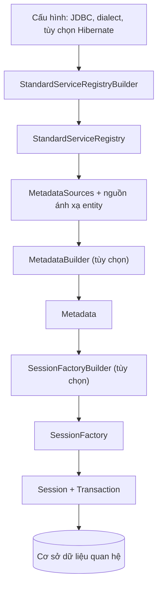

# Khởi tạo gốc với registry dịch vụ, metadata và SessionFactory

## 1. Hibernate ORM được khởi tạo như thế nào?

Khi dùng Spring Boot hoặc Jakarta Persistence, phần lớn công việc khởi tạo Hibernate đã được framework thực hiện. Tuy nhiên, Hibernate ORM cũng cho phép ứng dụng **tự khởi tạo theo native bootstrap API**: khai báo cấu hình, tạo registry dịch vụ, cung cấp nguồn ánh xạ entity, xây dựng metadata và tạo `SessionFactory`. Cách này giúp hiểu rõ Hibernate dùng những thông tin nào trước khi thực hiện truy vấn, và hữu ích trong ứng dụng Java độc lập, công cụ dòng lệnh, tác vụ batch hoặc hệ thống tự quản lý vòng đời persistence.

Luồng khởi tạo cốt lõi là:



Trong đó:

- **`StandardServiceRegistry`** cung cấp các dịch vụ cơ sở hạ tầng để Hibernate hoạt động, ví dụ quản lý kết nối, xử lý JDBC và những chiến lược được cấu hình.
- **`MetadataSources`** tập hợp các nguồn mô tả mô hình dữ liệu: entity được chú thích bằng annotation, mapping XML khi được hỗ trợ, v.v.
- **`Metadata`** là mô hình ánh xạ đã được Hibernate diễn giải và xây dựng từ những nguồn đó.
- **`SessionFactory`** là thành phần dùng lâu dài để tạo `Session`, điều phối persistence, truy vấn và thực thi các thao tác trên dữ liệu.
- **`Session`** đại diện cho một đơn vị làm việc với persistence context; thường gắn với transaction khi ghi dữ liệu.

Đừng nhầm **giai đoạn bootstrap** (thường chỉ diễn ra lúc khởi động ứng dụng) với **giai đoạn làm việc** (mở session và transaction nhiều lần để xử lý yêu cầu). Các bước dựng registry, metadata và factory không nên lặp lại cho mỗi request.

## 2. Vai trò và vòng đời của từng đối tượng

| Đối tượng | Trách nhiệm | Khi nào tạo | Sử dụng và vòng đời |
|---|---|---|---|
| `StandardServiceRegistryBuilder` | Nhận các setting và xây dựng registry dịch vụ | Lúc bootstrap | Dùng để cấu hình rồi gọi `build()` |
| `StandardServiceRegistry` | Cung cấp services mà Hibernate cần | Lúc bootstrap | Dùng trong khi dựng metadata/factory; phải quản lý tài nguyên đúng vòng đời |
| `MetadataSources` | Tập hợp nguồn mapping | Lúc bootstrap | Đăng ký entity và tài nguyên mapping |
| `MetadataBuilder` | Tinh chỉnh cách diễn giải metadata | Nếu cần tùy chỉnh mapping | Dùng trước khi gọi `build()` |
| `Metadata` | Mô hình mapping đã xử lý | Sau khi thu thập nguồn ánh xạ | Dùng để dựng `SessionFactory` |
| `SessionFactoryBuilder` | Tùy chỉnh cách dựng factory | Nếu cần tùy chọn factory | Dùng trước khi gọi `build()` |
| `SessionFactory` | Tạo session; chứa cấu hình/mapping và cơ chế runtime của Hibernate | Thường một lần cho mỗi cấu hình persistence | Tái sử dụng qua nhiều thao tác, **an toàn khi dùng chung giữa các luồng** |
| `Session` | Quản lý persistence context và thao tác với entity | Khi xử lý một đơn vị công việc | **Không thread-safe**; mở và đóng theo phạm vi xử lý |

`SessionFactory` tương đối tốn tài nguyên để tạo. Đóng rồi dựng lại factory cho mỗi lần lưu entity là sai mục đích thiết kế; nó còn gây chi phí cấu hình, quản lý connection và cache không cần thiết.

## 3. Bước 1 — Tạo StandardServiceRegistry

Class thường dùng:

```java
import org.hibernate.boot.registry.StandardServiceRegistry;
import org.hibernate.boot.registry.StandardServiceRegistryBuilder;
```

Ví dụ cấu hình PostgreSQL trực tiếp bằng code:

```java
StandardServiceRegistry registry = new StandardServiceRegistryBuilder()
    .applySetting(
        "hibernate.connection.driver_class",
        "org.postgresql.Driver"
    )
    .applySetting(
        "hibernate.connection.url",
        "jdbc:postgresql://localhost:5432/library"
    )
    .applySetting("hibernate.connection.username", "library_user")
    .applySetting("hibernate.connection.password", "change-me")
    .applySetting("hibernate.hbm2ddl.auto", "validate")
    .applySetting("hibernate.show_sql", "true")
    .build();
```

Các setting này có ý nghĩa:

| Setting | Ý nghĩa |
|---|---|
| `hibernate.connection.driver_class` | Class JDBC driver khi sử dụng cơ chế kết nối phù hợp |
| `hibernate.connection.url` | JDBC URL của database |
| `hibernate.connection.username`, `hibernate.connection.password` | Thông tin xác thực |
| `hibernate.hbm2ddl.auto=validate` | Kiểm tra schema hiện có phù hợp với mapping khi khởi tạo factory; không tự tạo bảng |
| `hibernate.show_sql=true` | In SQL phục vụ học và debug; ứng dụng thực tế thường quản lý log chi tiết hơn |

Trong những phiên bản Hibernate ORM hiện đại, dialect thường có thể được suy ra từ thông tin JDBC/database. Khi cần chỉ định rõ, có thể cấu hình `hibernate.dialect` với class dialect tương ứng và được phiên bản đang dùng hỗ trợ.

**Lưu ý khi áp dụng thực tế:** Không lưu password thật trong source code. Hãy đọc từ biến môi trường, hệ thống bí mật hoặc cấu hình triển khai. Khi ứng dụng do Spring/Jakarta EE quản lý, thông tin kết nối thường đến từ `DataSource` được quản lý tập trung, thay vì tự tạo JDBC connection settings như ví dụ.

### Registry lưu gì?

Registry quản lý nhiều service và chiến lược nội bộ, chẳng hạn `ConnectionProvider`, dịch vụ liên quan đến JDBC và cơ chế lựa chọn strategy. Builder cung cấp cấu hình; registry là đối tượng đã được dựng để Hibernate sử dụng. Một cấu hình sai (chẳng hạn JDBC URL, driver hoặc database không tương thích) có thể gây lỗi lúc dựng registry hoặc ở bước metadata/`SessionFactory` sau đó, tùy thời điểm service được khởi tạo và cần đến kết nối.

### Có thể cấu hình bằng hibernate.cfg.xml

Ngoài `applySetting(...)`, bạn có thể đặt các thuộc tính trong `hibernate.cfg.xml` trên classpath và nạp bằng:

```java
StandardServiceRegistry registry =
    new StandardServiceRegistryBuilder()
        .configure() // Đọc hibernate.cfg.xml mặc định.
        .build();
```

Hoặc truyền tên resource riêng vào `configure("my-hibernate.cfg.xml")`. Sau khi nạp cấu hình, vẫn có thể gọi `applySetting(...)` để áp dụng một số setting trong chương trình. Phần đăng ký các entity bằng `MetadataSources` ở bước tiếp theo giúp xác định rõ nguồn mapping đang dùng.

## 4. Bước 2 — Tập hợp nguồn ánh xạ với MetadataSources

Giả sử ứng dụng quản lý bảng `books` bằng entity:

```java
package com.example.persistence;

import jakarta.persistence.Column;
import jakarta.persistence.Entity;
import jakarta.persistence.GeneratedValue;
import jakarta.persistence.GenerationType;
import jakarta.persistence.Id;
import jakarta.persistence.Table;

@Entity
@Table(name = "books")
public class Book {
    @Id
    @GeneratedValue(strategy = GenerationType.IDENTITY)
    private Long id;

    @Column(name = "title", nullable = false, length = 200)
    private String title;

    protected Book() {
        // Constructor dành cho cơ chế tạo entity của JPA/Hibernate.
    }

    public Book(String title) {
        this.title = title;
    }

    public Long getId() {
        return id;
    }

    public String getTitle() {
        return title;
    }
}
```

Khai báo entity trong `MetadataSources`:

```java
import org.hibernate.boot.MetadataSources;

MetadataSources sources = new MetadataSources(registry);
sources.addAnnotatedClass(Book.class);
```

`@Entity` chỉ đánh dấu một class có thể ánh xạ. Trong native bootstrap, cần đảm bảo Hibernate **nhận được class đó như nguồn mapping**. `addAnnotatedClass(Book.class)` thực hiện việc này. Tùy dự án, có thể đăng ký nhiều entity:

```java
MetadataSources sources = new MetadataSources(registry)
    .addAnnotatedClass(Book.class)
    .addAnnotatedClass(Author.class)
    .addAnnotatedClass(Category.class);
```

Ví dụ `Author` và `Category` chỉ có ý nghĩa nếu những entity đó thực sự đã được định nghĩa trong dự án.

`MetadataSources` còn có các phương thức nhận tài nguyên mapping khác, ví dụ `addResource("mappings/Book.hbm.xml")` cho loại Hibernate mapping XML được phiên bản đang dùng hỗ trợ. Không nhất thiết phải trộn annotation và XML; quan trọng là các nguồn mapping được đăng ký trước khi build metadata.

## 5. Bước 3 — Dựng Metadata

Sau khi tập hợp các nguồn mapping, yêu cầu Hibernate phân tích chúng và tạo `Metadata`:

```java
import org.hibernate.boot.Metadata;

Metadata metadata = sources.buildMetadata();
```

Đây là lối viết ngắn cho trường hợp không cần sửa tùy chọn build. Nếu muốn tùy chỉnh cách diễn giải mapping, có thể dùng `MetadataBuilder`:

```java
import org.hibernate.boot.MetadataBuilder;
import org.hibernate.boot.model.naming.ImplicitNamingStrategyJpaCompliantImpl;

MetadataBuilder metadataBuilder = sources.getMetadataBuilder();

metadataBuilder.applyImplicitNamingStrategy(
    ImplicitNamingStrategyJpaCompliantImpl.INSTANCE
);

Metadata metadata = metadataBuilder.build();
```

**Điểm phân biệt:** `MetadataSources` là *đầu vào*, còn `Metadata` là *kết quả xử lý ánh xạ*. Hibernate sẽ đọc thông tin entity, cột, khóa chính, quan hệ, kiểu dữ liệu và những khai báo liên quan. Ở giai đoạn bootstrap, Hibernate còn có thể cần thông tin JDBC hoặc cấu trúc database tùy cài đặt, vì vậy không nên xem mọi bước build metadata là thao tác thuần bộ nhớ.

### Implicit naming và physical naming

Tên bảng/cột có thể được chỉ rõ bằng `@Table(name = "...")` hay `@Column(name = "...")`, hoặc được suy ra nếu không có tên tường minh.

- **Implicit naming strategy** quyết định tên logic khi mapping không khai báo tên rõ ràng.
- **Physical naming strategy** quyết định cách tên logic được chuyển thành tên vật lý trong database, ví dụ một quy ước chuyển chữ hoa/camelCase sang snake_case.

Thay đổi naming strategy sau khi đã dựng `SessionFactory` không làm mapping hiện có tự cập nhật. Các chính sách này cần được xác định trong giai đoạn bootstrap.

## 6. Bước 4 — Tạo SessionFactory từ Metadata

Tạo factory theo dạng ngắn:

```java
import org.hibernate.SessionFactory;

SessionFactory sessionFactory = metadata.buildSessionFactory();
```

Hoặc dùng builder nếu muốn cấu hình thêm các tùy chọn mà API/phiên bản Hibernate cung cấp:

```java
SessionFactory sessionFactory =
    metadata.getSessionFactoryBuilder().build();
```

Cả hai cách đều đi từ metadata đã được xây dựng sang một `SessionFactory` sử dụng được. Từ đây, Hibernate có đủ ánh xạ cần thiết để tạo session, lập SQL và làm việc với database. Nếu bật kiểm tra schema (ví dụ `hibernate.hbm2ddl.auto=validate`), lỗi không khớp giữa mapping và bảng có thể xuất hiện ở giai đoạn khởi tạo factory.

Đặt `SessionFactory` ở cấp ứng dụng hoặc cấp persistence unit; nhiều thread có thể yêu cầu mở session từ cùng factory. **Không** chia sẻ một instance `Session` đồng thời giữa nhiều request/thread.

## 7. Ví dụ hoàn chỉnh: bootstrap thủ công và lưu một bản ghi

Ví dụ sau minh họa Native Hibernate ORM sử dụng PostgreSQL, không phụ thuộc Spring hoặc `persistence.xml`. Để chạy cần thư viện `org.hibernate.orm:hibernate-core` và PostgreSQL JDBC driver `org.postgresql:postgresql` với các phiên bản tương thích; mã minh họa sử dụng hệ annotation `jakarta.persistence.*`.

### 7.1. Chuẩn bị schema

Tạo database `library` và người dùng tương ứng bằng công cụ quản trị PostgreSQL, sau đó tạo bảng:

```sql
CREATE TABLE books (
    id BIGINT GENERATED BY DEFAULT AS IDENTITY PRIMARY KEY,
    title VARCHAR(200) NOT NULL
);
```

Lệnh tạo bảng là phần chuẩn bị một lần; Hibernate được cấu hình `validate` nên sẽ kiểm tra mapping mà không tự tạo bảng trong ví dụ.

### 7.2. Entity Book

Sử dụng class `com.example.persistence.Book` ở mục 4.

### 7.3. Main chương trình

```java
package com.example.persistence;

import org.hibernate.Session;
import org.hibernate.SessionFactory;
import org.hibernate.Transaction;
import org.hibernate.boot.Metadata;
import org.hibernate.boot.MetadataSources;
import org.hibernate.boot.registry.StandardServiceRegistry;
import org.hibernate.boot.registry.StandardServiceRegistryBuilder;

public class NativeHibernateApp {

    public static void main(String[] args) {
        // 1. Tạo registry dịch vụ từ cấu hình.
        StandardServiceRegistry registry =
            new StandardServiceRegistryBuilder()
                .applySetting(
                    "hibernate.connection.driver_class",
                    "org.postgresql.Driver"
                )
                .applySetting(
                    "hibernate.connection.url",
                    "jdbc:postgresql://localhost:5432/library"
                )
                .applySetting(
                    "hibernate.connection.username",
                    "library_user"
                )
                .applySetting(
                    "hibernate.connection.password",
                    "change-me"
                )
                .applySetting("hibernate.hbm2ddl.auto", "validate")
                .applySetting("hibernate.show_sql", "true")
                .build();

        // 2-4. Dựng mapping metadata và SessionFactory.
        // Đóng factory sau khi công việc kết thúc.
        try {
            MetadataSources sources = new MetadataSources(registry);
            sources.addAnnotatedClass(Book.class);

            Metadata metadata = sources.buildMetadata();

            try (SessionFactory sessionFactory =
                     metadata.buildSessionFactory()) {
                saveBook(sessionFactory);
            }
        } finally {
            // Dọn registry do chương trình chủ động tạo.
            StandardServiceRegistryBuilder.destroy(registry);
        }
    }

    private static void saveBook(SessionFactory factory) {
        // Session được mở cho một đơn vị công việc.
        try (Session session = factory.openSession()) {
            Transaction transaction = session.beginTransaction();

            try {
                Book book = new Book("Hibernate native bootstrap");
                session.persist(book);

                transaction.commit();
                System.out.println("Saved book id: " + book.getId());
            } catch (RuntimeException ex) {
                if (transaction.isActive()) {
                    transaction.rollback();
                }
                throw ex;
            }
        }
    }
}
```

Ví dụ được giữ ở mức tối thiểu để làm rõ cơ chế bootstrap. Chuỗi `change-me` chỉ là giá trị minh họa; khi chạy cần cung cấp thông tin xác thực đúng và bảo vệ bí mật kết nối.

### 7.4. Diễn biến khi chạy

1. `StandardServiceRegistryBuilder` nạp các setting kết nối và tạo `registry`.
2. `MetadataSources` nhận `Book.class`; Hibernate đọc `@Entity`, `@Table`, `@Id`, `@GeneratedValue` và `@Column`.
3. `buildMetadata()` xây dựng mô hình mapping.
4. `buildSessionFactory()` khởi tạo factory; bước validate kiểm tra bảng/cột cần thiết trong database.
5. `openSession()` mở một session. `beginTransaction()` bắt đầu phạm vi transaction.
6. `persist(book)` chuyển entity mới sang trạng thái được quản lý và đưa nó vào tiến trình persistence. Với chiến lược IDENTITY, Hibernate có thể cần thực thi INSERT sớm để lấy khóa được database tạo ra; không được giả định mọi INSERT chỉ chạy tại `commit()`.
7. `commit()` hoàn tất transaction; `Session` được đóng và tài nguyên của factory/registry được dọn khi ứng dụng kết thúc.

## 8. Một SessionFactory, nhiều Session

Sau bootstrap, cách sử dụng thường thấy là:

```java
// Cùng một factory được tái sử dụng.
try (Session readSession = sessionFactory.openSession()) {
    Book first = readSession.find(Book.class, 1L);
    // Xử lý kết quả...
}

try (Session writeSession = sessionFactory.openSession()) {
    Transaction tx = writeSession.beginTransaction();
    try {
        // Thao tác ghi trong transaction.
        tx.commit();
    } catch (RuntimeException e) {
        if (tx.isActive()) {
            tx.rollback();
        }
        throw e;
    }
}
```

`sessionFactory` trong đoạn trên là instance đã khởi tạo ở bước trước, do tầng quản lý ứng dụng truyền vào; không phải biến tạo lại cho từng thao tác. Khi entity đang được quản lý trong session, Hibernate theo dõi thay đổi để xử lý lúc flush/commit theo cơ chế dirty checking.

Điều kiện đóng tài nguyên:

- **Session:** đóng sau khi hoàn tất một đơn vị công việc; đừng lưu session để dùng lại qua nhiều request hoặc dùng đồng thời từ nhiều thread.
- **Transaction:** commit khi thành công, rollback khi thất bại nếu transaction còn hoạt động; cơ chế thực tế có thể do framework điều phối.
- **SessionFactory:** đóng khi ứng dụng ngừng hoặc khi persistence unit không còn sử dụng. Không đóng trong handler của một request thông thường.
- **Registry:** nếu ứng dụng tự dựng và quản lý, phải bảo đảm cleanup, đặc biệt khi bootstrap bị lỗi; không destroy khi factory đang hoạt động.

Một số tầng tích hợp quản lý thêm vòng đời service registry cùng `SessionFactory`. Khi tự viết bootstrap như ví dụ, việc cleanup registry trong `finally` chỉ diễn ra sau khi factory đã đóng.

## 9. BootstrapServiceRegistry là gì? Có bắt buộc không?

Ngoài `StandardServiceRegistry`, Hibernate còn có **`BootstrapServiceRegistry`**. Đây là tầng service registry sớm trong quá trình khởi tạo, phục vụ các dịch vụ cấp bootstrap như class loading, strategy selection và cơ chế tích hợp/extension.

Ví dụ xây registry theo hai tầng:

```java
import org.hibernate.boot.registry.BootstrapServiceRegistry;
import org.hibernate.boot.registry.BootstrapServiceRegistryBuilder;
import org.hibernate.boot.registry.StandardServiceRegistry;
import org.hibernate.boot.registry.StandardServiceRegistryBuilder;

BootstrapServiceRegistry bootstrapRegistry =
    new BootstrapServiceRegistryBuilder().build();

StandardServiceRegistry registry =
    new StandardServiceRegistryBuilder(bootstrapRegistry)
        .applySetting("hibernate.connection.url",
                      "jdbc:postgresql://localhost:5432/library")
        .applySetting("hibernate.connection.username", "library_user")
        .applySetting("hibernate.connection.password", "change-me")
        .build();

// Từ đây vẫn thực hiện:
// new MetadataSources(registry).addAnnotatedClass(Book.class)
//     .buildMetadata().buildSessionFactory();
// Và nhớ đóng factory, cleanup registry theo vòng đời ứng dụng.
```

Ở ứng dụng thông thường, `new StandardServiceRegistryBuilder()` đã cung cấp lối bootstrap thuận tiện; không cần tự dựng `BootstrapServiceRegistry` nếu không có yêu cầu tích hợp lớp bootstrap đặc biệt. Hai tầng tồn tại vì **dịch vụ hỗ trợ quá trình khởi tạo** và **dịch vụ dùng cho ORM runtime** có phạm vi trách nhiệm khác nhau.

## 10. Native bootstrap và Jakarta Persistence bootstrap

Hibernate ORM vừa có native API vừa là một implementation của **Jakarta Persistence (JPA)**. Hai cách khởi tạo có lối vào khác nhau:

| Khía cạnh | Native Hibernate bootstrap | Jakarta Persistence bootstrap |
|---|---|---|
| Điểm vào | `StandardServiceRegistryBuilder`, `MetadataSources` | `Persistence.createEntityManagerFactory(...)` hoặc container/framework |
| Đối tượng factory thường gặp | `SessionFactory` | `EntityManagerFactory` |
| Đơn vị làm việc | `Session` | `EntityManager` |
| Mô tả persistence | Setting Hibernate và các nguồn mapping được đăng ký | `persistence.xml` hoặc cấu hình do framework quản lý |
| Khi chọn | Ứng dụng cần điều khiển bootstrap Hibernate trực tiếp | Ứng dụng ưu tiên API chuẩn JPA hoặc để framework quản lý |

Ví dụ JPA bootstrap đối chiếu:

```java
import jakarta.persistence.EntityManagerFactory;
import jakarta.persistence.Persistence;

EntityManagerFactory emf =
    Persistence.createEntityManagerFactory("library-unit");

try {
    // emf.createEntityManager(), transaction và truy vấn JPA...
} finally {
    emf.close();
}
```

Ví dụ JPA giả định có persistence unit tên `library-unit` được khai báo và cấu hình phù hợp. Vì Hibernate `SessionFactory` cũng tích hợp với các abstraction JPA, các khái niệm ánh xạ entity, persistence context và transaction có phần giao nhau; khác biệt ở đây chủ yếu là **ai khởi tạo, bằng API nào và ai sở hữu vòng đời tài nguyên**.

Nếu Spring Boot hay một Jakarta EE container đã tạo factory, thường nên sử dụng factory do hệ thống đó quản lý thay vì chủ động tạo thêm một `SessionFactory` riêng cho cùng datasource mà không có lý do rõ ràng.

## 11. Một số lỗi phổ biến khi tự bootstrap

### Không đăng ký entity trong MetadataSources

`@Entity` trên class chưa đủ nếu class chưa được đưa vào nguồn mapping mà Hibernate sử dụng. Truy vấn có thể báo entity không thuộc mô hình persistence hoặc chưa được ánh xạ. Hãy kiểm tra `addAnnotatedClass(...)`, mapping resource và cách Hibernate nạp metadata.

### Cấu hình JDBC đúng cú pháp nhưng không kết nối được

Sai URL, username/password, thiếu JDBC driver, database chưa chạy hoặc thiếu quyền truy cập đều có thể làm bootstrap thất bại. Lỗi có thể xuất hiện lúc Hibernate cần đọc metadata JDBC hoặc kiểm tra schema, không nhất thiết ngay ở lệnh `applySetting(...)`.

### Mapping không khớp schema thực tế

Ví dụ mapping trỏ tới `books` nhưng database chỉ có `book`, hoặc kiểu dữ liệu/khóa chính không phù hợp. Với `hibernate.hbm2ddl.auto=validate`, Hibernate có thể phát hiện một phần sai lệch lúc tạo factory. Cần quản lý schema bằng migration và kiểm tra môi trường database thật.

### Dùng chế độ tự chỉnh schema một cách vô ý

Các giá trị như `create`, `create-drop` hoặc `update` điều khiển hành vi schema management, có thể gây tác động lớn lên cấu trúc database. Chế độ phù hợp phụ thuộc môi trường. Với dữ liệu quan trọng, nên quản lý schema qua công cụ migration như Flyway/Liquibase và sử dụng `validate` hoặc thiết lập tương ứng theo chính sách dự án.

### Tạo SessionFactory bên trong mỗi request

Sai phạm vi vòng đời gây tăng chi phí, quản lý kết nối và tài nguyên khó kiểm soát. Hãy khởi tạo factory lúc ứng dụng bắt đầu và đóng ở lúc ứng dụng dừng.

### Dùng chung một Session giữa các thread

`Session` chứa trạng thái persistence context và không được thiết kế để chia sẻ đồng thời. Mỗi đơn vị xử lý cần phạm vi session/transaction phù hợp.

### Quên cleanup khi bootstrap thất bại

Nếu tạo registry thành công nhưng quá trình dựng metadata/factory ném lỗi, các tài nguyên được registry quản lý vẫn cần được dọn. Bao đoạn bootstrap bằng `try/finally` như ví dụ để cleanup cả trong trường hợp lỗi.

## 12. Quy tắc thực hành cần ghi nhớ

1. **Cấu hình trước:** dựng `StandardServiceRegistry` từ kết nối và các tùy chọn Hibernate.
2. **Nạp mapping tiếp theo:** dùng `MetadataSources` để đăng ký entity; dùng `MetadataBuilder` nếu cần thay đổi cách diễn giải tên, ánh xạ hoặc những tùy chọn metadata.
3. **Tạo một factory dùng lâu dài:** gọi `Metadata.buildSessionFactory()` hoặc dùng `SessionFactoryBuilder`.
4. **Mở session ngắn hạn:** mỗi nhóm thao tác có session và transaction thích hợp; commit hoặc rollback rồi đóng session.
5. **Dọn tài nguyên đúng thời điểm:** đóng factory khi dừng ứng dụng và cleanup registry do mình quản lý, bao gồm đường đi thất bại khi bootstrap.

Nắm chắc thứ tự **`StandardServiceRegistry` → `MetadataSources` → `Metadata` → `SessionFactory` → `Session`** sẽ giúp bạn đọc được kiến trúc khởi tạo Hibernate ngay cả khi framework đã che khuất phần lớn các bước này.

### Tài liệu tham khảo

- [Hibernate ORM — trang dự án](https://hibernate.org/orm/)
- [Hibernate ORM — tài liệu hướng dẫn](https://docs.jboss.org/hibernate/orm/)
- [Hibernate ORM — Javadocs](https://docs.jboss.org/hibernate/orm/current/javadocs/)
- [Jakarta Persistence](https://jakarta.ee/specifications/persistence/)
