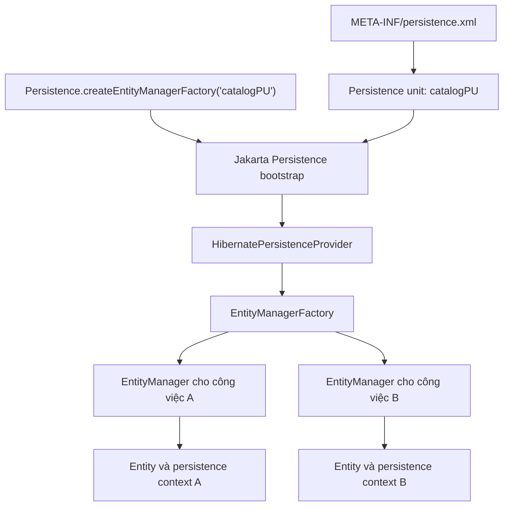
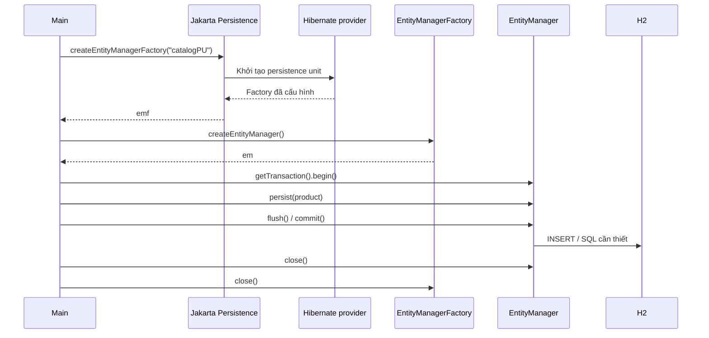

# Khởi tạo Hibernate qua Jakarta Persistence với persistence unit

## 1. Khởi tạo qua Jakarta Persistence là gì?

Hibernate ORM có thể được sử dụng thông qua **Jakarta Persistence API (JPA)**. Theo cách này, mã ứng dụng không cần trực tiếp tạo `StandardServiceRegistry`, `Metadata` hay gọi `buildSessionFactory()` của API native Hibernate. Ứng dụng khai báo một **persistence unit**, sau đó yêu cầu Jakarta Persistence tìm nhà cung cấp ORM và tạo `EntityManagerFactory`.

Một persistence unit là một cấu hình ORM có tên, xác định những entity nào tham gia, provider nào xử lý, cách kết nối cơ sở dữ liệu và các tùy chọn quản lý transaction.

Luồng khởi tạo trong ứng dụng Java SE thường là:



Hai cấp đối tượng có vòng đời khác nhau:

- `EntityManagerFactory` được tạo khi ứng dụng khởi động hoặc khi persistence unit cần hoạt động. Nó có chi phí khởi tạo lớn hơn và được dùng chung bởi nhiều luồng.
- `EntityManager` được tạo từ factory cho từng đơn vị công việc; nó quản lý một persistence context và **không an toàn để chia sẻ đồng thời giữa các thread**.

Khi Hibernate làm JPA provider, đối tượng tương ứng còn hỗ trợ các giao diện riêng của Hibernate: `SessionFactory` mở rộng `EntityManagerFactory` và `Session` mở rộng `EntityManager`. Tuy nhiên, bài này tập trung vào quy trình khởi tạo bằng **Jakarta Persistence**.

## 2. Vai trò của persistence unit

Persistence unit không phải database, cũng không phải một phiên làm việc. Nó là **định nghĩa cấu hình có tên** để provider xây dựng một `EntityManagerFactory`.

Ví dụ:

```xml
<persistence-unit name="catalogPU" transaction-type="RESOURCE_LOCAL">
    <provider>org.hibernate.jpa.HibernatePersistenceProvider</provider>
    <!-- Danh sách entity, data source và thuộc tính -->
</persistence-unit>
```

Các thành phần chính:

| Thành phần | Vai trò |
|---|---|
| `name="catalogPU"` | Định danh persistence unit; được truyền vào `Persistence.createEntityManagerFactory("catalogPU")`. |
| `transaction-type="RESOURCE_LOCAL"` | Giao dịch do ứng dụng quản lý thông qua `EntityTransaction`. |
| `<provider>` | Chỉ định JPA provider; Hibernate sử dụng `org.hibernate.jpa.HibernatePersistenceProvider`. |
| `<class>` | Khai báo một lớp entity thuộc persistence unit. |
| `<exclude-unlisted-classes>` | Kiểm soát việc tự động tìm các lớp entity chưa liệt kê, tùy môi trường đóng gói/triển khai. |
| `<properties>` | Cấu hình JDBC, schema, logging và các tùy chọn khác. |
| `<jta-data-source>` / `<non-jta-data-source>` | Tham chiếu DataSource do môi trường cung cấp khi dùng kiểu cấu hình phù hợp. |

Một tệp `persistence.xml` có thể khai báo nhiều persistence unit, mỗi unit có **tên riêng**. Khi bootstrap, tên được truyền vào API quyết định cấu hình nào được chọn.

### Vị trí tệp bắt buộc

Provider tìm descriptor theo đường dẫn trên classpath:

```text
META-INF/persistence.xml
```

Với dự án Maven hoặc Gradle thông thường, vị trí trong source là:

```text
src/main/resources/META-INF/persistence.xml
```

Khi build, `src/main/resources` được đưa vào classpath; ví dụ với Maven, descriptor sẽ hiện diện dưới `target/classes/META-INF/persistence.xml`. Đặt tệp ở `src/main/java` hoặc ở một thư mục `config` không được đóng gói vào classpath thường khiến bước bootstrap không tìm được persistence unit.

## 3. Ví dụ tự chứa: Java SE, Maven, Hibernate và H2

Ta xây dựng ứng dụng Java SE lưu một sản phẩm vào cơ sở dữ liệu H2 trong bộ nhớ. Mục tiêu là thấy **toàn bộ đường đi từ persistence unit tới EntityManager**, không cần cài máy chủ database riêng.

Cấu trúc dự án:

```text
jpa-bootstrap-demo/
├── pom.xml
└── src/
    └── main/
        ├── java/
        │   └── com/example/catalog/
        │       ├── Product.java
        │       └── Main.java
        └── resources/
            └── META-INF/
                └── persistence.xml
```

Ví dụ dùng Java 17, Hibernate ORM 6.6.0.Final (một phiên bản minh họa tương thích Jakarta Persistence 3.1) và H2 2.3.232. Có thể chọn phiên bản khác nhưng cần giữ sự tương thích giữa Hibernate, Jakarta Persistence, JDBC driver và JDK. Không cần thêm một phiên bản JPA provider khác khi đã chọn Hibernate.

### 3.1. Khai báo thư viện trong `pom.xml`

```xml
<project xmlns="http://maven.apache.org/POM/4.0.0"
         xmlns:xsi="http://www.w3.org/2001/XMLSchema-instance"
         xsi:schemaLocation="http://maven.apache.org/POM/4.0.0
                             https://maven.apache.org/xsd/maven-4.0.0.xsd">
    <modelVersion>4.0.0</modelVersion>

    <groupId>com.example</groupId>
    <artifactId>jpa-bootstrap-demo</artifactId>
    <version>1.0-SNAPSHOT</version>

    <properties>
        <maven.compiler.release>17</maven.compiler.release>
        <project.build.sourceEncoding>UTF-8</project.build.sourceEncoding>
    </properties>

    <dependencies>
        <!-- Hibernate triển khai Jakarta Persistence API. -->
        <dependency>
            <groupId>org.hibernate.orm</groupId>
            <artifactId>hibernate-core</artifactId>
            <version>6.6.0.Final</version>
        </dependency>

        <!-- Database nhúng dành cho ví dụ. -->
        <dependency>
            <groupId>com.h2database</groupId>
            <artifactId>h2</artifactId>
            <version>2.3.232</version>
            <scope>runtime</scope>
        </dependency>
    </dependencies>

    <build>
        <plugins>
            <plugin>
                <groupId>org.codehaus.mojo</groupId>
                <artifactId>exec-maven-plugin</artifactId>
                <version>3.4.1</version>
            </plugin>
        </plugins>
    </build>
</project>
```

Thư viện `hibernate-core` cung cấp JPA provider của Hibernate và các dependency cần thiết, trong đó có Jakarta Persistence API phù hợp. `h2` là JDBC driver và database cho demo. Trong dự án có BOM hoặc dependency management, nên để hệ thống đó quyết định những phiên bản tương thích.

### 3.2. Định nghĩa entity

Tạo `src/main/java/com/example/catalog/Product.java`:

```java
package com.example.catalog;

import jakarta.persistence.Column;
import jakarta.persistence.Entity;
import jakarta.persistence.GeneratedValue;
import jakarta.persistence.GenerationType;
import jakarta.persistence.Id;
import jakarta.persistence.Table;

@Entity
@Table(name = "products")
public class Product {

    @Id
    @GeneratedValue(strategy = GenerationType.IDENTITY)
    private Long id;

    @Column(nullable = false, length = 120)
    private String name;

    // Constructor không tham số để provider tạo entity.
    protected Product() {
    }

    public Product(String name) {
        this.name = name;
    }

    public Long getId() {
        return id;
    }

    public String getName() {
        return name;
    }
}
```

Lưu ý namespace của annotation là **`jakarta.persistence`**. Dự án dùng Hibernate 6.x với Jakarta Persistence không nên trộn annotation `javax.persistence` từ các thế hệ JPA cũ.

Trong ví dụ, `@Entity` đánh dấu một đối tượng được Hibernate quản lý; `@Id` định nghĩa khóa chính; `@GeneratedValue` sử dụng khả năng sinh giá trị định danh của database.

### 3.3. Khai báo `persistence.xml`

Tạo `src/main/resources/META-INF/persistence.xml`:

```xml
<?xml version="1.0" encoding="UTF-8"?>
<persistence
    xmlns="https://jakarta.ee/xml/ns/persistence"
    xmlns:xsi="http://www.w3.org/2001/XMLSchema-instance"
    xsi:schemaLocation="
        https://jakarta.ee/xml/ns/persistence
        https://jakarta.ee/xml/ns/persistence/persistence_3_1.xsd"
    version="3.1">

    <persistence-unit name="catalogPU" transaction-type="RESOURCE_LOCAL">
        <provider>org.hibernate.jpa.HibernatePersistenceProvider</provider>

        <class>com.example.catalog.Product</class>
        <exclude-unlisted-classes>true</exclude-unlisted-classes>

        <properties>
            <property name="jakarta.persistence.jdbc.driver"
                      value="org.h2.Driver"/>
            <property name="jakarta.persistence.jdbc.url"
                      value="jdbc:h2:mem:catalogdb;DB_CLOSE_DELAY=-1"/>
            <property name="jakarta.persistence.jdbc.user"
                      value="sa"/>
            <property name="jakarta.persistence.jdbc.password"
                      value=""/>

            <!-- Chỉ dùng cho ví dụ: tạo rồi hủy schema. -->
            <property name="hibernate.hbm2ddl.auto"
                      value="create-drop"/>
            <property name="hibernate.show_sql"
                      value="true"/>
            <property name="hibernate.format_sql"
                      value="true"/>
        </properties>
    </persistence-unit>
</persistence>
```

Giải thích cấu hình:

- `xmlns`, `version="3.1"` và `xsi:schemaLocation` xác định định dạng Jakarta Persistence XML; cần đồng bộ với phiên bản API/schema được dùng. Đây là namespace **Jakarta**, không phải namespace JPA cũ của `javax.persistence`.
- `catalogPU` là tên duy nhất của persistence unit trong ví dụ. Chuỗi này phải khớp với tên được truyền cho API bootstrap.
- `RESOURCE_LOCAL` chỉ định quản lý transaction bằng `EntityManager.getTransaction()`.
- `<provider>` chỉ rõ Hibernate. Nếu bỏ phần tử này, cơ chế phát hiện provider dựa trên các provider khả dụng; khi nhiều provider cùng xuất hiện, khai báo tường minh giúp tránh chọn ngoài ý muốn.
- `<class>com.example.catalog.Product</class>` đăng ký entity theo tên đầy đủ của lớp Java.
- `<exclude-unlisted-classes>true</exclude-unlisted-classes>` làm cấu hình demo trở nên tường minh: lớp entity cần dùng được liệt kê bằng `<class>`.
- `jakarta.persistence.jdbc.*` là các thuộc tính kết nối JDBC chuẩn dành cho trường hợp bootstrap phù hợp với JDBC trực tiếp.
- `hibernate.hbm2ddl.auto=create-drop` là **thuộc tính riêng của Hibernate**, yêu cầu tạo schema khi factory khởi tạo và hủy schema khi đóng; chỉ phù hợp ví dụ hoặc thử nghiệm dữ liệu tạm.
- `hibernate.show_sql` và `hibernate.format_sql` giúp nhìn thấy câu SQL và định dạng nó. Đây không phải chuẩn JPA.

Giá trị URL `jdbc:h2:mem:catalogdb;DB_CLOSE_DELAY=-1` sử dụng H2 trong bộ nhớ cho demo; dữ liệu vẫn chỉ tồn tại trong quá trình chạy ứng dụng, không được lưu bền vững như PostgreSQL hay MySQL. Trong sản phẩm thực tế, cấu hình thường sử dụng `DataSource` hoặc connection pool và đặt thông tin kết nối bên ngoài mã nguồn.

### 3.4. Bootstrap và thao tác dữ liệu bằng JPA

Tạo `src/main/java/com/example/catalog/Main.java`:

```java
package com.example.catalog;

import jakarta.persistence.EntityManager;
import jakarta.persistence.EntityManagerFactory;
import jakarta.persistence.EntityTransaction;
import jakarta.persistence.Persistence;

public class Main {

    public static void main(String[] args) {
        EntityManagerFactory emf =
                Persistence.createEntityManagerFactory("catalogPU");

        try {
            Long productId = insertProduct(emf, "Bàn phím cơ");
            printProduct(emf, productId);
        } finally {
            emf.close();
        }
    }

    private static Long insertProduct(
            EntityManagerFactory emf, String name) {

        EntityManager em = emf.createEntityManager();

        try {
            EntityTransaction tx = em.getTransaction();

            try {
                tx.begin();

                Product product = new Product(name);
                em.persist(product);

                // Đồng bộ thay đổi đang chờ với database.
                em.flush();
                Long id = product.getId();

                tx.commit();
                return id;
            } catch (RuntimeException ex) {
                if (tx.isActive()) {
                    tx.rollback();
                }
                throw ex;
            }
        } finally {
            em.close();
        }
    }

    private static void printProduct(
            EntityManagerFactory emf, Long id) {

        EntityManager em = emf.createEntityManager();

        try {
            Product product = em.find(Product.class, id);
            if (product == null) {
                System.out.println("Không tìm thấy sản phẩm: " + id);
            } else {
                System.out.printf(
                        "Product[id=%d, name=%s]%n",
                        product.getId(),
                        product.getName()
                );
            }
        } finally {
            em.close();
        }
    }
}
```

Chạy từ thư mục gốc của dự án bằng Maven:

```bash
mvn compile exec:java -Dexec.mainClass=com.example.catalog.Main
```

Khi khởi động thành công, Hibernate đọc metadata, xây dựng factory, xử lý schema theo cấu hình và phát SQL tương ứng với thao tác `persist`/`find`. Kết quả có một dòng tương đương:

```text
Product[id=1, name=Bàn phím cơ]
```

Giá trị ID và các dòng log SQL có thể khác theo provider, database và cấu hình. Ví dụ chỉ minh họa chương trình Java SE với transaction `RESOURCE_LOCAL`.

## 4. Điều gì diễn ra khi gọi `Persistence.createEntityManagerFactory(...)`?

Lời gọi:

```java
EntityManagerFactory emf =
        Persistence.createEntityManagerFactory("catalogPU");
```

có thể hiểu qua các bước khái niệm sau:

1. API Jakarta Persistence nhận tên `catalogPU` và tìm thông tin persistence unit trong các descriptor `META-INF/persistence.xml` khả dụng trên classpath/module path.
2. Cơ chế bootstrap xác định JPA provider phù hợp. Trong ví dụ, `<provider>` chỉ rõ `org.hibernate.jpa.HibernatePersistenceProvider`.
3. Hibernate đọc cấu hình và danh sách entity, phân tích mapping của `Product`, xây dựng metadata cùng các dịch vụ ORM cần thiết.
4. Provider khởi tạo `EntityManagerFactory` và trả kết quả cho ứng dụng.
5. Ứng dụng gọi `emf.createEntityManager()` khi cần thao tác với persistence context riêng.
6. Khi không còn sử dụng persistence unit, ứng dụng gọi `emf.close()` để giải phóng tài nguyên của factory.



**Không đồng nhất factory với connection JDBC.** Hibernate có thể dùng provider kết nối hoặc connection pool để lấy và trả JDBC connection theo chiến lược phù hợp. Việc tạo factory, tạo entity manager, mở transaction và thực thi SQL là những hành động khác nhau; không nên suy luận rằng mỗi hành động luôn mở một kết nối vật lý mới.

### 4.1. Vì sao cần đóng cả `EntityManager` và `EntityManagerFactory`?

Factory thường dùng chung cho toàn ứng dụng và hỗ trợ truy cập đồng thời. `EntityManager` thường có vòng đời ngắn, quản lý entity và trạng thái thay đổi trong một persistence context.

Trong demo:

- `emf` được tạo một lần ở `main` và đóng sau tất cả công việc.
- `insertProduct` và `printProduct` tạo **hai entity manager riêng** từ cùng một factory.
- Mỗi entity manager được đóng trong `finally` sau khi sử dụng.
- Giao dịch ghi được `commit` khi thành công hoặc `rollback` khi gặp lỗi.

`EntityManager` không được coi như một đối tượng singleton dùng chung cho nhiều request. Trái lại, không tạo một `EntityManagerFactory` mới cho mỗi thao tác insert hoặc truy vấn vì việc khởi tạo factory tương đối tốn kém.

### 4.2. `flush()` và `commit()`

`em.persist(product)` đưa entity mới vào trạng thái managed; Hibernate quyết định khi nào thực thi SQL. Việc sử dụng `GenerationType.IDENTITY` có thể khiến thao tác insert diễn ra sớm để lấy khóa chính.

`em.flush()` yêu cầu đồng bộ thay đổi trong persistence context xuống database, nhưng **không thay thế `commit()`**. Transaction vẫn có thể `rollback()` sau khi SQL được gửi. `commit()` mới kết thúc transaction thành công.

Trong ví dụ, gọi `flush()` để minh họa sự phân biệt này và đọc được khóa ID. Với nhiều trường hợp thông thường, lập trình viên không cần gọi `flush()` thủ công trước `commit()`.

## 5. Thay đổi thuộc tính lúc bootstrap

Jakarta Persistence có overload nhận một `Map` thuộc tính cấu hình:

```java
import jakarta.persistence.EntityManagerFactory;
import jakarta.persistence.Persistence;
import java.util.HashMap;
import java.util.Map;

Map<String, Object> overrides = new HashMap<>();

String dbUrl = System.getenv("APP_DB_URL");
if (dbUrl != null && !dbUrl.isBlank()) {
    overrides.put("jakarta.persistence.jdbc.url", dbUrl);
}

String dbUser = System.getenv("APP_DB_USER");
if (dbUser != null) {
    overrides.put("jakarta.persistence.jdbc.user", dbUser);
}

String dbPassword = System.getenv("APP_DB_PASSWORD");
if (dbPassword != null) {
    overrides.put("jakarta.persistence.jdbc.password", dbPassword);
}

EntityManagerFactory emf =
        Persistence.createEntityManagerFactory("catalogPU", overrides);

try {
    // Thực hiện công việc với emf...
} finally {
    emf.close();
}
```

Như vậy, `persistence.xml` cung cấp cấu hình nền, còn ứng dụng có thể cung cấp một số thuộc tính cụ thể khi khởi tạo. Cách này hữu ích khi thay môi trường, connection URL hoặc thông tin xác thực mà không sửa descriptor.

Cần phân biệt:

- `jakarta.persistence.jdbc.*` là tên thuộc tính của Jakarta Persistence.
- `hibernate.*` là tên thuộc tính mở rộng do Hibernate cung cấp. Ví dụ `hibernate.show_sql` và `hibernate.hbm2ddl.auto`.
- Các thuộc tính provider-specific có thể không được provider khác hỗ trợ hoặc có ngữ nghĩa khác.

Trong triển khai thực tế, tránh commit mật khẩu vào `persistence.xml`, nguồn Java hay Git; quản lý chúng qua cấu hình môi trường hoặc secret manager. Với ứng dụng có framework/container, cơ chế `DataSource` được cấu hình tập trung thường phù hợp hơn so với truyền thông tin JDBC ở từng lời gọi bootstrap.

## 6. Nhiều persistence unit trong một ứng dụng

Một descriptor có thể chứa nhiều unit với các tên khác nhau:

```xml
<persistence xmlns="https://jakarta.ee/xml/ns/persistence"
             version="3.1">

    <persistence-unit name="catalogPU" transaction-type="RESOURCE_LOCAL">
        <provider>org.hibernate.jpa.HibernatePersistenceProvider</provider>
        <class>com.example.catalog.Product</class>
        <!-- Các properties kết nối cho catalog... -->
    </persistence-unit>

    <persistence-unit name="auditPU" transaction-type="RESOURCE_LOCAL">
        <provider>org.hibernate.jpa.HibernatePersistenceProvider</provider>
        <class>com.example.audit.AuditEvent</class>
        <!-- Các properties kết nối cho audit... -->
    </persistence-unit>
</persistence>
```

Đây là đoạn cấu hình cấu trúc **minh họa**, không phải toàn bộ descriptor chạy được: mỗi unit còn cần cấu hình kết nối/`DataSource` hợp lệ.

Ứng dụng chọn unit theo tên:

```java
EntityManagerFactory catalogFactory =
        Persistence.createEntityManagerFactory("catalogPU");

EntityManagerFactory auditFactory =
        Persistence.createEntityManagerFactory("auditPU");

try {
    // Mỗi factory tạo EntityManager của unit tương ứng.
} finally {
    auditFactory.close();
    catalogFactory.close();
}
```

Đây là **hai factory độc lập được chủ động tạo**, có metadata/persistence context và cấu hình riêng. Hai persistence unit không có nghĩa transaction của chúng tự động phối hợp với nhau; nếu cần transaction phân tán giữa nhiều resource, phải thiết kế transaction management phù hợp, thường thông qua môi trường có JTA.

Trong ứng dụng chỉ sử dụng một database và một tập entity, một persistence unit là đủ cho phần lớn nhu cầu.

## 7. Phân biệt `RESOURCE_LOCAL` và `JTA`

Thuộc tính `transaction-type` quyết định cách gắn với transaction manager và thay đổi cách viết mã nghiệp vụ.

| Đặc điểm | `RESOURCE_LOCAL` | `JTA` |
|---|---|---|
| Nơi thường gặp | Java SE độc lập, công cụ console, ứng dụng tự quản lý transaction | Jakarta EE, môi trường tích hợp JTA transaction manager |
| Cơ chế transaction | `em.getTransaction().begin()`, `commit()`, `rollback()` | Transaction do container/framework hoặc JTA manager quản lý |
| Lấy database resource | Thường dùng JDBC properties hoặc non-JTA datasource | Thường dùng `<jta-data-source>` do môi trường cung cấp |
| Lời gọi `em.getTransaction()` | Phù hợp với resource-local entity manager | Không dùng để quản lý transaction JTA; có thể phát sinh `IllegalStateException` |
| Cấp phát/đóng entity manager | Ví dụ Java SE tự tạo bằng `createEntityManager()` và tự đóng | Có thể inject `@PersistenceContext` để container quản lý context |

Ví dụ descriptor của một persistence unit chạy trong môi trường có JTA:

```xml
<persistence-unit name="enterprisePU" transaction-type="JTA">
    <provider>org.hibernate.jpa.HibernatePersistenceProvider</provider>
    <jta-data-source>java:comp/env/jdbc/CatalogDS</jta-data-source>
    <class>com.example.catalog.Product</class>
</persistence-unit>
```

`java:comp/env/jdbc/CatalogDS` là tên JNDI minh họa: ứng dụng phải thực sự cấu hình DataSource có tên đó trong container. Chỉ sao chép snippet trên vào ứng dụng Java SE chưa có JTA container sẽ không khiến JTA tự hoạt động.

Trong Jakarta EE có thể sử dụng persistence context do container quản lý:

```java
package com.example.catalog;

import jakarta.enterprise.context.ApplicationScoped;
import jakarta.persistence.EntityManager;
import jakarta.persistence.PersistenceContext;
import jakarta.transaction.Transactional;

@ApplicationScoped
public class CatalogService {

    @PersistenceContext(unitName = "enterprisePU")
    private EntityManager em;

    @Transactional
    public void createProduct(String name) {
        em.persist(new Product(name));
        // Container / transaction interceptor quản lý transaction.
    }
}
```

Đoạn mã đòi hỏi container hỗ trợ injection và transaction integration. Ứng dụng **không tự gọi `em.close()`** trên entity manager do container quản lý qua `@PersistenceContext` và không sử dụng `EntityTransaction` như ví dụ `RESOURCE_LOCAL`.

Nếu dùng Spring Boot/Spring Data JPA, framework thường tự cấu hình `EntityManagerFactory`, `DataSource` và transaction manager. Khi đó, `@Transactional` của Spring và các repository sử dụng factory/context do Spring quản lý. Việc tự bootstrap thêm factory qua `Persistence.createEntityManagerFactory(...)` chỉ nên làm khi thực sự cần cấu hình độc lập.

## 8. `persistence.xml` có thể chứa những cấu hình nào khác?

Ngoài những phần tử cốt lõi, persistence unit còn có thể chứa:

- `<mapping-file>`: chỉ định mapping XML (ví dụ `META-INF/orm.xml`), thường dùng khi cần định nghĩa hoặc điều chỉnh ánh xạ ngoài annotation.
- `<jar-file>`: bổ sung các archive chứa lớp persistent cho unit theo quy tắc đóng gói của Jakarta Persistence.
- `<shared-cache-mode>`: điều khiển mức sử dụng shared cache theo JPA; cần xem thêm cấu hình cache provider khi dùng tính năng cache thực tế.
- `<validation-mode>`: điều khiển tích hợp Bean Validation (`AUTO`, `CALLBACK` hoặc `NONE`).
- `<non-jta-data-source>`: tham chiếu DataSource không quản lý theo JTA trong môi trường hỗ trợ.

Các khai báo khác này chỉ nên thêm khi có nhu cầu rõ ràng. Một bài demo Java SE đơn giản có thể bắt đầu bằng `<class>` và vài thuộc tính JDBC cơ bản như ở mục 3.

### 8.1. Schema generation chuẩn JPA và tùy chọn Hibernate

Ngoài `hibernate.hbm2ddl.auto`, Jakarta Persistence định nghĩa các tùy chọn schema generation riêng, ví dụ:

```xml
<property
    name="jakarta.persistence.schema-generation.database.action"
    value="drop-and-create"/>
```

Đây là ví dụ **thay thế** cho cấu hình tạo schema của Hibernate trong demo, không nên đồng thời đặt nhiều cơ chế schema generation với yêu cầu trái nhau. Việc phát sinh schema tự động giúp học ORM, nhưng ở production nên quản lý thay đổi cấu trúc database bằng migration có kiểm soát như Flyway hoặc Liquibase. Với Hibernate, có thể chọn chế độ kiểm tra schema phù hợp thay cho tự ý tạo/hủy bảng.

### 8.2. Có cần khai báo Hibernate dialect không?

Với Hibernate hiện đại và JDBC driver phù hợp, ORM thường suy ra dialect từ thông tin JDBC metadata của database khi có thể kết nối. Trong ví dụ H2, không cần thêm `hibernate.dialect`. Nếu môi trường yêu cầu hoặc việc tự phát hiện thất bại, cấu hình dialect cụ thể phải khớp với database và phiên bản Hibernate đang dùng.

## 9. Lỗi thường gặp khi bootstrap

| Hiện tượng | Nguyên nhân có thể gặp | Cách kiểm tra |
|---|---|---|
| `No Persistence provider for EntityManager named catalogPU` | Không tìm thấy unit, tên không khớp, thiếu provider hoặc descriptor không được đóng gói. | Kiểm tra `META-INF/persistence.xml` trên classpath, `name` chính xác, dependency Hibernate JPA provider. |
| `PersistenceException` khi tạo factory | XML sai định dạng, entity mapping sai hoặc Hibernate không thể khởi tạo dịch vụ. | Đọc exception nguyên nhân gốc (`caused by`), đối chiếu cấu hình XML/entity và log provider. |
| Không nhận diện `@Entity` | Dùng lẫn `javax.persistence` và `jakarta.persistence`, entity chưa được liệt kê hoặc scan không tìm thấy. | Kiểm tra import, `<class>`, `<exclude-unlisted-classes>` và vị trí class khi đóng gói. |
| `ClassNotFoundException: org.h2.Driver` hoặc lỗi driver tương tự | Thiếu JDBC driver ở runtime classpath hoặc sai driver class. | Thêm dependency driver và dùng tên driver đúng với database. |
| `Connection refused` / sai thông tin đăng nhập | URL, cổng, tài khoản, mật khẩu hoặc server database sai; cấu hình mạng chặn kết nối. | Kiểm tra kết nối độc lập từ môi trường chạy; không mặc định đây là lỗi của JPA. |
| `TransactionRequiredException` hoặc transaction không được kích hoạt | Ghi dữ liệu không có transaction cần thiết. | Với `RESOURCE_LOCAL`, bao `persist`/`remove` và thao tác ghi trong `begin`/`commit`; với JTA, kiểm tra transaction manager. |
| `IllegalStateException` khi gọi `getTransaction()` trong JTA | Dùng API transaction resource-local trong môi trường JTA. | Đưa transaction về JTA manager/container hoặc chuyển unit sang resource-local nếu phù hợp. |
| Dữ liệu biến mất sau khi thoát ứng dụng | Dùng H2 in-memory và `hibernate.hbm2ddl.auto=create-drop`. | Dùng database bền vững cùng chiến lược migration phù hợp nếu cần giữ dữ liệu. |
| Entity không được tạo bảng tự động | Không bật schema generation hoặc entity không nằm trong unit. | Kiểm tra danh sách entity, lựa chọn chiến lược schema và quyền truy cập database. |
| Nhiều factory hoặc lỗi tài nguyên | Mỗi request tự `createEntityManagerFactory`, hoặc không đóng factory/session được ứng dụng tạo. | Khởi tạo factory theo vòng đời ứng dụng, đóng entity manager sau mỗi đơn vị công việc. |

Khi gặp lỗi bootstrap, hãy bắt đầu từ **lỗi gốc trong stack trace**. Hibernate có thể bọc nhiều lỗi cấu hình, JDBC hoặc mapping bên trong `PersistenceException`; dòng exception ngoài cùng chưa chắc là nguyên nhân thật.

## 10. Các nguyên tắc triển khai

1. **Đặt descriptor đúng vị trí:** `src/main/resources/META-INF/persistence.xml` để hệ thống build đưa vào classpath.
2. **Nhất quán hệ sinh thái Jakarta:** dùng `jakarta.persistence.*` với Hibernate 6.x và phiên bản Jakarta Persistence tương thích; tránh trộn dependency cũ.
3. **Dùng tên persistence unit tường minh:** `catalogPU` trong XML phải khớp đúng tham số của `createEntityManagerFactory`.
4. **Chọn transaction type dựa vào môi trường:** Java SE đơn giản dùng `RESOURCE_LOCAL`; Jakarta EE có transaction manager thường dùng `JTA`.
5. **Tạo factory theo vòng đời ứng dụng:** chia sẻ `EntityManagerFactory` an toàn, tạo/đóng `EntityManager` theo đơn vị công việc và không chia sẻ entity manager giữa nhiều thread.
6. **Phân biệt thuộc tính chuẩn và riêng Hibernate:** các property `jakarta.persistence.*` có mục tiêu portable hơn; `hibernate.*` là extension của provider.
7. **Không đặt mật khẩu thật và schema-destroying option trong cấu hình production:** đưa credential ra môi trường, quản lý schema bằng migrations.

## 11. Bài thực hành mở rộng

Sau khi chạy ví dụ, có thể tự thử các thay đổi sau:

**Thực hành A — Thay tên unit.** Đổi `catalogPU` thành `inventoryPU` ở cả `persistence.xml` và `Persistence.createEntityManagerFactory(...)`. Sau đó thử chỉ đổi một bên để quan sát lý do provider không tìm thấy unit.

**Thực hành B — Thêm entity.** Tạo lớp `Category` có `@Entity` và khóa chính, thêm `<class>com.example.catalog.Category</class>` vào XML, rồi lưu một bản ghi. Do demo đang đặt `<exclude-unlisted-classes>true</exclude-unlisted-classes>`, việc đăng ký lớp mới qua `<class>` giúp hiểu rõ tập entity thuộc persistence unit.

**Thực hành C — Tách persistence context.** Tạo hai `EntityManager` từ một factory, tìm cùng một sản phẩm và thử kiểm tra identity của object trong hai persistence context. Chúng cùng biểu diễn dữ liệu của một dòng database nhưng không bắt buộc là cùng Java object.

**Thực hành D — Thay H2 bằng PostgreSQL.** Thêm PostgreSQL JDBC driver và điều chỉnh `jakarta.persistence.jdbc.driver`, `url`, `user`, `password`. Dùng database thử nghiệm riêng và bỏ `create-drop` để tránh hủy dữ liệu ngoài ý muốn.

**Thực hành E — Override tại runtime.** Chuyển JDBC URL sang biến môi trường và truyền qua overload `createEntityManagerFactory(name, properties)`.

## 12. Tổng kết cơ chế

```text
src/main/resources/META-INF/persistence.xml
    └─ persistence-unit name="catalogPU"
         ├─ HibernatePersistenceProvider
         ├─ Product entity
         ├─ JDBC/H2 properties
         └─ transaction-type="RESOURCE_LOCAL"
                    │
                    ▼
Persistence.createEntityManagerFactory("catalogPU")
                    │
                    ▼
             EntityManagerFactory
                    │
                    ├─ createEntityManager() ──> EntityManager #1
                    │                            ├─ transaction
                    │                            ├─ persistence context
                    │                            └─ close()
                    │
                    └─ createEntityManager() ──> EntityManager #2
                                                 ├─ persistence context riêng
                                                 └─ close()
                    │
                    ▼
             emf.close() khi ứng dụng dừng
```

**Cốt lõi:** persistence unit là cấu hình có tên; `Persistence.createEntityManagerFactory(...)` là API chuẩn dùng tên đó để bootstrap JPA provider; Hibernate cung cấp implementation của factory; ứng dụng dùng các entity manager được tạo từ factory để làm việc với entity và transaction.

### Tài liệu tham khảo

- [Jakarta Persistence Specification 3.1](https://jakarta.ee/specifications/persistence/3.1/jakarta-persistence-spec-3.1)
- [Jakarta Persistence — EntityManagerFactory API](https://jakarta.ee/specifications/persistence/3.1/apidocs/jakarta.persistence/jakarta/persistence/entitymanagerfactory)
- [Jakarta Persistence — Persistence API](https://jakarta.ee/specifications/persistence/3.1/apidocs/jakarta.persistence/jakarta/persistence/persistence)
- [Hibernate ORM User Guide — Jakarta Persistence bootstrap](https://docs.jboss.org/hibernate/orm/6.6/userguide/html_single/Hibernate_User_Guide.html)

