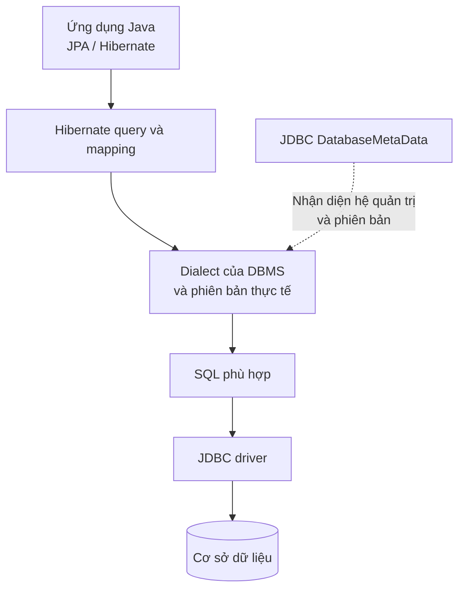
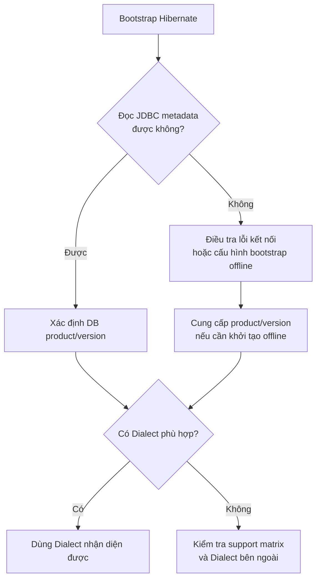

# Lựa chọn Dialect và kiểm tra hỗ trợ của hệ quản trị trong Hibernate

Khi khởi tạo một ứng dụng Java dùng Hibernate để truy cập cơ sở dữ liệu quan hệ, có hai câu hỏi cần trả lời: **Hibernate sẽ sinh SQL theo biến thể của hệ quản trị nào?** và **phiên bản cơ sở dữ liệu thực tế có được phiên bản Hibernate hiện tại hỗ trợ hay không?**

Một **Hibernate Dialect** mô tả cú pháp SQL và một số khả năng của một hệ quản trị cơ sở dữ liệu (DBMS). Ví dụ, `PostgreSQLDialect` mô tả PostgreSQL, còn `MySQLDialect` mô tả MySQL. Dialect giúp Hibernate render SQL, xử lý phân trang, lựa chọn kiểu SQL, cơ chế sinh khóa và một số cú pháp DDL, khóa hay hàm. Dialect **không thay thế JDBC driver**, không tự sửa lỗi kết nối và không biến hai database khác nhau thành tương thích hoàn toàn.

**Nguyên tắc hiện đại:** với Hibernate 6 trở lên, khi dùng DBMS được hỗ trợ và JDBC metadata đọc được, nên để Hibernate **tự phát hiện Dialect**. Chỉ cấu hình tường minh khi có nhu cầu đã xác định, chẳng hạn dùng custom/third-party Dialect. Sau đó vẫn cần kiểm tra database version, driver và các tính năng ứng dụng thực sự sử dụng.

## 1. Vì sao Hibernate cần Dialect?

SQL có chuẩn chung nhưng mỗi engine triển khai các phần khác nhau và có cú pháp khác nhau cho cùng nhu cầu. Hãy xét yêu cầu lấy trang kết quả thứ ba, mỗi trang 10 bản ghi:

```java
List<PurchaseOrder> orders = entityManager
    .createQuery(
        "select o from PurchaseOrder o order by o.id",
        PurchaseOrder.class)
    .setFirstResult(20)
    .setMaxResults(10)
    .getResultList();
```

Ứng dụng sử dụng API JPA/Hibernate chung, nhưng SQL gửi đến DBMS phải thích hợp. Chẳng hạn hai kiểu cú pháp phổ biến:

```sql
-- PostgreSQL: một dạng SQL có LIMIT/OFFSET
SELECT id, status
FROM purchase_orders
ORDER BY id
LIMIT 10 OFFSET 20;

-- SQL Server: một dạng SQL dùng OFFSET/FETCH
SELECT id, status
FROM purchase_orders
ORDER BY id
OFFSET 20 ROWS FETCH NEXT 10 ROWS ONLY;
```

Đây là ví dụ để phân biệt cú pháp; **không bảo đảm Hibernate luôn phát ra chính xác hai câu SQL này**. SQL thực tế còn phụ thuộc Dialect, phiên bản database, cấu trúc truy vấn, mapping và phiên bản Hibernate.



Những chức năng thường chịu ảnh hưởng của Dialect:

| Lĩnh vực | Dialect cung cấp thông tin gì? | Hậu quả khi không phù hợp |
|---|---|---|
| Phân trang | Cách biểu diễn limit/offset, top/fetch và SQL liên quan | SQL sai hoặc giới hạn kết quả không như dự kiến |
| Kiểu dữ liệu | Cách biểu diễn các kiểu SQL hỗ trợ, như số, chuỗi, thời gian, UUID/JSON tùy DB | DDL sai, mapping không tương thích |
| Sinh định danh | Khả năng sử dụng sequence, identity column và lấy khóa tự sinh | Insert thất bại hoặc chiến lược ID không chạy |
| Hàm SQL | Cách render hàm chuỗi, toán học, thời gian và các biểu thức | HQL/Criteria được chuyển thành SQL DB không nhận |
| Khóa | Cách sinh một số câu lệnh khóa và tính năng liên quan | Sai cú pháp hoặc hành vi khóa khác dự kiến |
| DDL | Cú pháp tạo bảng, sequence, constraint và quoting identifier | Schema generation không chạy |
| Khả năng theo phiên bản | Tính năng nào được hỗ trợ từ phiên bản DB nhất định | ORM dùng tính năng engine cũ chưa có |

Các khả năng này giúp tăng tính di động giữa hệ quản trị, nhưng **portability không tuyệt đối**. Native SQL, full-text search, JSON, index đặc thù, locking và transaction semantics vẫn có thể phụ thuộc mạnh vào vendor.

### 1.1. Dialect, JDBC driver và DBMS khác nhau ra sao?

| Thành phần | Vai trò chính | Ví dụ |
|---|---|---|
| Database engine | Lưu trữ, thực thi SQL, transaction, constraint, index | PostgreSQL, MySQL, MariaDB, Oracle, SQL Server |
| JDBC driver | Kết nối Java với DB; cung cấp `Connection`, `PreparedStatement`, `DatabaseMetaData` | PostgreSQL JDBC driver |
| Hibernate Dialect | Mô tả biến thể SQL để Hibernate sinh câu lệnh phù hợp | `org.hibernate.dialect.PostgreSQLDialect` |
| Hibernate ORM | Quản lý entity, persistence context, HQL/Criteria, mapping và tạo SQL | `hibernate-core` |
| Ứng dụng | Chọn truy vấn, nghiệp vụ, ranh giới transaction, schema và mục tiêu hiệu năng | Repository, service, migrations |

Đổi Dialect **không khắc phục** sai username/password, sai JDBC URL, thiếu driver, network timeout hay DB chưa chạy. Ngược lại, driver kết nối thành công chưa chứng minh SQL được tạo sẽ hợp với database.

## 2. Hibernate xác định Dialect như thế nào?

### 2.1. Tự phát hiện từ JDBC metadata

Trong Hibernate 6 và các phiên bản tiếp theo, ứng dụng làm việc với một DBMS được hỗ trợ thường **không cần** khai `hibernate.dialect`. Hibernate có thể lấy thông tin từ JDBC `DatabaseMetaData` để nhận diện vendor và version:

- `getDatabaseProductName()`: tên DBMS do driver báo, như `PostgreSQL`, `MySQL`, `MariaDB` hoặc `Oracle`.
- `getDatabaseMajorVersion()` và `getDatabaseMinorVersion()`: phiên bản DB.
- Các metadata khác để nhận diện những đặc điểm cần thiết.

Quy trình khái quát:



Để Hibernate tự xác định là lựa chọn tốt khi cấu hình thông thường vì giảm thông tin trùng lặp và tránh ghim tên class Dialect cũ sau khi nâng cấp Hibernate. **Dù phát hiện được Dialect, DB version vẫn có thể thấp hơn mức tối thiểu mà Hibernate release công bố.** Kiểm tra hỗ trợ phiên bản là bước riêng.

### 2.2. Ví dụ Spring Boot dùng PostgreSQL

Trong ứng dụng dùng Spring Data JPA/Hibernate, `application.properties` có thể tối giản:

```properties
spring.datasource.url=jdbc:postgresql://localhost:5432/order_db
spring.datasource.username=app_user
spring.datasource.password=change-via-secret-manager

# Chỉ kiểm tra schema, không yêu cầu Hibernate tự thay đổi bảng.
spring.jpa.hibernate.ddl-auto=validate

# Không cần spring.jpa.database-platform
# Không cần spring.jpa.properties.hibernate.dialect
```

Ví dụ về dependencies dùng Gradle Kotlin DSL trong dự án Spring Boot:

```kotlin
dependencies {
    implementation("org.springframework.boot:spring-boot-starter-data-jpa")
    runtimeOnly("org.postgresql:postgresql")
}
```

`change-via-secret-manager` là chuỗi minh họa. Trong hệ thống thật, phải lấy credential từ cơ chế bảo mật phù hợp; không commit mật khẩu. Phiên bản dependency nên được quản lý đồng bộ bởi Spring Boot BOM/Gradle dependency management của dự án. Nếu dùng `ddl-auto=validate`, schema cần được tạo trước bằng migrations hoặc cơ chế triển khai có kiểm soát.

Khi PostgreSQL và driver hoạt động, Hibernate có thể đọc metadata rồi chọn Dialect phù hợp. Để xác định chính xác Dialect đã dùng, xem log hoặc kiểm tra đối tượng Dialect lúc runtime như ví dụ ở phần sau.

### 2.3. Ví dụ tên property khi dùng Hibernate/JPA trực tiếp

Nếu bootstrap Hibernate bằng Jakarta Persistence hoặc mã cấu hình riêng, các property kết nối thường có dạng:

```properties
jakarta.persistence.jdbc.url=jdbc:postgresql://localhost:5432/order_db
jakarta.persistence.jdbc.user=app_user
jakarta.persistence.jdbc.password=read-from-secret-store
```

Các property có thể nằm trong `persistence.xml` hoặc được cung cấp khi khởi tạo `EntityManagerFactory`. Khi metadata có sẵn và DB được hỗ trợ, thông thường **không cần** thêm `hibernate.dialect`.

Tài liệu Hibernate 3–5 có thể đề xuất tự điền class Dialect cụ thể. Khi làm với Hibernate 6/7, không chép máy móc hướng dẫn cho phiên bản cũ: một số tên class và yêu cầu minimum database version đã thay đổi.

## 3. Khi nào cấu hình Dialect tường minh?

### 3.1. Custom và third-party Dialect

Nếu database chưa được Hibernate Core nhận diện hoặc ứng dụng có một Dialect do tổ chức/bên thứ ba cung cấp, có thể chọn class đó bằng `hibernate.dialect`.

```properties
# Class giả định, chỉ minh họa cách đặt property:
hibernate.dialect=com.example.persistence.AcmeDialect
```

Trong Spring Boot có thể truyền qua:

```properties
spring.jpa.properties.hibernate.dialect=com.example.persistence.AcmeDialect
```

`com.example.persistence.AcmeDialect` **không phải class phân phối bởi Hibernate**. Khi dùng thực tế, class phải tồn tại trên classpath, kế thừa/triển khai đúng API theo phiên bản Hibernate, và được kiểm thử với database đích.

Spring Boot cũng có cấu hình:

```properties
# Chỉ dùng khi có nhu cầu chỉ định tường minh:
spring.jpa.database-platform=org.hibernate.dialect.PostgreSQLDialect
```

Với PostgreSQL và Hibernate mới được hỗ trợ, việc chỉ định `spring.jpa.database-platform` thường thừa. Tránh thiết lập đồng thời nhiều property chọn Dialect khác nhau; thứ tự ưu tiên có thể phụ thuộc phiên bản framework, tạo cấu hình khó hiểu.

**Cẩn trọng:** không chọn `PostgreSQLDialect` cho một engine không phải PostgreSQL chỉ vì một số lệnh SQL căn bản tình cờ chạy được. Kiểu dữ liệu, transaction semantics, generated IDs, locking hoặc DDL vẫn có thể khác.

### 3.2. Khởi tạo offline khi không đọc JDBC metadata

Trong một số tình huống đặc biệt, ứng dụng/công cụ cần bootstrap Hibernate hoặc sinh schema khi chưa thể kết nối database. Hibernate hiện đại có thể được cung cấp rõ **database product và version** mà không đọc metadata lúc khởi tạo:

```properties
hibernate.boot.allow_jdbc_metadata_access=false
jakarta.persistence.database-product-name=PostgreSQL
jakarta.persistence.database-major-version=15
jakarta.persistence.database-minor-version=0
```

Nếu dùng Spring Boot, các property Hibernate/Jakarta Persistence này có thể được truyền tiếp qua:

```properties
spring.jpa.properties.hibernate.boot.allow_jdbc_metadata_access=false
spring.jpa.properties.jakarta.persistence.database-product-name=PostgreSQL
spring.jpa.properties.jakarta.persistence.database-major-version=15
spring.jpa.properties.jakarta.persistence.database-minor-version=0
```

Số `15.0` trong ví dụ chỉ minh họa; phải khai đúng version đích được hỗ trợ. Cấu hình này phù hợp khi **cố ý không truy cập metadata**; nó không chữa một kết nối DB bị hỏng lúc ứng dụng thực sự phải đọc/ghi. Việc cung cấp version giả để né kiểm tra tương thích không làm engine cũ hỗ trợ cú pháp mới.

### 3.3. Hibernate cũ và tên Dialect theo phiên bản

Một số class Dialect trong tài liệu Hibernate cũ có tên chứa phiên bản SQL/DB. Những class đó có thể bị đổi tên, hợp nhất, chuyển module hoặc không còn trong release mới. Khi nâng cấp Hibernate:

1. Xác định `hibernate-core` version thực chạy.
2. Tra Javadoc/compatibility matrix của chính phiên bản đó.
3. Bỏ `hibernate.dialect` lỗi thời nếu Hibernate tự nhận diện được.
4. Nếu dùng custom/community Dialect, kiểm tra module và version tương thích.
5. Xác nhận kết quả bằng SQL chạy trên DB thực tế.

## 4. Kiểm tra hỗ trợ của hệ quản trị ở nhiều lớp

Không thể kết luận “được hỗ trợ” chỉ dựa trên việc service khởi động thành công. Cần phân biệt những lớp kiểm tra sau:

| Phạm vi | Câu hỏi | Cách xác minh |
|---|---|---|
| Hibernate | Ứng dụng thực sự chạy release `hibernate-core` nào? | Runtime classpath, dependency tree, startup log |
| Database product | Đích là PostgreSQL, MySQL, MariaDB, Oracle, SQL Server hay một engine tương thích? | JDBC metadata và thông tin DB server |
| Database version | Major/minor có đạt mức Hibernate release yêu cầu? | Bảng supported databases của đúng Hibernate release |
| JDBC driver | Driver có tương thích DB engine/version và JDK không? | Tài liệu driver, kiểm thử kết nối |
| Dialect | Class nằm trong `hibernate-core`, community hoặc third-party? | Javadoc, dependency, thông tin Dialect thực chạy |
| SQL và data types | Các tính năng mà ứng dụng cần có được engine hỗ trợ? | Integration tests và quan sát SQL |
| Schema và hiệu năng | DDL/migration, constraints, query plan có đúng không? | Test trên database đích, execution plan |

### 4.1. Tự đọc database product và version qua JDBC

Có thể dùng một `DataSource` có sẵn để xác nhận chính xác thông tin driver báo về:

```java
import javax.sql.DataSource;
import java.sql.Connection;
import java.sql.DatabaseMetaData;
import java.sql.SQLException;

public final class DatabaseIdentity {
    private final DataSource dataSource;

    public DatabaseIdentity(DataSource dataSource) {
        this.dataSource = dataSource;
    }

    public void printIdentity() throws SQLException {
        try (Connection connection = dataSource.getConnection()) {
            DatabaseMetaData md = connection.getMetaData();

            System.out.println("DB product: "
                    + md.getDatabaseProductName());
            System.out.println("DB version: "
                    + md.getDatabaseProductVersion());
            System.out.println("Major/minor: "
                    + md.getDatabaseMajorVersion() + "/"
                    + md.getDatabaseMinorVersion());
            System.out.println("JDBC driver: "
                    + md.getDriverName());
            System.out.println("Driver version: "
                    + md.getDriverVersion());
        }
    }
}
```

Đây là đoạn mã chẩn đoán, không phải cơ chế giám sát production. Không in mật khẩu, thông tin xác thực hay URL có thể chứa dữ liệu nhạy cảm vào log. Một số database proxy hoặc dịch vụ “compatible with ...” có thể trả metadata khác kỳ vọng; cần đối chiếu vendor docs và kết quả thực tế.

### 4.2. So minimum supported version theo đúng release

Hibernate công bố danh sách các database và phiên bản tối thiểu mà từng release hỗ trợ. Danh sách này **thay đổi theo phiên bản Hibernate**. Một DB chạy được với Hibernate cũ chưa chắc còn được dòng Hibernate mới hỗ trợ chính thức.

Để quyết định tương thích, luôn đối chiếu đủ:

```text
Hibernate ORM release cụ thể
               +
DB product thực tế từ server/JDBC
               +
DB major/minor version thực tế
               ↓
Bảng database compatibility của đúng Hibernate release
```

Ví dụ, không nên hỏi chung “Hibernate hỗ trợ PostgreSQL 10 không?” mà phải hỏi “release Hibernate đang chạy hỗ trợ tối thiểu PostgreSQL version nào?”. Nếu DB thấp hơn minimum, giải pháp phù hợp thường là nâng cấp DB hoặc chọn stack hỗ trợ DB đó, có đánh giá rủi ro và kế hoạch duy trì. Việc ép Dialect hay khai giả version không biến bản DB cũ thành được hỗ trợ.

### 4.3. Core Dialect và Community Dialect

Hibernate Core cung cấp nhiều Dialect thuộc package `org.hibernate.dialect`. Ngoài ra Hibernate có artifact `org.hibernate.orm:hibernate-community-dialects` cho một số Dialect được hỗ trợ ở mức cộng đồng.

Ví dụ dependency tùy chọn:

```kotlin
dependencies {
    // Chỉ thêm nếu database mục tiêu yêu cầu module này.
    implementation("org.hibernate.orm:hibernate-community-dialects")
}
```

Không cần thêm community module chỉ để chạy PostgreSQL/MySQL thông thường khi Dialect đã nằm trong Core. Nếu phải dùng, cần tra đúng tên class/package, khả năng tự phát hiện, mức version hỗ trợ và giữ version community module đồng bộ với Hibernate Core. “Có Dialect cộng đồng” không có nghĩa Hibernate chính thức kiểm thử mọi chức năng hoặc mọi phiên bản database.

### 4.4. JDBC driver và phiên bản engine là điều kiện độc lập

Một driver lỗi thời có thể kết nối được nhưng không phản ánh đầy đủ các tính năng DB mới. Một DB engine mới cũng không bảo đảm tương thích với Hibernate release cũ. Sự kết hợp cần xem như ma trận:

```text
      Hibernate ORM version
           ↕
       JDBC driver
           ↕
   Database engine/version
           ↕
  JDK / Spring / Runtime
```

Phần version được quản lý bởi BOM của Spring Boot hoặc Gradle/Maven có thể khác với dependency trực tiếp. Cần kiểm tra **runtime** thay vì chỉ đọc một dòng trong build file.

Ví dụ lệnh tra cứu tại dự án Gradle:

```bash
./gradlew dependencyInsight --dependency hibernate-core --configuration runtimeClasspath
./gradlew dependencies --configuration runtimeClasspath
```

Dự án Maven có thể dùng:

```bash
mvn dependency:tree
```

Các lệnh chỉ minh họa cách kiểm tra; trong dự án nhiều module phải chạy tại module và configuration tương ứng.

## 5. Xác nhận Dialect được dùng tại runtime

Khi có `EntityManagerFactory`, ứng dụng có thể xem Dialect qua API nội bộ Hibernate phục vụ chẩn đoán:

```java
import jakarta.persistence.EntityManagerFactory;
import org.hibernate.dialect.Dialect;
import org.hibernate.engine.spi.SessionFactoryImplementor;

public final class DialectInspector {
    public static void printDialect(EntityManagerFactory emf) {
        SessionFactoryImplementor sessionFactory =
                emf.unwrap(SessionFactoryImplementor.class);

        Dialect dialect =
                sessionFactory.getJdbcServices().getDialect();

        System.out.println(
                "Selected dialect: " + dialect.getClass().getName());
    }
}
```

`SessionFactoryImplementor` là API nội bộ, có thể thay đổi theo Hibernate major version; không nên biến nó thành dependency lõi của nghiệp vụ. Ngoài ra có thể xem thông tin bootstrap logs nếu phiên bản đang dùng cung cấp.

**Chỉ biết class Dialect chưa đủ**: cùng một class có thể render SQL khác nhau tùy version DB được phát hiện. Hãy so tên DB, phiên bản, Dialect đã nhận diện, SQL và các test trên database đích.

### 5.1. Quan sát SQL thật

Trong môi trường kiểm soát có thể bật log SQL:

```properties
logging.level.org.hibernate.SQL=DEBUG

# Khi thật sự cần chẩn đoán bind:
# logging.level.org.hibernate.orm.jdbc.bind=TRACE
```

Tên logger cụ thể thay đổi theo dòng Hibernate. Log bind có thể chứa dữ liệu nhạy cảm; chỉ bật khi cần và tránh giữ lâu trong production. Khi kiểm tra, ưu tiên những câu SQL đại diện cho tính năng ứng dụng: pagination, bulk update, sequence, insert lấy khóa, khóa bản ghi và truy vấn chức năng.

### 5.2. Kiểm thử tính năng, không chỉ “connection successful”

Hibernate có thể kết nối và chạy CRUD đơn giản nhưng thất bại trên truy vấn phức tạp. Các trường hợp cần cân nhắc tùy ứng dụng:

| Nhóm test | Mục đích |
|---|---|
| Insert và generated ID | Identity/sequence được hỗ trợ và hoạt động đúng |
| Đọc/ghi kiểu dữ liệu quan trọng | Mapping Java–JDBC–SQL phù hợp với DB |
| Pagination + `ORDER BY` | Không sai cú pháp hoặc phân trang thiếu ổn định |
| Constraint/unique/FK | Bảo vệ bất biến dữ liệu ở database |
| Optimistic/pessimistic locking | Phát hiện hoặc ngăn xung đột như thiết kế |
| Native query, JSON/array, hàm vendor | Tính năng DB đặc thù thật sự hoạt động |
| Schema validation và migration | Cấu trúc DB thực tế đúng theo mapping |
| Query plan và index | Hiệu năng đạt yêu cầu dưới dữ liệu đại diện |

Nên chạy integration tests trên cùng engine và phiên bản DB với production, chẳng hạn qua Testcontainers nếu hạ tầng dự án hỗ trợ. H2 ở compatibility mode hữu ích cho một số test nhanh, nhưng **không thay thế** PostgreSQL, MySQL hoặc Oracle thật về SQL, transaction, constraint, index và locking.

## 6. Quy trình chọn Dialect và kiểm tra DB support

### Bước 1. Xác định môi trường đích

Ghi rõ database product/version ở local, CI, staging và production. Đừng mặc định tất cả môi trường dùng cùng engine chỉ vì cùng JDBC API. Nếu production dùng PostgreSQL và local dùng H2, đó là hai DBMS với Dialect khác nhau.

### Bước 2. Xác định Hibernate, driver và runtime JDK

Kiểm tra dependency thực được resolve, quản lý version qua BOM, và khả năng tương thích của framework. Một project Spring Boot có thể thay đổi Hibernate khi nâng cấp Boot.

### Bước 3. Tra support matrix đúng phiên bản

Đọc phần “Database/Dialect” trong tài liệu Hibernate của **release đang dùng**. Đối chiếu minimum supported DB version. Nếu engine không được Core hỗ trợ, xem community/third-party/custom Dialect và chính sách bảo trì. Không tự cho rằng engine “tương thích SQL” là được hỗ trợ.

### Bước 4. Cấu hình DataSource và ưu tiên auto detection

Cấu hình JDBC URL, driver, credentials, connection pool. Với hệ DB thông dụng được hỗ trợ, **không thêm `hibernate.dialect` khi không cần**.

### Bước 5. Kiểm tra metadata và Dialect thực tế

Lấy `DatabaseMetaData`, xem tên DB/version và Dialect Hibernate chọn. Nếu metadata không truy cập được, sửa lỗi kết nối trước; chỉ dùng cấu hình offline khi có lý do rõ.

### Bước 6. Kiểm tra schema và migration

Dùng công cụ migration có kiểm soát như Flyway/Liquibase theo quy trình dự án. Hibernate có thể kiểm tra schema, nhưng không tự thiết kế việc thay đổi database an toàn trong production. Không phụ thuộc vào `ddl-auto=update` để xử lý mọi khác biệt giữa DBMS.

### Bước 7. Chạy integration tests trên DB đích

Kiểm tra mapping, constraints, generated ID, query trọng yếu, transaction và locking. Quan sát SQL thực tế và execution plan với dữ liệu đại diện. Một Dialect đúng không tự tạo index tối ưu.

### Bước 8. Ghi lại quyết định và kiểm tra khi nâng cấp

Tài liệu hóa phiên bản Hibernate/driver/DB, Dialect tùy chỉnh nếu có, lý do lựa chọn, tập tính năng đặc thù và bài test đã chạy. Lặp lại kiểm tra hỗ trợ sau mỗi lần nâng cấp Hibernate, database hoặc JDBC driver.

## 7. Những lỗi thường gặp

### 7.1. “Unable to determine Dialect without JDBC metadata”

Thông báo liên quan đến Dialect có thể chỉ là **hậu quả của lỗi connection**: JDBC URL sai, DB server không tới được, mật khẩu sai, TLS lỗi, thiếu driver, hoặc Hibernate bị cấu hình không đọc metadata.

Cách phân tích:

1. Tìm **root cause** trong exception chain, đặc biệt `SQLException` hoặc `No suitable driver`.
2. Kiểm tra JDBC URL và kết nối bằng công cụ phù hợp.
3. Đọc `DatabaseMetaData` khi có connection hợp lệ.
4. Kiểm tra Hibernate version và supported DB list.
5. Chỉ dùng property metadata offline nếu thực sự cần bootstrap không kết nối DB.

Thêm `hibernate.dialect` có thể làm mất một thông báo ở bước khởi tạo nhưng **không khôi phục** đường đọc/ghi dữ liệu bị hỏng.

### 7.2. “ClassNotFoundException” hoặc lỗi chọn strategy cho Dialect

Thường do cấu hình class không còn tồn tại trong Hibernate version mới, sai package, hoặc thiếu artifact community/custom. Phải xác định version `hibernate-core`, tra đúng Javadoc và sửa dependency/config. Không ép thêm một phiên bản Hibernate khác chỉ để lấy lại class cũ vì có thể gây xung đột trên classpath.

### 7.3. SQL syntax error sau khi bootstrap thành công

Xem SQL Hibernate thực gửi xuống DB và tính năng nào bị từ chối. Có thể do Dialect sai, metadata nhận diện sai DB/version, HQL được render vào tính năng không hỗ trợ, hoặc native SQL vendor-specific viết nhầm. Đối chiếu SQL với DB engine/version thật và test nhỏ để tái hiện.

### 7.4. “Unsupported database version” hoặc cảnh báo tương tự

DB phiên bản hiện tại có thể thấp hơn mức Hibernate release hỗ trợ. Không sửa bằng cách nói dối version trong metadata config; hãy chọn DB/Hibernate stack phù hợp và kiểm thử tương thích.

### 7.5. Chạy trên H2 nhưng hỏng trên production

H2 có thể hỗ trợ một phần cú pháp của engine khác qua compatibility mode, nhưng không mô phỏng đầy đủ kiểu dữ liệu, locking, transaction, index, câu lệnh DDL hoặc migration. Dùng integration tests với engine production trước khi triển khai.

### 7.6. Dùng Dialect đúng nhưng truy vấn chậm

Dialect quyết định nhiều chi tiết cú pháp; nó không tự định nghĩa fetch plan tối ưu, chỉ mục hoặc query plan. N+1 query, thiếu index, lọc tenant không tốt, phân trang với join fetch có thể gây vấn đề ngay khi Dialect hoàn toàn đúng. Đo số query, execution plan và dữ liệu truyền qua DB thay vì thay Dialect ngẫu nhiên.

## 8. Một số tình huống chọn cấu hình

| Tình huống | Lựa chọn hợp lý | Xác minh bắt buộc |
|---|---|---|
| PostgreSQL version được Hibernate hiện tại hỗ trợ | JDBC DataSource + tự phát hiện Dialect | Product/version, SQL, integration tests |
| MySQL hoặc MariaDB | Dùng đúng driver/engine thực, ưu tiên tự phát hiện | Không đánh đồng MySQL với MariaDB |
| Database thông qua proxy hoặc cloud compatible | Kiểm tra metadata, Dialect và vendor docs | Tính năng đặc thù, lock, generated ID, DDL |
| Cần bootstrap/sinh DDL không truy cập DB | Cung cấp database product + major/minor version | Kết quả SQL đúng với DB đích |
| Custom/third-party Dialect | Chỉ định `hibernate.dialect` đúng tên class | Classpath, phiên bản, tính năng thực tế |
| Dialect thuộc community module | Thêm đúng artifact cùng version với Hibernate Core | Mức hỗ trợ cộng đồng và test phù hợp |
| Nâng cấp từ Hibernate 5 lên 6/7 | Kiểm tra lại tên class; xóa cấu hình cũ nếu không cần | Compatibility matrix và test đường đọc/ghi |

### Ví dụ quyết định cho dự án PostgreSQL 15

Giả sử hệ thống Spring Boot dùng Hibernate hiện đại và DB production PostgreSQL 15, còn CI đang sử dụng H2:

1. Kiểm tra Hibernate release thực trong runtime classpath; đối chiếu release đó có hỗ trợ PostgreSQL 15.
2. Production cấu hình PostgreSQL JDBC driver và DataSource; để Hibernate đọc metadata và chọn PostgreSQL Dialect.
3. CI chạy H2 thì dùng Dialect H2 tương ứng, nhưng không coi H2 test là đủ chứng minh tương thích PostgreSQL.
4. Thêm integration tests trên PostgreSQL 15 cho chức năng trọng yếu, nhất là kiểu dữ liệu/DDL, sequence, transaction và query phức tạp.
5. Nếu cần DB offline ở bước bootstrap, truyền database product/version chính xác theo cơ chế Hibernate hỗ trợ; không đổi một Dialect bất kỳ để “qua lỗi”.

Cách này tách rõ ba việc: **lựa chọn biến thể SQL**, **xác nhận engine/version được hỗ trợ**, và **kiểm chứng hành vi thực tế của ứng dụng**.

## 9. Tổng kết

Lựa chọn Hibernate Dialect là lựa chọn kiến thức về **SQL và khả năng của DBMS**, không phải lựa chọn database thay cho ứng dụng. Với Hibernate 6/7, database thông dụng và được hỗ trợ thường nên dùng **tự nhận diện Dialect qua JDBC metadata**. Khi không thể đọc metadata vì một quy trình bootstrap offline có chủ đích, hãy cung cấp database product/version; khi dùng một Dialect custom hoặc third-party, chỉ định class một cách tường minh và kiểm chứng dependency tương thích.

Muốn kết luận hệ quản trị “được hỗ trợ”, phải biết chính xác **Hibernate release, database product/version, JDBC driver** và xác nhận các tính năng mà ứng dụng sử dụng trên database thật. Đúng Dialect là điều kiện cần cho SQL phù hợp, nhưng schema, constraints, giao dịch và hiệu năng vẫn cần thiết kế và kiểm thử riêng.

### Tài liệu chính thức để tra cứu

- [Hibernate ORM User Guide](https://docs.jboss.org/hibernate/orm/current/userguide/html_single/Hibernate_User_Guide.html) — phần Database và Database Dialect, đặc biệt bảng minimum supported DB version của release.
- [A Short Guide to Hibernate 7.1](https://docs.jboss.org/hibernate/orm/7.1/introduction/pdf/Hibernate_Introduction.pdf) — cách tự nhận diện Dialect và thuộc tính cấu hình khi không truy cập JDBC metadata.
- [Hibernate ORM Javadocs](https://docs.jboss.org/hibernate/orm/current/javadocs/) — tên class, package và contract của Dialect.

Khi sử dụng tài liệu, hãy chuyển đến **đúng nhánh phiên bản Hibernate đang chạy**. Link `current` có thể trỏ đến một release khác với release thực của dự án.
