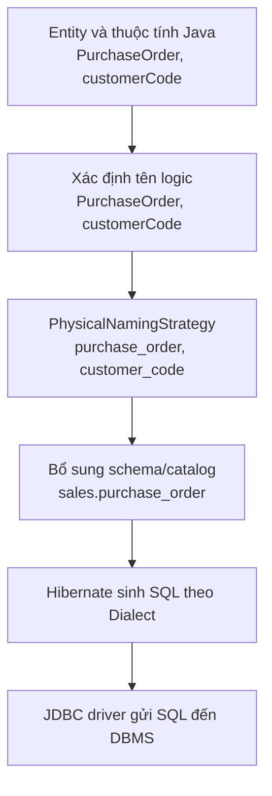

# Cấu hình tên logic, tên vật lý, schema và catalog trong Hibernate

Trong Hibernate ORM, việc ánh xạ một entity Java sang bảng SQL không chỉ đơn giản là lấy tên lớp làm tên bảng. Hibernate cần xác định **tên logic** từ metadata ánh xạ, chuyển nó thành **tên vật lý** theo quy ước của dự án, rồi xác định bảng nằm trong **schema** và **catalog** nào của hệ quản trị cơ sở dữ liệu.

Các khái niệm này đặc biệt quan trọng khi dự án dùng quy ước tên `snake_case`, chuyển giữa PostgreSQL và MySQL, làm việc với nhiều schema, hoặc dùng Flyway/Liquibase để quản lý cấu trúc dữ liệu.

## 1. Bức tranh tổng thể: từ entity đến đối tượng trong cơ sở dữ liệu

Ví dụ một entity Java:

```java
import jakarta.persistence.Entity;
import jakarta.persistence.Id;

@Entity
public class PurchaseOrder {
    @Id
    private Long id;

    private String customerCode;
}
```

Ta có thể muốn Hibernate truy cập bảng `sales.purchase_order`, gồm các cột `id` và `customer_code`. Để đạt được kết quả đó, có nhiều bước khác nhau:



**Tên logic** trả lời câu hỏi: “Theo mapping Hibernate, đối tượng này được gọi là gì?”. **Tên vật lý** trả lời: “Trong database, đối tượng đó thực sự có tên SQL nào?”. **Schema/catalog** trả lời: “Đối tượng đó thuộc không gian tên nào?”.

| Khái niệm | Ví dụ | Vai trò |
|---|---|---|
| Tên entity Java | `PurchaseOrder` | Tên lớp trong mã nguồn |
| Tên entity JPA | `PurchaseOrder` hoặc tên chỉ định ở `@Entity(name = ...)` | Tên entity dùng trong JPQL/HQL |
| Tên bảng logic | `PurchaseOrder` | Tên ban đầu từ mapping hoặc quy tắc suy diễn |
| Tên bảng vật lý | `purchase_order` | Tên được sử dụng trong SQL sau bước chuyển đổi |
| Tên cột logic | `customerCode` | Tên ban đầu cho mapping thuộc tính |
| Tên cột vật lý | `customer_code` | Tên cột được dùng trong SQL |
| Schema | `sales` | Nhóm đối tượng bên trong database ở những DBMS có khái niệm schema |
| Catalog | `commerce` | Không gian tên cấp cao hơn, thường gần với khái niệm database nhưng phụ thuộc DBMS |

Điều quan trọng là **tên entity dùng trong HQL/JPQL không phải tên bảng SQL**. Chẳng hạn:

```java
// Truy vấn theo tên entity và tên thuộc tính Java.
List<PurchaseOrder> orders = entityManager.createQuery(
    "select o from PurchaseOrder o where o.customerCode = :code",
    PurchaseOrder.class
).setParameter("code", "CUS-001").getResultList();
```

Hibernate sẽ dùng mapping để sinh SQL với tên bảng/cột thực tế. Không thay `PurchaseOrder` bằng `sales.purchase_order` trong JPQL chỉ vì đó là tên bảng trong database.

## 2. Tên logic và ImplicitNamingStrategy

### 2.1. Tên được khai báo tường minh

Khi sử dụng các annotation như `@Table(name = ...)` hay `@Column(name = ...)`, ta đang cung cấp tên ánh xạ một cách **tường minh**:

```java
import jakarta.persistence.Column;
import jakarta.persistence.Entity;
import jakarta.persistence.Id;
import jakarta.persistence.Table;

@Entity(name = "Order")
@Table(name = "PurchaseOrder")
public class PurchaseOrder {

    @Id
    private Long id;

    @Column(name = "CustomerCode")
    private String customerCode;
}
```

Trong ví dụ này:

- `Order` là **tên entity trong JPQL/HQL**.
- `PurchaseOrder` là tên bảng được khai báo trong mapping.
- `CustomerCode` là tên cột được khai báo trong mapping.

Các giá trị `name` vừa khai báo **chưa chắc là tên SQL cuối cùng**. Một `PhysicalNamingStrategy` tùy chỉnh vẫn có thể chuyển `PurchaseOrder` thành `purchase_order` và `CustomerCode` thành `customer_code`. Vì thế, “đã ghi `@Table(name = ...)`” không đồng nghĩa với “bỏ qua physical naming strategy”.

### 2.2. Tên được suy diễn ngầm định

Nếu `@Table` không khai báo `name`, hoặc một thuộc tính không có `@Column(name = ...)`, Hibernate sử dụng **implicit naming strategy** để suy ra tên logic.

```java
@Entity
public class PurchaseOrder {
    @Id
    private Long id;

    private String customerCode;
}
```

Với cách ánh xạ cơ bản, Hibernate có thể suy ra tên logic cho bảng là `PurchaseOrder` và cột là `customerCode`. Tên logic của join table, join column, collection table hoặc các đối tượng phụ thuộc quan hệ có thể được tạo từ nhiều thành phần, chẳng hạn tên entity, thuộc tính và bảng liên quan.

**`ImplicitNamingStrategy` chỉ tham gia khi cần suy ra một tên chưa được chỉ định tường minh.** Nó không thay thế ý nghĩa của annotation đã có tên rõ ràng.

Trong Hibernate, một chiến lược tuân theo quy tắc đặt tên JPA phổ biến là:

```text
org.hibernate.boot.model.naming.ImplicitNamingStrategyJpaCompliantImpl
```

Những tên lớp và tên thuộc tính được dùng làm dữ liệu đầu vào cho chiến lược đặt tên. Nếu đổi tên thuộc tính Java, tên cột được suy diễn cũng có thể đổi theo; việc đó ảnh hưởng đến tính tương thích với schema đã triển khai.

### 2.3. Ví dụ có quan hệ

```java
@Entity
public class Customer {
    @Id
    private Long id;
}

@Entity
public class Invoice {
    @Id
    private Long id;

    @ManyToOne
    private Customer customer;
}
```

Vì `Invoice.customer` chưa khai báo `@JoinColumn`, Hibernate phải suy ra tên cột khóa ngoại. Theo quy tắc đặt tên JPA phổ biến, tên logic có thể là `customer_id`; physical naming strategy sẽ tiếp tục xử lý tên này.

Nếu schema hiện có sử dụng cột `customer_ref`, hãy khai báo rõ:

```java
@ManyToOne
@JoinColumn(name = "customer_ref")
private Customer customer;
```

Khi có một quy ước tên khác với mặc định, việc khai báo mapping tường minh giúp tránh phụ thuộc vào giả định về tên cột được suy diễn.

## 3. Tên vật lý và PhysicalNamingStrategy

`PhysicalNamingStrategy` nhận tên logic và quyết định **identifier dùng trong SQL**. Nó có thể xử lý tên bảng, tên cột, sequence, schema và catalog.

Ví dụ, một chiến lược chuyển camel case sang chữ thường có dấu gạch dưới:

| Tên logic | Tên vật lý mong muốn |
|---|---|
| `PurchaseOrder` | `purchase_order` |
| `customerCode` | `customer_code` |
| `CreatedAt` | `created_at` |
| `OrderItem` | `order_item` |

Trong Hibernate ORM 6, có thể sử dụng lớp:

```text
org.hibernate.boot.model.naming.CamelCaseToUnderscoresNamingStrategy
```

Tên lớp trên là một implementation sẵn có trong Hibernate. Nếu dự án sử dụng phiên bản Hibernate khác, cần đối chiếu API của chính phiên bản đó.

Ngược lại, `PhysicalNamingStrategyStandardImpl` là chiến lược chuẩn không cố ý đổi tên logic thành một quy ước kiểu snake case:

```text
org.hibernate.boot.model.naming.PhysicalNamingStrategyStandardImpl
```

### 3.1. Implicit và physical naming hoạt động cùng nhau

| Cách ánh xạ | Xác định tên logic | Áp dụng physical strategy |
|---|---|---|
| Không có `@Table(name)` | Implicit strategy suy tên bảng | Có |
| Có `@Table(name = "PurchaseOrder")` | Lấy tên `PurchaseOrder` từ annotation | Vẫn có |
| Không có `@Column(name)` | Implicit strategy suy tên cột | Có |
| Có `@Column(name = "CustomerCode")` | Lấy tên `CustomerCode` từ annotation | Vẫn có |

Ví dụ:

```java
@Entity
@Table(name = "PurchaseOrder")
public class PurchaseOrder {

    @Id
    private Long id;

    @Column(name = "CustomerCode")
    private String customerCode;
}
```

Nếu physical strategy chuyển camel case sang snake case, tên SQL cuối cùng có thể là `purchase_order` và `customer_code`, dù tên đã được chỉ định tường minh trong annotation.

Một lưu ý: **mỗi implementation của `PhysicalNamingStrategy` có thể có quy tắc riêng**. Không nên khẳng định rằng mọi chiến lược đều biến đổi tất cả tên giống nhau, nhất là các tên có dấu trích dẫn hoặc tên viết tắt.

### 3.2. Khi nào nên viết naming strategy riêng?

Dự án có thể có quy ước như:

- Tên bảng luôn bắt đầu bằng `tbl_`.
- Tên sequence có tiền tố `seq_`.
- Tên cột Java giữ nguyên theo một quy tắc, nhưng tên bảng chuyển sang snake case.
- Cần tương thích với hệ thống database cũ có quy ước nhất quán.

Khi đó có thể triển khai interface `org.hibernate.boot.model.naming.PhysicalNamingStrategy`, vốn định nghĩa các phương thức chuyển đổi tên catalog, schema, table, sequence và column.

Ví dụ sau chỉ thêm tiền tố cho tên bảng, đồng thời giữ nguyên hành vi của chiến lược snake case đối với các loại identifier khác:

```java
import org.hibernate.boot.model.naming.CamelCaseToUnderscoresNamingStrategy;
import org.hibernate.boot.model.naming.Identifier;
import org.hibernate.engine.jdbc.env.spi.JdbcEnvironment;

public class PrefixedTableNamingStrategy
        extends CamelCaseToUnderscoresNamingStrategy {

    @Override
    public Identifier toPhysicalTableName(
            Identifier logicalName,
            JdbcEnvironment jdbcEnvironment) {

        Identifier baseName =
                super.toPhysicalTableName(logicalName, jdbcEnvironment);

        if (baseName == null) {
            return null;
        }

        return Identifier.toIdentifier(
                "tbl_" + baseName.getText(),
                baseName.isQuoted()
        );
    }
}
```

Ví dụ, bảng logic `PurchaseOrder` sẽ thành `tbl_purchase_order`. Đây là một quy tắc mẫu; khi áp dụng trong hệ thống thực tế, cần xác định chính sách cho tên được quote và tên bảng do thư viện/legacy schema quy định. Các phương thức còn lại tiếp tục dùng cách triển khai kế thừa.

Đăng ký lớp tùy chỉnh bằng property:

```properties
hibernate.physical_naming_strategy=com.example.persistence.PrefixedTableNamingStrategy
```

## 4. Schema và catalog: định danh đối tượng nằm ở đâu?

Schema và catalog là các lớp **định danh/không gian tên** của database. Một tên bảng có thể được ghi đầy đủ theo dạng khái niệm:

```sql
catalog.schema.table_name
```

Tuy nhiên, cách hiểu và số phần được phép xuất hiện trong tên SQL **khác nhau giữa các hệ quản trị**. Không phải database nào cũng chấp nhận đầy đủ cấu trúc ba thành phần.

### 4.1. PostgreSQL

Trong PostgreSQL:

- **Database** là đơn vị kết nối chính, ví dụ `commerce`.
- Bên trong một database có nhiều **schema**, ví dụ `public`, `sales` và `audit`.
- Bảng có thể được tham chiếu bằng `sales.purchase_order`.

Ví dụ:

```sql
CREATE SCHEMA IF NOT EXISTS sales;

CREATE TABLE sales.purchase_order (
    id BIGINT PRIMARY KEY,
    customer_code VARCHAR(100) NOT NULL
);

SELECT id, customer_code
FROM sales.purchase_order;
```

Trong ngữ cảnh JDBC metadata, catalog của PostgreSQL thường tương ứng với database đã kết nối. PostgreSQL không hỗ trợ truy vấn tùy ý qua database khác bằng cách thêm catalog vào tên bảng như một số DBMS khác. Vì thế, đừng mặc định sinh `commerce.sales.purchase_order` để truy vấn bảng PostgreSQL.

PostgreSQL còn có `search_path`: nếu SQL không ghi schema, server tìm bảng theo các schema được cấu hình trong đường dẫn tìm kiếm. Điều đó khác với việc Hibernate chủ động gắn tiền tố `sales.` vào tên bảng.

### 4.2. MySQL

Ở MySQL, các từ **database** và **schema** thường được sử dụng gần như đồng nghĩa ở cấp SQL. Một tên bảng có thể có dạng:

```sql
commerce.purchase_order
```

JDBC/Hibernate dùng khái niệm catalog và schema để xây dựng tên đúng theo khả năng mà dialect/driver báo cáo. Không nên bê nguyên ý nghĩa của `@Table(schema = "sales")` từ PostgreSQL sang MySQL rồi giả định SQL sẽ giống nhau.

### 4.3. SQL Server

SQL Server phân biệt **database** và **schema**; bảng có thể được tham chiếu như:

```sql
commerce.sales.purchase_order
```

Trong cách dùng này, `commerce` tương ứng database/catalog, `sales` tương ứng schema, và `purchase_order` là tên bảng. Phạm vi định danh và cú pháp được Hibernate sử dụng còn phụ thuộc dialect và phiên bản DBMS.

| DBMS | Ví dụ tên phân cấp | Lưu ý |
|---|---|---|
| PostgreSQL | `sales.purchase_order` | Schema nằm trong database đang kết nối |
| MySQL | `commerce.purchase_order` | Database/schema thường là cùng một cấp tên |
| SQL Server | `commerce.sales.purchase_order` | Database và schema là hai cấp khác nhau |

**Nguyên tắc:** Dựa trên semantics của DBMS và Hibernate Dialect đang dùng; không coi `catalog` và `schema` là từ đồng nghĩa trong mọi trường hợp.

## 5. Chỉ định tên và schema/catalog bằng annotation JPA

### 5.1. `@Table`

`@Table` cho phép chỉ định `name`, `schema` và `catalog` của bảng chính:

```java
import jakarta.persistence.Column;
import jakarta.persistence.Entity;
import jakarta.persistence.Id;
import jakarta.persistence.Table;

@Entity
@Table(name = "purchase_order", schema = "sales")
public class PurchaseOrder {

    @Id
    private Long id;

    @Column(name = "customer_code", nullable = false)
    private String customerCode;
}
```

Với PostgreSQL và schema `sales` đã tồn tại, Hibernate có thể sinh một truy vấn tương đương:

```sql
SELECT id, customer_code
FROM sales.purchase_order
WHERE id = ?;
```

Alias, cách quote và SQL chính xác thay đổi theo phiên bản Hibernate và dialect, nên truy vấn trên chỉ minh họa tên bảng/cột.

Đối với DBMS có mô hình catalog phù hợp, có thể cấu hình:

```java
@Table(
    name = "purchase_order",
    schema = "sales",
    catalog = "commerce"
)
```

**Chỉ nên khai báo `catalog` khi thật sự phù hợp với hệ quản trị và cách truy cập database.** Ví dụ ba thành phần trên không phải mẫu chung cho mọi DBMS.

### 5.2. `@Column` và `@JoinColumn`

Các annotation này điều khiển tên cột bên trong bảng:

```java
@Entity
@Table(name = "invoice", schema = "sales")
public class Invoice {

    @Id
    private Long id;

    @Column(name = "issued_on")
    private java.time.LocalDate issuedOn;

    @ManyToOne
    @JoinColumn(name = "customer_ref")
    private Customer customer;
}
```

`@Column(name = ...)` chỉ định cột cho thuộc tính cơ bản; `@JoinColumn(name = ...)` chỉ định cột tham chiếu cho quan hệ. Nếu bỏ trống tên, Hibernate sử dụng implicit naming strategy và sau đó physical naming strategy.

### 5.3. Các đối tượng không nằm ở bảng chính

Không phải mọi tên đều được cấu hình qua `@Table`. Tùy mapping, cần xem thêm:

- `@JoinTable`: tên, schema/catalog của bảng liên kết nhiều-nhiều.
- `@CollectionTable`: tên, schema/catalog của bảng chứa element collection.
- `@SecondaryTable`: tên, schema/catalog của bảng phụ.
- `@SequenceGenerator`: tên sequence và schema/catalog dành cho sequence khi chiến lược sinh khóa sử dụng nó.
- `@AttributeOverride` và `@AssociationOverride`: tên cột hoặc quan hệ tại vị trí mapping được ghi đè.

Ví dụ bảng liên kết đặt trong schema `sales`:

```java
@ManyToMany
@JoinTable(
    name = "order_tag",
    schema = "sales",
    joinColumns = @JoinColumn(name = "order_id"),
    inverseJoinColumns = @JoinColumn(name = "tag_id")
)
private java.util.Set<Tag> tags = new java.util.HashSet<>();
```

Đây là đoạn mapping minh họa trong một entity đơn hàng; `Tag` cần được khai báo như một entity hợp lệ. Nếu không chỉ định schema cho bảng phụ, Hibernate sẽ dùng cơ chế tên mặc định theo metadata và cấu hình tương ứng.

## 6. Cấu hình schema/catalog mặc định cho Hibernate

Khi nhiều entity cùng nằm trong một schema, không nhất thiết phải ghi `schema = "sales"` ở từng `@Table`. Hibernate có các property:

```properties
hibernate.default_schema=sales
hibernate.default_catalog=commerce
```

Chúng được dùng làm schema/catalog mặc định cho những mapping không chỉ định giá trị riêng, trong phạm vi được dialect/DBMS hỗ trợ.

Lưu ý về mức ưu tiên:

1. Mapping đã khai báo schema/catalog cụ thể thì dùng giá trị tương ứng của mapping.
2. Nếu mapping không khai báo, Hibernate có thể dùng `hibernate.default_schema` hoặc `hibernate.default_catalog`.
3. Nếu vẫn không có định danh được khai báo, việc phân giải tên không đủ schema/catalog phụ thuộc vào DBMS, kết nối, người dùng hiện tại và thiết lập của phiên database.

Cách phân giải này không tạo quyền truy cập hay tự chuyển dữ liệu sang schema khác. Schema đích phải tồn tại và tài khoản kết nối cần có quyền phù hợp.

### 6.1. Ví dụ Spring Boot với PostgreSQL

Giả sử:

- Database tên `commerce`.
- Bảng ứng dụng nằm trong schema `sales`.
- Quy ước bảng/cột là snake case.
- Dự án đã có dependency Spring Data JPA, Hibernate và PostgreSQL JDBC driver.

Cấu hình `application.yml`:

```yaml
spring:
  datasource:
    url: jdbc:postgresql://localhost:5432/commerce
    username: ${DB_USERNAME}
    password: ${DB_PASSWORD}

  jpa:
    hibernate:
      ddl-auto: validate
    properties:
      hibernate:
        default_schema: sales
        implicit_naming_strategy: org.hibernate.boot.model.naming.ImplicitNamingStrategyJpaCompliantImpl
        physical_naming_strategy: org.hibernate.boot.model.naming.CamelCaseToUnderscoresNamingStrategy
```

Trong cấu hình này:

- `spring.datasource.url` chỉ định **database PostgreSQL để kết nối**.
- `hibernate.default_schema` chỉ định schema mặc định mà Hibernate dùng khi tạo tên bảng không ghi schema.
- `implicit_naming_strategy` xử lý các tên logic chưa được khai báo.
- `physical_naming_strategy` chuyển tên logic sang tên SQL theo quy ước.
- `ddl-auto: validate` yêu cầu Hibernate kiểm tra sự tương thích của mapping với schema hiện có thay vì dựa vào Hibernate để chủ động tạo hoặc sửa bảng.

Với entity:

```java
@Entity
public class PurchaseOrder {
    @Id
    private Long id;

    private String customerCode;
}
```

Kết quả tên mong muốn trong PostgreSQL là:

```text
Database  : commerce
Schema    : sales
Table     : purchase_order
Columns   : id, customer_code
SQL name  : sales.purchase_order
```

Đây là ví dụ cấu hình có chủ đích; các dự án dùng phiên bản Spring Boot/Hibernate khác nhau có thể có mặc định naming strategy khác nhau. **Không dựa vào mặc định ngầm của framework khi cần bảo đảm tên SQL cố định trong nhiều môi trường.**

### 6.2. Cấu hình Hibernate không qua Spring Boot

Trong ứng dụng cấu hình Hibernate trực tiếp, các thuộc tính tương ứng là:

```properties
hibernate.default_schema=sales
hibernate.implicit_naming_strategy=org.hibernate.boot.model.naming.ImplicitNamingStrategyJpaCompliantImpl
hibernate.physical_naming_strategy=org.hibernate.boot.model.naming.CamelCaseToUnderscoresNamingStrategy
```

Những property này có thể được cung cấp cho Hibernate khi khởi tạo `SessionFactory`. Cách khai báo cụ thể tùy việc dự án dùng `hibernate.cfg.xml`, `StandardServiceRegistryBuilder` hay cơ chế tích hợp khác.

### 6.3. Default schema khác gì `search_path`?

Trong PostgreSQL, nếu Hibernate sinh tên đầy đủ `sales.purchase_order`, DBMS sẽ truy cập bảng thuộc schema `sales` một cách tường minh. Nếu Hibernate sinh `purchase_order`, DBMS mới cần tìm bảng theo `search_path`.

Do đó:

- `hibernate.default_schema=sales` tác động đến cách Hibernate định danh các đối tượng database trong SQL và metadata.
- `search_path` là thiết lập phân giải tên ở **phía phiên kết nối PostgreSQL**.
- Chúng có thể cùng hướng đến `sales`, nhưng không phải cùng một chức năng.

Khi dùng pool, không tùy tiện chỉnh `search_path` trên một kết nối đang mượn mà không khôi phục trạng thái trước khi trả pool. Kết nối vật lý có thể được tái sử dụng bởi yêu cầu khác.

## 7. Thứ tự ưu tiên qua các tình huống

Xem một cấu hình giả định:

```properties
hibernate.default_schema=sales
hibernate.physical_naming_strategy=org.hibernate.boot.model.naming.CamelCaseToUnderscoresNamingStrategy
```

Các entity sau dẫn tới những tên SQL **dự kiến**, giả sử DBMS hỗ trợ schema và không có quy tắc quote đặc biệt:

| Annotation / mapping | Tên logic | Schema | Tên vật lý dự kiến |
|---|---|---|---|
| `@Entity class PurchaseOrder` | `PurchaseOrder` | Mặc định `sales` | `sales.purchase_order` |
| `@Table(name = "PaymentRecord")` | `PaymentRecord` | Mặc định `sales` | `sales.payment_record` |
| `@Table(name = "AuditLog", schema = "audit")` | `AuditLog` | Tường minh `audit` | `audit.audit_log` |
| Trường `customerCode` không có `@Column` | `customerCode` | Theo bảng chứa | `customer_code` |
| `@Column(name = "CreatedAt")` | `CreatedAt` | Theo bảng chứa | `created_at` |

Như vậy, `hibernate.default_schema` cung cấp **vị trí mặc định**; `@Table(schema = ...)` có thể ghi đè vị trí đó cho bảng; còn physical naming strategy cung cấp **cách chuyển đổi tên**.

Cần phân biệt với tình huống `@Entity(name = "InvoiceDocument")`: đây là tên entity cho truy vấn JPQL/HQL, không phải cách định nghĩa schema hay catalog.

## 8. Chữ hoa/chữ thường, tên được quote và từ khóa SQL

Một số lỗi Hibernate khó thấy đến từ cách DBMS xử lý identifier:

- PostgreSQL thường gấp (fold) identifier **không quote** về chữ thường. `PurchaseOrder` không quote có thể được phân giải khác với `"PurchaseOrder"` có quote.
- Một số hệ quản trị và cấu hình xử lý phân biệt hoa/thường khác nhau.
- Tên bảng `order`, `group`, `user` hoặc những từ có ý nghĩa trong SQL có thể gây xung đột từ khóa, tùy dialect.

Ví dụ trong PostgreSQL:

```sql
CREATE TABLE sales.purchase_order (
    id BIGINT PRIMARY KEY
);

-- Không giống tên bảng trên:
CREATE TABLE sales."PurchaseOrder" (
    id BIGINT PRIMARY KEY
);
```

Hai câu tạo bảng trên tham chiếu hai tên khác nhau. Nếu Hibernate tạo SQL cho `sales.purchase_order` nhưng database chỉ có `sales."PurchaseOrder"`, truy vấn có thể báo không tìm thấy relation.

Hibernate có cơ chế đánh dấu identifier được quote, ví dụ cú pháp backtick trong mapping theo quy ước của Hibernate:

```java
@Table(name = "`PurchaseOrder`", schema = "sales")
```

Ở đoạn trên, dấu `` biểu diễn ký tự backtick được viết trong **chuỗi Java**, để Hibernate hiểu đây là một tên cần quote. Khi render SQL, Hibernate sử dụng kiểu quote thích hợp cho dialect. Với tên được quote, hãy xác định trước quy tắc viết hoa/thường và xem cách physical naming strategy xử lý identifier đó.

Có thể bật cấu hình quote toàn bộ identifier trong một số tình huống, nhưng điều này thay đổi tên SQL được phát ra và dễ không khớp với schema đã có. Trong dự án mới, cách đơn giản là ưu tiên tên bảng/cột không trùng từ khóa và có quy ước viết chữ nhất quán.

## 9. Đồng bộ giữa Hibernate và công cụ migration

Hibernate có thể quản lý schema ở những mức độ khác nhau, nhưng các dự án triển khai nhiều môi trường thường dùng Flyway hoặc Liquibase để quản lý thay đổi cấu trúc database.

Giả sử migration tạo:

```sql
CREATE SCHEMA IF NOT EXISTS sales;

CREATE TABLE sales.purchase_order (
    id BIGINT PRIMARY KEY,
    customer_code VARCHAR(100) NOT NULL
);
```

Nếu entity có tên `PurchaseOrder`, thuộc tính `customerCode` và dùng naming strategy camel-case-to-underscores cùng `default_schema=sales`, tên trong Hibernate sẽ phù hợp với migration trên.

Ngược lại, nếu physical naming strategy bị thay đổi từ snake case sang giữ nguyên tên, Hibernate có thể tìm `sales.PurchaseOrder` hay một biến thể khác theo quy tắc DBMS. Điều đó có thể làm ứng dụng không đọc được bảng, dù mã entity không đổi.

Một số thực hành cần thiết:

1. Chọn quy ước tên vật lý rõ ràng ngay từ đầu dự án.
2. Ghi nhận naming strategy trong cấu hình dự án; không phụ thuộc vào mặc định thay đổi theo phiên bản framework.
3. Đặt schema/catalog đúng theo cấu trúc và quyền đã được cấp trong DBMS.
4. Đảm bảo migration tạo đúng schema, bảng, cột, join table và sequence mà mapping mong đợi.
5. Dùng chế độ `validate` khi thích hợp để phát hiện sai khác cấu trúc lúc khởi động.
6. Coi việc đổi naming strategy hoặc đổi default schema như một thay đổi có ảnh hưởng đến dữ liệu và migration, không chỉ là đổi format mã nguồn.

Không nên mặc định rằng bật chức năng tạo bảng của Hibernate sẽ tự tạo mọi schema/catalog hoặc tự cấp quyền. Đây là các thao tác phụ thuộc DBMS, dialect, cơ chế triển khai và đặc quyền của tài khoản.

## 10. Trường hợp nhiều schema và multi-tenancy

Một ứng dụng có thể sử dụng nhiều schema cho nhiều nhóm dữ liệu:

```text
commerce (PostgreSQL database)
├── sales
│   ├── purchase_order
│   └── invoice
└── audit
    └── action_log
```

Nếu `PurchaseOrder` nằm trong `sales` và `ActionLog` nằm trong `audit`, có thể gắn `@Table(schema = ...)` tường minh để phân định các bảng.

Tuy nhiên, bài toán **multi-tenancy theo schema** phức tạp hơn. Ví dụ tenant A dùng `tenant_a.purchase_order`, tenant B dùng `tenant_b.purchase_order`, trong khi cả hai sử dụng cùng loại entity. Gắn cố định `@Table(schema = "tenant_a")` không tự động chọn schema dựa trên tenant ở mỗi request.

Trong hệ thống multi-tenant, cần cơ chế Hibernate hỗ trợ lựa chọn tenant và quản lý kết nối/schema tương ứng. Khi chuyển schema ở cấp kết nối, phải đặc biệt chú ý việc phục hồi trạng thái trước khi trả connection về pool để dữ liệu của tenant này không bị truy cập trong ngữ cảnh tenant khác.

Cấu hình `hibernate.default_schema` dành cho một schema mặc định cố định; bản thân property này không phải cơ chế định tuyến tenant theo request.

## 11. Chẩn đoán lỗi liên quan tên và schema/catalog

| Triệu chứng | Nguyên nhân có thể gặp | Hướng kiểm tra |
|---|---|---|
| `relation ... does not exist` | Sai bảng vật lý, sai schema, sai chữ hoa/thường hoặc sai `search_path` | SQL được Hibernate sinh, database kết nối, schema thực tế |
| `Table ... doesn't exist` | Mapping tên không khớp hoặc database/catalog đang chọn không đúng | Kiểm tra JDBC URL, tên bảng, naming strategy |
| `permission denied for schema/table` | Tài khoản thiếu quyền trên schema hoặc bảng | Quyền `USAGE` và quyền thao tác bảng, tùy DBMS |
| Hibernate tìm `purchase_order` nhưng DB có `PurchaseOrder` | Physical naming strategy và quy tắc quote/case khác nhau | Annotation, naming strategy, identifier được quote |
| Bảng phụ hoặc join table bị tạo ở schema không mong muốn | Mapping chưa khai báo schema hoặc default schema không phù hợp | `@JoinTable`, `@CollectionTable`, `@SecondaryTable` |
| Cập nhật framework xong không truy cập được bảng | Naming strategy mặc định hoặc dialect thay đổi | Đối chiếu cấu hình trước/sau nâng cấp, SQL sinh ra |
| Lỗi xác thực hoặc không kết nối được database | Vấn đề JDBC URL, tài khoản, mạng hoặc driver | Sửa lớp kết nối trước, chưa vội đổi schema mapping |

Để xác định sai ở đâu, nên xem **SQL thực tế Hibernate gửi đến DBMS** và đối chiếu với danh sách bảng/cột/schema đang có, thay vì chỉ nhìn tên lớp hoặc annotation Java.

Ví dụ với PostgreSQL:

```sql
SELECT current_database(), current_schema();
SHOW search_path;

SELECT table_schema, table_name
FROM information_schema.tables
WHERE table_name = 'purchase_order';
```

Các truy vấn trên hỗ trợ kiểm tra database đang kết nối, schema hiện tại, đường dẫn tìm kiếm và bảng được nhìn thấy trong metadata. Tài khoản truy vấn cần có quyền quan sát metadata phù hợp.

## 12. Bài thực hành: dự đoán tên SQL

Giả sử ứng dụng kết nối PostgreSQL database `warehouse` và sử dụng:

```properties
hibernate.default_schema=inventory
hibernate.physical_naming_strategy=org.hibernate.boot.model.naming.CamelCaseToUnderscoresNamingStrategy
```

Mapping:

```java
@Entity
@Table(name = "StockItem")
public class StockItem {

    @Id
    private Long id;

    private String warehouseCode;

    @Column(name = "UpdatedAt")
    private java.time.Instant updatedAt;
}
```

Hãy dự đoán:

1. Tên entity trong JPQL là gì?
2. Bảng được Hibernate nhắm tới nằm trong schema nào?
3. Tên bảng vật lý và hai cột dữ liệu là gì?
4. Nếu muốn chuyển riêng `StockItem` sang schema `archive` mà không đổi schema của các entity khác, nên cấu hình ở đâu?

**Đáp án giải thích:**

1. Tên entity mặc định là `StockItem`; JPQL viết `select s from StockItem s`.
2. Schema mặc định là `inventory` vì `@Table` chưa chỉ định schema.
3. Bảng dự kiến là `inventory.stock_item`, các cột là `id`, `warehouse_code` và `updated_at`. Tên `UpdatedAt` được khai báo tường minh nhưng vẫn được physical strategy chuyển đổi.
4. Thêm `schema = "archive"` vào `@Table` của entity đó; không đổi `hibernate.default_schema` cho cả ứng dụng.

## 13. Ghi nhớ các ranh giới trách nhiệm

- **Entity name** xác định cách gọi đối tượng trong HQL/JPQL.
- **ImplicitNamingStrategy** xác định tên logic khi mapping chưa chỉ rõ tên.
- **PhysicalNamingStrategy** chuyển tên logic thành identifier dùng trong SQL, kể cả với những tên đã được khai báo tường minh nếu implementation quy định như vậy.
- **`@Table`, `@JoinTable`, `@Column` và các annotation liên quan** mô tả mapping cho từng đối tượng cụ thể.
- **`hibernate.default_schema` và `hibernate.default_catalog`** cung cấp ngữ cảnh mặc định khi mapping không khai báo, với semantics phụ thuộc DBMS.
- **Hibernate Dialect và JDBC driver** giúp sinh SQL phù hợp và thực hiện truy cập đến cơ sở dữ liệu, nhưng không thể tự sửa mọi sai khác giữa mapping và schema vật lý.

Khi thiết kế mapping Hibernate, hãy xác định tuần tự: **tên logic nào đang được lấy hoặc suy ra → physical naming strategy biến đổi ra sao → schema/catalog nào sẽ được dùng → SQL thực tế nhắm tới đối tượng nào**. Chuỗi kiểm tra này giúp giữ tên nhất quán và tìm lỗi nhanh khi database có nhiều schema hoặc khi dự án thay đổi quy ước đặt tên.
