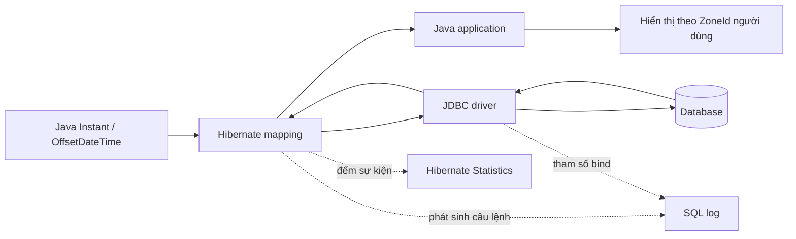

# Cấu hình múi giờ JDBC, hiển thị SQL và thống kê trong Hibernate ORM

## 1. Mục tiêu bài học

Khi bắt đầu dùng Hibernate ORM với cơ sở dữ liệu quan hệ, ba nhóm cấu hình ảnh hưởng trực tiếp đến khả năng vận hành và gỡ lỗi là:

1. **Múi giờ JDBC:** xác định cách những giá trị ngày giờ phù hợp được chuyển giữa Java, JDBC driver và database.
2. **Hiển thị và ghi log SQL:** xem Hibernate thực sự gửi câu lệnh gì đến database, các tham số nào được bind và số lượng câu lệnh phát sinh.
3. **Thống kê Hibernate:** đo số lần thực thi statement, tải entity, truy cập collection, sử dụng cache và các hoạt động bên trong `SessionFactory`.

Bài này sử dụng Java 17+, Spring Boot 3.x với Hibernate ORM 6.x và PostgreSQL làm ngữ cảnh minh họa. Ý nghĩa cấu hình cốt lõi cũng áp dụng khi cấu hình Hibernate/JPA trực tiếp; tên logger hoặc cách ánh xạ kiểu thời gian có thể khác ở các phiên bản và JDBC driver. Các ví dụ sử dụng package `jakarta.persistence.*`.

**Kết quả mong muốn:** bạn có thể lưu và đọc một thời điểm theo UTC mà không bị lệch giờ do môi trường, bật log để tìm lỗi SQL hoặc truy vấn N+1, rồi đọc thống kê để xác định điểm cần tối ưu. Các tính năng quan sát này có chi phí và rủi ro lộ dữ liệu, nên cần cách bật khác nhau giữa môi trường phát triển và production.

## 2. Hình dung toàn bộ luồng dữ liệu

Giả sử hệ thống quản lý đơn hàng lưu thời điểm khách đặt đơn. Ứng dụng chạy ở Việt Nam, JDBC driver kết nối PostgreSQL, còn một máy triển khai khác có múi giờ hệ điều hành UTC. Cùng một thời điểm thật phải được lưu và đọc nhất quán.



Ba lớp thông tin phải được phân biệt:

| Lớp | Câu hỏi nó trả lời | Ví dụ |
|---|---|---|
| Dữ liệu thời gian | Giá trị đại diện **thời điểm** hay **giờ địa phương**? | `Instant` khác `LocalDateTime`. |
| SQL log | SQL và tham số Hibernate/JDBC xử lý là gì? | `select ... where id=?` cùng giá trị bind `42`. |
| Hibernate Statistics | Đã chuẩn bị bao nhiêu statement, load bao nhiêu entity, cache có hit không? | `prepareStatementCount = 12`. |

**SQL log và Statistics hỗ trợ chẩn đoán, không thay thế dữ liệu tracing/metrics của toàn hệ thống.** Hibernate không biết đầy đủ thời gian từ HTTP, xử lý nghiệp vụ, mạng, connection pool đến render kết quả.

## 3. Nắm đúng các kiểu ngày giờ trước khi cấu hình JDBC

Java Time API có nhiều kiểu với ý nghĩa khác nhau:

| Kiểu Java | Ý nghĩa | Ví dụ sử dụng |
|---|---|---|
| `Instant` | Một thời điểm tuyệt đối trên trục thời gian UTC. | Thời điểm tạo đơn, ghi nhận thanh toán, audit event. |
| `OffsetDateTime` | Ngày giờ kèm offset cụ thể như `+07:00`; biểu diễn được một thời điểm. | Dữ liệu tích hợp API có offset, khi cần giữ thông tin offset theo chính sách lưu trữ. |
| `ZonedDateTime` | Ngày giờ kèm vùng IANA như `Asia/Ho_Chi_Minh`, bao gồm quy tắc múi giờ. | Lịch hoạt động gắn với vùng cụ thể; cần xem chiến lược lưu zone. |
| `LocalDateTime` | Ngày giờ **không có offset hay múi giờ**. | Lịch hẹn dạng giờ trên đồng hồ địa phương nếu đã lưu zone riêng. |
| `LocalDate` | Một ngày trong lịch, không phải thời điểm. | Ngày sinh, ngày nghỉ, ngày hóa đơn. |
| `LocalTime` | Giờ trên đồng hồ, không gắn ngày/zone. | Giờ mở cửa hằng ngày. |

Ví dụ cùng một thời điểm:

```java
Instant orderedAt = Instant.parse("2026-07-10T09:30:00Z");

ZonedDateTime vietnamTime = orderedAt.atZone(
    ZoneId.of("Asia/Ho_Chi_Minh"));

System.out.println(orderedAt);   // 2026-07-10T09:30:00Z
System.out.println(vietnamTime); // 2026-07-10T16:30+07:00[Asia/Ho_Chi_Minh]
```

`2026-07-10 09:30 UTC` và `2026-07-10 16:30 Asia/Ho_Chi_Minh` là **cùng một thời điểm**. Ngược lại, chuỗi `2026-07-10T16:30:00` dưới dạng `LocalDateTime` không thể xác định thời điểm nếu thiếu thông tin về múi giờ/offset.

Với timestamp sự kiện hệ thống, nên ưu tiên `Instant`. Khi cần hiển thị, chuyển từ `Instant` sang `ZonedDateTime` theo múi giờ của người dùng. Không dùng `LocalDateTime.now()` để tự đại diện cho một thời điểm tuyệt đối ở nhiều máy chủ khác múi giờ.

## 4. `hibernate.jdbc.time_zone` thực sự làm gì?

Hibernate cung cấp thuộc tính:

```properties
hibernate.jdbc.time_zone=UTC
```

Khi ánh xạ kiểu dữ liệu cần chuyển đổi qua các API thời gian JDBC thích hợp, Hibernate có thể truyền một `Calendar` theo múi giờ đã cấu hình cho các lệnh như:

```java
preparedStatement.setTimestamp(index, timestamp, utcCalendar);
resultSet.getTimestamp(index, utcCalendar);
```

Vì vậy cấu hình này giúp các phép đọc/ghi timestamp qua JDBC có cùng cơ sở diễn giải thời gian, đặc biệt khi môi trường JVM, driver hoặc database có múi giờ khác nhau. Hiệu quả cụ thể còn tùy kiểu Java, JDBC type, Hibernate version, dialect và driver; ví dụ `Instant`, `OffsetDateTime` hoặc kiểu SQL hỗ trợ timezone có thể đi qua nhánh ánh xạ khác so với `java.sql.Timestamp` truyền thống.

### 4.1. Những điều thuộc tính này không tự thực hiện

- **Không đặt lại múi giờ của hệ điều hành hoặc JVM.** `ZoneId.systemDefault()` vẫn đọc cấu hình của JVM/máy chạy.
- **Không tương đương `SET TIME ZONE 'UTC'`** cho session PostgreSQL; múi giờ session database là cấu hình riêng.
- **Không tự biến `LocalDateTime` thành một thời điểm chuẩn.** Nó vốn không chứa timezone.
- **Không bảo đảm giữ nguyên offset hoặc tên vùng gốc của `OffsetDateTime`/`ZonedDateTime`.** Điều này phụ thuộc kiểu cột, dialect và chiến lược lưu timezone của Hibernate.
- **Không quyết định JSON trả về cho frontend.** Jackson, định dạng ISO-8601, timezone người dùng và quy ước API phải được cấu hình hoặc xử lý riêng.

Do đó “đặt `hibernate.jdbc.time_zone=UTC`” là một phần của chính sách nhất quán thời gian, không phải giải pháp duy nhất cho mọi lỗi lệch múi giờ.

### 4.2. Kiểu cột SQL cũng quyết định ý nghĩa

Với PostgreSQL, hai kiểu dễ nhầm nhất là:

| Kiểu SQL | Ý nghĩa | Hệ quả |
|---|---|---|
| `TIMESTAMP WITHOUT TIME ZONE` (`timestamp`) | Lưu giá trị ngày giờ trên đồng hồ, **không có offset hoặc zone**. | Cần quy ước rõ nó là giờ địa phương của vùng nào hay UTC được quy ước từ trước. |
| `TIMESTAMP WITH TIME ZONE` (`timestamptz`) | Biểu diễn một thời điểm; PostgreSQL chuẩn hóa giá trị theo UTC và chuyển cách hiển thị theo timezone session. | Không lưu lại tên timezone hoặc offset đầu vào ban đầu. |

Ví dụ khi đọc một giá trị `timestamptz` tại cùng một thời điểm, PostgreSQL có thể hiển thị `09:30+00` ở session UTC và `16:30+07` ở session `Asia/Ho_Chi_Minh`. Dữ liệu chỉ đại diện **một** thời điểm; thay đổi cách hiển thị không đồng nghĩa dữ liệu đã bị sửa.

```sql
SHOW TIME ZONE;

SELECT TIMESTAMPTZ '2026-07-10 09:30:00+00';

SET TIME ZONE 'Asia/Ho_Chi_Minh';

SELECT TIMESTAMPTZ '2026-07-10 09:30:00+00';
```

Chạy ví dụ trên **một kết nối riêng để thực hành**, không dùng `SET TIME ZONE` tùy tiện trên connection được chia sẻ qua pool. Khi dùng pool, những thiết lập thay đổi trạng thái session phải được quản lý nhất quán và phục hồi khi trả connection.

Trong Hibernate 6, việc chọn JDBC type cho các kiểu `java.time` và chiến lược lưu `OffsetDateTime`/`ZonedDateTime` còn phụ thuộc dialect cùng cấu hình liên quan đến timezone storage. Nếu ứng dụng yêu cầu giữ cả `ZoneId` ban đầu (ví dụ `Europe/Paris`), nên lưu thêm một cột `zone_id` có ý nghĩa nghiệp vụ, thay vì giả định `timestamptz` giữ được thông tin đó.

## 5. Cấu hình Hibernate qua Spring Boot

Một cấu hình `application.yml` cho dự án Spring Boot sử dụng JPA/Hibernate có thể là:

```yaml
spring:
  datasource:
    url: jdbc:postgresql://localhost:5432/shop
    username: shop_user
    password: ${DB_PASSWORD}
  jpa:
    open-in-view: false
    hibernate:
      ddl-auto: validate
    properties:
      hibernate:
        jdbc:
          time_zone: UTC
        format_sql: true
        use_sql_comments: true
        generate_statistics: true

logging:
  level:
    org.hibernate.SQL: DEBUG
    org.hibernate.orm.jdbc.bind: TRACE
    org.hibernate.stat: DEBUG
```

Giải thích từng phần:

- `spring.jpa.properties.hibernate.jdbc.time_zone=UTC` là thuộc tính Hibernate được Spring Boot truyền vào JPA provider. Viết dạng YAML lồng như trên có cùng ý nghĩa.
- `spring.jpa.hibernate.ddl-auto=validate` yêu cầu Hibernate đối chiếu mapping với schema hiện hữu, phù hợp khi database được tạo bằng migration. Với dự án học thử dùng H2 in-memory có thể chọn `create-drop` **riêng ở profile thử nghiệm**, không dùng với dữ liệu cần giữ.
- `spring.jpa.open-in-view=false` làm rõ ranh giới persistence context; code đọc lazy relation phải thực hiện trong service/transaction cần thiết.
- `hibernate.format_sql=true` tạo định dạng xuống dòng/thụt vào dễ đọc. Đây là định dạng output, không làm truy vấn nhanh hơn.
- `hibernate.use_sql_comments=true` cho phép Hibernate bổ sung comment hỗ trợ nhận diện một số câu query, hữu ích khi debug.
- `hibernate.generate_statistics=true` bật thu thập Statistics.
- `logging.level.org.hibernate.SQL=DEBUG` log câu SQL do Hibernate phát sinh.
- `logging.level.org.hibernate.orm.jdbc.bind=TRACE` log giá trị tham số bind (trong Hibernate 6.x).
- `logging.level.org.hibernate.stat=DEBUG` hỗ trợ xem thông tin thống kê được log tùy thành phần và phiên bản; để lấy số liệu cụ thể có thể dùng `SessionFactory.getStatistics()` như phần sau.

**Đây là cấu hình minh họa cho local/dev**, vì `TRACE` của tham số và Statistics có thể tạo lượng log lớn hoặc chứa dữ liệu nhạy cảm. Trong production chỉ bật theo nhu cầu chẩn đoán và chính sách vận hành.

### 5.1. Phân biệt cách cấu hình trực tiếp và qua Spring Boot

| Khi cấu hình Hibernate trực tiếp | Khi cấu hình trong Spring Boot |
|---|---|
| `hibernate.jdbc.time_zone=UTC` | `spring.jpa.properties.hibernate.jdbc.time_zone=UTC` |
| `hibernate.show_sql=true` | `spring.jpa.show-sql=true` hoặc truyền thuộc tính Hibernate |
| `hibernate.format_sql=true` | `spring.jpa.properties.hibernate.format_sql=true` |
| `hibernate.generate_statistics=true` | `spring.jpa.properties.hibernate.generate_statistics=true` |
| Logger `org.hibernate.SQL` | `logging.level.org.hibernate.SQL=DEBUG` |
| Logger `org.hibernate.orm.jdbc.bind` | `logging.level.org.hibernate.orm.jdbc.bind=TRACE` |

Cấu hình logging thuộc hệ thống log ứng dụng (ví dụ Logback), không phải mọi logger đều là thuộc tính Hibernate đặt trong `spring.jpa.properties`.

### 5.2. Dùng profile để kiểm soát mức quan sát

Trong `application.yml` dùng cấu hình nền an toàn:

```yaml
spring:
  jpa:
    open-in-view: false
    hibernate:
      ddl-auto: validate
    properties:
      hibernate:
        jdbc:
          time_zone: UTC
        format_sql: true
        generate_statistics: false

logging:
  level:
    org.hibernate.SQL: WARN
    org.hibernate.orm.jdbc.bind: OFF
```

Trong `application-local.yml` chỉ để dùng khi debug ở máy phát triển:

```yaml
spring:
  jpa:
    properties:
      hibernate:
        generate_statistics: true
        use_sql_comments: true

logging:
  level:
    org.hibernate.SQL: DEBUG
    org.hibernate.orm.jdbc.bind: TRACE
```

Khởi động với profile `local` theo cơ chế Spring Boot, chẳng hạn đặt `SPRING_PROFILES_ACTIVE=local`. Đây là ví dụ **hai lựa chọn cấu hình**, không phải yêu cầu bật TRACE thường xuyên trên máy chạy production.

### 5.3. Cấu hình rõ múi giờ hiển thị của ứng dụng

Múi giờ JDBC điều khiển một phần lớp persistence. Phần hiển thị phải sử dụng zone của nghiệp vụ/người dùng:

```java
import java.time.Instant;
import java.time.ZoneId;
import java.time.format.DateTimeFormatter;

Instant createdAt = Instant.parse("2026-07-10T09:30:00Z");
ZoneId viewerZone = ZoneId.of("Asia/Ho_Chi_Minh");

String text = DateTimeFormatter.ofPattern("dd/MM/yyyy HH:mm z")
    .withZone(viewerZone)
    .format(createdAt);

System.out.println(text); // 10/07/2026 16:30 ICT (tên viết tắt tùy locale/runtime)
```

Trong API, có thể thống nhất gửi timestamp ISO-8601 kèm `Z` hoặc offset, rồi để frontend hiển thị theo timezone người dùng. Không nên gửi chuỗi thiếu timezone như `"2026-07-10 09:30:00"` cho sự kiện tuyệt đối, vì client dễ hiểu khác nhau.

## 6. Ví dụ entity có trường thời gian

Ta có bảng `purchase_orders` và một entity nhỏ để quan sát các giá trị:

```java
import jakarta.persistence.*;
import java.time.Instant;

@Entity
@Table(name = "purchase_orders")
public class PurchaseOrder {
    @Id
    @GeneratedValue(strategy = GenerationType.IDENTITY)
    private Long id;

    @Column(name = "customer_id", nullable = false)
    private Long customerId;

    @Column(name = "created_at", nullable = false)
    private Instant createdAt;

    protected PurchaseOrder() {}

    public PurchaseOrder(Long customerId, Instant createdAt) {
        this.customerId = customerId;
        this.createdAt = createdAt;
    }

    public Long getId() { return id; }
    public Instant getCreatedAt() { return createdAt; }
}
```

Nếu chủ động quản lý schema bằng PostgreSQL migration, có thể tạo:

```sql
CREATE TABLE purchase_orders (
    id BIGINT GENERATED BY DEFAULT AS IDENTITY PRIMARY KEY,
    customer_id BIGINT NOT NULL,
    created_at TIMESTAMP WITH TIME ZONE NOT NULL
);
```

Để cô lập bài học, `customer_id` ở đoạn mã này là một `Long`. Trong ứng dụng đầy đủ, bạn có thể thêm foreign key đến `customers` và ánh xạ `@ManyToOne` theo mô hình quan hệ thực tế. Kiểu cột `TIMESTAMP WITH TIME ZONE` là lựa chọn rõ nghĩa cho **thời điểm** trong PostgreSQL; cần xác nhận JDBC/Hibernate mapping được sử dụng phù hợp với dialect đang chạy.

Một repository Spring Data JPA:

```java
import org.springframework.data.jpa.repository.JpaRepository;

public interface PurchaseOrderRepository
        extends JpaRepository<PurchaseOrder, Long> {
}
```

Service lưu và đọc lại ở các transaction độc lập:

```java
import org.springframework.stereotype.Service;
import org.springframework.transaction.annotation.Transactional;
import java.time.Instant;

@Service
public class OrderTimeService {
    private final PurchaseOrderRepository orders;

    public OrderTimeService(PurchaseOrderRepository orders) {
        this.orders = orders;
    }

    @Transactional
    public Long create(Long customerId) {
        Instant time = Instant.now();
        return orders.save(new PurchaseOrder(customerId, time)).getId();
    }

    @Transactional(readOnly = true)
    public Instant readCreatedAt(Long orderId) {
        return orders.findById(orderId)
            .orElseThrow(() -> new IllegalArgumentException("Order not found"))
            .getCreatedAt();
    }
}
```

Để kiểm thử quyết định, dùng một `Instant` cố định thay vì `Instant.now()`. Đừng so sánh chuỗi `toString()` của timestamp lấy từ SQL console nếu session DB hiển thị múi giờ khác; hãy so sánh **instant** trong Java hoặc chuyển cả hai phía về UTC trước khi đối chiếu.

## 7. Bật log SQL: `show_sql` hay logger?

Có hai cách thường gặp để nhìn SQL Hibernate sinh ra.

### 7.1. `hibernate.show_sql`

```properties
hibernate.show_sql=true
hibernate.format_sql=true
```

Trong Spring Boot có thể dùng:

```yaml
spring:
  jpa:
    show-sql: true
    properties:
      hibernate:
        format_sql: true
```

`show_sql` in SQL trực tiếp ra standard output, thường có tiền tố `Hibernate:`. Nó hữu dụng để xem nhanh trong bài thực hành, nhưng không đi qua pipeline logging thông thường với level, định dạng, correlation ID và sink của ứng dụng. Nếu đồng thời bật `org.hibernate.SQL=DEBUG`, bạn dễ thấy cùng SQL hai lần.

### 7.2. Log qua SLF4J/Logback

Thực tế nên ưu tiên logger:

```yaml
spring:
  jpa:
    show-sql: false
    properties:
      hibernate:
        format_sql: true

logging:
  level:
    org.hibernate.SQL: DEBUG
```

Ví dụ log (minh họa, cú pháp chính xác phụ thuộc dialect):

```text
DEBUG org.hibernate.SQL -
    select
        po1_0.id,
        po1_0.created_at,
        po1_0.customer_id
    from
        purchase_orders po1_0
    where
        po1_0.id=?
```

Ký tự `?` nghĩa là SQL được thực thi qua **prepared statement** với tham số bind riêng; không phải Hibernate đã quên gán giá trị.

### 7.3. Xem giá trị tham số bind

Với Hibernate ORM 6.x:

```yaml
logging:
  level:
    org.hibernate.SQL: DEBUG
    org.hibernate.orm.jdbc.bind: TRACE
```

Ví dụ:

```text
DEBUG org.hibernate.SQL - select ... from purchase_orders po1_0 where po1_0.id=?
TRACE org.hibernate.orm.jdbc.bind - binding parameter (1:BIGINT) <- [42]
```

Đối với Hibernate 5.x, logger tham số thường là `org.hibernate.type.descriptor.sql.BasicBinder` ở mức `TRACE`, không phải logger mới của Hibernate 6. Tra cứu version thực tế trước khi kết luận không có bind log.

Một số logger Hibernate 6 hữu ích khi đi sâu hơn:

| Logger | Mức tham khảo | Dùng khi |
|---|---|---|
| `org.hibernate.SQL` | `DEBUG` | Nhìn câu SQL được sinh. |
| `org.hibernate.orm.jdbc.bind` | `TRACE` | Nhìn giá trị tham số đưa vào `PreparedStatement`. |
| `org.hibernate.orm.jdbc.extract` | `TRACE` | Nghiên cứu giá trị đọc từ `ResultSet` khi debug chuyên sâu. |
| `org.hibernate.stat` | `DEBUG` | Quan sát thông tin thống kê được ghi log. |
| `org.hibernate.SQL_SLOW` | `INFO` tùy phiên bản | Quan sát truy vấn vượt ngưỡng chậm nếu đã cấu hình. |

Vì bind/extract log có thể chứa email khách hàng, số điện thoại, token hoặc giá trị từ các bảng nhạy cảm, chỉ bật khi thực sự cần và phải có cơ chế giới hạn truy cập, thời gian lưu cũng như loại bỏ/ẩn dữ liệu thích hợp. SQL log có thể ghi cả nội dung comment do ứng dụng cung cấp; không nên để dữ liệu bí mật vào SQL comment.

### 7.4. `format_sql`, `highlight_sql` và `use_sql_comments`

```properties
hibernate.format_sql=true
hibernate.highlight_sql=true
hibernate.use_sql_comments=true
```

- `format_sql`: xuống dòng và thụt đầu dòng câu SQL, dễ đọc khi query nhiều join.
- `highlight_sql`: có thể dùng mã màu ANSI trong output, hữu ích ở terminal hỗ trợ màu nhưng có thể làm log tập trung khó xử lý; tùy cách xuất log.
- `use_sql_comments`: bổ sung comment hỗ trợ truy ngược một số SQL về truy vấn Hibernate/JPA đã tạo ra nó; nội dung cụ thể tùy loại query và phiên bản.

Đây là **cấu hình quan sát**, không sửa quy tắc tối ưu SQL, không tạo index và không tăng tốc truy vấn. Nếu cần phân tích hiệu năng, phải xem actual SQL, plan của database và số lần query.

## 8. Đọc SQL log theo một yêu cầu nghiệp vụ

Giả sử API `GET /orders/42` làm việc sau:

```java
PurchaseOrder order = orders.findById(42L).orElseThrow();
```

Log có thể trông như:

```text
DEBUG org.hibernate.SQL - select po1_0.id,po1_0.created_at,po1_0.customer_id
    from purchase_orders po1_0 where po1_0.id=?
TRACE org.hibernate.orm.jdbc.bind - binding parameter (1:BIGINT) <- [42]
```

Khi xem log, trả lời theo thứ tự:

1. **Có đúng số lần truy vấn?** Một request tưởng cần một SQL nhưng thực tế có hàng chục statement có thể là N+1.
2. **Có chọn những cột cần thiết?** `SELECT` toàn bộ entity khi chỉ cần một DTO có thể tải dữ liệu thừa.
3. **`WHERE`, `JOIN`, `ORDER BY` có tương ứng với nghiệp vụ?** Thiếu điều kiện lọc có thể khiến DB quét nhiều bản ghi.
4. **Bind có đúng kiểu và giá trị?** Sai `id`, sai khoảng ngày hoặc lệch timezone dẫn đến kết quả không mong muốn.
5. **Có cần index không?** Chỉ có database execution plan mới giúp khẳng định điểm nghẽn thực tế.

Log Hibernate thường không hiển thị một câu SQL đã thay thế ký tự `?` bằng giá trị literal để bạn dán trực tiếp vào console. Prepared statement gửi SQL và các bind value qua giao thức/driver riêng. Khi tái hiện bằng công cụ database, tự dựng lại truy vấn có tham số đúng kiểu thay vì giả định copy nguyên log sẽ chạy được.

## 9. Bật Hibernate Statistics

Hibernate có API `org.hibernate.stat.Statistics` trên `SessionFactory`, cung cấp các bộ đếm toàn cục trong phạm vi một `SessionFactory` đang hoạt động.

```properties
hibernate.generate_statistics=true
```

Spring Boot:

```yaml
spring:
  jpa:
    properties:
      hibernate:
        generate_statistics: true
```

Khi tắt, Hibernate không thu thập đầy đủ các thống kê dành cho API này. Khi bật, các bộ đếm hữu ích nhưng có overhead, nên production cần cân nhắc bật có kiểm soát để chẩn đoán hoặc dùng hệ thống metrics được thiết kế cho vận hành dài hạn.

### 9.1. Lấy thống kê bằng Java

```java
import jakarta.persistence.EntityManagerFactory;
import org.hibernate.SessionFactory;
import org.hibernate.stat.Statistics;
import org.springframework.stereotype.Component;

@Component
public class HibernateStatisticsReader {
    private final SessionFactory sessionFactory;

    public HibernateStatisticsReader(EntityManagerFactory emf) {
        this.sessionFactory = emf.unwrap(SessionFactory.class);
    }

    public StatisticsSnapshot snapshot() {
        Statistics stats = sessionFactory.getStatistics();
        return new StatisticsSnapshot(
            stats.getPrepareStatementCount(),
            stats.getEntityLoadCount(),
            stats.getEntityFetchCount(),
            stats.getCollectionFetchCount(),
            stats.getQueryExecutionCount(),
            stats.getSecondLevelCacheHitCount(),
            stats.getSecondLevelCacheMissCount()
        );
    }

    public record StatisticsSnapshot(
        long preparedStatements,
        long entityLoads,
        long entityFetches,
        long collectionFetches,
        long queryExecutions,
        long secondLevelCacheHits,
        long secondLevelCacheMisses
    ) {}
}
```

Các chỉ số ở đây là **số tích lũy từ lúc bật/khởi tạo hoặc reset**, chia sẻ giữa mọi request đang dùng chung `SessionFactory`. Chúng không mặc định là chỉ số của riêng `GET /orders/42` hay của một transaction. Để đo một ca cụ thể trong thử nghiệm cô lập, có thể chụp `before/after` rồi lấy hiệu; tránh trộn với request khác.

### 9.2. Diễn giải các bộ đếm thường dùng

| Bộ đếm | Điều cần hiểu | Không nên suy luận |
|---|---|---|
| `getPrepareStatementCount()` | Số lần chuẩn bị JDBC prepared statement theo thống kê của Hibernate. | Không đồng nhất trực tiếp với số round-trip hoặc tổng thời gian DB. |
| `getEntityLoadCount()` | Số lần entity được load từ persistence layer theo thống kê. | Không bằng số hàng SQL hay số HTTP request. |
| `getEntityFetchCount()` | Lượng fetch entity bổ sung được thống kê. | Không dùng riêng chỉ số này để kết luận có/không N+1. |
| `getCollectionFetchCount()` | Hoạt động fetch collection. | Không phải số phần tử trong collection. |
| `getQueryExecutionCount()` | Số lần thực thi truy vấn JPQL/HQL/Criteria được thống kê. | Không phải tổng tất cả SQL, do load entity, JDBC batching và cache có cách tính khác. |
| `getSecondLevelCacheHitCount()` | Lượt lấy dữ liệu từ cache cấp 2. | Không thể hiện cache cấp 1 của persistence context. |
| `getSecondLevelCacheMissCount()` | Lượt lookup cache cấp 2 không có kết quả. | Miss không nhất thiết là lỗi; mặc định cache cấp 2 có thể chưa bật. |

`getEntityLoadCount()` và `getPrepareStatementCount()` thường khác đáng kể. Ví dụ một query trả 50 entity trong một statement có thể làm `entityLoadCount` tăng nhiều hơn `prepareStatementCount`. Ngược lại, N+1 có thể làm số statement tăng nhanh ngay cả khi màn hình chỉ hiển thị vài trường dữ liệu.

Để tối ưu, dùng **nhiều tín hiệu cùng lúc**: SQL log, số statement, fetch/collection counters, latency đo từ ứng dụng và `EXPLAIN (ANALYZE)` của PostgreSQL trên truy vấn cần quan tâm.

### 9.3. Reset thống kê trong bài kiểm tra cô lập

```java
SessionFactory sessionFactory = emf.unwrap(SessionFactory.class);
Statistics statistics = sessionFactory.getStatistics();

statistics.clear();

// Chạy đúng một thao tác nghiệp vụ trong môi trường không có request song song.
long statements = statistics.getPrepareStatementCount();
System.out.println("Statements prepared: " + statements);
```

`clear()` đặt lại thống kê **toàn bộ SessionFactory**, nên không nên gọi từ endpoint hoặc trong luồng traffic production. Với thử nghiệm, cần tách rõ setup dữ liệu (insert test data), thời điểm reset, thao tác cần đo và các lần `flush`/`clear` để cache cấp 1 không làm kết quả sai kỳ vọng.

### 9.4. Log chỉ số phiên làm việc (session metrics)

Hibernate hỗ trợ cơ chế log thống kê từng session thông qua sự kiện session. Trong các phiên bản hỗ trợ, cấu hình tham khảo:

```properties
hibernate.generate_statistics=true
hibernate.session.events.log=true
```

Và khi cần xem chi tiết, bật logger cho listener:

```yaml
logging:
  level:
    org.hibernate.engine.internal.StatisticalLoggingSessionEventListener: DEBUG
```

Output có thể gồm thời gian lấy connection, chuẩn bị/thực thi JDBC statements, số batch, flush, truy cập cache và một số thời gian xử lý bên trong session. Tên cấu hình logger/format cụ thể phụ thuộc version đang dùng; kiểm tra bằng một thao tác thực tế trên phiên bản hiện tại. **Session metrics không tương đương thời gian phản hồi HTTP**, và session dài hoặc giao dịch nhiều bước có thể khó gán về một API request.

## 10. Kết hợp log và Statistics để phát hiện N+1

Giả sử có các entity `Customer` và `PurchaseOrder`, với mỗi đơn tham chiếu một khách:

```java
@ManyToOne(fetch = FetchType.LAZY)
private Customer customer;
```

Mã nghiệp vụ:

```java
List<PurchaseOrder> page = queryOrders();
for (PurchaseOrder order : page) {
    System.out.println(order.getCustomer().getName());
}
```

Nếu nhiều đơn tham chiếu nhiều khách khác nhau mà customer chưa được load, Hibernate có thể thực thi **một query lấy danh sách đơn cộng nhiều query lấy khách**. Đây là hình thức N+1: số query phát triển theo số phần tử khi duyệt.

```text
select ... from purchase_orders ...        -- danh sách đơn
select ... from customers where id = ?    -- khách của đơn A
select ... from customers where id = ?    -- khách của đơn B
select ... from customers where id = ?    -- ...
```

Nếu nhiều đơn cùng tham chiếu một customer, persistence context có thể tái dùng entity đã load nên tổng statement ít hơn `1 + số đơn`. Vì vậy cách đánh giá tốt là **đọc log và đếm chuẩn bị statement trên bộ dữ liệu đại diện**, thay vì giả định N+1 luôn chính xác bằng `1 + N`.

Giải pháp tùy mục đích:

- Với **chi tiết một đơn**, có thể `JOIN FETCH` các quan hệ thật sự cần, trả DTO trong service.
- Với **danh sách có phân trang**, ưu tiên projection/DTO chọn đúng cột cần thiết; cân nhắc fetch hai bước nếu phải tải collection.
- Với việc truy cập lazy lặp lại, có thể đánh giá batch fetching (`hibernate.default_batch_fetch_size`) khi phù hợp với pattern truy vấn.

Không nên tự động đổi toàn bộ `LAZY` thành `EAGER`, vì điều đó thường khiến truy vấn lớn hơn và khó kiểm soát. Cũng không nên áp dụng `JOIN FETCH` collection kèm phân trang mà chưa hiểu việc join nhân số hàng.

### Ví dụ đo hai cách đọc

Giả sử môi trường test đã chuẩn bị 100 đơn và các khách hàng liên quan:

| Cách đọc | Điều có thể quan sát |
|---|---|
| Lấy danh sách đơn rồi gọi `getCustomer()` từng bản ghi | Nhiều SQL SELECT nếu customer chưa nằm trong persistence context. |
| Lấy projection `select new ... (o.id, c.name)` | Một query trả các cột cần cho trang danh sách (tùy bộ lọc, count query và paging). |

Phương pháp đo: chạy từng cách trên transaction/test độc lập, dọn persistence context trước mỗi lượt, reset thống kê trong môi trường không có request khác, chụp số statement, xem SQL và so sánh kết quả trả về. Số lượng cụ thể phụ thuộc cách sinh query và cấu hình, không nên ghi cứng là một hằng số cho mọi phiên bản.

## 11. Phân tích một lỗi lệch múi giờ từ đầu đến cuối

### Tình huống

Khách xác nhận đơn lúc 16:30 ở Việt Nam (UTC+07), tức `2026-07-10T09:30:00Z`. API ghi giá trị ngày giờ vào database. Khi truy vấn SQL console, nhân viên thấy `09:30`; khi mở trang web lại thấy `16:30`. Trường hợp này **có thể hoàn toàn đúng** nếu DB session đang UTC, còn frontend hiển thị theo `Asia/Ho_Chi_Minh`.

Nếu trên web thấy `23:30` hoặc giờ bị cộng 7 tiếng **hai lần**, hãy kiểm tra theo thứ tự:

1. **Kiểu Java:** trường đại diện thời điểm là `Instant` hay chỉ `LocalDateTime`?
2. **Giá trị đầu vào:** ISO timestamp có `Z`/offset, hay chuỗi giờ địa phương không có zone?
3. **Kiểu cột SQL:** `timestamp` hay `timestamptz`? Có migration ép kiểu trước đó không?
4. **JDBC/Hibernate:** `hibernate.jdbc.time_zone` được nạp đúng vào `EntityManagerFactory` chưa? Dialect/driver phiên bản nào?
5. **Database session:** `SHOW TIME ZONE` trả gì? Có thay đổi timezone theo connection pool không?
6. **API và frontend:** serializing/deserializing timestamp có thêm/bỏ `Z`, có tự cộng offset trước khi gọi `atZone` không?
7. **Log:** câu insert/select và bind parameter có thể hiện kiểu JDBC, thời gian được xử lý phù hợp không? Cần lưu ý một số kiểu bind/log không hiển thị rõ offset gốc.

Đừng sửa lỗi bằng cách cộng hoặc trừ cố định bảy giờ ở nhiều tầng. Đúng hơn là xác định **giá trị nào là thời điểm tuyệt đối, giá trị nào là ngày giờ theo múi giờ nghiệp vụ**, sau đó quy định chuyển đổi tại ranh giới dữ liệu.

### 11.1. Bài thực hành với timestamp cố định

Chạy ở môi trường thực hành với PostgreSQL và schema xác định:

```java
Instant expected = Instant.parse("2026-07-10T09:30:00Z");

// Transaction 1: persist new PurchaseOrder(1L, expected)
// Kết thúc transaction, tạo một persistence context mới.
// Transaction 2: đọc lại entity rồi lấy getCreatedAt().

assert expected.equals(actualCreatedAt);
```

Các chú thích đại diện các bước của một integration test, không phải đoạn mã hoàn chỉnh tự chạy độc lập. Để test đáng tin, dùng fixture có customer nếu schema có FK, đảm bảo read thực sự lấy từ database qua persistence context mới, và chọn timestamp có độ chính xác tương ứng với cột DB. Một số DB giảm precision ở microsecond/millisecond, nên không so sánh nanosecond tùy ý nếu database không lưu được.

Thử đọc cùng bản ghi từ hai JVM có timezone mặc định khác nhau, kiểm tra rằng giá trị `Instant` mang cùng thời điểm. Có thể dùng hai tiến trình test để tránh việc gọi `TimeZone.setDefault(...)` thay đổi toàn cục và ảnh hưởng test chạy song song.

## 12. Đọc truy vấn chậm và giới hạn của Hibernate Statistics

Hibernate 6 có cấu hình ngưỡng chậm cho SQL, tính bằng mili giây ở những phiên bản hỗ trợ:

```properties
hibernate.log_slow_query=1000
```

Thông thường các statement vượt ngưỡng có thể xuất hiện ở category log SQL chậm của Hibernate. Cấu hình và khả năng đo/log cụ thể phụ thuộc phiên bản/dialect/JDBC; sau khi bật cần kiểm tra kết quả với workload thật, thay vì giả định mọi truy vấn chậm đều xuất hiện. Có trường hợp thiếu khả năng lấy số đo phía driver hoặc cấu hình logging khiến bạn không thấy thông tin mong đợi.

Ngay cả khi có log “slow query”, không nên kết luận nguyên nhân là thiếu index. Một request chậm còn có thể đến từ:

- Quá nhiều câu query ngắn (N+1), từng query không vượt ngưỡng.
- Chờ connection từ pool, transaction giữ connection lâu.
- Lock, contention và thời gian chờ ở database.
- Tải quá nhiều entity/collection rồi ánh xạ DTO hoặc serialize JSON tốn thời gian.
- Chi phí mạng giữa ứng dụng và DB, hoặc các bước nghiệp vụ khác trong cùng request.

Giải pháp điều tra có thứ tự: đo latency đầu cuối → tìm request hoặc ca dùng chậm → xem số SQL được phát sinh → xác định query hoặc lock tốn kém → lấy execution plan tại database → thay đổi đúng nguyên nhân và đo lại. Với PostgreSQL, `EXPLAIN (ANALYZE, BUFFERS)` chỉ nên chạy có kiểm soát vì có thể thực thi truy vấn thật và tiêu thụ tài nguyên; đặc biệt thận trọng với lệnh thay đổi dữ liệu.

## 13. Các lỗi cấu hình thường gặp

| Hiện tượng | Khả năng nguyên nhân | Cách xử lý |
|---|---|---|
| Log SQL hiện hai lần | Bật cả `hibernate.show_sql=true` và logger `org.hibernate.SQL=DEBUG`. | Chọn logger làm nguồn log chính, tắt `show_sql`. |
| SQL hiện `?` mà không có giá trị | Chưa bật bind logger, hoặc dùng sai logger cho Hibernate version. | Với Hibernate 6 bật `org.hibernate.orm.jdbc.bind=TRACE` trong môi trường phù hợp. |
| Không thấy SQL dù đã `format_sql=true` | `format_sql` chỉ định dạng output, không bật xuất log. | Bật `org.hibernate.SQL=DEBUG` hoặc `show_sql=true`. |
| Thống kê toàn số 0 | Chưa bật `generate_statistics` hoặc chưa có thao tác trong SessionFactory đang đo. | Kiểm tra cấu hình và lấy đúng `SessionFactory`. |
| Số statement thay đổi giữa hai lần thử | Persistence context/cache khác, lazy loading hoặc request khác cùng chạy. | Cô lập test, kiểm soát flush/clear, đo delta. |
| Dữ liệu timestamp trông lệch giờ | Nhầm `timestamp` với `timestamptz`, `LocalDateTime` với `Instant`, hoặc đổi timezone hai lần. | Xác nhận semantics ở từng tầng và so sánh cùng một instant UTC. |
| Thay đổi `hibernate.jdbc.time_zone` nhưng SQL console vẫn hiện giờ khác | Timezone JDBC không đặt session timezone PostgreSQL. | Kiểm tra `SHOW TIME ZONE`, kiểu cột và cách công cụ hiển thị. |
| Số SQL thấp nhưng trang vẫn chậm | Query trả quá nhiều hàng, query plan xấu, lock hoặc công việc ngoài DB. | Kết hợp metrics ứng dụng và execution plan DB. |
| Log quá nhiều hoặc lộ dữ liệu | TRACE bind/extract và Statistics bật đại trà. | Giảm log level, lọc nội dung nhạy cảm, giới hạn thời gian bật. |

## 14. Bài thực hành tổng hợp

Chuẩn bị Spring Boot + Hibernate 6 + PostgreSQL, bảng `purchase_orders` có `created_at` là `timestamptz`, và một repository tìm đơn theo ID. Thực hiện ba vòng:

**Vòng A — Timezone.** Đặt `hibernate.jdbc.time_zone=UTC`, lưu `Instant` cố định `2026-07-10T09:30:00Z`. Đọc lại sau một transaction mới. Dùng `SHOW TIME ZONE` và câu SELECT trong PostgreSQL để xem cách timezone của session thay đổi phần hiển thị mà không thay đổi thời điểm được lưu. Chuyển `Instant` sang `Asia/Ho_Chi_Minh` trong Java để in `16:30`.

**Vòng B — SQL.** Tắt `show_sql`, bật `org.hibernate.SQL=DEBUG`, `org.hibernate.orm.jdbc.bind=TRACE` và `format_sql=true`. Gọi `findById(42L)` với ID tồn tại, sau đó dùng ID không tồn tại. Nhận diện SQL, vị trí `?`, JDBC type và giá trị bind. Thử bật `show_sql=true` để quan sát hiện tượng log trùng, rồi tắt đi.

**Vòng C — Statistics.** Bật `hibernate.generate_statistics=true` trong môi trường test. Chạy một lượt đọc 20 đơn và tên khách bằng lazy relation, ghi `prepareStatementCount` và SQL log. Sau đó viết query projection lấy tên khách bằng join, chạy trên bộ dữ liệu tương đương trong test cô lập, so sánh số statement và kết quả dữ liệu. Nếu cần quan sát session metrics, thử cấu hình listener log và xem khác biệt giữa thời gian JDBC với thời gian đầu cuối HTTP.

### Tiêu chí hoàn thành

- Giải thích được khác biệt giữa `Instant`, `LocalDateTime`, `OffsetDateTime` và vùng IANA `ZoneId`.
- Biết `hibernate.jdbc.time_zone=UTC` điều khiển cơ chế tương tác timestamp qua JDBC khi thích hợp, **không tự thay đổi timezone của DB session/JVM/frontend**.
- Cấu hình được SQL logger, bind logger đúng phiên bản và biết khi nào dùng/tắt `show_sql`.
- Lấy được `SessionFactory.getStatistics()`, hiểu bộ đếm là tích lũy toàn cục và phân biệt số statement với số entity tải.
- Dùng đồng thời SQL log và Statistics để phát hiện truy vấn thừa, biết xác nhận bằng database execution plan khi cần.
- Có cấu hình local để debug và cấu hình production tránh bật TRACE/Statistics đại trà, đồng thời bảo vệ dữ liệu nhạy cảm trong log.

## 15. Ghi nhớ khi đưa ứng dụng vào môi trường thật

Một chính sách vận hành nhất quán nên quy định: **lưu thời điểm sự kiện bằng kiểu có ngữ nghĩa rõ (`Instant`), quy ước timezone tại ranh giới JDBC/database, hiển thị theo vùng của người dùng, dùng logging có chủ đích và đo hiệu năng bằng nhiều nguồn số liệu**.

Hibernate giúp ánh xạ entity sang SQL nhưng không quyết định toàn bộ semantics của thời gian và cũng không thay thế công cụ giám sát database. Khi gặp lỗi, tách ba câu hỏi: “giá trị thời gian này đại diện cho điều gì?”, “Hibernate đã gửi SQL và bind gì?” và “chi phí truy cập dữ liệu nằm ở đâu?”. Trả lời từng câu bằng cấu hình, log và số liệu phù hợp sẽ giúp xử lý vấn đề chính xác, tránh chỉnh timezone tùy tiện hoặc tối ưu dựa trên cảm giác.
