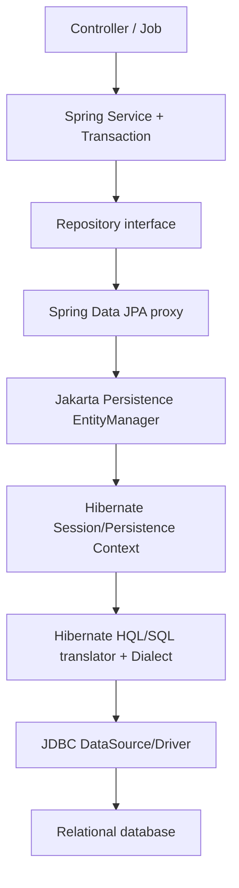
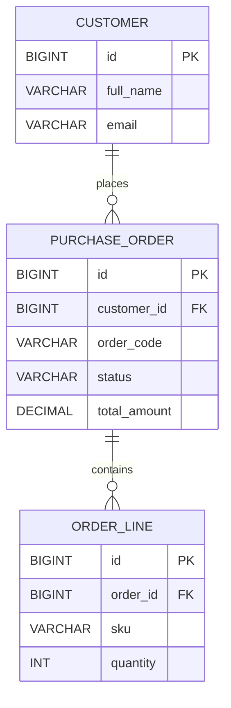
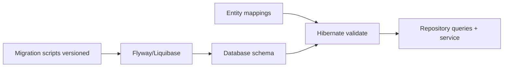

# Spring Data JPA như lớp repository phía trên Hibernate

Trong ứng dụng Java dùng Spring Boot và cơ sở dữ liệu quan hệ, ba tên gọi thường xuất hiện cùng nhau: **Spring Data JPA**, **Jakarta Persistence (JPA)** và **Hibernate ORM**. Chúng bổ sung cho nhau nhưng không phải cùng một công nghệ.

- **Jakarta Persistence** là đặc tả các hợp đồng chuẩn như `@Entity`, `EntityManager`, JPQL, Criteria API, trạng thái entity và các mapping quan hệ.
- **Hibernate ORM** là một implementation JPA phổ biến. Hibernate quản lý persistence context, dirty checking, lazy loading, SQL translation theo Dialect, flush, locking và các tính năng tối ưu của ORM.
- **Spring Data JPA** bổ sung **lớp repository** phía trên JPA: triển khai interface repository tự động, CRUD, tìm kiếm theo tên method, `@Query`, pagination, projection, Specification và tích hợp transaction của Spring.

Ví dụ:

```java
public interface PurchaseOrderRepository
        extends JpaRepository<PurchaseOrder, Long> {

    List<PurchaseOrder> findByStatus(OrderStatus status);
}
```

Spring Data JPA tạo bean repository để xử lý lời gọi `findByStatus`. Nó không tự thay thế Hibernate: truy vấn cuối vẫn đi qua JPA provider và JDBC để thực thi ở database.

**Ý chính của bài:** Spring Data JPA giúp giảm mã truy cập dữ liệu lặp lại nhưng không xóa trách nhiệm hiểu **transaction boundary, entity lifecycle, fetch plan, dirty checking, SQL, concurrency và schema migrations**.

Bài học tự chứa này giải thích từ kiến trúc tới cách dùng `JpaRepository`, query derivation, DTO, phân trang, Specification, khóa, auditing, các extension của Hibernate và kiểm thử hiệu năng trong ứng dụng thực tế.

## 1. Kiến trúc từ HTTP request đến SQL



Giả sử service gọi:

```java
@Service
public class OrderQueryService {

    private final PurchaseOrderRepository repository;

    public OrderQueryService(PurchaseOrderRepository repository) {
        this.repository = repository;
    }

    @Transactional(readOnly = true)
    public List<PurchaseOrder> paidOrders() {
        return repository.findByStatus(OrderStatus.PAID);
    }
}
```

Thứ tự khái niệm:

1. Spring inject repository proxy vào service.
2. Spring transaction infrastructure mở/join transaction theo cấu hình.
3. Proxy chọn query strategy cho `findByStatus`.
4. JPA provider diễn giải mapping và biểu thức truy vấn.
5. Hibernate sinh SQL thích hợp cho DBMS/Dialect.
6. JDBC gửi statement và nhận ResultSet.
7. Hibernate dựng managed entities hoặc projection.
8. Spring trả kết quả qua repository/service tới caller.

Một câu `findBy...` ngắn vẫn có thể gây SELECT, join, lazy SQL phụ, cache lookup và transaction flush. Đừng suy ra SQL behavior chỉ từ tên method.

## 2. Phân chia trách nhiệm giữa các tầng

| Nhu cầu | Thành phần chính |
|---|---|
| Interface repository và auto implementation | Spring Data JPA |
| Phân tích tên `findByStatus` | Spring Data JPA |
| `Pageable`, `Page`, `Slice` | Spring Data |
| Annotation `@Entity`, `@ManyToOne` | Jakarta Persistence |
| `EntityManager.persist`/`merge` | Jakarta Persistence API, provider thực thi |
| Persistence context/identity map | Hibernate/JPA provider |
| Dirty checking và lazy proxy | Hibernate |
| Chuyển JPQL/HQL/Criteria sang SQL | Hibernate |
| SQL dialect và JDBC mapping | Hibernate + JDBC driver |
| Commit/rollback từ `@Transactional` | Spring transaction manager và tài nguyên DB |
| Migration schema có version | Flyway/Liquibase hoặc pipeline DBA |
| Quyền truy cập dữ liệu | Service/security policy + DBMS constraints/roles |

**Repository không phải nơi duy nhất chịu trách nhiệm cho tính đúng đắn dữ liệu.** Database constraints, service business rules, transaction isolation và ORM semantics vẫn quan trọng.

## 3. Cấu hình với Spring Boot

Gradle dependency minh họa:

```groovy
dependencies {
    implementation 'org.springframework.boot:spring-boot-starter-data-jpa'
    runtimeOnly 'org.postgresql:postgresql'
    implementation 'org.flywaydb:flyway-core'
}
```

Với Maven, sử dụng dependency `spring-boot-starter-data-jpa` tương ứng. Starter này đưa các thành phần Spring Data JPA và một JPA provider thường là Hibernate vào dependency graph do Spring Boot quản lý.

Ví dụ `application.yml`:

```yaml
spring:
  datasource:
    url: jdbc:postgresql://localhost:5432/shop
    username: shop_app
    password: from-secret-manager
  jpa:
    open-in-view: false
    hibernate:
      ddl-auto: validate
    properties:
      hibernate:
        jdbc:
          batch_size: 50
        order_inserts: true
        order_updates: true
  flyway:
    enabled: true
```

Trong production, không lưu password thật trong source code. Chuỗi `from-secret-manager` chỉ là placeholder; thực tế inject qua môi trường hoặc secret manager.

Các điểm cần nắm:

- `ddl-auto=validate` chỉ kiểm tra một phần tương thích giữa entity mappings và schema, không tự tạo/sửa schema.
- Flyway quản lý lịch sử migration.
- `open-in-view=false` khuyến khích truy cập lazy association có chủ đích trong service, không kéo persistence context qua serialization.
- `hibernate.jdbc.batch_size` là cấu hình Hibernate JDBC batching, không biến mọi lời gọi `saveAll` thành một SQL duy nhất.

### 3.1. Đừng đoán phiên bản Hibernate từ tên starter

Spring Boot BOM/dependency management quyết định version. Khi cần kiểm tra, có thể log:

```java
System.out.println(org.hibernate.Version.getVersionString());
```

Đồng thời xem resolved dependencies, Spring Data/Jakarta Persistence versions, DBMS/driver version và Dialect. Khi dùng API thay đổi theo version, đọc Javadoc của đúng series.

## 4. Mô hình entity xuyên suốt

Giả sử hệ thống bán hàng có `Customer`, `PurchaseOrder` và `OrderLine`.

```java
public enum OrderStatus {
    NEW, PAID, SHIPPED, CANCELLED
}
```

```java
@Entity
@Table(name = "customer")
public class Customer {

    @Id
    private Long id;

    @Column(name = "full_name", nullable = false)
    private String fullName;

    @Column(nullable = false, unique = true)
    private String email;

    protected Customer() {}

    public Long getId() { return id; }
    public String getFullName() { return fullName; }
    public String getEmail() { return email; }
}
```

```java
@Entity
@Table(name = "purchase_order")
public class PurchaseOrder {

    @Id
    @GeneratedValue(strategy = GenerationType.SEQUENCE)
    private Long id;

    @Column(name = "order_code", nullable = false, unique = true)
    private String orderCode;

    @Enumerated(EnumType.STRING)
    @Column(nullable = false)
    private OrderStatus status;

    @Column(name = "total_amount", nullable = false, precision = 18, scale = 2)
    private BigDecimal totalAmount;

    @Column(name = "created_at", nullable = false)
    private Instant createdAt;

    @Version
    private long version;

    @ManyToOne(fetch = FetchType.LAZY, optional = false)
    @JoinColumn(name = "customer_id", nullable = false)
    private Customer customer;

    @OneToMany(mappedBy = "order",
               cascade = CascadeType.ALL,
               orphanRemoval = true)
    private List<OrderLine> lines = new ArrayList<>();

    protected PurchaseOrder() {}

    public PurchaseOrder(String code, Customer customer, Instant time) {
        this.orderCode = code;
        this.customer = customer;
        this.createdAt = time;
        this.status = OrderStatus.NEW;
        this.totalAmount = BigDecimal.ZERO;
    }

    public Long getId() { return id; }
    public String getOrderCode() { return orderCode; }
    public OrderStatus getStatus() { return status; }
    public BigDecimal getTotalAmount() { return totalAmount; }
    public Instant getCreatedAt() { return createdAt; }
    public Customer getCustomer() { return customer; }

    public void markPaid() {
        if (status != OrderStatus.NEW) {
            throw new IllegalStateException(
                "Only NEW orders can be paid"
            );
        }
        this.status = OrderStatus.PAID;
    }

    public void addLine(String sku, int quantity) {
        if (quantity <= 0) {
            throw new IllegalArgumentException("quantity must be positive");
        }
        lines.add(new OrderLine(this, sku, quantity));
    }
}
```

```java
@Entity
@Table(name = "order_line")
public class OrderLine {

    @Id
    @GeneratedValue(strategy = GenerationType.SEQUENCE)
    private Long id;

    @ManyToOne(fetch = FetchType.LAZY, optional = false)
    @JoinColumn(name = "order_id", nullable = false)
    private PurchaseOrder order;

    @Column(nullable = false)
    private String sku;

    @Column(nullable = false)
    private int quantity;

    protected OrderLine() {}

    OrderLine(PurchaseOrder order, String sku, int quantity) {
        this.order = order;
        this.sku = sku;
        this.quantity = quantity;
    }
}
```

Đây là các đoạn minh họa. Trong dự án Java, đặt mỗi public class/enum vào tệp riêng, bổ sung imports `jakarta.persistence.*`, `java.time.Instant`, `java.math.BigDecimal` và `java.util.*`.



**Mapping quyết định SQL**, không phải repository. Nếu association là to-many, SQL join có thể nhân rows; nếu mapping `LAZY`, truy cập getter có thể phát SQL phụ.

## 5. Khai báo repository interface

```java
import org.springframework.data.jpa.repository.JpaRepository;

public interface PurchaseOrderRepository
        extends JpaRepository<PurchaseOrder, Long> {
}
```

Generic `PurchaseOrder` là entity type; `Long` là ID type. Khi Spring Boot bootstrap JPA repositories, Spring Data tạo bean proxy/implementation phù hợp cho interface trên.

Dùng thông qua dependency injection:

```java
@Service
public class OrderLookupService {

    private final PurchaseOrderRepository orders;

    public OrderLookupService(PurchaseOrderRepository orders) {
        this.orders = orders;
    }

    @Transactional(readOnly = true)
    public Optional<PurchaseOrder> findById(Long id) {
        return orders.findById(id);
    }
}
```

Không dùng `new PurchaseOrderRepository()` vì đó là interface. Spring Data kết nối repository proxy với `EntityManager` do Spring quản lý.

### 5.1. Repository không phải service nghiệp vụ

Một repository trả lời “lưu/đọc entity như thế nào?”. Service thường trả lời “đơn này có được thanh toán không?”, “cần cập nhật tồn kho và ghi thanh toán trong cùng transaction không?” hay “người dùng này có quyền xem đơn không?”.

Đặt business flow ở service/domain layer, tránh nhồi hàng loạt quyết định nghiệp vụ vào query method hoặc callback persistence.

## 6. Các repository abstraction cần biết

| Interface | Mục tiêu |
|---|---|
| `Repository<T, ID>` | Marker cho repository methods |
| `CrudRepository<T, ID>` | CRUD cơ bản |
| `ListCrudRepository<T, ID>` | CRUD trả List ở các series hỗ trợ |
| `PagingAndSortingRepository<T, ID>` | Paging/sorting |
| `JpaRepository<T, ID>` | Bộ thao tác repository đặc thù JPA, gồm flush và batch delete APIs |
| `JpaSpecificationExecutor<T>` | Truy vấn động theo Specification khi khai báo thêm |

Quan hệ kế thừa chính xác giữa các interface thay đổi theo một số Spring Data versions. Ví dụ, một số series tách `PagingAndSortingRepository` khỏi `CrudRepository`. Vì vậy xem Javadoc của version thực tế nếu thiết kế custom base repository.

Trong ứng dụng Spring Data JPA phổ biến, `JpaRepository` đủ tiện lợi cho CRUD, phân trang và các thao tác JPA.

### 6.1. Không expose CRUD không cần thiết

Một module chỉ đọc có thể định nghĩa base repository nhỏ hơn, chẳng hạn:

```java
@NoRepositoryBean
public interface ReadOnlyRepository<T, ID>
        extends Repository<T, ID> {

    Optional<T> findById(ID id);
    boolean existsById(ID id);
}
```

`@NoRepositoryBean` tránh Spring tạo repository bean trực tiếp cho interface generic. Hạn chế API repository giúp định hình boundary, nhưng **không thay thế database permissions và authorization**.

## 7. CRUD semantics: `findById`, `existsById`, `deleteById`

```java
Optional<PurchaseOrder> maybe =
    repository.findById(42L);

boolean present =
    repository.existsById(42L);

long count =
    repository.count();

repository.deleteById(42L);
```

Cần tránh những suy luận máy móc:

- `findById` có thể trả entity đã managed trong first-level cache, nên không phải lúc nào cũng có SELECT.
- `existsById` có thể dùng query tồn tại/đếm; nó không bắt buộc load entity giống `findById`.
- `deleteById` có thể đi qua entity load/remove semantics, tùy implementation/version, không nhất thiết chỉ một SQL DELETE.
- `count` có thể tốn chi phí trên bảng lớn.

Tối ưu phải quan sát SQL và execution plan, không chỉ đọc method name.

### 7.1. `getReferenceById` khác `findById`

```java
PurchaseOrder reference =
    repository.getReferenceById(42L);
```

`getReferenceById` thường sử dụng semantics `EntityManager.getReference`. Hibernate có thể trả lazy proxy/reference thay vì tải dữ liệu ngay, tùy provider và mapping.

Nếu ID không tồn tại, lỗi có thể xảy ra lúc proxy được khởi tạo. Vì vậy không dùng reference làm bằng chứng tồn tại hoặc vượt qua business authorization.

## 8. `save` có thể dùng `persist` hoặc `merge`

Một nhầm lẫn phổ biến: “`save` luôn thực hiện SQL INSERT”.

Thực tế, Spring Data JPA xem entity là **new** hay **existing** rồi có thể chọn `EntityManager.persist` hoặc `EntityManager.merge`:

```java
PurchaseOrder result = repository.save(order);
```

Ý nghĩa cơ bản:

- `persist` đăng ký một new entity vào persistence context và lên lịch INSERT.
- `merge` sao chép state vào một managed instance tương ứng và **trả instance managed**.
- Entity truyền vào `merge` (thường detached) **không tự được gắn managed** chỉ vì method trả về.

### 8.1. Với detached entity hãy dùng kết quả trả về

```java
PurchaseOrder managedCopy =
    repository.save(detachedOrder);
```

`managedCopy` có thể khác reference với `detachedOrder`. Nếu tiếp tục sửa `detachedOrder` sau lời gọi, không có bảo đảm Hibernate dirty-check nó. Cần kiểm soát lifecycle rõ.

### 8.2. Thế nào là new entity?

Spring Data JPA có các chiến lược nhận diện entity mới tùy version và entity model:

- Xem identifier null/non-null.
- Xem non-primitive `@Version` khi phù hợp.
- Dùng `Persistable.isNew()` khi entity triển khai.
- Dùng custom entity information.

Với entity có ID gán sẵn (ví dụ UUID từ bên ngoài), ID không null chưa chắc nghĩa row tồn tại. Nếu việc chọn merge/persist quan trọng cho hiệu năng/semantics, hãy thiết kế `isNew` đúng.

## 9. `save`, `flush` và `saveAndFlush`

```java
repository.save(order);

repository.flush();

repository.saveAndFlush(other);
```

- `save` đưa state vào context theo JPA lifecycle. SQL có thể chưa được gửi ngay.
- `flush` đồng bộ pending SQL với database **trong transaction hiện tại**.
- `saveAndFlush` save rồi flush thông qua repository implementation.

**Flush không phải commit.** Transaction vẫn có thể rollback sau flush. Nếu mục tiêu là atomicity của một use case, đặt transaction boundary tại service chứ không “commit” bằng `saveAndFlush`.

### 9.1. Vì sao không flush sau mọi entity?

Gọi `saveAndFlush` trong vòng lặp hàng nghìn items có thể làm mất cơ hội batching và tăng round-trip. Hibernate thường flush khi cần hoặc trước transaction commit theo flush mode. Chỉ flush tường minh khi có lý do: phát hiện constraint sớm, query cần trạng thái đồng bộ, hoặc quản lý memory trong batch.

## 10. Dirty checking: không phải lúc nào cũng cần gọi `save`

Managed entity thay đổi trong transaction:

```java
@Service
public class OrderCommandService {

    private final PurchaseOrderRepository orders;

    public OrderCommandService(PurchaseOrderRepository orders) {
        this.orders = orders;
    }

    @Transactional
    public void markPaid(Long orderId) {
        PurchaseOrder order =
            orders.findById(orderId).orElseThrow();

        order.markPaid();

        // Hibernate theo dõi managed entity.
        // Không bắt buộc orders.save(order) ở cuối.
    }
}
```

Khi flush/commit, Hibernate so sánh state hoặc dùng enhanced dirty tracking để xác định thay đổi và gửi UPDATE.

Câu “không cần save” chỉ đúng khi entity **đã managed** và transaction/persistence context phù hợp. Một object detached sửa ngoài Session không tự cập nhật DB.

### 10.1. Dirty checking thuộc Hibernate/JPA, không thuộc Spring Data

Repository method giúp tìm entity. Hibernate chịu trách nhiệm nhận diện thay đổi. Nếu tách provider hoặc dùng native SQL, behavior có thể khác.

## 11. Transaction boundary ở service

Một use case có thể cần nhiều repository:

```java
@Service
public class CheckoutService {

    private final PurchaseOrderRepository orders;
    private final InventoryReservationService inventory;

    public CheckoutService(
            PurchaseOrderRepository orders,
            InventoryReservationService inventory) {
        this.orders = orders;
        this.inventory = inventory;
    }

    @Transactional
    public void checkout(Long orderId) {
        PurchaseOrder order = orders.findById(orderId)
            .orElseThrow();

        inventory.reserve(order);
        order.markPaid();
    }
}
```

`InventoryReservationService` là thành phần nghiệp vụ của ứng dụng. Nếu nó chỉ thao tác trên cùng database/transaction manager, các thay đổi có thể commit/rollback cùng transaction. Nếu nó gọi dịch vụ bên ngoài, DB rollback **không** tự thu hồi side effect như thanh toán/email; cần outbox/idempotency hoặc protocol phân tán.

### 11.1. Repository default transactions không thay thế transaction nghiệp vụ

CRUD methods kế thừa implementation thường có transaction metadata do Spring Data JPA cung cấp. Nhưng query methods tự khai báo không phải lúc nào cũng có cùng transaction semantics. Khi một use case phối hợp nhiều thao tác hoặc truy cập lazy fields, nên đặt `@Transactional` rõ tại service.

### 11.2. `readOnly = true` không phải quyền read-only tuyệt đối

`@Transactional(readOnly = true)` là một hint cho Spring/provider và có thể ảnh hưởng flush behavior của Hibernate. Nó không phải cơ chế chặn mọi DML ở database trong mọi cấu hình. Không dùng để thay thế database role chỉ đọc hoặc authorization.

## 12. Spring proxy và self-invocation

Sai kỳ vọng:

```java
@Service
public class BatchService {

    public void runAll() {
        for (...) {
            writeChunk(); // gọi nội bộ trong cùng bean
        }
    }

    @Transactional
    public void writeChunk() {
        // ...
    }
}
```

Trong Spring proxy-based transaction thông thường, lời gọi `this.writeChunk()` có thể không đi qua proxy nên annotation không tạo ranh giới transaction mới như kỳ vọng.

Các hướng xử lý:

- Tách chunk writer thành Spring bean khác.
- Dùng `TransactionTemplate`.
- Đặt transaction trên method entrypoint gọi qua proxy.
- Hiểu rõ propagation, đặc biệt nếu runner đã có transaction bao ngoài.

Không cho rằng `@Transactional` ở bất kỳ method nào cũng được kích hoạt khi gọi nội bộ.

## 13. Query derivation: tìm kiếm từ tên method

```java
public interface PurchaseOrderRepository
        extends JpaRepository<PurchaseOrder, Long> {

    List<PurchaseOrder> findByStatus(OrderStatus status);

    Optional<PurchaseOrder> findByOrderCode(String orderCode);

    List<PurchaseOrder> findByStatusAndCreatedAtAfter(
        OrderStatus status,
        Instant after
    );

    long countByStatus(OrderStatus status);

    boolean existsByOrderCode(String orderCode);
}
```

Spring Data parse các phần `findBy`, `And`, `After`, `countBy`, `existsBy` dựa vào **tên Java persistent attribute**, không dựa vào tên cột SQL.

`findByCreatedAtAfter` hợp lệ với `createdAt`; `findByCreated_atAfter` không phải cách chuẩn để truy cập cột `created_at`.

### 13.1. Query derivation mạnh nhưng không hiểu toàn bộ business rules

Một method `findByStatus` không tự:

- Thêm tenant/authorization guard.
- Giới hạn size của kết quả.
- Fetch các association được UI cần.
- Ngăn N+1 khi serialize JSON.
- Đặt tie-breaker cho pagination.
- Chuẩn hóa input theo policy.
- Chứng minh index sử dụng hiệu quả.

Với nhiều điều kiện phức tạp, `@Query` hoặc Specification dễ review hơn một tên method rất dài.

## 14. `@Query` với JPQL/HQL

```java
@Query("""
    select o
    from PurchaseOrder o
    where o.status = :status
      and o.totalAmount >= :minimum
    order by o.createdAt desc, o.id desc
    """)
List<PurchaseOrder> findLargeOrders(
    @Param("status") OrderStatus status,
    @Param("minimum") BigDecimal minimum
);
```

`PurchaseOrder` và `totalAmount` là entity/attribute Java; chúng không nhất thiết trùng `purchase_order` và `total_amount` của SQL.

Named parameter tách query structure và user data:

```java
@Query("select o from PurchaseOrder o where o.orderCode = :code")
Optional<PurchaseOrder> lookup(
    @Param("code") String code
);
```

Không nối request vào query string:

```java
String query = "from PurchaseOrder o where o.orderCode = '" +
    userInput + "'";
```

Việc ghép chuỗi tạo nguy cơ injection và escaping errors. Với sort field động, bind parameter không thay identifier được; cần whitelist field hợp lệ.

### 14.1. Query validation

Một số repository queries được parse/validate khi bootstrap; thời điểm cụ thể phụ thuộc bootstrap mode, framework version và lazy initialization. Integration test thực thi query trên DBMS mục tiêu vẫn cần, nhất là các extension HQL.

## 15. Native SQL trong repository

```java
@Query(
    value = """
        SELECT o.*
        FROM purchase_order o
        WHERE o.status = :status
        ORDER BY o.created_at DESC, o.id DESC
        """,
    nativeQuery = true
)
List<PurchaseOrder> nativeOrders(
    @Param("status") String status
);
```

Native SQL dùng tên bảng/cột thật. Cần lưu ý:

- Hỗ trợ cú pháp/hàm phụ thuộc DBMS.
- Result mapping cần đủ cột/kiểu để tạo entity.
- Count và pagination native queries có giới hạn theo Spring Data version/query parser.
- Bulk native DML có thể làm managed context stale.
- SQL injection vẫn có thể phát sinh nếu dynamic SQL structure không được whitelist.

Ưu tiên JPQL/HQL cho query portable, dùng native khi lợi ích của SQL vendor-specific rõ ràng và có integration test tương ứng.

## 16. Phân trang với `Pageable`, `Page` và `Slice`

```java
Page<PurchaseOrder> findByStatus(
    OrderStatus status,
    Pageable pageable
);
```

Caller:

```java
Pageable pageable = PageRequest.of(
    0,
    20,
    Sort.by(
        Sort.Order.desc("createdAt"),
        Sort.Order.desc("id")
    )
);

Page<PurchaseOrder> result =
    repository.findByStatus(OrderStatus.PAID, pageable);
```

- `Page` chứa nội dung trang và metadata tổng số hàng/trang khi framework xác định được total.
- `Slice` cho biết còn trang tiếp theo mà không nhất thiết phải tính tổng số record.
- `List` với `Pageable` có thể chỉ cần danh sách giới hạn, không cần metadata tổng.

Ví dụ `Slice`:

```java
Slice<PurchaseOrder> findSliceByStatus(
    OrderStatus status,
    Pageable pageable
);
```

Nếu UI là feed “Load more”, `Slice` có thể tiết kiệm count query tốn kém. Nếu cần số trang tổng để điều hướng, dùng `Page` hoặc thiết kế total riêng.

### 16.1. Đừng nhận sort/page tùy ý từ client

Giới hạn `size`, kiểm tra `page >= 0`, whitelist sort keys, và thêm tie-breaker theo unique ID để ổn định thứ tự. `Sort.by(userInput)` mà không validate có thể làm query lỗi hoặc cho phép sort qua attribute ngoài ý định.

## 17. Data query và count query phải cùng semantics

Với `@Query` có pagination phức tạp, định nghĩa count query rõ:

```java
@Query(
    value = """
        select o
        from PurchaseOrder o
        join o.customer c
        where lower(c.fullName) like :pattern
        """,
    countQuery = """
        select count(o)
        from PurchaseOrder o
        join o.customer c
        where lower(c.fullName) like :pattern
        """
)
Page<PurchaseOrder> searchCustomer(
    @Param("pattern") String pattern,
    Pageable pageable
);
```

Count query cần cùng filter semantics nhưng không cần fetch graph hoặc order không cần thiết.

Nếu data query join to-many lines:

```hql
select o
from PurchaseOrder o
join o.lines l
where l.sku = :sku
```

một order có nhiều lines khớp có thể tạo duplicate SQL rows. Count số **order** thường cần `count(distinct o.id)` hoặc `exists`:

```hql
select count(o)
from PurchaseOrder o
where exists (
    select 1
    from OrderLine l
    where l.order = o
      and l.sku = :sku
)
```

Không dùng số join rows làm `totalElements` nếu hợp đồng API đếm root orders.

### 17.1. Data và count có thể nhìn snapshot khác nhau

Dưới một số isolation levels, insert/delete xảy ra giữa data query và count query có thể khiến total không tương ứng tuyệt đối với danh sách trả về. Đây là transaction isolation problem, không phải bug riêng của `Pageable`.

## 18. DTO projection với constructor expression

Endpoint đọc chỉ cần ID, order code, total và customer name. Dùng DTO:

```java
package com.example.api;

public record OrderRow(
    Long id,
    String orderCode,
    BigDecimal totalAmount,
    String customerName
) {}
```

Repository:

```java
@Query(
    value = """
        select new com.example.api.OrderRow(
            o.id, o.orderCode, o.totalAmount, c.fullName
        )
        from PurchaseOrder o
        join o.customer c
        where o.status = :status
        """,
    countQuery = """
        select count(o)
        from PurchaseOrder o
        where o.status = :status
        """
)
Page<OrderRow> findOrderRows(
    @Param("status") OrderStatus status,
    Pageable pageable
);
```

Với `new com.example.api.OrderRow(...)`, Hibernate dựng DTO trực tiếp từ kết quả query; nó không tạo một managed `PurchaseOrder` rồi đọc toàn bộ association chỉ để trả JSON.

DTO **không được persistence context quản lý**, không tự dirty-check hay lazy-load như entity.

### 18.1. Projection interface

```java
public interface OrderSummaryView {
    Long getId();
    String getOrderCode();
    BigDecimal getTotalAmount();
}
```

Repository:

```java
List<OrderSummaryView> findAllProjectedByStatus(
    OrderStatus status
);
```

Spring Data có thể xây projection proxy từ kết quả truy vấn. Với nested projections hoặc thuộc tính association, query vẫn có thể tạo join/tải nhiều hơn mong đợi. Phải kiểm tra SQL thay vì giả định “projection luôn chỉ đọc những cột đặt trong interface”.

### 18.2. Dynamic projection

Ở các versions hỗ trợ:

```java
<T> List<T> findByStatus(
    OrderStatus status,
    Class<T> projectionType
);
```

Điều này cho caller chọn result type, nhưng có thể làm repository contract phức tạp. Chỉ expose những projection types được kiểm thử và thực sự cần.

## 19. N+1 vẫn xuất hiện khi dùng Spring Data

Ví dụ:

```java
List<PurchaseOrder> orders =
    repository.findByStatus(OrderStatus.PAID);

for (PurchaseOrder order : orders) {
    System.out.println(order.getCustomer().getFullName());
}
```

Nếu customer lazy chưa initialized, Hibernate có thể gửi SELECT phụ theo customer. Số query cụ thể phụ thuộc first-level cache, số customer khác nhau, batching và second-level cache.

Spring Data repository không tự loại bỏ N+1. Các giải pháp:

- DTO projection chọn đúng field cần.
- `@EntityGraph` cho query cụ thể.
- `JOIN FETCH` trong HQL khi phù hợp.
- Hibernate batch fetching khi access pattern cần.
- Query nhiều pha khi phải tải collection lớn.

## 20. `@EntityGraph` cho fetch plan theo use case

```java
@EntityGraph(attributePaths = "customer")
List<PurchaseOrder> findTop20ByStatusOrderByCreatedAtDesc(
    OrderStatus status
);
```

EntityGraph yêu cầu provider tải association `customer` theo fetch plan cho method này. Không nhất thiết luôn một SQL JOIN, nhưng thường tránh N+1 do lần lượt gọi customer getter.

### 20.1. Vì sao không đặt EAGER cho mọi association?

`EAGER` là ràng buộc fetch rộng lên entity mapping, có thể làm các use case không cần association vẫn tải dữ liệu. `LAZY` với fetch plan cụ thể/DTO giúp service chủ động hơn.

### 20.2. Collection fetch + pagination cần cẩn thận

Một query page orders đồng thời fetch collection `lines` có thể gặp vấn đề do mỗi order có nhiều SQL rows. Hibernate version/Dialect có thể xử lý trong bộ nhớ hoặc có cơ chế đặc biệt, nhưng không nên mặc định root pagination luôn đúng và nhanh.

Chiến lược phổ biến:

1. Query page order IDs theo sort ổn định.
2. Query fetch lines cho nhóm IDs.
3. Sắp xếp lại orders theo thứ tự page IDs.
4. Nếu lines quá lớn, phân trang child riêng.

Không dùng list transformer/dedup sau SQL limit để sửa trang root sai vì child rows đã bị cắt không thể khôi phục.

## 21. `JpaSpecificationExecutor` cho bộ lọc động

Repository:

```java
public interface PurchaseOrderRepository
        extends JpaRepository<PurchaseOrder, Long>,
                JpaSpecificationExecutor<PurchaseOrder> {
}
```

Filter record:

```java
public record OrderFilter(
    OrderStatus status,
    BigDecimal minTotal,
    Instant fromInclusive,
    Instant toExclusive
) {}
```

Tạo `Specification`:

```java
public final class OrderSpecifications {

    private OrderSpecifications() {}

    public static Specification<PurchaseOrder> from(
            OrderFilter filter) {

        return (root, query, cb) -> {
            List<Predicate> predicates = new ArrayList<>();

            if (filter.status() != null) {
                predicates.add(cb.equal(
                    root.get("status"), filter.status()
                ));
            }

            if (filter.minTotal() != null) {
                predicates.add(cb.greaterThanOrEqualTo(
                    root.<BigDecimal>get("totalAmount"),
                    filter.minTotal()
                ));
            }

            if (filter.fromInclusive() != null) {
                predicates.add(cb.greaterThanOrEqualTo(
                    root.<Instant>get("createdAt"),
                    filter.fromInclusive()
                ));
            }

            if (filter.toExclusive() != null) {
                predicates.add(cb.lessThan(
                    root.<Instant>get("createdAt"),
                    filter.toExclusive()
                ));
            }

            return cb.and(predicates.toArray(Predicate[]::new));
        };
    }
}
```

Caller:

```java
Specification<PurchaseOrder> spec =
    OrderSpecifications.from(filter);

Page<PurchaseOrder> page =
    repository.findAll(spec, pageable);
```

Imports cần thiết: `org.springframework.data.jpa.domain.Specification`, `jakarta.persistence.criteria.Predicate`, `java.util.ArrayList`/`List` và entity types.

### 21.1. Predicate tạo theo root của từng query

`Specification` tái sử dụng **hàm tạo điều kiện**; mỗi lần `toPredicate(root, query, cb)` được gọi nó tạo `Predicate` mới cho root đúng scope. Không cache `Predicate`/`Path` từ data query rồi gắn vào count query vì alias/table-group có thể sai.

### 21.2. Đừng đặt fetch/order vô điều kiện trong Specification

Một anti-pattern:

```java
Specification<PurchaseOrder> bad = (root, query, cb) -> {
    root.fetch("lines", JoinType.LEFT);
    query.orderBy(cb.desc(root.get("createdAt")));
    return cb.conjunction();
};
```

Nếu Spring Data dùng lại Specification để tạo count query, fetch collection có thể gây lỗi vì owner không nằm trong SELECT hoặc count bị nhân rows. Tách filter, sorting, selection và fetch plan.

### 21.3. Version API khác nhau

Method composition, nullable `Specification`, fluent query và một số count-specific API thay đổi theo Spring Data versions. Đừng sử dụng một helper ở Spring Data version mới vào series cũ nếu chưa xác nhận Javadoc.

## 22. Query by Example (QBE) cho matching đơn giản

Spring Data có `Example`/`ExampleMatcher`:

```java
Example<Customer> example =
    Example.of(customerProbe);

List<Customer> matches =
    customerRepository.findAll(example);
```

`customerProbe` là entity mẫu do ứng dụng tạo để chứa những giá trị muốn khớp. Với entity có primitive properties, cần cẩn thận default false/0 vô tình trở thành tiêu chí.

QBE hữu ích khi cần so khớp thuộc tính đơn giản. Nó không phù hợp cho:

- Range query `createdAt >= from AND createdAt < to`.
- Numeric comparison.
- Complex OR groups.
- Correlated subquery.
- Aggregate/grouping.
- Fetch plan đặc thù.

Với các trường hợp đó, `Specification`/Criteria hay HQL rõ ràng hơn.

## 23. `@Modifying` cho bulk UPDATE/DELETE

Ví dụ đổi trạng thái các order cũ:

```java
@Modifying(
    flushAutomatically = true,
    clearAutomatically = true
)
@Query("""
    update PurchaseOrder o
    set o.status = :next
    where o.status = :current
      and o.createdAt < :cutoff
    """)
int changeStatuses(
    @Param("current") OrderStatus current,
    @Param("next") OrderStatus next,
    @Param("cutoff") Instant cutoff
);
```

Service cần transaction ghi:

```java
@Transactional
public int cancelExpiredNewOrders(Instant cutoff) {
    return repository.changeStatuses(
        OrderStatus.NEW,
        OrderStatus.CANCELLED,
        cutoff
    );
}
```

**Bulk DML không có semantics của cập nhật từng managed entity:**

- Bỏ qua setter/domain method từng entity.
- Không tự gọi lifecycle callbacks per entity như managed update.
- Managed objects đã load có thể trở thành stale.
- Không tự áp optimistic version increment giống entity update thông thường nếu không có thiết kế riêng.
- Cascade/orphanRemoval không hoạt động như một chuỗi `entityManager.remove`.

`flushAutomatically` và `clearAutomatically` điều khiển flush/clear của persistence context, không tạo transaction mới. `clear` detach entities, nên phải bảo đảm không đánh mất pending changes và hiểu code đang giữ references sẽ ra sao.

## 24. `saveAll` không phải một SQL bulk INSERT

```java
repository.saveAll(orderBatch);
```

`saveAll` hỗ trợ convenience khi lưu nhiều entity, nhưng thường vẫn áp logic save từng phần tử, không có hợp đồng “một câu SQL INSERT chứa mọi rows”.

SQL batching phụ thuộc:

- `hibernate.jdbc.batch_size`.
- ID generation strategy; IDENTITY có thể hạn chế insert batching.
- Transaction boundary.
- Thứ tự statements và SQL shape.
- Driver/DBMS.
- Flush behavior.
- Cascades/associations.

### 24.1. Import lớn nên chia transaction

Với hàng trăm nghìn records, tránh một transaction giữ quá nhiều managed entities. Một chiến lược:

1. Read source theo keyset cursor.
2. Ghi tối đa N items trong một transaction.
3. Flush/clear ở điểm phù hợp.
4. Commit chunk cùng checkpoint.
5. Retry ở transaction mới nếu lỗi.
6. Đo SQL batch, memory và lock contention.

JDBC batch size 50 và chunk transaction 500 là hai tầng độc lập. `saveAll` không tự làm job resumable/idempotent.

## 25. `deleteAllInBatch` và xóa entity thường

Một số `JpaRepository` APIs có `deleteAllInBatch`/`deleteAllByIdInBatch`. Bulk delete thường chạy DML trực tiếp, khác `delete(entity)` qua JPA lifecycle.

Cần lưu ý:

- Không tự chạy các callback/cascade JPA của từng entity giống remove thường.
- Các foreign keys trong database vẫn có hiệu lực.
- Persistence context có thể chứa entities đã bị xóa ở database.
- Soft delete/audit có thể bị bỏ qua.
- Version-based concurrency cần kiểm tra riêng.

Chỉ dùng khi hiểu rõ dữ liệu bị ảnh hưởng và transaction boundary. Tên “InBatch” không phải bằng chứng mọi domain invariant được giữ nguyên.

## 26. Optimistic locking với `@Version`

Entity có:

```java
@Version
private long version;
```

Hai transactions cùng đọc version=4:

```text
Tx A -> đọc version=4
Tx B -> đọc version=4
A sửa và commit -> version=5
B sửa và commit -> UPDATE WHERE version=4 không khớp
```

Hibernate phát hiện stale update và ném optimistic locking exception theo cơ chế provider; Spring có thể translate sang dạng `DataAccessException` tương ứng.

Chiến lược xử lý tùy nghiệp vụ:

- Form người dùng: báo conflict và yêu cầu reload.
- Background idempotent job: retry bounded trong transaction mới.
- Tài khoản/tồn kho: có thể cần thêm locking/constraint để bảo vệ invariant rộng.

Không retry vô hạn mọi optimistic locking conflict.

## 27. Pessimistic locking với `@Lock`

```java
@Lock(LockModeType.PESSIMISTIC_WRITE)
@Query("select o from PurchaseOrder o where o.id = :id")
Optional<PurchaseOrder> findLocked(
    @Param("id") Long id
);
```

Service:

```java
@Transactional
public void updateUnderLock(Long id) {
    PurchaseOrder order =
        repository.findLocked(id).orElseThrow();

    // Cập nhật nhanh và commit.
}
```

Khóa do database quản lý theo transaction, isolation và DBMS/Dialect. Nếu method chỉ lấy khóa rồi transaction kết thúc trước khi update, không còn bảo đảm khóa giữ cho bước sau.

Pessimistic locking có thể tăng contention/deadlock; dùng có chủ đích. `NOWAIT`, `SKIP LOCKED`, timeout hints không portable tuyệt đối.

## 28. Auditing Spring Data JPA

Spring Data JPA có auditing annotations:

```java
@Entity
@EntityListeners(AuditingEntityListener.class)
public class AuditSample {

    @Id
    private Long id;

    @CreatedDate
    private Instant createdAt;

    @LastModifiedDate
    private Instant updatedAt;
}
```

Cấu hình:

```java
@Configuration
@EnableJpaAuditing
public class JpaAuditConfiguration {
}
```

Các annotation như `@CreatedDate` và `@LastModifiedDate` thuộc Spring Data; `AuditingEntityListener` thuộc Spring Data JPA. Với `@CreatedBy`/`@LastModifiedBy` có thể cần `AuditorAware`.

**Giới hạn:** Bulk DML và native SQL ngoài lifecycle entity có thể bỏ qua auditing callbacks. Auditing fields không thay thế immutable audit history, event log hoặc trigger nếu nghiệp vụ cần chứng minh lịch sử đầy đủ.

## 29. Lazy loading, OSIV và JSON serialization

Controller trả thẳng entity:

```java
@GetMapping("/orders/{id}")
public PurchaseOrder getOrder(@PathVariable Long id) {
    return repository.findById(id).orElseThrow();
}
```

Serializer có thể gọi `getCustomer`, `getLines` hoặc nhiều getter khác. Khi Session đã đóng, có thể gặp `LazyInitializationException`. Nếu Open Session in View vẫn bật, serializer có thể phát SQL phụ mà service không chủ động kiểm soát.

Nên trả DTO:

```java
public record OrderDetail(
    Long id,
    String code,
    BigDecimal total,
    String customerName
) {}
```

Service:

```java
@Transactional(readOnly = true)
public OrderDetail getDetail(Long id) {
    PurchaseOrder order =
        repository.findWithCustomerById(id).orElseThrow();

    return new OrderDetail(
        order.getId(),
        order.getOrderCode(),
        order.getTotalAmount(),
        order.getCustomer().getFullName()
    );
}
```

Repository:

```java
@EntityGraph(attributePaths = "customer")
@Query("select o from PurchaseOrder o where o.id = :id")
Optional<PurchaseOrder> findWithCustomerById(
    @Param("id") Long id
);
```

Use case xác định fetch plan ngay trong transaction; DTO không mang lazy proxies vào JSON layer.

## 30. Spring exception translation

Spring Data repository có thể translate nhiều persistence exceptions thành hierarchy `DataAccessException`:

- Data integrity/constraint violation.
- Optimistic locking failure.
- Lock acquisition/timeout.
- Connection/resource failure.
- Query/mapping exception.
- Transaction rollback errors.

Đừng:

```java
try {
    return repository.findById(id);
} catch (Exception ex) {
    return Optional.empty();
}
```

Cách này biến database outage thành “entity not found”, che lỗi vận hành và dễ trả HTTP 404 sai.

`Optional.empty()` từ `findById` thể hiện không tìm thấy. Connection failure phải được xử lý như failure khác. Sau JPA `PersistenceException` trong flush/transaction, thường phải rollback và mở transaction mới, không dùng tiếp Session đã lỗi.

## 31. Custom repository fragment khi query phức tạp

Interface custom:

```java
public interface OrderAnalytics {
    List<OrderStats> salesByCustomer(Instant from, Instant to);
}
```

Repository chính:

```java
public interface PurchaseOrderRepository
        extends JpaRepository<PurchaseOrder, Long>,
                OrderAnalytics {
}
```

Fragment implementation minh họa:

```java
@Repository
public class OrderAnalyticsImpl implements OrderAnalytics {

    @PersistenceContext
    private EntityManager em;

    @Override
    public List<OrderStats> salesByCustomer(
            Instant from,
            Instant to) {

        return em.createQuery(
            """
            select new com.example.api.OrderStats(
                c.id, count(o), sum(o.totalAmount)
            )
            from PurchaseOrder o
            join o.customer c
            where o.createdAt >= :from
              and o.createdAt < :to
            group by c.id
            """,
            OrderStats.class
        )
        .setParameter("from", from)
        .setParameter("to", to)
        .getResultList();
    }
}
```

DTO:

```java
package com.example.api;

public record OrderStats(
    Long customerId,
    Long orderCount,
    BigDecimal revenue
) {}
```

Đoạn này giả định package/class được tổ chức tương ứng và các imports đầy đủ. `@Repository` trên fragment implementation có thể hỗ trợ exception translation/DI; naming convention cho fragment cần tương thích Spring Data version.

### 31.1. Tại sao không viết toàn bộ repository thủ công?

Ta vẫn tận dụng những method CRUD/query derivation có sẵn cho 90% use cases, rồi thêm implementation cho những báo cáo/truy vấn cần kiểm soát chi tiết. Đây là sự kết hợp chứ không phải hai cách loại trừ nhau.

## 32. Hibernate-specific extension qua `EntityManager.unwrap`

Khi cần API riêng Hibernate:

```java
Session session =
    entityManager.unwrap(Session.class);
```

Có thể dùng khi cần Hibernate query transformers, filters, statistics hoặc một số tính năng không có trong JPA chuẩn.

Nhưng:

- Code sẽ phụ thuộc Hibernate version.
- Không thể giả định mọi JPA provider hỗ trợ `Session`.
- Không mở một Session riêng không cùng transaction chỉ vì muốn dùng API extension.
- Với native SQL/vendor features, phải test trên DBMS đích.

Tư duy phù hợp: giữ repository/JPA APIs khi đủ dùng, xuống tầng Hibernate khi có lợi ích cụ thể và nhận thức về lock-in.

## 33. Repository và các tầng cache

Một transaction:

```java
PurchaseOrder first =
    repository.findById(10L).orElseThrow();

PurchaseOrder second =
    repository.findById(10L).orElseThrow();
```

Nếu cùng persistence context và không có detach/clear, Hibernate thường trả cùng managed instance từ **first-level identity map**.

Các cache khác cần phân biệt:

| Cache | Phạm vi |
|---|---|
| Hibernate first-level cache | Một Session/persistence context |
| Hibernate second-level cache | Entity/collection states giữa Sessions khi bật |
| Hibernate query cache | Query result metadata theo provider config |
| Spring Cache `@Cacheable` | Method result/application cache |
| DB buffer cache | Page/block ở database |

Spring Data JPA không tự biến mọi repository query thành một cache xuyên transaction. Nếu dùng `@Cacheable` trên method có tenant/user scope, cache key phải chứa security context phù hợp để không lộ dữ liệu.

## 34. Security và multi-tenancy

Repository method:

```java
Optional<PurchaseOrder> findById(Long id);
```

không tự kiểm tra caller có quyền đọc order. Nếu entity có `tenantId`:

```java
Optional<PurchaseOrder> findByIdAndTenantId(
    Long id,
    Long tenantId
);
```

Nhưng `tenantId` phải lấy từ authenticated server-side context. Không nhận `tenantId` tùy ý từ request rồi coi là đã bảo mật.

Ngoài findById còn cần guard cho:

- Pagination/search/count/exists.
- Custom HQL/SQL.
- Exports/reports.
- Bulk UPDATE/DELETE.
- Association traversal.
- Background jobs/admin APIs.

Có thể bổ sung database row-level security hoặc schema-per-tenant khi yêu cầu. Repository naming pattern là một phần, không phải cơ chế authorization tổng thể.

## 35. Soft delete và provider-specific behavior

Giả sử entity có:

```java
@Column(nullable = false)
private boolean deleted;
```

Một derived query:

```java
List<PurchaseOrder> findByDeletedFalse();
```

giúp lọc những hàng chưa xóa mềm, nhưng những repository methods khác có thể quên `deleted=false`.

Các lựa chọn thiết kế:

- Predicate/Specification guard chung.
- Repository API có domain-specific methods.
- Provider-specific soft-delete/filters nếu Hibernate version hỗ trợ.
- Database view/row-level policy.

Bulk DELETE, native queries, count và association fetch cần test theo soft-delete policy. Đừng lấy annotation mới ở Hibernate series khác rồi dùng khi chưa xác minh khả năng runtime.

## 36. Schema migration vẫn là trách nhiệm riêng

Spring Data JPA không theo dõi lịch sử nâng cấp database. Với production, thường dùng:

```yaml
spring:
  jpa:
    hibernate:
      ddl-auto: validate
  flyway:
    enabled: true
```

Quy trình:



Không dùng Hibernate `update` làm thay thế cho migration có version khi rename cột, backfill, siết constraint hoặc rolling deployment. Hibernate không tự hiểu ý định chuyển dữ liệu qua từng release.

## 37. Unit test và JPA slice test

Spring Boot hỗ trợ `@DataJpaTest` ở các series thích hợp:

```java
@DataJpaTest
class PurchaseOrderRepositoryTest {

    @Autowired
    PurchaseOrderRepository repository;

    @Test
    void queryByOrderCodeReturnsExpectedOrder() {
        // Insert fixture và assert repository behavior.
    }
}
```

`@DataJpaTest` thường bootstrap JPA slice và transaction test được rollback khi kết thúc. Cần kiểm tra datasource replacement, SQL init và migration settings theo Spring Boot version.

### 37.1. Vì sao test trên H2 chưa đủ?

H2 có thể khác PostgreSQL/MySQL/Oracle về:

- Native SQL syntax.
- Enum/UUID/timezone mapping.
- Unique/null semantics.
- Locking/pagination.
- Schema migration.
- Query execution plans.

Dùng Testcontainers hoặc integration DB phù hợp sản phẩm cho những tính năng quan trọng.

### 37.2. Test fixture có cardinality thực tế

Tạo:

- Customer có 0, 1 và nhiều orders.
- Order có 0, 1 và nhiều lines.
- Nhiều orders cùng timestamp.
- Status khác nhau.
- Tenant IDs khác nhau.
- Concurrent updates cho `@Version`.
- Nhiều rows để phát hiện N+1 và join multiplication.

Không chỉ assert rằng method trả danh sách không null.

## 38. Transaction trong test có thể che lỗi

Nhiều test Spring được chạy trong transaction và rollback cuối test. Điều này giúp isolation nhưng có thể che:

- Exception chỉ phát sinh lúc commit.
- Lazy initialization sau khi context đóng.
- Rollback behavior của service thật.
- Self-invocation transaction proxy.
- Stale state sau bulk update.

Khi cần kiểm tra database state thật, thực hiện `flush/clear` có chủ đích và đọc trong transaction mới.

```java
entityManager.flush();
entityManager.clear();
```

Đừng coi việc query cùng persistence context trả giá trị mới là bằng chứng SQL đã commit.

## 39. SQL logging, Hibernate statistics và đo hiệu năng

Trong test/dev:

```properties
spring.jpa.show-sql=true
spring.jpa.properties.hibernate.format_sql=true
spring.jpa.properties.hibernate.generate_statistics=true
```

Ngoài ra có thể dùng SQL logger, JDBC proxy, tracing/APM theo phiên bản.

Các chỉ số cần xem:

- Statements/request.
- Rows returned/scanned.
- Count query latency.
- Association lazy loads.
- JDBC batches khi `saveAll`.
- Entity/collection fetch counts.
- Heap và transaction duration.
- Lock wait/deadlock.
- DB execution plan và index.
- p50/p95 latency.

Không log bind values nhạy cảm trong production chỉ để tối ưu query. Áp dụng masking/retention và giới hạn quyền truy cập logs.

## 40. Một bảng anti-pattern phổ biến

| Sai lầm | Hậu quả | Cách cải thiện |
|---|---|---|
| Gọi `save` sau mọi setter của managed entity | Hiểu sai dirty checking | Service transaction + managed state |
| Dùng `saveAndFlush` trong vòng lặp lớn | Tốn round-trip, giảm batching | Flush theo chunk |
| Coi `saveAll` là một INSERT duy nhất | SQL thực tế không đúng kỳ vọng | Kiểm tra batch config và ID strategy |
| Controller trả entity trực tiếp | Lazy exception/N+1/lộ graph | DTO và fetch plan |
| Mọi relation đều EAGER | Fetch quá rộng | LAZY + EntityGraph/projection |
| Fetch to-many collection cùng Pageable | Sai/đắt pagination | Page IDs trước, child query sau |
| Count sau to-many join không distinct | `totalElements` sai | `countDistinct` hoặc `exists` |
| Specification tái dùng Predicate cũ | Sai root/alias/table group | Tạo predicate mới cho query |
| `@Modifying` rồi đọc managed entity cũ | Stale state | Flush/clear/refresh theo policy |
| Dùng `readOnly` thay authorization | Ghi/đọc trái policy vẫn có thể xảy ra | DB roles + service guards |
| Swallow mọi DB exception | Che hỏng DB thành not-found | Phân loại lỗi, rollback |
| Nối request trực tiếp vào JPQL/SQL | Injection/escaping | Bind parameters + whitelist |
| `ddl-auto=update` ở production | Drift và migration thiếu kiểm soát | Migration versioned |
| Chỉ test H2 | Khác biệt production dialect | Testcontainers/DB thật |
| Derived method quá dài | Khó review và mở rộng | @Query/Specification/custom fragment |

## 41. Bài thực hành A — Chuyển DAO thủ công thành repository

Cho DAO:

```java
@Repository
class CustomerDao {
    @PersistenceContext
    EntityManager em;

    Optional<Customer> find(Long id) {
        return Optional.ofNullable(
            em.find(Customer.class, id)
        );
    }
}
```

**Yêu cầu:**

1. Tạo `CustomerRepository extends JpaRepository<Customer, Long>`.
2. Thay `find` bằng `findById`.
3. Viết `Optional<Customer> findByEmail(String email)`.
4. Tạo service có `@Transactional(readOnly=true)`.
5. Giải thích ai thực hiện SQL và quản lý persistence context.

**Gợi ý:** Spring Data tạo proxy; Hibernate xử lý mapping và SQL. Repository rút gọn DAO nhưng không thay transaction/domain layer.

## 42. Bài thực hành B — Dirty checking và `save`

```java
@Transactional
public void pay(Long id) {
    PurchaseOrder order =
        repository.findById(id).orElseThrow();
    order.markPaid();
}
```

**Câu hỏi:**

1. Vì sao không bắt buộc `repository.save(order)`?
2. SQL UPDATE được thực thi khi nào?
3. `flush` có đồng nghĩa commit không?
4. Nếu object detached thì thay đổi setter có tự lưu không?
5. `@Version` giúp gì khi hai request cùng cập nhật?

**Gợi ý:** Managed entity được Hibernate dirty-check. Flush gửi SQL nhưng transaction vẫn có thể rollback. Detached object cần thao tác JPA phù hợp hoặc load managed object rồi đổi.

## 43. Bài thực hành C — N+1 và projection

Endpoint trả 100 orders, code duyệt `order.getCustomer().getFullName()`.

**Yêu cầu:**

1. Bật SQL logging và đo statements.
2. Viết DTO chỉ gồm orderId, code, total, customerName.
3. Dùng `@Query` constructor projection.
4. Thử `@EntityGraph(attributePaths="customer")` để so sánh.
5. Giải thích vì sao số queries phụ thuộc cache và số customer khác nhau.

**Gợi ý:** Không đoán rằng số query luôn 101; cần fixture đủ đa dạng và đo thực tế. DTO làm hợp đồng API tách khỏi entity graph.

## 44. Bài thực hành D — Trang order theo SKU

Hãy tìm orders có ít nhất một line có SKU `A-001` và trả `Page<OrderRow>`.

**Câu hỏi:**

1. Vì sao join to-many có thể nhân rows?
2. `count(o)` có đếm đúng số order duy nhất không?
3. Dùng `exists` hay `distinct` theo semantics nào?
4. Vì sao không fetch toàn bộ lines bằng page query?
5. Cần sort tie-breaker nào?

**Gợi ý:** Dùng count root duy nhất và selection DTO theo use case. Cẩn thận SQL limit khi join lines. Sắp xếp `createdAt DESC, id DESC` để thứ tự xác định.

## 45. Bài thực hành E — Bulk UPDATE và auditing

Giả sử cần hủy các đơn NEW quá hạn bằng `@Modifying`.

**Câu hỏi:**

1. Bulk DML có gọi `markPaid` hoặc entity callbacks không?
2. Managed entity đã load có tự cập nhật status không?
3. `clearAutomatically` có tác động tới pending changes thế nào?
4. `@Version` có tự tăng như update managed entity không?
5. Vì sao cần transaction và scope theo tenant?

**Gợi ý:** Bulk SQL đi thẳng tới database theo query, có thể làm persistence context stale; version/callback/domain invariant cần được thiết kế riêng.

## 46. Bài thực hành F — Chọn công cụ truy vấn

| Use case | Lựa chọn phù hợp |
|---|---|
| Tìm customer theo email | Derived query |
| Báo cáo revenue theo customer | @Query hoặc custom fragment |
| Search với 12 filters tùy chọn | Specification |
| Feed không cần total count | Slice |
| Export triệu rows | Streaming/chunking, không `findAll` vào một List |
| Import hàng loạt | Batch transaction và Hibernate/JDBC tuning |
| Cập nhật entity có invariant | Service transaction + managed state |
| Window function vendor-specific | Native/custom query có integration test |

Giải thích lựa chọn bằng **độ rõ mã nguồn, tính đúng đắn và SQL thực tế**, không chỉ độ ngắn của repository interface.

## 47. Checklist khi triển khai thực tế

- [ ] Đã xác định versions Spring Boot, Spring Data JPA, Hibernate và DBMS.
- [ ] Hiểu Spring Data proxy nằm trên JPA provider.
- [ ] Entity ID, association và `@Version` được mapping rõ.
- [ ] Service có transaction boundary đúng.
- [ ] Phân biệt managed/detached và persist/merge trong `save`.
- [ ] Không coi flush là commit.
- [ ] Query derivation dễ đọc; query phức tạp dùng công cụ phù hợp.
- [ ] Bind parameters và whitelist sort/filter.
- [ ] Pagination có size limit, tie-breaker và count chính xác.
- [ ] N+1 được kiểm tra bằng SQL/statistics.
- [ ] DTO/projection/fetch plan được chọn theo use case.
- [ ] Không tùy tiện page với to-many fetch join.
- [ ] Bulk DML có chính sách flush/clear/version/audit.
- [ ] `saveAll`/JDBC batching được đo trên runtime thật.
- [ ] Authorization/tenant guards áp dụng trên mọi query.
- [ ] Migration quản lý schema, không dùng auto-update trên production.
- [ ] Tests có DBMS mục tiêu và fixture đa dạng.
- [ ] Có concurrency tests/rollback tests.
- [ ] Hibernate-specific extensions được dùng có chủ đích và ghi nhận phụ thuộc version.

## 48. Tổng kết

**Spring Data JPA là một lớp repository tiện lợi phía trên Jakarta Persistence và Hibernate**, chứ không phải ORM mới thay thế Hibernate.

Các nguyên tắc cốt lõi:

1. Spring Data JPA triển khai repository interface, query derivation, projection, pagination và Specification.
2. Hibernate quản lý persistence context, lazy loading, dirty checking, flush, SQL translation, cache và locking.
3. `JpaRepository.save` có thể sử dụng `persist` hoặc `merge`, nên phải hiểu trạng thái new/managed/detached.
4. Managed entity có thể được UPDATE khi transaction commit mà không cần gọi `save` lần nữa.
5. `@Transactional` nên biểu đạt ranh giới use case; tránh self-invocation và outer transaction không chủ đích.
6. `Page`, `Slice` và count query có chi phí/semantics khác nhau; to-many join có thể làm trùng root.
7. DTO projection, EntityGraph và fetch plan theo use case giúp tránh tải entity graph không cần.
8. Specification tái sử dụng công thức lọc nhưng không tái sử dụng các node Criteria sai phạm vi.
9. Bulk `@Modifying`/`deleteAllInBatch` và `saveAll` không tự duy trì mọi entity lifecycle/transaction/batching semantics.
10. Optimistic/pessimistic locking, auditing, security và tenant scoping phải được thiết kế rõ.
11. Migration, integration tests, SQL logging và execution plans vẫn cần kể cả khi toàn bộ truy cập dữ liệu chỉ là repository interfaces.
12. Hãy chọn abstraction **vừa đủ**: dùng Spring Data cho phần lặp lại, xuống JPA/Hibernate/custom SQL khi có nhu cầu cụ thể và kiểm chứng được.

Khi hiểu đúng các ranh giới này, Spring Data JPA làm code truy cập dữ liệu ngắn gọn và dễ bảo trì mà không che đi sự thật rằng **database transaction, entity lifecycle và SQL cuối cùng mới quyết định tính đúng đắn và hiệu năng**.
