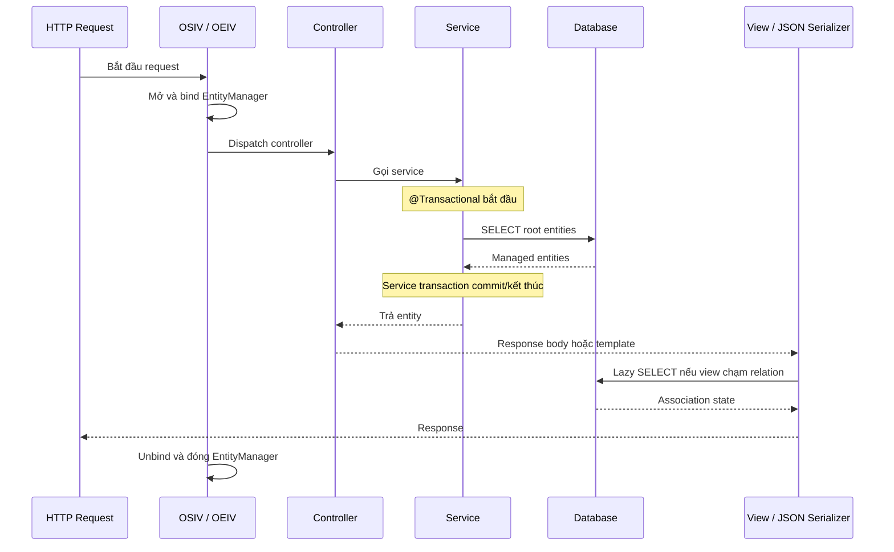
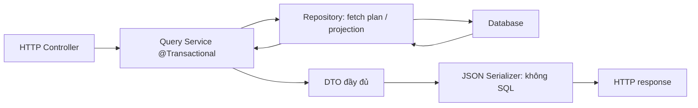
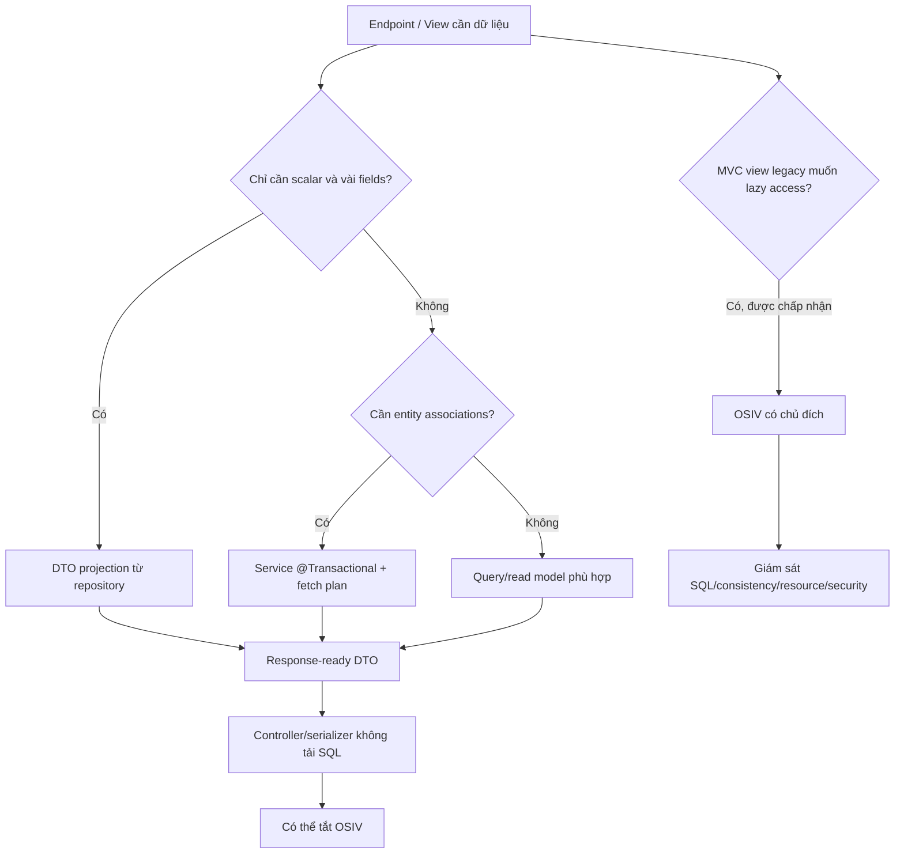

# Open Session in View và quyết định nơi cho phép tải dữ liệu

Khi tích hợp Spring với Hibernate, một API có thể chạy tốt khi cấu hình `spring.jpa.open-in-view=true` nhưng ném `LazyInitializationException` sau khi chuyển sang `false`. Cùng lúc, một số endpoint “chạy tốt” với Open Session in View lại phát hàng trăm câu SQL trong lúc Jackson tạo JSON, dù phần service chỉ có một câu truy vấn.

Điểm chung của hai biểu hiện đó là **ranh giới cho phép truy cập database**. Service lấy những dữ liệu nào? Controller chỉ trả response hay được phép kích hoạt lazy loading? JSON serializer có thể chạy SQL không? Một EntityManager còn mở có đồng nghĩa transaction còn mở không?

**Open Session in View (OSIV)** là pattern giữ Hibernate `Session` hoặc JPA `EntityManager` còn khả dụng trong phần xử lý web request, giúp các association `LAZY` có thể được tải khi view được render. Với Spring Data JPA, tên kỹ thuật thường là **Open EntityManager in View (OEIV)**. Hai biến thể gần nhau về mục đích, nhưng dùng infrastructure khác nhau.

OSIV có thể hữu ích cho ứng dụng server-rendered MVC truyền thống. Tuy nhiên, nó cũng có thể:

- Che giấu việc service chưa tải đủ dữ liệu cho response.
- Cho phép SQL chạy trong view, mapper hoặc JSON serializer.
- Làm phát sinh N+1 queries khó thấy khi review repository.
- Trộn dữ liệu đọc ở những thời điểm/transactions khác nhau.
- Kéo dài vòng đời persistence context và tăng khó khăn khi đo tài nguyên.
- Làm API response phụ thuộc sâu vào entity mapping, tăng nguy cơ payload lớn hoặc lộ thông tin.

Bài học này giải thích vòng đời OSIV trong **Spring MVC + Spring Data JPA + Hibernate**, các trường hợp nên bật/tắt, cách thiết kế fetch plan trong service, DTO projection, EntityGraph, pagination và phương pháp kiểm thử để xác nhận **không có truy vấn ngoài ranh giới mong muốn**.

---

## 1. Lazy loading là nguyên nhân trực tiếp của bài toán

Xét mô hình đơn hàng:

```java
@Entity
@Table(name = "purchase_orders")
public class PurchaseOrder {
    @Id
    private Long id;

    @Column(nullable = false)
    private String orderCode;

    @ManyToOne(fetch = FetchType.LAZY, optional = false)
    private Customer customer;

    @OneToMany(mappedBy = "order", fetch = FetchType.LAZY)
    private List<OrderLine> lines = new ArrayList<>();

    protected PurchaseOrder() {}

    public Long getId() { return id; }
    public String getOrderCode() { return orderCode; }
    public Customer getCustomer() { return customer; }
    public List<OrderLine> getLines() { return lines; }
}

@Entity
public class Customer {
    @Id
    private Long id;
    private String name;

    protected Customer() {}

    public String getName() { return name; }
}

@Entity
public class OrderLine {
    @Id
    private Long id;

    @ManyToOne(fetch = FetchType.LAZY)
    private PurchaseOrder order;

    private String sku;
    private int quantity;

    protected OrderLine() {}

    public Long getId() { return id; }
    public String getSku() { return sku; }
    public int getQuantity() { return quantity; }
}
```

Khi chạy:

```java
PurchaseOrder order =
    entityManager.find(PurchaseOrder.class, orderId);
```

Hibernate có thể tải các cột cơ bản của `PurchaseOrder` mà chưa đọc toàn bộ `Customer` hoặc collection `lines`. Association to-one có thể là proxy; collection one-to-many có thể còn uninitialized.

Khi gọi:

```java
String customerName =
    order.getCustomer().getName();

int lineCount =
    order.getLines().size();
```

Hibernate có thể cần SELECT phụ để lấy Customer hoặc OrderLines.

**Một getter không luôn tạo SQL.** Nếu association đã được fetch, đang có trong persistence context hoặc được cache theo cơ chế phù hợp, Hibernate có thể trả dữ liệu mà không query database. Nhưng khi association còn LAZY và chưa được khởi tạo, Hibernate cần một Session/persistence context có khả năng tải dữ liệu.

### 1.1. Entity state và khả năng đọc dữ liệu

| Trạng thái | Có thể đọc basic fields đã tải? | Có thể tự lazy load chưa khởi tạo? |
|---|---|---|
| Managed trong Session còn hoạt động | Có | Thường có, theo mapping và context |
| Detached sau Session đóng | Có | Thường không |
| Detached nhưng association đã khởi tạo | Có | Không cần lazy load cho phần đã có |
| Transient entity mới | Các giá trị Java có sẵn | Không có cơ chế lazy database load mặc định |

Một detached entity không phải object “không thể dùng”. Nó vẫn chứa dữ liệu đã được materialize. `LazyInitializationException` thường xuất hiện khi code truy cập **association chưa khởi tạo** sau khi entity không còn liên kết với Session thích hợp.

### 1.2. LAZY và EAGER không quyết định HTTP response

`FetchType.LAZY` là định hướng thời điểm tải association. `FetchType.EAGER` yêu cầu provider tải association theo semantics JPA, nhưng không bảo đảm một SQL JOIN duy nhất; Hibernate có thể dùng secondary SELECT và gây N+1.

Do đó, đổi mọi association thành EAGER chỉ để API serialize được là cách sửa không tốt: nó làm các use cases khác tải thêm dữ liệu không cần.

## 2. OSIV kéo dài vòng đời của Session/EntityManager trong request

Một request Spring MVC thông thường:



Khi OEIV đang bật, một EntityManager có thể tồn tại sau transaction của service để view/serializer tiếp tục khởi tạo lazy associations.

**OSIV không tự kéo dài transaction nghiệp vụ từ service đến hết giai đoạn serialize.** Nó kéo dài khả năng dùng persistence context. Lazy SELECT phát sinh sau service transaction thường **không nằm trong chính transaction đó**, tùy Spring/Hibernate/JDBC transaction handling.

### 2.1. Bốn vòng đời khác nhau

| Vòng đời | Mục đích | Điều quan trọng |
|---|---|---|
| HTTP request | Nhận/gửi HTTP | Chưa chắc cùng một thread trong mọi async flow |
| EntityManager / Session | Quản lý persistence context | OSIV có thể kéo dài tới view phase |
| `@Transactional` | Commit/rollback, transaction isolation | Thường kết thúc ở service boundary |
| JDBC Connection | Thực thi SQL | Có chế độ acquire/release tùy Hibernate/driver |

Không nên đồng nhất **Session đang mở = transaction vẫn đang chạy = JDBC connection bị giữ liên tục**. Hibernate có cơ chế delayed connection acquisition và release tùy phiên bản/cấu hình. Song OSIV vẫn có thể gây SQL ngoài service transaction, tăng latency và tạo áp lực lên pool khi truy cập DB.

### 2.2. Những việc OSIV không tự làm

OSIV không:

- Bắt đầu transaction cho toàn bộ thời gian view render.
- Đảm bảo mọi lazy load nhìn cùng snapshot dữ liệu.
- Loại N+1 queries.
- Giới hạn số quan hệ được serialize.
- Bảo đảm mọi exception xảy ra trước khi HTTP body được ghi.
- Tự tạo DTO hoặc áp authorization lên từng nested field.
- Biến detached entity thành một managed entity trong thread khác.
- Thay thế service-level `@Transactional`.

Đó là những trách nhiệm cần được giải quyết riêng trong kiến trúc ứng dụng.

## 3. OpenEntityManagerInView so với OpenSessionInView

Trong hệ sinh thái Spring có những component:

- `OpenEntityManagerInViewFilter` và `OpenEntityManagerInViewInterceptor` dùng JPA `EntityManager`.
- `OpenSessionInViewFilter` và `OpenSessionInViewInterceptor` dùng Hibernate native `Session`.

Với Spring Data JPA và `JpaTransactionManager`, cách tích hợp thông thường là **Open EntityManager in View**. Dù developer thường gọi gọn là “OSIV”, cần biết chính xác component thực tế đang dùng để gỡ lỗi resource binding và transaction participation.

Không nên đồng thời đăng ký nhiều filter/interceptor OSIV native/JPA chồng lên cùng một request chỉ để “bật cho chắc”. Nếu application có custom resource management, phải kiểm tra transaction manager và filter/interceptor ordering rõ ràng.

### 3.1. Spring Boot property

```properties
spring.jpa.open-in-view=true
```

hoặc:

```properties
spring.jpa.open-in-view=false
```

Trong nhiều phiên bản Spring Boot dùng Servlet MVC + JPA, OSIV có thể được bật mặc định khi auto-configuration phù hợp. Một số bản phát thông báo nếu OSIV bật mà chưa explicit configuration.

Không nên giả định tất cả Boot versions/stacks có cùng default. Cần kiểm tra cấu hình effective, auto-configuration và loại ứng dụng (Spring MVC/JPA so với reactive stack).

### 3.2. YAML tương đương

```yaml
spring:
  jpa:
    open-in-view: false
```

Với REST service muốn truy vấn theo service boundary rõ ràng, cấu hình tắt OSIV thường đáng cân nhắc. Tuy nhiên, cần chuẩn bị fetch plans/DTO trước hoặc cùng lúc để các endpoint không bị `LazyInitializationException`.

## 4. Ví dụ: controller trả thẳng entity

Controller:

```java
@RestController
@RequestMapping("/orders")
public class OrderController {
    private final OrderService service;

    public OrderController(OrderService service) {
        this.service = service;
    }

    @GetMapping("/{id}")
    public PurchaseOrder getOne(@PathVariable Long id) {
        return service.findOrder(id);
    }
}
```

Service:

```java
@Service
public class OrderService {
    private final PurchaseOrderRepository repository;

    public OrderService(PurchaseOrderRepository repository) {
        this.repository = repository;
    }

    @Transactional(readOnly = true)
    public PurchaseOrder findOrder(Long id) {
        return repository.findById(id)
            .orElseThrow(() -> new OrderNotFoundException(id));
    }
}
```

### 4.1. Khi OSIV bật

- Web infrastructure mở EntityManager cho request.
- Service gọi repository trong transaction.
- Service transaction kết thúc và trả entity.
- EntityManager vẫn có thể còn mở nhờ OSIV.
- Jackson đọc getter để tạo JSON.
- Nếu Jackson đọc `customer.name` hoặc `lines` chưa initialized, Hibernate có thể thực hiện SELECT thêm.

SQL minh họa:

```sql
SELECT id, order_code, customer_id
FROM purchase_orders WHERE id = ?;

-- Trong giai đoạn serialize, có thể thêm:
SELECT id, name
FROM customers WHERE id = ?;

SELECT id, order_id, sku, quantity
FROM order_lines WHERE order_id = ?;
```

Đoạn SQL xuất hiện sau service không có nghĩa nó thuộc cùng transaction với câu SELECT đầu tiên.

### 4.2. Khi OSIV tắt

Với Spring JPA cấu hình thông thường, EntityManager phục vụ service transaction được đóng/không còn usable sau service. Entity trả ra có thể detached.

Nếu Jackson chạm uninitialized lazy association, có thể gặp:

```text
org.hibernate.LazyInitializationException:
could not initialize proxy [...] - no Session
```

Thông báo cụ thể tùy Hibernate version và loại association. Endpoint chỉ đọc các basic fields đã loaded vẫn có thể hoạt động. Điều quan trọng là **dữ liệu chưa được tải mà tầng presentation cần**.

### 4.3. Đừng chỉ nhìn status 200 OK

Với OSIV bật, API có thể không lỗi nhưng chậm nghiêm trọng. Với OSIV tắt, API có thể lỗi rõ ngay. Trường hợp thứ hai làm lộ ranh giới fetch plan thiếu, còn trường hợp thứ nhất có thể che thiếu sót đó bằng extra SQL.

## 5. Ranh giới của service transaction và read consistency

Một service:

```java
@Transactional(readOnly = true)
public PurchaseOrder getOrder(Long id) {
    return repository.findById(id).orElseThrow();
}
```

chạy transaction đọc. Nhưng khi transaction kết thúc, một lazy SELECT trong serializer không nằm trong transaction service đã kết thúc.

Giả sử:

1. Service đọc Order tại thời điểm T1.
2. Transaction commit/kết thúc.
3. Một transaction khác thay đổi các OrderLines.
4. Jackson chạm `order.getLines()` tại T2.
5. Hibernate phát SELECT và có thể thấy tập lines mới hơn.

Response có thể kết hợp **Order header ở T1** với **Lines ở T2**.

### 5.1. Persistence context không phải database snapshot toàn request

Persistence context giữ entity identity map và trạng thái managed entities, nhưng nó không biến tất cả các SELECT sau commit thành cùng snapshot với transaction trước đó.

Database isolation như READ COMMITTED, REPEATABLE READ hoặc SNAPSHOT còn phụ thuộc DBMS và transaction settings. Nếu nghiệp vụ yêu cầu một ảnh chụp nhất quán, cần tải/xác minh dữ liệu trong transaction thích hợp hoặc dùng read model/snapshot riêng.

### 5.2. Read-only transaction không phải phép màu

`@Transactional(readOnly = true)` là hint cho transaction infrastructure/provider. Nó có thể giúp giảm overhead trong một số cấu hình Hibernate nhưng **không phải cam kết rằng mọi DBMS đều từ chối UPDATE** hay rằng dữ liệu được snapshot nhất quán theo nghiệp vụ.

Quyết định consistency phải xét isolation level, database semantics và những query thực tế.

### 5.3. Ví dụ cần consistency

Những thao tác như xuất hóa đơn, xác nhận thanh toán, tính tổng số dư hoặc trả số liệu đối soát phải được thiết kế transaction/read model rõ. Không để serializer tự thêm lazy SELECT sau khi service đã ra quyết định nghiệp vụ.

## 6. N+1 queries: OSIV cho phép nhưng không ngăn

Giả sử API trả 100 orders:

```java
List<PurchaseOrder> orders =
    repository.findAll();

for (PurchaseOrder order : orders) {
    System.out.println(order.getCustomer().getName());
}
```

Nếu 100 orders trỏ tới 100 customers chưa loaded, ORM có thể thực thi:

```text
1 SELECT purchase_orders
100 SELECT customers WHERE id = ?
Tổng ~101 SELECT
```

Trong request OSIV-enabled, vòng lặp tương đương có thể nằm trong JSON serializer hoặc Thymeleaf template. Không có exception, nhưng có nhiều round-trips SQL.

### 6.1. Những nơi vô tình trigger lazy SELECT

- Jackson serialize getter của association.
- Thymeleaf/FreeMarker đọc nested relation.
- MapStruct hoặc mapper thủ công đọc `customer.name`.
- `toString()`, `equals()` hoặc `hashCode()` được viết để duyệt associations.
- Logging các entities/collections.
- HATEOAS assembler.
- Một permission check có truy cập association.
- Code controller lấy `collection.size()` mà không hiểu nó có thể khởi tạo cả collection.

Một review repository code có thể không phát hiện các truy vấn này nếu chỉ nhìn SQL trong service.

### 6.2. N+1 vẫn có thể xảy ra khi OSIV tắt

Nếu service loop qua 100 orders và chạm 100 lazy relations **bên trong transaction**, N+1 vẫn xảy ra. Tắt OSIV chỉ làm rõ boundary, không tự tối ưu query count. Fetch plan vẫn là trách nhiệm của service/repository.

## 7. Thay thế: service trả DTO đã hoàn chỉnh

Mô hình đề xuất cho REST API:



Định nghĩa DTO:

```java
public record OrderLineDto(
    Long id,
    String sku,
    int quantity
) {}

public record OrderDetailsDto(
    Long id,
    String orderCode,
    String customerName,
    List<OrderLineDto> lines
) {}
```

Repository:

```java
public interface PurchaseOrderRepository
        extends JpaRepository<PurchaseOrder, Long> {

    @Query("""
        select distinct o
        from PurchaseOrder o
        join fetch o.customer
        left join fetch o.lines
        where o.id = :id
        """)
    Optional<PurchaseOrder> findForDetails(
        @Param("id") Long id
    );
}
```

Service:

```java
@Service
public class OrderQueryService {
    private final PurchaseOrderRepository repository;

    public OrderQueryService(PurchaseOrderRepository repository) {
        this.repository = repository;
    }

    @Transactional(readOnly = true)
    public OrderDetailsDto getDetails(Long id) {
        PurchaseOrder order = repository.findForDetails(id)
            .orElseThrow(() -> new OrderNotFoundException(id));

        List<OrderLineDto> lines = order.getLines()
            .stream()
            .map(line -> new OrderLineDto(
                line.getId(),
                line.getSku(),
                line.getQuantity()
            ))
            .toList();

        return new OrderDetailsDto(
            order.getId(),
            order.getOrderCode(),
            order.getCustomer().getName(),
            List.copyOf(lines)
        );
    }
}
```

Controller:

```java
@RestController
@RequestMapping("/api/orders")
public class OrderController {
    private final OrderQueryService queryService;

    public OrderController(OrderQueryService queryService) {
        this.queryService = queryService;
    }

    @GetMapping("/{id}")
    public OrderDetailsDto details(@PathVariable Long id) {
        return queryService.getDetails(id);
    }
}
```

Tất cả các field mà JSON serializer cần đã nằm trong DTO. Entity chỉ được truy cập khi transaction service đang hoạt động.

### 7.1. Tại sao DTO tốt hơn chỉ khởi tạo entity?

DTO định nghĩa rõ response contract. Các trường không được phép trả cho client không được đưa vào DTO. Jackson không tự đi theo associations sâu hơn; cũng không phụ thuộc cách Hibernate proxy/collection được serialize.

### 7.2. Không dùng JOIN FETCH vô điều kiện

Ví dụ trên phù hợp cho **một order** với một collection lines có kích thước hợp lý. Nếu một order có 100.000 lines, tải toàn bộ sẽ tốn bộ nhớ và network. Thay bằng endpoint phân trang lines hoặc query DTO riêng.

Với nhiều collection fetch joins, SQL có thể nhân hàng theo tích và gặp `MultipleBagFetchException`. OSIV không giải quyết các vấn đề đó.

## 8. Truy vấn DTO projection trực tiếp cho danh sách

Một trang list thường chỉ cần vài cột:

```java
package com.example.orders;

public record OrderSummary(
    Long id,
    String orderCode,
    Instant createdAt,
    String customerName
) {}
```

Spring Data JPA repository:

```java
public interface PurchaseOrderRepository
        extends JpaRepository<PurchaseOrder, Long> {

    @Query(
        value = """
            select new com.example.orders.OrderSummary(
                o.id, o.orderCode, o.createdAt, c.name
            )
            from PurchaseOrder o
            join o.customer c
            where o.status = :status
            """,
        countQuery = """
            select count(o)
            from PurchaseOrder o
            where o.status = :status
            """
    )
    Page<OrderSummary> findSummaryPage(
        @Param("status") OrderStatus status,
        Pageable pageable
    );
}
```

Service:

```java
@Transactional(readOnly = true)
public Page<OrderSummary> confirmedOrders(
        Pageable pageable) {
    return repository.findSummaryPage(
        OrderStatus.CONFIRMED,
        pageable
    );
}
```

Với DTO projection:

- Query chỉ chọn các fields được yêu cầu.
- Không tạo managed entity graph đầy đủ chỉ để render danh sách.
- Không có lazy associations trong DTO.
- Hoạt động khi OSIV tắt.
- SQL và count query có thể được review độc lập.

### 8.1. Pageable và sorting

Nếu input từ HTTP cho phép sort field, dùng allowlist và thứ tự ổn định. Khi nhiều orders có cùng `createdAt`, nên có ID tie-breaker. Nếu dùng JOIN collection chỉ để lọc, cần xem duplication và count semantics.

### 8.2. DTO không phải entity

`OrderSummary` là value object. Nó không có dirty checking/cascade/lazy loading. Nếu thao tác update, service tải entity managed trong transaction write phù hợp. Không dùng DTO như một detached entity tùy tiện cho `merge()`.

## 9. EntityGraph: chọn dữ liệu được tải bởi query

Spring Data JPA hỗ trợ EntityGraph:

```java
public interface PurchaseOrderRepository
        extends JpaRepository<PurchaseOrder, Long> {

    @EntityGraph(attributePaths = {"customer"})
    @Query("""
        select o
        from PurchaseOrder o
        where o.status = :status
        order by o.createdAt desc, o.id desc
        """)
    List<PurchaseOrder> findWithCustomer(
        @Param("status") OrderStatus status
    );
}
```

`@EntityGraph` chỉ định association cần được tải, không phải câu lệnh “luôn dùng một SQL JOIN”. Hibernate chọn SQL strategy theo query/mapping. Nó giúp service nói rõ nhu cầu mà không đổi association sang EAGER cho mọi use case.

### 9.1. EntityGraph và OSIV là hai quyết định khác nhau

- EntityGraph chọn **what to fetch**.
- OSIV chọn **how long persistence context remains usable in web request**.

Một EntityGraph không tự kéo dài transaction; OSIV không tự quyết định graph mà UI thực sự cần.

### 9.2. EntityGraph sâu có thể overfetch

Graph chứa `customer`, `lines`, `payments`, `shipments` và nested `lines.product.category` có thể làm SQL rất rộng hoặc nhiều SELECT phụ. Luôn thiết kế theo cardinality và payload thực tế.

## 10. JOIN FETCH: ứng viên to-one, cẩn thận với collection

To-one:

```java
select o
from PurchaseOrder o
join fetch o.customer
where o.status = :status
order by o.createdAt desc, o.id desc
```

Khi customer bắt buộc có và list API luôn cần nó, JOIN FETCH có thể tránh N+1. Quan hệ to-one thường không nhân số root rows theo kiểu one-to-many, nên phù hợp hơn với pagination khi query hợp lệ.

Một collection của một order:

```java
select distinct o
from PurchaseOrder o
left join fetch o.lines
where o.id = :id
```

SQL vẫn có một hàng join cho mỗi line. Hibernate 6 có thể tự loại root entity duplicates do collection fetch join khỏi Java List, nhưng **không giảm số hàng SQL** nhờ đó. Chỉ fetch collection khi số lượng hợp lý.

### 10.1. Nhiều collections và Cartesian explosion

```java
select o
from PurchaseOrder o
left join fetch o.lines
left join fetch o.payments
```

Một order có 30 lines và 8 payments có thể tạo khoảng 240 hàng SQL. Với nhiều bag associations, Hibernate có thể ném `MultipleBagFetchException`.

Đổi một `List` thành `Set` chỉ để né lỗi có thể thay đổi domain semantics. Tách query hoặc batch/subselect collections thường là phương án hợp lý hơn.

## 11. Batch fetching trong service

Hibernate có batch fetching lazy associations:

```java
@OneToMany(mappedBy = "order", fetch = FetchType.LAZY)
@BatchSize(size = 20)
private List<OrderLine> lines = new ArrayList<>();
```

Cấu hình chung:

```properties
spring.jpa.properties.hibernate.default_batch_fetch_size=20
```

Khi service khởi tạo collections cho một nhóm owners, Hibernate có thể tải nhiều collection cùng role bằng một hoặc vài SELECT có `IN (...)` thay vì mỗi owner một SELECT.

### 11.1. Batch vẫn cần nằm trong ranh giới fetch phù hợp

Nếu service cần lines của 20 orders để tạo DTO, hãy khởi tạo/map trong transaction. Batch chỉ giúp giảm số round-trips trong quá trình đó; không làm DTO tự lazy-load sau khi service trả.

### 11.2. Không nhầm với DML batch

`@BatchSize` và `hibernate.default_batch_fetch_size` liên quan SELECT fetching. `hibernate.jdbc.batch_size` liên quan JDBC batching của INSERT/UPDATE/DELETE. Hai nhóm setting phục vụ các vấn đề khác nhau.

## 12. Collection pagination: OSIV không làm LIMIT trở nên đúng

Giả sử query:

```java
select o
from PurchaseOrder o
left join fetch o.lines
order by o.createdAt desc
```

và áp `setMaxResults(20)`. Vì một order có thể có nhiều lines, SQL result chứa nhiều hàng cho cùng order. Giới hạn 20 SQL rows không tương đương 20 distinct root orders với toàn bộ lines.

Hibernate có thể áp pagination ở memory hoặc phát cảnh báo/exception tùy version và setting khi có collection fetch join.

### 12.1. Phân trang IDs rồi fetch graph

Bước 1 — lấy page root IDs:

```java
List<Long> ids = em.createQuery(
        """
        select o.id
        from PurchaseOrder o
        where o.status = :status
        order by o.createdAt desc, o.id desc
        """,
        Long.class
    )
    .setParameter("status", OrderStatus.CONFIRMED)
    .setFirstResult(offset)
    .setMaxResults(pageSize)
    .getResultList();
```

Bước 2 — fetch dữ liệu cho đúng IDs:

```java
List<PurchaseOrder> orders = ids.isEmpty()
    ? List.of()
    : em.createQuery(
        """
        select distinct o
        from PurchaseOrder o
        join fetch o.customer
        left join fetch o.lines
        where o.id in :ids
        """,
        PurchaseOrder.class
    )
    .setParameter("ids", ids)
    .getResultList();
```

Sau đó map DTO trong transaction, khôi phục thứ tự theo `ids` vì SQL `IN` không bảo đảm thứ tự. Với nhiều collection lớn, dùng batch/subselect hoặc query riêng.

Hai query có thể thấy dữ liệu thay đổi giữa các statements tùy transaction isolation. Với dữ liệu yêu cầu consistent snapshot, thiết kế transaction/isolation thích hợp.

## 13. SQL chạy trong view có thể làm response nhất quán kém

Một tình huống:

```text
T1: service load Order header (status = CONFIRMED)
T2: transaction service kết thúc
T3: transaction khác thêm OrderLine
T4: serializer truy cập order.lines -> SELECT
T5: response chứa header T1 và lines T4
```

Bởi vì OSIV không duy trì một service transaction snapshot đến cuối render, response có thể kết hợp dữ liệu ở những thời điểm khác nhau.

Không phải mọi API đều cần snapshot hoàn hảo; nhưng đối với thanh toán, kiểm toán, đối soát hoặc quyết định nghiệp vụ quan trọng, **consistency phải được thiết kế trong transaction/read model**, không phó mặc việc lazy load cho view.

### 13.1. Read-only transaction và isolation

`@Transactional(readOnly = true)` không tự đảm bảo mọi reads theo same-snapshot nếu DBMS chạy READ COMMITTED với nhiều statements. Khi cần snapshot/repeatable reads, chọn transaction isolation và query shape phù hợp DBMS.

OSIV kéo dài EntityManager, không phải là isolation strategy.

## 14. OSIV và JDBC connection lifetime

Một số mô tả cho rằng OSIV luôn giữ một JDBC connection từ đầu request tới cuối response. Đây là **khái quát hóa quá mức**.

Hibernate có các chế độ connection acquisition/release; connection có thể được lấy muộn và giải phóng theo transaction hoặc statement tùy cấu hình và provider. Nhưng OSIV vẫn có các tác động:

- Persistence context có thể sống lâu hơn service transaction.
- Lazy SQL có thể xuất hiện sau những thao tác HTTP/network chậm.
- Một số paths có thể giữ connection/transaction resources lâu hơn.
- DB round-trips trong serializer tăng thời gian request.
- HTTP concurrency cao có thể gây áp lực pool/DB.

Đừng tranh luận chỉ dựa trên câu “OSIV luôn giữ connection”; đo:

- Active/pending/idle connections của pool.
- SQL statements và latency theo HTTP request.
- Transaction duration.
- JDBC connection acquisition/release spans.
- p95/p99 response latency.
- DB session/lock metrics.

### 14.1. Remote I/O xen giữa

```java
@GetMapping("/{id}")
public OrderView details(@PathVariable Long id) {
    PurchaseOrder order = orderService.load(id);

    externalClient.fetchMetadata(id); // Network call.

    return mapper.toView(order); // Có thể lazy SELECT.
}
```

Với OSIV bật, mapper có thể chạy SQL sau remote call. Việc này khó kiểm soát thời điểm đọc dữ liệu và latency. Thường nên định nghĩa transaction/service boundary rõ và trả response-ready DTO.

## 15. Serialization entity trực tiếp có rủi ro ngoài lazy loading

Giả sử entity về sau có thêm:

```java
private String internalFraudNote;

@ManyToOne(fetch = FetchType.LAZY)
private StaffMember approvedBy;
```

Khi trả entity trực tiếp, JSON contract có thể thay đổi theo visibility/annotations của Jackson. Trường nội bộ hoặc nested relationship có thể bị serialize ngoài dự định.

### 15.1. Vòng lặp trong bidirectional relations

```text
Order -> Customer -> orders -> Customer -> ...
```

JSON serializer duyệt cả hai phía có thể gây recursion hoặc payload khổng lồ. Một số Jackson annotations giúp điều khiển chu trình, nhưng DTO rõ ràng thường dễ bảo đảm response contract hơn.

### 15.2. Security và tenant boundaries

Không nên để serializer tự quyết định truy cập mọi association có thể tải. Service cần kiểm tra authorization/tenant ownership và chỉ đưa dữ liệu được phép vào DTO.

OSIV không tự làm authorization bypass; **rủi ro phát sinh khi response schema không được kiểm soát và entity graph chứa dữ liệu ngoài phạm vi quyền người dùng**.

### 15.3. Jackson Hibernate module

Một số module Jackson cho Hibernate có thể bỏ qua uninitialized proxies hoặc serialize identifiers mà không force-load, tùy phiên bản/cấu hình. Điều này có thể giảm lỗi serialization nhưng không thay thế:

- Fetch plan.
- Query count budget.
- Read consistency.
- DTO API contract.
- Authorization.

Không bật một serialization module rồi coi là đã xử lý N+1 và lazy loading ở mọi nơi.

## 16. Vì sao @Transactional nên ở service?

Transaction thường thuộc **unit of work** nghiệp vụ:

- Command service: load/validate/mutate/persist trong transaction.
- Query service: load data/map DTO trong read-only transaction.
- Controller: HTTP request/response orchestration.
- Renderer: chuyển DTO thành JSON/HTML.

Ví dụ:

```java
@Transactional(readOnly = true)
public OrderDetailsDto getDetails(Long id) {
    PurchaseOrder order =
        repository.findForDetails(id).orElseThrow();

    return mapToDetails(order);
}
```

### 16.1. @Transactional trên controller chưa chắc bao phủ serialization

Trong Spring MVC thông thường, JSON serialization xảy ra sau khi controller method đã trả kết quả. `@Transactional` trên controller method không có nghĩa transaction bao trùm mọi bước ghi response body.

Đặt data access trong service có thể review, test và tái sử dụng dễ hơn.

### 16.2. Self-invocation của Spring proxy

Ví dụ:

```java
@Service
public class OrderService {
    public OrderDetailsDto details(Long id) {
        return loadAndMap(id);
    }

    @Transactional(readOnly = true)
    public OrderDetailsDto loadAndMap(Long id) {
        // Query + DTO mapping
    }
}
```

Trong Spring proxy-based transaction management, method cùng bean gọi trực tiếp method có `@Transactional` có thể bỏ qua proxy advice, dẫn tới transaction không được mở như mong muốn.

Hãy đặt transaction trên method được gọi qua Spring proxy hoặc thiết kế bean boundary phù hợp. Đừng dựa vào OSIV để che lỗi transaction không kích hoạt.

### 16.3. @Async và thread boundaries

Một transaction đang mở ở request thread không tự chuyển sang `CompletableFuture`/thread pool. Async task nên gọi service có transaction riêng nếu cần DB và trả DTO, không truyền proxy lazy từ request rồi kỳ vọng OSIV tự theo sang thread khác.

Spring MVC có hỗ trợ những trường hợp async request dispatch nhất định, nhưng behavior tùy framework/version; không coi OSIV là một transactional context chung cho mọi threads.

## 17. Hibernate.initialize(): dùng khi cần, không lạm dụng

Trong service transaction:

```java
@Transactional(readOnly = true)
public OrderDetailsDto getDetails(Long id) {
    PurchaseOrder order = repository.findById(id)
        .orElseThrow();

    Hibernate.initialize(order.getCustomer());
    Hibernate.initialize(order.getLines());

    return toDto(order);
}
```

`Hibernate.initialize` là Hibernate-specific API để khởi tạo proxy/collection trong một Session thích hợp. Nó có thể hữu ích khi cần chủ động tải dữ liệu nhưng không muốn viết JOIN FETCH ngay.

**Nó không tự tối ưu SQL**:

- Khởi tạo `lines` cho 100 orders trong loop có thể gây N+1.
- Khởi tạo collection không tự tải mọi nested relation của từng line.
- Nếu collection rất lớn, có thể tốn bộ nhớ.
- Fetch plan trong repository thường rõ và tối ưu hơn.

Có thể kiểm tra trạng thái:

```java
boolean loaded =
    Hibernate.isInitialized(order.getLines());
```

hoặc theo JPA:

```java
boolean loaded =
    Persistence.getPersistenceUtil()
        .isLoaded(order, "lines");
```

Tuy nhiên, service nên biết dữ liệu mình cần thay vì để controller kiểm tra `isLoaded` rồi tùy trạng thái quyết định chạm database.

## 18. enable_lazy_load_no_trans không phải giải pháp tổng quát

Hibernate có setting trong một số release:

```properties
hibernate.enable_lazy_load_no_trans=true
```

Mục đích là cho phép một số kiểu lazy initialization ngoài transaction/session context thông thường, có thể qua temporary sessions hoặc cơ chế provider-specific.

Đây không phải lời khuyên dùng mặc định: nó có thể tạo SQL ngoài unit of work dự kiến, làm khó kiểm soát performance, N+1 và consistency. Không bật chỉ để “hết exception” khi vấn đề thật sự là service trả thiếu dữ liệu.

Tương tự, thêm `FetchType.EAGER` hàng loạt hoặc gọi `collection.size()` trong controller không phải cách tối ưu fetch plan.

## 19. Server-rendered view: tình huống OSIV có thể được chọn

Lịch sử OSIV gắn với template view có thể đọc lazy association:

```html
<!-- Minh họa Thymeleaf với model attribute đang chọn -->
<span th:text="*{customer.name}"></span>
```

Với một MVC app server-rendered nhỏ, số liệu đơn giản, view được review cùng database workload, OSIV có thể là một lựa chọn tiện lợi có chủ đích.

Điều kiện cần quan tâm:

- View nào chạm association nào?
- Tổng số SQL theo mỗi page có đo được không?
- Collections có thể lớn bao nhiêu?
- Có yêu cầu snapshot consistency không?
- Có trường nhạy cảm trong nested relations không?
- Server có đủ connection pool headroom không?
- Khi nâng Hibernate/Spring, view có thay đổi lazy behavior không?

### 19.1. View model vẫn là hướng bền vững

Controller có thể trả một view model đã được service chuẩn bị:

```java
@GetMapping("/orders/{id}")
public String details(
        @PathVariable Long id,
        Model model) {

    model.addAttribute(
        "order",
        queryService.getDetails(id)
    );

    return "orders/details";
}
```

Template không cần biết Hibernate. Khi tắt OSIV, page vẫn có dữ liệu cần thiết.

## 20. Background jobs và streaming responses

OSIV gắn với web request; nó không phải transaction boundary cho:

- `@Scheduled` jobs.
- Kafka/RabbitMQ consumers.
- Spring Batch steps.
- Background worker threads.
- Email rendering ngoài request.
- Long-running export tasks.

Những luồng đó cần transaction/service boundaries rõ ràng.

### 20.1. Export lớn không nên giữ full entity graph

Nếu export hàng triệu rows:

- Query DTO/scalar projection.
- Phân trang/keyset hoặc streaming theo driver/DBMS.
- Giữ transaction và JDBC resources có kiểm soát.
- Flush/clear hoặc chọn stateless/read-only strategies nếu phù hợp.
- Không serialize lazy entities từ một Session đã đóng.
- Không giữ response request OSIV mở chỉ để xuất lượng dữ liệu khổng lồ.

### 20.2. Spring MVC async

OSIV interceptors/filters có thể tích hợp với một số async dispatch mechanisms của Spring MVC. Không kết luận “OSIV luôn bị đóng khi bắt đầu async” cho mọi version, nhưng cũng không mặc định một EntityManager request-bound là usable trong thread pool tùy ý.

Thiết kế async task dựa trên service transaction độc lập và DTO thay vì phụ thuộc lifecycle request.

## 21. Lỗi trong giai đoạn JSON serialization

Một lỗi query trong service thường xảy ra trước khi controller trả response và trước khi body được ghi. Exception handler còn có cơ hội tạo status/payload lỗi phù hợp.

Nếu lazy SQL bị kích hoạt trong serialization, exception có thể xuất hiện **sau khi controller method đã return**. Tùy buffering/web server, một phần response body có thể đã được gửi, khiến error handling khó hơn.

Các lỗi thường thấy:

- `LazyInitializationException` khi không có Session.
- Database timeout/connection error khi lazy SELECT.
- Recursion do bidirectional associations.
- Serialization exception với Hibernate proxies.
- Payload size vượt giới hạn khi duyệt collections lớn.

Chuẩn bị DTO hoàn chỉnh tại service giúp các lỗi data access xảy ra trước giai đoạn serialize HTTP body và làm failure boundary rõ ràng hơn.

## 22. First-level cache, L2 cache, query cache khác OSIV

Những cơ chế này giải quyết những câu hỏi khác nhau:

| Cơ chế | Câu hỏi được giải quyết |
|---|---|
| First-level cache | Session này có managed entity instance theo identity chưa? |
| Second-level entity/collection cache | State/collection data có được cache chia sẻ không? |
| Query cache | Kết quả của query với parameters/options có sẵn và còn hợp lệ không? |
| OSIV/OEIV | EntityManager/Session còn khả dụng trong view/render của request không? |
| Fetch plan | Query cần tải association nào ngay? |
| Transaction | Unit of work/commit/rollback/isolation nằm ở đâu? |

L2/query cache có thể giảm SELECT, nhưng không tự biến detached proxy thành một graph initialized. OSIV có thể cho phép lazy query tiếp tục, nhưng không có nghĩa SQL đó miễn phí nhờ cache.

Cần thiết kế đúng fetch plan trước khi tối ưu cache.

## 23. Kiểm thử với OSIV tắt

Một integration test có thể ép property:

```java
@SpringBootTest(
    properties = "spring.jpa.open-in-view=false"
)
@AutoConfigureMockMvc
class OrderControllerIT {

    @Autowired
    MockMvc mockMvc;

    @Test
    void detailsDoesNotNeedOsiv() throws Exception {
        mockMvc.perform(
                get("/api/orders/42")
                    .accept(MediaType.APPLICATION_JSON)
            )
            .andExpect(status().isOk())
            .andExpect(jsonPath("$.id").value(42))
            .andExpect(
                jsonPath("$.customerName").isNotEmpty()
            );
    }
}
```

Đây là skeleton; cần fixtures tạo Order#42, Customer và Lines tương ứng.

### 23.1. Không để test transaction che ranh giới thật

Nếu test method có `@Transactional` và mọi call chạy trong cùng persistence context, lazy getter có thể hoạt động dù OSIV tắt, khiến test không phản ánh production request boundary.

Để test HTTP behavior:

- Seed fixtures và commit ở transaction riêng.
- Gọi endpoint như request thực.
- Không giữ một outer test EntityManager/transaction vô tình cho controller dùng.
- Kiểm tra response sau serialization.
- Ghi lại SQL count và exceptions.

### 23.2. Test dữ liệu đủ lớn để thấy N+1

Một order với một line không phơi bày vấn đề. Nên tạo:

- 50–100 orders.
- Nhiều customer IDs.
- Collections có 0, 1 và nhiều elements.
- Một collection đặc biệt lớn.
- Quan hệ optional.
- Entity chứa field không được phép trả API.

Kiểm tra response đúng, không rò field và số SQL statements hợp lý.

## 24. Đo SQL bằng Hibernate Statistics

Bật:

```properties
spring.jpa.properties.hibernate.generate_statistics=true
logging.level.org.hibernate.SQL=DEBUG
```

Nếu cần bind values trong Hibernate 6:

```properties
logging.level.org.hibernate.orm.jdbc.bind=TRACE
```

Bind tracing có thể lộ dữ liệu cá nhân/secrets; chỉ bật có kiểm soát ở môi trường phù hợp.

Trong test:

```java
SessionFactory factory =
    entityManagerFactory.unwrap(SessionFactory.class);

Statistics statistics =
    factory.getStatistics();

long before = statistics.getPrepareStatementCount();

// Thực thi request hoặc service invocation.

long after = statistics.getPrepareStatementCount();
long statements = after - before;
```

`Statistics` ở cấp SessionFactory nên có thể bị nhiễu bởi parallel tests/background activities. Đo trong môi trường cô lập hoặc dùng JDBC proxy/request tracing để có số liệu theo request chính xác hơn.

### 24.1. Đo cả latency và data volume

Số SQL statements là chỉ số quan trọng nhưng không đủ:

- Một JOIN FETCH lớn có thể trả hàng trăm nghìn rows.
- Một DTO projection có thể trả ít dữ liệu hơn.
- Serializer entity graph có thể tạo JSON rất lớn.
- Connection pool có thể bị chờ dù số SQL thấp.

Theo dõi SQL count, rows, DB latency, HTTP p95/p99, response size và connection pool metrics cùng nhau.

## 25. Lộ trình chuyển đổi hệ thống đang phụ thuộc OSIV

Một ứng dụng legacy có thể đang dùng OSIV ở hàng trăm endpoints. Tắt ngay có thể làm nhiều trang lỗi vì view tự tải lazy associations.

Thay đổi theo giai đoạn:

1. **Quan sát:** ghi effective OSIV property, SQL count per endpoint, những chỗ trả entity trực tiếp.
2. **Ưu tiên:** chọn endpoints traffic cao hoặc có N+1/payload lớn.
3. **Thiết kế DTO:** định nghĩa response fields cho từng use case.
4. **Chỉnh repository:** projection cho list, EntityGraph/JOIN FETCH cho detail, batch cho collections cần thiết.
5. **Map trong service transaction:** tránh để view/serializer tải SQL.
6. **Test OSIV-disabled:** kiểm tra contract, query counts, authorization.
7. **Staging/load test:** xác nhận không phát sinh LazyInitializationException mới, so sánh latency.
8. **Rollout:** đổi `spring.jpa.open-in-view=false` ở phạm vi phù hợp, theo dõi lỗi.
9. **Duy trì:** review fetch plan cho mỗi response change và không trả entity tùy tiện.

Đây là chuyển đổi kiến trúc về **data access ownership**, không chỉ một thao tác đổi property.

## 26. Bảng quyết định khi nào bật/tắt

| Bối cảnh | Lựa chọn thường phù hợp | Lý do |
|---|---|---|
| Public REST API | Tắt OSIV, trả DTO | Rõ response contract và SQL boundary |
| API tải cao, nhiều associations | Tắt, dùng fetch plan chủ động | Giảm N+1/latency khó đoán |
| App MVC HTML nhỏ, view kiểm soát tốt | Có thể bật có chủ đích | Tiện lazy access trong template |
| Legacy app đang phụ thuộc OSIV | Chuyển dần sang DTO | Tránh breaking change hàng loạt |
| Domain đọc cần snapshot | Transaction/read model rõ | OSIV không duy trì transaction snapshot |
| Trang danh sách phân trang | DTO projection hoặc page IDs | Tránh collection fetch pagination |
| Dashboard chỉ cần counts/totals | Aggregate query | Không hydrate full entity collections |
| Async/scheduled jobs | Service transaction độc lập | Không dựa request OSIV |
| API có thông tin nhạy cảm | DTO/authorization chặt | Không expose entity graph ngoài ý định |
| View render chậm/remote I/O | Fetch tại service và đo pool | Tránh lazy SQL ở thời điểm khó đoán |

Bật OSIV không mặc nhiên sai; tắt OSIV không tự động tốt hơn mọi cấu hình. Quan trọng là **quyền tải dữ liệu phải được quyết định rõ và kiểm chứng bằng số liệu**.

## 27. Sai lầm thường gặp

### 27.1. “OSIV = một transaction từ đầu đến cuối request”

Sai. OSIV giữ Session/EntityManager usable; service transaction thường kết thúc sớm hơn.

### 27.2. “OSIV luôn chiếm một JDBC connection suốt request”

Không chính xác cho mọi Hibernate connection handling modes. Nhưng lazy SQL trong view vẫn có thể gây DB load và resource pressure.

### 27.3. “Tắt OSIV tức LAZY không dùng được”

Sai. LAZY hoạt động trong service transaction. Cần fetch/mapping dữ liệu trước khi trả response.

### 27.4. “LazyInitializationException phải sửa bằng EAGER”

Sai. EAGER có thể tạo secondary SELECT và N+1; hãy dùng fetch plan theo use case.

### 27.5. “@Transactional đặt trên controller đủ cho JSON”

Không nhất thiết, vì serialization có thể xảy ra sau khi controller method return.

### 27.6. “Trả entity trực tiếp luôn tiết kiệm công viết DTO”

Chi phí ban đầu ít hơn nhưng có thể gây API drift, SQL ẩn, recursion và bảo mật phức tạp hơn.

### 27.7. “Dùng Jackson @JsonIgnore giải quyết fetch plan”

`@JsonIgnore` có thể giới hạn serialization nhưng không làm query tối ưu hay xác định chính xác data contract của service.

### 27.8. “Hibernate.initialize(collection) tải toàn bộ nested graph”

Sai. Nó chỉ chủ động khởi tạo proxy/collection mục tiêu; nested lazy associations có thể chưa tải.

### 27.9. “OSIV sẽ sửa N+1”

Sai. Nó thường cho phép N+1 diễn ra thành công thay vì ném lỗi ở presentation layer.

### 27.10. “Tắt OSIV tự chữa N+1”

Sai. N+1 trong service transaction vẫn phải xử lý.

### 27.11. “L2/query cache thay thế Session cho detached lazy proxy”

Sai. Cache hỗ trợ dữ liệu, nhưng không thay persistence context cần thiết để khởi tạo proxy theo lifecycle ORM.

### 27.12. “View có quyền đọc bất kỳ quan hệ entity nào”

Sai về thiết kế bảo mật và performance. Service phải kiểm soát authorization, data shape và fetch plan.

### 27.13. “Một EntityManager đảm bảo mọi dữ liệu cùng snapshot”

Sai. Transaction isolation và thời điểm SQL phát sinh mới quyết định snapshot/visibility. Lazy SELECT sau commit có thể nhìn dữ liệu khác.

## 28. Một ví dụ so sánh cuối cùng

Yêu cầu: `GET /api/orders/recent` trả 20 orders gần nhất, mỗi row có mã đơn và tên khách hàng.

**Cách phụ thuộc OSIV:**

```java
@Transactional(readOnly = true)
public List<PurchaseOrder> recent() {
    return repository.findTop20ByOrderByCreatedAtDesc();
}
```

Nếu controller trả entities, Jackson có thể load `customer` và `lines` ngoài service transaction. Response phụ thuộc entity mapping, có thể gây N+1 và lỗi nếu OSIV tắt.

**Cách chủ động:**

```java
public record RecentOrderRow(
    Long id,
    String orderCode,
    String customerName
) {}

@Query("""
    select new com.example.orders.RecentOrderRow(
        o.id, o.orderCode, c.name
    )
    from PurchaseOrder o
    join o.customer c
    order by o.createdAt desc, o.id desc
    """)
List<RecentOrderRow> findRecentRows(Pageable pageable);
```

Service:

```java
@Transactional(readOnly = true)
public List<RecentOrderRow> recent() {
    return repository.findRecentRows(
        PageRequest.of(0, 20)
    );
}
```

Controller trả `List<RecentOrderRow>`. Serializer không có lazy association để truy cập. Có thể chạy với OSIV tắt; query và response fields dễ review hơn.

Nếu cần thêm `lineCount`, nên thêm aggregate/projection phù hợp, không tải toàn bộ `OrderLine` entities chỉ để đếm.

## 29. Quy trình chọn nơi được phép tải dữ liệu



Hãy trả lời lần lượt:

1. Response cần những field nào?
2. Có association nào bắt buộc phải tải ngay?
3. Có collection lớn cần pagination riêng không?
4. Transaction đọc cần isolation/consistency đến mức nào?
5. Query trả entities hay DTO/scalars?
6. Tầng service đã map đủ dữ liệu chưa?
7. Serializer có thể phát SQL ngoài ý định không?
8. N+1 có được đo trên fixture đủ lớn không?
9. OSIV đang bật/tắt thực sự theo cấu hình effective nào?
10. Nếu bật OSIV, chi phí và rủi ro nào được chấp nhận có chủ đích?

## 30. Kết luận

**Open Session in View cho phép lazy loading tiếp tục trong giai đoạn render bằng cách kéo dài vòng đời Session/EntityManager; nó không tự kéo dài service transaction và không bảo đảm mọi dữ liệu thuộc cùng database snapshot.**

Với Spring Data JPA và Hibernate:

- `spring.jpa.open-in-view=true` có thể giúp view/serializer truy cập lazy relations, nhưng SQL có thể xuất hiện ngoài service.
- `spring.jpa.open-in-view=false` làm ranh giới tải dữ liệu rõ hơn, đòi hỏi service chuẩn bị đầy đủ dữ liệu cần trả.
- Fetch plans như `JOIN FETCH`, `@EntityGraph`, batch fetching và DTO projection giải quyết **lấy dữ liệu nào, bằng cách nào**.
- `@Transactional` giải quyết **transaction bắt đầu/kết thúc ở đâu**; OSIV không thay thế.
- Trả DTO giúp tách HTTP contract khỏi entity mapping, giảm khả năng N+1/recursion và lộ dữ liệu.
- Connection lifetime, latency và consistency phải được đánh giá theo Hibernate/Spring version cùng cấu hình DB thật; tránh những khẳng định tuyệt đối không đo đạc.

Quyết định thiết kế quan trọng nhất là:

> **Tầng nào được phép phát SQL, và khi controller bắt đầu tạo response thì dữ liệu đã phải đầy đủ đến mức nào?**

Một API dễ bảo trì thường để service/repository chịu trách nhiệm truy vấn, còn controller/serializer chỉ xử lý dữ liệu đã định hình. Nếu ứng dụng chọn giữ OSIV cho view templates hoặc legacy pages, hãy coi đó là chính sách có giới hạn, có monitoring và được review cùng fetch plan.

### Tài liệu tham khảo

- [Spring Framework Reference — JPA Integration](https://docs.spring.io/spring-framework/reference/data-access/orm/jpa.html) — JPA/OEIV integration.
- [OpenEntityManagerInViewFilter Javadocs](https://docs.spring.io/spring-framework/docs/current/javadoc-api/org/springframework/orm/jpa/support/OpenEntityManagerInViewFilter.html) — request-scoped EntityManager và lazy loading.
- [OpenEntityManagerInViewInterceptor Javadocs](https://docs.spring.io/spring-framework/docs/current/javadoc-api/org/springframework/orm/jpa/support/OpenEntityManagerInViewInterceptor.html) — interceptor lifecycle.
- [Spring Transaction Management](https://docs.spring.io/spring-framework/reference/data-access/transaction.html) — `@Transactional`, proxies, propagation và isolation.
- [Spring Boot Reference — Data SQL/JPA](https://docs.spring.io/spring-boot/reference/data/sql.html) — `spring.jpa.open-in-view` và auto-configuration.
- [Spring Data JPA Reference](https://docs.spring.io/spring-data/jpa/reference/) — repository projections và `@EntityGraph`.
- [Hibernate ORM User Guide](https://docs.hibernate.org/orm/6.6/userguide/html_single/) — persistence context, fetching, batch loading, SQL diagnostics.
- [Jakarta Persistence Specification](https://jakarta.ee/specifications/persistence/) — entity lifecycle, LAZY/EAGER, EntityGraph và transaction semantics.

Đối chiếu đúng versions **Spring Framework, Spring Boot, Hibernate ORM, transaction manager, JDBC driver và web stack**. Một setting có cùng tên chưa chắc có default/behavior giống nhau giữa các releases, nên cần kiểm chứng bằng integration tests ở ranh giới HTTP và SQL tracing thực tế.
