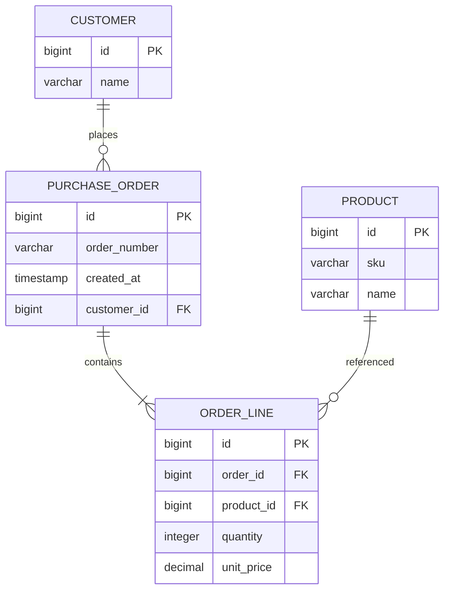

# Chuyển DTO bên trong ranh giới phù hợp để kiểm soát truy vấn với Spring và Hibernate

## 1. Bài toán: một mapper DTO có thể vô tình quyết định số câu SQL

Một ứng dụng Spring Boot dùng Spring Data JPA thường có ba lớp quen thuộc:

```text
HTTP Controller  ->  Application Service  ->  Repository / EntityManager
     |                       |                         |
  JSON response          Transaction               Hibernate Session
```

Giả sử endpoint trả danh sách đơn hàng. Một lập trình viên có thể viết:

```java
@GetMapping("/orders")
public List<OrderDto> listOrders() {
    return orderService.findAllOrders().stream()
            .map(order -> new OrderDto(
                order.getId(),
                order.getCustomer().getName()
            ))
            .toList();
}
```

Nhìn từ Java, đây chỉ là phép chuyển object sang DTO. Nhưng nếu `order.customer` là association `LAZY`, dòng `getCustomer().getName()` có thể:

- Kích hoạt thêm một câu `SELECT` cho từng đơn hàng.
- Ném `LazyInitializationException` khi persistence context đã đóng.
- Hoạt động được lúc thử nghiệm nhờ Open Session in View (OSIV) nhưng thực thi nhiều truy vấn ngoài transaction ứng dụng.
- Thay đổi kết quả hoặc số query khi object graph, cache, pagination và cách repository fetch data thay đổi.

Vấn đề nằm ở **ranh giới nơi dữ liệu được tải và nơi DTO được tạo**. DTO mapping không chỉ là chuyện tổ chức code: nó có thể xác định những association nào bị truy cập, lúc nào SQL chạy, ở transaction nào và có bị N+1 hay không.

**Nguyên tắc trọng tâm:** đối với dữ liệu được lấy qua ORM, hãy thực hiện những thao tác cần truy cập entity/lazy association **bên trong một ranh giới truy vấn hoặc transaction đã được thiết kế**, và trả ra DTO hoàn chỉnh trước khi rời ranh giới đó. Với read model cố định, có thể để Hibernate tạo DTO trực tiếp từ query, nhờ vậy thậm chí không cần hydrate entity graph.

Bài học tập trung vào Spring + Hibernate/Jakarta Persistence, không yêu cầu phải dùng một framework mapping DTO cụ thể.

### 1.1. Các câu hỏi cần trả lời trước khi viết mapper

1. Endpoint trả **entity**, **DTO phẳng**, hay DTO chứa **collection lồng nhau**?
2. Những field nào là scalar của root entity, field nào nằm trên association?
3. Mapper chạy **trong** hay **ngoài** Spring `@Transactional`?
4. Hibernate phải thực thi bao nhiêu query để tạo response với 1, 10, 100 hoặc 1.000 records?
5. Có dùng `Pageable` và JOIN collection không?
6. Cấu hình `spring.jpa.open-in-view` đang bật hay tắt?
7. Sau khi service trả kết quả, có ai còn truy cập Hibernate proxy hoặc persistent collection không?
8. Những dữ liệu cần bảo vệ (tenant, ownership, permission) đã được lọc ngay trong query chưa?

Mục tiêu không phải bắt mọi mapper nằm trong một service khổng lồ, mà là đặt **ranh giới quản lý truy vấn** ở nơi có thể đo và tối ưu một cách chủ động.

## 2. Ba loại “ranh giới” dễ bị nhầm

### 2.1. Ranh giới HTTP

Controller nhận request và trả response. JSON serializer có thể chạy sau khi controller nhận giá trị trả về và có thể chạm getter của object đó.

Nếu controller trả entity thẳng:

```java
@GetMapping("/{id}")
public PurchaseOrder getOrder(@PathVariable Long id) {
    return orderService.loadOrder(id);
}
```

Jackson có thể duyệt `order.getCustomer()`, `order.getLines()` hoặc một association sâu khác. Query bị kích hoạt trong quá trình serialize, vượt ra ngoài nơi repository/service có thể kiểm soát rõ ràng.

### 2.2. Ranh giới transaction của Spring

`@Transactional` thường được áp qua Spring proxy. Khi gọi public method được proxy quản lý, Spring mở/ghép transaction trước khi method thực thi và hoàn thành transaction khi method trả về hoặc ném lỗi phù hợp.

```java
@Service
public class OrderQueryService {

    @Transactional(readOnly = true)
    public OrderDetailDto getOrder(Long id) {
        // Các truy cập cần database nên được hoàn tất trong method này.
    }
}
```

Bên trong transaction, `EntityManager` được gắn với transaction bởi Spring và Hibernate có thể tải lazy associations. Tuy nhiên `@Transactional` không tự ngăn N+1: nó chỉ tạo một ngữ cảnh để truy vấn hoạt động, không quyết định fetch plan.

### 2.3. Ranh giới persistence context / Hibernate Session

Một `Session` giữ những entity managed và proxy/lazy collection tương ứng. Nó thường được gắn với transaction nhưng **vòng đời Session và vòng đời transaction không luôn trùng hoàn toàn**.

Ví dụ OSIV có thể duy trì EntityManager trong toàn bộ web request ngay cả khi service transaction đã kết thúc. Khi đó một lazy getter vẫn có thể thực hiện SQL tại controller hoặc trong JSON serialization.

Do đó:

- **Có Session mở** không đồng nghĩa **còn transaction nghiệp vụ**.
- **Không có LazyInitializationException** không đồng nghĩa truy vấn hiệu quả.
- **Đang trong transaction** không đồng nghĩa Hibernate tự fetch đúng association.
- **Đã chuyển sang DTO** không bảo đảm không còn proxy nếu DTO giữ tham chiếu entity.

## 3. Hai lỗi trái ngược khi map DTO sai ranh giới

### 3.1. LazyInitializationException

Một repository tải danh sách root entities:

```java
List<PurchaseOrder> findByStatus(OrderStatus status);
```

Service:

```java
@Transactional(readOnly = true)
public List<PurchaseOrder> findOrders(OrderStatus status) {
    return orderRepository.findByStatus(status);
}
```

Controller nhận entity list rồi chuyển DTO:

```java
List<OrderSummaryDto> rows = orderService.findOrders(status)
        .stream()
        .map(o -> new OrderSummaryDto(
            o.getId(),
            o.getCustomer().getName()
        ))
        .toList();
```

Nếu `customer` chưa được fetch và Session đã đóng, khi gọi `getName()` Hibernate không còn context để khởi tạo proxy, dẫn tới `org.hibernate.LazyInitializationException`.

Không nên “chữa” bằng cách chuyển tất cả quan hệ thành `FetchType.EAGER`. Điều đó có thể khiến những use case khác tải dư dữ liệu hoặc tạo nhiều truy vấn không mong muốn.

### 3.2. N+1 khi OSIV đang bật

Nếu OSIV giữ Session mở qua controller/serializer, code trên có thể chạy mà không báo lỗi, nhưng tạo:

```text
1 SELECT danh sách Order
+ N SELECT tải Customer của từng Order chưa có trong persistence context/cache
= 1 + N queries, trong điều kiện worst case
```

Trong một số dataset, nhiều order dùng chung Customer hoặc cache hit làm số truy vấn thấp hơn N; nhưng phụ thuộc dữ liệu/cache không phải một fetch strategy đáng tin cho hiệu năng.

Vấn đề N+1 có thể không lộ trên môi trường development chỉ có vài records, nhưng tăng mạnh ở production.

### 3.3. OSIV chỉ chuyển thời điểm lỗi, không sửa thiết kế

OSIV giúp xử lý lazy access trong web layer ở một số cấu hình, nhưng có đánh đổi:

- Query có thể chạy sau khi application service transaction kết thúc.
- Controller/serializer quyết định ngầm khi nào database được truy cập.
- N+1 dễ bị che giấu.
- Thời gian giữ persistence context/connection handling có thể chịu ảnh hưởng.
- Dữ liệu được đọc trong nhiều transaction/snapshot khác nhau tùy tình huống.
- Trả entity qua HTTP có thể lộ trường không dự định hoặc tạo vòng tham chiếu khi serialize quan hệ hai chiều.

Với ứng dụng muốn kiểm soát query tại service/repository, thường cân nhắc **tắt OSIV**, nhưng tắt là quyết định kiến trúc và cần cập nhật mọi endpoint còn phụ thuộc lazy access ngoài service.

## 4. Cấu hình Spring Boot để làm lộ ranh giới truy vấn

Trong `application.yml`:

```yaml
spring:
  jpa:
    open-in-view: false
    properties:
      hibernate:
        generate_statistics: true
        query:
          fail_on_pagination_over_collection_fetch: true
```

Hoặc `application.properties`:

```properties
spring.jpa.open-in-view=false
spring.jpa.properties.hibernate.generate_statistics=true
spring.jpa.properties.hibernate.query.fail_on_pagination_over_collection_fetch=true
```

Ý nghĩa:

- `spring.jpa.open-in-view=false`: không duy trì EntityManager theo web request chỉ để serializer chạm lazy association sau service.
- `hibernate.generate_statistics=true`: bật thống kê Hibernate hữu ích khi đo truy vấn trong test/dev.
- `hibernate.query.fail_on_pagination_over_collection_fetch=true`: trong những phiên bản hỗ trợ, cho phép fail rõ khi cố phân trang trên query có fetch collection gây nguy cơ in-memory pagination.

Không cần bật statistics vĩnh viễn cho mọi hệ thống production vì có overhead; dùng theo mục đích đo và cấu hình vận hành.

### 4.1. Logging SQL trong test/dev

```properties
logging.level.org.hibernate.SQL=DEBUG
logging.level.org.hibernate.orm.jdbc.bind=TRACE
```

Hibernate 6 dùng logging category cho bind parameters như `org.hibernate.orm.jdbc.bind`. Chỉ bật bind logging ở môi trường an toàn vì nó có thể ghi PII, token, thông tin khách hàng hoặc nội dung giao dịch.

**Không suy luận số round-trips chỉ bằng đếm SQL line** khi có cache/batching. Với read queries, kết hợp statement statistics và datasource/JDBC instrumentation khi cần.

## 5. Mô hình minh họa: Order — Customer — OrderLine — Product

Ta dùng mô hình đơn hàng trong một ứng dụng Spring Boot 3 với Jakarta Persistence và Hibernate.



Ví dụ entity (lược bỏ accessor và constructor không liên quan):

```java
import jakarta.persistence.*;
import java.time.Instant;
import java.util.ArrayList;
import java.util.List;

@Entity
@Table(name = "purchase_orders")
public class PurchaseOrder {
    @Id
    @GeneratedValue(strategy = GenerationType.SEQUENCE)
    private Long id;

    @Column(name = "order_number", nullable = false, unique = true)
    private String orderNumber;

    @Column(name = "created_at", nullable = false)
    private Instant createdAt;

    @ManyToOne(fetch = FetchType.LAZY, optional = false)
    @JoinColumn(name = "customer_id", nullable = false)
    private Customer customer;

    @OneToMany(mappedBy = "order")
    private List<OrderLine> lines = new ArrayList<>();

    protected PurchaseOrder() {}

    public Long getId() { return id; }
    public String getOrderNumber() { return orderNumber; }
    public Instant getCreatedAt() { return createdAt; }
    public Customer getCustomer() { return customer; }
    public List<OrderLine> getLines() { return lines; }
}
```

```java
@Entity
@Table(name = "customers")
public class Customer {
    @Id
    private Long id;

    @Column(nullable = false)
    private String name;

    protected Customer() {}

    public String getName() { return name; }
}
```

```java
import java.math.BigDecimal;

@Entity
@Table(name = "order_lines")
public class OrderLine {
    @Id
    @GeneratedValue(strategy = GenerationType.SEQUENCE)
    private Long id;

    @ManyToOne(fetch = FetchType.LAZY, optional = false)
    @JoinColumn(name = "order_id", nullable = false)
    private PurchaseOrder order;

    @ManyToOne(fetch = FetchType.LAZY, optional = false)
    @JoinColumn(name = "product_id", nullable = false)
    private Product product;

    @Column(nullable = false)
    private int quantity;

    @Column(name = "unit_price", nullable = false,
            precision = 18, scale = 2)
    private BigDecimal unitPrice;

    protected OrderLine() {}

    public Long getId() { return id; }
    public Product getProduct() { return product; }
    public int getQuantity() { return quantity; }
    public BigDecimal getUnitPrice() { return unitPrice; }
}
```

```java
@Entity
@Table(name = "products")
public class Product {
    @Id
    private Long id;

    @Column(nullable = false)
    private String sku;

    @Column(nullable = false)
    private String name;

    protected Product() {}

    public Long getId() { return id; }
    public String getSku() { return sku; }
    public String getName() { return name; }
}
```

Trong mô hình:

- `PurchaseOrder.customer` là to-one LAZY.
- `PurchaseOrder.lines` là to-many LAZY (mặc định cho `@OneToMany`).
- `OrderLine.product` là to-one LAZY.
- `order.getCustomer().getName()` hoặc `line.getProduct().getName()` có thể kích hoạt SQL.
- Đọc collection `order.getLines()` có thể kích hoạt SQL riêng nếu chưa khởi tạo.

Đây là mapping minh họa; trong code production cần thêm constructor phù hợp, validation, versioning, cascade policy, equals/hashCode và giới hạn tenant/authorization.

## 6. Thiết kế DTO theo shape thực sự cần

Trang danh sách thường chỉ cần dữ liệu phẳng:

```java
package com.example.orders.api;

import java.time.Instant;

public record OrderListRowDto(
        Long id,
        String orderNumber,
        Instant createdAt,
        String customerName,
        Long lineCount
) {}
```

Trang chi tiết cần nested collection:

```java
package com.example.orders.api;

import java.math.BigDecimal;
import java.time.Instant;
import java.util.List;

public record OrderLineDto(
        Long id,
        String sku,
        String productName,
        int quantity,
        BigDecimal unitPrice
) {}

public record OrderDetailDto(
        Long id,
        String orderNumber,
        Instant createdAt,
        String customerName,
        List<OrderLineDto> lines
) {}
```

Các DTO này chỉ có primitive/value-like fields, `String`, `BigDecimal`, `Instant` và list của DTO khác; **không giữ Entity, Hibernate proxy, PersistentCollection hay EntityManager**.

Một Java record bất biến phù hợp với read model, dù `List` bản thân có thể mutable nếu caller giữ một mutable list. Có thể dùng `List.copyOf` hoặc builder defensive copy nếu cần contract immutability sâu hơn; `Stream.toList()` trong Java hiện đại trả danh sách unmodifiable.

### 6.1. Không thiết kế DTO theo mọi quan hệ của entity

Nếu `OrderDetailDto` chứa toàn bộ `Customer` entity, toàn bộ `Product` entity và recursive `OrderLine.order`, response sẽ vô tình mirror ORM graph. Điều này làm serializer chạm lazy fields, tăng response size và nguy cơ vòng lặp.

Thiết kế DTO từ **use case đọc**: client thực sự cần những trường nào? Trường nhạy cảm nào phải loại? Trường tính toán nào nên tính ở database hoặc service?

### 6.2. DTO là hợp đồng đầu ra, không phải entity managed

`OrderDetailDto` không được Hibernate dirty-check và không có persistence lifecycle. Sửa object DTO không tự UPDATE database. Khi cần thay đổi dữ liệu, service tải/mutate managed entity trong transaction riêng, kiểm soát validation/authorization rồi tạo response DTO sau khi xử lý xong.

## 7. Anti-pattern: trả entity từ service rồi mới map tại controller

Repository:

```java
public interface PurchaseOrderRepository
        extends JpaRepository<PurchaseOrder, Long> {
}
```

Service:

```java
@Service
public class OrderService {
    private final PurchaseOrderRepository orders;

    public OrderService(PurchaseOrderRepository orders) {
        this.orders = orders;
    }

    @Transactional(readOnly = true)
    public PurchaseOrder findOrder(Long id) {
        return orders.findById(id).orElseThrow();
    }
}
```

Controller:

```java
@RestController
@RequestMapping("/api/orders")
public class OrderController {

    private final OrderService service;

    public OrderController(OrderService service) {
        this.service = service;
    }

    @GetMapping("/{id}")
    public OrderDetailDto detail(@PathVariable Long id) {
        PurchaseOrder order = service.findOrder(id);

        return new OrderDetailDto(
            order.getId(),
            order.getOrderNumber(),
            order.getCreatedAt(),
            order.getCustomer().getName(),
            order.getLines().stream()
                .map(l -> new OrderLineDto(
                    l.getId(),
                    l.getProduct().getSku(),
                    l.getProduct().getName(),
                    l.getQuantity(),
                    l.getUnitPrice()
                ))
                .toList()
        );
    }
}
```

**Vấn đề:** service `findOrder` đã trả về; transaction có thể đã đóng. Mapper truy cập `customer`, `lines`, `product` sau boundary. Khi OSIV tắt, điều này dễ ném LazyInitializationException. Khi OSIV bật, nó có thể chạy nhiều SELECT không được dự tính.

Dù controller được thêm `@Transactional` và tình cờ hoạt động, vẫn nên để application service hoặc chuyên biệt read service làm chủ logic tải và tạo DTO thay vì mở rộng transaction tới HTTP/serialization layer.

## 8. Phương án A: map DTO ngay bên trong transactional read service

Dữ liệu chi tiết có collection thường phù hợp với phương án:

1. Query order header cùng Customer (to-one).
2. Query toàn bộ OrderLine cùng Product (to-one) bằng một truy vấn.
3. Tạo DTO từ những object đã được tải ở trong `@Transactional(readOnly = true)`.
4. Trả DTO hoàn chỉnh cho controller; serializer không cần Session.

Đây là dạng **fetch intentionally, then map within boundary**.

### 8.1. Repository lấy header cùng Customer

```java
package com.example.orders.persistence;

import com.example.orders.domain.PurchaseOrder;
import java.util.Optional;
import org.springframework.data.jpa.repository.JpaRepository;
import org.springframework.data.jpa.repository.Query;
import org.springframework.data.repository.query.Param;

public interface PurchaseOrderRepository
        extends JpaRepository<PurchaseOrder, Long> {

    @Query("""
        select o
        from PurchaseOrder o
        join fetch o.customer
        where o.id = :id
        """)
    Optional<PurchaseOrder> findHeaderWithCustomer(
        @Param("id") Long id
    );
}
```

`join fetch o.customer` lấy Customer cùng Order trong query này. Vì `customer` là to-one không nullable trong ví dụ, INNER JOIN là phù hợp. Nếu association nullable nhưng vẫn muốn giữ order, cân nhắc `left join fetch`.

### 8.2. Repository lấy lines cùng Product

```java
package com.example.orders.persistence;

import com.example.orders.domain.OrderLine;
import java.util.List;
import org.springframework.data.jpa.repository.JpaRepository;
import org.springframework.data.jpa.repository.Query;
import org.springframework.data.repository.query.Param;

public interface OrderLineRepository
        extends JpaRepository<OrderLine, Long> {

    @Query("""
        select l
        from OrderLine l
        join fetch l.product
        where l.order.id = :orderId
        order by l.id
        """)
    List<OrderLine> findByOrderIdWithProduct(
        @Param("orderId") Long orderId
    );
}
```

Query này lấy các OrderLine cùng Product trong một lần truy vấn có JOIN to-one. Trường `l.order.id` trong predicate có thể được Hibernate biểu diễn qua FK mà không cần khởi tạo Order cho từng line.

### 8.3. Service tạo DTO trước khi transaction kết thúc

```java
package com.example.orders.application;

import com.example.orders.api.OrderDetailDto;
import com.example.orders.api.OrderLineDto;
import com.example.orders.domain.PurchaseOrder;
import com.example.orders.persistence.OrderLineRepository;
import com.example.orders.persistence.PurchaseOrderRepository;
import java.util.List;
import org.springframework.stereotype.Service;
import org.springframework.transaction.annotation.Transactional;

@Service
public class OrderQueryService {

    private final PurchaseOrderRepository orders;
    private final OrderLineRepository lines;

    public OrderQueryService(
            PurchaseOrderRepository orders,
            OrderLineRepository lines) {
        this.orders = orders;
        this.lines = lines;
    }

    @Transactional(readOnly = true)
    public OrderDetailDto getDetail(Long orderId) {
        PurchaseOrder order = orders.findHeaderWithCustomer(orderId)
                .orElseThrow(() -> new OrderNotFoundException(orderId));

        List<OrderLineDto> lineDtos =
                lines.findByOrderIdWithProduct(orderId).stream()
                    .map(line -> new OrderLineDto(
                        line.getId(),
                        line.getProduct().getSku(),
                        line.getProduct().getName(),
                        line.getQuantity(),
                        line.getUnitPrice()
                    ))
                    .toList();

        return new OrderDetailDto(
            order.getId(),
            order.getOrderNumber(),
            order.getCreatedAt(),
            order.getCustomer().getName(),
            lineDtos
        );
    }
}
```

`OrderNotFoundException` là runtime exception của ứng dụng (hoặc thay bằng cách báo 404 được project dùng). Các class repository/entity/DTO là những class minh họa ở các phần trước.

**Điều quan trọng:**

- Toàn bộ truy cập getter có khả năng đụng lazy association xảy ra **trong một method transactional**.
- Fetch plan được xác định trong repositories, không để mapper “may rủi” chạy query.
- Các DTO đã chứa scalar values sau khi service trả về.
- Với mapping minh họa, việc lấy một order header cùng customer và một list lines cùng product thường có thể hoàn thành bằng **hai SELECT chính**, không tăng tuyến tính theo số line.
- Con số hai là mục tiêu của đường truy vấn này, không phải cam kết mọi hệ thống chỉ có hai SQL: filters, inheritance, secondary tables, callbacks, caching, dialect và các mapping khác có thể tạo thêm hoạt động.

### 8.4. Controller trở nên mỏng và độc lập Hibernate

```java
@RestController
@RequestMapping("/api/orders")
public class OrderController {

    private final OrderQueryService queries;

    public OrderController(OrderQueryService queries) {
        this.queries = queries;
    }

    @GetMapping("/{id}")
    public OrderDetailDto detail(@PathVariable Long id) {
        return queries.getDetail(id);
    }
}
```

Controller không biết `EntityManager`, không cần unwrap `Session` và không gọi lazy getter. JSON serializer chỉ xử lý DTO đã hoàn chỉnh.

### 8.5. “Map trong transaction” không có nghĩa cứ stream entity là tốt

Nếu bỏ `findByOrderIdWithProduct` và dùng:

```java
order.getLines().stream()
    .map(line -> line.getProduct().getName())
    .toList();
```

mà không fetch Product, service vẫn chạy bên trong transaction nhưng có thể tạo N+1. Transaction đảm bảo khả năng truy cập dữ liệu; **fetch plan mới kiểm soát số truy vấn**.

Nên coi DTO mapper là một phần của *query plan design*: mapper đọc field nào thì repository phải biết cần cung cấp field ấy theo cách nào.

## 9. Phương án B: tạo DTO trực tiếp trong HQL/JPQL

Đối với trang danh sách phẳng, không nhất thiết tải entity rồi map. Hibernate/JPA có constructor expression:

```hql
select new com.example.orders.api.OrderListRowDto(
    o.id,
    o.orderNumber,
    o.createdAt,
    c.name,
    count(l.id)
)
from PurchaseOrder o
join o.customer c
left join o.lines l
group by o.id, o.orderNumber, o.createdAt, c.name
order by o.createdAt desc, o.id desc
```

Query select đúng dữ liệu needed và tạo DTO; không phải trả managed entity để mapper truy cập lazy association.

### 9.1. Spring Data JPA repository với Page<DTO>

```java
package com.example.orders.persistence;

import com.example.orders.api.OrderListRowDto;
import com.example.orders.domain.PurchaseOrder;
import java.time.Instant;
import org.springframework.data.domain.Page;
import org.springframework.data.domain.Pageable;
import org.springframework.data.jpa.repository.JpaRepository;
import org.springframework.data.jpa.repository.Query;
import org.springframework.data.repository.query.Param;

public interface PurchaseOrderRepository
        extends JpaRepository<PurchaseOrder, Long> {

    @Query(
        value = """
            select new com.example.orders.api.OrderListRowDto(
                o.id,
                o.orderNumber,
                o.createdAt,
                c.name,
                count(l.id)
            )
            from PurchaseOrder o
            join o.customer c
            left join o.lines l
            where o.createdAt >= :fromTime
            group by o.id, o.orderNumber, o.createdAt, c.name
            order by o.createdAt desc, o.id desc
            """,
        countQuery = """
            select count(o.id)
            from PurchaseOrder o
            where o.createdAt >= :fromTime
            """
    )
    Page<OrderListRowDto> findSummaryPage(
        @Param("fromTime") Instant fromTime,
        Pageable pageable
    );
}
```

Ở đây data query tạo một nhóm trên mỗi Order vì `group by` bao gồm identity root; `count(l.id)` cho ra số line (0 với order không có line nhờ left join). Count query đếm số order thỏa điều kiện thời gian, phản ánh số hàng logic của data query trong giả định Customer là bắt buộc và không có filter khác trên line.

Nếu bổ sung filter theo child association hoặc HAVING, **phải thiết kế lại count query** để đếm đúng số group/order thỏa filter. Không mặc định đổi SELECT sang `count(o.id)` sẽ đúng trong mọi query.

### 9.2. Service chỉ điều phối và trả Page DTO

```java
@Service
public class OrderQueryService {
    private final PurchaseOrderRepository orders;

    public OrderQueryService(PurchaseOrderRepository orders) {
        this.orders = orders;
    }

    @Transactional(readOnly = true)
    public Page<OrderListRowDto> list(
            Instant fromTime,
            Pageable pageable) {
        return orders.findSummaryPage(fromTime, pageable);
    }
}
```

Trong trường hợp này, **ranh giới chuyển DTO nằm ngay tại JPQL query trong repository**. Service vẫn là ranh giới application transaction/use case, nhưng nó không cần map entity thành DTO.

### 9.3. Nếu không cần total count, cân nhắc Slice

`Page<T>` có thể thực thi count query để biết `totalElements`. Nếu UI chỉ cần “còn trang tiếp không?”, `Slice<T>` có thể phù hợp hơn và giúp tránh count ở một số use case.

```java
Slice<OrderListRowDto> findRecentRows(
        Instant fromTime, Pageable pageable);
```

Phải thiết kế `@Query` và sort phù hợp với repository method. Không tự coi `Slice` là bảo đảm chỉ một SQL trong mọi cấu hình; hãy đo SQL thực tế.

### 9.4. Constructor DTO không tự tạo nested collection

Một `select new OrderDetailDto(o.id, o.lines)` không tự biến `PersistentCollection<OrderLine>` thành `List<OrderLineDto>`. DTO chứa entity/collection từ Hibernate vẫn có thể gây lazy access về sau.

Với nested DTO, có thể dùng:

- Query header + query lines rồi group/map trong service.
- Hai (hoặc vài) constructor projections rồi compose DTO.
- Những kỹ thuật mapping/aggregation đặc thù database nếu có cơ sở.
- Entity graph/fetch join có kiểm soát rồi map trong transaction với data size phù hợp.

## 10. Phương án C: dùng @EntityGraph để kiểm soát fetch plan

Spring Data JPA hỗ trợ `@EntityGraph` cho repository methods:

```java
import org.springframework.data.jpa.repository.EntityGraph;

public interface PurchaseOrderRepository
        extends JpaRepository<PurchaseOrder, Long> {

    @EntityGraph(attributePaths = {"customer"})
    Optional<PurchaseOrder> findWithCustomerById(Long id);
}
```

EntityGraph mô tả những association cần tải cho use case mà không nhất thiết viết HQL `join fetch` thủ công. Nó đặc biệt hữu ích cho các association to-one và những truy vấn tìm entity có fetch shape ổn định.

### 10.1. EntityGraph không thay đổi ranh giới transaction

Nếu service vẫn trả entity và controller map sau đó, một graph chỉ fetch Customer không đảm bảo `lines` hay `line.product` đã được load. Đừng coi EntityGraph là lý do để trả raw entities ra ngoài service.

### 10.2. Không dùng graph collection lớn với pagination bừa bãi

Graph có `lines` hoặc `lines.product` có thể tạo JOIN collection hoặc chiến lược SQL khác theo provider. Khi kết hợp pagination, phải kiểm tra Hibernate có giới hạn trên database hay phải xử lý in-memory.

Đối với trang danh sách đơn hàng, ưu tiên DTO projection không load collection, hoặc page root IDs trước rồi lấy details của tập IDs.

### 10.3. HQL fetch join và EntityGraph là hai cách khác nhau

- `join fetch`: khai báo fetch trong truy vấn cụ thể.
- `@EntityGraph`: khai báo graph thuộc tính cần fetch cho repository operation.

Không bật mọi association lên EAGER chỉ để một màn hình detail chạy được. Fetch plan nên gắn với **read use case**, tránh biến mapping toàn cục thành chính sách của một endpoint.

## 11. So sánh các vị trí chuyển DTO

| Vị trí chuyển | Ví dụ | Lợi thế | Rủi ro |
|---|---|---|---|
| Controller, ngoài transaction | `service.findEntities().stream().map(...)` | Code ngắn ban đầu | Lazy exception, OSIV N+1, SQL ngoài service |
| JSON serializer tự duyệt entity | Trả `PurchaseOrder` trực tiếp | Ít DTO classes | Fetch ngầm, vòng lặp, lộ dữ liệu, N+1 |
| Service trong `@Transactional`, không fetch plan | `order.getLines().stream()` | Không lỗi lazy trong transaction | Vẫn N+1, quá nhiều SQL |
| Service trong transaction + fetch plan | Query header + lines rồi map | Kiểm soát query/DTO nested | Cần thiết kế queries theo shape |
| Repository JPQL `select new` | `Page<OrderListRowDto>` | Ít cột, không hydrate full entity | Constructor/COUNT/GROUP BY phải khớp |
| Criteria `cb.construct` hoặc Tuple | Dynamic filters/read models | Linh hoạt với query động | Dễ phức tạp type/alias |
| Cache read model riêng | Materialized/report view | Phục vụ báo cáo lớn | Consistency/cập nhật riêng |
| HTTP mapper nhận entity detached | Mapper thuần sau transaction | Có thể test không cần DB | Chỉ an toàn nếu toàn bộ data đã được fetch và mapper không chạm lazy |

Một mapper đặt ngoài service **không phải luôn sai** nếu nhận input là một read model đã hoàn chỉnh hoặc một cấu trúc không còn proxy. Điều quan trọng là **nơi quyết định truy vấn**: đừng để mapper ở tầng presentation tự phát sinh SQL.

## 12. Query budget: biến ý định thành ràng buộc đo được

Thay vì “cố tránh N+1”, mỗi use case có thể có query budget định tính:

| Use case | Shape kết quả | Query strategy đề xuất | Mục tiêu SQL để thử đo |
|---|---|---|---|
| Lấy order ID, number | DTO phẳng | Constructor projection | Một data SELECT |
| Danh sách paged order + customer name + line count | Page DTO | Aggregate projection + count | Data query + có thể count query |
| Order detail với N lines và Product | Nested DTO | Header to-one fetch + lines to-one fetch | Số SELECT không tăng tuyến tính theo N |
| Danh sách 100 orders kèm lines | Page parent + nested lines | Page IDs/headers, query lines IN IDs, group | Một số cố định query mỗi page |
| Trả report aggregate | DTO kết quả tổng hợp | GROUP BY projection | Query tổng hợp theo nhóm |
| Update order status | Managed entity | Find + update + mapper cần thiết | Đo theo write path/flush |

“Query budget” là mục tiêu phải xác nhận bằng SQL/Statistics ở version/dialect thực tế, không phải ràng buộc tự động của Hibernate.

### 12.1. N+1 có thể nằm nhiều tầng

Ví dụ:

```text
Order list (1 query)
  -> Order.customer cho N orders (tối đa N queries)
  -> Order.lines cho N orders (tối đa N queries)
  -> Line.product cho M lines (tối đa M queries)
```

Tổng truy vấn có thể tăng theo số order và line. Một `@Transactional` bao quanh mapper khiến tất cả truy vấn này chạy hợp lệ, nhưng không làm chúng biến mất.

### 12.2. Không dựa vào cache để che N+1

L2 cache có thể giảm số SELECT trong lần chạy nóng, song kết quả thay đổi khi data mới, cache eviction hoặc instance mới. Query plan cần đo trong điều kiện cold cache và số record thực tế.

Nếu tính năng chỉ chạy nhanh khi cache đã ấm, cần ghi nhận đó là dependency hiệu năng, không coi là fetch plan ổn định.


## 13. Nested DTO cho cả một trang: dùng chiến lược hai pha

Giả sử API cần 20 orders một trang, mỗi order có nhiều lines. Cách sai thường gặp:

```java
@Query("""
    select o from PurchaseOrder o
    left join fetch o.lines
    order by o.createdAt desc
    """)
Page<PurchaseOrder> findPageWithLines(Pageable pageable);
```

Một Order có 30 lines xuất hiện 30 row ở SQL join result. Database limit 20 rows lúc này có thể cắt ngang một Order hoặc chỉ trả vài Orders, nên Hibernate có thể áp pagination trong memory hoặc cảnh báo/fail. Thêm `distinct` không tự giải quyết cardinality ở DB result set khi fetch collection.

### 13.1. Pha 1: phân trang root IDs

```java
@Query("""
    select o.id
    from PurchaseOrder o
    where o.createdAt >= :fromTime
    order by o.createdAt desc, o.id desc
    """)
Page<Long> findPageIds(
    @Param("fromTime") Instant fromTime,
    Pageable pageable
);
```

Page dựa trên root orders, không nhân dòng theo lines.

### 13.2. Pha 2: lấy headers và lines cho tập IDs

Repository ví dụ:

```java
@Query("""
    select o from PurchaseOrder o
    join fetch o.customer
    where o.id in :orderIds
    """)
List<PurchaseOrder> findHeadersWithCustomer(
    @Param("orderIds") List<Long> orderIds
);
```

```java
@Query("""
    select l from OrderLine l
    join fetch l.product
    where l.order.id in :orderIds
    order by l.order.id, l.id
    """)
List<OrderLine> findLinesWithProductForOrders(
    @Param("orderIds") List<Long> orderIds
);
```

Trong service:

```java
@Transactional(readOnly = true)
public Page<OrderDetailDto> listDetails(
        Instant fromTime, Pageable pageable) {

    Page<Long> pageIds =
            orders.findPageIds(fromTime, pageable);

    List<Long> ids = pageIds.getContent();
    if (ids.isEmpty()) {
        return pageIds.map(id -> {
            throw new IllegalStateException("No rows");
        });
    }

    Map<Long, PurchaseOrder> headerById =
            orders.findHeadersWithCustomer(ids).stream()
                .collect(Collectors.toMap(
                    PurchaseOrder::getId,
                    Function.identity()
                ));

    Map<Long, List<OrderLineDto>> linesByOrderId =
            orderLines.findLinesWithProductForOrders(ids).stream()
                .collect(Collectors.groupingBy(
                    line -> line.getOrder().getId(),
                    LinkedHashMap::new,
                    Collectors.mapping(
                        line -> new OrderLineDto(
                            line.getId(),
                            line.getProduct().getSku(),
                            line.getProduct().getName(),
                            line.getQuantity(),
                            line.getUnitPrice()
                        ),
                        Collectors.toList()
                    )
                ));

    List<OrderDetailDto> dtos = ids.stream()
        .map(id -> {
            PurchaseOrder order = headerById.get(id);
            if (order == null) {
                throw new IllegalStateException(
                    "Order missing while assembling page: " + id
                );
            }

            return new OrderDetailDto(
                id,
                order.getOrderNumber(),
                order.getCreatedAt(),
                order.getCustomer().getName(),
                linesByOrderId.getOrDefault(id, List.of())
            );
        })
        .toList();

    return new PageImpl<>(
        dtos,
        pageable,
        pageIds.getTotalElements()
    );
}
```

Đây là mẫu minh họa cho một read service (các repository/entity/DTO đã được khai báo ở phần trước; import `Map`, `List`, `LinkedHashMap`, `Collectors`, `Function`, `PageImpl` ... khi triển khai). Để gọn hơn với trang rỗng, implementation thực tế nên trả:

```java
if (ids.isEmpty()) {
    return new PageImpl<>(
        List.of(), pageable, pageIds.getTotalElements()
    );
}
```

Việc trả page rỗng trực tiếp rõ hơn đoạn mapper không bao giờ được gọi phía trên. Cốt lõi không đổi: **chỉ truy vấn pha 2 khi danh sách IDs không rỗng**.

### 13.3. Vì sao cần phục hồi thứ tự từ ids?

`where o.id in :orderIds` không bảo đảm SQL trả rows theo thứ tự danh sách bind. Pha 1 đã chọn thứ tự page; vì vậy `ids.stream()` ở pha assembly giúp trả đúng thứ tự trang.

### 13.4. Vì sao map theo FK khác với duyệt lazy collection?

`line.getOrder().getId()` thường có thể đọc identity của owning association mà không tải toàn bộ Order, nhưng hành vi cụ thể phụ thuộc Hibernate mapping/proxy/enhancement. Nếu muốn hoàn toàn tránh proxy access trong mapper, query line có thể trả scalar `orderId` bằng DTO projection thay vì entity `OrderLine`.

### 13.5. Khi tập IDs rỗng

Không bind `IN :ids` với list rỗng rồi phụ thuộc provider/dialect. Short-circuit sớm và trả page rỗng.

### 13.6. Consistency khi pha 1 và pha 2 là hai SELECT

Nếu order bị xóa hoặc thay đổi giữa các truy vấn, page IDs và header/lines có thể lệch. Một transaction read-only không tự bảo đảm snapshot isolation mạnh trên mọi database. Nếu use case yêu cầu consistent snapshot, phải xem transaction isolation, read replica và chiến lược locking phù hợp.

## 14. Fetch join collection khi nào vẫn hợp lý?

Không phải mọi collection fetch join đều sai. Ví dụ lấy chi tiết **một order theo ID** với số lines hợp lý:

```hql
select distinct o
from PurchaseOrder o
left join fetch o.lines
where o.id = :id
```

có thể phù hợp nếu kết quả nhỏ và cần collection ngay. Tuy nhiên:

- SQL có thể lặp lại cột Order theo mỗi Line.
- Kết hợp nhiều bag collections có thể gây `MultipleBagFetchException` hoặc Cartesian explosion.
- Thêm nested `line.product` fetch làm row rộng hơn.
- Không áp cùng cách đó cho page root entities với `setMaxResults` mà không kiểm tra SQL pagination.
- Với một order có hàng chục nghìn lines, nên phân trang lines riêng thay vì tải hết.

Hibernate 6 có cơ chế deduplication một số entity results cho fetch join, nhưng **không làm chi phí hàng SQL join biến mất**.

### 14.1. Entity graph lớn không thay thế thiết kế read model

Một graph tải `customer`, `lines`, `lines.product` cho mọi Order có thể trở thành “load everything” và gây pressure lên memory/network. Ưu tiên chọn dữ liệu theo màn hình.

## 15. Hibernate batch fetching như một lựa chọn khác

Nếu nhiều proxy LAZY chưa được fetch, Hibernate có thể batch các load với `@BatchSize` hoặc `hibernate.default_batch_fetch_size`.

Ví dụ:

```java
@Entity
@BatchSize(size = 32)
public class Product {
    // ...
}
```

hoặc:

```properties
spring.jpa.properties.hibernate.default_batch_fetch_size=32
```

Thay vì mỗi Product proxy cần một SELECT, Hibernate có thể tải một nhóm keys trong một query `IN` theo khả năng dialect/provider. Điều này giúp giảm N+1 khi truy cập nhiều to-one proxies hoặc collections ở những mapping phù hợp.

**Batch fetching không đồng nghĩa JDBC INSERT batching**. Đây là tối ưu cho dữ liệu đọc. Nó cũng không bảo đảm mỗi màn hình có đúng một query, và không thay yêu cầu map DTO bên trong ranh giới có kiểm soát.

### 15.1. Khi nên dùng batch fetch?

- Có nhiều association LAZY cần tải theo nhóm.
- Việc viết projection hoặc fetch join riêng cho mọi use case không thuận tiện.
- Số lượng entities/collections đọc đủ lớn để hưởng lợi.
- Query count và memory sau khi bật đã được đo.

Không bật batch size cực lớn toàn cục mà không đo, vì số bind parameters và SQL size tăng, đặc biệt trên database có giới hạn `IN`.

## 16. Constructor projection so với map entity: lựa chọn theo shape

| Đặc điểm | HQL `select new` DTO | Fetch entity rồi map trong service |
|---|---|---|
| Trả scalar/field phẳng | Rất phù hợp | Thường dư state |
| Trả aggregate `count/sum` | Phù hợp | Có thể N+1 nếu đếm collection |
| Nested DTO collection | Không tự dựng collection | Có thể compose sau khi fetch đúng |
| Entity trong persistence context | Không cần cho DTO thuần | Có entity managed |
| Số field select | Chính xác theo projection | Thường toàn bộ mapped state của entity được load |
| Dependency với constructor | Có, thứ tự/type phải khớp | Mapper phụ thuộc getters |
| LazyInitializationException sau service | Không với scalar DTO thuần | Không nếu DTO hoàn chỉnh trước khi return |
| N+1 | Có thể tránh với SQL chọn đúng | Cần fetch plan/batch/projection rõ |
| Update entity | Không phù hợp làm write model | Phù hợp với managed state |
| Dynamic filters | Có thể kết hợp Criteria | Có thể kết hợp EntityGraph/specification |

Với **REST list/search**, ưu tiên cân nhắc projection ngay ở repository. Với **detail/nested response**, dùng read service trong transaction để tổ chức một số query có kiểm soát và map thành DTO.

## 17. Mapping DTO bằng MapStruct hoặc mapper tự viết

Một mapper thuần có thể đặt ở module application/API:

```java
public final class OrderDtoMapper {

    private OrderDtoMapper() {}

    public static OrderLineDto toLineDto(OrderLine line) {
        return new OrderLineDto(
            line.getId(),
            line.getProduct().getSku(),
            line.getProduct().getName(),
            line.getQuantity(),
            line.getUnitPrice()
        );
    }
}
```

Nếu dùng MapStruct:

```java
@Mapper(componentModel = "spring")
public interface OrderMapper {
    @Mapping(target = "customerName", source = "customer.name")
    OrderHeaderDto toHeaderDto(PurchaseOrder order);
}
```

MapStruct tạo Java code gọi getters. **Nó không tự quyết định fetch plan và không tự chặn N+1/LazyInitializationException**. Nếu getter truy cập `customer.name` và association chưa được fetch, mapper có thể kích hoạt SQL giống mapper viết tay.

### 17.1. Ranh giới trách nhiệm nên rõ

- Repository/read DAO: quyết định SQL, fetch graph hoặc projection.
- Transactional service: điều phối use case, authorization, compose kết quả, transaction boundary.
- Mapper: chuyển những giá trị đã được tải thành DTO, hạn chế side effects.
- Controller: validate request, gọi service và trả HTTP response.
- Serializer: chuyển DTO sang JSON, **không cần chạm Session**.

Không nhất thiết tách mỗi bước thành một class. Điều quan trọng là không để mapper hoặc serializer phát SQL mà người thiết kế query không kiểm soát.

### 17.2. Mapper có thể chứa phép tính nhưng cần chủ ý

Ví dụ:

```java
BigDecimal lineTotal =
        line.getUnitPrice()
            .multiply(BigDecimal.valueOf(line.getQuantity()));
```

Tính toán scalar này không chạm database và an toàn khi các input đã có. Nếu tính “tổng giá trị đơn hàng” bằng cách lazy-load toàn bộ lines cho mỗi order trên list screen, nó trở thành vấn đề truy vấn. Với list tổng hợp, SQL `sum(...)` hoặc read model chuyên biệt có thể hiệu quả hơn.

## 18. @Transactional(readOnly = true): có ích nhưng không phải phép màu

Spring annotation:

```java
@Transactional(readOnly = true)
public OrderDetailDto getDetail(Long id) {
    // ...
}
```

có thể tạo transaction và truyền read-only hints xuống Hibernate/JDBC; tùy Spring/Hibernate version, nó có thể điều chỉnh flush behavior hoặc tối ưu dirty checking. Tuy nhiên:

- Không bảo đảm database từ chối mọi UPDATE.
- Không bảo đảm snapshot hoàn toàn nhất quán qua nhiều SELECT trên mọi isolation.
- Không tự fetch mọi LAZY association.
- Không tự xóa N+1.
- Không cho phép bạn truy cập lazy proxy sau khi transaction/persistence context đã kết thúc.

Nếu service là một **read use case**, `readOnly = true` giúp diễn đạt ý định. Việc đúng số query vẫn phụ thuộc fetch plan và mapping.

### 18.1. Annotation đặt ở đúng entry point do Spring proxy gọi

```java
@Service
public class QueryService {

    public OrderDetailDto externalCall(Long id) {
        return this.internalRead(id);
    }

    @Transactional(readOnly = true)
    public OrderDetailDto internalRead(Long id) {
        // ...
    }
}
```

Nếu `externalCall` được gọi từ bean khác và sau đó gọi `this.internalRead`, lời gọi self-invocation thông thường **không đi qua Spring proxy**, nên annotation trên `internalRead` có thể không được áp theo proxy mode.

Tốt hơn là đặt transaction ở public service entry point được gọi xuyên qua Spring bean proxy hoặc tách transactional component có lý do rõ ràng.

### 18.2. private method @Transactional cũng không phải entry point proxy

`@Transactional` trên private method trong cấu hình Spring proxy thông thường không tạo transaction khi method đó được gọi trực tiếp. Không dựa vào annotation ở vị trí không được intercept.

### 18.3. Không chạy IO mạng lâu trong read transaction nếu không cần

Nếu đang tải database rồi gọi API bên ngoài:

```text
DB transaction opened
    -> SELECT orders
    -> HTTP call service khác (2 giây)
    -> map DTO
DB transaction closed
```

Transaction tồn tại trong lúc HTTP chờ, có thể kéo dài thời gian giữ resource. Nếu DTO đã đủ dữ liệu sau bước SELECT, tạo DTO rồi kết thúc transaction trước khi gọi API ngoài nếu business consistency cho phép.

Nếu cần phối hợp nhiều nguồn dữ liệu, hãy thiết kế orchestration và consistency contract riêng, không kéo dài DB transaction chỉ để tiện mapper.

## 19. @Async và ranh giới thread

Persistence context không nên được chia sẻ tùy tiện giữa threads. Một lỗi phổ biến:

```java
@Transactional(readOnly = true)
public void scheduleExport(Long orderId) {
    PurchaseOrder order = orders.findById(orderId).orElseThrow();

    CompletableFuture.runAsync(() -> {
        // Có thể chạy ở thread khác sau khi Session đóng.
        String customer = order.getCustomer().getName();
    });
}
```

Lazy proxy ở thread khác không có bảo đảm session/transaction thích hợp; dùng managed entity qua thread boundary cũng không an toàn.

### 19.1. Truyền ID hoặc DTO snapshot

Lựa chọn 1: tạo DTO hoàn chỉnh trong transaction rồi truyền DTO immutable cho job.

```java
OrderDetailDto dto = queryService.getDetail(orderId);
exportExecutor.submit(() -> export(dto));
```

Lựa chọn 2: truyền chỉ `orderId`, job mở transaction mới khi cần load lại trạng thái mới:

```java
@Async
@Transactional(readOnly = true)
public void exportOrder(Long orderId) {
    OrderDetailDto dto = queryService.getDetail(orderId);
    export(dto);
}
```

Ví dụ thứ hai cần kiểm soát việc gọi service qua Spring proxy, transaction boundaries và thời gian export. Thông thường nên **đọc DTO trong một transactional method ngắn, kết thúc transaction, rồi làm IO export** để tránh giữ database transaction trong lúc ghi file/network.

### 19.2. Snapshot hay load-lại?

- **DTO snapshot**: kết quả phản ánh thời điểm request/event được tạo; phù hợp audit/export có tính lịch sử nếu field đã đầy đủ.
- **Chỉ truyền ID**: worker đọc state mới nhất khi xử lý; phù hợp tác vụ “lấy trạng thái hiện tại”.
- **Entity managed/proxy**: không phải payload thích hợp qua queue/thread/HTTP.

Nên chọn theo semantics nghiệp vụ, không phải để né LazyInitializationException.

## 20. DTO mapping sau một write transaction

Không chỉ read endpoints mới có vấn đề. Sau khi tạo Order hoặc cập nhật trạng thái, service có thể muốn trả response:

```java
@Transactional
public OrderDetailDto createOrder(CreateOrderCommand command) {
    PurchaseOrder order = new PurchaseOrder(...);
    // Thiết lập liên kết, validate, persist...
    entityManager.persist(order);

    // Cần chắc chắn dữ liệu cho DTO đã sẵn sàng:
    // entity fields, generated IDs, computed columns, associations.
    return mapper.toDetailDto(order);
}
```

Những điểm cần chú ý:

- Generated ID có thể biết trước INSERT với sequence hoặc chỉ biết sau INSERT với identity, tùy Hibernate generator.
- Giá trị do database trigger/default/generated column tạo có thể chưa cập nhật trong Java object cho tới flush/refresh phù hợp.
- Mapping một collection LAZY chưa đầy đủ trong transaction vẫn có thể chạy thêm nhiều SQL.
- Sau khi viết, mapping DTO từ entity managed có thể phản ánh in-memory state chưa commit; nếu commit thất bại, response chưa được gửi thành công theo flow proxy transaction thông thường, nhưng side effects ra ngoài DB trước commit vẫn cần tránh.
- Validation và authorization nên được xử lý trước write, không dựa vào DTO mapper để sửa domain state.

### 20.1. Tránh query lặp chỉ để lấy response

Nếu create command đã có toàn bộ dữ liệu cần trả, có thể tạo DTO từ state đã biết trong transaction mà không load lại toàn bộ graph. Nếu cần computed DB values, cân nhắc `flush`/`refresh` có mục đích. Không gọi refresh trên mọi entity theo thói quen.

### 20.2. Transaction event và AFTER_COMMIT

`@TransactionalEventListener(phase = TransactionPhase.AFTER_COMMIT)` chạy sau commit; listener không nên giả định có thể lazy-load mọi association từ entity/proxy nằm trong event. Event payload nên là ID hoặc DTO snapshot đã chuẩn bị, và nếu cần đọc database trong listener, nên mở transaction mới rõ ràng.

## 21. Streaming và lazy result boundaries

Spring Data JPA có thể trả `Stream<T>` từ repository; một số provider thực thi theo cursor/streaming. Nếu service trả thẳng Stream cho controller, transaction/EntityManager có thể đóng trước khi stream được duyệt.

Ví dụ rủi ro:

```java
@Transactional(readOnly = true)
public Stream<OrderListRowDto> streamRows() {
    return repository.streamOrders();
}
```

Caller duyệt Stream sau khi service trả về thì tài nguyên JDBC/persistence có thể không còn hợp lệ. Nên **tiêu thụ stream trong ranh giới transaction** và đóng stream đúng cách:

```java
@Transactional(readOnly = true)
public void exportRows(Consumer<OrderListRowDto> sink) {
    try (Stream<OrderProjection> stream = repository.streamOrders()) {
        stream.map(this::toDto)
              .forEach(sink);
    }
}
```

Nhưng callback `sink` không nên làm IO ngoài chậm hoặc gọi lại database tùy tiện trong transaction. Với export lớn, cân nhắc phân trang/chunking và xử lý kết quả ngoài transaction theo lô.

### 21.1. Page.map có thể map trong transaction hoặc ngoài transaction

`Page<T>.map(converter)` chỉ chạy tại thời điểm method được gọi. Nếu `Page<PurchaseOrder>` được trả khỏi service và controller mới gọi `page.map(mapper)`, mapper có thể nằm ngoài transaction.

Đặt `page.map(...)` ngay trong method transactional nếu mapper cần entity getters, hoặc tốt hơn dùng `Page<DTO>` trực tiếp từ repository cho read model cố định.

## 22. Projection interface trong Spring Data JPA

Ngoài constructor DTO, Spring Data JPA hỗ trợ interface projection:

```java
public interface OrderRowView {
    Long getId();
    String getOrderNumber();
    String getCustomerName();
}
```

Query ví dụ:

```java
@Query("""
    select o.id as id,
           o.orderNumber as orderNumber,
           c.name as customerName
    from PurchaseOrder o
    join o.customer c
    where o.id = :id
    """)
Optional<OrderRowView> findView(@Param("id") Long id);
```

Projection interface có thể được Spring Data tạo proxy để đọc các alias/scalar values. Đây là một lựa chọn tiện với response phẳng.

Tuy nhiên:

- Interface-based projections có rules về alias/property resolution theo Spring Data version; dùng query rõ ràng và integration test.
- Nested interface projection qua association không đồng nghĩa query chỉ select vài cột hoặc không join nhiều tables.
- Open projection dùng SpEL có thể truy cập nhiều thuộc tính và khó tối ưu hơn closed projection.
- Trả thẳng một projection proxy khỏi service cần xác định nó chỉ chứa scalar values đã materialized; nếu dựa vào nested lazy entity, boundary problem vẫn còn.

Với API lâu dài và contract phức tạp, Java record/class constructor DTO thường dễ hiểu hơn.

## 23. Kiểm soát phân trang, ORDER BY và tập dữ liệu

### 23.1. ORDER BY có thứ tự ổn định

Khi có nhiều orders cùng `createdAt`, chỉ sắp xếp theo timestamp có thể tạo thứ tự không xác định giữa các trang. Nên có tie-breaker duy nhất:

```hql
order by o.createdAt desc, o.id desc
```

Cách này giảm nguy cơ duplicate/missing giữa các lần page trong cùng snapshot; dữ liệu mới được thêm giữa các request vẫn có thể khiến offset pagination dịch chuyển.

### 23.2. Count query phải có cùng nghĩa dữ liệu

Khi data query dùng LEFT JOIN, filter, GROUP BY hoặc HAVING, count không được “tự chế” thiếu điều kiện. Đếm **số root/group rows hợp lệ** mà page đang trình bày.

### 23.3. Tránh OFFSET quá lớn nếu workload lớn

Với dataset lớn và truy cập trang sâu, keyset/seek pagination có thể hiệu quả hơn offset, theo khóa sort nhất quán như `(createdAt, id)`. DTO cần cung cấp cursor fields hoặc cursor token được thiết kế an toàn. Đây là quyết định API, không chỉ quyết định Hibernate.

### 23.4. Một trang API không nhất thiết là một SQL SELECT

`Page<DTO>` thường bao gồm data query và count query; detail page có thể gồm header + lines. Mục tiêu là **số query có kiểm soát và phù hợp shape**, không phải ép mọi use case vào một JOIN khổng lồ.

## 24. Bảo mật và multi-tenant filtering phải nằm trong truy vấn

Ví dụ endpoint `GET /orders/{id}` không thể chỉ nhận id rồi load, map DTO và hi vọng serializer ẩn field nhạy cảm. Application service cần kiểm tra quyền đọc.

Có thể đưa tenant/ownership ngay trong repository:

```java
@Query("""
    select o from PurchaseOrder o
    join fetch o.customer
    where o.id = :id
      and o.tenantId = :tenantId
    """)
Optional<PurchaseOrder> findHeaderForTenant(
    @Param("id") Long id,
    @Param("tenantId") Long tenantId
);
```

Điều kiện này giả định entity PurchaseOrder thực tế có property `tenantId`; nếu không, phải mapping hoặc áp chính sách authorization khác phù hợp. Không thêm query filter tên property không tồn tại.

Query lines cũng cần theo cùng scope/ownership:

```hql
select l
from OrderLine l
join fetch l.product
where l.order.id = :orderId
  and l.order.tenantId = :tenantId
```

Tránh tình huống header đã được lọc theo tenant nhưng truy vấn lines là một API công khai có thể gọi trực tiếp với orderId của tenant khác.

### 24.1. DTO giảm nguy cơ lộ field, nhưng không thay authorization

DTO có thể bỏ giá vốn, internal notes, token hoặc PII không cần thiết. Nhưng DTO mapping không phải bộ kiểm soát quyền; các WHERE clauses và service rules vẫn là nguồn xác nhận request có quyền xem row đó.

### 24.2. Không dùng OSIV để lách thiếu quyền

Nếu serializer truy cập association có dữ liệu từ nhiều quyền truy cập khác nhau, hệ thống có thể phát SQL mà không có authorization filter ở đúng use case. Chủ động thiết kế projection/fetch queries làm rõ dữ liệu được phép lấy.


## 25. Database isolation và consistency của một DTO ghép từ nhiều query

Một `OrderDetailDto` được tạo từ:

1. SELECT order header/customer.
2. SELECT order lines/product.

Nếu transaction khác cập nhật order/lines giữa hai SELECT, hai phần DTO có thể phản ánh **hai thời điểm khác nhau**, tùy isolation level và replication. `@Transactional(readOnly=true)` giúp nhóm lời gọi trong một transaction Spring nhưng không tự bảo đảm snapshot đồng nhất theo mọi database.

Ví dụ trong READ COMMITTED, mỗi statement có thể nhìn một snapshot mới hơn, nên header có thể “cũ” còn lines đã đổi. Nếu business yêu cầu một snapshot chặt hơn (báo cáo tài chính, kiểm toán), cần xem:

- Isolation như REPEATABLE READ/SNAPSHOT theo database.
- Cách đọc từ primary hay replica.
- Optimistic version check hoặc version tokens.
- Locking và throughput trade-off.
- Dùng một SQL projection phù hợp hoặc read model materialized nếu logic cho phép.

Đừng kéo dài transaction tùy tiện để tin nó sẽ tự nhất quán. Tính đúng phụ thuộc isolation và data model.

## 26. Lazy access đặc thù: proxy ID, toString và JSON

### 26.1. Lấy ID có thể không tải entity, lấy property khác có thể tải

Trong nhiều Hibernate proxy cases, gọi `line.getProduct().getId()` có thể lấy identifier mà không SELECT đầy đủ Product. Nhưng gọi `getName()` cần state Product, có thể SELECT. Hành vi còn phụ thuộc proxy/enhancement và mapping.

Không thiết kế query budget dựa trên một “mẹo” proxy không được đo. Khi cần ID trong read projection, select FK/path phù hợp ngay từ HQL.

### 26.2. toString/logging có thể tạo truy vấn

Một Lombok `@ToString` trên entity có lazy relationships có thể gây SQL khi log entity hoặc tạo recursion:

```java
log.debug("order={}", order);
```

Nếu `toString()` duyệt `lines`/`customer`, dòng log có thể kích hoạt nhiều queries. Tránh tự động include associations trong `toString`/`equals`/`hashCode`.

### 26.3. Jackson annotations không phải fetch strategy

Các annotation như `@JsonIgnore`, `@JsonManagedReference` hoặc Hibernate Jackson module có thể ảnh hưởng serialization, nhưng không thay thế một DTO contract hoặc kế hoạch truy vấn. Có thể chúng chỉ ngăn một số field bị duyệt, chứ không giải quyết mọi vấn đề lifecycle và performance.

## 27. Kiểm thử integration để chứng minh mapper không phát N+1

Unit test mock repository thường không tái hiện SQL/lazy behavior. Cần ít nhất một số **integration tests** với Hibernate thực và database test phù hợp.

### 27.1. Thiết lập scenario

- Seed vài Orders với Customer và 1, 10, 100 OrderLines.
- Tắt OSIV trong profile test.
- Chạy qua Spring bean proxy của service.
- Tách transaction setup/seed khỏi phần đo truy vấn.
- Clear persistence context để không nhận dữ liệu đã prefetch từ test setup.
- Bật Hibernate Statistics hoặc dùng datasource proxy.
- Xác nhận kết quả DTO đầy đủ.

### 27.2. Ví dụ đo số prepared statements

```java
@SpringBootTest(properties = {
    "spring.jpa.open-in-view=false",
    "spring.jpa.properties.hibernate.generate_statistics=true"
})
class OrderQueryServiceIT {

    @Autowired
    private OrderQueryService queryService;

    @Autowired
    private EntityManagerFactory emf;

    @Test
    void detailLoadsLineProductsWithoutNPlusOne() {
        Long orderId = seedOrderWithLinesInCommittedTransaction(50);

        SessionFactory sf = emf.unwrap(SessionFactory.class);
        Statistics stats = sf.getStatistics();
        stats.setStatisticsEnabled(true);
        stats.clear();

        OrderDetailDto dto = queryService.getDetail(orderId);

        assertThat(dto.lines()).hasSize(50);

        long prepared = stats.getPrepareStatementCount();
        assertThat(prepared).isLessThanOrEqualTo(3);
    }
}
```

`seedOrderWithLinesInCommittedTransaction` là fixture helper giả định, cần implement để thực hiện seed/commit tách khỏi measurement. `getPrepareStatementCount()` đo prepared statements của SessionFactory, không phải tổng số network round-trips; threshold 3 chỉ minh họa mục tiêu hai truy vấn chính cộng một khoảng overhead tùy stack.

**Cần cô lập test:** Statistics cấp SessionFactory có thể bị request/tests khác làm nhiễu, và caching có thể làm statement count giảm. Không dùng con số này như SLA tuyệt đối trong test chạy song song.

### 27.3. Test từ HTTP/controller để bắt lazy access ngoài transaction

Gọi `MockMvc` hoặc REST integration test thực tế với `spring.jpa.open-in-view=false`, không thêm `@Transactional` lên test method một cách vô tình để giữ Session mở bao trùm toàn bộ request xử lý.

Xác nhận endpoint trả JSON DTO đầy đủ. Nếu controller vẫn map entity sau service, test này có thể bắt LazyInitializationException mà service-only unit test bỏ qua.

### 27.4. Test tăng cardinality

Chạy hai dataset:

- 1 order có 1 line.
- 1 order có 100 lines.

Nếu số SELECT tăng gần tuyến tính theo số line, khả năng có N+1. Nếu số SELECT giữ quanh hai query chính, fetch plan phù hợp với shape đã thiết kế.

Số câu query còn phụ thuộc product reuse/L2 cache, vì vậy cold cache và fixture có unique Products giúp test nêu bật vấn đề.

### 27.5. Test pagination với collection

Bật cấu hình fail-on-pagination-over-collection-fetch để test phát hiện query fetch join to-many kết hợp Pageable. Kiểm tra page trả đúng số parent, không cắt ngang collection và không bị duplicates.

### 27.6. Test không trả Hibernate proxies

Serialization test nhận `OrderDetailDto` từ service rồi serialize **sau khi method đã kết thúc transaction**. Nếu DTO chỉ giữ strings/numbers/records, serialization phải không cần DB query. Có thể đo statement count trước và sau serialize để phát hiện lazy access bị rò ra.

## 28. Quan sát production và điều tra query count

Khi latency tăng, phân biệt các nhóm vấn đề:

1. **Nhiều SELECT:** mapper đang chạm lazy association; count tăng theo số rows.
2. **Một SELECT rất lớn:** fetch join nhiều collections tạo Cartesian product hoặc row quá rộng.
3. **Một SELECT chậm:** thiếu index, filter/sort không tối ưu, database plan kém.
4. **Count query đắt:** Spring Data Page cần total, query GROUP BY/filter phức tạp.
5. **Read transaction quá dài:** external IO, mapper nặng, stream chậm.
6. **Cache-dependent performance:** môi trường cold cache chậm hơn nhiều so với warm.
7. **Replica lag/isolation:** DTO ghép nhiều query thấy dữ liệu không cùng snapshot.
8. **Blocking thread/connection pressure:** ORM JDBC là blocking; cần điều phối thread/connection pool phù hợp.

Có thể kết hợp:

- Hibernate Statistics.
- SQL logging ở môi trường an toàn.
- Datasource proxy hoặc JDBC tracing.
- Spring observation/metrics/tracing.
- Database slow query logs và execution plans.
- Chỉ số response size, time-to-first-byte, số rows, queue/connection pool.

Không chỉ tối ưu dựa trên số SQL; một query join khổng lồ đôi khi tệ hơn vài query nhỏ. Mục tiêu là throughput, latency, memory và correctness được đo trên workload thực.

## 29. Các lỗi thường gặp và cách xử lý

| Triệu chứng | Nguyên nhân khả dĩ | Cách xử lý |
|---|---|---|
| `LazyInitializationException` trong controller | Mapper gọi lazy getter sau service transaction | Trả DTO hoàn chỉnh từ read service/projection |
| Endpoint chạy khi OSIV bật nhưng chậm | SQL phát trong mapper/serialization | Tắt OSIV có kế hoạch, thiết kế fetch plan |
| Đã có `@Transactional` nhưng vẫn N+1 | Fetch plan chưa phù hợp | Join to-one, query riêng to-many, projection/batch fetch |
| `@EntityGraph` vẫn kéo rất nhiều dữ liệu | Graph fetch nhiều associations | Thu hẹp graph theo use case |
| Pageable + collection fetch warning/failure | Join nhân parent rows | Page parent IDs trước, load children riêng |
| DTO chứa entity nên serializer gọi DB | DTO chưa phải scalar snapshot thuần | Thay entity reference bằng field/DTO phù hợp |
| Page content đúng nhưng total sai | Count query không cùng filter/group semantics | Viết count query tường minh |
| MapStruct không tránh Lazy exception | Generated mapper vẫn gọi lazy getter | Fetch đúng dữ liệu, map trong boundary |
| Interface projection vẫn phát JOIN không mong muốn | Nested/open projection | Kiểm tra SQL, dùng constructor projection khi cần |
| Private/self-invoked `@Transactional` không hoạt động | Không đi qua Spring proxy | Đặt transaction ở proxied public entry point |
| `@Async` nhận entity rồi lỗi lazy | Chuyển entity sang thread khác | Truyền DTO snapshot/ID, transaction mới phù hợp |
| `Page.map` ở controller gây lazy | Converter chạy sau service transaction | Map trong service hoặc query trả Page DTO |
| Query count đẹp trong test nhưng production N+1 | Test giữ Session/cache/transaction quá rộng | Test cold cache, OSIV off, seed realistic |
| DTO ghép header và lines không nhất quán | Nhiều SELECT với isolation chưa phù hợp | Xác định snapshot requirements và isolation |
| Lộ dữ liệu tenant | Query chỉ lọc ID, thiếu ownership | Filter/authorize ở repository/service |
| Memory tăng khi fetch hàng vạn children | Tải graph quá rộng | Paginate children, batch/chunk/read model |
| ReadOnly transaction nhưng code vẫn ghi | `readOnly` là hint, không cơ chế quyền tuyệt đối | Phân tách read/write path và kiểm tra DB policy |
| JSON response lớn/chậm | DTO mirror toàn bộ entity graph | Thiết kế DTO cho màn hình/use case |
| Nhiều query đột ngột sau cache eviction | Fetch plan dựa vào cache hit | Đo cold cache, sửa query strategy |

## 30. Quy trình thiết kế một endpoint đọc bằng Spring + Hibernate

### Bước 1: định nghĩa response shape

Ví dụ: “Một order detail có id, number, customer name và tất cả lines gồm sku, quantity, unitPrice.” Không mặc định lấy toàn bộ entity graph.

### Bước 2: xác định những trường nào đến từ association

Đánh dấu `order.customer.name`, `order.lines`, `line.product.sku` là field có thể đụng lazy loading.

### Bước 3: xác định ranh giới application transaction

Public read service được Spring gọi qua proxy:

```java
@Transactional(readOnly = true)
public OrderDetailDto getDetail(Long id) { ... }
```

### Bước 4: chọn chiến lược truy vấn

- Scalar DTO phẳng: JPQL constructor projection/Criteria.
- Detail gồm nested collection nhỏ: query header+children, hoặc fetch join có kiểm soát.
- Page parent với children: page root IDs trước rồi bulk load children.
- Báo cáo tổng hợp: aggregate projection.
- Entity cần update: managed entity trong write service.

### Bước 5: map thành DTO trước khi return

Không trả Hibernate proxies và persistent collections cho controller/serializer. Mapper nên không còn cần gọi database nếu fetch plan đã chuẩn bị đủ input.

### Bước 6: tắt OSIV trong môi trường kiểm thử

Đảm bảo endpoint vẫn chạy đúng khi persistence context không kéo dài tới JSON serialization.

### Bước 7: kiểm thử số query và pagination

So query count trên 1/10/100 child rows. Test count query, ordered page, null associations, quyền truy cập và serialization sau transaction.

### Bước 8: quan sát production

Theo dõi SQL, response size, p95 latency, DB CPU/locks, query count và connection pool. Điều chỉnh fetch plan dựa trên chứng cứ, không dựa vào cảm giác “mapper rất đơn giản”.

## 31. Bài tập thực hành

**Bài 1 — Lazy exception.** Tạo repository tải Order không fetch Customer, service trả entity, controller mới gọi `getCustomer().getName()`. Tắt OSIV và quan sát lỗi.

**Bài 2 — OSIV N+1.** Bật OSIV trong môi trường test, tải 100 Orders và map customer name ở controller. Đo số SELECT, sau đó tắt OSIV và chuyển mapping vào service.

**Bài 3 — To-one fetch.** Viết query `join fetch o.customer`, map Order header thành DTO trong `@Transactional(readOnly=true)`. Đo query count.

**Bài 4 — Detail 50 lines.** Dùng hai query header+lines/product để tạo DTO chi tiết. Xác minh query count không tăng tuyến tính theo số lines.

**Bài 5 — Constructor projection.** Tạo `OrderListRowDto` record và JPQL `select new` lấy order number, customer name và count lines.

**Bài 6 — Page và count.** Thêm `Pageable` vào list DTO, viết count query đúng. Tạo orders có cùng timestamp và bảo đảm ORDER BY có id tie-breaker.

**Bài 7 — Collection fetch paging.** Tạo query `left join fetch o.lines` trả Page<Order>; bật fail-on-pagination-over-collection-fetch và quan sát lỗi. Thay bằng page IDs + bulk lines.

**Bài 8 — EntityGraph.** Dùng `@EntityGraph(attributePaths={"customer"})` và so SQL với HQL fetch join to-one.

**Bài 9 — Batch fetching.** Bật `hibernate.default_batch_fetch_size`, so số SELECT cho 100 lazy Product proxies với cấu hình trước đó.

**Bài 10 — MapStruct.** Viết mapper cho `customer.name` rồi chứng minh annotation mapping không tự giảm N+1 nếu fetch plan thiếu.

**Bài 11 — Async.** Truyền detached Order sang async worker và quan sát lỗi/điều kiện race. Sửa bằng chỉ truyền ID hoặc DTO snapshot.

**Bài 12 — Interface projection.** Dùng Spring Data interface với alias rõ; so với constructor DTO về type safety và SQL.

**Bài 13 — Query count integration.** Viết test Spring Boot với OSIV off, Statistics on, seed dữ liệu đã commit, assert DTO và số prepared statements dưới ngưỡng hợp lý.

**Bài 14 — Authorization.** Thêm tenantId/ownerId vào query order detail và query lines. Viết test không thể lấy order của tenant khác.

**Bài 15 — Consistency.** Cho transaction khác chèn line giữa hai SELECT của một detail service; phân tích kết quả dưới READ COMMITTED và một isolation level mạnh hơn.

## 32. Câu hỏi tự kiểm tra

**1. Vì sao map DTO ở controller có thể phát SQL?**

Vì mapper đọc getters của lazy associations khi entity vẫn gắn với Session (ví dụ OSIV), hoặc ném LazyInitializationException nếu Session đã đóng.

**2. @Transactional có tự sửa N+1 không?**

Không. Transaction làm truy cập lazy khả thi, còn fetch plan/query design quyết định số SELECT.

**3. Tắt OSIV có làm Hibernate không còn hoạt động không?**

Không. Hibernate vẫn hoạt động trong transaction/repository boundaries. Tắt OSIV làm lộ những nơi code trước đây dựa vào Session ở web layer.

**4. Khi nào dùng constructor DTO projection?**

Khi kết quả có shape phẳng hoặc aggregate cố định và không cần hydrate entity graph.

**5. Vì sao DTO nested list không dễ làm với một `select new`?**

Constructor expression thường tạo DTO trên mỗi SQL row; nó không tự gom nhiều rows thành một nested child collection.

**6. Tại sao collection fetch join và Pageable nguy hiểm?**

JOIN nhân một parent thành nhiều SQL rows, làm database row LIMIT không tương đương với số parent cần phân trang.

**7. MapStruct có tự quyết định fetch plan không?**

Không. Generated mapper gọi getters; Hibernate lazy behavior vẫn giống như mapper viết tay.

**8. Page.map nên gọi ở đâu nếu input là entity?**

Trong service transactional nếu mapper cần lazy fields; tốt hơn là query Page<DTO> khi có thể.

**9. Tại sao `@Transactional(readOnly=true)` không đủ đảm bảo snapshot?**

Vì consistency giữa nhiều SELECT còn phụ thuộc isolation, DB và replica behavior.

**10. Có nên truyền entity sang `@Async` không?**

Không nên. Dùng ID để load trong transaction mới hoặc DTO snapshot đã materialized.

**11. Query budget có phải mục tiêu bắt buộc một SQL duy nhất không?**

Không. Vài query hợp lý thường tốt hơn một query join quá rộng hoặc N+1 tuyến tính.

**12. Vì sao DTO không thay thế authorization?**

DTO chỉ mô tả field trả về; quyền xem dữ liệu phải được kiểm soát trong query/service.

## 33. Ghi nhớ

- **Chuyển DTO tại ranh giới phù hợp** nghĩa là hoàn tất mọi dữ liệu cần thiết trong transactional query/service boundary và chỉ trả read model đã materialize ra controller.
- `LazyInitializationException` cho biết access tới lazy association sau khi Session không còn khả dụng; OSIV có thể che lỗi nhưng làm truy vấn phát sinh ở web layer.
- `@Transactional(readOnly=true)` giúp xác định đơn vị đọc; **không tự giải quyết N+1** và không bảo đảm database snapshot theo mọi isolation.
- Đối với DTO phẳng, **constructor projection** hoặc projection có kiểu từ repository thường là cách rõ và hiệu quả.
- Đối với DTO lồng nhau, **tải theo fetch plan rõ ràng rồi map trong service**; tránh per-row lazy access và kiểm thử query count.
- `join fetch` hoặc `@EntityGraph` hữu ích cho association to-one; với **to-many + pagination**, ưu tiên page root IDs rồi bulk load children.
- Mapper viết tay và MapStruct đều gọi getters; chúng không tự tạo fetch plan. `Page.map` chạy tại nơi được gọi, không mặc định nằm trong transaction.
- Tắt `spring.jpa.open-in-view` trong test là cách tốt để phát hiện phụ thuộc sai ranh giới; kiểm soát bằng integration tests, SQL logs và Hibernate Statistics.
- Đừng truyền managed entity/proxy sang controller serialization, async workers, message queue hoặc luồng khác khi cần dữ liệu hoàn chỉnh.
- DTO thuần giảm coupling với Hibernate, giúp tránh truy vấn trong JSON serialization và tạo hợp đồng API rõ.
- Kiểm soát query count phải gắn với correctness: authorization, pagination, nullability, transaction isolation và kích thước dữ liệu thực tế.

### Tài liệu tham khảo

- [Spring Framework Reference — Transaction Management](https://docs.spring.io/spring-framework/reference/data-access/transaction.html)
- [Spring Data JPA Reference — Projections](https://docs.spring.io/spring-data/jpa/reference/repositories/projections.html)
- [Spring Data JPA Reference — JPA Query Methods](https://docs.spring.io/spring-data/jpa/reference/jpa/query-methods.html)
- [Spring Data JPA Reference — EntityGraph](https://docs.spring.io/spring-data/jpa/reference/jpa/entity-graph.html)
- [Hibernate ORM 6.6 User Guide — Fetching](https://docs.jboss.org/hibernate/orm/6.6/userguide/html_single/Hibernate_User_Guide.html#fetching)
- [Hibernate ORM 6.6 User Guide — Querying](https://docs.jboss.org/hibernate/orm/6.6/userguide/html_single/Hibernate_User_Guide.html#hql)
- [Hibernate ORM 6.6 — HQL Query Language](https://docs.jboss.org/hibernate/orm/6.6/querylanguage/html_single/Hibernate_Query_Language.html)
- [Jakarta Persistence 3.1 Specification](https://jakarta.ee/specifications/persistence/3.1/jakarta-persistence-spec-3.1)

