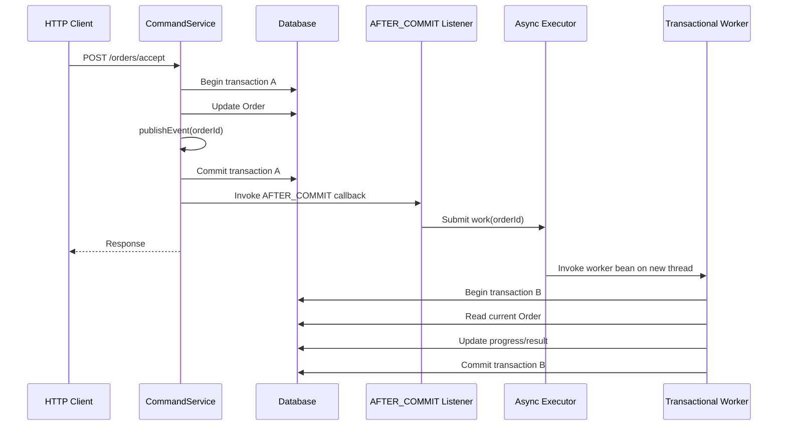

# Tác vụ nền hoặc bất đồng bộ cần context và giao dịch riêng

## 1. Bài toán: request kết thúc nhưng công việc với database vẫn tiếp tục

Trong ứng dụng Spring dùng Hibernate ORM, không phải mọi nghiệp vụ đều chạy xong trước khi HTTP response được trả về. Các tác vụ phổ biến gồm:

- Xử lý file import hàng chục nghìn dòng.
- Tạo báo cáo hoặc xuất dữ liệu.
- Gửi thông báo sau khi đơn hàng được xác nhận.
- Đồng bộ dữ liệu với một hệ thống khác.
- Xử lý hàng đợi hoặc sự kiện.
- Chạy tác vụ định kỳ để đóng đơn hết hạn, dọn dữ liệu và tính toán số liệu.
- Tính toán sau khi một giao dịch chính đã commit.

Một cách làm dễ mắc lỗi là lấy entity hoặc `EntityManager` từ HTTP request rồi chuyển sang luồng nền:

```java
@Transactional
public void createOrder(CreateOrderRequest request) {
    PurchaseOrder order = orderRepository.save(toEntity(request));

    // Sai ý tưởng nếu task dùng entity hoặc session của request.
    CompletableFuture.runAsync(() -> {
        order.getLines().size();
        order.setStatus(OrderStatus.PROCESSED);
    });
}
```

Đoạn code có ít nhất bốn vấn đề:

1. `CompletableFuture.runAsync` mặc định có thể chạy trên executor khác, **không mang theo transaction của request**.
2. `order` có thể chứa lazy associations hoặc Hibernate proxies gắn với Persistence Context của luồng ban đầu.
3. `order.setStatus(...)` trong luồng nền không được dirty-check bởi transaction request đã kết thúc.
4. Tác vụ có thể chạy **trước khi transaction tạo Order commit**, nên không tìm thấy hàng hoặc đọc state chưa như kỳ vọng.

Đây là lỗi **ranh giới context và transaction**, không chỉ là vấn đề đồng bộ Java thread.

Bài học giải thích vì sao mỗi tác vụ nền cần tự xác định Persistence Context, transaction, security/tenant context và lifecycle của chính nó; sau đó đưa ra những mẫu triển khai với `@Async`, `@Scheduled`, Spring events, `TransactionTemplate` và transactional outbox.

## 2. “Context” trong câu chuyện này gồm những gì?

Từ “context” có nhiều nghĩa. Không nên gộp tất cả thành một đối tượng có thể copy qua thread:

| Loại context | Chứa điều gì? | Có tự chạy theo thread `@Async` không? |
|---|---|---|
| Hibernate Persistence Context | Managed entities, identity map, snapshots, dirty checking | **Không** |
| Database transaction | Connection/transaction resources, commit/rollback boundary | **Không**, với mô hình transaction thread-bound thông thường |
| Spring transaction synchronization | Resources và transaction synchronizations gắn thread | **Không** |
| HTTP request context | Request attributes, request-scoped beans | Không nên giả định |
| Security context | Principal, authentication, authorities | Không mặc định bảo đảm; có cơ chế propagation riêng |
| Tenant context | Tenant ID, schema routing, Hibernate filters | Phụ thuộc kiến trúc; phải thiết lập rõ |
| Logging/tracing context | MDC, trace ID, correlation ID | Cần propagation phù hợp |
| Application job context | Job ID, retry count, checkpoint, business parameters | Nên truyền tường minh/persist |

Một tác vụ nền có thể cần **một số thông tin từ request**, chẳng hạn `orderId`, `tenantId`, `initiatedByUserId`, `traceId`. Nhưng nó không nên kế thừa nguyên transaction, Session, JDBC Connection hay live entity graph của request.

### Nguyên tắc chính

**Truyền dữ liệu/định danh cần thiết; tạo hoặc lấy tài nguyên riêng tại luồng xử lý.**

```text
HTTP request thread                          Worker thread
-------------------                          -------------
Validate request
Start transaction A
Persist Order
Commit transaction A
        |
        +--- orderId / tenantId / jobId ---> Start transaction B
                                            Load Order by ID
                                            Check current state
                                            Update entity
                                            Commit transaction B
```

Transaction A và B có thể liên quan về nghiệp vụ nhưng **không phải cùng một transaction**.

## 3. Persistence Context của Hibernate gắn với một unit of work

Trong một transaction JPA thông thường:

```java
@Transactional
public void updateOrder(long orderId) {
    PurchaseOrder order = entityManager.find(
        PurchaseOrder.class, orderId
    );

    order.setStatus(OrderStatus.PROCESSED);
    // Hibernate dirty checking tại flush/commit.
}
```

`order` là managed instance trong Persistence Context của transaction/service operation đó. Hibernate có identity map, theo dõi thay đổi và có thể sinh SQL UPDATE khi flush.

Sau khi transaction/context kết thúc, instance có thể trở thành detached; một lazy collection chưa được nạp có thể không còn Session phù hợp để initialize.

### Session và EntityManager không phải tài nguyên thread-safe

Không chia sẻ một instance `org.hibernate.Session` hoặc một **EntityManager thực** giữa các thread cùng lúc. Chúng là tài nguyên có state và không được thiết kế để nhiều thread tùy ý thao tác đồng thời.

```java
// Không làm như sau:
Session session = sessionFactory.openSession();

executor.submit(() -> session.find(Order.class, 1L));
executor.submit(() -> session.find(Order.class, 2L));
```

Cả hai task đang sử dụng cùng Session; có thể gây lỗi đồng thời, rối transaction/flush hoặc state không nhất quán.

### Vậy @PersistenceContext dùng ở singleton service có sao không?

Trong Spring, field được tiêm qua `@PersistenceContext` thường là **shared proxy** phân giải `EntityManager` thích hợp với thread/transaction hiện tại:

```java
@Service
public class OrderService {
    @PersistenceContext
    private EntityManager entityManager;
}
```

Tiêm proxy này vào Spring bean singleton là pattern bình thường. Điểm không an toàn là **lấy EntityManager thực, Session thực hoặc managed entities của một unit of work rồi chuyển qua thread khác**.

## 4. Transaction trong Spring thường được gắn với thread

Với Spring imperative transaction management, `JpaTransactionManager` hoặc transaction manager tương ứng gắn resources và trạng thái transaction với thread thực thi thông qua cơ chế transaction synchronization.

```java
@Transactional
public void handleRequest() {
    // Transaction A trên request thread.

    executor.execute(() -> {
        // Thread khác KHÔNG tự nằm trong transaction A.
    });
}
```

`@Transactional` trên caller **không tự mở rộng transaction sang một luồng khác**.

Nếu task muốn dùng JPA, nó cần một transaction/EntityManager riêng khi bắt đầu thao tác database.

### Có ngoại lệ không?

Ứng dụng reactive có một mô hình transaction khác dựa trên Reactor Context, không tương đương Java ThreadLocal. Bài này tập trung **Spring MVC/imperative Spring Data JPA/Hibernate ORM**; không lấy quy tắc thread-bound để giải thích đầy đủ mọi reactive transaction.

Trong Spring JPA thông thường, hãy thiết kế theo nguyên tắc:

> Mỗi worker invocation thực hiện DB work trong transaction do chính worker/service của nó mở, không dùng transaction request đã rời khỏi thread.

## 5. Ba thời điểm cần hiểu khi tạo asynchronous task

```text
T0 — Request bắt đầu transaction.
T1 — Request persist Order và submit async task.
T2 — Worker bắt đầu chạy.
T3 — Request commit.
```

Không có bảo đảm `T3 < T2` nếu task được submit trước commit. Một scheduler nhanh có thể chạy ngay ở T2, trong khi Order mới:

- Chưa được flush.
- Đã flush nhưng chưa commit.
- Chưa visible dưới isolation của transaction khác.
- Sau đó bị rollback.

Ví dụ dễ gây race:

```java
@Transactional
public void createOrder(CreateOrderRequest request) {
    PurchaseOrder order = repository.save(toEntity(request));
    asyncProcessor.processAsync(order.getId()); // Có thể chạy trước commit.
}
```

Worker dùng transaction B để `findById(orderId)` có thể không thấy hàng hoặc nhìn thấy state khác kỳ vọng.

### Bảo đảm cần định nghĩa

Nếu task chỉ được chạy khi order **commit thành công**, phải dùng cơ chế after-commit phù hợp hoặc transactional outbox. Không chữa bằng `Thread.sleep(1000)`: thời gian commit và scheduler là không xác định.

## 6. @Async là bất đồng bộ, không phải @Transactional

Spring có `@Async` để chạy method trên một executor:

```java
@Service
public class NotificationDispatch {

    @Async("applicationExecutor")
    public CompletableFuture<Void> notifyOrder(long orderId) {
        // Chạy trong worker thread do executor quản lý.
        return CompletableFuture.completedFuture(null);
    }
}
```

`@Async` **không tự tạo transaction database**. Nếu worker cần đọc/ghi JPA, phải chỉ định transaction boundary hoặc gọi một service transactional.

Khi một phương thức `@Async` được gọi qua Spring proxy, caller thường trở về ngay (hoặc nhận Future), còn work chạy ở thread khác. Nhưng vì proxy/advisor lifecycle, không nên suy luận rằng mọi lời gọi Java đến method có annotation đều bất đồng bộ.

## 7. @Transactional là giao dịch, không phải background execution

`@Transactional`:

```java
@Transactional
public void updateStatus(long orderId) {
    PurchaseOrder order = repository.findById(orderId)
        .orElseThrow();
    order.setStatus(OrderStatus.PROCESSED);
}
```

trong mô hình Spring proxy tạo hoặc tham gia transaction trên **thread đang thực thi method**.

Nó không:

- Tự tạo một thread nền.
- Tự chuyển transaction qua executor.
- Bảo đảm method được gọi qua Spring proxy nếu gọi từ `this`.
- Bảo đảm mọi external side effects rollback cùng DB.

### REQUIRED và REQUIRES_NEW

Mặc định `@Transactional` dùng propagation `REQUIRED`: nếu thread hiện tại đã có transaction thích hợp thì tham gia, nếu chưa có thì mở mới.

Trong một worker thread thực sự tách khỏi request, thường **không có transaction request**, nên `REQUIRED` đã mở transaction mới.

`REQUIRES_NEW` hữu ích khi cần **chủ động tách** một transaction ngay cả khi thread hiện tại đang có transaction khác; nó không phải một “nút bật async”. Sử dụng lạm dụng có thể tăng nhu cầu connection, đặc biệt khi outer transaction bị suspend và inner transaction cần connection khác.

## 8. Lỗi self-invocation: annotation không được áp qua this

Ví dụ:

```java
@Service
public class OrderService {

    public void start(long id) {
        this.processAsync(id);
    }

    @Async("applicationExecutor")
    @Transactional
    public void processAsync(long id) {
        // Không chắc chạy qua proxy vì gọi trực tiếp từ this.
    }
}
```

Với Spring AOP **proxy mode mặc định**, lời gọi `this.processAsync(...)` là lời gọi nội bộ trong cùng object, không đi qua proxy. Do đó advice của `@Async` và `@Transactional` có thể không được áp dụng như tác giả mong đợi.

Không khắc phục bằng cách thay `this` thành một reference trỏ lại bean theo cách tùy tiện. Thiết kế rõ hơn là **tách bean điều phối và bean thực thi**.

### Một cấu trúc an toàn hơn

```text
OrderController
      |
      v
OrderCommandService
      |
      v
OrderAsyncFacade (@Async, Spring proxy)
      |
      v
OrderWorkerService (@Transactional, Spring proxy)
      |
      v
OrderRepository / EntityManager
```

Lời gọi giữa các bean Spring đi qua proxy, giúp tách rõ executor boundary và transaction boundary.

## 9. Mẫu thiết kế: @Async facade + @Transactional worker

Đầu tiên định nghĩa transactional worker:

```java
@Service
public class OrderWorkerService {

    private final OrderRepository orderRepository;

    public OrderWorkerService(OrderRepository orderRepository) {
        this.orderRepository = orderRepository;
    }

    @Transactional
    public void processOne(long orderId) {
        PurchaseOrder order = orderRepository.findById(orderId)
            .orElseThrow(() -> new IllegalStateException(
                "Order not found: " + orderId
            ));

        if (order.getStatus() == OrderStatus.PROCESSED) {
            return; // Idempotent no-op cho trạng thái đã xử lý.
        }

        if (order.getStatus() != OrderStatus.ACCEPTED) {
            throw new IllegalStateException(
                "Order not ready for processing"
            );
        }

        order.setStatus(OrderStatus.PROCESSED);
        // Hibernate dirty checking khi transaction flush/commit.
    }
}
```

Async facade:

```java
@Service
public class OrderAsyncFacade {

    private final OrderWorkerService worker;

    public OrderAsyncFacade(OrderWorkerService worker) {
        this.worker = worker;
    }

    @Async("applicationExecutor")
    public CompletableFuture<Void> processAsync(long orderId) {
        worker.processOne(orderId);
        return CompletableFuture.completedFuture(null);
    }
}
```

Giả định `OrderRepository` là Spring Data JPA repository và `OrderStatus`/`PurchaseOrder` được mapping hợp lệ.

### Transaction thật sự ở đâu?

- `processAsync` chạy trên executor thread.
- Nó gọi `worker.processOne(...)` qua bean Spring khác.
- Transaction advice mở transaction trên **executor thread**.
- `findById` nạp PurchaseOrder **mới trong Persistence Context của worker**.
- Khi `processOne` kết thúc thành công, transaction manager flush/commit.
- Nếu exception phù hợp rollback rules, transaction B rollback.

Điểm dễ hiểu nhất là tách rõ **“chạy ở thread nào”** và **“DB transaction bắt đầu/kết thúc ở method nào”**.

## 10. Cấu hình bounded ThreadPoolTaskExecutor

Không dùng common pool vô hạn/không kiểm soát cho tác vụ database có thể tiêu tốn connection.

```java
@Configuration
@EnableAsync
public class AsyncConfiguration {

    @Bean("applicationExecutor")
    public ThreadPoolTaskExecutor applicationExecutor() {
        ThreadPoolTaskExecutor executor =
            new ThreadPoolTaskExecutor();

        executor.setCorePoolSize(4);
        executor.setMaxPoolSize(8);
        executor.setQueueCapacity(200);
        executor.setThreadNamePrefix("order-worker-");
        executor.setRejectedExecutionHandler(
            new ThreadPoolExecutor.AbortPolicy()
        );

        executor.setWaitForTasksToCompleteOnShutdown(true);
        executor.setAwaitTerminationSeconds(20);
        executor.initialize();
        return executor;
    }
}
```

Imports cần có:

```java
import org.springframework.context.annotation.Bean;
import org.springframework.context.annotation.Configuration;
import org.springframework.scheduling.annotation.EnableAsync;
import org.springframework.scheduling.concurrent.ThreadPoolTaskExecutor;
import java.util.concurrent.ThreadPoolExecutor;
```

### Vì sao phải giới hạn?

Database có một connection pool hữu hạn. Nếu executor chạy hàng trăm task cùng lúc và mỗi task mở transaction giữ connection, chúng có thể làm pool cạn, latency tăng và request thông thường bị ảnh hưởng.

Mối quan hệ cần đánh giá:

```text
Thread pool concurrency
  -> số transaction đồng thời
  -> số DB connections cần
  -> locks + DB CPU + I/O
```

`maxPoolSize = 8` chỉ là ví dụ, **không phải giá trị phù hợp mọi hệ thống**. Phải xem connection pool, DB capacity, workload duration và requests foreground.

### Queue không phải nơi lưu công việc bền vững

Queue của executor nằm trong process memory. Khi process crash/restart, task chưa được persist có thể mất. Nếu công việc phải được thực hiện **ít nhất một lần** sau commit, cần durable queue/job table/outbox, không chỉ queue của ThreadPoolTaskExecutor.

## 11. Truyền ID hoặc DTO, không truyền managed entity

Thay vì:

```java
asyncFacade.processAsync(order); // Dễ mang theo proxy/lazy state.
```

nên:

```java
asyncFacade.processAsync(order.getId());
```

Hoặc truyền một immutable command DTO chỉ chứa những thông tin cần thiết:

```java
public record ProcessOrderCommand(
    long orderId,
    String tenantId,
    String initiatedBy,
    String requestId
) {}
```

Ưu điểm:

- Không chia sẻ managed entity/proxy giữa các threads.
- Không dựa vào Persistence Context của request.
- Có thể persist/serialize thành job payload nếu cần durable processing.
- Worker nạp state **hiện tại** từ DB và kiểm tra lại điều kiện nghiệp vụ.

### ID không tự tạo bảo đảm “cùng dữ liệu”

Giữa lúc submit và xử lý, Order có thể bị xóa, hủy hoặc đổi trạng thái. Worker phải xử lý:

```java
PurchaseOrder order = repository.findById(command.orderId())
    .orElseThrow(...);

if (order.getStatus() != OrderStatus.ACCEPTED) {
    // Phân biệt already processed, cancelled, missing và conflict.
}
```

Không mặc định entity vẫn giống state ở lúc request.

## 12. LazyInitializationException khi đi qua thread boundary

Entity:

```java
@Entity
public class PurchaseOrder {
    @OneToMany(mappedBy = "order", fetch = FetchType.LAZY)
    private List<OrderLine> lines;
}
```

Request:

```java
PurchaseOrder order = repository.findById(id).orElseThrow();
asyncFacade.handle(order);
```

Trong background thread:

```java
int count = order.getLines().size();
```

Nếu `lines` chưa initialized và Session phù hợp đã đóng, Hibernate có thể ném `LazyInitializationException`.

Nếu Session gốc còn mở, cũng **không được** sử dụng cùng entity/proxy giữa threads một cách đồng thời vì tài nguyên persistence không thread-safe.

### Cách sửa

```java
@Transactional(readOnly = true)
public OrderReportData loadForReport(long orderId) {
    // Query DTO/projection hoặc fetch phù hợp trong transaction của worker.
}
```

Worker nhận ID, nạp dữ liệu trong context của chính mình, tạo DTO, và hoàn tất toàn bộ việc cần dữ liệu lazy **trước khi transaction kết thúc**.

`@Transactional(readOnly = true)` là read-only hint/optimization chứ không phải cơ chế authorization hay khóa vật lý ngăn mọi write trong mọi DB.

## 13. Open EntityManager in View không giải quyết background context

Trong một số cấu hình Spring MVC, cơ chế Open EntityManager in View (OSIV) cho phép EntityManager tồn tại trong vòng đời HTTP request để hỗ trợ lazy loading khi render.

OSIV:

- Liên quan HTTP request thread/lifecycle.
- Không mặc định truyền Persistence Context qua executor.
- Không phải cơ chế transaction commit cho background write.
- Có thể khiến việc truy cập lazy association ngoài service transaction khó quan sát hơn.

**Không bật OSIV để chữa LazyInitializationException trong task nền.** Hãy xác định query/fetch plan rõ trong worker transaction.

## 14. @Scheduled cũng cần transaction riêng

Một method được scheduler gọi thường không chạy trong transaction HTTP request nào cả:

```java
@Component
public class ExpiredOrderScheduler {

    private final ExpiredOrderService service;

    public ExpiredOrderScheduler(ExpiredOrderService service) {
        this.service = service;
    }

    @Scheduled(fixedDelay = 60_000)
    public void run() {
        service.expireOldOrders();
    }
}
```

Service:

```java
@Service
public class ExpiredOrderService {

    private final OrderRepository repository;

    public ExpiredOrderService(OrderRepository repository) {
        this.repository = repository;
    }

    @Transactional
    public void expireOldOrders() {
        Instant cutoff = Instant.now().minus(30, ChronoUnit.DAYS);

        List<PurchaseOrder> candidates =
            repository.findExpirableBefore(cutoff);

        for (PurchaseOrder order : candidates) {
            if (order.getStatus() == OrderStatus.NEW) {
                order.setStatus(OrderStatus.EXPIRED);
            }
        }
    }
}
```

`@EnableScheduling` cần được bật ở cấu hình phù hợp. Ví dụ trên minh họa ranh giới transaction, **không phải một kế hoạch tối ưu cho hàng triệu rows**; trên bảng lớn phải chia chunk, dùng bulk UPDATE hoặc job claiming.

### Vì sao tách scheduler và service?

Scheduler điều phối thời điểm chạy. Transactional service sở hữu business operation và Persistence Context. Dễ kiểm thử, cấu hình retry và bảo đảm proxy invocation hơn khi trộn mọi thứ trong một method.

## 15. Khi nhiều instance cùng chạy @Scheduled

Giả sử ứng dụng có ba replicas:

```text
App A -- @Scheduled mỗi phút
App B -- @Scheduled mỗi phút
App C -- @Scheduled mỗi phút
```

Mỗi replica có thể chạy cùng task, dẫn đến:

- Xử lý lại cùng Order.
- Gửi trùng thông báo.
- Cạnh tranh lock.
- Cập nhật dữ liệu theo thứ tự không mong muốn.

`@Scheduled` không tự tạo **cluster-wide singleton job**.

Phương án:

- Distributed lock/leader election.
- DB row claiming với status/lease, unique constraints.
- Queue có consumer coordination.
- Idempotent worker để xử lý ít nhất một lần.

Ví dụ điều kiện cập nhật nguyên tử:

```sql
UPDATE jobs
SET status = 'CLAIMED'
WHERE id = :id
  AND status = 'READY';
```

Worker chỉ được tiếp tục nếu số rows affected bằng 1. Trên workload lớn, có thể dùng query claiming kết hợp locking/`SKIP LOCKED` nếu database/dialect hỗ trợ; cần kiểm thử concurrency và transaction boundary.

## 16. Transaction của request phải commit trước khi worker tìm dữ liệu

Một lỗi race điển hình:

```java
@Transactional
public long registerOrder(CreateOrderRequest request) {
    PurchaseOrder order = repository.save(toOrder(request));

    asyncFacade.processAsync(order.getId());
    return order.getId();
}
```

Khi `processAsync` bắt đầu sớm, transaction mới chưa chắc nhìn thấy Order vì transaction register còn chưa commit.

Giải pháp tùy mức yêu cầu:

1. `@TransactionalEventListener(phase = AFTER_COMMIT)`: kích hoạt xử lý sau transaction commit **trong cùng application process**.
2. Transactional outbox: lưu ý định công việc cùng transaction, dispatcher xử lý sau commit và có thể retry sau restart.
3. Durable message queue với publish được phối hợp an toàn qua outbox/CDC hoặc cơ chế có bảo đảm tương đương.

Chọn theo mức chấp nhận mất tác vụ, độ trễ và hạ tầng của hệ thống.

## 17. Spring @TransactionalEventListener AFTER_COMMIT

Khi một thay đổi dữ liệu đã được commit, bạn mới muốn bắt đầu async task.

Sự kiện ứng dụng:

```java
public record OrderAcceptedEvent(
    long orderId,
    String tenantId
) {}
```

Service:

```java
@Service
public class OrderCommandService {

    private final ApplicationEventPublisher publisher;
    private final OrderRepository repository;

    public OrderCommandService(
            ApplicationEventPublisher publisher,
            OrderRepository repository) {
        this.publisher = publisher;
        this.repository = repository;
    }

    @Transactional
    public void acceptOrder(long orderId, String tenantId) {
        PurchaseOrder order = repository
            .findByIdAndTenantId(orderId, tenantId)
            .orElseThrow();

        order.accept();

        publisher.publishEvent(
            new OrderAcceptedEvent(orderId, tenantId)
        );
    }
}
```

Listener:

```java
@Component
public class OrderAcceptedListener {

    private final OrderAsyncFacade asyncFacade;

    public OrderAcceptedListener(OrderAsyncFacade asyncFacade) {
        this.asyncFacade = asyncFacade;
    }

    @TransactionalEventListener(
        phase = TransactionPhase.AFTER_COMMIT
    )
    public void afterCommit(OrderAcceptedEvent event) {
        asyncFacade.processAsync(
            event.orderId(),
            event.tenantId()
        );
    }
}
```

Với method async tương ứng:

```java
@Async("applicationExecutor")
public CompletableFuture<Void> processAsync(
        long orderId,
        String tenantId) {

    worker.processOne(orderId, tenantId);
    return CompletableFuture.completedFuture(null);
}
```

`worker.processOne(...)` cần `@Transactional` trên Spring bean riêng và tự kiểm tra tenant/authorization.

### Ý nghĩa

- Nếu transaction command rollback, listener phase AFTER_COMMIT không được gọi.
- Khi listener chạy sau commit, worker có thể mở transaction mới và truy cập dữ liệu đã commit.
- Event payload là ID + tenantId, không chứa managed entity.

### Giới hạn quan trọng

`@TransactionalEventListener` **không phải durable queue**. Nếu process chết sau DB commit nhưng trước khi listener/async work hoàn thành, event có thể mất vì không được lưu bền vững để retry.

Ngoài ra, listener mặc định chỉ được kích hoạt khi có transaction thích hợp; nếu publish event ngoài transaction, `fallbackExecution` mặc định không buộc nó chạy. Phải kiểm thử contract theo version Spring thực tế.

## 18. AFTER_COMMIT có thể còn thấy resources nhưng transaction cũ đã hoàn tất

Một điểm dễ bỏ qua trong Spring:

`@TransactionalEventListener(phase = AFTER_COMMIT)` chạy ở giai đoạn **sau khi transaction đã commit**, nhưng một số transaction resources/synchronizations có thể vẫn còn bound trong thời điểm callback.

Không nên làm như sau rồi giả định dữ liệu mới sẽ được commit theo transaction cũ:

```java
@TransactionalEventListener(
    phase = TransactionPhase.AFTER_COMMIT
)
public void afterCommit(OrderAcceptedEvent event) {
    // Tránh ghi database ở đây mà dựa vào transaction đã commit.
    auditRepository.save(new AuditRecord(event.orderId()));
}
```

Trong các callback after-completion/after-commit, các data access có thể tương tác resources còn tồn tại nhưng không có commit tiếp theo cho transaction đã hoàn tất.

Nếu bắt buộc ghi DB đồng bộ tại callback, hãy gọi **service transactional khác với `REQUIRES_NEW`**, qua Spring proxy:

```java
@Service
public class AuditWriter {

    @Transactional(propagation = Propagation.REQUIRES_NEW)
    public void writeAudit(long orderId) {
        // Transaction mới, có commit riêng.
    }
}
```

Trong mẫu ở phần trước, listener chỉ submit đến `@Async` facade; worker thread không kế thừa transaction cũ và tự mở transaction, nên ranh giới dễ hiểu hơn.

**Nếu không được phép mất audit/task**, dùng outbox trong transaction gốc thay vì cố ghi audit sau commit.

## 19. Durable processing bằng transactional outbox

Giả sử yêu cầu:

> Một Order được ACCEPTED thì cuối cùng phải được xử lý; hệ thống restart không được làm mất ý định xử lý.

Chỉ gọi `@Async` hoặc gửi Spring event sau commit không đủ cho độ bền này.

Transactional outbox:

```text
Transaction A:
  UPDATE orders SET status='ACCEPTED'
  INSERT INTO outbox_events(type, aggregate_id, payload, status)
  COMMIT
            |
            v
Dispatcher đọc outbox đã commit
            |
            v
Queue hoặc worker
            |
            v
Transaction B: load order + process + mark result
```

Nếu transaction A rollback, Order và outbox row cùng rollback. Nếu process crash sau commit, outbox row vẫn tồn tại cho dispatcher retry.

Schema minh họa:

```sql
CREATE TABLE outbox_events (
    id BIGINT PRIMARY KEY,
    aggregate_type VARCHAR(80) NOT NULL,
    aggregate_id BIGINT NOT NULL,
    event_type VARCHAR(100) NOT NULL,
    payload_json TEXT NOT NULL,
    status VARCHAR(20) NOT NULL,
    created_at TIMESTAMP NOT NULL,
    attempts INTEGER NOT NULL DEFAULT 0
);
```

Trong một transaction:

```java
@Transactional
public void acceptOrder(long orderId) {
    PurchaseOrder order = orderRepository.findById(orderId)
        .orElseThrow();

    order.accept();

    OutboxEvent event = OutboxEvent.orderAccepted(order.getId());
    outboxRepository.save(event);
}
```

Dispatcher và worker có transaction riêng. Để nhiều workers không claim cùng event, cần protocol trạng thái/lock/lease có cơ chế atomic. Sau khi external message được gửi, phải cập nhật trạng thái outbox theo policy có retry.

### At-least-once và idempotency

Outbox thường giúp đạt **at-least-once processing/delivery**, không mặc định exactly-once side effects. Crash giữa gửi message và đánh dấu DELIVERED có thể dẫn đến gửi lại. Consumer cần deduplicate/idempotency theo `eventId` hoặc business key.

## 20. Sau khi submit Future, exception không tự đi về caller

Một method:

```java
@Async("applicationExecutor")
public void sendNotification(long orderId) {
    externalClient.send(orderId);
}
```

có thể ném exception trong background thread. HTTP caller đã nhận response nên không tự catch được lỗi đó.

Nếu `@Async` method trả `void`, cần log và `AsyncUncaughtExceptionHandler` hoặc cơ chế reporting phù hợp để tránh lỗi bị bỏ qua.

Với `CompletableFuture`:

```java
CompletableFuture<Void> result =
    asyncFacade.processAsync(orderId);

result.whenComplete((ignored, failure) -> {
    if (failure != null) {
        logger.warn("Async order processing failed", failure);
    }
});
```

Nhưng callback này chỉ quan sát lỗi **khi process còn chạy**. Nó không thay thế persistent job state, retry policy và durable queue.

### Đừng block request vô tình

Nếu gọi:

```java
asyncFacade.processAsync(orderId).join();
```

request chờ task hoàn thành. Điều này có thể hợp với một fan-out có deadline, nhưng không còn mang lợi ích trả response sớm. Với job dài, trả `202 Accepted` + `jobId` và cung cấp endpoint xem trạng thái thường phù hợp hơn.

## 21. @Async trên method trả Future cũng cần proxy

Các lỗi thường gặp:

```java
@Service
public class BrokenService {

    public void start() {
        processAsync(); // Self-invocation.
    }

    @Async
    public CompletableFuture<Void> processAsync() {
        return CompletableFuture.completedFuture(null);
    }
}
```

`@Async` không có tác dụng qua self-invocation của proxy mode. Tương tự:

```java
new OrderAsyncFacade(...).processAsync(id);
```

Bean tự `new` không phải Spring-managed proxy.

Nên:

- Đặt method `@Async` trên bean riêng.
- Inject bean đó từ Spring.
- Bật `@EnableAsync`.
- Dùng executor tên rõ ràng.
- Chạy integration test xác nhận tên thread/transaction boundary.

## 22. Spring @Transactional chỉ có tác dụng khi advice được áp

Tương tự `@Async`, proxy mode của `@Transactional` có những giới hạn:

- `this.transactionalMethod()` bỏ qua proxy.
- Gọi từ constructor hoặc method internal có thể không đi qua advice.
- Class được tạo bằng `new` không phải Spring bean proxy.
- Kỹ thuật proxying, method visibility/final class và phiên bản Spring có thể ảnh hưởng interception.

Ví dụ:

```java
@Service
public class ImportService {

    public void importAll(List<Long> ids) {
        for (Long id : ids) {
            this.processOne(id); // Không tạo transaction riêng mỗi id.
        }
    }

    @Transactional
    public void processOne(Long id) {
        // Có thể chạy không theo boundary mà tác giả kỳ vọng.
    }
}
```

Giải pháp:

```java
@Service
public class ImportCoordinator {
    private final ImportItemService itemService;

    public void importAll(List<Long> ids) {
        for (Long id : ids) {
            itemService.processOne(id);
        }
    }
}

@Service
public class ImportItemService {
    @Transactional
    public void processOne(Long id) {
        // Một transaction riêng nếu thread hiện tại không có transaction,
        // hoặc theo propagation được chọn.
    }
}
```

**Không giả định mỗi iteration có một transaction mới nếu coordinator đã có transaction bao ngoài với propagation REQUIRED.** Xác định ranh giới theo yêu cầu và transaction propagation thực tế.

## 23. TransactionTemplate: mở transaction tường minh trong Runnable

Với worker không muốn dựa vào AOP proxy, có thể sử dụng `TransactionTemplate`:

```java
@Component
public class OrderTaskRunner {

    private final TransactionTemplate transactionTemplate;
    private final OrderRepository repository;

    public OrderTaskRunner(
            PlatformTransactionManager txManager,
            OrderRepository repository) {

        this.transactionTemplate =
            new TransactionTemplate(txManager);
        this.repository = repository;
    }

    public void process(long orderId) {
        transactionTemplate.executeWithoutResult(status -> {
            PurchaseOrder order = repository.findById(orderId)
                .orElseThrow();

            if (order.getStatus() == OrderStatus.ACCEPTED) {
                order.setStatus(OrderStatus.PROCESSED);
            }
        });
    }
}
```

`TransactionTemplate` mở/commit/rollback trên **thread đang thực thi callback**. Nếu `process` được gọi từ worker thread, transaction thuộc worker thread.

### Khi nào dùng?

- Cần transaction boundary rõ ngay trong job/chunk callback.
- Worker logic được gọi từ nhiều nơi không thuận lợi với proxy.
- Cần thay đổi propagation/isolation/timeout theo một template được cấu hình riêng.

Nhược điểm là code mang transaction concern trực tiếp, trong khi `@Transactional` thường ngắn gọn hơn. Hai cách đều hợp lệ; chọn theo kiến trúc.

### Không chia sẻ mutable config tùy ý giữa threads

Nếu cần các TransactionTemplate khác nhau, cấu hình thành bean riêng cho từng policy. Không mutate thời gian timeout/propagation trên cùng một template instance đang được nhiều worker dùng đồng thời.

## 24. Spring transaction propagation trong background job

| Propagation | Ý nghĩa trong thread hiện tại | Lưu ý |
|---|---|---|
| `REQUIRED` | Tham gia transaction hiện có hoặc mở mới | Phổ biến cho worker service |
| `REQUIRES_NEW` | Suspend transaction hiện có và mở transaction độc lập | Có thể tiêu tốn connection bổ sung |
| `MANDATORY` | Bắt buộc có transaction hiện tại | Worker thread mới có thể thất bại nếu chưa mở |
| `SUPPORTS` | Tham gia nếu có; nếu không thì chạy không transaction | Không phù hợp nếu bắt buộc atomic write |
| `NOT_SUPPORTED` | Chạy không transaction, suspend transaction hiện có | Không dành cho multi-step DB mutation cần nguyên tử |
| `NEVER` | Báo lỗi nếu có transaction hiện tại | Hữu ích trong trường hợp đặc biệt |
| `NESTED` | Sử dụng savepoint trong transaction ngoài nếu transaction manager hỗ trợ | Không mặc định được hỗ trợ như nhau với JPA |

Trong một `@Async` thread, transaction gốc từ request không hiện diện; vì vậy `REQUIRES_NEW` không cần chỉ để “tách khỏi request”. Dùng `REQUIRED` thường đã đủ.

### Điều cần nhớ về REQUIRES_NEW

Nếu cùng một thread đang giữ outer transaction với connection, inner `REQUIRES_NEW` thường cần connection khác hoặc tài nguyên transaction mới. Nhiều threads đồng thời giữ outer rồi chờ inner có thể gây connection pool exhaustion/deadlock. Chọn pool size và transaction design phù hợp.

## 25. Nên commit mỗi item, mỗi chunk hay cả job?

Một import có 100.000 rows có thể:

- Commit từng item: dễ cô lập lỗi, nhưng overhead transaction lớn.
- Commit từng chunk 100–1000 items: thường cân bằng throughput/retry.
- Commit cả job: mạnh về all-or-nothing, nhưng transaction dài, locks/WAL lớn.

Không có một kích thước tối ưu cho mọi database.

Ví dụ:

```java
@Service
public class ImportChunkService {

    @Transactional
    public void persistChunk(List<ImportRow> rows) {
        for (ImportRow row : rows) {
            entityManager.persist(mapToEntity(row));
        }

        entityManager.flush();
        entityManager.clear();
    }
}
```

Coordinator không có transaction bao ngoài:

```java
for (List<ImportRow> chunk : chunks) {
    importChunkService.persistChunk(chunk); // Gọi qua bean khác.
    checkpointRepository.recordCommittedChunk(...);
}
```

Ví dụ chỉ diễn tả ranh giới; `recordCommittedChunk` nếu ghi ở một transaction khác có crash window sau commit. Với yêu cầu checkpoint bền vững/atomic, lưu checkpoint **trong cùng transaction chunk** hoặc dùng idempotency để bảo vệ retry.

### Stateful batch

Hibernate stateful Session có Persistence Context; với job lớn cần `flush/clear` định kỳ, cấu hình JDBC batching và tránh giữ tất cả entity trong một graph.

`StatelessSession` có thể phù hợp với một số workload nhưng có semantics khác về callback/cascade/cache/batching theo version. Không chuyển sang stateless chỉ vì muốn có transaction nền.

## 26. Job status và API cho công việc dài

Với job mất vài phút, trả kết quả xử lý ngay trong HTTP response thường không hợp lý.

Thiết kế:

```text
POST /imports
  -> 202 Accepted
  -> jobId

GET /imports/{jobId}
  -> status / progress / failed rows
```

Model:

```java
public enum JobStatus {
    QUEUED,
    RUNNING,
    SUCCEEDED,
    FAILED,
    CANCELLED
}

public record ImportJobView(
    long jobId,
    JobStatus status,
    long totalRows,
    long processedRows,
    String errorCode
) {}
```

Transaction boundaries tách biệt:

1. Tạo job record/intent và commit.
2. Worker claim job bằng transaction ngắn.
3. Process từng chunk bằng transaction riêng.
4. Cập nhật progress/checkpoint.
5. Đánh dấu SUCCEEDED khi tất cả bước cần thiết đã durable.

Không lấy `CompletableFuture.isDone()` làm trạng thái nghiệp vụ duy nhất: Future mất khi JVM restart và hoàn tất Future không nhất thiết đồng nghĩa external effects đã thành công.

## 27. Trạng thái job và claim phải nguyên tử

Một bảng job:

```sql
CREATE TABLE jobs (
    id BIGINT PRIMARY KEY,
    status VARCHAR(20) NOT NULL,
    attempt INTEGER NOT NULL DEFAULT 0,
    lease_until TIMESTAMP NULL,
    updated_at TIMESTAMP NOT NULL
);
```

Hai worker có thể cùng đọc `status='QUEUED'` rồi cùng chạy nếu chỉ làm:

```text
SELECT job WHERE status='QUEUED'
if found:
  UPDATE job status='RUNNING'
```

với hai thao tác không bảo vệ concurrency.

Một cách claim:

```sql
UPDATE jobs
SET status = 'RUNNING',
    attempt = attempt + 1
WHERE id = :jobId
  AND status = 'QUEUED';
```

Chỉ worker có `rowsAffected = 1` được xử lý. Với distributed queue thực tế cần thêm lease/heartbeat, recovery, lock semantics và thời gian hết hạn nếu worker chết.

Đây là ví dụ về **business-level concurrency**, không được giải quyết chỉ bằng `@Transactional` hoặc `@Async`.

## 28. Retry: phải tạo transaction mới cho mỗi lần thử

Tác vụ nền có thể gặp:

- Deadlock.
- Lock timeout.
- Connection timeout.
- Network failure đến service ngoài.
- Optimistic locking conflict.
- Invalid data hoặc unique constraint violation.

Không phải lỗi nào cũng nên retry. Phải phân loại transient vs permanent.

Mẫu:

```text
attempt 1:
  begin tx
  process job
  DB deadlock
  rollback tx

backoff

attempt 2:
  begin NEW tx
  re-read current state
  process job
  commit tx
```

**Không retry statement cuối trong một Session/transaction đã lỗi** rồi mong toàn bộ state vẫn an toàn. Sau persistence exception, transaction có thể đã rollback-only hoặc DB transaction bị aborted.

### Idempotency là điều kiện của retry

Nếu attempt 1 đã gọi external API thành công nhưng crash trước khi đánh dấu complete, attempt 2 có thể gọi lại.

Giải pháp:

- Idempotency key gửi tới downstream.
- Unique constraint cho business operation.
- Outbox/inbox dedup.
- Kiểm tra state machine trước khi xử lý.
- Thiết kế external API có retry semantics rõ.

Không khẳng định “exactly once” chỉ vì dùng transaction DB hoặc queue.

## 29. Transaction database không bao trùm email/HTTP API

Ví dụ:

```java
@Transactional
public void completeOrder(long orderId) {
    PurchaseOrder order = repository.findById(orderId)
        .orElseThrow();

    order.complete();
    emailClient.sendConfirmation(orderId);
}
```

Nếu database transaction rollback sau email, email đã gửi không tự được thu hồi.

Ngược lại, nếu email gửi thất bại sau khi một bước khác đã commit, hệ thống có thể rơi vào trạng thái không đồng bộ.

Các side effects ngoài DB thường cần:

- Outbox event trong cùng DB transaction.
- Retry/dedup.
- Saga/compensation với nghiệp vụ nhiều bước.
- Quan sát trạng thái và cơ chế xử lý thủ công khi cần.

**Không giữ DB transaction mở khi chờ HTTP call dài** nếu không thật sự cần, vì connection/locks có thể bị giữ trong suốt thời gian network.

## 30. SecurityContext không mặc định đi qua executor

Trong web request, Spring Security có thể giữ Authentication trong context gắn thread.

Task nền chạy trên thread khác không nên mặc định đọc:

```java
SecurityContextHolder.getContext().getAuthentication();
```

rồi giả định đây là người dùng đã gửi request.

### Nếu worker cần biết ai khởi tạo

Truyền ID/actor metadata rõ:

```java
public record ExportCommand(
    long jobId,
    String requestedByUserId,
    String tenantId
) {}
```

Sau đó:

- Xác nhận người khởi tạo có quyền tạo job tại transaction ban đầu.
- Khi thực thi, áp dụng chính sách authorization của background service.
- Định nghĩa quyền được kiểm tra theo **thời điểm enqueue** hay **thời điểm execute**; hai cách có thể khác khi người dùng mất quyền giữa chừng.
- Không lưu password, access token hoặc cả HTTP Session vào payload.

### Khi bắt buộc propagate SecurityContext

Spring Security có các wrapper executor, ví dụ `DelegatingSecurityContextAsyncTaskExecutor`, để truyền security context có kiểm soát. Đây là lựa chọn có chủ đích, không phải mặc định cho mọi worker.

Một job chạy lại sau nhiều giờ nên có principal/service identity và authorization policy riêng, thay vì phụ thuộc request-scoped Authentication đã hết hạn.

## 31. Tenant context và data isolation

Trong hệ thống multi-tenant, background job dễ bị lỗi nếu tenant được giữ trong `ThreadLocal` của HTTP request:

```java
TenantContext.setCurrentTenant("tenant-A");
// HTTP request kết thúc và context được clear.
```

Worker thread không tự nhận tenant-A. Tệ hơn, thread pool tái sử dụng thread; nếu tenant context không được clear, request tiếp theo có thể dùng nhầm tenant cũ.

### Mẫu truyền tenant rõ

```java
public record TenantJobCommand(
    long jobId,
    String tenantId
) {}
```

Trong worker:

```java
public void execute(TenantJobCommand command) {
    String tenantId = command.tenantId();

    // Xác nhận tenant từ job record đáng tin cậy.
    // Dùng repository/multitenancy routing phù hợp.
    workerService.processJob(command.jobId(), tenantId);
}
```

Với schema/database-per-tenant routing, connection phải được lấy **sau khi tenant context/routing đã được thiết lập**, và context phải được clear trong `finally`:

```java
try {
    TenantContext.setTenantId(tenantId);
    transactionalWorker.processJob(jobId);
} finally {
    TenantContext.clear();
}
```

Mẫu này chỉ phù hợp nếu resolver/transaction manager của dự án đọc context theo cách tương ứng. Nếu Hibernate multi-tenancy đã dùng `CurrentTenantIdentifierResolver` hoặc tenant-specific session, hãy thiết kế theo API đó; không tự đặt ThreadLocal rồi giả định mọi query/connection sẽ theo tenant.

### Quan trọng

Đặt tenant context trong transaction đã mở có thể là **quá muộn** nếu connection/schema đã được chọn. Nên tách tenant routing facade và transactional worker, để xác định tenant trước khi proxy transactional tạo/bind connection.

Native SQL, bulk DML và filters cũng phải được kiểm thử riêng để tránh truy cập chéo tenant.

## 32. MDC, trace ID và TaskDecorator

Logging context như MDC thường cũng gắn ThreadLocal. Khi request gọi task async, log trong worker có thể mất correlation ID.

Spring `TaskDecorator` cho phép capture và thiết lập một số context nhỏ cho task:

```java
@Bean("applicationExecutor")
public ThreadPoolTaskExecutor applicationExecutor() {
    ThreadPoolTaskExecutor executor = new ThreadPoolTaskExecutor();
    executor.setCorePoolSize(4);
    executor.setMaxPoolSize(8);
    executor.setQueueCapacity(200);
    executor.setThreadNamePrefix("worker-");

    executor.setTaskDecorator(task -> {
        Map<String, String> captured = MDC.getCopyOfContextMap();

        return () -> {
            Map<String, String> previous = MDC.getCopyOfContextMap();
            try {
                if (captured == null) {
                    MDC.clear();
                } else {
                    MDC.setContextMap(captured);
                }
                task.run();
            } finally {
                if (previous == null) {
                    MDC.clear();
                } else {
                    MDC.setContextMap(previous);
                }
            }
        };
    });

    executor.initialize();
    return executor;
}
```

Đây là minh họa của `org.slf4j.MDC` và TaskDecorator, chưa bao gồm toàn bộ imports/configuration production.

### Không copy mọi ThreadLocal

TaskDecorator có thể phù hợp cho `traceId` hoặc `correlationId`, nhưng **không được copy Hibernate Session, EntityManager, JDBC Connection hoặc Spring transaction resources** sang worker. Những tài nguyên này không được thiết kế để di chuyển tùy ý giữa threads.

Với observability hiện đại, nên dùng instrumentation/tracing framework hỗ trợ context propagation để tránh tự viết propagation sai.

## 33. TaskExecutor và connection pool phải được thiết kế cùng nhau

Giả sử:

```text
HTTP request concurrency: 40
Worker concurrency:       20
Hikari maxPoolSize:       20
```

Nếu cả request và worker đều thường giữ connection cùng lúc, worker có thể chiếm toàn bộ pool và khiến HTTP request chờ connection.

Không thể chỉ tăng worker pool size để “xử lý nhanh hơn” mà bỏ qua database capacity.

Một số biện pháp:

- Giới hạn worker concurrency.
- Tách queue/process/connection pool nếu workload đủ lớn và kiến trúc cho phép.
- Dùng batch processing và transaction ngắn.
- Dùng backpressure/rejection rõ.
- Theo dõi connection acquisition time và active/idle/pending connections.
- Không giữ transaction mở trong lúc chờ network hoặc sleep.

### Executor rejection cần một đường xử lý

Với bounded queue + `AbortPolicy`, task submission có thể bị từ chối. Nếu caller đã commit dữ liệu mà task bị reject, chỉ log và bỏ qua sẽ làm mất công việc.

Với durable job table/outbox, rejection chỉ làm chậm dispatch; job vẫn tồn tại để thử lại.

Nếu không có durable queue, phải định nghĩa hành vi khi executor quá tải: trả lỗi phù hợp trước commit, backpressure hoặc cơ chế bù đắp. Không để rejection bị nuốt mất.

## 34. Timeout và cancellation không tự rollback công việc đã commit

Một worker có thể có giới hạn thời gian. Nhưng:

- `CompletableFuture.cancel(true)` không bảo đảm SQL hoặc remote call đang chạy lập tức dừng.
- Thread interruption không luôn chặn JDBC driver theo cách mong muốn.
- Transaction timeout phụ thuộc manager/driver/database và cách query thực thi.
- Những chunk đã commit không tự rollback khi job bị cancel.

Với job có thể hủy, thiết kế:

```text
RUNNING
  -> cancel requested
  -> worker kiểm tra giữa chunks
  -> dừng nhận chunk mới
  -> commit/rollback chunk hiện tại theo policy
  -> CANCELLED
```

Các thao tác dừng/rollback phải có trạng thái persistent và được kiểm thử với crash/restart.

## 35. Transaction read-only và query lớn

Tác vụ export:

```java
@Transactional(readOnly = true)
public List<OrderReportRow> loadPage(int offset, int size) {
    return repository.findReportRows(offset, size);
}
```

Nếu export rất lớn, không nên:

```java
@Transactional(readOnly = true)
public void exportEverything() {
    List<PurchaseOrder> all = repository.findAll();
    // Tạo file rất lâu trong cùng transaction.
}
```

vì:

- Materialize toàn bộ entity tốn RAM.
- Transaction/connection kéo dài.
- Có thể giữ MVCC snapshot/locks lâu.
- Serialization/ghi file không nhất thiết cần transaction mở.

Thay vào đó:

1. Query DTO/IDs theo từng trang/chunk.
2. Mỗi chunk dùng transaction đọc ngắn khi phù hợp.
3. Chuyển DTO ra file bên ngoài transaction.
4. Có checkpoint và consistency contract (snapshot hay eventual).
5. Với dữ liệu thay đổi liên tục, cân nhắc keyset/snapshot/export staging.

**@Transactional(readOnly = true) không tự làm mọi query nhanh hay không tiêu thụ connection.**

## 36. Lazy loading khi tạo notification/report

Một job muốn gửi email gồm tên khách hàng và các dòng đơn:

```java
public record OrderEmailData(
    String orderNumber,
    String customerEmail,
    List<OrderLineData> lines
) {}
```

Nên:

```text
Transactional loader:
  select Order + customer + lines/projection
  build immutable OrderEmailData
  commit/close context
              |
              v
Email renderer/sender:
  dùng DTO, không dùng managed entities
```

Ví dụ:

```java
@Service
public class OrderEmailDataLoader {

    @Transactional(readOnly = true)
    public OrderEmailData load(long orderId) {
        // Query DTO với fetch plan rõ, hoặc nạp entity graph
        // trong transaction này rồi dựng DTO đầy đủ.
        return ...;
    }
}
```

Chú ý: khi dùng `JOIN FETCH` to-many cùng pagination, Hibernate có thể phải xử lý pagination trong memory; nên tách IDs/DTO queries phù hợp. Trong trường hợp email cho một Order, fetch plan đơn giản hơn.

## 37. Tính nhất quán: worker nhìn thấy dữ liệu mới nhất hay snapshot tại submit?

Khi request tạo job lúc T0 và worker chạy lúc T1, Order có thể đã thay đổi:

```text
T0: Order ACCEPTED, tạo job.
T0+3s: Người dùng CANCEL Order.
T1: Worker bắt đầu.
```

Worker phải quyết định:

- Vẫn xử lý theo snapshot ACCEPTED tại thời điểm enqueue?
- Không xử lý vì Order hiện tại đã CANCELLED?
- Xử lý nhưng ghi một kết quả kiểm toán riêng?

Không thể để Persistence Context quyết định giúp business semantics.

### Hai mô hình

**Load current state:** payload chứa `orderId`; worker nạp state mới và kiểm tra transition hợp lệ.

**Capture snapshot:** payload chứa immutable business facts cần thiết lúc enqueue; worker dùng snapshot đã được persist, kèm version/event ID.

Nếu dữ liệu có liên quan đến tiền hoặc quyền truy cập, xác định chính xác trường nào cần snapshot và trường nào bắt buộc revalidate khi thực thi.

## 38. Optimistic locking cho tác vụ nền cạnh tranh

Entity:

```java
@Entity
public class PurchaseOrder {
    @Id
    private Long id;

    @Version
    private long version;

    private OrderStatus status;
}
```

Hai workers có thể cùng load version 3:

```text
Worker A: load version 3 -> set PROCESSED
Worker B: load version 3 -> set CANCELLED
Worker A: commit version 4
Worker B: commit -> optimistic conflict
```

Hibernate có thể phát exception khi version check thất bại. Worker B cần:

1. Rollback transaction.
2. Re-read state trong transaction mới.
3. Quyết định retry, skip hoặc báo conflict theo nghiệp vụ.

Không auto-retry mọi optimistic failure nếu transition đã trở nên không hợp lệ.

### Pessimistic locking

Với workload cần serialize updates, có thể dùng `LockModeType.PESSIMISTIC_WRITE` trong transaction phù hợp. Nhưng lock duration, deadlock và throughput cần đo; không giữ lock qua external HTTP call.

## 39. Event và transaction: timeline thực tế



Sơ đồ diễn tả **trật tự quan hệ chính**, không cam kết thứ tự tuyệt đối giữa việc hoàn tất callback và lúc response được ghi ra socket ở mọi cấu hình web framework.

Tính chất:

- Transaction B không nằm trong transaction A.
- Rollback A không kích hoạt AFTER_COMMIT như bình thường.
- Nếu JVM chết sau commit A trước khi B bắt đầu, task trong bộ nhớ có thể mất.
- Nếu bắt buộc delivery bền vững, outbox/job table cần được ghi trong A.

## 40. Lỗi thường gặp và cách sửa

### Lỗi 1: Truyền entity từ request vào @Async

**Vấn đề:** detached/lazy proxy và concurrent access. **Sửa:** truyền ID/immutable payload; worker load lại trong transaction của mình.

### Lỗi 2: Truyền EntityManager/Session vào Runnable

**Vấn đề:** Persistence Context không thread-safe. **Sửa:** inject Spring-managed proxy/service và tạo unit of work theo thread.

### Lỗi 3: Gọi this.asyncMethod()

**Vấn đề:** self-invocation bỏ qua proxy. **Sửa:** tách bean.

### Lỗi 4: Gọi @Async trước transaction commit

**Vấn đề:** worker chạy trước khi dữ liệu visible. **Sửa:** AFTER_COMMIT hoặc outbox theo durability yêu cầu.

### Lỗi 5: Coi @Transactional trên caller được chuyển sang @Async

**Vấn đề:** transaction thread-bound. **Sửa:** @Transactional/TransactionTemplate trong worker thread.

### Lỗi 6: Dùng @Async + @Transactional cùng method mà không kiểm chứng proxy/advisor

**Vấn đề:** khó nhìn ranh giới thực thi theo cấu hình/version. **Sửa:** async facade và transactional worker ở hai bean, integration test.

### Lỗi 7: Dùng @Scheduled trên nhiều replicas mà không coordination

**Vấn đề:** chạy trùng job. **Sửa:** job claim/distributed lock/idempotency.

### Lỗi 8: Dùng Thread.sleep để chờ commit

**Vấn đề:** race không biến mất. **Sửa:** liên kết lifecycle công việc với commit đúng cách.

### Lỗi 9: Dùng @TransactionalEventListener làm durable queue

**Vấn đề:** event trong memory có thể mất khi crash. **Sửa:** transactional outbox hoặc durable job table.

### Lỗi 10: Ghi DB trong AFTER_COMMIT bằng transaction cũ

**Vấn đề:** transaction đã hoàn tất; resources có thể còn bound nhưng không có commit tiếp. **Sửa:** transaction mới qua service, hoặc ghi cùng transaction gốc bằng outbox.

### Lỗi 11: Dùng common pool cho DB operations không giới hạn

**Vấn đề:** cạn connection/không kiểm soát backpressure. **Sửa:** bounded executor và thiết kế queue/DB pool.

### Lỗi 12: Cho rằng Future là trạng thái job bền vững

**Vấn đề:** Future mất khi restart. **Sửa:** persist job state/checkpoint.

### Lỗi 13: Copy ThreadLocal transaction sang worker

**Vấn đề:** vi phạm ownership thread/transaction resources. **Sửa:** chỉ propagate metadata phù hợp; mỗi worker tự mở transaction.

### Lỗi 14: Quên clear tenant/MDC trên pooled thread

**Vấn đề:** context của job trước có thể rò sang job sau. **Sửa:** `try/finally` và context propagation library có cleanup rõ.

### Lỗi 15: Tự động retry mọi exception

**Vấn đề:** lỗi dữ liệu vĩnh viễn lặp mãi, side effects trùng. **Sửa:** phân loại lỗi, backoff, max attempts, dead-letter và idempotency.

### Lỗi 16: Một transaction giữ connection trong suốt quá trình gửi email

**Vấn đề:** long transaction, lock/connection contention. **Sửa:** commit DB work trước, external side effect có durable workflow riêng.

## 41. Bài thực hành 1: chứng minh transaction không truyền qua @Async

Tạo service:

```java
@Service
public class TransactionProbe {

    private final AsyncProbe asyncProbe;

    @Transactional
    public void start() {
        log.info("caller active = {}",
            TransactionSynchronizationManager
                .isActualTransactionActive());

        asyncProbe.inspect();
    }
}

@Service
public class AsyncProbe {

    @Async("applicationExecutor")
    public void inspect() {
        log.info("worker active = {}",
            TransactionSynchronizationManager
                .isActualTransactionActive());
    }
}
```

Yêu cầu:

1. Bật `@EnableAsync` và tạo executor có tên.
2. So sánh tên thread của caller và worker.
3. So sánh kết quả `isActualTransactionActive()`.
4. Tạo transactional service riêng mà worker gọi; kiểm tra ở bên trong service có transaction.
5. Không dùng `Thread.sleep` để kết luận thứ tự commit.

Đây là probe của imperative Spring transaction model; kết quả thực tế còn phụ thuộc AOP, transaction manager và test setup.

## 42. Bài thực hành 2: tái hiện LazyInitializationException

Entity Order có collection `lines` lazy.

1. Trong request transaction, load Order nhưng không initialize `lines`.
2. Truyền entity sang `@Async` method.
3. Truy cập `order.getLines().size()` sau khi request context đóng.
4. Quan sát exception hoặc state không mong muốn.
5. Sửa thành truyền `orderId`.
6. Worker gọi transactional loader và dựng DTO.
7. Chỉ truyền DTO đã fully initialized ra external sender.

Giải thích vì sao bật OSIV không phải lời giải cho background thread.

## 43. Bài thực hành 3: race trước commit

Tạo method:

```java
@Transactional
public void createAndSubmit() {
    PurchaseOrder order = repository.save(newOrder());
    asyncFacade.processAsync(order.getId());

    // Trong môi trường test, dùng barrier/latch có kiểm soát
    // để làm worker bắt đầu trước commit.
}
```

Yêu cầu:

1. Chứng minh worker có thể không nhìn thấy Order chưa commit.
2. Thay bằng `ApplicationEventPublisher` + `@TransactionalEventListener(AFTER_COMMIT)`.
3. Chạy lại với transaction rollback; xác nhận listener không xử lý.
4. Mô phỏng process crash sau commit trước worker; giải thích lỗ hổng durability.
5. Thêm outbox row trong transaction gốc.

Không dùng sleep làm công cụ đồng bộ test; barrier/latch phải đặt đúng thread và có timeout để tránh deadlock.

## 44. Bài thực hành 4: hai workers cùng xử lý một job

Seed:

```text
jobs[1001] = QUEUED
```

Chạy hai worker đồng thời:

1. Cùng đọc status.
2. Thử xử lý không có atomic claim; quan sát duplicate.
3. Dùng `UPDATE ... WHERE status='QUEUED'` và kiểm tra affected row count.
4. Bảo đảm chỉ một worker claim thành công.
5. Thêm lease/recovery policy nếu worker crash.
6. Thêm idempotency key cho side effects.

Yêu cầu test trên DB thực tế để hiểu locking và transaction semantics.

## 45. Bài thực hành 5: tenant/MDC propagation

Tạo hai jobs:

```text
Job A: tenant-A, trace-A
Job B: tenant-B, trace-B
```

Executor có một thread để buộc reuse.

1. Thiết lập tenant context trước khi mở transaction của worker.
2. Thêm MDC decorator với cleanup trong `finally`.
3. Chạy A rồi B.
4. Kiểm tra logs không chứa sai trace ID.
5. Kiểm tra queries của B không thể truy cập rows tenant-A.
6. Thử một task ném exception; xác nhận tenant/MDC vẫn clear.
7. Chạy native SQL/bulk DML nếu dự án dùng, test isolation riêng.

Không dùng test “có MDC đúng” như bằng chứng rằng tenant routing an toàn; đây là hai cơ chế độc lập.

## 46. Bài thực hành 6: retry và chunk transaction

Import 1.000 rows, chunk size 100. Hàng thứ 251 vi phạm unique constraint.

Yêu cầu:

1. Viết `ImportChunkService.persistChunk` với `@Transactional`.
2. Coordinator gọi qua Spring bean riêng, không self-invocation.
3. Khi chunk 201–300 lỗi, rollback chunk đó.
4. Đưa lỗi vào quarantine với record ID.
5. Chỉ đánh dấu committed chunks sau commit.
6. Retry chunk lỗi sau khi sửa input, bằng transaction mới.
7. Restart job và chứng minh không duplicate rows.
8. Đo active DB connections khi tăng worker concurrency.

Không coi “đã submit task” đồng nghĩa “đã commit chunk”.

## 47. Bài thực hành 7: mất event và transactional outbox

Thiết kế:

```text
Transaction A: Order ACCEPTED + outbox event
Dispatcher: claim event
Worker: update Order
Dispatcher: mark event delivered
```

Tạo các failure points:

- Trước commit A.
- Sau commit A nhưng trước dispatch.
- Sau dispatch nhưng trước worker commit.
- Sau worker commit nhưng trước mark delivered.
- Khi worker bị retry đồng thời.

Yêu cầu giải thích:

1. Ở điểm nào event có thể mất nếu chỉ dùng `@Async`?
2. Outbox giúp giữ lại ý định công việc như thế nào?
3. Vì sao có thể giao event trùng?
4. Unique constraint/idempotency key đặt ở đâu?
5. Khi nào job được đánh dấu SUCCEEDED?

## 48. Câu hỏi tự kiểm tra

1. Vì sao transaction của HTTP request không tự có trong worker `@Async`?
2. Persistence Context và EntityManager có thread-safe không?
3. `@PersistenceContext` trong singleton Spring service có giống việc chia sẻ EntityManager thực giữa threads không?
4. Vì sao không nên truyền managed entity/lazy proxy sang task nền?
5. `@Async` có tự mở database transaction không?
6. `@Transactional` có tự chạy method ở background thread không?
7. Vì sao `this.processAsync()` có thể bỏ qua `@Async`?
8. Vì sao `@Transactional` trên `this.processOne()` không bảo đảm transaction mới?
9. Khi task cần đọc Order mới tạo, có nên submit trước commit không?
10. `@TransactionalEventListener(AFTER_COMMIT)` có bảo đảm durable delivery không?
11. Vì sao ghi DB sau commit có thể cần `REQUIRES_NEW`?
12. Vì sao `REQUIRES_NEW` thường không cần chỉ để tách một worker thread khỏi request thread?
13. `TransactionTemplate` mở transaction trên thread nào?
14. Vì sao `@Scheduled` có thể chạy trùng giữa các replicas?
15. Khi retry, tại sao cần transaction mới và idempotency?
16. Vì sao DB transaction không rollback một email đã gửi?
17. Làm sao worker lấy tenant đúng và tránh leak sang task kế tiếp?
18. TaskDecorator có nên copy EntityManager/transaction resources không?
19. Vì sao executor queue không thay thế durable job queue?
20. Khi cancel Future, các DB chunks đã commit có tự rollback không?

**Gợi ý:** (1) transaction thread-bound; (2) không; (3) không, Spring thường inject proxy; (4) detached/lazy và concurrent use; (5) không; (6) không; (7) self-invocation bỏ qua proxy; (8) tương tự; (9) không nếu cần thấy committed data; (10) không; (11) transaction cũ đã hoàn tất; (12) worker đã tách thread; (13) thread thực thi callback; (14) mỗi replica có scheduler riêng; (15) lỗi/các side effects có thể lặp; (16) external side effect ngoài DB; (17) ID/tenant đáng tin + set/clear; (18) không; (19) RAM không durable; (20) không.

## 49. Nguyên tắc cần ghi nhớ

1. **Mỗi tác vụ nền cần xác định Persistence Context và transaction riêng** khi truy cập database; không dùng Session hoặc transaction của request đã rời khỏi thread.
2. **Spring imperative transaction thường thread-bound.** `@Async` không truyền transaction từ caller sang worker.
3. **`@Async` và `@Transactional` làm hai nhiệm vụ khác nhau.** Tách async facade và transactional worker ở các Spring beans giúp ranh giới rõ ràng.
4. **Self-invocation qua `this` thường bỏ qua AOP proxy.** Không giả định annotation được áp trong mọi lời gọi.
5. **Truyền ID/immutable command DTO thay vì managed entity.** Worker nạp state trong transaction và kiểm tra lại business state.
6. **Lazy associations phải được xử lý trong context phù hợp.** OSIV không phải giải pháp cho background threads.
7. **Không submit công việc phụ thuộc dữ liệu chưa commit.** Dùng AFTER_COMMIT để điều phối trong tiến trình, hoặc outbox khi cần durability.
8. **AFTER_COMMIT không đồng nghĩa đã ghi một job bền vững**; sau commit có thể crash trước khi task chạy.
9. **Nếu cần ghi DB sau commit, mở transaction mới có chủ đích.** Cẩn thận với resources còn bound trong callback.
10. **@Scheduled không tự bảo đảm chỉ chạy một lần trên cluster.** Có locking/claim/idempotency.
11. **Task retries cần rollback boundary, transaction mới, backoff và idempotency.** Không retry trong Session đã lỗi.
12. **Executor concurrency phải phù hợp connection pool và DB capacity.** Queue bounded nhưng chỉ trong memory.
13. **Security, tenant và tracing context có quy tắc propagation riêng.** Không mang nguyên ThreadLocal transaction sang worker; luôn cleanup context khi thread được tái sử dụng.
14. **External side effects không nằm trong DB transaction.** Dùng outbox/saga hoặc protocol phù hợp để tránh thất lạc/nhân đôi.
15. **Với job lớn, xử lý theo chunk và checkpoint bền vững**; không giữ một transaction và entity graph khổng lồ.

Hãy nhớ một cách phân chia trách nhiệm đơn giản: **request transaction lưu sự thật nghiệp vụ; cơ chế after-commit/outbox xác nhận ý định công việc; worker transaction xử lý state hiện tại; job state/metrics bảo đảm khả năng quan sát và retry**. Khi ranh giới ấy rõ, các lỗi về `LazyInitializationException`, entity detached, transaction mất, task chạy trước commit và dữ liệu tenant lẫn nhau sẽ dễ ngăn ngừa hơn.

### Tài liệu tham khảo chính thức

- [Spring Framework — Transaction Management](https://docs.spring.io/spring-framework/reference/data-access/transaction.html)
- [Spring Framework — Declarative Transaction Management](https://docs.spring.io/spring-framework/reference/data-access/transaction/declarative.html)
- [Spring Framework — Programmatic Transaction Management](https://docs.spring.io/spring-framework/reference/data-access/transaction/programmatic.html)
- [Spring Framework — Transaction-bound Events](https://docs.spring.io/spring-framework/reference/data-access/transaction/event.html)
- [Spring Framework — Task Execution and Scheduling](https://docs.spring.io/spring-framework/reference/integration/scheduling.html)
- [Spring Framework — @Async](https://docs.spring.io/spring-framework/reference/integration/scheduling.html#scheduling-annotation-support-async)
- [Spring Security — Concurrency Support](https://docs.spring.io/spring-security/reference/features/integrations/concurrency.html)
- [Hibernate ORM User Guide — Persistence Context](https://docs.jboss.org/hibernate/orm/current/userguide/html_single/Hibernate_User_Guide.html#pc)
- [Hibernate ORM User Guide — Flushing](https://docs.jboss.org/hibernate/orm/current/userguide/html_single/Hibernate_User_Guide.html#flushing)
- [Jakarta Persistence Specification](https://jakarta.ee/specifications/persistence/)
