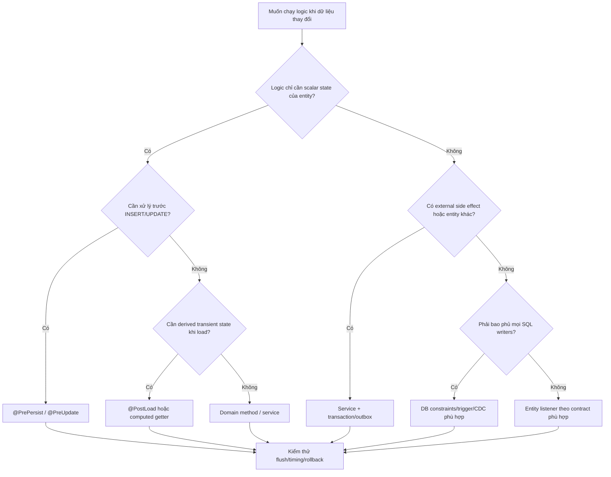

# Callback vòng đời Jakarta Persistence và thời điểm được gọi

Trong Hibernate ORM, entity không chỉ là một Java object được ánh xạ xuống bảng. Nó trải qua nhiều **sự kiện vòng đời (lifecycle events)**: được đưa vào persistence context, được đọc từ database, bị thay đổi, được xóa và đôi khi được đồng bộ lại bằng `refresh()`. Jakarta Persistence định nghĩa một tập **lifecycle callbacks** để ứng dụng thực hiện một số thao tác ngay tại những thời điểm này.

Ví dụ, trước khi INSERT, entity có thể tự điền `createdAt`; trước khi UPDATE, điền `updatedAt`; sau khi entity được load, tính một trường `@Transient` phục vụ hiển thị.

Các annotation tiêu chuẩn:

- `@PrePersist` và `@PostPersist`.
- `@PreUpdate` và `@PostUpdate`.
- `@PreRemove` và `@PostRemove`.
- `@PostLoad`.

Điều khó không phải nhớ tên annotation, mà là hiểu **thời điểm chúng được gọi so với `persist()`, `merge()`, `remove()`, `flush()`, SQL thật và `commit()`**. Một callback có thể chạy trước khi câu SQL được gửi, sau khi INSERT nhưng **trước khi transaction commit**, hoặc khi Hibernate vừa khởi tạo một entity từ L2 cache mà không hề phát SELECT mới.

Bài học này phân tích chính xác vai trò của từng callback, cách khai báo trong entity và entity listener, thứ tự gọi trong inheritance hierarchy, những tác động của lazy loading, cascade và dirty checking, cùng cách tránh các side effect nguy hiểm.

## 1. Callback trong bức tranh vòng đời của entity

Hibernate quản lý entity qua một `Session` hoặc `EntityManager`. Một entity có thể ở các trạng thái khái quát:

| Trạng thái | Ý nghĩa | Ví dụ |
|---|---|---|
| New/transient | Java object chưa được quản lý | `new Customer(...)` |
| Managed/persistent | Nằm trong persistence context | `em.persist(customer)` hoặc `em.find(...)` |
| Detached | Không còn được persistence context quản lý | Sau `em.detach`, `em.clear` hoặc đóng Session |
| Removed | Managed entity đã được đánh dấu để xóa | `em.remove(customer)` |

Các callbacks không phải annotation cho từng trạng thái, mà gắn với **những operation/lifecycle events** cụ thể:

```text
                 new Java object
                       |
                 persist/cascade
                       v
                 @PrePersist
                       |
               SQL INSERT ở flush
                       v
                 @PostPersist
                       |
                    managed
                       |
       +---------------+----------------+
       |               |                |
  load/refresh      modify state     remove/cascade
       |               |                |
   @PostLoad       dirty checking    @PreRemove
                       |                |
                  @PreUpdate       SQL DELETE
                       |                |
                   SQL UPDATE       @PostRemove
                       |
                  @PostUpdate
```

Sơ đồ nêu luồng thường gặp, không có nghĩa mọi callback diễn ra chính xác tại dòng Java gọi operation. Ví dụ `@PreUpdate` thường chỉ chạy khi flush phát hiện entity cần UPDATE; `@PostPersist` có thể chạy ở flush hoặc sớm hơn nếu ID generation buộc INSERT sớm.

## 2. Bảng tổng quan bảy lifecycle callbacks

| Annotation | Sự kiện | Thời điểm cần nhớ | Trường hợp sử dụng |
|---|---|---|---|
| `@PrePersist` | Persist một entity mới, kể cả qua cascade | Trước INSERT; không nhất thiết tại flush | Điền `createdAt`, chuẩn hóa scalar fields |
| `@PostPersist` | INSERT entity hoàn tất theo provider | Sau INSERT; ID đã được gán; chưa chắc commit | Đọc generated ID, xử lý state nội bộ |
| `@PreUpdate` | Entity managed được UPDATE | Trước SQL UPDATE, thường trong flush | Điền `updatedAt`, kiểm tra một số scalar invariants |
| `@PostUpdate` | UPDATE entity hoàn tất | Sau UPDATE, trước khi bảo đảm commit | Ghi nhận thao tác trong transaction, tính state tạm |
| `@PreRemove` | Entity được yêu cầu xóa | Trước DELETE; có thể ngay khi `remove` | Kiểm tra điều kiện xóa đơn giản |
| `@PostRemove` | DELETE entity hoàn tất | Sau DELETE; transaction vẫn có thể rollback | Dọn trạng thái nội bộ, không phát event ngoài ngay |
| `@PostLoad` | Entity được load vào context hoặc refresh | Sau load/refresh; không phải mỗi `find` | Tính `@Transient`, bổ sung derived in-memory state |

Một ứng dụng không nhất thiết dùng đủ bảy callbacks. Chỉ khai báo sự kiện thật sự cần thiết để tránh trộn nhiều logic ngầm vào persistence layer.

## 3. Hai cách khai báo callback

Có hai hình thức Jakarta Persistence phổ biến:

**Cách 1 — callback method trong chính entity:**

```java
@Entity
public class PurchaseOrder {

    @Id
    @GeneratedValue(strategy = GenerationType.SEQUENCE)
    private Long id;

    private Instant createdAt;

    @PrePersist
    void assignCreatedAt() {
        if (createdAt == null) {
            createdAt = Instant.now();
        }
    }
}
```

**Cách 2 — callback trong entity listener riêng:**

```java
@Entity
@EntityListeners(PurchaseOrderListener.class)
public class PurchaseOrder {
    @Id
    private Long id;
}
```

```java
public class PurchaseOrderListener {

    @PostLoad
    public void afterLoad(PurchaseOrder order) {
        // Xử lý chỉ liên quan tới entity vừa được load.
    }
}
```

Cách thứ nhất đặt logic rất gần dữ liệu. Cách thứ hai tách một concern dùng chung ra khỏi entity, thuận lợi khi nhiều entity có cùng kiểu audit/normalization.

**Không nhầm `@EntityListeners` của Jakarta Persistence với Spring application events hay Hibernate native event listeners.** Chúng có lifecycle và contract riêng.

## 4. Quy tắc chữ ký method

Callback method trong entity thường có dạng **`void method()`, không nhận tham số**:

```java
@PrePersist
private void beforePersist() {
    // ...
}
```

Callback method trong entity listener nhận **một tham số entity** hoặc một kiểu phù hợp như `Object`:

```java
public class AuditListener {

    @PrePersist
    public void beforePersist(Object entity) {
        // Có thể áp dụng cho nhiều entity types.
    }
}
```

Các quy tắc cơ bản:

- Return type là `void`.
- Entity callback có **không** tham số.
- Listener callback có **một** tham số thể hiện entity được xử lý.
- Với portable usage, dùng **instance method**, không static, không final.
- Có thể đặt visibility public, protected, package-private hoặc private cho entity callback theo contract JPA phù hợp.
- Một class không nên khai báo **hai methods cho cùng một lifecycle event**; JPA chỉ cho tối đa một callback method cho một event trong cùng một class.
- Entity listeners phải được khai báo để provider có thể khởi tạo/quản lý, kể cả qua CDI trong môi trường có hỗ trợ.

Ví dụ **không hợp lệ về signature**:

```java
@PrePersist
public boolean verifyBeforeInsert() { // Không phải void.
    return true;
}

@PreUpdate
public void touch(EntityManager em) { // Entity callback không có tham số.
    // ...
}
```

Lỗi metadata callback có thể xuất hiện khi Hibernate bootstrap, không đợi tới lúc thực hiện INSERT.

## 5. Ví dụ entity hoàn chỉnh với timestamps

Một bài toán audit đơn giản:

```java
import jakarta.persistence.*;
import java.time.Instant;
import java.util.Objects;

@Entity
@Table(name = "purchase_orders")
public class PurchaseOrder {

    @Id
    @GeneratedValue(strategy = GenerationType.SEQUENCE)
    private Long id;

    @Column(name = "created_at", nullable = false, updatable = false)
    private Instant createdAt;

    @Column(name = "updated_at", nullable = false)
    private Instant updatedAt;

    @Enumerated(EnumType.STRING)
    @Column(nullable = false)
    private OrderStatus status;

    @Version
    private long version;

    protected PurchaseOrder() {}

    public PurchaseOrder() {
        this.status = OrderStatus.NEW;
    }

    @PrePersist
    private void onCreate() {
        Instant now = Instant.now();
        if (createdAt == null) {
            createdAt = now;
        }
        updatedAt = now;
    }

    @PreUpdate
    private void onUpdate() {
        updatedAt = Instant.now();
    }

    public void confirm() {
        if (status != OrderStatus.NEW) {
            throw new IllegalStateException("Order not NEW");
        }
        status = OrderStatus.CONFIRMED;
    }

    public Long getId() { return id; }
    public Instant getCreatedAt() { return createdAt; }
    public Instant getUpdatedAt() { return updatedAt; }
    public OrderStatus getStatus() { return status; }
}

enum OrderStatus {
    NEW, CONFIRMED, CANCELLED
}
```

Đây là một ví dụ hoàn chỉnh về ý tưởng callback audit, nhưng còn tùy database sequence generator, schema DDL và nhu cầu thời gian hệ thống. Trong dự án production có thể cần `Clock` testable, timestamp từ database, timezone policy hoặc optimistic locking.

### Ý nghĩa quan trọng

- `@PrePersist` chuẩn bị hai timestamps **trước INSERT**.
- `@PreUpdate` chỉ gán `updatedAt` khi entity được đưa vào luồng UPDATE; không chạy mỗi khi getter được gọi.
- `@Version` do provider quản lý phiên bản, không nên được cập nhật thủ công trong callback.
- `updatable=false` ngăn Hibernate đưa `createdAt` vào các UPDATE thông thường, không phải một Java-level immutable guarantee.

## 6. `@PrePersist`: trước khi INSERT

Khi ứng dụng gọi:

```java
PurchaseOrder order = new PurchaseOrder();
entityManager.persist(order);
```

`@PrePersist` được gọi như một phần của persist lifecycle, kể cả khi persist operation được cascade từ một entity khác. Nó xảy ra **trước INSERT**; ở nhiều triển khai, gần thời điểm `persist()` được gọi.

Những việc phù hợp:

- Điền created timestamp.
- Điền scalar default nếu chưa có.
- Chuẩn hóa chuỗi, ví dụ trim những field không phải relationship.
- Kiểm tra những invariant đơn giản có thể kiểm chứng từ chính entity.
- Sinh business code độc lập với database ID nếu có contract rõ.

Ví dụ:

```java
@PrePersist
void normalizeBeforeInsert() {
    if (code != null) {
        code = code.trim().toUpperCase(Locale.ROOT);
    }
    if (createdAt == null) {
        createdAt = Instant.now();
    }
}
```

### Đừng phụ thuộc generated ID ở `@PrePersist`

Một số generation strategies có thể gán ID trước khi INSERT; một số cần database thực thi INSERT rồi mới có ID. Do đó **generated identifier không được bảo đảm sẵn sàng ở `@PrePersist`** theo portability contract.

Không viết:

```java
@PrePersist
void buildExternalReference() {
    reference = "ORDER-" + id; // ID có thể vẫn null.
}
```

Nếu reference cần ID do database sinh, hãy giải quyết sau INSERT, hoặc thay đổi business ID generation thiết kế ngay từ đầu.

## 7. `@PostPersist`: sau INSERT, không phải sau commit

`@PostPersist` được gọi sau khi operation INSERT hoàn tất theo lifecycle provider. Đây là thời điểm mà generated primary key đã có giá trị theo JPA contract.

Ví dụ:

```java
@PostPersist
void afterInsert() {
    // getId() đã có thể cung cấp generated identifier.
    Long generatedId = id;
}
```

Nhưng transaction vẫn có thể rollback:

```text
BEGIN
persist(order)
  -> @PrePersist
flush
  -> SQL INSERT
  -> @PostPersist
... logic nghiệp vụ khác thất bại ...
ROLLBACK
```

`@PostPersist` **không** có nghĩa “bản ghi đã commit thành công và chắc chắn tồn tại cho mọi transaction khác”.

### IDENTITY có thể làm POST xảy ra sớm

Với:

```java
@GeneratedValue(strategy = GenerationType.IDENTITY)
```

database sinh ID khi INSERT. Hibernate có thể cần thực thi INSERT sớm hơn thay vì đợi một flush cuối, vì cần ID để quản lý entity. Khi đó `@PostPersist` có thể chạy ngay trong đường `persist()` hoặc ở một điểm khác phụ thuộc provider/flush context.

Với sequence-based generation, identifier thường có thể được cấp trước khi INSERT và INSERT có thể chờ flush. Đừng hardcode logic dựa trên thời gian chính xác giữa `persist()` và `@PostPersist`.

## 8. `@PreUpdate`: trước UPDATE, thường được kích hoạt khi flush

Một entity managed được thay đổi:

```java
PurchaseOrder order =
    entityManager.find(PurchaseOrder.class, id);

order.confirm();
```

Hibernate chưa nhất thiết phát SQL khi `confirm()` chạy. Tại flush, dirty checking so sánh state và quyết định có UPDATE hay không.

```text
find -> @PostLoad
order.confirm()
  -> chỉ đổi Java state
flush / auto-flush / commit
  -> dirty checking
  -> @PreUpdate
  -> SQL UPDATE
  -> @PostUpdate
```

Ví dụ:

```java
@PreUpdate
void assignUpdatedAt() {
    updatedAt = Instant.now();
}
```

Callback thích hợp cho scalar audit state. Nhưng không nên đặt logic quan trọng yêu cầu gọi **mọi lần application method được gọi** vào `@PreUpdate`, vì nó phụ thuộc có database UPDATE hay không.

### `@PreUpdate` không được kích hoạt chỉ vì getter được gọi

```java
PurchaseOrder order = em.find(PurchaseOrder.class, id);
String label = order.toString();
em.flush();
```

Nếu không có persistent state thay đổi, Hibernate thường không cần UPDATE, nên không cần `@PreUpdate`.

## 9. `@PostUpdate`: sau UPDATE, vẫn chưa chắc commit

```java
@PostUpdate
void afterUpdate() {
    // Không dùng như bằng chứng transaction đã commit.
}
```

Sau `@PostUpdate`:

- Một transaction khác có thể chưa thấy dữ liệu mới, tùy isolation.
- Transaction hiện tại có thể thất bại ở thao tác SQL tiếp theo.
- Application có thể chủ động rollback.
- Một network call đã phát ở callback không được rollback cùng database.

Do đó, `@PostUpdate` phù hợp cho những xử lý **nội bộ** liên quan lifecycle, không phù hợp để gửi email, phát message Kafka hoặc gọi API thanh toán với giả định update đã commit.

Nếu cần thông báo sau commit, thiết kế transactional outbox hoặc transaction synchronization ở service layer.

## 10. Khi nào `@PreUpdate` và `@PostUpdate` không chạy?

Một số tình huống dễ nhầm:

1. Entity được load nhưng không thay đổi.
2. Gán lại cùng giá trị mà dirty checking xác định không có thay đổi.
3. Chỉ thay đổi một bảng join/collection mà không có entity-table UPDATE tương ứng; behavior cụ thể phụ thuộc mapping và versioning.
4. Gọi bulk JPQL/HQL UPDATE thay vì entity-level dirty checking.
5. Ghi trực tiếp bằng JDBC/native SQL.
6. Đối tượng đã detached, setter chỉ thay đổi Java object ngoài persistence context.
7. Entity được đánh dấu immutable và provider không thực hiện UPDATE thường.

Đừng dùng `@PreUpdate` như đồng hồ đo “bất kỳ logic nghiệp vụ nào chạm tới entity”. Nó phản ánh **database update lifecycle**, không phải từng Java mutation.

### Entity mới rồi sửa trong cùng transaction

```java
PurchaseOrder order = new PurchaseOrder();
em.persist(order);
order.confirm();
em.flush();
```

Một implementation có thể thực hiện một INSERT chứa state cuối, hoặc các SQL operations khác tùy timing. Jakarta Persistence cho phép những điểm không hoàn toàn portable trong việc kết hợp persist và update trong một transaction; **không dựa vào việc `@PreUpdate` chắc chắn chạy** ở case này. Hãy thiết kế `@PrePersist` để chuẩn bị state cần cho INSERT.

## 11. `@PreRemove`: khi xóa entity theo lifecycle

```java
PurchaseOrder order = em.find(PurchaseOrder.class, id);
em.remove(order);
```

`@PreRemove` được gọi trước khi entity bị xóa trong persistence lifecycle, có thể gần thời điểm `remove` được yêu cầu. SQL DELETE thường được thực thi khi flush.

Ví dụ:

```java
@PreRemove
void beforeRemove() {
    if (status == OrderStatus.CONFIRMED) {
        throw new IllegalStateException(
            "Cannot remove confirmed order"
        );
    }
}
```

Đây là một validation tự thân của entity, nhưng không thay thế concurrency checks hoặc DB constraints. Trong hệ thống có nhiều write paths, một bulk DELETE hoặc native SQL có thể bỏ qua method này hoàn toàn.

### Với cascade remove

Nếu có `CascadeType.REMOVE` hoặc `CascadeType.ALL`, JPA có thể gọi remove lifecycle trên các related entities theo cascade và các callbacks tương ứng sẽ chạy.

**Không dựa vào một thứ tự toàn cục cứng** giữa callbacks của nhiều entities trong graph. Provider có quyền sắp xếp SQL actions để đáp ứng foreign keys/batching. Nếu nghiệp vụ cần thứ tự sự kiện rõ, orchestration nên ở service, không rải phụ thuộc ngầm qua callbacks của parent/child.

## 12. `@PostRemove`: sau DELETE, không phải kết thúc transaction

```java
@PostRemove
void afterRemove() {
    // Java callback sau khi delete event hoàn tất.
}
```

Nhưng transaction vẫn có thể rollback:

```text
BEGIN
find(order) -> @PostLoad
remove(order) -> @PreRemove
flush -> DELETE -> @PostRemove
another operation fails
ROLLBACK
```

Sau rollback, database row có thể vẫn tồn tại dù `@PostRemove` đã chạy. Vì vậy không dùng `@PostRemove` để thực hiện không thể hoàn tác như xóa file storage thật, gọi billing API hoặc thông báo “đã xóa vĩnh viễn”.

### Soft delete là một trường hợp khác

Nếu Hibernate dùng `@SoftDelete` hoặc custom SQL delete mapping như `@SQLDelete`, một lệnh `remove()` có thể dẫn đến SQL UPDATE/flag thay vì DELETE vật lý. Callback lifecycle vẫn phụ thuộc entity remove operation/provider behavior, nhưng “PostRemove” khi ấy không có nghĩa row đã bị xóa khỏi bảng.

Đọc mapping thật và kiểm chứng bằng SQL capture.

## 13. `@PostLoad`: sau load hoặc refresh

`@PostLoad` được gọi sau khi entity được Hibernate/JPA load vào persistence context hoặc sau `refresh()`. Một ứng dụng có thể dùng nó để tính nonpersistent state:

```java
@Entity
public class Product {

    @Id
    private Long id;

    private String name;

    private BigDecimal price;

    @Transient
    private String displayLabel;

    @PostLoad
    void prepareViewState() {
        displayLabel = name + " — " + price;
    }

    public String getDisplayLabel() {
        return displayLabel;
    }
}
```

Đây là ví dụ có thể chạy nhưng dữ liệu derived `displayLabel` sẽ **không tự cập nhật** khi `name`/`price` bị sửa sau khi load, trừ khi domain method tự tính lại.

Nếu giá trị dễ tính và phụ thuộc state mutable, một computed getter thuần Java thường đơn giản hơn:

```java
public String getDisplayLabel() {
    return name + " — " + price;
}
```

### `@PostLoad` không chạy trên mọi `find()`

Trong một persistence context:

```java
Product first = em.find(Product.class, 7L);
Product second = em.find(Product.class, 7L);
```

`second` thường là cùng managed object từ L1 identity map. Không có một lần load mới chỉ vì gọi `find` lần thứ hai, nên không mặc định `@PostLoad` được gọi lại.

### `@PostLoad` có thể chạy dù không phát SQL SELECT

Nếu entity state được lấy từ L2 cache rồi materialize vào một persistence context mới, provider vẫn tạo entity mới trong context và có thể kích hoạt load lifecycle. Vì vậy `@PostLoad` không phải counter đo SELECT.

## 14. `refresh()` và `@PostLoad`

`EntityManager.refresh(entity)` yêu cầu provider nạp lại persistent state từ database cho một managed entity theo contract thích hợp.

```java
Product product = em.find(Product.class, id);
// Một transaction khác có thể đã cập nhật dữ liệu.

em.refresh(product);
// @PostLoad có thể được gọi lại khi refresh hoàn tất.
```

Cần lưu ý:

- `refresh` có thể ghi đè những thay đổi chưa flush trên entity.
- Có thể cascade refresh theo mapping.
- Refresh vẫn phải tuân thủ transaction/locking requirements của provider.
- `@PostLoad` không có nghĩa mọi lazy association đã được initialize.

Đừng dùng `refresh` trong `@PostLoad` của chính entity: nó có nguy cơ recursion và không thuộc mô hình callback an toàn.

## 15. Lazy loading và thời điểm `@PostLoad`

Với lazy association:

```java
@Entity
public class PurchaseOrder {

    @Id
    private Long id;

    @ManyToOne(fetch = FetchType.LAZY)
    private Customer customer;

    @PostLoad
    void afterLoad() {
        // Không truy cập sâu customer.getOrders() ở đây.
    }
}
```

Khi Hibernate load PurchaseOrder, `customer` có thể vẫn là proxy chưa khởi tạo. `@PostLoad` chỉ bảo đảm entity đang được load đã trải qua load lifecycle; nó **không hứa toàn bộ object graph đã sẵn sàng**.

Nếu callback truy cập lazy collections, hệ quả có thể là:

- Phát thêm SELECT trong lúc entity đang được hydrate.
- N+1 khi query trả nhiều parent entities.
- Khó đoán fetch plan.
- Vòng lặp associations hoặc việc truy cập state chưa sẵn sàng.

Giữ `@PostLoad` ngắn, chỉ tính transient values dựa trên dữ liệu scalar đã sẵn có, và tránh truy cập repositories hoặc các entities khác.

### Proxy chưa initialized

Một lời gọi `getReference` có thể tạo proxy với ID mà chưa tải state:

```java
Customer customer = em.getReference(Customer.class, id);
```

Chỉ nhận proxy không nhất thiết kích hoạt `@PostLoad`. Khi proxy được khởi tạo và entity state thực được load, load callback có thể được gọi.

## 16. Cascade `PERSIST` và callbacks của nhiều entities

Ví dụ:

```java
@Entity
public class Invoice {

    @Id
    @GeneratedValue
    private Long id;

    @OneToMany(
        mappedBy = "invoice",
        cascade = CascadeType.PERSIST
    )
    private List<InvoiceLine> lines = new ArrayList<>();

    @PrePersist
    void prepareInvoice() {
        // Thiết lập scalar fields riêng của Invoice.
    }
}
```

Khi gọi `em.persist(invoice)`, entity lines mới được cascade persist và có thể nhận `@PrePersist` riêng.

Tuy nhiên, không nên dựa vào:

```text
@PrePersist Invoice
-> @PrePersist tất cả InvoiceLine theo list order
-> @PostPersist Invoice
-> @PostPersist tất cả InvoiceLine
```

như một thứ tự tuyệt đối được bảo đảm cho mọi provider. SQL action queue có thể sắp xếp statements nhằm đáp ứng constraints, dependency graph hoặc JDBC batching; thứ tự events giữa entities liên quan cũng có chi tiết provider-specific.

Nếu cần nghiệp vụ phân bổ số dòng theo thứ tự, hãy thực hiện **trước persist** trong aggregate factory/service, không phụ thuộc callback event order.

## 17. `merge()`: callbacks chạy trên managed copy, không phải detached object

Một sai lầm thường gặp:

```java
PurchaseOrder detached = ...; // Detached object.
detached.confirm();

PurchaseOrder managed = em.merge(detached);
```

`merge()` không có nghĩa detached instance đã trở thành managed object. JPA thường sao chép state vào một managed instance và trả **managed instance** đó. Vì vậy:

- Không mặc định callback trên original detached object.
- Với existing entity, provider có thể load managed copy trước (`@PostLoad` nếu load thật).
- Nếu copied state tạo ra một entity UPDATE, `@PreUpdate`/`@PostUpdate` có thể chạy lúc flush.
- Nếu merge tạo mới transient entity, persist lifecycle/callbacks có thể áp dụng.
- Những điểm timing của merge + persist/update trong cùng transaction có thể khác nhau.

Mẫu code đúng:

```java
PurchaseOrder managed = em.merge(detached);

// Tiếp tục thao tác trên managed, không phải detached.
managed.confirm();
em.flush();
```

Không dùng `@PreUpdate` để phân biệt “update bằng merge” và “update bằng dirty checking”: cùng một entity update lifecycle có thể dẫn tới callbacks.

## 18. `detach()`, `clear()` và đóng Session không có callbacks tương ứng

Jakarta Persistence không định nghĩa:

- `@PreDetach`.
- `@PostDetach`.
- `@PreMerge`.
- `@PostMerge`.
- `@PreFlush`.
- `@PostFlush`.
- `@PostCommit`.

Nếu gọi:

```java
em.detach(order);
em.clear();
em.close();
```

không có một callback tiêu chuẩn nào trong bảy annotations trên được gọi chỉ vì object trở thành detached.

Hibernate có native event/interceptor APIs khác có thể quan sát các điểm sâu hơn; nhưng đó là extension, không phải lifecycle callback Jakarta Persistence.

## 19. `flush()` là ranh giới quan trọng nhưng không phải commit

Hibernate có action queue và dirty checking. Khi flush, pending operations được đồng bộ với database:

```java
em.persist(order);

order.confirm();

em.flush();
```

Flush có thể kích hoạt SQL và callbacks liên quan trước khi transaction kết thúc.

Các thời điểm gây flush:

- `em.flush()` tường minh.
- `commit()` khi cần đồng bộ pending changes.
- Một số JPQL/HQL queries trước khi thực thi theo flush mode.
- Một số native queries hoặc APIs theo provider-specific synchronization.
- Các hoạt động yêu cầu INSERT sớm để lấy generated ID.

### FlushModeType.AUTO và COMMIT

`FlushModeType.AUTO` cho phép provider bảo đảm những cập nhật cần thiết sẽ được phản ánh trong query execution theo contract; thường dẫn đến auto-flush trước query khi có liên quan.

`FlushModeType.COMMIT` thường trì hoãn flush tới commit hơn, nhưng tác động của pending changes lên một số queries có thể không được bảo đảm theo cách ứng dụng kỳ vọng.

**Không mã hóa logic “callback X phải chạy sau dòng query Y” trừ khi bạn đã thiết kế transaction/flush boundary rõ và kiểm thử provider thật.**

## 20. Thời điểm callback theo từng thao tác

| Java operation | Callback có thể liên quan | Điều không được suy luận |
|---|---|---|
| `new Entity()` | Không có JPA callback tự động | Constructor không làm `@PrePersist` chạy |
| `persist(newEntity)` | `@PrePersist`; sau INSERT có `@PostPersist` | Không phải `@PostPersist` luôn chạy tại return của `persist` |
| `find(id)` với L1 miss | `@PostLoad` nếu entity thực sự được load | Không phải mọi `find` đều SELECT |
| `find(id)` với L1 hit | Thường không load callback mới | Không dùng callback làm counter getter |
| `getReference(id)` | Không nhất thiết có ngay `@PostLoad` | Proxy chưa chắc initialized |
| Setter trên managed entity | Chưa nhất thiết callback update | Setter không tự flush |
| `flush()` khi dirty | `@PreUpdate`/`@PostUpdate` | Không phải mọi managed entity đều UPDATE |
| `remove(managed)` | `@PreRemove`; sau SQL có `@PostRemove` | `@PostRemove` không phải after commit |
| `refresh(managed)` | `@PostLoad` | Không tự eager-load mọi association |
| `merge(detached)` | Tùy insert/update/load của managed copy | Detached source không trở thành managed |
| `clear()/detach()` | Không có detach callback chuẩn | Không tự gửi pending state chưa flush |

## 21. Không nên giả định callback chỉ được gọi một lần cho mỗi business request

Nếu trong cùng request bạn:

1. Load entity.
2. Refresh entity.
3. Update và flush.
4. Update lần nữa và flush.
5. Retry transaction do optimistic locking.

Thì `@PostLoad`, `@PreUpdate` hoặc những callback khác có thể xảy ra nhiều lần trong tổng luồng nghiệp vụ.

```text
Request business "Confirm Order"
   |
   +-- Transaction attempt 1
   |       @PostLoad
   |       @PreUpdate
   |       ... transaction conflict -> rollback
   |
   +-- Transaction attempt 2
           @PostLoad
           @PreUpdate
           @PostUpdate
           commit
```

Do đó, callback không phải nơi thích hợp cho side effect phải thực hiện **chính xác một lần** như gửi SMS, chuyển tiền hay xuất hóa đơn.

Nếu retry/idempotency quan trọng, dùng business operation ID và database constraints/outbox.

## 22. Entity listeners với `@EntityListeners`

Ví dụ tách audit logic:

```java
public interface Auditable {

    Instant getCreatedAt();
    void setCreatedAt(Instant time);

    Instant getUpdatedAt();
    void setUpdatedAt(Instant time);
}
```

```java
public class TimestampListener {

    @PrePersist
    public void onCreate(Auditable entity) {
        Instant now = Instant.now();

        if (entity.getCreatedAt() == null) {
            entity.setCreatedAt(now);
        }
        entity.setUpdatedAt(now);
    }

    @PreUpdate
    public void onUpdate(Auditable entity) {
        entity.setUpdatedAt(Instant.now());
    }
}
```

```java
@Entity
@EntityListeners(TimestampListener.class)
public class Customer implements Auditable {

    @Id
    private Long id;

    private Instant createdAt;
    private Instant updatedAt;

    protected Customer() {}

    // Getters/setters thực hiện interface Auditable.
}
```

Listener nhận entity làm tham số, nên có thể áp dụng cho nhiều entity classes với một contract interface rõ ràng.

Cần chắc chắn method parameter type phù hợp với entity class theo JPA contract/provider. Nếu một listener dùng chung cho nhiều loại không cùng interface, `Object` parameter là một lựa chọn rồi kiểm tra type có chủ đích.

## 23. Không nhầm listener với dependency injection tự động

Một plain entity listener không tự là Spring bean chỉ vì có `@EntityListeners`.

Trong Jakarta EE với CDI integration phù hợp, JPA provider có cơ chế quản lý/inject dependencies vào listener. Trong một ứng dụng Spring, hỗ trợ injection vào entity listeners phụ thuộc Spring/Hibernate integration và cách khởi tạo listeners.

Ví dụ dễ lỗi:

```java
public class OrderListener {

    @Autowired
    private NotificationService notificationService;

    @PostPersist
    public void onCreated(PurchaseOrder order) {
        notificationService.send(order.getId());
    }
}
```

Có ít nhất hai vấn đề:

1. `notificationService` có thể null nếu listener không phải object được Spring inject theo cấu hình hiện tại.
2. Ngay cả khi inject được, `@PostPersist` chưa bảo đảm transaction đã commit; gửi thông báo tại đây tạo side effect không rollback được.

Nếu cần gửi thông báo, đặt orchestration ở application service hoặc transactional outbox. Dùng DI ở listener chỉ cho thao tác ngắn, phù hợp lifecycle contract và được provider chính thức hỗ trợ.

## 24. Thứ tự gọi listener và callback trong entity hierarchy

Ví dụ:

```java
@MappedSuperclass
@EntityListeners(BaseAuditListener.class)
public abstract class BaseEntity {

    @PrePersist
    void baseBeforeInsert() {
        // ...
    }
}

@Entity
@EntityListeners(OrderAuditListener.class)
public class PurchaseOrder extends BaseEntity {

    @PrePersist
    void orderBeforeInsert() {
        // ...
    }
}
```

Các callback có thể đến từ:

- **Default listeners** khai báo trong ORM XML metadata.
- Entity listeners khai báo ở mapped superclass/entity superclasses.
- Entity listeners khai báo tại concrete entity.
- Callback methods nằm trong mapped superclass/entity hierarchy.

Jakarta Persistence xác định quy tắc gọi theo inheritance và declarations; thông thường default listeners được gọi trước, superclass listeners trước subclass listeners, và callback methods trong class hierarchy sau entity listeners, từ superclass xuống subclass.

### Thứ tự trong `@EntityListeners`

```java
@EntityListeners({
    FirstListener.class,
    SecondListener.class
})
```

Trong một danh sách listener áp dụng cho cùng event, declaration order là một phần của ordering semantics.

### Một lưu ý về XML mapping

ORM XML có thể khai báo default listeners, override/exclude một số metadata hoặc thay đổi ordering so với annotations. Nếu dự án dùng `orm.xml`, không thể suy luận toàn bộ thứ tự chỉ bằng annotations.

### Đừng xây business correctness trên thứ tự giữa các entities

Ngay cả khi ordering **trong một entity hierarchy** có contract, thứ tự callbacks giữa Order, OrderLine, Customer và các cascading associations không nên được dùng để đồng bộ workflow ngoài persistence layer.

## 25. `@ExcludeDefaultListeners` và `@ExcludeSuperclassListeners`

Khi một entity không muốn kế thừa listeners, Jakarta Persistence có annotations:

```java
@Entity
@ExcludeDefaultListeners
@ExcludeSuperclassListeners
public class SpecialReportEntity extends BaseEntity {

    @Id
    private Long id;
}
```

- `@ExcludeDefaultListeners` loại trừ default listeners được khai báo ở persistence unit metadata.
- `@ExcludeSuperclassListeners` loại trừ listener classes được thừa kế từ superclasses theo quy tắc JPA.

Đặc biệt cần phân biệt **listener classes** với **callback methods nằm trực tiếp trong mapped superclass/entity class**. Không mặc định `@ExcludeSuperclassListeners` sẽ xóa mọi callback method kế thừa. Đối với callback methods bị override theo Java, còn có quy tắc riêng.

Khi cần kiểm soát chính xác hierarchy behavior, viết test cho entity cụ thể thay vì đoán dựa trên tên annotation.

## 26. Method override trong superclass callback

Ví dụ:

```java
@MappedSuperclass
public abstract class BaseEntity {

    @PrePersist
    void initializeDefaults() {
        // Logic base.
    }
}

@Entity
public class Customer extends BaseEntity {

    @Override
    void initializeDefaults() {
        // Override method của superclass.
    }
}
```

Một callback method ở superclass có thể bị override bởi một method với cùng signature ở subclass; theo quy tắc Java/JPA, superclass callback đã bị override không phải lúc nào còn được gọi như một callback độc lập. Nếu subclass method không có annotation, vẫn cần hiểu JPA rules và provider treatment, không dựa vào một invocation chain tưởng tượng.

Nếu muốn cả hai logic đều thực thi, phương án rõ ràng là tránh override mơ hồ hoặc gọi `super.initializeDefaults()` bằng chủ ý từ implementation phù hợp, kết hợp annotations đúng quy định.

**Một class chỉ được có một callback method cho cùng lifecycle event.** Nhưng superclass và subclass có thể mỗi class khai báo callback theo contract; hãy dùng các tên method rõ ràng để tránh override ngoài ý muốn.

## 27. Callback method có thể là private không?

Trong entity:

```java
@PrePersist
private void beforePersist() {
    createdAt = Instant.now();
}
```

JPA cho phép callback methods có những visibility khác nhau theo spec; Hibernate có thể dùng reflection/bytecode để gọi method private khi phù hợp. Không cần biến method thành public domain API chỉ để lifecycle provider gọi.

Tuy nhiên:

- Private method không được Java subclass override; inheritance callback behavior khác với protected/package-private.
- Java modules (JPMS) có thể cần `opens` package cho persistence provider.
- Build-time enhancement, runtime proxies và reflection access phải được cấu hình phù hợp.
- Nếu entity listener được DI quản lý, constructor/visibility requirements cần theo provider integration.

Tránh dùng static/final callback methods nếu muốn portability.

## 28. Giới hạn logic được phép trong callback

Jakarta Persistence hướng lifecycle callbacks tới logic liên quan **state của chính entity**. Quy tắc portability quan trọng: callback không nên gọi `EntityManager` hoặc `Query` operations, truy cập các entity instances khác, hay sửa relationships trong cùng persistence context; callback có thể thay đổi **non-relationship state** của chính entity.

### Tốt: chuẩn hóa scalar state

```java
@PrePersist
void normalize() {
    if (email != null) {
        email = email.trim().toLowerCase(Locale.ROOT);
    }
}
```

### Rủi ro: query repository trong callback

```java
@PrePersist
void calculateFromDatabase() {
    long next = entityManager.createQuery(
        "select count(o) from PurchaseOrder o",
        Long.class
    ).getSingleResult();

    sequenceNo = next + 1;
}
```

Vấn đề:

- Không portable theo callback restrictions.
- Có thể gây reentrant flush/query và lỗi khó đoán.
- `count+1` không an toàn dưới concurrency.
- Listener có thể chạy trước transaction boundary mà code tưởng có.
- N+1 queries nếu persist nhiều entities.

Dùng database sequence/unique constraint hoặc service-level operation có transaction rõ ràng.

## 29. Callback không phải nơi sửa association graph

Một callback như sau trông tiện nhưng dễ phá persistence action order:

```java
@PrePersist
void attachToCurrentUser() {
    currentUser.getOrders().add(this);
    this.user = currentUser;
}
```

Nếu `currentUser` là một managed entity khác, callback đang sửa relationship và collection của entity khác trong lúc provider xử lý lifecycle. Những side effects này có thể không portable, có thể gây cascade recursion hoặc tạo SQL không mong muốn.

Tốt hơn:

```java
PurchaseOrder order = new PurchaseOrder();
User user = em.find(User.class, userId);

user.addOrder(order);   // Duy trì hai phía trong domain method.
em.persist(order);
```

Giữ relationship management trong domain/service code trước operation, không lén làm trong callback.

## 30. Callback exceptions và transaction rollback

Nếu callback ném runtime exception:

```java
@PrePersist
void validateState() {
    if (totalAmount == null
            || totalAmount.signum() < 0) {
        throw new IllegalStateException(
            "totalAmount must be nonnegative"
        );
    }
}
```

JPA operation có thể thất bại. Khi callback exception xảy ra trong transaction active, transaction thường phải rollback/được đánh dấu rollback-only theo JPA semantics. Đừng bắt exception ở service rồi cố tiếp tục commit nếu state của persistence context đã bị ảnh hưởng.

### Exception không phải cơ chế validation duy nhất

Dùng:

- Bean Validation cho constraints như `@NotNull`, `@Size`, `@Positive`.
- Domain method/constructor để bảo vệ invariants khi Java code tạo hoặc sửa entity.
- DB NOT NULL/UNIQUE/CHECK/FK constraints để bảo vệ dữ liệu ở database.
- Callbacks cho default/normalization đơn giản.

Nếu có bulk SQL, native JDBC hoặc external writers, callbacks sẽ không bảo vệ các write paths đó. Các invariants quan trọng cần bảo vệ ở lớp phù hợp, thường gồm database constraints.

## 31. Callback và Bean Validation không phải một cơ chế

Ví dụ:

```java
@Entity
public class Customer {

    @Id
    private Long id;

    @NotBlank
    private String email;

    @PrePersist
    void normalizeEmail() {
        email = email == null
            ? null
            : email.trim().toLowerCase(Locale.ROOT);
    }
}
```

Bean Validation có thể được tích hợp với JPA lifecycle events để validate entity khi persist/update/remove theo configuration, nhưng validation callbacks/listeners là một cơ chế khác với custom `@PrePersist`/`@PreUpdate` methods.

Thứ tự tương đối giữa custom callbacks và validation listeners có thể chịu ảnh hưởng provider/config; không dựa vào một ordering không được cấu hình rõ. Đồng thời, DB constraints mới bảo vệ được những writes ngoài JPA.

Nếu cần error messages trực tiếp ở API boundary, validate DTO/request trước khi persistence operations bắt đầu.

## 32. Callback và database triggers

Có hai loại hooks khác tầng:

| Đặc điểm | JPA callback | Database trigger |
|---|---|---|
| Chạy ở đâu? | JVM/provider lifecycle | Database engine |
| Nhìn thấy native SQL writers? | Không | Có nếu SQL thao tác đúng table/event |
| Truy cập managed entity fields? | Có trên entity instance | Không, làm việc với row/SQL values |
| Cấu hình | Java annotations/XML | Database migration/DDL |
| Phụ thuộc Hibernate? | JPA portable ở mức contract | DBMS-specific syntax |
| Thời điểm | Trước/sau ORM event, có thể quanh flush | Trước/sau DML theo DBMS semantics |
| Có DB transaction? | Gắn với ORM transaction nếu active | Thường thuộc transaction của SQL, trừ các cơ chế đặc thù |

Nếu có cả `@PreUpdate` set `updatedAt` và DB trigger set cùng cột, giá trị Hibernate nắm trong persistence context có thể khác DB giá trị sau trigger.

Một thiết kế phải chọn **nguồn authoritative** cho cột:

- Java callback tự điền timestamp, DB không tự thay.
- DB trigger/defaults tự điền, Hibernate mapping biết cần đọc lại generated value khi phù hợp.
- Hibernate-specific `@CreationTimestamp`/`@UpdateTimestamp` theo contract version.

Không để ba cơ chế tranh nhau giá trị mà không có test.

## 33. `@CreationTimestamp` và `@UpdateTimestamp` khác JPA callback

Hibernate có annotations riêng:

```java
@CreationTimestamp
private Instant createdAt;

@UpdateTimestamp
private Instant updatedAt;
```

Chúng có thể thuận tiện hơn viết callbacks thủ công cho timestamps, nhưng là Hibernate-specific và version-dependent về nguồn thời gian/generated value strategy.

`@PrePersist`/`@PreUpdate` là Jakarta Persistence callbacks, có thể portable giữa JPA providers hơn; đổi lại ứng dụng tự quyết định `Clock`, timezone và default logic.

Một số dự án dùng Spring Data JPA auditing như `@CreatedDate`/`@LastModifiedDate`. Đây lại là abstraction khác, thường dựa trên listener/framework infrastructure.

**Không gộp tất cả annotations trên thành một cơ chế duy nhất.** Kiểm tra ai ghi giá trị, ở thời điểm nào và sau SQL trigger Hibernate có đồng bộ state không.

## 34. Timestamps và Clock: testability

`Instant.now()` trong callback đơn giản nhưng unit test khó đặt expected value chính xác và không dễ mô phỏng clock drift.

Nếu cần testable time source, có thể:

- Thiết kế domain service truyền `Instant` vào khi tạo/cập nhật aggregate.
- Sử dụng một listener có injectable `Clock` nếu JPA/CDI/Spring integration hỗ trợ chính thức.
- Dùng DB-generated timestamp rồi đọc lại theo mapped generation semantics.

Ví dụ hướng domain-service rõ hơn:

```java
Instant now = clock.instant();

PurchaseOrder order =
    PurchaseOrder.create(customerId, now);

em.persist(order);
```

Điều này có thể loại bỏ nhu cầu `@PrePersist` để tạo timestamp khi business model đã chủ động quản lý thời gian. Callback hữu ích khi cần chính sách thống nhất cho nhiều write paths trong ORM, nhưng không phải luôn là lựa chọn duy nhất.

## 35. @PostPersist có phù hợp tạo event “OrderCreated” không?

Không nếu cần bảo đảm event chỉ được công bố sau commit.

Sai về atomicity:

```java
@PostPersist
void publishOrderCreated() {
    kafkaProducer.send(
        "orders.created",
        id.toString()
    );
}
```

Lý do:

- `@PostPersist` có thể chạy trước commit.
- Transaction sau đó rollback nhưng message đã gửi.
- Retry có thể gửi duplicate messages.
- Network call có thể làm transaction chậm hoặc lỗi.
- Callback có thể chạy trong Hibernate flush, không thích hợp tạo side effects reentrant.

### Transactional outbox

Một hướng đáng tin cậy hơn:

```text
Application service transaction
   |
   +-- persist Order
   |
   +-- persist OutboxEvent
   |
   +-- COMMIT cả hai
            |
            v
Outbox dispatcher đọc committed events
            |
            v
Gửi message, retry/idempotency
```

Outbox event nên được tạo bởi application/domain service trong cùng transaction, không phải tự persist một entity khác bên trong JPA lifecycle callback. Dispatcher chạy sau commit, có xử lý duplicates và failures.

Nếu chỉ cần xử lý hậu commit đơn giản trong cùng process, Spring transaction synchronization hoặc `@TransactionalEventListener(phase = AFTER_COMMIT)` có thể hữu ích, nhưng nó không tự bảo đảm delivery sau crash. Outbox phù hợp khi event là dữ liệu nghiệp vụ quan trọng.

## 36. @PostRemove không nên xóa file/blob trực tiếp

Giả sử database có metadata của một file, file thật nằm trên object storage. Xóa file ngay trong `@PostRemove`:

```java
@PostRemove
void deleteFile() {
    storageClient.delete(objectKey);
}
```

có thể tạo trạng thái:

```text
DELETE metadata trong DB transaction
  -> @PostRemove xóa object trên storage
  -> DB transaction rollback
  -> metadata phục hồi nhưng file đã mất
```

Thay vào đó:

- Trong DB transaction, đánh dấu deletion intent hoặc ghi outbox.
- Commit transaction.
- Worker thực hiện storage delete idempotently.
- Theo dõi retry và reconciliation.
- Đặt rõ yêu cầu eventual consistency nếu metadata và storage không commit atomically.

Đây là một ví dụ quan trọng vì **“Post” trong tên callback không có nghĩa “after commit”**.

## 37. Audit: callback ghi scalar state khác audit trail đầy đủ

`@PreUpdate` điền `updatedAt` là audit tối thiểu. Nhưng audit log đầy đủ có thể cần:

- Ai thay đổi (actor).
- Entity ID và version.
- Old/new values.
- Operation business name.
- Correlation/request ID.
- Timestamp.
- Tenant/authorization context.
- Thông tin transaction committed hay rolled back.

Một callback chỉ nhìn entity hiện tại thường không đủ thông tin về request context hoặc previous snapshot theo cách portable. Hơn nữa, bulk DML, JDBC và external writers bỏ qua nó.

Các giải pháp khác:

- Hibernate Envers cho entity audit histories theo tính năng/provider.
- Audit service + outbox trong transaction.
- DB triggers/CDC cho tất cả SQL writers.
- Application event log theo domain operations.

Không dùng `@PostUpdate` như nguồn duy nhất của audit-compliance nếu hệ thống còn những đường ghi ngoài ORM.

## 38. Bulk JPQL/HQL UPDATE và DELETE bỏ qua entity callbacks

Ví dụ:

```java
int updated = em.createQuery("""
    update PurchaseOrder o
    set o.status = :expired
    where o.createdAt < :cutoff
    """)
    .setParameter("expired", OrderStatus.CANCELLED)
    .setParameter("cutoff", cutoff)
    .executeUpdate();
```

Câu bulk UPDATE áp dụng trực tiếp lên nhiều rows. Hibernate không tải từng PurchaseOrder rồi gọi `@PreUpdate`/`@PostUpdate` cho từng row.

Tương tự:

```java
int deleted = em.createQuery("""
    delete from PurchaseOrder o
    where o.createdAt < :cutoff
    """)
    .setParameter("cutoff", cutoff)
    .executeUpdate();
```

Bulk DELETE không gọi `@PreRemove`/`@PostRemove` trên từng entity và không tự kích hoạt ORM cascade remove/`orphanRemoval`.

### So sánh

| Hành động | Entity callbacks? | ORM cascade? | Hibernate dirty checking? |
|---|---|---|---|
| `em.persist(entity)` | Có theo lifecycle | Có nếu mapped | Theo entity lifecycle |
| Sửa managed entity rồi flush | Có nếu entity UPDATE | Theo mapping/flush | Có |
| `em.remove(entity)` | Có theo lifecycle | Có nếu mapped | ORM event/action |
| JPQL bulk UPDATE | Không theo từng entity | Không | Không theo từng entity |
| JPQL bulk DELETE | Không theo từng entity | Không | Không theo từng entity |
| JDBC/native SQL trực tiếp | Không theo từng entity | Không | Không |
| DB trigger | Không kích hoạt Java callback | DB FK/trigger semantics riêng | Không |

Vì vậy, nếu nghiệp vụ bắt buộc callback cho từng row, không thể chuyển sang bulk DML mà không thiết kế lại audit/validation/side effects.

## 39. JDBC batching có bỏ qua callbacks không?

**Không**, khi Hibernate thực thi entity operations qua stateful `Session`. JDBC batching chỉ nhóm những SQL executions có cùng shape; entity vẫn đi qua persistence lifecycle và callbacks tương ứng.

Ví dụ:

```java
for (int i = 0; i < 1000; i++) {
    em.persist(new PurchaseOrder());
    if ((i + 1) % 50 == 0) {
        em.flush();
        em.clear();
    }
}
```

Nếu Hibernate bật:

```properties
hibernate.jdbc.batch_size=50
hibernate.order_inserts=true
```

INSERTs có thể được JDBC batched nếu ID generator/SQL shape/driver hỗ trợ. `@PrePersist` và `@PostPersist` vẫn gắn với mỗi entity insert lifecycle.

Nhưng đừng giả định từng callback `@PostPersist` xuất hiện ngay sau một riêng lẻ physical network send trong JDBC batch. Provider có thể thực hiện batching, queueing và callback dispatch theo thuật toán nội bộ; điều quan trọng là callback lifecycle contract chứ không phải số network round trips.

## 40. `StatelessSession` và đường đi ngoài persistence context

Hibernate có `StatelessSession` với semantics khác stateful `Session`: không dùng persistence context và dirty checking giống EntityManager.

Khi dùng nó cho bulk import/update, cần kiểm tra Javadocs của Hibernate version thực tế về event listeners, interceptors, cascades và batching. **Không được giả định tất cả lifecycle callbacks JPA vẫn diễn ra như `em.persist()/em.remove()`**.

Tương tự, code dùng:

```java
session.doWork(connection -> {
    // Raw PreparedStatement/CallableStatement SQL.
});
```

là JDBC direct execution; SQL trong callback `doWork` không kích hoạt JPA entity callbacks cho rows được thay đổi.

Nếu một requirement phụ thuộc callbacks, phải chọn đường thao tác ORM đúng, không chỉ dựa vào câu lệnh SQL tương đương.

## 41. `Spring Data JPA save()` có phải luôn gọi `@PrePersist`?

Không. Spring Data JPA `save(entity)` có thể chọn JPA `persist` hoặc `merge` dựa trên new-entity detection và metadata.

Ví dụ:

```java
repository.save(customer);
```

Nếu Customer là entity mới, `@PrePersist` có thể chạy. Nếu Customer là existing/detached entity được merge, update lifecycle có thể diễn ra sau đó khi flush.

`saveAll` thường áp dụng operation cho từng entity; nếu Hibernate có JDBC batching, SQLs có thể được nhóm, nhưng callbacks vẫn theo ORM entity lifecycle.

Các methods `@Modifying @Query("update ...")` hoặc `deleteAllInBatch` (tùy API/version) dùng bulk DML, **không được coi tương đương** với entity-by-entity callbacks.

## 42. Entity lifecycle callbacks và JPA auditing trong Spring

Spring Data JPA cung cấp auditing abstractions như `@CreatedDate`/`@LastModifiedDate`, thường phối hợp với `AuditingEntityListener`.

Ví dụ định hướng:

```java
@Entity
@EntityListeners(AuditingEntityListener.class)
public class Customer {

    @Id
    private Long id;

    @CreatedDate
    private Instant createdAt;

    @LastModifiedDate
    private Instant updatedAt;
}
```

Để hoạt động còn cần Spring Data JPA auditing configuration (ví dụ `@EnableJpaAuditing`), dependencies và nguồn audit time/actor phù hợp.

Điều quan trọng là tách:

- **JPA lifecycle callbacks** — contract sự kiện persistence.
- **Spring Data auditing** — feature framework thường dựa trên listeners.
- **Hibernate Envers** — audit revision history qua Hibernate integration.
- **Database triggers/CDC** — observe database writes.

Chúng có phạm vi coverage và portability khác nhau.

## 43. Callback không tự quản transaction

Một listener có annotation:

```java
@PrePersist
void beforePersist() {
    // ...
}
```

không mở transaction mới. Nó được provider gọi trong context của operation. Không nên dùng `@Transactional` trên entity method rồi mặc định Spring proxy sẽ intercept callback method đó; entity thường không phải Spring-managed service bean.

Transaction boundary nên được kiểm soát ở application service:

```java
@Service
public class OrderApplicationService {

    @PersistenceContext
    private EntityManager em;

    @Transactional
    public Long create() {
        PurchaseOrder order = new PurchaseOrder();
        em.persist(order);
        return order.getId();
    }
}
```

Nếu ID generation khiến `order.getId()` chưa sẵn sàng ở thời điểm cụ thể theo setup, service có thể cần flush hoặc xác định ID generation semantics phù hợp; không nên ép flush chỉ để có ID nếu không cần.

## 44. Entity callbacks và optimistic locking

Với:

```java
@Version
private long version;
```

Hibernate có thể phát SQL:

```sql
update purchase_orders
set status = ?, updated_at = ?, version = ?
where id = ? and version = ?;
```

`@PreUpdate` có thể chạy trước SQL được gửi. Nếu UPDATE sau đó ảnh hưởng 0 rows vì transaction khác đã đổi version, Hibernate có thể ném optimistic locking exception. Vì vậy:

- `@PreUpdate` có thể đã chạy dù transaction cuối cùng rollback.
- Không coi việc callback đã chạy là bằng chứng update thành công.
- `@PostUpdate` timing phải hiểu trong provider/flush lifecycle.
- Callback không nên tự thay đổi `@Version`.
- Retry service operation có thể làm callbacks chạy lại.

Nếu dùng bulk JPQL UPDATE, Hibernate không áp dụng optimistic version checks cho từng entity giống entity lifecycle thông thường; callback cũng không chạy.

## 45. Entity callbacks và dirty checking

Một method:

```java
@PreUpdate
void touch() {
    updatedAt = Instant.now();
}
```

được gọi khi provider đã xác định entity nằm trong update lifecycle. Nhưng nếu **chỉ muốn updatedAt luôn đổi dù không sửa bất kỳ field nào**, `@PreUpdate` không làm được điều đó theo contract chuẩn, vì không có UPDATE thì callback không nhất thiết xảy ra.

Ví dụ:

```java
Product p = em.find(Product.class, id);
em.flush(); // Không sửa field.

 // Không nên kỳ vọng @PreUpdate tự chạy để cập nhật updatedAt.
```

Nếu domain cần hành động “touch”, hãy có explicit domain method làm persistent state thay đổi hoặc thực thi một update command có contract rõ.

Một callback có thể sửa non-relationship state trong lúc được gọi. Tuy nhiên, kết quả dirty detection và SQL column inclusion còn phụ thuộc Hibernate implementation, enhancement, `@DynamicUpdate` và mapping. Hãy test các trường hợp thay đổi updatedAt riêng, version và generated fields nếu cần.

## 46. SQL triggers và generated values sau Post callbacks

Nếu database có trigger:

```sql
-- Pseudocode: trigger tự cập nhật calculated_total khi INSERT/UPDATE.
```

Java entity object có thể chưa phản ánh DB-generated value sau SQL:

```java
em.persist(invoice);
em.flush();

// invoice.getCalculatedTotal() không mặc định đã là
// giá trị mới do trigger database điền.
```

`@PostPersist`/`@PostUpdate` không bảo đảm Hibernate đã refresh mọi DB-generated columns. Có thể cần mapping generated values phù hợp Hibernate version hoặc `em.refresh(entity)` tại boundary hợp lệ.

Không gọi `em.refresh` bên trong callback chỉ để sửa state: điều đó có thể gây reentrant operations và vi phạm quy tắc portability về EntityManager calls trong lifecycle methods.

## 47. Cẩn thận với `equals()`, `hashCode()` và `toString()` trong callback

Trong callback, code có thể log entity:

```java
@PostLoad
void logLoaded() {
    logger.debug("Loaded: {}", this);
}
```

Nếu `toString()` tự traverse lazy associations, logging có thể gây N+1 hoặc recursive graph loops. `equals/hashCode` có thể đọc associations hoặc dùng `getClass()` không phù hợp với proxies.

Một callback nên log tối thiểu:

```java
@PostLoad
void logLoaded() {
    logger.debug("Loaded PurchaseOrder id={}", id);
}
```

Vẫn phải cân nhắc dữ liệu nhạy cảm và logging volume, đặc biệt khi truy vấn hàng chục nghìn entities; `@PostLoad` có thể chạy cho từng entity materialized.

## 48. Performance: callbacks chạy theo số entities

Giả sử query tải 50.000 PurchaseOrders. Nếu mỗi `@PostLoad` thực hiện 1 SELECT riêng:

```text
1 SELECT tải 50.000 orders
+ 50.000 SELECTs trong callbacks
= N+1 cực lớn
```

Tương tự, import 200.000 entities với `@PrePersist` nặng CPU hoặc gọi external service có thể khiến JDBC batching không giúp được nhiều.

Quy tắc performance:

- Callback phải ngắn và deterministic.
- Tránh I/O, network và database queries.
- Tránh traverse lazy associations.
- Tránh allocate object lớn trên mọi callback.
- Tránh blocking calls dưới flush/transaction.
- Dùng SQL/batch operations đúng semantics khi cần throughput.
- Đo số callbacks và flush latency bằng instrumentation trong test.

Nếu dữ liệu được xử lý qua bulk DML, callback không chạy; cần đảm bảo side effect không bị bỏ qua.

## 49. Kiểm thử bằng recorder listener

Một cách học rõ nhất là tạo listener ghi lại events trong test. Ví dụ khung:

```java
public final class CallbackRecorder {

    private static final List<String> EVENTS =
        new CopyOnWriteArrayList<>();

    public static void clear() {
        EVENTS.clear();
    }

    public static void record(String event) {
        EVENTS.add(event);
    }

    public static List<String> snapshot() {
        return List.copyOf(EVENTS);
    }
}
```

```java
public class RecordingListener {

    @PrePersist
    public void prePersist(Object entity) {
        CallbackRecorder.record("prePersist");
    }

    @PostPersist
    public void postPersist(Object entity) {
        CallbackRecorder.record("postPersist");
    }

    @PreUpdate
    public void preUpdate(Object entity) {
        CallbackRecorder.record("preUpdate");
    }

    @PostUpdate
    public void postUpdate(Object entity) {
        CallbackRecorder.record("postUpdate");
    }

    @PreRemove
    public void preRemove(Object entity) {
        CallbackRecorder.record("preRemove");
    }

    @PostRemove
    public void postRemove(Object entity) {
        CallbackRecorder.record("postRemove");
    }

    @PostLoad
    public void postLoad(Object entity) {
        CallbackRecorder.record("postLoad");
    }
}
```

```java
@Entity
@EntityListeners(RecordingListener.class)
public class CallbackDemoEntity {

    @Id
    @GeneratedValue(strategy = GenerationType.SEQUENCE)
    private Long id;

    private String name;

    protected CallbackDemoEntity() {}

    public CallbackDemoEntity(String name) {
        this.name = name;
    }

    public void rename(String name) {
        this.name = name;
    }
}
```

Đây là **test-only instrumentation**, không nên dùng static mutable global list trong ứng dụng production. Khi test chạy song song, shared recorder cần cô lập theo test/session hoặc dùng thread-safe correlation để tránh nhiễu.

## 50. Integration test: create → load → update → delete

Một test outline minh họa:

```java
@Test
void callbacksFollowEntityLifecycle() {
    CallbackRecorder.clear();

    Long id = transactionTemplate.execute(status -> {
        CallbackDemoEntity entity =
            new CallbackDemoEntity("before");
        em.persist(entity);
        em.flush();

        assertTrue(
            CallbackRecorder.snapshot().contains("prePersist")
        );
        assertTrue(
            CallbackRecorder.snapshot().contains("postPersist")
        );
        return entity.getId();
    });

    CallbackRecorder.clear();

    transactionTemplate.executeWithoutResult(status -> {
        em.clear();
        CallbackDemoEntity entity =
            em.find(CallbackDemoEntity.class, id);

        assertTrue(
            CallbackRecorder.snapshot().contains("postLoad")
        );

        entity.rename("after");
        em.flush();

        assertTrue(
            CallbackRecorder.snapshot().contains("preUpdate")
        );
        assertTrue(
            CallbackRecorder.snapshot().contains("postUpdate")
        );

        em.remove(entity);
        em.flush();

        assertTrue(
            CallbackRecorder.snapshot().contains("preRemove")
        );
        assertTrue(
            CallbackRecorder.snapshot().contains("postRemove")
        );
    });
}
```

Ví dụ cần `TransactionTemplate`, transaction-scoped EntityManager và test setup phù hợp. Nếu EntityManager được proxy theo transaction, việc `clear()` trong callback test cần được hiểu đúng. Cần có sequence/DDL hỗ trợ và đảm bảo test không giữ L1 entity từ transaction trước.

Không cần assert từng event nằm ở một dòng Java chính xác ngoài contract; hãy assert callback hiện diện và quan sát thời điểm trước/sau flush theo phiên bản provider.

## 51. Test “không dirty thì không update callback”

```java
@Test
void unchangedEntityDoesNotRequireUpdateCallback() {
    CallbackRecorder.clear();

    transactionTemplate.executeWithoutResult(status -> {
        CallbackDemoEntity entity = em.find(
            CallbackDemoEntity.class,
            existingId
        );

        em.flush();
    });

    assertFalse(
        CallbackRecorder.snapshot().contains("preUpdate")
    );
}
```

Test này minh họa kỳ vọng thông thường: entity không đổi thì không phát entity UPDATE. Nhưng nếu mapping/trigger/version/cascade làm phát UPDATE gián tiếp, bạn cần kiểm tra SQL và state thực tế.

Mục tiêu là chứng minh `@PreUpdate` không phải callback cho mọi flush.

## 52. Test bulk DML bỏ qua callbacks

```java
@Test
void bulkUpdateSkipsPerEntityCallbacks() {
    CallbackRecorder.clear();

    transactionTemplate.executeWithoutResult(status -> {
        em.createQuery("""
            update CallbackDemoEntity e
            set e.name = :newName
            where e.name = :oldName
            """)
            .setParameter("newName", "updated")
            .setParameter("oldName", "before")
            .executeUpdate();
    });

    assertFalse(
        CallbackRecorder.snapshot().contains("preUpdate")
    );
    assertFalse(
        CallbackRecorder.snapshot().contains("postUpdate")
    );
}
```

Test setup phải bảo đảm không có entity operations khác chạy callbacks trong cùng recorder window. Sau bulk DML, các managed instances có thể stale; có thể cần `em.clear()` hoặc context mới để kiểm tra DB state.

## 53. Test rollback và hậu quả side effect

Một test quan trọng:

1. Bắt đầu transaction.
2. Persist entity.
3. Flush để `@PostPersist` chạy.
4. Chủ động rollback.
5. Dùng transaction mới query database; entity không tồn tại.
6. Xác nhận nếu callback đã gọi external service thì side effect sẽ không được rollback theo.

Không cần thật sự gửi email trong test; thay bằng một fake service để chứng minh thứ tự là đủ.

```text
@PostPersist happened
        !=
Database transaction committed
        !=
External message delivered exactly once
```

Test này giúp team tránh nhầm lẫn giữa callback “post” và after-commit notification.

## 54. Các lỗi thường gặp

### “@PreUpdate không chạy sau khi gọi setter”

Entity có thể chưa flush, hoặc dirty checking thấy không có persistent state change. Kiểm tra entity đang managed, transaction active và SQL UPDATE thật.

### “@PostPersist chạy trước khi method persist trả về”

Với `IDENTITY` hoặc provider-specific timing, INSERT có thể diễn ra sớm để lấy generated ID. Đây không phải bằng chứng transaction đã commit.

### “@PrePersist không thấy generated ID”

ID generation timing chưa bảo đảm ở pre callback. Dùng `@PostPersist` nếu cần ID sau INSERT, nhưng tránh external side effect trước commit.

### “@PostLoad chạy nhiều lần dù chỉ một request”

Có thể entity được load trong nhiều persistence contexts, bị `refresh()` hoặc proxy được initialize ở thời điểm khác. Nó không đồng nghĩa có cùng số SELECT.

### “@PostLoad không chạy khi find lần hai”

L1 persistence context trả cùng managed instance; không có load event mới.

### “Callback không chạy khi @Modifying update”

Bulk DML không gọi entity callbacks theo từng row. Dùng entity lifecycle hoặc thiết kế audit/update khác.

### “@PreRemove không chạy khi xóa bằng JDBC”

Raw SQL không đi qua EntityManager.remove lifecycle. Database trigger có thể chạy, JPA callback không.

### “Listener dependency null”

Listener chưa chắc được Spring/CDI tạo/inject theo cấu hình hiện tại. Kiểm tra integration; không dựa vào dependency injection implicit.

### “Ném exception trong callback làm transaction rollback”

Đó là behavior phù hợp khi runtime exception xảy ra trong transaction. Validation nghiệp vụ nên được thực hiện trước khi persistence thay vì dựa hoàn toàn vào callback.

### “@PostUpdate gửi Kafka rồi transaction rollback”

Post-update không phải after-commit. Sử dụng transactional outbox hoặc một notification mechanism sau commit phù hợp.

### “Callbacks chạy sai thứ tự mong muốn giữa parent và children”

Không xây workflow dựa vào thứ tự cross-entity cascade callbacks. Thứ tự SQL/action queue có thể khác do FK, batching và mapping.

### “EntityListener chạy cùng một event hai lần”

Kiểm tra callback declarations ở entity, mapped superclasses, default listeners trong `orm.xml`, duplicate class registration hoặc nhiều listeners cùng ghi log. Cũng có thể event lifecycle thực sự xảy ra hai lần qua hai flush/transactions.

## 55. Checklist thiết kế lifecycle callback

Trước khi thêm callback, tự trả lời:

- Event nào thực sự cần? `@PrePersist`, `@PreUpdate` hay `@PostLoad`?
- Callback có đúng chữ ký `void method()`/`void method(entity)`?
- Có trùng event method trong cùng class không?
- Listener có được khai báo/kế thừa đúng không?
- Có default listeners hoặc XML metadata bổ sung không?
- Thứ tự trong hierarchy có cần test không?
- Logic chỉ thay đổi non-relationship state của chính entity?
- Có truy cập EntityManager, query hoặc entity khác không?
- Có thể phát thêm SQL/N+1 trong callback không?
- Có phụ thuộc generated ID trước khi INSERT không?
- Có nhầm after-SQL với after-commit không?
- Runtime exception có gây rollback đúng ý muốn không?
- Có external side effects cần outbox/idempotency không?
- Bulk JPQL, JDBC, stored procedures hoặc external systems có bypass callbacks không?
- Entity có `@Version` hoặc immutable mapping không?
- Generated columns/triggers có xung đột callback không?
- Callback có thể chạy lại khi retry transaction không?
- `merge` có làm code nhầm detached source với managed copy không?
- Có test trên DBMS/Hibernate version thực tế không?
- Có quan sát SQL/flush trong integration test khi timing quan trọng không?

## 56. Sơ đồ chọn callback hay cơ chế khác



Sơ đồ hướng tới **đúng trách nhiệm**, không khuyên mọi logic đều phải đưa vào callback. Callback là một extension point tiện lợi nhưng có giới hạn rõ về portability, timing và side effects.

## 57. Tổng kết: callback nằm trong persistence lifecycle, không phải business transaction outcome

Hãy ghi nhớ bảy callback Jakarta Persistence:

1. **`@PrePersist`:** trước INSERT của entity mới, thích hợp chuẩn hóa/điền scalar fields; không chắc generated ID đã có.
2. **`@PostPersist`:** sau INSERT, generated primary key đã sẵn sàng, nhưng transaction vẫn có thể rollback.
3. **`@PreUpdate`:** trước entity UPDATE, thường quanh flush/dirty checking; không chạy nếu không có UPDATE.
4. **`@PostUpdate`:** sau UPDATE lifecycle, nhưng không phải after-commit.
5. **`@PreRemove`:** trước remove/DELETE operation của entity; không dùng làm validation duy nhất nếu có bulk SQL writers.
6. **`@PostRemove`:** sau DELETE lifecycle, transaction vẫn có thể rollback hoặc soft-delete mapping vẫn giữ row.
7. **`@PostLoad`:** khi entity được load vào persistence context hoặc refresh, không phải mỗi lần `find` hay mỗi SQL SELECT.

Các quy tắc xuyên suốt:

- **Entity callback không nhận tham số; listener callback nhận entity.**
- **Inheritance/default listeners có quy tắc thứ tự** nhưng không nên phụ thuộc thứ tự giữa các entities trong cascade graph.
- **Không gọi EntityManager/query hoặc sửa relationships trong callbacks** nếu cần JPA portability.
- **Chỉ xử lý logic nhỏ, deterministic và liên quan state của entity.**
- **Generated IDs, flush timing và dirty checking** quyết định callback nào có thể chạy ở thời điểm nào.
- **Entity-by-entity JDBC batching vẫn có callbacks; bulk DML/native SQL/JDBC không kích hoạt callbacks per row.**
- **Callback không bảo đảm transaction đã commit**; dùng service transaction, after-commit hook hoặc transactional outbox tùy mức độ bảo đảm cần thiết.
- **Test bằng EntityManager/context độc lập và SQL inspection**, không dựa vào số lần gọi method Java đơn thuần.

Trong thiết kế Hibernate tốt, lifecycle callback là **điểm mở rộng hẹp của ORM** cho normalization, auditing scalar fields và một số derived state. Các nghiệp vụ lớn, thao tác liên entity, gọi mạng và phát sự kiện sau commit nên nằm ở service/domain infrastructure có transaction boundary và khả năng retry rõ ràng. Hiểu đúng ranh giới này giúp callbacks hữu ích mà không biến entity lifecycle thành nơi chứa side effects khó kiểm soát.
