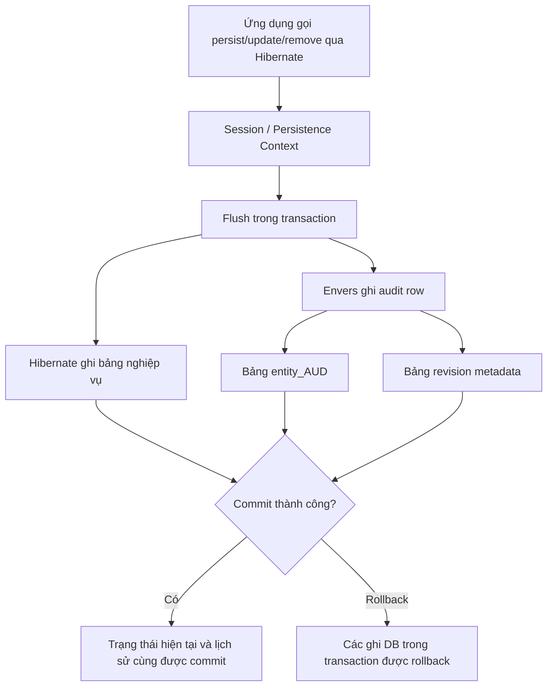

# Envers giải quyết nhu cầu kiểm toán thay đổi dữ liệu nào

## 1. Câu hỏi mở đầu: “Giá trị hiện tại” chưa đủ để giải thích lịch sử

Một ứng dụng Hibernate có bảng `purchase_orders`:

```sql
CREATE TABLE purchase_orders (
    id BIGINT PRIMARY KEY,
    status VARCHAR(30) NOT NULL,
    total_amount NUMERIC(18, 2) NOT NULL,
    customer_id BIGINT NOT NULL
);
```

Khi xem một đơn hàng:

```text
Order #1001
status       = CANCELLED
total_amount = 850000
customer_id  = 42
```

Ta chỉ biết **trạng thái hiện tại**. Nhưng nhân viên hỗ trợ, kiểm toán viên hoặc quản trị viên có thể đặt nhiều câu hỏi:

- Lúc khách thanh toán, `total_amount` là bao nhiêu?
- Trước khi bị hủy, Order có trạng thái nào?
- Trạng thái đã chuyển từ `PAID` sang `CANCELLED` ở đợt thay đổi nào?
- Khiếu nại xảy ra vào thứ Ba: dữ liệu Order lúc đó trông như thế nào?
- Có thể hiển thị lần lượt những phiên bản đã lưu của bản ghi không?
- Những entity nào được thêm, sửa hoặc xóa trong một lần chỉnh sửa?
- Có thể gắn thông tin người thực hiện và lý do với lần chỉnh sửa không?

Nếu database chỉ lưu một hàng hiện tại, thao tác:

```sql
UPDATE purchase_orders
SET status = 'CANCELLED'
WHERE id = 1001;
```

đã ghi đè trạng thái trước đó. Muốn điều tra lịch sử, ta phải có một nguồn dữ liệu lưu **những phiên bản trước**.

**Hibernate Envers** giải quyết nhu cầu cốt lõi này: **ghi lại lịch sử các trạng thái của entity được chọn để audit, theo những lần sửa đổi (revision), và truy vấn lại trạng thái tại revision cũ**.

Tuy nhiên, Envers không phải hệ thống ghi mọi sự kiện xảy ra trong doanh nghiệp hay cơ chế bảo mật không thể giả mạo. Bài học tập trung làm rõ **nhu cầu nào phù hợp, bằng chứng nào nó tạo được, giới hạn nào cần hệ thống khác**.

## 2. Envers là gì trong Hibernate ORM?

Envers là module **entity auditing** thuộc hệ sinh thái Hibernate ORM. Khi được tích hợp và bật audit cho một entity, Envers dùng cơ chế lắng nghe những thay đổi được ORM xử lý để ghi thêm dữ liệu lịch sử vào các **audit tables**.

Ví dụ:

```java
import jakarta.persistence.Entity;
import jakarta.persistence.Id;
import jakarta.persistence.Table;
import org.hibernate.envers.Audited;

@Entity
@Audited
@Table(name = "purchase_orders")
public class PurchaseOrder {
    @Id
    private Long id;

    private String status;

    private BigDecimal totalAmount;
}
```

Với cấu hình mặc định thường gặp, một bảng entity `purchase_orders` có bảng lịch sử tương ứng như `purchase_orders_AUD`, và có bảng revision metadata như `REVINFO`.

Một audit row mô tả **trạng thái entity ở revision nhất định** và loại thay đổi; bảng revision mô tả **một lần sửa đổi** có thể liên quan nhiều entity.

Không nên suy ra rằng:

- Mọi entity trong hệ thống tự được audit.
- Mọi thay đổi SQL trực tiếp đều được ghi.
- Envers tự biết danh tính người thao tác.
- Lịch sử có thể thay thế transaction log, sự kiện nghiệp vụ hoặc hệ thống giám sát bảo mật.

Đó là những yêu cầu khác cần thiết kế riêng.

## 3. “Kiểm toán thay đổi dữ liệu” có nhiều nghĩa

Các đội sản phẩm thường gọi chung mọi yêu cầu lịch sử là “audit”, nhưng thực tế có ít nhất năm nhóm:

| Nhu cầu | Câu hỏi điển hình | Envers phù hợp đến đâu? |
|---|---|---|
| **Lịch sử trạng thái entity** | Order trông thế nào ở revision N? | **Rất phù hợp** nếu thay đổi đi qua ORM và entity được audit |
| **Theo dõi ai/khi nào sửa** | Ai đổi địa chỉ khách hàng, lúc nào? | Có thể bổ sung **revision metadata** về actor; không tự biết mọi danh tính |
| **Nhật ký sự kiện nghiệp vụ** | Khách nhấn “Hủy đơn” vì lý do gì? | Chỉ thấy state change; cần domain event/metadata cho ý định và nguyên nhân |
| **Bảo mật/forensics toàn hệ thống** | Ai đã chạy SQL trực tiếp, kể cả DBA? | Không đủ; cần DB audit, access logs hoặc hạ tầng kiểm soát riêng |
| **Tái dựng hệ thống từ event stream** | Phát lại toàn bộ sự kiện để phục hồi projection? | Không phải mục tiêu chính; không thay thế event sourcing |

### Một quy tắc chọn công cụ

Nếu câu hỏi là **“đối tượng Java này có giá trị nào ở lần thay đổi trước?”**, Envers là ứng viên tốt.

Nếu câu hỏi là **“nghiệp vụ gì đã xảy ra, ai phê duyệt và thông điệp nào đã được gửi?”**, cần audit/domain event design rộng hơn.

Nếu câu hỏi là **“mọi thay đổi database, kể cả từ công cụ quản trị ngoài Hibernate, đã được ghi chống sửa/xóa chưa?”**, cần database-level audit hoặc giải pháp chuyên dụng.

## 4. Bản ghi entity hiện tại khác bản ghi lịch sử

Xét một đơn hàng đi qua ba thao tác:

```text
Revision 1:
  Tạo Order #1001
  status = NEW
  amount = 850000

Revision 3:
  Xác nhận thanh toán
  status = PAID
  amount = 850000

Revision 8:
  Hủy đơn
  status = CANCELLED
  amount = 850000
```

Trong bảng chính:

```text
purchase_orders
id=1001, status=CANCELLED, amount=850000
```

Trong dữ liệu Envers, ta có thể tìm lại các phiên bản ứng với revision 1, 3 và 8.

**Bảng chính** hỗ trợ nghiệp vụ hiện tại. **Audit tables** hỗ trợ lịch sử. Đây không phải hai bản sao hoàn toàn giống nhau: audit table còn có số revision, loại thao tác và cấu trúc riêng.

### Lịch sử không phải một chuỗi snapshot toàn bộ database

Nếu ở revision 3 chỉ có Order #1001 thay đổi, Envers không nhất thiết lưu lại tất cả các Order khác. Trạng thái lịch sử của một Order được dựng từ những audit rows của **chính entity đó** phù hợp revision cần tìm.

Vì vậy Envers có tính **theo thay đổi của entity**, không phải chụp toàn bộ database sau mỗi transaction.

## 5. Revision là gì?

Revision là một mốc thay đổi được Envers tạo khi một transaction có những thay đổi audited cần ghi.

Một revision có thể chứa lịch sử của nhiều entity:

```text
Transaction:
  Order #1001: status NEW -> PAID
  Payment #500: status PENDING -> SETTLED
  Inventory #A: quantity 10 -> 9

Envers revision R42:
  purchase_orders_AUD: (1001, R42, MOD, ...)
  payments_AUD:        (500,  R42, MOD, ...)
  inventory_AUD:       (A,    R42, MOD, ...)
```

Nếu các entity đó được audit và thao tác thông qua đường ORM được Envers theo dõi, chúng có thể thuộc cùng một revision của transaction.

### Revision không đồng nghĩa HTTP request

Một HTTP request có thể tạo nhiều transactions và do đó nhiều revisions. Ngược lại, một scheduled job hoặc message consumer có thể tạo revisions dù không có HTTP request.

Revision là khái niệm của **Envers transaction-based change tracking**, không phải ID của user interaction.

### Revision không đồng nghĩa một lần set field

Trong cùng một transaction:

```java
order.setStatus(OrderStatus.PAID);
order.setStatus(OrderStatus.CONFIRMED);
```

Nếu chỉ trạng thái cuối được ghi khi flush và Envers ghi nhận một entity change, lịch sử có thể chỉ chứa trạng thái `CONFIRMED` ở revision đó. Không có nghĩa Envers sẽ lưu mỗi lệnh gọi setter làm một phiên bản riêng.

Nếu cần biết từng business transition, kể cả các bước trung gian trong một transaction, phải tạo **domain events hoặc business log tường minh**.

## 6. Sơ đồ: ORM state và audit history



Trong cấu hình transaction/connection thông thường, các audit changes do Envers ghi được thực hiện cùng transaction database với thay đổi entity. Nếu transaction rollback, các audit inserts chưa commit cũng rollback.

Điều này giúp tránh tình huống bảng chính commit thành công nhưng audit row của thao tác Hibernate đó bị rollback riêng, **miễn là** chúng cùng transaction và đường ghi được Envers quản lý đúng.

Không nhầm “đã flush” với “đã commit”. Dữ liệu lịch sử chưa chắc được các transaction khác nhìn thấy trước commit.

## 7. Cấu trúc thường gặp: bảng chính, bảng audit và bảng revision

Ví dụ:

```sql
CREATE TABLE purchase_orders (
    id BIGINT PRIMARY KEY,
    status VARCHAR(30) NOT NULL,
    total_amount NUMERIC(18, 2) NOT NULL
);
```

Với cấu hình suffix mặc định thường gặp:

```text
purchase_orders
  id | status | total_amount

purchase_orders_AUD
  id | REV | REVTYPE | status | total_amount

REVINFO
  REV | REVTSTMP
```

`REV` liên kết audit row với revision metadata; `REVTYPE` mô tả dạng thay đổi. Tên cột/bảng thực tế có thể được tùy chỉnh và chịu ảnh hưởng naming strategy, version, schema và cấu hình.

### Ví dụ dữ liệu

```text
REVINFO
REV | REVTSTMP
  7 | timestamp_R7
  9 | timestamp_R9
 12 | timestamp_R12

purchase_orders_AUD
id   | REV | REVTYPE | status      | total_amount
1001 |   7 | ADD     | NEW         | 850000
1001 |   9 | MOD     | PAID        | 850000
1001 |  12 | DEL     | ...         | ...
```

`ADD`, `MOD`, `DEL` là tên ý nghĩa của các giá trị enum `RevisionType`; trong schema thường có biểu diễn số tương ứng, thường là 0/1/2 theo mapping Envers. Không viết ứng dụng giả định mọi deployment nhất thiết dùng literal text `ADD` trong cột.

Với DELETE, mặc định nhiều cấu hình Envers chỉ giữ ID/revision/type ở dòng xóa, còn các thuộc tính có thể là NULL. Có tùy chọn lưu dữ liệu entity tại thời điểm delete, sẽ được giải thích sau.

## 8. Bật Envers cho dự án Hibernate

Thêm module Envers với **cùng dòng phiên bản ORM** mà ứng dụng sử dụng.

Ví dụ Gradle khi đang dùng dependency management/BOM Spring Boot phù hợp:

```kotlin
dependencies {
    implementation("org.springframework.boot:spring-boot-starter-data-jpa")
    implementation("org.hibernate.orm:hibernate-envers")
}
```

Đây là ví dụ cho Spring Boot quản lý version tương ứng. Không tự phối Hibernate ORM core 6.x với Envers 7.x hoặc ngược lại; kiểm tra runtime dependency resolution.

Ví dụ Gradle không có BOM:

```kotlin
dependencies {
    implementation("org.hibernate.orm:hibernate-core:6.6.x.Final")
    implementation("org.hibernate.orm:hibernate-envers:6.6.x.Final")
}
```

`6.6.x.Final` là **ký hiệu giữ chỗ**, không phải version artifact để copy chạy trực tiếp. Thay bằng **một release thực tế giống nhau** của core và Envers; các tọa độ module có thể khác ở những đời Hibernate cũ.

### Envers không tự audit mọi class

Phải chọn entity hoặc thuộc tính:

```java
@Audited
@Entity
public class PurchaseOrder {
    // Các field được mapping.
}
```

Các entity không được đánh dấu audit sẽ không tự có history giống entity đã audit. Nếu relation liên quan entity không audited, phải thiết kế relation auditing phù hợp.

### Cần schema migration

Envers có thể phối hợp Hibernate schema tooling để tạo audit tables trong môi trường dev/test. Với production có dữ liệu cần giữ, nên dùng migration versioned như Flyway/Liquibase để thêm audit tables/constraints/index, rồi `validate` nếu phù hợp.

## 9. Ví dụ entity: audit những field quan trọng

```java
import jakarta.persistence.*;
import org.hibernate.envers.Audited;
import org.hibernate.envers.NotAudited;
import java.math.BigDecimal;
import java.time.Instant;

@Entity
@Table(name = "purchase_orders")
@Audited
public class PurchaseOrder {

    @Id
    @GeneratedValue(strategy = GenerationType.IDENTITY)
    private Long id;

    @Enumerated(EnumType.STRING)
    @Column(nullable = false)
    private OrderStatus status;

    @Column(name = "total_amount",
            nullable = false, precision = 18, scale = 2)
    private BigDecimal totalAmount;

    @Column(name = "created_at", nullable = false)
    private Instant createdAt;

    @NotAudited
    @Column(name = "internal_processing_hint")
    private String internalProcessingHint;

    protected PurchaseOrder() {}

    public Long getId() { return id; }
    public OrderStatus getStatus() { return status; }
    public BigDecimal getTotalAmount() { return totalAmount; }

    public void markPaid() {
        if (status != OrderStatus.NEW) {
            throw new IllegalStateException("Invalid transition");
        }
        status = OrderStatus.PAID;
    }
}
```

`@Audited` trên class yêu cầu audit những phần được hỗ trợ; `@NotAudited` trên field loại trường đó khỏi lịch sử.

### Vì sao chọn field để audit?

Vì lịch sử càng chi tiết thì:

- Audit tables càng lớn.
- Mỗi thay đổi ghi thêm dữ liệu.
- Dữ liệu cá nhân/bí mật có thể xuất hiện ở nhiều phiên bản lịch sử.
- Retention và quyền đọc càng phức tạp.

Chỉ audit những field cần giải đáp câu hỏi nghiệp vụ hoặc tuân thủ. Một field `internalProcessingHint` mang tính cache tạm có thể không đáng ghi lịch sử.

**Không dùng `@NotAudited` để che một trường nhạy cảm khỏi sự kiểm soát nghiệp vụ mà không xem xét yêu cầu audit thật sự.** Việc không ghi lại trường có thể đúng về minimization, nhưng quyết định phải có chủ đích.

## 10. Thêm, sửa, xóa: lịch sử nào được ghi?

Giả sử service:

```java
@Service
public class OrderService {

    private final OrderRepository repository;

    public OrderService(OrderRepository repository) {
        this.repository = repository;
    }

    @Transactional
    public void markPaid(Long id) {
        PurchaseOrder order = repository.findById(id)
            .orElseThrow();

        order.markPaid();
    }
}
```

Do `order` được Hibernate quản lý, dirty checking có thể phát SQL UPDATE khi flush. Nếu Order được audited và Envers listener nhận event đó, sẽ có audit revision cho thay đổi đã thực hiện.

Các operation thường gặp:

| Thao tác ORM | Ý nghĩa lịch sử khi audited | Lưu ý |
|---|---|---|
| `persist` entity mới | Revision kiểu ADD | ID generation và flush timing tùy mapping |
| Thay đổi managed entity, flush UPDATE | Revision kiểu MOD | Có thể không tạo audit row nếu không có thay đổi mapped audited hữu hiệu theo strategy/event |
| `remove` entity | Revision kiểu DEL | Giá trị field ở dòng delete tùy config |
| Đổi collection hoặc association audited | Revision liên quan có thể được tạo | Phụ thuộc mapping, owning side, Envers settings |
| Chỉ gọi setter rồi rollback | Không có lịch sử **đã commit** | SQL audit trong transaction cũng rollback |
| Nhiều setter trước cùng flush | Thường ghi nhận trạng thái cuối | Không phải lịch sử mỗi lần setter chạy |

Những dòng này mô tả use case ORM thông thường. Với entity generated properties, version fields, listeners, collection tables hay custom types, cần kiểm thử cụ thể.

## 11. Đọc danh sách revision bằng AuditReader

Envers cung cấp `AuditReader` để truy vấn lịch sử.

```java
import jakarta.persistence.EntityManager;
import org.hibernate.envers.AuditReader;
import org.hibernate.envers.AuditReaderFactory;
import java.util.List;

@Service
public class OrderHistoryService {

    @PersistenceContext
    private EntityManager em;

    @Transactional(readOnly = true)
    public List<Number> revisionsOf(long orderId) {
        AuditReader reader = AuditReaderFactory.get(em);
        return reader.getRevisions(PurchaseOrder.class, orderId);
    }
}
```

Kết quả có thể như:

```text
[7, 9, 12]
```

Danh sách cho biết những revision có lịch sử cho entity ID đó, không đồng nghĩa chính những con số là thời điểm hoặc ID của người dùng.

### Cần kiểm tra quyền đọc

Một service trả `getRevisions` cho ID bất kỳ có thể làm lộ sự tồn tại/lịch sử một đối tượng thuộc tenant khác. Trước khi truy vấn và trả dữ liệu:

- Xác nhận user/worker được đọc entity đó.
- Bảo đảm tenant scope.
- Hạn chế truy cập audit endpoints theo vai trò.
- Không suy rằng Hibernate filter hiện tại tự áp cho mọi query của Envers giống query entity thông thường.

Audit tables cũng là dữ liệu nhạy cảm.

## 12. Đọc trạng thái entity tại một revision

```java
@Transactional(readOnly = true)
public OrderHistoryView atRevision(long orderId, Number revision) {
    AuditReader reader = AuditReaderFactory.get(em);

    PurchaseOrder historical = reader.find(
        PurchaseOrder.class,
        orderId,
        revision
    );

    if (historical == null) {
        throw new HistoryNotFoundException();
    }

    return new OrderHistoryView(
        historical.getId(),
        historical.getStatus(),
        historical.getTotalAmount()
    );
}
```

DTO:

```java
public record OrderHistoryView(
    Long id,
    OrderStatus status,
    BigDecimal totalAmount
) {}
```

### Ý nghĩa của find(entity, id, revision)

Envers trả một đại diện lịch sử theo revision được chọn; đây **không phải** entity hiện tại được managed bằng cách thông thường để người dùng sửa rồi Hibernate tự hiểu cần thay đổi quá khứ.

Không lấy historical object và gọi `repository.save(historical)` để “khôi phục” mà không có quy trình rõ. Việc đó có thể ghi đè state hiện tại, quan hệ, version hoặc dữ liệu phát sinh sau revision cũ.

### Sau khi entity bị xóa

Tùy revision và API semantics, `find` có thể trả `null` nếu entity không tồn tại ở revision yêu cầu, chẳng hạn tại revision đã bị delete. Nếu cần xem bản trước khi xóa, truy vấn revision trước đó hoặc dùng history query phù hợp với delete rows.

## 13. Lấy cả entity snapshot, metadata và loại revision

Muốn hiển thị timeline:

```text
09:00  ADD  Order #1001 status=NEW
10:15  MOD  Order #1001 status=PAID
11:30  MOD  Order #1001 amount=850000
13:00  DEL  Order #1001
```

có thể dùng `AuditQuery`:

```java
import org.hibernate.envers.query.AuditEntity;
import org.hibernate.envers.RevisionType;

AuditReader reader = AuditReaderFactory.get(em);

@SuppressWarnings("unchecked")
List<Object[]> rows = reader.createQuery()
    .forRevisionsOfEntity(
        PurchaseOrder.class,
        false,   // Không chỉ entity snapshots; gồm metadata/type.
        true     // Bao gồm delete revisions.
    )
    .add(AuditEntity.id().eq(orderId))
    .addOrder(AuditEntity.revisionNumber().asc())
    .getResultList();

for (Object[] row : rows) {
    PurchaseOrder snapshot = (PurchaseOrder) row[0];
    Object revisionEntity = row[1];
    RevisionType type = (RevisionType) row[2];
    System.out.println(type + " " + snapshot.getId());
}
```

Với dạng query này, mỗi kết quả thường là **entity snapshot, revision entity, RevisionType** khi không dùng projection thay đổi kết quả. Các overload và cách return result có thể khác với các API truy vấn chỉ trả snapshots; đọc Javadocs tương ứng.

### Điều cần xác định trước khi expose timeline

- Có bao gồm delete rows không?
- Có cần hiển thị cả phiên bản đầu ADD không?
- Có cần phân trang vì số revision rất nhiều không?
- Người xem được thấy trường nhạy cảm nào?
- Có cần thông tin actor và reason từ revision metadata không?
- Có muốn hiển thị chỉ một số field nghiệp vụ không?

Không serialize trực tiếp toàn bộ entity historical graph thành JSON API nếu không chủ động kiểm soát dữ liệu và relation loading.

## 14. Revision number và revision timestamp

Envers có metadata cho revision, thông thường gồm:

- Số revision.
- Một timestamp cho revision.

Javadocs có các annotation:

```java
@RevisionNumber
@RevisionTimestamp
```

Một revision entity mặc định thường dùng `DefaultRevisionEntity` với những thông tin này.

### Timestamp nói điều gì?

Revision timestamp giúp sắp xếp/tra cứu mốc thời gian. Tuy nhiên, **không nên mặc định nó là chính xác thời điểm commit database** hay đồng hồ được đồng bộ giữa mọi application node.

Tùy cơ chế tạo revision, metadata có thể được gán trước commit. Nếu transaction rollback thì revision chưa commit bị rollback, nhưng timestamp vẫn không phải chứng cứ về nanosecond-level commit ordering.

Nếu yêu cầu so sánh chính xác thứ tự commit giữa nhiều hệ thống, cần công cụ mạnh hơn như database commit log/CDC, transaction metadata hoặc thiết kế event ordering riêng.

### Không đồng nhất revision ID với thời gian

Revision number thường hỗ trợ định danh revision và sắp xếp trong audit model, nhưng DB sequence/transaction concurrency có thể tạo gaps và khác thứ tự commit khi giao dịch cạnh tranh. Không dùng phép `revision + 1` để đo “lần thay đổi kế tiếp chắc chắn đã commit” hoặc suy luận khoảng thời gian.

## 15. Xem entity thay đổi trong một transaction

Nếu transaction cập nhật nhiều entities, cùng revision có thể liên kết chúng.

Ví dụ dịch vụ xử lý chuyển đơn:

```java
@Transactional
public void confirm(long orderId) {
    PurchaseOrder order = orderRepo.findById(orderId).orElseThrow();
    Payment payment = paymentRepo.findByOrderId(orderId).orElseThrow();

    order.markPaid();
    payment.markSettled();
}
```

Nếu cả hai classes được audited, chúng có thể tạo audit rows dưới một revision. Điều này giúp trả lời:

> Trong cùng lần thay đổi dữ liệu đã commit này, những entity audited nào đã có phiên bản mới?

Nhưng nếu business operation còn gửi email hoặc gọi gateway ngoài transaction, Envers **không tự ghi lại kết quả những side effects đó**.

Nếu hệ thống yêu cầu liệt kê các entity types đã thay đổi trong một revision, Envers có các cơ chế truy vấn/revision tracking và cross-type revision changes tùy cấu hình/version; không suy từ bảng `REVINFO` mặc định rằng nó chứa sẵn mọi entity type, field name hay business command.

## 16. Ghi ai thay đổi: revision metadata tùy chỉnh

Thông tin lịch sử mặc định thường đủ để biết **revision** và **thời điểm metadata**. Nhưng nhu cầu kiểm toán phổ biến còn hỏi:

- Ai là actor?
- Yêu cầu đến từ màn hình nào?
- Correlation/request ID?
- Job ID hoặc message ID?
- Lý do thay đổi?
- Tenant nào?

Envers cho phép tạo **revision entity** riêng và dùng `RevisionListener` để điền metadata.

Ví dụ:

```java
import jakarta.persistence.Column;
import jakarta.persistence.Entity;
import jakarta.persistence.Table;
import org.hibernate.envers.DefaultRevisionEntity;
import org.hibernate.envers.RevisionEntity;

@Entity
@Table(name = "audit_revision")
@RevisionEntity(ActorRevisionListener.class)
public class ActorRevision extends DefaultRevisionEntity {

    @Column(name = "actor_id", length = 120)
    private String actorId;

    @Column(name = "request_id", length = 120)
    private String requestId;

    public String getActorId() { return actorId; }
    public void setActorId(String actorId) { this.actorId = actorId; }

    public String getRequestId() { return requestId; }
    public void setRequestId(String requestId) {
        this.requestId = requestId;
    }
}
```

Listener:

```java
import org.hibernate.envers.RevisionListener;
import org.springframework.security.core.Authentication;
import org.springframework.security.core.context.SecurityContextHolder;

public class ActorRevisionListener implements RevisionListener {

    @Override
    public void newRevision(Object revisionEntity) {
        ActorRevision revision = (ActorRevision) revisionEntity;

        Authentication auth = SecurityContextHolder
            .getContext()
            .getAuthentication();

        String actor = auth == null
            ? "SYSTEM"
            : auth.getName();

        revision.setActorId(actor);
    }
}
```

Đoạn này chỉ minh họa lấy actor từ Spring Security ở **thread thực thi revision listener**. Trong job nền hoặc worker, `SecurityContextHolder` có thể không chứa user gửi request; có thể có anonymous principal hoặc service identity. Vì thế:

- Actor metadata cần quy ước tin cậy.
- Với background jobs, truyền/persist `initiatedByUserId` khi tạo job, sau đó điền từ job context.
- Không tin các header/query params bất kỳ là danh tính được xác thực.
- Nếu listener cần inject Spring bean, phải dùng integration phù hợp với Hibernate version, không giả định listener được Spring tự quản lý.
- Mọi thread-local context phải được clear khi thread pool tái sử dụng.

**Revision metadata là dữ liệu do ứng dụng ghi**. Nếu app bỏ qua điền actor hoặc bị giả mạo context, Envers không có cơ chế thần kỳ xác minh danh tính.

## 17. “Ai làm” và “tại sao làm” là hai câu hỏi khác nhau

Actor:

```text
actorId = "operator-17"
```

không giải thích lý do:

```text
reason = "Customer requested cancellation"
ticketId = "SUP-4821"
```

Nếu nghiệp vụ cần lưu `reason`, phải xác định cách thu thập/kiểm soát nó:

- Trường bắt buộc trong command/application service.
- Lưu vào domain event hoặc business audit log trong cùng transaction.
- Một custom revision field nếu phù hợp scope một revision.
- Gắn một correlation ID liên kết với ticket/approval record.

### Bẫy revision-level reason

Nếu transaction sửa **nhiều entities với nhiều lý do khác nhau**, một `reason` gắn duy nhất vào revision có thể không đủ. Khi đó, lưu reason ở mức **business event hoặc entity change record** có thể đúng hơn.

Envers ưu tiên lưu **state snapshots**; nó không tự đọc ý định của service method hoặc hiểu nội dung của một workflow phê duyệt.

## 18. Lịch sử thay đổi field: snapshot và modified flags

Một audit row có thể chứa snapshot các field được audit:

```text
REV=10
status=PAID
total_amount=850000
shippingAddress="..."
```

Nếu muốn biết **field nào đã thay đổi ở revision đó**, có thể:

1. So sánh hai snapshots liên tiếp.
2. Dùng Envers **modified flags** khi được cấu hình hỗ trợ.

Ví dụ:

```java
@Audited(withModifiedFlag = true)
@Entity
public class PurchaseOrder {
    // ...
}
```

Ở các phiên bản hỗ trợ, audit table có thể thêm những cột cờ như `status_MOD`, `totalAmount_MOD`, ... theo naming/configuration.

### Flag trả lời câu hỏi nào?

Ví dụ:

```text
REV=10:
  status = PAID
  status_MOD = true
  totalAmount_MOD = false
```

Điều này giúp lọc những revision có thay đổi property được quan tâm, thay vì kéo snapshots về Java để so sánh.

### Giới hạn

- Cờ mô tả **ORM-detected modified property**, không phải business reason.
- Với custom types/collections/associations, xác định flag semantics theo mapping/version.
- Modified flags tăng số cột và chi phí lưu trữ.
- Không nên bật mọi cờ trên mọi entity chỉ vì “càng nhiều audit càng tốt”.

Với nhu cầu so sánh hai version đơn giản, DTO diff trên snapshots có thể đủ.

## 19. RevisionType: thêm/sửa/xóa chưa chắc nói đủ về nghiệp vụ

`RevisionType.ADD`, `MOD`, `DEL` giúp phân biệt thao tác dữ liệu.

Nhưng:

```text
MOD: status NEW -> PAID
```

không tự nói “khách thanh toán thẻ thành công”, “nhân viên xác nhận thủ công” hay “job reconciliation sửa lại trạng thái”.

Để biết **nguyên nhân**, cần:

- Business command/event type.
- Actor, channel, ticket/reference ID.
- Transactional outbox/domain event.
- Approval record hoặc workflow state.

Một thay đổi `MOD` có thể là bug fix, admin patch, automated processing hoặc hành động người dùng. Envers không tự suy luận được.

## 20. Điểm mạnh 1: điều tra lịch sử của một bản ghi

Ví dụ support nhận báo cáo:

> Hôm qua giá đơn hàng là 1.200.000 đồng, hôm nay thành 1.350.000 đồng.

Nếu `totalAmount` audited:

1. Kiểm tra các revision của Order ID.
2. Đọc snapshots trước/sau khoảng thời gian nghi ngờ.
3. So sánh giá trị amount.
4. Đọc revision actor/request metadata nếu có.
5. Đối chiếu với logs/payment/approval records.

Kết quả hữu ích:

```text
R105 — totalAmount = 1,200,000
R110 — totalAmount = 1,350,000
Actor (nếu có): operator-17
```

Nhưng nếu thay đổi thực tế được chạy bằng một SQL maintenance script ngoài Hibernate, Envers có thể **không có R110**. Vì thế, một lịch sử không có thay đổi không luôn chứng minh database chưa từng bị chỉnh sửa.

## 21. Điểm mạnh 2: xem trạng thái ở thời điểm trước

Một ứng dụng cần khôi phục giao diện bản nháp hợp đồng hoặc hồ sơ khách hàng ở thời điểm trước khi bị sửa.

Envers cho phép truy vấn snapshot entity tại một revision. Có thể xây timeline:

```text
Hồ sơ khách hàng #42:
  Revision 7: phone = 090...
  Revision 9: phone = 091...
  Revision 13: address = "..."
```

### Truy vấn tại một timestamp

Envers hỗ trợ cơ chế tìm revision liên quan thời điểm thông qua `AuditReader`, ví dụ những API kiểu `getRevisionNumberForDate(...)` trong phiên bản phù hợp.

Một bước:

```java
AuditReader reader = AuditReaderFactory.get(em);
Number revision = reader.getRevisionNumberForDate(
    Date.from(targetInstant)
);

PurchaseOrder order = reader.find(
    PurchaseOrder.class,
    orderId,
    revision
);
```

Điều này dựa trên **revision timestamps** và quy tắc “revision gần nhất không sau thời điểm” của API. Nó không biến Envers thành temporal database với đầy đủ semantics transaction commit timestamp, bitemporal validity hay snapshot nhất quán xuyên mọi hệ thống.

### Điều cần phân biệt

**Transaction time**: thời điểm hệ thống ghi nhận thay đổi.

**Valid/effective time**: thời điểm giá trị được coi có hiệu lực về nghiệp vụ (có thể được nhập hồi tố).

Envers chủ yếu theo dõi thay đổi được ORM ghi theo revisions; nếu hệ thống cần cả hai trục thời gian, phải thiết kế thêm **bitemporal model**.

## 22. Điểm mạnh 3: hỗ trợ kiểm tra thay đổi trái mong muốn

Một thao tác admin vô tình cập nhật sai trạng thái nhiều Orders.

Nếu những Orders được audit qua managed entity updates, có thể:

- Liệt kê affected IDs và revisions.
- Xem state trước thao tác.
- Xác định các giá trị bị thay đổi.
- Hỗ trợ dựng một script/command **bù đắp** sau khi kiểm tra.

### Khôi phục không đồng nghĩa “quay thời gian toàn hệ thống”

Nếu Order lúc R10 có `status=PAID`, sau đó:

```text
R11: Order shipped
R12: Payment refunded
R13: Order cancelled
```

thì khôi phục toàn bộ entity từ R10 có thể:

- Vi phạm state machine.
- Ghi đè địa chỉ/số tiền người dùng đã cập nhật hợp lệ.
- Mâu thuẫn với Payment/Inventory.
- Phá `@Version` hoặc optimistic locking.

Phương án đúng là **đọc lịch sử để hỗ trợ một business correction mới** trong transaction hiện tại. Correction đó lại tạo revision mới, thay vì âm thầm sửa bảng audit cũ.

## 23. Điểm mạnh 4: theo dõi thay đổi trên nhiều entity audited

Trong cùng transaction, Envers có thể liên kết các audit rows với một revision chung.

Ví dụ:

```text
R500:
  Customer #42  MOD
  Address  #7   MOD
  Order    #91  ADD
```

Điều này giúp xem nhóm những data operations được xử lý cùng transaction ORM.

Nhưng:

- Không chắc tất cả entities của toàn hệ thống đều audited.
- Không chắc những bảng được sửa bằng SQL trực tiếp có audit rows.
- Không chắc cùng revision tương ứng đúng một business event.
- Không chắc revision metadata chứa actor/reason nếu chưa custom.

**Một revision là nhóm audit records, không phải bản mô tả đầy đủ của business transaction.**

## 24. Những thay đổi nào Envers không tự ghi?

Đây là giới hạn cốt lõi khi chọn Envers.

### 24.1. Native SQL trực tiếp

```java
entityManager.createNativeQuery(
    "update purchase_orders " +
    "set status = 'CANCELLED' " +
    "where id = :id"
)
.setParameter("id", id)
.executeUpdate();
```

Câu SQL trực tiếp thay hàng database; nó không xử lý từng entity qua lifecycle event bình thường của Envers. **Không mặc định có Envers audit row** tương ứng.

### 24.2. HQL/JPQL bulk UPDATE hoặc DELETE

```java
entityManager.createQuery(
    "update PurchaseOrder o " +
    "set o.status = :status " +
    "where o.createdAt < :cutoff"
)
.setParameter("status", OrderStatus.EXPIRED)
.setParameter("cutoff", cutoff)
.executeUpdate();
```

Bulk DML hoạt động trực tiếp ở mức database rows, không load từng entity để gọi listener. Không mặc định Envers audit các hàng đó.

### 24.3. JDBC/JdbcTemplate ngoài entity lifecycle

```java
jdbcTemplate.update(
    "delete from purchase_orders where id = ?",
    orderId
);
```

JDBC statement không tự qua Envers entity event listeners.

### 24.4. Database jobs, triggers và DBA scripts

Nếu DBA chạy SQL trực tiếp hoặc database trigger đổi cột, Envers không tự biết toàn bộ sự kiện đó. Một số trường trong entity có thể được DB trigger sửa khi Hibernate chạy SQL, nhưng bản audit có thể phản ánh **state mà Hibernate biết** thay vì mọi giá trị cuối do trigger biến đổi, tùy mapping/generated property handling.

### 24.5. Thay đổi ngoài database

Email gửi đi, message publish, cache eviction, API call hay file được tạo không nằm trong entity audit tables trừ khi ứng dụng lưu các sự kiện đó thành audited entities riêng.

### 24.6. Một số đường Hibernate API đặc thù

`StatelessSession` và các operation không đi qua stateful entity event model có semantics khác theo Hibernate version. Không suy luận rằng mọi lệnh `insert/update/delete` ở API nào cũng sinh Envers history như `Session.persist`/managed update. **Kiểm thử đường ghi thực tế** nếu ứng dụng sử dụng stateless/bulk pipelines.

## 25. Bảng quyết định theo nguồn thay đổi

| Nguồn thay đổi | Có nên kỳ vọng Envers tự ghi lịch sử? | Ghi chú |
|---|---|---|
| `EntityManager.persist` entity `@Audited` | Có trong luồng ORM thông thường | Transaction phải commit |
| Sửa managed entity rồi flush | Có khi tạo audited update event | Dirty checking và property mapping |
| `EntityManager.remove` audited entity | Có trong luồng ORM thông thường | Audit delete row semantics |
| HQL `update/delete` bulk | **Không** | Bypass per-entity Envers event handling |
| Native `UPDATE` | **Không** | SQL trực tiếp |
| JdbcTemplate `UPDATE` | **Không** | Không dùng Envers |
| DBA sửa bảng bằng SQL | **Không** | Cần DB-level auditing |
| DB trigger thay đổi row | Không có bảo đảm đầy đủ | Cần test generated values và DB audit |
| HTTP request chỉ đọc dữ liệu | Không có history change | Envers không phải access log |
| Gửi email, gọi external API | Không | Cần business event/outbox/log |
| Đổi Java object detached nhưng không persist | Không | DB không đổi |
| Flush rồi rollback | Không có bản audit **đã commit** | Transaction rollback |

Đây là khác biệt giữa **application-level entity auditing** và **database-wide change auditing**.

## 26. Vì sao Envers không phải access log?

Audit lịch sử thay đổi dữ liệu và audit truy cập là hai yêu cầu khác:

```text
Change audit:
  Ai/sự kiện nào đã sửa Order #1001?
  Trước/sau là gì?

Access audit:
  Ai đã XEM hồ sơ #42?
  Ai đã EXPORT 10.000 records?
  Có ai đọc dữ liệu nhạy cảm trái phép?
```

Envers chủ yếu ghi phiên bản của audited entity khi thay đổi, **không ghi mọi SELECT, export hoặc thao tác xem**.

Nếu hệ thống cần kiểm tra truy cập dữ liệu sức khỏe/tài chính/cá nhân, nên có access audit logs hoặc database access monitoring có chính sách lưu trữ/kiểm soát riêng.

Không dùng việc không có revision mới làm bằng chứng rằng không ai đã xem dữ liệu.

## 27. Envers khác Spring Data JPA auditing như thế nào?

Spring Data có annotation:

```java
@CreatedDate
@LastModifiedDate
@CreatedBy
@LastModifiedBy
```

Ví dụ:

```java
@Entity
@EntityListeners(AuditingEntityListener.class)
public class Customer {

    @CreatedDate
    private Instant createdAt;

    @LastModifiedDate
    private Instant lastModifiedAt;

    @CreatedBy
    private String createdBy;

    @LastModifiedBy
    private String modifiedBy;
}
```

Để hoạt động cần cấu hình Spring Data auditing phù hợp, ví dụ `@EnableJpaAuditing` và `AuditorAware` nếu lấy actor.

### Khác biệt chính

| Spring Data JPA auditing | Envers |
|---|---|
| Ghi created/last modified metadata lên entity hiện tại | Ghi nhiều phiên bản của entity vào audit tables |
| Trả lời “ai sửa gần nhất?” | Có thể trả lời “entity trông thế nào ở revision N?” |
| Không tự giữ mọi giá trị cũ của field | Ghi snapshots lịch sử cho thuộc tính audited |
| Dễ dùng cho metadata hiện tại | Phù hợp lịch sử thay đổi nhiều revision |
| Vẫn phụ thuộc đường ghi ORM | Cũng phụ thuộc đường ghi ORM được audited |

Hai cơ chế có thể **bổ sung** nhau: màn hình chính hiển thị `lastModifiedAt` từ entity hiện tại, còn màn hình lịch sử đọc Envers.

Không dùng `@LastModifiedDate` như một thay thế cho bảng lịch sử khi phải biết nhiều phiên bản cũ.

## 28. Envers khác database triggers và CDC

### Database trigger audit

Database trigger có thể ghi old/new row khi DML xảy ra:

```text
Any client -> INSERT/UPDATE/DELETE -> DB trigger -> audit table
```

Ưu điểm tiềm năng:

- Bao phủ cả JDBC/native SQL/DB scripts nếu DML đi qua trigger.
- Có thể enforce tại database, không phụ thuộc mọi app đều dùng Hibernate.

Nhược điểm và thách thức:

- Phụ thuộc SQL dialect và DB trigger code.
- Mapping old/new fields, performance và schema migration phức tạp.
- Có thể thiếu business actor/reason nếu DB session context không được thiết kế.
- DBA quyền cao có thể thay/tắt trigger nếu không có kiểm soát.

### Change Data Capture (CDC)

CDC thường khai thác database change log để phát hiện thay đổi rows:

```text
Database WAL/binlog -> CDC connector -> change events -> downstream
```

CDC hỗ trợ replication, data pipeline và theo dõi thay đổi database rộng hơn ORM. Nhưng cần:

- Connector/replay semantics.
- Schema evolution.
- Event ordering.
- Retention, deduplication, bảo mật payload.
- Phân biệt transaction log operation với business intent.

### Envers đặt ở đâu?

Envers thích hợp khi Hibernate là đường ghi chính và bài toán là **đọc lịch sử entity ngay trong cùng ứng dụng**. Triggers/CDC phù hợp hơn nếu yêu cầu bao phủ mọi database writers hoặc đồng bộ changes cho hệ thống khác.

Không có công cụ nào tự động thay thế toàn bộ chức năng của các công cụ còn lại.

## 29. Envers khác transactional outbox

Outbox lưu **ý định phát sự kiện/integration message** trong cùng transaction:

```text
Order được thanh toán
    |
    +-- UPDATE order
    |
    +-- INSERT outbox_event(type='OrderPaid', payload=...)
    |
    +-- COMMIT
            |
            v
       Dispatcher gửi message
```

Envers có thể ghi thêm lịch sử:

```text
purchase_orders_AUD: status=PAID at revision R500
```

Nhưng audit row này **không phải thông điệp tích hợp** có delivery state, retries, consumer acknowledgment hoặc idempotency protocol.

Một hệ thống có thể dùng cả hai:

- Envers: xem lại phiên bản dữ liệu.
- Outbox: đảm bảo ý định xuất bản business event không mất sau commit.

Không gửi email hoặc Kafka event dựa trên việc đọc mỗi revision mới nếu chưa thiết kế ordering, duplication, retention và delivery contract.

## 30. Envers khác event sourcing

Event sourcing lưu chuỗi **domain events là nguồn sự thật**:

```text
OrderCreated
ItemAdded
PaymentConfirmed
ShippingAddressChanged
OrderCancelled
```

Trạng thái hiện tại được dựng lại từ các events theo quy tắc domain.

Envers thường lưu **snapshots của entity states sau thay đổi**, còn bảng hiện tại vẫn là nguồn trạng thái chính để ứng dụng làm việc.

### Ví dụ

```text
Envers:
  R1: status=NEW, amount=100
  R2: status=PAID, amount=100
  R3: status=CANCELLED, amount=100

Event sourcing:
  E1: OrderCreated(items=[...])
  E2: PaymentCaptured(paymentId=..., provider=...)
  E3: CancellationRequested(reason=...)
  E4: RefundApproved(...)
```

Trong Envers, nguyên nhân business transition không được ghi nếu không lưu metadata/event riêng. Với event sourcing, domain events có thể chứa intent/causality giàu thông tin hơn nhưng đòi hỏi kiến trúc event versioning/replay phức tạp.

**Envers không tự biến một CRUD application thành hệ thống event-sourced.**

## 31. Envers có phải nguồn bằng chứng chống sửa đổi không?

Audit tables Envers nằm trong database và thường được quản lý cùng schema/application credentials.

Nếu một người có đủ quyền database:

- UPDATE/DELETE `entity_AUD`.
- Sửa `REVINFO`.
- Drop/rebuild audit tables.
- Tắt/audited paths hoặc chạy SQL bypass.

thì lịch sử có thể bị sửa hoặc thiếu mà Envers không tự ngăn chặn hoàn toàn.

Vì vậy, với yêu cầu compliance/forensics nghiêm ngặt, phải phân biệt:

1. **Functional audit history**: hỗ trợ sản phẩm và điều tra nghiệp vụ.
2. **Tamper-evident/tamper-resistant evidence**: có cơ chế phát hiện/ngăn giả mạo, phân quyền, xuất log bất biến, ký hash, retention, legal hold.

Envers hỗ trợ (1). Để đáp ứng (2), có thể cần hệ thống log độc lập, WORM/immutable storage, DB auditing, hạn chế quyền DML trên audit tables và review quy trình vận hành.

Không hứa “không thể xóa lịch sử” chỉ vì entity có `@Audited`.

## 32. DELETE audit và tùy chọn lưu state tại lúc xóa

Khi xóa audited entity:

```java
entityManager.remove(order);
```

Envers có revision kiểu DEL. Theo cấu hình mặc định thường gặp, audit row của DELETE có thể chỉ có ID/revision/type, còn các field audited khác là NULL.

Envers có tùy chọn:

```properties
org.hibernate.envers.store_data_at_delete=true
```

để lưu dữ liệu tại thời điểm delete trong audit row, tùy mapping/version hỗ trợ.

### Đánh đổi

- Có data at delete: query lịch sử xóa có thể thuận tiện hơn.
- Không có: ít dữ liệu trùng lặp hơn; có thể lấy state ở revision trước khi xóa.
- Với PII: lưu dữ liệu xóa vào lịch sử có thể mâu thuẫn yêu cầu retention/erasure.

Không bật `store_data_at_delete` theo thói quen mà chưa xác định yêu cầu lưu dữ liệu sau xóa.

## 33. Audit relations: lịch sử entity graph phức tạp hơn field đơn

Một Order có Customer và OrderLines:

```java
@Entity
@Audited
public class PurchaseOrder {

    @ManyToOne(fetch = FetchType.LAZY)
    private Customer customer;

    @OneToMany(mappedBy = "order")
    private List<OrderLine> lines;
}
```

Những câu hỏi cần trả lời:

- Có muốn biết Customer nào được gán cho Order ở revision cũ không?
- Customer có cần được audit để xem **tên/địa chỉ cũ** không?
- Nếu OrderLine thay đổi quantity, lịch sử Order có phải tạo revision mới không?
- Quan hệ là owning side nào?
- Dữ liệu collection được ghi ở table nào?

### Một relation tới entity không audited

Một số association có thể cấu hình `targetAuditMode = RelationTargetAuditMode.NOT_AUDITED`:

```java
@Audited(
    targetAuditMode = RelationTargetAuditMode.NOT_AUDITED
)
@ManyToOne
private Country country;
```

Điều này phù hợp trong một số domain khi `Country` là dữ liệu tham chiếu không cần lịch sử. Nhưng khi xem Order ở revision cũ, relation tới `Country` có thể phân giải theo **trạng thái hiện tại của target**, không phải bản Country lịch sử.

Nếu yêu cầu một **snapshot toàn bộ graph ở quá khứ**, phải audit cả những target cần thiết và kiểm chứng relation query. Không mặc định `@Audited` trên root đủ giữ mọi thứ trong graph đúng theo thời điểm.

## 34. Collection changes và revision semantics

Hibernate Envers có xử lý audit một số thay đổi của audited collections/relations. Một cấu hình thường gặp:

```properties
org.hibernate.envers.revision_on_collection_change=true
```

Giá trị mặc định và cách tương tác với relation owning/not-owning side cần kiểm tra theo Envers version.

### Tình huống

```java
order.getLines().add(line);
```

Nếu thêm line không cập nhật owning side `line.setOrder(order)` trong một bidirectional association, ORM relation có thể không được lưu đúng; Envers cũng không thể tự biến một object graph sai thành lịch sử đúng.

Nên:

- Duy trì quan hệ hai chiều nhất quán trong domain methods.
- Xác định entity nào là audited.
- Test thêm/sửa/xóa child và reassign parent.
- Test lịch sử query của root sau các thay đổi collection.
- Không xem cùng một revision trên root là đủ để suy ra tất cả child histories.

## 35. Revision strategy: mặc định và validity

Envers hỗ trợ các audit strategies ảnh hưởng cách tìm phiên bản có hiệu lực ở một revision.

### DefaultAuditStrategy

Thường lưu revision bắt đầu của mỗi audit row. Khi tìm state tại revision N, Envers tìm audit record mới nhất không vượt quá N cho entity đó theo strategy/query.

Ý tưởng:

```text
Entity id=1001:
  REV=7  NEW
  REV=9  PAID
  REV=12 CANCELLED

State at REV=10 -> bản ghi REV=9
```

### ValidityAuditStrategy

Có thể lưu thêm revision kết thúc hiệu lực (ví dụ `REVEND`) để các bản audit thể hiện một khoảng validity theo revision.

```text
REV=7,  REVEND=9
REV=9,  REVEND=12
REV=12, REVEND=NULL
```

Điều này có thể giúp một số historical queries hoặc join patterns, nhưng khi ghi version mới thường cần update end-revision của bản trước, làm tăng DML/locking và cần migration riêng.

### Cấu hình minh họa

```properties
org.hibernate.envers.audit_strategy=org.hibernate.envers.strategy.ValidityAuditStrategy
```

Không đổi audit strategy trên database đã có lịch sử mà chỉ sửa property: audit tables cũ có thể cần thêm cột/điền validity ranges, tạo indexes và được migrate theo version.

**Chọn strategy theo queries và đo hiệu năng**, không kết luận strategy nào luôn nhanh hơn.

## 36. Envers và schema migration

Khi bật `@Audited` cho entity đang có dữ liệu, một số trường hợp cần:

- Tạo audit table với ID, revision, type và cột audited.
- Tạo revision table.
- Tạo foreign keys/index phù hợp.
- Quy định naming/schema.
- Quyết định có backfill lịch sử trước ngày bật Envers không.

### Lịch sử không xuất hiện ngược thời gian

Nếu Customer tồn tại từ năm 2020 và Envers chỉ được bật năm 2026, Envers không tự biết mọi phiên bản từ 2020 đến 2025.

Có thể tạo **baseline snapshot** có chủ đích tại thời điểm triển khai để ghi nhận state hiện tại, nhưng đó **không phải lịch sử thực sự** của những năm trước.

Nếu business yêu cầu lịch sử trước khi bật, cần nhập từ audit logs/CDC/backups có nguồn chứng cứ và metadata rõ. Không tự tạo revisions giả như thể những hành động quá khứ đã được hệ thống quan sát trực tiếp.

### Trên production

Dùng Flyway/Liquibase hoặc migration process có review để thêm bảng audit. Kiểm tra naming, constraint, data types và Hibernate version. Không để `hbm2ddl.auto=update` tự sửa schema production mà không có lịch sử migration.

## 37. Envers và chuyển đổi schema của audited fields

Khi entity thay đổi:

```java
// Trước
@Column(name = "customer_name")
private String customerName;

// Sau
@Column(name = "display_name")
private String displayName;
```

nếu field được audited, có thể phải migrate **cả bảng chính và audit table**, đồng thời giữ semantics của dữ liệu lịch sử.

Một migration chỉ đổi cột hiện tại có thể khiến Envers historical query lỗi vì audit table còn tên cũ hoặc mất dữ liệu.

Các thay đổi cần xem xét:

- Rename field/column.
- Đổi enum ORDINAL sang STRING.
- Đổi type/precision/scale.
- Thêm/bỏ audited properties.
- Đổi inheritance mapping.
- Đổi association và collection audit tables.
- Đổi revision entity schema hoặc audit strategy.

**Một lịch sử đã ghi là dữ liệu production cần bảo toàn**, không phải cache có thể xóa rồi tạo lại tùy ý.

## 38. Không được xem Envers như công cụ giữ backup

Envers lưu những phiên bản entity được audit trong cùng hệ thống database. Nó không thay thế:

- Backup/PITR.
- Disaster recovery.
- Bảo vệ khỏi drop database.
- Khôi phục toàn bộ index/constraint/role.
- Khôi phục data từ các writers không được audited.

Nếu mất toàn bộ database gồm bảng chính và bảng audit, lịch sử Envers cũng có thể mất.

**Audit history** hỗ trợ xem lại thay đổi. **Backup/DR** bảo vệ khả năng khôi phục hệ thống trước sự cố hạ tầng hoặc thao tác phá hoại.

## 39. Retention, dung lượng và độ lớn audit tables

Mỗi thay đổi audited có thể ghi thêm một audit row. Một entity cập nhật 100 lần tạo nhiều phiên bản, không chỉ một.

Giả sử:

```text
100,000 Orders
Trung bình 20 revisions cho mỗi Order

~2,000,000 audit rows cho Order
chưa kể Payment, Customer, Address, lines, indexes, revision metadata
```

Đây chỉ là ước lượng theo giả định, không phải công thức cố định: số revisions thực tế phụ thuộc transaction changes, mapped properties, collection behavior và audit strategy.

### Tác động hiệu năng

- Ghi thêm audit rows làm tăng DB DML, WAL/redo và storage.
- Indexes audit giúp truy vấn nhưng làm tăng write cost.
- Historical queries có thể cần joins và subqueries.
- Revision metadata có thể trở thành điểm truy cập nóng tùy workload.
- Bảng audit khổng lồ cần chính sách archive/partition/retention được thiết kế.

### Không xóa revision history tùy tiện

Các bản audit có liên kết và revision ranges. Xóa một phần dữ liệu mà không xét strategy và foreign keys có thể làm lịch sử không đầy đủ hoặc query sai.

Trước khi retention/purge:

1. Xác định thời hạn pháp lý và nghiệp vụ.
2. Kiểm tra legal hold.
3. Quy định thời điểm cần giữ bản baseline.
4. Kiểm tra audit strategy và quan hệ.
5. Archive/restore test.
6. Đo ảnh hưởng query/index.

## 40. Dữ liệu cá nhân trong lịch sử: vấn đề privacy/GDPR

Audit bảng cũ có thể giữ:

- Số điện thoại trước khi người dùng đổi.
- Địa chỉ giao hàng cũ.
- Email cũ.
- Thông tin định danh đã được “xóa” khỏi bảng chính.

Nếu ứng dụng chỉ xóa dữ liệu từ bảng hiện tại nhưng giữ nguyên trong `_AUD`, yêu cầu privacy/data erasure có thể chưa được đáp ứng.

### Câu hỏi cần thống nhất

- Loại dữ liệu nào bắt buộc giữ vì quy định?
- Dữ liệu nào được phép anonymize?
- Khi xóa một customer, audit history có được giữ nguyên PII không?
- Khóa mã hóa/retention ra sao?
- Ai được đọc lịch sử?
- Có cần redaction hoặc xóa theo chính sách không?

Không tự khẳng định “GDPR buộc xóa tất cả lịch sử” hoặc “audit được miễn mọi yêu cầu xóa”. Nghĩa vụ cụ thể phụ thuộc luật áp dụng, cơ sở pháp lý, mục đích xử lý và chính sách của tổ chức; cần phối hợp chuyên gia privacy/compliance.

### Gợi ý thiết kế

- Audit có chọn lọc.
- `@NotAudited` với field không cần lịch sử và rủi ro cao.
- Tách dữ liệu nhạy cảm vào module/store có chính sách retention riêng.
- Mã hóa và quản lý khóa phù hợp.
- Role-based read access, redaction trong API.
- Chính sách purge/archive có kiểm toán.

## 41. Envers và bảo mật quyền đọc lịch sử

Một endpoint:

```text
GET /orders/1001/history
```

có thể trả địa chỉ cũ, giá tiền cũ, actor ID và thời điểm thay đổi. Dữ liệu ấy nhạy cảm hơn màn hình Order hiện tại.

Không expose raw Envers entity object hoặc revision table không có authorization.

### Checklist

- Xác thực người dùng.
- Kiểm tra quyền xem **Order và lịch sử**.
- Kiểm tra tenant của Order.
- Áp redaction nếu role không được xem PII cũ.
- Giới hạn page size/rate để tránh quét lịch sử hàng loạt.
- Audit chính hành vi xem/export lịch sử nếu cần.
- Giữ actor metadata không rò email/tokens.

### Multi-tenancy

Envers tables cũng cần tenant isolation. Với shared-table tenancy, audit tables/revision metadata phải được thiết kế/query theo tenant phù hợp. Không giả định mọi entity filter sẽ được áp y hệt vào một audit query, và không lấy order ID đơn lẻ làm bằng chứng authorization.

Nếu dùng schema-per-tenant, audit tables cũng cần có trong mỗi schema và migration đúng tenant. Phải test trên đúng Hibernate multi-tenancy setup.

## 42. Các giới hạn của revision metadata về thời gian và thứ tự

Envers giúp đánh dấu các revisions nhưng không phải “đồng hồ toàn cục hoàn hảo”.

Ví dụ hai transactions đồng thời:

```text
Transaction A:
  tạo revision R100
  xử lý lâu
  commit sau

Transaction B:
  tạo revision R101
  commit trước A
```

Trật tự allocation number/timestamp không nhất thiết phản ánh tuyệt đối **thứ tự commit visible** ở mọi database/cấu hình.

Với nhu cầu:

- Đồng bộ message theo thứ tự commit chính xác.
- Global ordering xuyên nhiều services/databases.
- Phát lại event một cách deterministic.

thì cần transaction log/CDC, business sequence hoặc event ordering contract riêng.

Không gắn một sequence REV rồi coi đã có thứ tự sự kiện toàn hệ thống.

## 43. Hiệu năng truy vấn lịch sử và indexes

Một truy vấn phổ biến:

```text
Tìm tất cả revisions của entity id=1001
Sắp theo revision number
```

Audit table thường cần key/index phù hợp với:

- Entity ID + REV.
- REV cho truy vấn across entities nếu cần.
- Tenant ID hoặc business dimensions nếu query history theo tenant.
- `REVEND` nếu dùng validity strategy.
- Modified flags và property search patterns nếu dùng.

Chỉ số index cần đo trên workload thực tế. Không phải mọi audit query đều cần một index riêng cho từng property.

### Đừng tải toàn bộ history không giới hạn

Một entity có thể có hàng nghìn revisions; API nên:

- Phân trang hoặc giới hạn history list.
- Dùng DTO thay vì serialize graph.
- Trả những field cần cho màn hình.
- Hạn chế truy vấn tất cả entities/revisions không có điều kiện.

Nếu cần báo cáo audit quy mô lớn hoặc tìm kiếm phức tạp, có thể xây read model/data warehouse riêng từ nguồn đáng tin, thay vì dùng Envers query trực tiếp trong request nóng.

## 44. Envers với optimistic locking và @Version

Một entity dùng:

```java
@Version
private long version;
```

`@Version` giúp Hibernate phát hiện một số optimistic concurrency conflicts trên entity hiện tại. Nó **không cùng mục đích** với số `REV` của Envers.

| `@Version` | Envers `REV` |
|---|---|
| Kiểm soát optimistic concurrency khi update entity | Đánh dấu lần sửa đổi trong lịch sử audited entities |
| Gắn với version của row/entity | Gắn với revision metadata và audit rows |
| Có thể dùng trong SQL WHERE khi update | Dùng để truy vấn bản ghi lịch sử |
| Không giữ tất cả snapshots cũ | Envers lưu snapshots audited |

Một số cấu hình Envers không audit optimistic locking field theo mặc định. Cần kiểm tra `do_not_audit_optimistic_locking_field` và version cụ thể nếu muốn lưu `@Version` trong history.

Không dùng REV thay thế `@Version` hoặc tự suy ra concurrency safety từ sự tồn tại của audit rows.

## 45. Tạo revision metadata cho background jobs

Trong HTTP request có thể có principal. Nhưng một task chạy:

```java
@Scheduled(fixedDelay = 60_000)
public void expireOrders() {
    service.expireOldOrders();
}
```

không nhất thiết có `SecurityContext` của người dùng.

Nếu cần actor rõ:

```text
actor = "system:expiration-job"
jobId = "expiration-2026-11-15-001"
reason = "Expired after 30 days"
```

Định nghĩa identity của service/job và lưu metadata tin cậy. Nếu job xuất phát từ user request, persist `requestedByUserId` cùng job payload và kiểm tra tenant/permission phù hợp khi thực thi.

### Vì sao không tự truyền toàn bộ HTTP SecurityContext?

- Context thread-bound có thể không theo worker.
- Token/principal có thể hết hạn khi task chạy.
- Thread pool reuse có nguy cơ rò context nếu không cleanup.
- Background operation có authorization policy khác HTTP request.

RevisionListener nên lấy actor từ một **audit execution context được thiết kế rõ**, với fallback “SYSTEM” có ý nghĩa và không che giấu nguồn gốc thực. Không lưu password/access token trong audit metadata.

## 46. Lịch sử từ lúc bật audit: có mất dữ liệu cũ không?

Việc thêm `@Audited` không nhất thiết làm thay đổi dữ liệu trong bảng chính. Nhưng những thay đổi trước thời điểm bật sẽ **không được Envers tự hồi dựng**.

Ví dụ:

```text
2024: Customer tạo, email A
2025: Customer sửa email B
2026: Bật Envers
2026: Customer sửa email C
```

Envers có thể ghi thay đổi từ B -> C sau khi bắt đầu audit, nhưng không tự biết email A từng tồn tại.

### Nếu cần baseline

Có thể chọn chính sách:

- Chỉ công bố lịch sử từ ngày bật audit.
- Seed baseline trạng thái hiện tại từ dữ liệu đáng tin, với flag `baseline`.
- Import lịch sử cũ từ nguồn event/audit logs có xác minh.

Không đánh dấu baseline bằng ngày 2024 và trình bày như một sự kiện thực nếu đó chỉ là bản chụp 2026.

## 47. Một service trả lịch sử theo DTO an toàn hơn entity graph

Ví dụ response:

```java
public record OrderRevisionView(
    long orderId,
    Number revision,
    String revisionType,
    OrderStatus status,
    BigDecimal totalAmount
) {}
```

Ý tưởng:

```java
@Transactional(readOnly = true)
public List<OrderRevisionView> history(long orderId) {
    assertCanReadOrderHistory(orderId);

    AuditReader reader = AuditReaderFactory.get(em);

    @SuppressWarnings("unchecked")
    List<Object[]> rows = reader.createQuery()
        .forRevisionsOfEntity(PurchaseOrder.class, false, true)
        .add(AuditEntity.id().eq(orderId))
        .addOrder(AuditEntity.revisionNumber().desc())
        .setMaxResults(50)
        .getResultList();

    return rows.stream().map(row -> {
        PurchaseOrder snapshot = (PurchaseOrder) row[0];
        Object metadata = row[1];
        RevisionType type = (RevisionType) row[2];

        // Lấy revision number từ revision entity bằng API/mapping
        // thực tế (DefaultRevisionEntity hoặc custom revision entity).
        Number number = extractRevisionNumber(metadata);

        return new OrderRevisionView(
            snapshot.getId(),
            number,
            type.name(),
            snapshot.getStatus(),
            snapshot.getTotalAmount()
        );
    }).toList();
}
```

`assertCanReadOrderHistory` và `extractRevisionNumber` là **application helpers** minh họa, không phải API Envers có sẵn. Trong production phải triển khai authorization theo tenant và custom revision entity mapping đang dùng.

### Chú ý delete row

Với REVTYPE DEL, snapshot có thể chỉ có ID và field khác NULL theo config `store_data_at_delete`. DTO cần hiển thị “Đã xóa” hoặc lấy previous revision khi muốn show prior state.

### Chú ý paging

`setMaxResults(50)` chỉ giới hạn trang đầu; nếu muốn load tiếp phải thiết kế offset/keyset/paging contract phù hợp, tránh unlimited history scans.

## 48. Checklist ra quyết định: khi nào Envers phù hợp?

| Câu hỏi | Nếu câu trả lời là “Có” |
|---|---|
| Cần xem lại giá trị entity ở những lần chỉnh sửa trước? | Envers là lựa chọn mạnh |
| Phần lớn thay đổi đi qua Hibernate managed entity lifecycle? | Phạm vi coverage phù hợp hơn |
| Chấp nhận tạo audit tables và quản lý schema riêng? | Có thể triển khai bền vững |
| Cần truy vấn revisions theo ID/thời điểm? | AuditReader/AuditQuery hữu ích |
| Cần bổ sung actor/request metadata từ ứng dụng? | Custom revision entity/listener |
| Cần chỉ audit một số field? | `@Audited`/`@NotAudited` có ích |
| Cần biết field nào đổi? | Modified flags hoặc snapshot diff |
| Cần audit cả DBA/native SQL/bulk jobs? | **Envers đơn lẻ chưa đủ** |
| Cần mọi lượt xem/export dữ liệu? | Dùng access audit, không chỉ Envers |
| Cần business event intent/delivery? | Dùng domain events/outbox |
| Cần hệ thống bất biến chống sửa lịch sử? | Cần tamper-resistant audit controls |
| Cần phát lại toàn domain từ events? | Cân nhắc event sourcing |
| Có yêu cầu xóa PII/retention? | Thiết kế chính sách audit data trước khi bật |

## 49. Bài thực hành 1: theo dõi vòng đời Order

Tạo audited entity PurchaseOrder có `id`, `status`, `totalAmount`.

1. Tạo Order và commit.
2. Trong transaction khác, chuyển `NEW -> PAID` và commit.
3. Trong transaction thứ ba, đổi `totalAmount` và commit.
4. Xóa Order và commit.
5. Dùng `AuditReader.getRevisions` lấy danh sách revisions.
6. Dùng `AuditReader.find` để xem Order ở revision sau khi tạo và sau thanh toán.
7. Dùng `forRevisionsOfEntity` để lấy thêm `RevisionType`.
8. So sánh bảng chính và bảng audit.

Trả lời: một revision tương ứng một setter, một lần flush, một HTTP request hay một lần ORM transaction thay đổi entity?

## 50. Bài thực hành 2: rollback có tạo lịch sử đã commit không?

Kịch bản:

```java
@Transactional
public void changeAndFail(Long id) {
    PurchaseOrder order = repository.findById(id).orElseThrow();
    order.markPaid();
    entityManager.flush();

    throw new IllegalStateException("Simulated rollback");
}
```

Yêu cầu:

1. Gọi method trong một transaction thực sự được Spring proxy áp dụng.
2. Bắt exception ở ngoài transaction boundary.
3. Kiểm tra state chính trong DB không đổi.
4. Kiểm tra không có audit revision **đã commit** cho thao tác rollback.
5. So sánh với trường hợp method return bình thường và commit.

Giải thích vì sao flush không đồng nghĩa commit.

## 51. Bài thực hành 3: chứng minh bulk DML bypass Envers

Seed ba audited Orders.

1. Dùng managed entity update từng Order; quan sát audit revisions.
2. Dùng HQL:

```hql
update PurchaseOrder o
set o.status = :status
where o.id in :ids
```

3. Dùng native SQL UPDATE tương đương.
4. So sánh bảng chính và audit tables.
5. Giải thích vì sao hai bulk paths không có cùng per-entity audit lifecycle.
6. Đề xuất chính sách: cấm bulk mutation với audited aggregate, hoặc dùng DB trigger/CDC/business audit record được thiết kế.

Không khắc phục bằng cách tự insert vài audit rows không có revision/strategy semantics đúng.

## 52. Bài thực hành 4: actor và request metadata

1. Tạo custom `@RevisionEntity` và `RevisionListener`.
2. Thêm `actorId`, `requestId` và `tenantId`.
3. Chạy HTTP request được xác thực và update audited entity.
4. Chạy scheduled job không có HTTP principal.
5. Quan sát metadata của cả hai revisions.
6. Thiết kế trusted audit context để job metadata không bị gán nhầm user khác.
7. Kiểm tra giá trị `SYSTEM`/service actor có ý nghĩa rõ và không che actor thực tế.

Phân biệt “metadata người thực hiện” với “lý do nghiệp vụ”.

## 53. Bài thực hành 5: snapshot field và modified flags

Tạo Order với status và amount:

1. Bật audit bình thường; đọc snapshots của hai revisions.
2. Viết hàm so sánh snapshots để biết field nào thay đổi.
3. Bật `withModifiedFlag` ở entity hoặc field phù hợp.
4. Quan sát các cột `*_MOD` được sinh trong audit table test.
5. Query lịch sử những revisions có đổi `status`.
6. Đánh giá overhead schema/storage.
7. Tự đặt câu hỏi: một modified flag có cho biết “vì sao đổi” không?

Nếu production đã có lịch sử, không bật modified flags rồi tin cờ ở các revisions cũ tự được backfill chính xác. Cần migration policy.

## 54. Bài thực hành 6: audit relations

Tạo Customer, PurchaseOrder và OrderLine.

1. Audit Order và Customer.
2. Gán Order cho Customer A rồi chuyển sang Customer B.
3. Thay đổi tên Customer A sau khi Order đã được tạo.
4. Query Order ở revision cũ.
5. Kiểm tra cách relation được phân giải khi target audited.
6. So sánh với relation target không audited được cấu hình `NOT_AUDITED`.
7. Thêm/xóa OrderLine và kiểm tra collection history.
8. Xác định owning side/cascade/orphan removal tương ứng.

Mục tiêu: hiểu vì sao “lịch sử một root entity” không tự đồng nghĩa snapshot chính xác của toàn bộ graph.

## 55. Bài thực hành 7: retention và privacy

Giả sử Customer có:

```text
name
phoneNumber
address
accessToken
```

Yêu cầu:

1. Quyết định field nào có business need để audit.
2. Không lưu accessToken vào audit history.
3. Định nghĩa retention cho phone/address cũ.
4. Chỉ cho role hợp lệ xem timeline.
5. Thiết kế data erasure/redaction policy.
6. Kiểm tra khi xóa Customer thì `_AUD` và backup còn gì.
7. Phân biệt backup, Envers history và immutable security logs.

Đừng xem “tất cả field đều audit” là lựa chọn mặc định tốt nhất.

## 56. Câu hỏi tự kiểm tra

1. Envers giúp trả lời câu hỏi nào mà bảng entity hiện tại không trả lời được?
2. Revision khác với HTTP request hoặc setter call ra sao?
3. Envers lưu full database snapshot sau mỗi transaction không?
4. `_AUD` và `REVINFO` có vai trò khác nhau thế nào?
5. `ADD`, `MOD`, `DEL` mô tả dữ liệu hay nguyên nhân nghiệp vụ?
6. Thay đổi chỉ flush rồi rollback có lịch sử đã commit không?
7. `AuditReader.getRevisions` trả gì?
8. `AuditReader.find` có phải là cách sửa entity quá khứ không?
9. Vì sao Envers không tự biết người thay đổi nếu chưa custom metadata?
10. Vì sao `@PostPersist` hoặc revision listener không phải after-commit event?
11. Modified flags khác snapshot diff ở điểm nào?
12. HQL bulk UPDATE có tự đi qua per-entity Envers listener không?
13. Native SQL/DBA scripts có được Envers ghi tự động không?
14. Spring Data `@LastModifiedDate` có giữ toàn bộ state history không?
15. Vì sao Envers không phải transactional outbox?
16. Vì sao Envers không phải event sourcing?
17. Trong yêu cầu forensic chống sửa lịch sử, Envers đơn lẻ thiếu điều gì?
18. Khi bật Envers năm 2026, nó có tự biết trạng thái từ 2024 không?
19. `@NotAudited` có ý nghĩa gì với privacy và storage?
20. Khi audited entity đổi column, phải migrate cả bảng nào?
21. ValidityAuditStrategy có thể thêm metadata dạng nào?
22. Envers có ghi mọi lần user SELECT dữ liệu không?
23. Vì sao audit history cần authorization/tenant isolation riêng?
24. Nếu record bị xóa, state tại delete revision có thể có những trường NULL nào?
25. Có thể khôi phục entity quá khứ bằng `save` trực tiếp mà không kiểm business invariant không?

**Gợi ý:** (1) trạng thái lịch sử; (2) một mốc audit transaction change; (3) không; (4) row history vs revision metadata; (5) loại thay đổi; (6) không; (7) danh sách revision numbers; (8) không; (9) cần trusted actor context; (10) commit có thể xảy ra sau callback; (11) cờ thay đổi so với tính diff; (12) không; (13) không; (14) không; (15) không có delivery contract; (16) lưu state snapshots thay vì domain event stream; (17) bảo vệ bất biến/chống chỉnh sửa và coverage DB-wide; (18) không; (19) loại field khỏi history; (20) bảng chính và audit; (21) end revision; (22) không; (23) lịch sử chứa dữ liệu nhạy cảm; (24) tùy store_data_at_delete; (25) không.

## 57. Nguyên tắc cần ghi nhớ

1. **Envers giải quyết nhu cầu lịch sử trạng thái entity**, đặc biệt khi cần biết entity đã có giá trị nào ở revision cũ.
2. **Chọn entity/field để audit có chủ đích** bằng `@Audited`/`@NotAudited`; không cần ghi mọi dữ liệu.
3. **Audit tables và revision metadata khác bảng hiện tại**. Một revision có thể liên quan nhiều audited entities trong transaction.
4. **Lịch sử Envers gắn với ORM operations được theo dõi và transaction commit**; flush rồi rollback không tạo lịch sử đã commit.
5. **Envers không tự audit bulk HQL/native SQL, JdbcTemplate, DBA scripts và mọi database triggers.** Coverage phải được kiểm tra trên từng đường ghi.
6. **Actor/reason không tự có**. Custom revision metadata và business events giúp bổ sung nhưng phải lấy từ trusted context.
7. **RevisionType ADD/MOD/DEL không giải thích business intent.** Nếu cần nguyên nhân, lưu command/event/approval riêng.
8. **Modified flags hỗ trợ biết field nào đổi** nhưng có chi phí và không thay thế business event.
9. **Audit relation graph cần thiết kế kỹ.** Một target không audited có thể được phân giải bằng state hiện tại.
10. **Envers khác Spring Data auditing, DB triggers/CDC, outbox và event sourcing.** Mỗi công cụ giải quyết lớp nhu cầu khác nhau.
11. **Envers không phải bằng chứng bất biến chống giả mạo**, access log hay backup/disaster recovery.
12. **Dữ liệu lịch sử có thể chứa PII và chiếm dung lượng lớn**, nên cần retention, quyền đọc, redaction và chiến lược archive/purge.
13. **Schema migration phải bảo toàn cả audit tables**, đặc biệt khi đổi tên field, enum, type, relations hoặc audit strategy.
14. **Không tự hồi dựng lịch sử trước khi bật Envers** nếu không có nguồn dữ liệu đáng tin.
15. **Khôi phục một phiên bản cũ là thao tác nghiệp vụ mới**, cần validation/concurrency và nên tạo revision mới.

Điểm mạnh thực tế của Envers là cho ứng dụng Hibernate một cách nhất quán để hỏi **“entity này từng như thế nào?”**. Khi yêu cầu chuyển sang **“mọi dữ liệu đã bị ai sửa, bằng công cụ nào, vì sao, có thể chống chỉnh sửa lịch sử và phát lại thành business events không?”**, cần một kiến trúc kiểm toán rộng hơn, kết hợp Envers với transaction design, security, domain events, database auditing và các chính sách lưu trữ phù hợp.

### Tài liệu tham khảo chính thức

- [Hibernate Envers User Guide](https://docs.jboss.org/hibernate/orm/current/userguide/html_single/Hibernate_User_Guide.html#envers)
- [Hibernate ORM Envers Javadocs — Audited](https://docs.jboss.org/hibernate/orm/current/javadocs/org/hibernate/envers/Audited.html)
- [Hibernate ORM Envers Javadocs — AuditReader](https://docs.jboss.org/hibernate/orm/current/javadocs/org/hibernate/envers/AuditReader.html)
- [Hibernate ORM Envers Javadocs — AuditReaderFactory](https://docs.jboss.org/hibernate/orm/current/javadocs/org/hibernate/envers/AuditReaderFactory.html)
- [Hibernate ORM Envers Javadocs — RevisionEntity](https://docs.jboss.org/hibernate/orm/current/javadocs/org/hibernate/envers/RevisionEntity.html)
- [Hibernate ORM Envers Javadocs — RevisionListener](https://docs.jboss.org/hibernate/orm/current/javadocs/org/hibernate/envers/RevisionListener.html)
- [Hibernate ORM Envers Javadocs — AuditEntity](https://docs.jboss.org/hibernate/orm/current/javadocs/org/hibernate/envers/query/AuditEntity.html)
- [Hibernate ORM Envers Javadocs — RevisionType](https://docs.jboss.org/hibernate/orm/current/javadocs/org/hibernate/envers/RevisionType.html)
- [Spring Data JPA — Auditing](https://docs.spring.io/spring-data/jpa/reference/auditing.html)
- [Jakarta Persistence Specification](https://jakarta.ee/specifications/persistence/)
