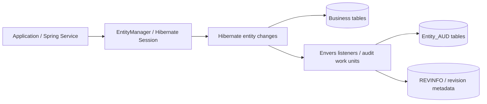
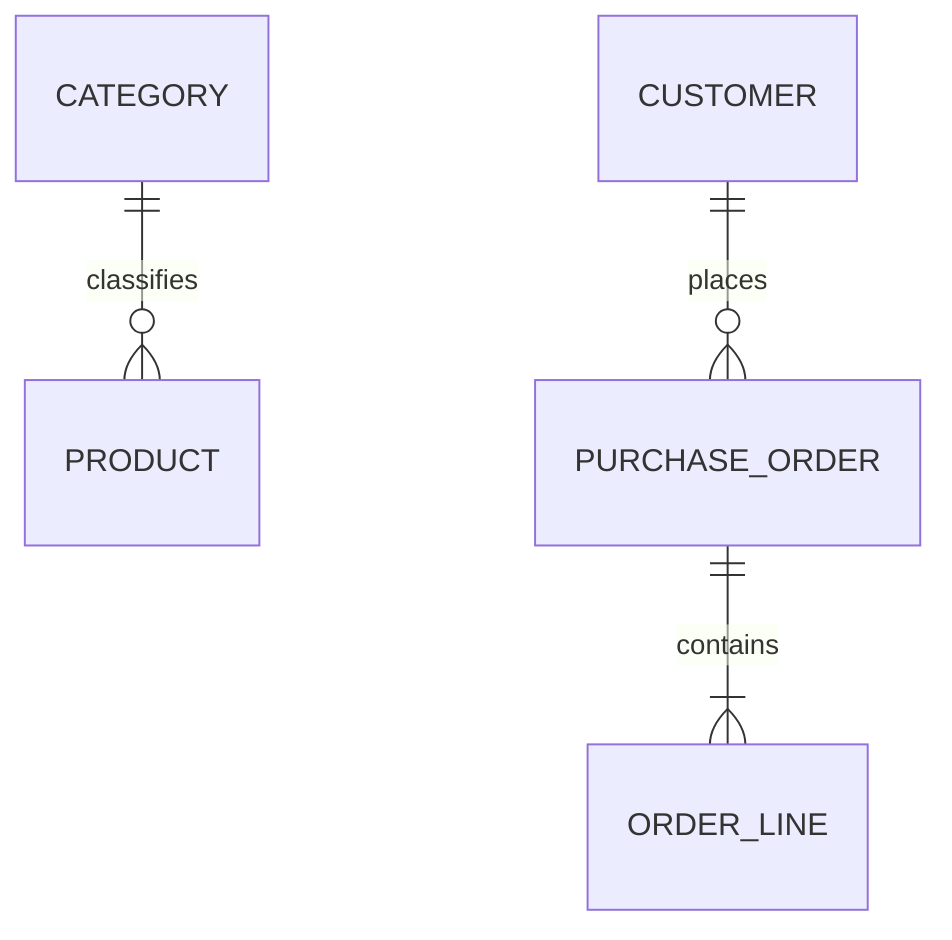

# Đăng ký thực thể cần theo dõi bằng `@Audited` trong Hibernate Envers

## 1. Tại sao cần ghi lịch sử thay đổi dữ liệu?

Trong ứng dụng Hibernate, database thường lưu **trạng thái hiện tại** của một entity. Khi thay đổi giá bán, trạng thái đơn hàng, cấu hình nghiệp vụ hoặc địa chỉ giao hàng, câu lệnh `UPDATE` ghi đè những giá trị cũ. Nếu sau đó cần trả lời “bản ghi này có giá bao nhiêu vào tuần trước?”, bảng nghiệp vụ hiện tại thường không đủ dữ liệu.

Giả sử entity `Product` có lịch sử:

| Thời điểm nghiệp vụ minh họa | Tác động | Giá trị hiện tại sau tác động |
|---|---|---|
| Ngày A | Tạo Product#101 | Giá 100, tên “Bàn phím A” |
| Ngày B | Đổi giá | Giá 120 |
| Ngày C | Đổi tên | Giá 120, tên “Bàn phím A Pro” |
| Ngày D | Xóa Product | Không còn trong bảng chính |

Nếu chỉ lưu bảng `products`, ta không xem được các trạng thái trước khi xóa. Một hệ thống cần audit trail có thể cần lưu lại **phiên bản dữ liệu theo mỗi lần thay đổi**.

**Hibernate Envers** là module đi kèm hệ sinh thái Hibernate ORM, hỗ trợ tự động ghi lịch sử các entity/thuộc tính được đăng ký. Annotation quan trọng nhất là:

```java
import org.hibernate.envers.Audited;

@Audited
@Entity
public class Product {
    // ...
}
```

`@Audited` chính là điểm bắt đầu: khai báo **entity hoặc property nào Hibernate Envers phải theo dõi** khi có thay đổi thông qua cơ chế persistence mà Envers quan sát được.

### 1.1. Mục tiêu của bài học

Sau bài này, bạn cần biết:

1. Thêm module Envers vào dự án Hibernate/Spring Boot đúng phiên bản.
2. Đặt `@Audited` trên entity hay property và hiểu phạm vi được ghi lịch sử.
3. Phân biệt bảng nghiệp vụ, bảng audit và bảng revision metadata.
4. Biết các thao tác `persist`, update managed entity, `remove` được Envers xử lý thế nào.
5. Dùng `@NotAudited`, `@AuditTable`, `@AuditOverride` và `@Audited(withModifiedFlag = true)` đúng nhu cầu.
6. Hiểu điều kiện khi association được audit và khi target entity không được audit.
7. Đọc lịch sử bằng `AuditReader`/`AuditQuery`, phân biệt revision với business timestamp.
8. Nhận diện những thay đổi **không được Envers tự ghi** như bulk HQL/JPQL DML, raw SQL, trigger hoặc ứng dụng khác.
9. Chuẩn bị schema, migration, bảo mật, kiểm thử tích hợp và vận hành audit trail.

**Giới hạn cần nhớ:** Envers là cơ chế theo dõi thay đổi của Hibernate ORM, không tự biến thành hệ thống ghi mọi SQL của database hay hệ thống lưu sự kiện nghiệp vụ hoàn chỉnh.

## 2. Envers nằm ở đâu trong kiến trúc?

Mô hình cơ bản:



Envers tích hợp vào vòng đời entity của Hibernate. Với entity được audit, những thay đổi có ý nghĩa qua Hibernate sẽ tạo audit work units và được ghi vào bảng lịch sử ở cùng cơ chế transaction.

Có ba nhóm dữ liệu cần phân biệt:

- **Business table:** giữ bản ghi hiện tại như `products`.
- **Audit table:** giữ các trạng thái theo revision như `products_AUD` hoặc `Product_AUD`, tùy naming strategy và mapping.
- **Revision entity/table:** giữ metadata chung về revision như số revision và thời gian tạo revision; tên bảng mặc định phổ biến là `REVINFO`.

Không nên hiểu `@Audited` là annotation chỉ “ghi log ra console”. Nó tạo ra **mô hình dữ liệu audit trong database** và đi kèm yêu cầu quản lý schema, dung lượng và quyền truy cập.

### 2.1. Revision khác version của optimistic locking

Hai số trông giống nhau nhưng có nghĩa khác nhau:

- `@Version`: thuộc tính giúp Hibernate phát hiện concurrent update, thường được kiểm tra trong WHERE của UPDATE/DELETE.
- **Envers revision number (`REV`):** định danh một revision audit được tạo theo transaction; có thể liên quan nhiều entity thay đổi trong cùng transaction.

Ví dụ cùng một transaction cập nhật Product#101 và Category#9 có thể tạo một revision metadata chung cho cả hai audit entries. Revision number không phải “số phiên bản riêng của Product#101” và không nên dùng như counter liên tục theo mỗi entity.

### 2.2. Envers có phải là event sourcing không?

Không. Envers thường lưu **snapshot trạng thái entity tại các revision** (theo chiến lược audit) và loại thay đổi thêm/sửa/xóa. Event sourcing lưu các **domain events** có ý nghĩa nghiệp vụ và xây lại state từ event stream.

Audit record dạng “giá đổi từ 100 sang 120” không tự giải thích lý do: quản trị viên điều chỉnh, chương trình khuyến mãi hay tác vụ đồng bộ. Nếu cần nguyên nhân, approval chain, actor, request ID và business event, phải thiết kế thêm metadata hoặc hệ thống events tương ứng.

## 3. Điều kiện trước khi dùng `@Audited`

### 3.1. Cần Hibernate Envers dependency

Với Spring Boot 3 / Hibernate 6 dùng Jakarta Persistence, có thể thêm dependency Gradle khi dependency management đã cung cấp version đồng bộ:

```kotlin
dependencies {
    implementation("org.springframework.boot:spring-boot-starter-data-jpa")
    implementation("org.hibernate.orm:hibernate-envers")
}
```

Hoặc Maven, khi dự án sử dụng BOM/dependency management quản lý version tương ứng:

```xml
<dependency>
    <groupId>org.hibernate.orm</groupId>
    <artifactId>hibernate-envers</artifactId>
</dependency>
```

Nếu không có dependency management, phải khai báo version Envers **tương thích với Hibernate ORM Core đang dùng**. Không nâng Envers lên bản mới độc lập khi Hibernate Core vẫn ở bản cũ mà chưa xác nhận tương thích. Trong code với Hibernate 5/JPA cũ, Maven coordinates, package namespaces và cấu hình có thể khác; ví dụ ở bài này giả định **Hibernate 6 + `jakarta.persistence`**.

Bài học trình bày cấu hình và source mẫu; không yêu cầu chạy build ở đây.

### 3.2. Cần entity thực sự được Hibernate quản lý

`@Audited` áp dụng cho entity hoặc persistent property đã được Hibernate mapping. Annotation đặt trên DTO, Java record không phải entity, lớp service hoặc class nằm ngoài entity scan **không tạo audit trail**.

Ví dụ đúng:

```java
import jakarta.persistence.Entity;
import jakarta.persistence.Id;
import org.hibernate.envers.Audited;

@Entity
@Audited
public class Customer {
    @Id
    private Long id;
    private String name;
}
```

Ví dụ không phải cách đăng ký entity:

```java
@Audited
public record CustomerResponse(Long id, String name) {}
```

`CustomerResponse` là DTO không có lifecycle ORM; không có database INSERT/UPDATE/DELETE do Hibernate quản lý cho record này.

### 3.3. Bật Envers khác bật log SQL

Envers sử dụng module và mapping/listeners. Các property `hibernate.show_sql` hoặc logger `org.hibernate.SQL` chỉ giúp quan sát SQL, không tự lưu lịch sử. Ngược lại, Envers có thể lưu audit rows khi không bật SQL logging.

## 4. Ví dụ đầu tiên: đánh dấu toàn bộ Product entity

Giả sử hệ thống bán hàng muốn theo dõi thay đổi về SKU, tên và giá sản phẩm.

```java
package com.example.catalog.domain;

import jakarta.persistence.*;
import org.hibernate.envers.Audited;
import java.math.BigDecimal;

@Entity
@Table(name = "products")
@Audited
public class Product {

    @Id
    @GeneratedValue(
        strategy = GenerationType.SEQUENCE,
        generator = "product_id_gen"
    )
    @SequenceGenerator(
        name = "product_id_gen",
        sequenceName = "product_id_seq",
        allocationSize = 50
    )
    private Long id;

    @Column(nullable = false, unique = true, length = 60)
    private String sku;

    @Column(nullable = false, length = 160)
    private String name;

    @Column(nullable = false, precision = 16, scale = 2)
    private BigDecimal price;

    protected Product() {}

    public Product(String sku, String name, BigDecimal price) {
        this.sku = sku;
        this.name = name;
        this.price = price;
    }

    public Long getId() {
        return id;
    }

    public String getSku() {
        return sku;
    }

    public String getName() {
        return name;
    }

    public BigDecimal getPrice() {
        return price;
    }

    public void rename(String nextName) {
        this.name = nextName;
    }

    public void changePrice(BigDecimal nextPrice) {
        if (nextPrice == null || nextPrice.signum() < 0) {
            throw new IllegalArgumentException("price must be >= 0");
        }
        this.price = nextPrice;
    }
}
```

Hai dòng liên quan Envers:

```java
import org.hibernate.envers.Audited;

@Audited
```

đặt trên **lớp entity** có ý nghĩa: theo dõi các thuộc tính persistent đủ điều kiện của entity, trừ những property được loại trừ hoặc có quy tắc đặc biệt.

Không cần thêm một bảng log bằng tay trong service và không cần `@PreUpdate` gọi `auditRepository.save(...)` chỉ để ghi lịch sử cơ bản. Envers sẽ sinh audit work units khi Hibernate xử lý entity changes.

### 4.1. Vì sao entity còn cần `@Entity` và `@Id`?

`@Audited` không thay thế mapping JPA:

- `@Entity`: đăng ký class như entity.
- `@Id`: định danh hàng hiện tại.
- `@GeneratedValue`: cách cấp primary key cho entity.
- `@Table`/`@Column`: ánh xạ sang schema nghiệp vụ.
- `@Audited`: đăng ký audit cho state persistent.

Không viết `@Audited` thay cho `@Entity`. Audit table cần identity để nối các revisions của cùng một bản ghi.

### 4.2. Khóa chính cần ổn định

Envers dùng entity identifier và revision number để nhận dạng trạng thái lịch sử. Thay đổi ID trong vòng đời entity thường không phải thao tác update hợp lệ theo JPA; nếu cần đổi business key như SKU, hãy để business key là một field có thể sửa và giữ PK ổn định.

Nếu dùng composite ID với `@EmbeddedId` hoặc `@IdClass`, mô hình audit cũng cần identity mapping phù hợp. Không đơn giản xem một chuỗi mã tùy ý có thể đổi làm primary key nếu hệ thống yêu cầu lịch sử đáng tin.

## 5. Các bảng thường được tạo khi audit Product

Với tên bảng nghiệp vụ `products`, tùy Hibernate naming strategy và cấu hình Envers, audit table có thể có tên `products_AUD`; revision table mặc định thường là `REVINFO`. Cấu trúc dưới đây chỉ để đọc hiểu, không phải DDL áp cho mọi dialect:

```sql
-- Bảng nghiệp vụ: chỉ trạng thái mới nhất.
CREATE TABLE products (
    id BIGINT PRIMARY KEY,
    sku VARCHAR(60) NOT NULL UNIQUE,
    name VARCHAR(160) NOT NULL,
    price DECIMAL(16, 2) NOT NULL
);

-- Bảng metadata các revision.
CREATE TABLE REVINFO (
    REV INTEGER PRIMARY KEY,
    REVTSTMP BIGINT
);

-- Bảng audit: lịch sử từng Product.
CREATE TABLE products_AUD (
    id BIGINT NOT NULL,
    REV INTEGER NOT NULL,
    REVTYPE SMALLINT,
    sku VARCHAR(60),
    name VARCHAR(160),
    price DECIMAL(16, 2),
    PRIMARY KEY (id, REV),
    FOREIGN KEY (REV) REFERENCES REVINFO(REV)
);
```

**Đây là DDL minh họa:** kiểu số, tên cột, FK/index, schema, naming strategy và cơ chế sequence/identity cấp revision phụ thuộc database, Hibernate version và cấu hình. Nếu dùng migration tool, phải tạo schema tương thích với metadata thực tế, không copy DDL demo rồi giả định đủ.

### 5.1. Phân biệt ba phần khóa

Ở bảng `products_AUD`:

- `id` là ID của Product nghiệp vụ.
- `REV` trỏ tới revision metadata.
- Cặp `(id, REV)` thường định danh một bản ghi audit của Product tại revision đó.
- `REVTYPE` mô tả loại thao tác.

Các giá trị RevisionType trong mô hình Envers thường tương ứng:

| RevisionType | Giá trị thường lưu trong REVTYPE | Ý nghĩa |
|---|---:|---|
| `ADD` | 0 | Entity được tạo |
| `MOD` | 1 | Entity được sửa |
| `DEL` | 2 | Entity bị xóa |

Khi đọc lịch sử nên dùng enum `org.hibernate.envers.RevisionType` thay vì hard-code 0/1/2 khắp business code.

### 5.2. Một revision có thể chứa nhiều entity changes

Giả sử một transaction tạo Product#101, Product#102 và cập nhật Category#9. Envers có thể dùng **cùng REV=42** cho các audit entries của các entity thay đổi trong transaction đó. Bảng `REVINFO` chỉ cần một record revision metadata tương ứng.

Không nên hiểu `REV=42` là “lần sửa thứ 42 của Product#101”. Muốn xem các revision đã tác động một entity cụ thể, dùng Envers `AuditReader.getRevisions(...)` hoặc audit query.

### 5.3. Bảng audit thường chỉ ghi khi có thay đổi cần audit

Envers không phải bảng snapshot tự động chụp lại toàn bộ database theo lịch. Một revision của Product thường xuất hiện khi Hibernate thực hiện operation ADD/MOD/DEL thuộc phạm vi audit, không phải mỗi lần gọi SELECT hay mỗi lần request HTTP.

## 6. Thao tác INSERT, UPDATE, DELETE tạo lịch sử như thế nào?

### 6.1. Thêm Product

Trong transaction Spring:

```java
@Service
public class ProductCommandService {

    private final ProductRepository products;

    public ProductCommandService(ProductRepository products) {
        this.products = products;
    }

    @Transactional
    public Long create(String sku, String name, BigDecimal price) {
        Product product = new Product(sku, name, price);
        products.save(product);
        return product.getId();
    }
}
```

`ProductRepository` có thể khai báo:

```java
public interface ProductRepository extends JpaRepository<Product, Long> {}
```

Sau khi transaction commit thành công, thông thường có:

- Row hiện tại trong `products`.
- Một audit row `REVTYPE=ADD` trong `products_AUD`.
- Metadata revision tương ứng trong `REVINFO`.

SQL minh họa, thứ tự/cú pháp có thể khác:

```sql
INSERT INTO products (id, sku, name, price)
VALUES (?, ?, ?, ?);

INSERT INTO REVINFO (REV, REVTSTMP)
VALUES (?, ?);

INSERT INTO products_AUD (id, REV, REVTYPE, sku, name, price)
VALUES (?, ?, 0, ?, ?, ?);
```

Việc Envers lấy/ghi revision ID và ghi các rows diễn ra trong cơ chế flush/transaction; đừng dựa vào đúng thứ tự ba statement trên như một API contract.

### 6.2. Sửa managed entity

```java
@Transactional
public void changePrice(Long productId, BigDecimal nextPrice) {
    Product product = products.findById(productId)
        .orElseThrow(() -> new EntityNotFoundException(
            "Product not found: " + productId
        ));

    product.changePrice(nextPrice);
}
```

Khi Hibernate phát hiện entity dirty và thực hiện UPDATE, Envers thường tạo record `REVTYPE=MOD` với trạng thái được audit tại revision đó.

**Không cần gọi `products.save(product)` cho managed entity chỉ để Envers hoạt động.** Dirty checking của Hibernate và transaction flush là cơ chế trọng tâm. `save` của Spring Data có semantics persist/merge phụ thuộc trạng thái entity; không phải “lệnh tạo revision” riêng.

### 6.3. Xóa entity

```java
@Transactional
public void delete(Long productId) {
    Product product = products.findById(productId)
        .orElseThrow();
    products.delete(product);
}
```

Hibernate xử lý DELETE và Envers có thể ghi `REVTYPE=DEL` cho identity được xóa.

Theo cấu hình Envers thông thường, audit row lúc DELETE **có thể chỉ lưu ID, REV và REVTYPE**, còn giá trị thuộc tính khác null. Nếu cần lưu state đầy đủ tại revision xóa, có property `org.hibernate.envers.store_data_at_delete` với trade-off dung lượng. Không giả định mọi DEL row chứa đầy đủ snapshot ngay khi chưa kiểm tra cấu hình.

### 6.4. Flush và rollback

```java
@Transactional
public void example(Long id) {
    Product p = products.findById(id).orElseThrow();
    p.rename("Tên mới");
    entityManager.flush();

    // Nếu transaction bị rollback sau đó, phần cập nhật nghiệp vụ
    // và audit row trong transaction cũng phải rollback theo DB.
}
```

`flush()` không tương đương commit. Audit row được chuẩn bị/ghi trong transaction có thể chưa được commit, nên consumer ở transaction khác không nhất thiết nhìn thấy. Nếu toàn transaction rollback thành công, không nên có audit revision **đã commit** mô tả một thay đổi nghiệp vụ chưa được commit.

Không dựa vào revision numbers là chuỗi liên tục không có gap: generator/sequence và transaction rollback có thể tạo khoảng trống.

### 6.5. Gọi setter với cùng giá trị có tạo revision không?

Một lời gọi setter không tự là một sự kiện audit. Hibernate cần nhận ra thay đổi persistence state hoặc association work unit tương ứng. Nếu giá trị mới bằng snapshot cũ, có thể không có UPDATE/audit row mới. Mapping, dirty tracking/enhancement và collection semantics có thể ảnh hưởng việc phát hiện thay đổi.

Nếu nghiệp vụ cần ghi “người dùng đã bấm lưu mặc dù dữ liệu không đổi”, đó là **business action log**, không nên phụ thuộc vào cơ chế Envers phát hiện dirty state.


## 7. `@Audited` ở cấp class và cấp property

### 7.1. Audit toàn bộ các persistent properties đủ điều kiện

Đặt trên entity:

```java
@Entity
@Audited
public class Product {
    @Id
    private Long id;

    private String sku;
    private String name;
    private BigDecimal price;
}
```

Thông thường các thuộc tính persistent được chọn để audit theo mapping. Envers không nhất thiết ghi Java `transient` fields, static fields hay properties không được ORM persist.

### 7.2. Chỉ audit một số properties

Có thể đặt `@Audited` trực tiếp lên một property thay vì cả class:

```java
@Entity
@Table(name = "device_settings")
public class DeviceSettings {

    @Id
    private Long id;

    @Audited
    @Column(name = "security_mode")
    private String securityMode;

    @Column(name = "last_checked_at")
    private Instant lastCheckedAt;
}
```

Ở ví dụ này, chủ đích là chỉ theo dõi thay đổi của `securityMode` (cùng ID cần thiết cho lịch sử), không lưu mọi lần cập nhật timestamp `lastCheckedAt`.

Lưu ý vị trí annotation phải phù hợp JPA access type (field access/property access). Nếu entity dùng property access qua getters, hãy đảm bảo annotation audit/mapping đặt nhất quán với cách provider đọc metadata.

### 7.3. Loại một field khỏi audit bằng `@NotAudited`

Đặt `@Audited` trên class nhưng không muốn lưu một thuộc tính:

```java
import org.hibernate.envers.NotAudited;

@Entity
@Audited
public class Product {

    @Id
    private Long id;

    private String sku;
    private BigDecimal price;

    @NotAudited
    @Column(name = "last_viewed_at")
    private Instant lastViewedAt;
}
```

`lastViewedAt` vẫn được Hibernate persist ở bảng chính, nhưng không trở thành một field theo dõi lịch sử của Product trong Envers.

**Cần phân biệt:**

- `@NotAudited`: không audit property.
- `@Transient` (JPA): không persist property qua ORM.
- Java `transient`: có semantics Java serialization và có thể ảnh hưởng mapping tùy access/context.
- `@Column(updatable = false)`: điều khiển khả năng Hibernate UPDATE column, không có nghĩa “không audit”.

### 7.4. Loại field ồn ào, nhưng đừng che mất dữ liệu quan trọng

Những field như last-viewed timestamp, volatile counters hoặc cache hints thường thay đổi rất nhiều và có thể khiến audit phình to nếu không cần nghiệp vụ. Ngược lại, field quan trọng như price, order status, owner, approval state và quyền truy cập có thể bắt buộc phải audit.

Không dùng `@NotAudited` chỉ để giảm dung lượng khi business/legal yêu cầu truy nguyên field đó.

### 7.5. Một revision có thể được tạo do association thay đổi

Ngay cả khi chỉ một trường được đánh dấu audit, thay đổi relation hoặc collection liên quan có thể tạo work unit audit theo mapping và cấu hình. Không kết luận từ số lần setter gọi rằng revision count luôn bằng số lần sửa scalar property.

## 8. `@Version` và những thuộc tính đặc biệt

Ví dụ:

```java
@Entity
@Audited
public class Product {
    @Id
    private Long id;

    @Version
    private long version;

    private BigDecimal price;
}
```

Envers mặc định thường **không audit optimistic-locking version field**, theo thiết lập `org.hibernate.envers.do_not_audit_optimistic_locking_field` (mặc định phổ biến là `true`).

Điều này không có nghĩa Hibernate bỏ optimistic locking: `@Version` vẫn phục vụ concurrent updates ở bảng chính. Revision number của Envers và version của entity là hai loại metadata có chức năng khác nhau.

Nếu cần lưu version column trong lịch sử, phải kiểm tra mapping, cấu hình Envers và yêu cầu audit; không tự đồng nhất nó với `REV`.

### 8.1. Giá trị do database tự cập nhật

Một field như `updated_at` do database trigger/default sinh có thể không được Hibernate nhận biết state mới ngay trong Java object, hoặc không tạo per-entity update event nếu database thay đổi ngoài ORM. Nếu business muốn ghi đầy đủ lịch sử trigger-generated values, cần thiết kế phối hợp giữa Envers, generated property refresh và database event/invalidation.

Đừng hứa `@Audited` sẽ ghi mọi side effect của database trigger ở các bảng khác.

### 8.2. @Formula không phải column nghiệp vụ thông thường

Hibernate `@Formula` là giá trị tính qua SQL expression, thường read-only. Envers audit cơ bản tập trung vào những persistent state được mapping; không giả định formula tự động lưu giá trị lịch sử ở mọi revision.

Nếu một computed value phải được tra lại chính xác theo thời điểm quá khứ, cần xác định nó phụ thuộc các bảng nào, những bảng đó có được audit không, và có nên materialize giá trị trong audit record hoặc read model riêng hay không.

## 9. Lịch sử association: không chỉ scalar fields

Các entity liên kết với nhau:



Khi đặt `@Audited` trên Product, cần quyết định **cả association đến Category có được theo dõi không?** Và nếu có, liệu Category cũng được audit?

### 9.1. ManyToOne tới audited target

Ví dụ:

```java
@Entity
@Audited
public class Category {
    @Id
    private Long id;
    private String name;
}

@Entity
@Audited
public class Product {
    @Id
    private Long id;

    @ManyToOne(fetch = FetchType.LAZY)
    private Category category;
}
```

Khi cả Product và Category được audit, Envers có thể tái tạo association theo revision. Nhưng không nên suy luận rằng việc load historical Product rồi gọi `getCategory()` luôn lấy toàn bộ association graph mà không phát thêm SQL. Lịch sử nhiều quan hệ có thể tốn truy vấn và memory.

### 9.2. ManyToOne tới entity không audited

Bảng tra cứu ổn định như Country, Currency hoặc TaxCode có thể **không cần lịch sử riêng**. Với audited entity tham chiếu một non-audited target:

```java
import org.hibernate.envers.RelationTargetAuditMode;

@Entity
@Audited
public class Product {
    @Id
    private Long id;

    @ManyToOne(fetch = FetchType.LAZY)
    @Audited(targetAuditMode = RelationTargetAuditMode.NOT_AUDITED)
    private Country country;
}

@Entity
public class Country {
    @Id
    private String code;

    private String displayName;
}
```

`targetAuditMode = NOT_AUDITED` có ý nghĩa: Envers có thể audit liên kết/foreign key của Product nhưng **không yêu cầu audit state của Country**.

Khi đọc historical Product, association tới Country không được phục hồi theo “Country của quá khứ”; nó thường trỏ tới **state hiện tại** của Country. Nếu Country có thể đổi tên hoặc bị xóa, kết quả truy hồi lịch sử có thể không tái hiện đầy đủ màn hình như tại thời điểm đó.

Nếu cần snapshot tên quốc gia lúc đặt hàng, lưu một field snapshot như `countryDisplayNameAtPurchase` trên entity được audit, hoặc audit Country riêng tùy domain.

### 9.3. Khi không muốn audit association

Nếu không cần theo dõi liên kết, có thể dùng:

```java
@Entity
@Audited
public class Product {
    @Id
    private Long id;

    @NotAudited
    @ManyToOne(fetch = FetchType.LAZY)
    private Warehouse warehouse;
}
```

Hibernate vẫn map association trong bảng nghiệp vụ, nhưng Envers bỏ thuộc tính đó khỏi lịch sử theo chính sách annotation.

### 9.4. Collection @OneToMany và @ManyToMany

Với audited entity có collection:

```java
@Entity
@Audited
public class PurchaseOrder {

    @Id
    private Long id;

    @OneToMany(mappedBy = "order")
    private List<OrderLine> lines = new ArrayList<>();
}

@Entity
@Audited
public class OrderLine {

    @Id
    private Long id;

    @ManyToOne(fetch = FetchType.LAZY)
    private PurchaseOrder order;
}
```

Envers có thể theo dõi thay đổi membership của association theo mapping. Với quan hệ dùng join table, có thể có audit join table; quan hệ inverse `mappedBy` và owning side phải được thiết kế đúng.

**Quan trọng:** lịch sử collection không phải Java snapshot deep-copy tự động của mọi child object trong mọi phiên bản. Khi quan hệ phức tạp, mapping đối tượng hai chiều, join table, owning side và thứ tự collection đều ảnh hưởng những gì Envers có thể tái dựng.

### 9.5. Trường hợp cần @AuditJoinTable

Một số association được quản lý qua join table hoặc cần bảng audit liên kết riêng. Envers có annotation `@AuditJoinTable` để kiểm soát thông tin bảng audit cho association phù hợp:

```java
@AuditJoinTable(name = "order_line_link_AUD")
```

Không nên thêm annotation này vào mọi collection theo thói quen. Cần dựa vào mapping association thực tế và schema do Envers yêu cầu.

### 9.6. Inverse collection và cấu hình revision_on_collection_change

Envers có property `org.hibernate.envers.revision_on_collection_change` để kiểm soát việc tạo revision khi collection quan hệ không phải owning side thay đổi trong những trường hợp được hỗ trợ. Giá trị mặc định phổ biến cho phép audit những thay đổi liên quan collection.

Đừng tự mặc định mỗi lần gọi `order.getLines().add(line)` đều tạo đúng một revision nếu owning side `line.order` chưa được đồng bộ hoặc Hibernate không thấy mutation. Trước tiên cần **mapping quan hệ đúng**, sau đó mới kiểm chứng lịch sử.

## 10. Embedded, mapped superclass và inheritance

### 10.1. Embedded value object

Một entity có `@Embedded`:

```java
@Embeddable
public class Address {
    private String street;
    private String city;
    private String postalCode;
}

@Entity
@Audited
public class Customer {
    @Id
    private Long id;

    @Embedded
    private Address billingAddress;
}
```

Envers có thể audit persistent fields được mapping của embedded value object. Đường đi, column overrides và các nested embeddables phải tương thích với phiên bản Hibernate đang sử dụng.

### 10.2. Loại một field inherited/embedded khỏi audit

`@AuditOverride` cho phép thay chính sách audit của property được thừa kế hoặc embedded trong các tình huống Envers hỗ trợ. Ví dụ minh họa:

```java
@Entity
@Audited
@AuditOverride(
    forClass = BaseRecord.class,
    name = "integrationTraceId",
    isAudited = false
)
public class Customer extends BaseRecord {
    @Id
    private Long id;
    private String name;
}
```

`BaseRecord` ở đây là mapped superclass hoặc superclass được mapping hợp lệ, có property `integrationTraceId`. Không copy ví dụ khi class này chưa được định nghĩa và chưa rõ JPA access type.

### 10.3. Class-level audit trong inheritance hierarchy

Nếu entity kế thừa nhiều field từ mapped superclass hoặc một hierarchy có nhiều entity classes, cần chủ động kiểm tra annotation trên từng cấp và `@AuditOverride` cần thiết. Không giả định chỉ đánh dấu một subclass sẽ tự bao phủ mọi bảng, subtype và field của toàn bộ hierarchy trong mọi mapping strategy.

Với `JOINED`, `SINGLE_TABLE` và `TABLE_PER_CLASS`, audit schema có thể khác nhau. Cần dùng metadata Envers/schema generation của phiên bản thực tế rồi đưa DDL chính xác vào migration.

## 11. Đặt tên và vị trí audit table

### 11.1. Mặc định theo suffix

Theo cấu hình thường gặp, Envers dùng hậu tố `_AUD` cho audit tables. Các property như:

```properties
org.hibernate.envers.audit_table_prefix=
org.hibernate.envers.audit_table_suffix=_AUD
```

điều khiển naming convention.

Nếu bảng nghiệp vụ tên `products`, audit table có thể là `products_AUD`. Nhưng physical naming strategy, explicit table names, schema và catalog có thể ảnh hưởng tên cuối cùng. Nên kiểm tra DDL thực tế, không suy luận chắc từ tên Java class.

### 11.2. Chỉ định tên audit table cụ thể

```java
import org.hibernate.envers.AuditTable;

@Entity
@Table(name = "products")
@Audited
@AuditTable(value = "product_history")
public class Product {
    // ...
}
```

`@AuditTable` chỉ định bảng audit cho entity. Tên table nghiệp vụ `products` không đổi. Nếu muốn tách audit schema:

```java
@AuditTable(value = "product_history", schema = "audit")
```

Cần đảm bảo database/schema `audit` tồn tại, quyền của user Hibernate cho phép INSERT/SELECT vào đó, và migration tool quản lý cấu trúc đúng.

### 11.3. Chú ý tránh va chạm tên revision columns

Các tên metadata như `REV`, `REVTYPE` và cấu hình property tương ứng có thể xung đột với cột business nếu naming không được thiết kế. Khi cấu hình revision field name khác mặc định, mọi audit tables và queries phải sử dụng cùng quy ước.

Không thay tên cột audit của database production mà không migration cùng metadata Envers.

## 12. Theo dõi cụ thể thuộc tính nào đã thay đổi

Audit row có thể lưu snapshot, nhưng đôi khi business cần câu hỏi: “Revision này thay đổi giá hay chỉ đổi tên?”.

Hibernate Envers hỗ trợ modified flags:

```java
@Entity
@Audited(withModifiedFlag = true)
public class Product {
    @Id
    private Long id;

    private String name;
    private BigDecimal price;
}
```

Với cấu hình này, audit table có thể có thêm các cột boolean tương ứng, ví dụ `name_MOD` và `price_MOD`; tên suffix/column thực tế theo configuration và mapping.

Ví dụ khái niệm:

| REV | REVTYPE | name | price | name_MOD | price_MOD |
|---:|---:|---|---:|---|---|
| 10 | ADD | Bàn phím A | 100 | true | true |
| 11 | MOD | Bàn phím A | 120 | false | true |
| 12 | MOD | Bàn phím A Pro | 120 | true | false |

Đây là bảng minh họa logic. Không coi mọi giá trị modified flag của ADD/DEL luôn đúng như trên ở mọi Hibernate version; nên test behavior thực tế nếu làm business rule trên flags.

### 12.1. Chỉ theo dõi flag cho vài field

Có thể đặt `@Audited(withModifiedFlag = true)` trên property cụ thể thay vì class nếu không muốn thêm flag cho mọi field:

```java
@Entity
public class Product {
    @Id
    private Long id;

    @Audited(withModifiedFlag = true)
    private BigDecimal price;
}
```

Nếu ứng dụng cần audit cả tên và giá nhưng chỉ quan tâm flag giá, có thể audit những field cần thiết theo mapping và bật modified flag có chọn lọc.

### 12.2. Đọc revisions có thay đổi một field

Envers AuditQuery hỗ trợ predicates như `hasChanged()` khi modified flags tương ứng được ghi:

```java
List<?> changedPriceRevisions =
    AuditReaderFactory.get(entityManager)
        .createQuery()
        .forRevisionsOfEntity(Product.class, false, true)
        .add(AuditEntity.id().eq(productId))
        .add(AuditEntity.property("price").hasChanged())
        .getResultList();
```

Đây là query Hibernate-specific. Nếu field không được cấu hình modified flag hoặc version không hỗ trợ query đó theo cách mong muốn, predicate có thể không hoạt động như dự kiến.

### 12.3. Trade-off của modified flags

Modified flags có lợi cho tra cứu “thay đổi field X”, nhưng làm audit table có thêm cột và tăng chi phí lưu/duy trì. Với entity hàng trăm properties, bật toàn bộ flags không miễn phí.

Đừng mặc định bật modified flags cho mọi entity nếu chỉ cần tra cứu snapshot.


## 13. Đọc lịch sử bằng AuditReader

Đăng ký `@Audited` chỉ là nửa đầu bài toán. Khi cần tra cứu audit trail, Hibernate Envers cung cấp `AuditReader`:

```java
import org.hibernate.envers.AuditReader;
import org.hibernate.envers.AuditReaderFactory;

AuditReader reader = AuditReaderFactory.get(entityManager);
```

Nên gọi từ application read service trong ranh giới EntityManager/transaction thích hợp và trả DTO kết quả cho controller, thay vì trả các object historic rồi để HTTP serializer duyệt lazy association.

### 13.1. Liệt kê revision của một entity

```java
@Transactional(readOnly = true)
public List<Number> revisionsOf(Long productId) {
    AuditReader reader = AuditReaderFactory.get(entityManager);
    return reader.getRevisions(Product.class, productId);
}
```

`getRevisions` trả về danh sách các revision numbers tương ứng với entity ID được audit, thường theo thứ tự tăng dần. Một entity được sửa nhiều lần có thể có danh sách như `[7, 19, 25, 31]` — không yêu cầu các revision liên tiếp vì những revision khác có thể liên quan entity khác.

### 13.2. Lấy trạng thái entity tại một revision

```java
@Transactional(readOnly = true)
public ProductHistoryDto findAtRevision(
        Long productId,
        Number revisionNumber
) {
    AuditReader reader = AuditReaderFactory.get(entityManager);
    Product historical = reader.find(
        Product.class, productId, revisionNumber
    );

    if (historical == null) {
        return null;
    }

    return new ProductHistoryDto(
        historical.getId(),
        historical.getSku(),
        historical.getName(),
        historical.getPrice(),
        revisionNumber.longValue()
    );
}
```

DTO:

```java
public record ProductHistoryDto(
        Long id,
        String sku,
        String name,
        BigDecimal price,
        long revision
) {}
```

`AuditReader.find` trả trạng thái lịch sử tương ứng với revision được hỏi theo quy tắc Envers; nếu entity chưa tồn tại hoặc đã bị xóa tại revision đó, kết quả có thể null. Không suy luận nó chỉ tìm những hàng có `REV` **đúng bằng** số được truyền: Envers có thể cần tìm revision hợp lệ gần nhất không vượt quá mốc yêu cầu, tùy audit strategy.

**Quan trọng:** object historical dùng để đọc lịch sử, không phải entity managed biểu diễn state hiện tại để gọi setter rồi kỳ vọng UPDATE bảng nghiệp vụ. Tạo read DTO tường minh giúp tách lịch sử khỏi write model.

### 13.3. Lấy thời điểm của revision

```java
Date revisionDate = reader.getRevisionDate(revisionNumber);
```

`Date` là kiểu trả về của API Envers ở nhiều phiên bản; có thể chuyển sang `Instant`:

```java
Instant changedAt = revisionDate.toInstant();
```

Timestamp revision thường là **thời điểm revision entity được tạo/ghi theo cơ chế Envers**, không phải một chuẩn “thời điểm commit chính xác tới nanosecond”. Nếu cần audit ordering bằng database commit timestamp, CDC hoặc business timestamp, phải thiết kế riêng.

### 13.4. Truy vấn mọi revision cùng loại thay đổi

```java
import org.hibernate.envers.query.AuditEntity;
import org.hibernate.envers.RevisionType;

List<?> rows = reader.createQuery()
    .forRevisionsOfEntity(Product.class, false, true)
    .add(AuditEntity.id().eq(productId))
    .addOrder(AuditEntity.revisionNumber().asc())
    .getResultList();
```

Với `forRevisionsOfEntity(Product.class, false, true)`, mỗi phần tử kết quả thường là `Object[]` gồm:

1. Entity historical snapshot.
2. Revision metadata entity.
3. `RevisionType`: ADD, MOD hoặc DEL.

Ví dụ đọc có kiểm soát:

```java
for (Object record : rows) {
    Object[] tuple = (Object[]) record;

    Product historical = (Product) tuple[0];
    Object revisionEntity = tuple[1];
    RevisionType type = (RevisionType) tuple[2];

    System.out.println(type + " at " + revisionEntity);
}
```

Khi code production cần truyền metadata ra API, nên ánh xạ revision entity thành DTO có type cụ thể hoặc lấy số revision/time theo API thay vì gọi `toString` tùy tiện.

### 13.5. Tránh N+1 khi đọc lịch sử quan hệ

Một list gồm 100 historic Product revisions mà mỗi DTO lại gọi `historical.getCategory().getName()` có thể tạo nhiều SQL lịch sử hoặc query hiện tại tùy association target audit mode. Hãy quyết định read model lịch sử thực sự cần gì, giới hạn số revision/pagination và kiểm tra SQL.

Lịch sử sâu theo association thường đắt hơn một `SELECT` đơn lẻ; `@Audited` không tự biến mọi truy vấn lịch sử thành một câu SQL tối ưu.

## 14. Revision entity và thông tin người thực hiện

Mặc định revision metadata có thể chỉ lưu revision number và timestamp. Nhưng doanh nghiệp thường cần:

- Ai thực hiện thay đổi?
- Thao tác từ API hay batch job?
- Request/correlation ID nào liên quan?
- Source system, tenant hoặc business action là gì?

Envers có thể dùng **custom revision entity** thông qua `@RevisionEntity`, `@RevisionNumber`, `@RevisionTimestamp` và revision listener.

Ví dụ khái niệm:

```java
@Entity
@Table(name = "audit_revision")
@RevisionEntity(RequestRevisionListener.class)
public class RequestRevision {

    @Id
    @GeneratedValue
    @RevisionNumber
    private int id;

    @RevisionTimestamp
    private long timestamp;

    @Column(name = "actor_id")
    private String actorId;

    @Column(name = "request_id")
    private String requestId;

    public void setActorId(String actorId) {
        this.actorId = actorId;
    }

    public void setRequestId(String requestId) {
        this.requestId = requestId;
    }
}
```

`RequestRevisionListener` implement `org.hibernate.envers.RevisionListener`:

```java
public class RequestRevisionListener implements RevisionListener {

    @Override
    public void newRevision(Object revisionEntity) {
        RequestRevision rev = (RequestRevision) revisionEntity;

        rev.setActorId(AuditContext.currentActorId());
        rev.setRequestId(AuditContext.currentRequestId());
    }
}
```

`AuditContext` là abstraction giả định do dự án tự định nghĩa; nó không phải class sẵn của Hibernate.

**Cẩn thận:** revision listener có thể chạy trong ngữ cảnh không có HTTP request (scheduled job, queue consumer, CLI). Nếu đọc actor từ Spring Security hoặc ThreadLocal, cần fallback rõ ràng, dọn context ở thread pool và tránh leak tenant/actor giữa requests. Không đưa token, mật khẩu hoặc PII không cần thiết vào revision metadata.

### 14.1. Có cần custom revision entity mới dùng được @Audited?

Không. `@Audited` hoạt động với default revision entity. Chỉ tạo custom revision entity khi thật sự cần metadata bổ sung và đã thiết kế quyền truy cập, dữ liệu bắt buộc, migration.

## 15. Mặc định audit strategy và validity strategy

Envers có các chiến lược lưu/tìm trạng thái lịch sử.

### 15.1. DefaultAuditStrategy

Với chiến lược mặc định phổ biến, query tại revision N thường cần tìm bản ghi audit có revision gần nhất `<= N` cho cùng entity, thường dùng subquery/điều kiện tương đương.

Ý tưởng:

```sql
SELECT a.*
FROM products_AUD a
WHERE a.id = :productId
  AND a.REV = (
      SELECT MAX(a2.REV)
      FROM products_AUD a2
      WHERE a2.id = a.id
        AND a2.REV <= :revision
  );
```

SQL trên chỉ mô tả cách tìm candidate gần nhất, chưa xử lý đầy đủ `REVTYPE=DEL`, joins và logic Envers; không coi nó là SQL thay thế mọi API AuditReader.

### 15.2. ValidityAuditStrategy

Với validity strategy, audit row có thể chứa cột end revision như `REVEND` (và tùy cấu hình thêm end timestamp). Query có thể dùng khoảng revision `start <= N < end` thay vì một số dạng subquery.

```properties
org.hibernate.envers.audit_strategy=org.hibernate.envers.strategy.ValidityAuditStrategy
```

Ưu điểm tiềm năng là query theo khoảng revision thuận lợi hơn ở một số database/index. Đổi lại, khi ghi revision mới có thể phải UPDATE audit row trước đó để đóng khoảng hiệu lực, làm thêm write work.

**Chọn strategy khi thiết kế schema ban đầu** hoặc có migration tương ứng. Không đổi property trên hệ thống đã có lịch sử audit theo chiến lược khác mà không di trú cấu trúc và dữ liệu.

### 15.3. Lịch sử revision không phải thời gian hiệu lực nghiệp vụ

“Revision 27 được tạo vào 10:02” không chứng minh giá có hiệu lực từ 09:00 nếu hệ thống cho phép nhập ngày hiệu lực trong quá khứ. Envers theo dõi persistence changes, không tự giải quyết **bitemporal modeling** (transaction time và valid time).

Nếu domain cần cả hai thời gian, hãy có business effective-from/effective-to fields hoặc hệ thống temporal modeling riêng.

## 16. Những thay đổi Envers không tự audit

`@Audited` dựa vào Hibernate entity events. Những hoạt động bypass ORM lifecycle có thể không tạo audit rows.

### 16.1. HQL/JPQL bulk UPDATE

Ví dụ:

```java
int count = entityManager.createQuery(
        """
        update Product p
        set p.price = p.price * :factor
        where p.price < :threshold
        """
    )
    .setParameter("factor", new BigDecimal("1.05"))
    .setParameter("threshold", new BigDecimal("500.00"))
    .executeUpdate();
```

Đây là bulk DML, không tải từng Product rồi dirty-check. Hibernate Envers **không tự ghi per-entity revision rows cho mọi Product bị thay đổi theo đường bulk HQL/JPQL** như khi sửa managed entities.

Lệnh có thể cập nhật 5.000 records trong database nhưng không tạo 5.000 audit rows theo `@Audited`.

Nếu yêu cầu lịch sử đầy đủ, lựa chọn gồm:

- Chuyển thao tác thành entity updates qua ORM trong các transaction/batches phù hợp.
- Dùng cơ chế audit ở database (trigger, CDC) được thiết kế riêng cho bulk SQL.
- Thiết kế một audit event/business history table độc lập cho loại bulk operation.
- Cấm bulk mutation trên bảng cần Envers history trừ khi có quy trình audit bù đáng tin cậy.

Không xem việc gọi `entityManager.clear()` sau bulk DML là “bổ sung audit”. `clear` chỉ detach managed entities.

### 16.2. Spring Data JPA @Modifying

```java
@Modifying
@Query("""
    update Product p set p.price = :price
    where p.id = :id
    """)
int updatePrice(
    @Param("id") Long id,
    @Param("price") BigDecimal price
);
```

Đây vẫn là bulk JPQL mutation và không đồng nghĩa update managed entity. Nó có cùng giới hạn Envers event-based audit.

Tương tự, các operation xóa hàng loạt dựa vào bulk JPQL/SQL như một số `deleteAllInBatch`/`deleteAllByIdInBatch` variants của Spring Data có thể bỏ qua callbacks/Envers như thao tác remove từng entity. Phải kiểm tra API được dùng và SQL thật.

### 16.3. Native SQL qua Hibernate

```java
entityManager.createNativeQuery(
        "update products set price = ? where id = ?"
    )
    .setParameter(1, new BigDecimal("120.00"))
    .setParameter(2, productId)
    .executeUpdate();
```

Hibernate thực thi câu SQL native nhưng không nhất thiết đi qua listener entity-update của từng Product. **Không kỳ vọng `@Audited` tự chụp lịch sử rows mà native SQL đã sửa**.

### 16.4. JDBC trực tiếp và external writers

```java
jdbcTemplate.update(
    "update products set price = ? where id = ?",
    new BigDecimal("120.00"), productId
);
```

Spring `JdbcTemplate` không dùng Hibernate Envers listeners. DBA scripts, stored procedures, triggers, ETL jobs hoặc service khác cũng không tự sinh Envers history trừ khi chúng cố ý tích hợp cơ chế tương ứng.

Nếu nhiều đường ghi cùng bảng, có thể cần database-level auditing hoặc thống nhất tất cả writes qua một service được audit.

### 16.5. Soft delete và @SQLDelete

Nếu ứng dụng biến thao tác “xóa” thành UPDATE cột `deleted=true` qua custom SQL hoặc soft-delete mechanism, semantics Envers có thể khác DELETE vật lý thông thường. Một soft-delete bằng managed state có thể tạo revision dạng MOD; custom `@SQLDelete` hoặc provider-specific soft-delete handling phải được kiểm chứng riêng.

Đừng mặc định mọi thao tác domain “xóa” đều tạo `REVTYPE=DEL` nếu database row chưa thật sự DELETE.

### 16.6. Thay đổi chỉ xảy ra ở bộ nhớ và chưa flush

Gọi setter trên detached object không được reattach/persist không tạo audit revision.

```java
Product detached = ...; // Entity không còn managed.
detached.changePrice(new BigDecimal("120.00"));
// Không có transaction/merge/update qua Hibernate -> không audit.
```

Phải có persistence operation được Hibernate quản lý và transaction hoàn tất phù hợp.

## 17. @Audited và Spring transactions

Spring thường quản lý transaction tại service:

```java
@Service
public class ProductCommandService {

    private final ProductRepository products;

    public ProductCommandService(ProductRepository products) {
        this.products = products;
    }

    @Transactional
    public void rename(Long id, String nextName) {
        Product product = products.findById(id).orElseThrow();
        product.rename(nextName);
    }
}
```

Những điểm cần chú ý:

- `@Transactional` được áp bằng Spring proxy trong cấu hình thông thường; self-invocation `this.rename(...)` từ cùng bean có thể không đi qua proxy.
- Có transaction giúp Hibernate flush/commit các state changes và audit work units cùng đơn vị công việc.
- `@Transactional(readOnly = true)` dùng cho lịch sử đọc; không dùng làm ranh giới cho thao tác ghi có chủ đích.
- `saveAll` có thể tạo nhiều entity changes, nhưng batching/performance và Envers audit tables là chi phí cần tính.
- Một transaction cập nhật nhiều entities có thể dùng **cùng revision number**, thay vì một revision cho mỗi lời gọi service.

### 17.1. Nếu update thất bại do optimistic locking

Khi entity dùng `@Version`, concurrent updates có thể gây `OptimisticLockException` hoặc `ObjectOptimisticLockingFailureException`. Transaction rollback thì history của thay đổi thất bại cũng không nên được commit.

Audit trail ghi những state changes thành công qua transaction; nó không ghi mặc định mọi **nỗ lực** update đã bị từ chối. Nếu cần nhật ký cả thao tác thất bại (security/audit compliance), dùng application security event log riêng.

### 17.2. Spring Data JPA auditing là một tính năng khác

Spring Data có `@CreatedDate`, `@LastModifiedDate`, `@CreatedBy`, `@LastModifiedBy`. Chúng giúp lưu **metadata trên row hiện tại**, không tự tạo bảng lịch sử cho mọi revision.

So sánh:

| Tính năng | Mục đích |
|---|---|
| `@CreatedDate` | Lưu thời điểm tạo hiện tại |
| `@LastModifiedDate` | Lưu thời điểm sửa gần nhất |
| `@Version` | Optimistic locking |
| Envers `@Audited` | Ghi lịch sử state theo revision |
| Custom revision entity | Bổ sung metadata revision, actor, request |
| Database trigger/CDC | Quan sát thay đổi DB qua đường ghi khác, tùy thiết kế |
| Domain event log | Ghi nghiệp vụ và ý nghĩa hành động |

Có thể phối hợp nhiều cơ chế, nhưng mỗi cơ chế giải quyết câu hỏi khác nhau.

## 18. Tích hợp schema migration trong Spring Boot

### 18.1. Development so với production

Trong môi trường demo, Hibernate schema generation có thể tạo bảng `products_AUD` và `REVINFO`. Nhưng trong production, thường không nên phụ thuộc `hibernate.hbm2ddl.auto=update` để tự sửa audit schema.

Với Flyway hoặc Liquibase:

1. Xác định entity nào mới được `@Audited`.
2. Dựa trên mapping Envers version hiện tại để tạo migration bảng audit/revision.
3. Tạo PK/FK/index và quota/quyền phù hợp.
4. Apply migration trước khi deploy code dựa vào bảng mới.
5. Khởi động ứng dụng với schema validation phù hợp.
6. Chạy test create/update/delete thật và đọc revision sau commit.

Ví dụ cấu hình kiểm tra schema:

```properties
spring.jpa.hibernate.ddl-auto=validate
```

`validate` giúp phát hiện một số mismatch mapping/schema, nhưng không kiểm chứng rằng các audit rows cũ đầy đủ, retention policy đúng hoặc external SQL cũng được log.

### 18.2. Không có lịch sử tự nhiên trước thời điểm bật Envers

Giả sử bảng Product đã có 10 triệu rows và hôm nay mới thêm `@Audited`. Envers không thể tự biết Product#101 đã có giá 100 ba tháng trước. Tạo audit tables mới chỉ giúp ghi các thay đổi **từ khi cơ chế bắt đầu hoạt động**.

Có thể cần migration để tạo **baseline snapshot** cho rows hiện có, nhưng phải lên kế hoạch revision metadata, transaction consistency, identity mapping, revision type và date semantics. Không đổ trực tiếp hàng loạt rows vào `products_AUD` mà không biết cách Envers sẽ đọc chúng.

### 18.3. Rolling deployment giữa audited và non-audited version

Nếu trong quá trình deploy vẫn có nodes phiên bản cũ không chứa `@Audited`:

- Node mới ghi audit rows khi thay entity qua Hibernate Envers.
- Node cũ vẫn sửa bảng nghiệp vụ mà **không ghi audit rows**.
- Audit trail trong giai đoạn mixed versions có thể thiếu các thay đổi từ node cũ.

**Chỉ deploy schema trước không tự giải quyết khoảng hở này.** Nếu yêu cầu audit không được mất một thao tác nào, cần dừng old writers, phối hợp database-level audit trong giai đoạn chuyển tiếp hoặc thiết kế release cutover với sự cho phép của nghiệp vụ.

### 18.4. Index cho audit queries

Các truy vấn thường dùng:

- Theo `(entity_id, revision)`.
- Theo revision/time range.
- Theo modified flag hoặc business key (tùy schema).
- Theo nhiều entity trong cùng revision.

Index PK `(id, REV)` giúp lookup history theo ID, nhưng các báo cáo “tìm tất cả thay đổi ngày X” có thể cần index khác như `REV` hoặc join với revision timestamp. Chọn indexes theo workload; quá nhiều indexes sẽ làm chậm audit writes.


## 19. Dung lượng, retention và bảo mật dữ liệu lịch sử

### 19.1. Mỗi update có thể tăng audit data

Với entity có 20 fields và 100.000 updates/ngày, audit table có thể lớn nhanh dù bảng chính chỉ có một row cho mỗi entity. Envers theo dõi audit-worthy changes theo transaction, không phải nén tự động mọi snapshot thành delta của từng field.

Cần đo:

- Số audited entities và cường độ thay đổi.
- Kích thước một audit row.
- Tần suất revisions và index growth.
- Query latency khi lịch sử dài.
- Backup/restore, replication và retention.
- Thời gian chạy migration/archiving.

### 19.2. Tránh audit secrets không cần thiết

Không nên mặc định audit plaintext password, access tokens, refresh tokens, API keys, encryption keys hoặc nội dung nhạy cảm khác. Nếu fields không nên được lưu trong lịch sử, dùng `@NotAudited` hoặc thiết kế an toàn hơn.

Ngay cả field đã được mã hóa, bản mã trong audit table có thể giữ mãi; rotation và right-to-erasure vẫn có yêu cầu riêng. Không coi “có encryption” là giấy phép lưu vô hạn.

### 19.3. Row-level security cho audit table

Một người có quyền xem Product hiện tại không nhất thiết được xem mọi Product versions, đặc biệt khi entity chứa PII, thông tin nội bộ hoặc dữ liệu tenant khác.

Endpoint lịch sử nên:

1. Kiểm tra quyền truy cập entity/tenant.
2. Chỉ trả DTO fields được phép.
3. Giới hạn số revisions và pagination.
4. Tránh leak actor IDs, audit metadata, secrets.
5. Đảm bảo query không lọt records tenant khác dù ID trùng.

Audit tables có thể cần quyền database riêng, policy truy cập chặt và audit chính hành động đọc audit trail tùy môi trường compliance.

### 19.4. Retention và quyền xóa dữ liệu

Lịch sử thường có yêu cầu lưu giữ lâu dài nhưng cũng có luật bảo vệ dữ liệu/retention. Xóa entity nghiệp vụ bằng `em.remove` **không tự xóa audit trail**; đó là chủ đích để truy nguyên lịch sử.

Nếu phải xóa dữ liệu theo quy định, cần quy trình purge/anonymize audit data có đánh giá phụ thuộc revision tables, FK, indexes, archived backups và các ràng buộc pháp lý. Không tùy tiện chạy `delete from REVINFO` vì revision metadata có thể được chia sẻ cho nhiều entity audit tables.

### 19.5. Envers không phải kho chống sửa đổi tuyệt đối

Người có quyền UPDATE/DELETE audit tables vẫn có thể chỉnh sửa lịch sử. Envers không tự cung cấp chữ ký số, append-only storage bất biến, external attestation hay WORM compliance.

Nếu yêu cầu audit chống giả mạo, phải bổ sung quyền DB, immutable logs, cryptographic verification, SIEM/CDC hoặc hệ thống audit chuyên biệt.

## 20. Hiệu năng: mỗi thay đổi entity được audit có thêm ghi database

Nếu một transaction cập nhật 500 Product entities, Envers có thể cần lưu thêm 500 audit rows (và revision metadata) ngoài 500 business updates. Tác động:

- Tăng số INSERT, redo/WAL và IO.
- Tăng storage, index maintenance và replication traffic.
- Có thể làm JDBC batching khác đi vì audit INSERT và entity UPDATE có SQL shape khác nhau.
- Thêm công việc tại flush/commit.
- Khi audit nhiều associations, số audit rows/join tables có thể nhiều hơn dự đoán.

**Không xem `@Audited` là “miễn phí” chỉ vì không có code tạo log thủ công.**

### 20.1. Có thể dùng JDBC batching cho audit INSERT không?

Khả năng batching phụ thuộc Hibernate action ordering, generator revision, dialect/JDBC driver, batch size và loại work unit. Không mặc định audit INSERT luôn được batch chỉ vì business entity dùng SEQUENCE pooled. Hãy đo generated SQL và JDBC batch executions.

### 20.2. Truy vấn lịch sử cần giới hạn kết quả

Một call `getRevisions(Product.class, id)` có thể trả hàng nghìn revision numbers. Query historic snapshots kèm associations có thể rất tốn thời gian. Với audit viewer lớn, dùng AuditQuery có filtering/pagination phù hợp thay vì tải toàn bộ lịch sử rồi map stream trong memory.

### 20.3. Loại trừ volatile fields hợp lý

Nếu lastViewedAt thay đổi khi mỗi người xem Product, audit cả field đó có thể tạo rất nhiều history không có ích. Dùng `@NotAudited` hoặc di chuyển dữ liệu thống kê truy cập sang cơ chế phù hợp. Nhưng cần thống nhất với compliance/business trước khi loại field.

## 21. Kiểm thử @Audited bằng transaction đã commit

Một bài integration test đúng phải phân biệt:

- Transaction setup tạo entity.
- Transaction update.
- Transaction đọc history.

Nếu toàn test method được đánh dấu `@Transactional` rồi Spring Test rollback cuối test, audit rows có thể không còn sau khi test kết thúc. Muốn kiểm tra database history **đã commit**, dùng `TransactionTemplate` hoặc tách transaction rõ.

### 21.1. Ví dụ Spring Boot integration test

```java
@SpringBootTest
class ProductAuditIT {

    @Autowired
    private TransactionTemplate tx;

    @Autowired
    private EntityManager em;

    @Test
    void createsAndUpdatesAuditedProduct() {
        Long productId = tx.execute(status -> {
            Product p = new Product(
                "SKU-A",
                "Bàn phím A",
                new BigDecimal("100.00")
            );
            em.persist(p);
            return p.getId();
        });

        tx.executeWithoutResult(status -> {
            Product p = em.find(Product.class, productId);
            p.changePrice(new BigDecimal("120.00"));
        });

        List<Number> revisions = tx.execute(status -> {
            AuditReader reader = AuditReaderFactory.get(em);
            return reader.getRevisions(Product.class, productId);
        });

        assertThat(revisions).hasSize(2);

        Product atFirstRevision = tx.execute(status -> {
            AuditReader reader = AuditReaderFactory.get(em);
            return reader.find(
                Product.class, productId, revisions.get(0)
            );
        });

        Product atSecondRevision = tx.execute(status -> {
            AuditReader reader = AuditReaderFactory.get(em);
            return reader.find(
                Product.class, productId, revisions.get(1)
            );
        });

        assertThat(atFirstRevision.getPrice())
            .isEqualByComparingTo("100.00");
        assertThat(atSecondRevision.getPrice())
            .isEqualByComparingTo("120.00");
    }
}
```

Test ví dụ giả định Spring Data/JPA, Envers dependency và schema đã cấu hình; `@Autowired EntityManager` có thể cần `@PersistenceContext` tùy cấu hình. Test cũng cần import JUnit, AssertJ, Spring TransactionTemplate, EntityManager, AuditReader, BigDecimal...

Mỗi `tx.execute(...)` tạo transaction theo transaction manager đang được cấu hình, giả định không bị một outer test transaction bao trùm. Để test số revisions chính xác, dùng database/test fixture riêng, SKU duy nhất và không chạy test đồng thời sửa cùng Product.

**Chú ý:** Nếu entity dùng `IDENTITY` hoặc generator khác, lúc lấy ID có thể có thời điểm sinh khác. Với entity ví dụ dùng `SEQUENCE`, ID thường có trước INSERT. Kiểm tra test theo generator thực tế.

### 21.2. Test rollback không lưu audit change thất bại

```java
try {
    tx.executeWithoutResult(status -> {
        Product p = em.find(Product.class, productId);
        p.changePrice(new BigDecimal("999.00"));
        status.setRollbackOnly();
    });
} catch (RuntimeException ex) {
    // Xử lý tùy test; rollback có thể không ném lỗi riêng.
}
```

Sau rollback, tạo transaction mới và đọc revisions: không được có **committed audit revision** cho giá 999. Có thể quan sát revision number gaps nếu revision generator đã cấp số trong transaction lỗi; điều đó không phủ định rollback.

### 21.3. Test @NotAudited

Tạo một entity có `lastViewedAt` đánh dấu `@NotAudited`. Sửa trường này trong transaction, sau đó đọc history và kiểm tra field không nằm trong audit snapshot theo kỳ vọng mapping.

Không nên khẳng định số revisions tuyệt đối cho mọi annotation/mapping khi còn association hoặc generated fields làm phát sinh audit work units. Mục đích là xác nhận **không lưu nội dung field bị loại trừ**.

### 21.4. Test bulk DML không tạo audit tự động

1. Tạo Product được audit và commit.
2. Chạy JPQL bulk UPDATE giá.
3. Commit.
4. Đọc bảng chính và audit history.
5. Quan sát sự khác biệt giữa trạng thái hiện tại và các audit revisions.
6. Quyết định cấm bulk DML hoặc dùng cơ chế audit bù theo yêu cầu.

Đây là test rất quan trọng trước khi bật Envers ở dự án đã có nhiều repository `@Modifying` methods.

### 21.5. Test association target không audited

Với `RelationTargetAuditMode.NOT_AUDITED`:

1. Tạo Country không audited.
2. Tạo Product audited tham chiếu Country.
3. Đổi tên Country sau đó.
4. Đọc historical Product và quan sát reference sử dụng state hiện tại của Country theo mapping, không phải giá trị lịch sử.
5. Nếu use case cần tên lịch sử, thêm snapshot field hoặc audit target.

## 22. Quy trình triển khai từng bước cho một entity hiện có

Đối với hệ thống production đang chạy, nên xem `@Audited` như một **thay đổi có migration và rollout**, không chỉ thêm annotation rồi deploy.

### Bước 1: xác định đối tượng và mục đích audit

Ví dụ cần lưu thay đổi `Product.sku`, `Product.name`, `Product.price`; không cần `Product.lastViewedAt`. Xác định ai được đọc, lưu bao lâu và liệu có cần actor metadata hay không.

### Bước 2: kiểm kê write paths

Tìm mọi nơi thay đổi Product:

- `save`, `saveAll`, `persist`, managed entity setters.
- `@Modifying` JPQL.
- `deleteAllInBatch` và các bulk delete APIs.
- Raw `JdbcTemplate`, native SQL.
- Scheduled jobs, ETL, external services, triggers.

Nếu có đường ghi không qua Hibernate entity events, Envers **không cung cấp lịch sử đầy đủ** nếu không sửa kiến trúc.

### Bước 3: thêm dependency và mapping

Thêm `hibernate-envers` tương thích với Core, đặt `@Audited` trên Product và `@NotAudited` cho field không cần theo dõi. Kiểm tra relations cần target auditing/targetAuditMode gì.

### Bước 4: tạo audit schema qua migration

Tạo bảng revision và audit table có PK/FK/index phù hợp mapping. Nếu đã có custom revision entity, dùng schema tương ứng. Không bật hbm2ddl auto-update trên production để thay migration review.

### Bước 5: cân nhắc baseline data

Bảng nghiệp vụ đã có dữ liệu trước đó; quyết định:

- Chỉ lưu lịch sử từ thời điểm cutover trở đi.
- Hoặc tạo baseline snapshot thông qua migration chuyên biệt.

Không quảng cáo audit history là hoàn chỉnh “từ ngày tạo entity” nếu Envers chỉ bắt đầu hôm nay.

### Bước 6: kiểm tra rolling deployment

Nếu old application nodes chưa có Envers vẫn tiếp tục ghi Product, lịch sử trong giai đoạn mixed-version có thể thiếu. Dự kiến thời điểm dừng old writers hoặc giải pháp database-level audit tạm thời.

### Bước 7: integration test và quan sát

Tạo/sửa/xóa Product, commit, đọc AuditReader, kiểm tra REVTYPE, đồng thời test bulk DML và association changes. Theo dõi audit table growth, SQL, lock, migration và cache effects.

### Bước 8: vận hành retention và bảo mật

Cấp quyền SELECT/INSERT audit theo vai trò, tránh dữ liệu nhạy cảm, định nghĩa retention/archiving, backup/restore và alert nếu audit write thất bại.

## 23. Những lỗi thường gặp

| Hiện tượng | Nguyên nhân thường gặp | Hướng xử lý |
|---|---|---|
| Đã thêm `@Audited` nhưng không có bảng lịch sử | Thiếu Envers module hoặc chưa migrate audit schema | Thêm đúng dependency, tạo migration và kiểm tra startup |
| Hibernate báo relation tới entity không audited | Association target không được audit theo mapping | Audit target hoặc dùng `targetAuditMode=NOT_AUDITED` có chủ đích |
| Không muốn lưu một field | Class-level `@Audited` theo dõi field đó | Đánh dấu `@NotAudited` hoặc audit chọn lọc |
| Lịch sử có revision nhưng thiếu actor | Default revision metadata không lưu actor | Custom revision entity/listener và request context an toàn |
| Không thấy lịch sử khi chạy JPQL bulk update | Bulk DML bypass per-entity events | Chuyển đường ghi hoặc thiết kế audit riêng |
| Không thấy lịch sử khi JdbcTemplate update | Không qua Hibernate listeners | Database audit/CDC hoặc unified write path |
| Có `REV=20` rồi `REV=24` | Revision là global, có gaps từ events/rollback | Không yêu cầu số liên tục cho một entity |
| Entity có 50 changes nhưng chỉ 30 revisions | No-op fields, changes không được audit, bulk DML, transaction grouping | Xác định audit scope và actual write paths |
| Audit row lúc DELETE thiếu data | `store_data_at_delete` mặc định không lưu đầy đủ payload | Chọn policy có chủ đích; đọc snapshot trước DEL khi cần |
| Số rows audit tăng quá nhanh | Auditing volatile fields/collections | Đánh giá field selection, storage/index/retention |
| Đọc historic association cho ra tên hiện tại | Target `NOT_AUDITED` | Audit target hoặc snapshot tên khi ghi |
| Không thấy audit từ node ứng dụng cũ | Old version chưa cài Envers | Điều phối rollout hoặc database audit |
| `@Version` không có trong audit table | Mặc định do_not_audit_optimistic_locking_field | Phân biệt revision và optimistic version |
| Đọc lịch sử chậm | Audit table lớn, query nhiều associations | Index, pagination, DTO projection, đo SQL |
| Test audit history rỗng sau test | Spring Test rollback outer transaction | Dùng transaction đã commit trong integration test |
| Xóa Product nhưng audit vẫn còn | Envers giữ lịch sử để truy nguyên | Định nghĩa retention/right-to-erasure riêng |
| @NotAudited rồi vẫn có UPDATE business | @NotAudited chỉ ảnh hưởng audit, không ORM persistence | Nếu không muốn persist, xem `@Transient`/mapping khác |
| Đổi audit strategy làm query lỗi | Schema cũ không tương thích strategy mới | Thiết kế migration metadata/audit tables |
| Multi-tenant audit đọc sai dữ liệu | Lịch sử query chưa kiểm soát tenant/authorization | Phân quyền và filter chặt, test ID collisions |

## 24. Bài tập thực hành

**Bài 1 — Đăng ký Product.** Thêm module Envers, đánh dấu `@Audited` trên Product, tạo Product và xác nhận có row audit ADD sau commit.

**Bài 2 — Đổi giá.** Cập nhật Product giá 100 → 120 trong transaction. Dùng `getRevisions` và `reader.find` để so snapshots.

**Bài 3 — Xóa Product.** Gọi `em.remove`, xem revision DEL, phân biệt dữ liệu bảng nghiệp vụ và audit table.

**Bài 4 — @NotAudited.** Thêm `lastViewedAt` và đánh dấu không audit. Sửa field, quan sát nội dung audit table.

**Bài 5 — Property-level @Audited.** Bỏ class-level audit và chỉ audit `Product.price`. So phạm vi lịch sử với trường hợp audit toàn class.

**Bài 6 — @AuditTable.** Đặt tên audit table riêng và di trú schema theo Flyway/Liquibase.

**Bài 7 — Modified flags.** Bật `withModifiedFlag = true` cho price, chạy query `hasChanged()` theo ID.

**Bài 8 — Association audited.** Audit Product và Category, đổi liên kết category rồi đọc historical Product.

**Bài 9 — Target không audited.** Dùng `targetAuditMode = NOT_AUDITED` cho Country, đổi tên Country, xem historical Product.

**Bài 10 — Bulk HQL.** Chạy `update Product ...` qua `executeUpdate`, so state bảng chính và revisions. Đề xuất thay thế nếu yêu cầu lịch sử đầy đủ.

**Bài 11 — Native SQL/JdbcTemplate.** Thay giá trực tiếp bằng SQL và xác định vì sao không có per-entity audit revision.

**Bài 12 — Rollback.** Flush thay đổi rồi rollback, sau đó kiểm tra không có audit row đã commit cho cập nhật thất bại.

**Bài 13 — Revision actor.** Tạo custom revision entity với actorId; thiết kế fallback cho scheduled job không có HTTP context.

**Bài 14 — Baseline.** Lập kế hoạch bật Envers cho bảng đã có một triệu Product và cần baseline; nêu rõ vấn đề revision date và historical completeness.

**Bài 15 — Security.** Viết endpoint GET lịch sử chỉ cho phép chủ thể có quyền và trả DTO không có các trường nhạy cảm.

**Bài 16 — Retention.** Ước lượng audit storage khi có 200.000 entity changes/ngày và thiết kế policy lưu/archiving phù hợp yêu cầu nghiệp vụ.

## 25. Câu hỏi tự kiểm tra

**1. `@Audited` dùng để làm gì?**

Đăng ký entity hoặc property để Hibernate Envers lưu lịch sử thay đổi persistent state qua các entity events mà nó theo dõi.

**2. Đặt `@Audited` lên class DTO có tạo audit không?**

Không. DTO không phải entity managed bởi Hibernate.

**3. Một revision number có riêng cho một Product không?**

Không. Revision number là metadata thuộc audit revision, có thể dùng chung cho nhiều entity changes trong một transaction.

**4. `REVTYPE=ADD/MOD/DEL` khác `@Version` thế nào?**

REVTYPE mô tả thao tác lịch sử; `@Version` phục vụ optimistic locking của entity hiện tại.

**5. Có thể chỉ audit một field không?**

Có, với property-level `@Audited`; hoặc class-level `@Audited` kết hợp `@NotAudited` để loại field.

**6. Có cần bảng audit trong database không?**

Có. Envers lưu history trong các bảng audit/revision được mapping; production cần schema migration đúng.

**7. Thay đổi qua `@Modifying` bulk JPQL có tự tạo revisions của từng entity không?**

Không theo cơ chế per-entity Envers listener thông thường; cần đường audit bổ sung nếu bắt buộc.

**8. Còn raw JDBC cập nhật bảng chính thì sao?**

Không tự đi qua Envers entity lifecycle, nên không mặc định tạo audit revision.

**9. RelationTargetAuditMode.NOT_AUDITED có nghĩa gì?**

Target entity không có lịch sử audit riêng; historical association thường dùng target state hiện tại thay vì target snapshot quá khứ.

**10. Tại sao DELETE revision có thể thiếu các field?**

Do cấu hình Envers mặc định thường chỉ cần lưu ID và loại xóa; store_data_at_delete có thể thay đổi cách lưu.

**11. @Audited có tự lưu actor không?**

Không mặc định; thường cần custom revision entity/listener và nguồn context an toàn.

**12. Nếu transaction rollback, audit history đã commit có chứa thay đổi đó không?**

Không nên. Audit rows thuộc cùng transaction phải rollback với thay đổi nghiệp vụ.

**13. Có dùng Envers để ghi toàn bộ SQL của mọi service không?**

Không. Envers theo dõi ORM entity changes, không phải database-wide change capture.

**14. Có nên giữ access token trong audit table không?**

Không. Cần loại trừ secrets hoặc thiết kế lưu trữ an toàn và retention theo chính sách.

**15. Khi nào nên bật modified flags?**

Khi cần truy vấn field nào thay đổi trong từng revision và chấp nhận thêm cột/chi phí.

## 26. Ghi nhớ

- `@Audited` từ `org.hibernate.envers.Audited` là annotation then chốt để **đăng ký entity/property cần theo dõi lịch sử**.
- Envers là module riêng của Hibernate ORM; phải có dependency tương thích và schema audit/revision.
- Bảng business giữ trạng thái hiện tại; bảng `*_AUD` lưu các snapshots theo revision; `REVINFO` giữ revision metadata.
- `REV` là revision chung theo transaction, không phải `@Version` hoặc số lần update của riêng một entity.
- Với entity được audit, `persist`, sửa managed entity và `remove` trong transaction có thể sinh ADD/MOD/DEL history records.
- `@NotAudited` loại thuộc tính khỏi history; property-level `@Audited` cho phép chỉ theo dõi fields cụ thể.
- Associations cần chính sách rõ: audit cả hai đầu, `targetAuditMode=NOT_AUDITED` hoặc `@NotAudited` tùy nhu cầu lịch sử.
- `@AuditTable` điều chỉnh bảng audit; `@AuditOverride` điều chỉnh inherited/embedded fields; modified flags hỗ trợ truy vấn field thay đổi.
- `AuditReader` đọc revision numbers, timestamps và entity snapshots, nhưng không nên coi historic entities là write model hiện tại.
- **HQL/JPQL bulk DML, native SQL, JdbcTemplate, triggers và external writers không tự tạo Envers per-entity revisions.**
- Audit trail có chi phí DB/storage, yêu cầu quyền truy cập, retention và giám sát. Nó không tự đáp ứng event sourcing hay tamper-proof compliance.
- Kiểm thử bằng các transaction **đã commit**, đọc lịch sử trong transaction khác và kiểm tra cả trường hợp rollback/bulk mutations.
- Khi bật Envers cho hệ thống đang chạy, audit history không tự chứa các thay đổi từ trước; cần xác định baseline và kế hoạch rollout giữa old/new writers.

### Tài liệu tham khảo

- [Hibernate ORM 6.6 User Guide — Envers](https://docs.jboss.org/hibernate/orm/6.6/userguide/html_single/Hibernate_User_Guide.html#envers)
- [Hibernate ORM 6.6 JavaDoc — @Audited](https://docs.jboss.org/hibernate/orm/6.6/javadocs/org/hibernate/envers/Audited.html)
- [Hibernate ORM 6.6 JavaDoc — AuditReader](https://docs.jboss.org/hibernate/orm/6.6/javadocs/org/hibernate/envers/AuditReader.html)
- [Hibernate ORM 6.6 JavaDoc — AuditReaderFactory](https://docs.jboss.org/hibernate/orm/6.6/javadocs/org/hibernate/envers/AuditReaderFactory.html)
- [Hibernate ORM 6.6 JavaDoc — @NotAudited](https://docs.jboss.org/hibernate/orm/6.6/javadocs/org/hibernate/envers/NotAudited.html)
- [Hibernate ORM 6.6 JavaDoc — RelationTargetAuditMode](https://docs.jboss.org/hibernate/orm/6.6/javadocs/org/hibernate/envers/RelationTargetAuditMode.html)
- [Jakarta Persistence 3.1 Specification](https://jakarta.ee/specifications/persistence/3.1/jakarta-persistence-spec-3.1)
- [Spring Framework Reference — Transaction Management](https://docs.spring.io/spring-framework/reference/data-access/transaction.html)

