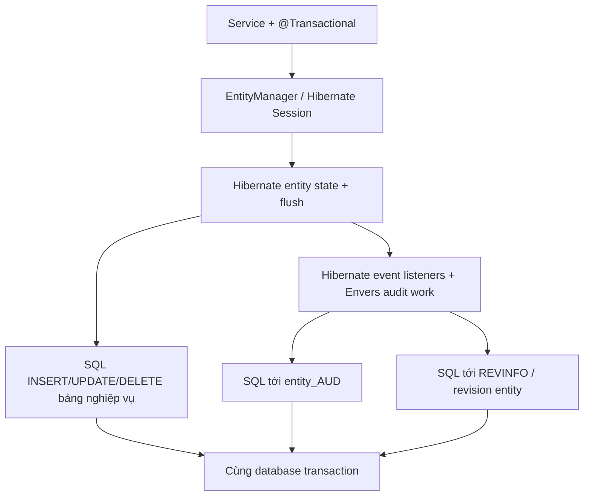
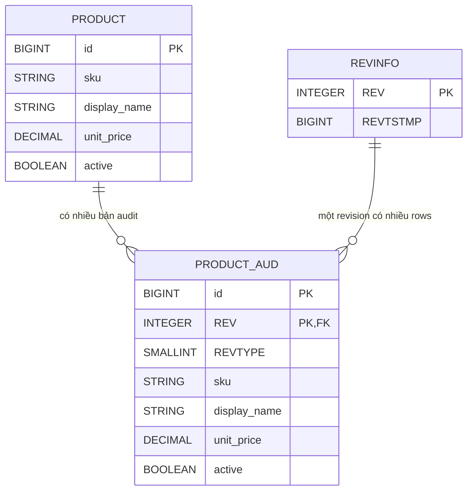
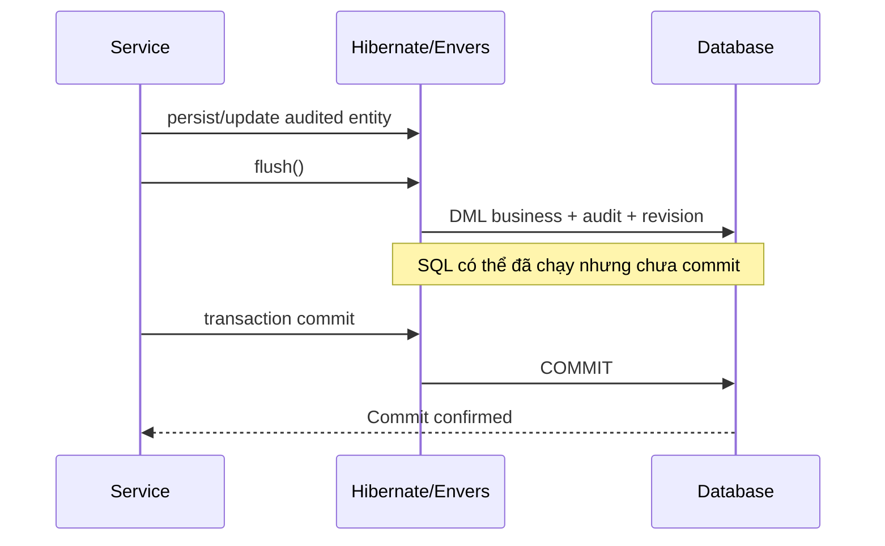
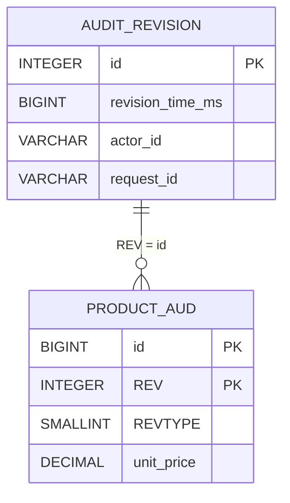

# Bảng lịch sử, số revision và thông tin lần thay đổi trong Hibernate Envers

Trong ứng dụng sử dụng Hibernate, việc cập nhật một entity bình thường chỉ để lại **trạng thái hiện tại** trong bảng nghiệp vụ. Ví dụ khách hàng đổi địa chỉ giao hàng ba lần thì hàng `customer` hiện tại thường chỉ chứa địa chỉ cuối. Nếu cần trả lời “giá trị trước khi sửa là gì?”, “ai đã thay đổi?”, “dữ liệu trông như thế nào ở một thời điểm trước đây?” hoặc “các entity nào được cập nhật trong cùng một giao dịch?”, cần có cơ chế lưu lịch sử.

**Hibernate Envers** là module audit tích hợp với Hibernate ORM. Khi entity được cấu hình `@Audited` và thay đổi thông qua những đường ORM mà Envers theo dõi, Envers có thể ghi thêm dữ liệu vào **bảng lịch sử** và gắn dữ liệu ấy với **revision** — một dấu mốc thay đổi trong cơ sở dữ liệu. Một revision cũng có thể mang metadata như timestamp và người thực hiện.

Ba câu hỏi xuyên suốt bài:

1. **Bảng lịch sử lưu gì?** Vì sao `product_AUD` thường chứa nhiều hàng có cùng business ID nhưng khác `REV`?
2. **Số revision đại diện cho điều gì?** Một revision có phải một lần sửa thuộc tính, một lần gọi `save()` hay một transaction không?
3. **Thông tin lần thay đổi lấy ở đâu?** Cách đọc timestamp, loại thao tác, actor/request ID và những hạn chế của metadata?

Ví dụ trong bài dựa trên API Hibernate ORM/Envers 6.x theo phong cách Jakarta Persistence. Tên class, package, options và chiến lược DDL có thể khác giữa Hibernate series; cần kiểm tra Javadoc và cấu hình thực tế của dự án trước khi áp dụng. Không lấy schema minh họa làm migration production mà chưa review.

> **Nguyên tắc chính:** `@Audited` quyết định **entity/property nào có lịch sử**; bảng `*_AUD` lưu **trạng thái đã được audit theo revision**; bảng revision (thường `REVINFO`) lưu **metadata của sự kiện revision**; `REV` liên kết các bảng này. Envers ghi lịch sử qua ORM, không phải một hệ thống audit bất biến, CDC hoặc giám sát mọi SQL từ bên ngoài.

---

## 1. Vấn đề của bảng chỉ lưu trạng thái hiện tại

Giả sử bảng `product` có dữ liệu:

| id | sku | name | price | active |
|---:|---|---|---:|---|
| 42 | KB-01 | Bàn phím cơ | 1.200.000 | true |

Người quản trị lần lượt thay đổi:

- 08:00: thêm sản phẩm giá 1.000.000.
- 10:30: đổi giá thành 1.100.000.
- 14:15: đổi tên hiển thị.
- Ngày hôm sau: đổi giá thành 1.200.000.

Bảng hiện tại chỉ biết hàng cuối. Nó **không chứng minh** trước đó giá nào đã được lưu, ai đổi hoặc các đơn hàng khác có bị sửa cùng thời điểm không.

Một cách tự xây lịch sử là viết trigger hoặc audit table. Envers hỗ trợ mô hình này ở tầng ORM và tự xây dữ liệu audit cho những entity được khai báo.

### 1.1. Lịch sử không giống log ứng dụng

Log:

```text
INFO Admin updated product 42
```

thường thiếu state chính xác, có thể bị rotate và khó truy vấn theo revision. Một bảng audit có cấu trúc rõ hơn:

```text
product_id=42, rev=17, action=MOD, price=1100000
```

Tuy nhiên, bản ghi audit vẫn cần phân quyền, bảo vệ dữ liệu, quy tắc retention và kiểm soát đường ghi. Không coi nó tự động là bằng chứng pháp lý không thể bị sửa.

## 2. Envers nằm ở đâu trong Hibernate?



Ở những thao tác ORM được hỗ trợ:

- Hibernate quản lý entity trong persistence context.
- Khi flush, Hibernate xác định insert/update/delete và phát các sự kiện lifecycle nội bộ.
- Envers thu thập audit work và phát SQL cho audit rows.
- Trong cấu hình transaction database thông thường, dữ liệu nghiệp vụ, hàng audit và revision metadata tham gia **cùng transaction**.
- Nếu transaction rollback thì các thay đổi trên cả bảng nghiệp vụ và audit cũng rollback.

Envers **không** dựa vào việc mọi repository method tự ghi log. Vì vậy Spring Data JPA `save()`, JPA `EntityManager` và Hibernate `Session` có thể cùng tham gia cơ chế audit khi đi qua operation mà Envers theo dõi.

### 2.1. Envers khác Spring Data Auditing

| Khía cạnh | Hibernate Envers | Spring Data JPA Auditing |
|---|---|---|
| Trọng tâm | Lưu trạng thái lịch sử theo revision | Điền `createdBy`, `lastModifiedBy`, `createdDate`... |
| Dữ liệu lưu | Các hàng `*_AUD` + revision entity | Field trên entity hiện tại |
| Truy vấn phiên bản cũ | Có `AuditReader`/`AuditQuery` | Không tự có |
| Loại thao tác ADD/MOD/DEL | `REVTYPE` | Không có revision type chuẩn |
| Actor | Có thể mở rộng revision entity/listener | `AuditorAware` cho auditing fields |
| Coverage của native/bulk SQL | Không tự audit các bulk/direct DB changes | Cũng không tự đảm bảo per-entity callbacks |

Hai giải pháp có thể bổ sung cho nhau. Đừng nhầm `@CreatedDate` với `@RevisionTimestamp`.

## 3. Thêm dependency Envers

Ví dụ Gradle trong ứng dụng Spring Boot:

```groovy
dependencies {
    implementation 'org.springframework.boot:spring-boot-starter-data-jpa'
    implementation 'org.hibernate.orm:hibernate-envers'
    runtimeOnly 'org.postgresql:postgresql'
}
```

Với Maven, dependency tương ứng thường có tọa độ:

```xml
<dependency>
  <groupId>org.hibernate.orm</groupId>
  <artifactId>hibernate-envers</artifactId>
</dependency>
```

Ví dụ trên giả định dependency management của Spring Boot cung cấp version tương thích. Khi không có BOM, phải chỉ định **version Envers tương thích với Hibernate ORM**. Không trộn Hibernate core 6.x với một Envers 5.x hoặc 7.x tùy tiện.

### 3.1. Kiểm tra runtime version

```java
String version = org.hibernate.Version.getVersionString();
System.out.println(version);
```

Trong build thực tế, xem resolved dependencies để chắc chắn `hibernate-core` và `hibernate-envers` khớp release train. Khi nâng Hibernate, cần kiểm thử cả mapping, schema audit và lịch sử sẵn có, không chỉ CRUD hiện tại.

### 3.2. Package Jakarta và phiên bản cũ

Ở Hibernate ORM 6.x, entity mapping thường dùng `jakarta.persistence.*`. Những dự án Hibernate 5.x cũ có thể còn `javax.persistence.*` và tên artifact/module khác. Không copy import từ tutorial cũ rồi tưởng chỉ cần đổi `@Audited`.

## 4. Đánh dấu entity được audit bằng `@Audited`

Entity:

```java
import jakarta.persistence.*;
import org.hibernate.envers.Audited;
import java.math.BigDecimal;

@Entity
@Audited
@Table(name = "product")
public class Product {

    @Id
    private Long id;

    @Column(name = "sku", nullable = false, unique = true, length = 64)
    private String sku;

    @Column(name = "display_name", nullable = false, length = 200)
    private String displayName;

    @Column(name = "unit_price", nullable = false, precision = 18, scale = 2)
    private BigDecimal unitPrice;

    @Column(nullable = false)
    private boolean active;

    @Version
    private long version;

    protected Product() {}

    public Long getId() { return id; }
    public String getSku() { return sku; }
    public String getDisplayName() { return displayName; }
    public BigDecimal getUnitPrice() { return unitPrice; }

    public void changePrice(BigDecimal newPrice) {
        if (newPrice == null || newPrice.signum() < 0) {
            throw new IllegalArgumentException("Invalid price");
        }
        this.unitPrice = newPrice;
    }

    public void rename(String name) {
        if (name == null || name.isBlank()) {
            throw new IllegalArgumentException("Invalid name");
        }
        this.displayName = name;
    }
}
```

`@Audited` thông báo cho Envers rằng entity cần được theo dõi. Khi `Product` được insert/update/delete qua các đường Hibernate ORM được hỗ trợ, Envers ghi lịch sử theo revision.

### 4.1. Điều gì không xảy ra?

`@Audited` không:

- Ghi một bản sao mỗi khi có `SELECT`.
- Tự động audit mọi bảng của database.
- Bắt toàn bộ SQL gửi từ JDBC ngoài Hibernate.
- Phát revision mới chỉ vì service gọi getter.
- Tạo actor ID nếu bạn chưa cấu hình metadata actor.
- Thay thế transaction hoặc optimistic locking.
- Bảo đảm mọi field bên ngoài annotation đều được lưu lịch sử.

### 4.2. Audit theo property

Nếu một field không cần audit:

```java
import org.hibernate.envers.NotAudited;

@NotAudited
@Column(name = "temporary_render_cache")
private String temporaryRenderCache;
```

Field này vẫn là thuộc tính entity hiện tại nhưng không tham gia lịch sử Envers theo cách thông thường. Khi đọc bản audit, không kỳ vọng giá trị lịch sử của field này được phục hồi.

## 5. Bảng nghiệp vụ, bảng audit và bảng revision

Với `Product`, schema điển hình có ba nhóm:

```text
product       -> Trạng thái hiện tại
product_AUD   -> Nhiều phiên bản lịch sử của product
REVINFO       -> Metadata revision chung cho các entity được audit
```

Các tên mặc định và DDL chính xác phụ thuộc naming strategy, Hibernate version và cấu hình.



Trong nhiều schema, khóa chính bảng audit gồm **business ID + revision number**. Nếu entity dùng khóa ghép, các thành phần business key cũng xuất hiện tương ứng. Đừng giả định mọi bảng `*_AUD` chỉ có hai cột khóa.

### 5.1. Bảng `product`

Lưu trạng thái hiện tại; thường có một hàng cho mỗi ID còn tồn tại. Khi xóa vật lý, hàng biến mất.

### 5.2. Bảng `product_AUD`

Lưu những state được audit theo revision. Nhiều hàng có thể cùng `id` nhưng khác `REV`.

### 5.3. Bảng `REVINFO`

Lưu metadata của **revision**, không phải từng lần sửa thuộc tính riêng lẻ. Một hàng revision có thể liên kết tới nhiều bảng `*_AUD`.

## 6. Các cột `REV` và `REVTYPE`

Một bảng audit mặc định thường có:

| Cột | Vai trò |
|---|---|
| `id` | ID entity nghiệp vụ |
| `REV` | Số revision gắn với thay đổi này |
| `REVTYPE` | Loại thao tác: thêm, sửa, xóa |
| `sku`, `display_name`, `unit_price`... | Các property được audit ở state tương ứng |
| `REVEND` (tùy strategy) | Revision kết thúc hiệu lực của bản audit |
| `REVEND_TSTMP` (tùy config) | Timestamp kết thúc cho một số chiến lược retention |

`REVTYPE` thông thường mã hóa:

- `0`: `ADD` — entity được thêm.
- `1`: `MOD` — entity được cập nhật.
- `2`: `DEL` — entity bị xóa.

Trong Java, nên sử dụng `org.hibernate.envers.RevisionType`, không cứng hóa literal số trong business code nếu không cần.

### 6.1. Không nhầm REVTYPE với business status

`REVTYPE=MOD` chỉ nói “Envers ghi nhận một thay đổi trên entity”. Nó không nói đơn hàng chuyển từ `NEW` sang `PAID` hay chỉ thay đổi ghi chú. Để biết cụ thể các field thay đổi, cần so sánh hai revision hoặc dùng *modified flags* nếu đã cấu hình.

## 7. Ví dụ thực tế: cùng một product qua bốn lần thay đổi

Giả sử:

| Thời điểm | Giao dịch | Hành động |
|---|---|---|
| T1 | TX-A | INSERT product ID 42 |
| T2 | TX-B | đổi giá |
| T3 | TX-C | đổi tên |
| T4 | TX-D | DELETE product |

Trạng thái `product_AUD` minh họa khi dùng default audit strategy:

| id | REV | REVTYPE | display_name | unit_price |
|---:|---:|---|---|---:|
| 42 | 10 | 0 / ADD | Bàn phím cơ | 1.000.000 |
| 42 | 14 | 1 / MOD | Bàn phím cơ | 1.100.000 |
| 42 | 19 | 1 / MOD | Bàn phím cơ RGB | 1.100.000 |
| 42 | 23 | 2 / DEL | null* | null* |

Dấu `*`: với setting mặc định, hàng DEL thường không lưu lại đầy đủ dữ liệu entity, ngoài ID/revision/type; cấu hình `org.hibernate.envers.store_data_at_delete=true` có thể thay đổi điều này. Xem phần dành riêng về DELETE.

Bảng `REVINFO` minh họa:

| REV | REVTSTMP |
|---:|---:|
| 10 | 1790000000000 |
| 14 | 1790000900000 |
| 19 | 1790003600000 |
| 23 | 1790090000000 |

Số timestamp chỉ là dữ liệu minh họa epoch milliseconds, **không** phải một timeline ngày tháng cụ thể cần dựa vào. Bảng audit lưu revision ID, còn thời điểm liên kết với revision thường lấy từ `REVINFO.REVTSTMP`.

### 7.1. Vì sao REV có khoảng trống 10, 14, 19, 23?

Số revision là một định danh trong namespace revision chung, không phải số lần thay đổi của riêng Product 42. Các revision 11, 12, 13... có thể thuộc entity khác, giao dịch khác hoặc bị bỏ qua vì cơ chế sequence/rollback.

**Không giả định revision của mỗi entity tăng liên tục 1, 2, 3.**

## 8. Một revision có thể bao gồm nhiều entity

Giả sử một giao dịch thanh toán làm hai thao tác audited:

```java
@Transactional
public void payOrder(Long orderId) {
    PurchaseOrder order = em.find(PurchaseOrder.class, orderId);
    order.markPaid();

    InventoryItem stock = em.find(InventoryItem.class, order.getSku());
    stock.reserve(1);
}
```

Giả sử `PurchaseOrder` và `InventoryItem` đều `@Audited`. Trong điều kiện audit bình thường của cùng Hibernate Session/transaction, Envers có thể ghi:

```text
REVINFO
  REV = 101

purchase_order_AUD
  (order_id=5001, REV=101, REVTYPE=MOD, status=PAID)

inventory_item_AUD
  (sku=KB-01, REV=101, REVTYPE=MOD, reserved=1)
```

Cùng `REV=101` liên kết những thay đổi được audit trong giao dịch. Một revision **không có nghĩa chỉ một entity** hay **chỉ một SQL UPDATE**.

### 8.1. Một transaction có thể sửa cùng entity nhiều lần

```java
Product p = em.find(Product.class, 42L);
p.changePrice(new BigDecimal("1100000"));
p.changePrice(new BigDecimal("1200000"));
```

Nếu cả hai setter được gọi trước flush, Hibernate có thể chỉ phát SQL cho state cuối. Envers không hứa ghi một revision riêng cho **mỗi lời gọi setter**. Lịch sử bám theo những thay đổi mà ORM ghi nhận trong ranh giới giao dịch, không phải log của mọi bước tính toán trong RAM.

### 8.2. Một transaction không thay đổi audited entity

Nếu transaction chỉ đọc hoặc chỉ thay đổi entity/property không được audit, không nhất thiết có revision Envers mới. Vì vậy `REV` không phải bộ đếm của **mọi transaction** trong database.

## 9. Revision number là gì và không phải gì?

**Revision number** là identifier của revision entity được Envers tạo khi cần ghi audit data.

Đặc điểm cần hiểu:

1. Thường được tạo bởi cơ chế identifier generation của Hibernate/database.
2. Có namespace dùng chung trong persistence unit/revision infrastructure.
3. Được audit rows tham chiếu qua `REV`.
4. Không phải ID của Product/Order/Customer.
5. Không phải timestamp.
6. Không nhất thiết trùng thứ tự **commit thực tế** của các transaction concurrent.
7. Không bảo đảm liên tục không có khoảng trống.
8. Không phải “version của entity” theo `@Version`.

### 9.1. Revision và optimistic locking `@Version`

| `@Version` | Envers `REV` |
|---|---|
| Gắn với từng entity row | Gắn với một revision audit chung |
| Dùng phát hiện stale concurrent updates | Dùng xác định state lịch sử |
| Có thể tăng trên managed entity update | Tham chiếu các thay đổi được audit |
| Không tự lưu snapshot cũ | Bảng `*_AUD` có snapshot |
| Thường xuất hiện trong `UPDATE ... WHERE version=?` | Dùng join/query lịch sử với bảng revision |

Một Product có `version=4` không đồng nghĩa revision Envers là `4`. Product có thể được tạo ở REV=100, cập nhật ở REV=215 và version tăng từ 0 lên 1.

### 9.2. Revision không phải thứ tự commit tuyệt đối

Với nhiều transaction concurrent:

```text
TX-A được cấp REV=70, chưa commit.
TX-B được cấp REV=71, commit nhanh.
TX-A commit sau đó.
```

Tùy generator và thời điểm tạo revision, thứ tự số có thể không phản ánh chính xác thứ tự wall-clock commit. Tương tự, `REVTSTMP` không nhất thiết là timestamp commit do database cung cấp.

Đừng dùng `REV` như nguồn duy nhất để chứng minh trật tự commit liên transaction khi yêu cầu audit pháp lý/nghiệp vụ tuyệt đối; cần protocol DB/change-log phù hợp.

## 10. `REVINFO` và timestamp

Bảng revision mặc định của Envers thường có các trường như:

```sql
REVINFO (
    REV      INTEGER PRIMARY KEY,
    REVTSTMP BIGINT NOT NULL
)
```

`REVTSTMP` thường là giá trị thời gian **epoch milliseconds**. Ví dụ đổi sang Java:

```java
long millis = revisionEntity.getTimestamp();
Instant time = Instant.ofEpochMilli(millis);
```

Với `DefaultRevisionEntity`, có accessor `getTimestamp()` cho thời gian revision. Khi hiển thị cho người dùng, chuyển `Instant` sang timezone được yêu cầu ở UI/API layer, không coi số millis là “giờ địa phương”.

### 10.1. Timestamp được lấy lúc nào?

Timestamp thường gắn với lúc Envers tạo revision entity trong quá trình flush/transaction work, **không nhất thiết** là timestamp của từng setter, của sự kiện business, hoặc thời gian database commit.

Nếu transaction rất dài, revision timestamp có thể cách xa lúc transaction hoàn tất. Với concurrency, hai revisions có timestamp gần nhau nhưng thứ tự commit khác.

### 10.2. Nếu cần thời gian nghiệp vụ riêng

Ví dụ business event “thanh toán được cổng thanh toán xác nhận lúc 14:03:05” có timestamp riêng và nên lưu trên domain event/transaction record. `REVTSTMP` cho biết thời điểm Envers ghi nhận revision, không thay thế mọi loại business timestamp.

## 11. Khi nào revision được ghi bền vững?

Hình dung:



Mấu chốt:

- `persist()` chưa khẳng định SQL audit đã gửi.
- `flush()` đồng bộ pending work nhưng **không phải commit**.
- Nếu transaction rollback sau flush, revision row và audit rows cũng phải bị rollback trong cấu hình cùng DB transaction chuẩn.
- Nếu commit thành công, lịch sử trở thành dữ liệu bền vững.
- Nếu client mất ACK khi commit, kết quả cần được xác minh từ database thay vì đoán.

### 11.1. Revision number vẫn có thể bị bỏ trống sau rollback

Sequence/ID allocator có thể cấp một số rồi transaction rollback; số đó không nhất thiết được “trả lại”. Kết quả lịch sử có thể có gap dù không có revision row tương ứng.

Do đó không dùng `MAX(REV) - MIN(REV) + 1` để đếm số revisions đã commit.

## 12. Envers lưu state dạng snapshot theo revision

Với mỗi entity được audit, các hàng `*_AUD` thường chứa các property được audit của entity tại revision đó. Đó là mô hình snapshot theo revision, **không đơn thuần là một dòng mô tả “price đổi từ X sang Y”**.

Ví dụ:

| id | REV | name | price |
|---:|---:|---|---:|
| 42 | 10 | Bàn phím | 1.000.000 |
| 42 | 14 | Bàn phím | 1.100.000 |

Để biết thay đổi:

```text
Old price = 1,000,000
New price = 1,100,000
Delta     = +100,000
```

có thể so sánh hai snapshots. Nếu cần query “property X đã thay đổi ở revision nào?”, Envers có cơ chế *modified flags* cần cấu hình trước; không phải mọi audit table mặc định đã có Boolean cho từng property.

### 12.1. Hàng audit không phải “sao chép toàn bộ entity graph”

Audit row đại diện cho entity và các property/relationship được audit theo mapping. Nó không đảm bảo một JSON chứa toàn bộ Customer, OrderLines, Inventory và các association lồng nhau tại cùng revision. Lịch sử quan hệ phải được mapping và truy vấn riêng theo policy của Envers.

## 13. Audit loại thêm, sửa, xóa

### 13.1. `ADD`

Entity mới được persist và transaction commit:

```text
Product(id=42, price=1000000)
product_AUD(id=42, REV=10, REVTYPE=ADD, ...)
```

### 13.2. `MOD`

Entity đã tồn tại, state audited thay đổi:

```text
Product(id=42, price=1100000)
product_AUD(id=42, REV=14, REVTYPE=MOD, ...)
```

Nếu chỉ có field không audit thay đổi, không nhất thiết có một revision/audit row cho entity, tùy mapping và event behavior. Không coi mọi `UPDATE` trong SQL đều tương ứng `MOD` nếu ORM không quản lý operation đó.

### 13.3. `DEL`

Entity được remove qua ORM:

```text
product row disappears
product_AUD(id=42, REV=23, REVTYPE=DEL, ...)
```

Mặc định nhiều cột được audit có thể là null trong DEL row; phiên bản cuối trước khi xóa vẫn nằm ở revision MOD/ADD trước đó.

### 13.4. Lưu state khi xóa

Cấu hình Hibernate Envers:

```properties
org.hibernate.envers.store_data_at_delete=true
```

Có thể yêu cầu lưu dữ liệu entity tại bản DEL, tùy mapping và Hibernate version. Điều này tăng dung lượng lưu trữ và có thể trùng thông tin với bản audit trước khi xóa.

**Không bật chỉ để “truy vấn audit dễ hơn” mà không cân nhắc retention, PII và dung lượng.**

## 14. Đọc lịch sử bằng `AuditReader`

Envers cung cấp `AuditReaderFactory`:

```java
import jakarta.persistence.EntityManager;
import org.hibernate.envers.AuditReader;
import org.hibernate.envers.AuditReaderFactory;

AuditReader reader = AuditReaderFactory.get(entityManager);
```

`EntityManager` là persistence context do Spring/JPA quản lý; reader dùng hạ tầng Hibernate hiện tại để truy vấn audit tables.

### 14.1. Lấy các revision của một entity

```java
Long productId = 42L;

List<Number> revisions =
    reader.getRevisions(Product.class, productId);
```

Kết quả minh họa:

```text
[10, 14, 19, 23]
```

Mỗi phần tử là **revision number**, không phải entity `@Version`. Không dùng `getRevisions(Product.class, 42L)` để đếm toàn hệ thống hay coi kết quả là số transaction độc lập của Product.

### 14.2. Đọc state tại revision

```java
Product beforeRename =
    reader.find(Product.class, productId, 14);
```

Kết quả thể hiện state của entity theo semantics “as of revision 14”, thường là bản audit gần nhất có `REV <= 14` và chưa bị xóa tại revision đó.

Nếu không có entity ở revision yêu cầu, `find` có thể trả `null`. Sau revision xóa, entity thường được xem là không còn tồn tại tại những revision tiếp theo. Khi cần xem **DEL event** hoặc metadata của thao tác xóa, dùng revision query với loại thao tác thích hợp thay vì mặc định `find` luôn trả object.

### 14.3. AuditReader không sửa lịch sử

Entity object trả về từ audit query phục vụ truy vấn snapshot, không phải một managed `Product` hiện tại mà setter sẽ tự cập nhật database theo semantics thông thường. Không dùng `save` lên một bản lịch sử như thể “chọn revision cũ để sửa trực tiếp”.

Nếu cần restore dữ liệu, hãy tạo một **operation nghiệp vụ mới**: load current entity, validate state cũ, copy các thuộc tính được phép, áp optimistic concurrency và commit như một thay đổi hiện tại. Operation restore nên có audit revision mới.

## 15. Đọc metadata revision

`AuditReader` có các API để lấy timestamp và revision entity.

Ví dụ với default revision entity:

```java
import org.hibernate.envers.DefaultRevisionEntity;

DefaultRevisionEntity metadata =
    reader.findRevision(DefaultRevisionEntity.class, 14);

int revisionNumber = metadata.getId();
long revisionTimestamp = metadata.getTimestamp();

Instant changedAt = Instant.ofEpochMilli(revisionTimestamp);
```

Đoạn này áp dụng khi ứng dụng dùng `DefaultRevisionEntity` làm revision entity. **Nếu đã khai báo custom `@RevisionEntity`**, phải dùng chính class custom khi gọi `findRevision`.

### 15.1. Lấy timestamp bằng API reader

```java
Date changedAt =
    reader.getRevisionDate(14);
```

`getRevisionDate` trả kiểu `Date` theo API Envers; chuyển thành `Instant` với `changedAt.toInstant()` khi cần. Thời gian có độ chính xác và semantics theo mapping revision timestamp.

### 15.2. Tìm revision theo ngày

```java
Number revisionAtOrBefore =
    reader.getRevisionNumberForDate(
        Date.from(Instant.parse("2026-11-01T12:00:00Z"))
    );
```

Semantics API này là tìm revision phù hợp với thời điểm được hỏi trong phạm vi khả năng Envers hỗ trợ; có thể ném exception khi không có revision tương ứng. Nó không biến `REV` thành clock commit hoàn hảo, và cần thận trọng với giao dịch concurrent/timestamp.

Không viết một API nghiệp vụ “đúng tại đúng microsecond” chỉ dựa vào timestamp revision có độ phân giải milliseconds nếu yêu cầu precision cao hơn.

## 16. Lấy entity cùng revision metadata và loại thao tác

`AuditReader.createQuery()` cung cấp `AuditQuery`. Một truy vấn phổ biến là lấy lịch sử của entity ID 42:

```java
import org.hibernate.envers.query.AuditEntity;
import org.hibernate.envers.RevisionType;

@SuppressWarnings("unchecked")
List<Object[]> rows = reader.createQuery()
    .forRevisionsOfEntity(Product.class, false, true)
    .add(AuditEntity.id().eq(42L))
    .addOrder(AuditEntity.revisionNumber().asc())
    .getResultList();
```

Với `forRevisionsOfEntity(Product.class, false, true)`, kết quả thông thường gồm ba phần tử:

```text
row[0] = trạng thái Product ở audit row
row[1] = revision entity metadata
row[2] = RevisionType.ADD / MOD / DEL
```

Có thể duyệt:

```java
for (Object[] row : rows) {
    Product snapshot = (Product) row[0];
    DefaultRevisionEntity revision =
        (DefaultRevisionEntity) row[1];
    RevisionType type = (RevisionType) row[2];

    System.out.printf(
        "rev=%d, type=%s, time=%s%n",
        revision.getId(),
        type,
        Instant.ofEpochMilli(revision.getTimestamp())
    );
}
```

Nếu dùng custom revision class, ép kiểu `row[1]` sang class đó. Đừng gắn cứng `DefaultRevisionEntity` vào code chung nếu sau này thêm actor metadata.

### 16.1. Hai tham số boolean nghĩa là gì?

Với overload này:

- `selectEntitiesOnly=false`: trả bộ kết quả gồm snapshot, revision entity và revision type thay vì chỉ entity.
- `selectDeletedEntities=true`: bao gồm revision DELETE.

Cú pháp API/overload có thể thay đổi theo Hibernate series; kiểm tra Javadoc của version dự án.

### 16.2. Lấy mỗi state mà không cần metadata

Nếu chỉ quan tâm snapshots, có thể sử dụng biến thể `selectEntitiesOnly=true` thích hợp. Nhưng khi cần “ai, lúc nào, loại thao tác nào”, phải lấy revision entity/type hoặc truy vấn metadata riêng.

## 17. Truy vấn trạng thái entity tại một revision toàn hệ thống

Hai loại câu hỏi khác nhau:

1. “Lịch sử của Product 42 gồm những revision nào?”
2. “Ở revision 100, những Product nào đang tồn tại và khớp một điều kiện?”

Với câu hỏi thứ hai:

```java
@SuppressWarnings("unchecked")
List<Product> activeProducts = reader.createQuery()
    .forEntitiesAtRevision(Product.class, 100)
    .add(AuditEntity.property("active").eq(true))
    .getResultList();
```

Hình thức query này tái tạo “as of revision” bằng audit schema và chiến lược audit được dùng. Nó không nhất thiết truy vấn bảng `product` hiện tại.

### 17.1. Chỉ lọc những property được audit

Nếu property bị đánh dấu `@NotAudited`, Envers không có đầy đủ lịch sử của nó để trả điều kiện tại revision cũ. Không coi `AuditEntity.property(...)` trên property không audit là một phép “truy vấn ngược thời gian” có dữ liệu.

### 17.2. Chi phí query as-of revision

Truy vấn lịch sử có thể dùng subquery hoặc join theo validity range. Khi audit tables lớn, index và query plan rất quan trọng. Không giả định `forEntitiesAtRevision` có cùng chi phí như SELECT hiện tại theo PK.

## 18. Tùy biến bảng revision để lưu “ai đã sửa”

Metadata mặc định chủ yếu có revision number và timestamp. Nếu cần actor, nguồn thao tác hoặc request correlation, định nghĩa **custom revision entity**.

```java
import jakarta.persistence.*;
import org.hibernate.envers.RevisionEntity;
import org.hibernate.envers.RevisionNumber;
import org.hibernate.envers.RevisionTimestamp;

@Entity
@Table(name = "audit_revision")
@RevisionEntity(ActorRevisionListener.class)
public class ActorRevisionEntity {

    @Id
    @GeneratedValue(
        strategy = GenerationType.SEQUENCE,
        generator = "audit_revision_id_gen"
    )
    @SequenceGenerator(
        name = "audit_revision_id_gen",
        sequenceName = "audit_revision_seq",
        allocationSize = 1
    )
    @RevisionNumber
    private int id;

    @RevisionTimestamp
    @Column(name = "revision_time_ms", nullable = false)
    private long timestamp;

    @Column(name = "actor_id", length = 100)
    private String actorId;

    @Column(name = "request_id", length = 100)
    private String requestId;

    protected ActorRevisionEntity() {}

    public int getId() { return id; }
    public long getTimestamp() { return timestamp; }
    public String getActorId() { return actorId; }
    public String getRequestId() { return requestId; }

    public void setActorId(String value) {
        this.actorId = value;
    }

    public void setRequestId(String value) {
        this.requestId = value;
    }
}
```

Trong một persistence unit nên có **một cấu hình revision entity nhất quán**. Không khai báo thêm một custom revision entity song song với một revision entity khác mà không hiểu quy tắc bootstrap của Envers.

### 18.1. Giải thích các annotation

| Annotation | Công dụng |
|---|---|
| `@Entity` | Revision entity được JPA quản lý |
| `@RevisionEntity(ActorRevisionListener.class)` | Chỉ định listener tạo metadata |
| `@RevisionNumber` | Trường đánh dấu revision number |
| `@RevisionTimestamp` | Trường đánh dấu thời điểm revision |
| `@Id`/`@GeneratedValue` | Khóa chính và identifier generation |
| `@Column` | Tùy chỉnh tên/độ dài cột lưu metadata |

Tên sequence và chiến lược ID generation phải khớp Hibernate version/DBMS và migration schema. Nếu schema đang có `REVINFO` với revision cũ, việc chuyển sang `audit_revision` **không phải một thay đổi chỉ ở Java**: cần kế hoạch migrate dữ liệu/key/foreign keys lịch sử.

## 19. `RevisionListener` điền actor và request ID

Envers gọi `RevisionListener.newRevision(...)` khi tạo revision entity.

Ví dụ đơn giản với Spring Security và SLF4J MDC (nếu ứng dụng có hai thư viện này):

```java
import org.hibernate.envers.RevisionListener;
import org.slf4j.MDC;
import org.springframework.security.core.Authentication;
import org.springframework.security.core.context.SecurityContextHolder;

public class ActorRevisionListener implements RevisionListener {

    @Override
    public void newRevision(Object revisionEntity) {
        ActorRevisionEntity rev =
            (ActorRevisionEntity) revisionEntity;

        Authentication auth =
            SecurityContextHolder.getContext()
                .getAuthentication();

        String actor = auth != null && auth.isAuthenticated()
            ? auth.getName()
            : "system";

        rev.setActorId(actor);
        rev.setRequestId(MDC.get("requestId"));
    }
}
```

Đoạn này minh họa cách lấy actor từ context của thread hiện tại. Nếu dùng anonymous authentication, cần chính sách riêng để tránh lưu `anonymousUser` như một người thật.

### 19.1. Listener không luôn là Spring-managed bean

`RevisionListener` được Hibernate/Envers khởi tạo theo cơ chế framework. Không mặc định constructor injection/`@Autowired` vào listener sẽ hoạt động giống Spring `@Service`. Nếu cần dependency, nghiên cứu integration strategy đúng version hoặc dùng một context provider có thiết kế rõ ràng.

Đừng gắn service có I/O chậm vào revision listener chỉ để tra cứu tên người dùng.

### 19.2. Async job không có HTTP security context

Trong scheduler, queue consumer hoặc batch worker, `SecurityContextHolder` có thể trống. Actor nên được định nghĩa theo chính sách:

```text
system:nightly-price-sync
service:catalog-importer
admin:1234
```

Có thể lưu thêm `sourceSystem` hoặc `jobId`. Đừng giả định mọi revision được tạo từ một HTTP request có logged-in user.

### 19.3. Request ID không phải business transaction ID

Một HTTP request có thể mở nhiều DB transactions; một transaction có thể đến từ job không có HTTP request. `requestId` hữu ích để correlate logs, nhưng không thay thế `REV`, business event ID hoặc idempotency key.

## 20. DDL của custom revision entity và quan hệ với audit rows

Với `ActorRevisionEntity`, DDL minh họa:

```sql
CREATE SEQUENCE audit_revision_seq
    START WITH 1 INCREMENT BY 1;

CREATE TABLE audit_revision (
    id INTEGER PRIMARY KEY,
    revision_time_ms BIGINT NOT NULL,
    actor_id VARCHAR(100),
    request_id VARCHAR(100)
);
```

Bảng `product_AUD` có `REV` tham chiếu **revision number** đến ID của custom revision entity; Hibernate mapping/schema generation thực tế quyết định tên cột/fk.



**Lưu ý:** default revision table có thể là `REVINFO` với `REV`/`REVTSTMP`. Khi chuyển sang custom entity, tên bảng và cột revision metadata do mapping mới quyết định; không tự giả định custom schema luôn giống REVINFO.

### 20.1. Query metadata custom

```java
ActorRevisionEntity meta =
    reader.findRevision(ActorRevisionEntity.class, 101);

System.out.println(meta.getActorId());
System.out.println(meta.getRequestId());
System.out.println(
    Instant.ofEpochMilli(meta.getTimestamp())
);
```

Nên map metadata sang DTO API, thay vì trả thẳng revision entity chứa thông tin nội bộ.

## 21. Metadata revision khác metadata từng entity

Một transaction có thể thay đổi Product 42 và Product 43:

```text
REV=101
  actor=admin-7
  requestId=req-abc

product_AUD:
  id=42, REV=101, REVTYPE=MOD
  id=43, REV=101, REVTYPE=MOD
```

Actor/request ID ở bảng revision thường **chung cho cả transaction/revision**. Nếu cần biết “sửa Product 42 vì lý do X, Product 43 vì lý do Y” trong cùng transaction, metadata cấp revision có thể **không đủ chi tiết**.

Các lựa chọn:

- Lưu reason/business event ID trên từng domain entity/audit-specific record.
- Tạo custom audit event table với entity ID và reason.
- Tổ chức use case thành transactions khác nhau nếu nghiệp vụ thật sự cần revision boundary riêng.
- Sử dụng Envers modified entity metadata để biết loại entity thay đổi (không đồng nghĩa lý do chi tiết từng row).

Đừng đặt tất cả metadata nghiệp vụ vào `RevisionListener` chỉ vì nó chạy khi tạo revision.

## 22. Revision listener nên nhẹ và deterministic

Không nên:

```java
@Override
public void newRevision(Object entity) {
    billingApi.charge(...);
    emailService.send(...);
    remoteUserService.fetchProfile(...);
}
```

Lý do:

- Revision listener có thể chạy khi ORM flush.
- External side effects không rollback theo DB transaction.
- I/O làm transaction kéo dài.
- Retry transaction có thể gọi listener nhiều lần.
- Lỗi network có thể làm ghi nghiệp vụ fail.
- Khó kiểm thử và gây phụ thuộc vòng giữa persistence và application services.

Thích hợp hơn: lấy actor ID/correlation ID đã có trong context và gán scalar fields. Nếu cần phát event sau commit, xem xét transactional outbox và idempotent consumer.

## 23. Modified flags: biết property nào thay đổi

Mặc định audit row lưu snapshot của các field được audit, không nhất thiết có cột Boolean per property để báo “field này đổi”.

Envers hỗ trợ tùy chọn modified flags; ví dụ:

```java
@Audited(withModifiedFlag = true)
@Entity
@Table(name = "product")
public class Product {
    // ...
}
```

Khi cấu hình phù hợp, audit table có thể xuất hiện cột theo mẫu:

```text
display_name_MOD
unit_price_MOD
active_MOD
```

Tên suffix/chi tiết có thể cấu hình và khác giữa versions. Modified flags nói một property đã được đánh dấu thay đổi trong audit work; không nhất thiết là mọi khác biệt nghiệp vụ giữa hai API requests.

### 23.1. Query property có thay đổi

```java
@SuppressWarnings("unchecked")
List<Object[]> priceChanges = reader.createQuery()
    .forRevisionsOfEntity(Product.class, false, false)
    .add(AuditEntity.id().eq(42L))
    .add(AuditEntity.property("unitPrice").hasChanged())
    .getResultList();
```

`hasChanged()` cần metadata modified flags phù hợp; nếu không cấu hình, một số truy vấn không được hỗ trợ/không thể cho kết quả kỳ vọng.

### 23.2. Lưu flags tăng chi phí schema/storage

Nếu entity có nhiều field, mỗi property được theo dõi có thể thêm cột flag. Cần đánh giá index, schema migration, dung lượng và lợi ích truy vấn. Với một yêu cầu hiếm, so sánh snapshots trong service có thể đơn giản hơn.

## 24. Liệt kê entity types được thay đổi trong revision

Trong một số use case, cần biết “revision 101 động đến những loại entity nào?”. Envers hỗ trợ cơ chế tracking entity names theo revision ở những cấu hình/version nhất định.

Ví dụ property cấu hình:

```properties
org.hibernate.envers.track_entities_changed_in_revision=true
```

Tùy phiên bản, Envers có thể dùng một revision entity chuyên biệt hoặc ghi thêm metadata association để lưu danh sách entity types thay đổi.

Ngoài ra, custom revision listener có thể triển khai interface tracking tương ứng như `EntityTrackingRevisionListener` ở những Envers versions hỗ trợ.

### 24.1. Không đồng nghĩa liệt kê mọi field/entity ID thay đổi

Tracking tên entity type thường trả thông tin loại như:

```text
Product
PurchaseOrder
InventoryItem
```

Nó không tự cho biết toàn bộ ID, field delta hoặc business reason. Muốn có per-entity event feed, dùng audit query theo revision hoặc custom change event model phù hợp.

### 24.2. Tác động schema

Bật option tracking có thể tạo cấu trúc lưu metadata bổ sung. Với production phải đưa schema này qua migration được version hóa và kiểm thử version/dialect. Không bật option trên database đã có lịch sử mà bỏ qua kế hoạch DDL.

## 25. Default audit strategy: tìm snapshot gần nhất

Hibernate Envers có chiến lược audit mặc định thường gọi `DefaultAuditStrategy`. Theo cách hiểu khái niệm, một snapshot tại revision R được tìm bằng audit row có:

```text
entity_id = X
REV là số lớn nhất <= R
và không bị xóa tại revision cần xem
```

SQL ý tưởng:

```sql
SELECT a.*
FROM product_AUD a
WHERE a.id = :id
  AND a.REV = (
      SELECT MAX(a2.REV)
      FROM product_AUD a2
      WHERE a2.id = a.id
        AND a2.REV <= :requestedRev
  );
```

Đây là SQL rút gọn để minh họa **ý tưởng tìm bản gần nhất**; Envers còn xử lý `REVTYPE`, quan hệ, inheritance và filter khác. Không lấy nguyên query này thay cho Envers audit query.

### 25.1. Vì sao cần index?

Truy vấn tìm max revision cho một entity có thể phải quét nhiều audit rows. Index trên `(id, REV)` hoặc cấu trúc phù hợp giúp tối ưu; schema audit mặc định có thể tạo primary key đó, nhưng nên kiểm tra execution plan với dữ liệu lớn.

## 26. Validity audit strategy: đánh dấu khoảng hiệu lực

Một lựa chọn khác là:

```properties
org.hibernate.envers.audit_strategy=org.hibernate.envers.strategy.ValidityAuditStrategy
```

Theo chiến lược này, mỗi audit row có thể lưu:

- `REV`: revision bắt đầu hiệu lực.
- `REVEND`: revision chấm dứt hiệu lực, được ghi khi có revision mới cho cùng entity.

Ví dụ:

| id | REV | REVEND | price |
|---:|---:|---:|---:|
| 42 | 10 | 14 | 1.000.000 |
| 42 | 14 | 19 | 1.100.000 |
| 42 | 19 | 23 | 1.200.000 |
| 42 | 23 | null | null (DEL) |

Bỏ qua chi tiết DELETE để tập trung vào phạm vi, một bản audit sống tại revision R nếu:

```text
REV <= R
AND (REVEND > R OR REVEND IS NULL)
```

Khi query thực tế, cần xét `REVTYPE=DEL` để không trả entity đã bị xóa ở revision R.

### 26.1. Đánh đổi của validity strategy

**Ưu điểm:**

- Có thể truy vấn range theo revision thay vì subquery tìm max.
- Một số báo cáo “as of revision” và khoảng hiệu lực dễ diễn đạt hơn.
- Có thể có lợi về performance theo database/index/workload.

**Đánh đổi:**

- Khi thêm revision mới, Envers thường phải **cập nhật audit row trước** để điền `REVEND`, nên không phải mô hình chỉ INSERT bất biến.
- Tăng số write/update trên audit table.
- Có yêu cầu locking/concurrency và index phù hợp.
- Chuyển từ default sang validity trên dữ liệu đã có cần migration/backfill những revision ranges.

**Không thay strategy production chỉ bằng đổi property** mà không migrate audit schema/dữ liệu và test query.

## 27. Timestamp kết thúc và retention

Với validity strategy, một số cấu hình hỗ trợ lưu timestamp revision kết thúc, ví dụ:

```properties
org.hibernate.envers.audit_strategy_validity_store_revend_timestamp=true
```

Tên cột thường là `REVEND_TSTMP` theo default; có thể cấu hình naming tương ứng.

Lợi ích của end timestamp: hỗ trợ một số chiến lược partitioning/purge audit rows cũ theo thời gian kết thúc hiệu lực.

Nhưng:

- Cần migration/schema column đúng.
- Không tự biến audit table thành partitioned table.
- Cần query và index phù hợp.
- Nếu retention xóa audit rows cũ, khả năng truy vấn các revision xưa sẽ thay đổi.
- Xóa audit rows có thể liên quan FK đến revision table và các entity associations.

Không dùng retention theo `REVTSTMP` một cách thô nếu nghiệp vụ cần giữ state tại một mốc lịch sử dài hạn.

## 28. Bảng revision so với bảng audit: nên đặt index ở đâu?

Một mô hình đọc lịch sử phổ biến:

```sql
SELECT a.id, a.REV, a.REVTYPE, a.unit_price, r.REVTSTMP
FROM product_AUD a
JOIN REVINFO r ON a.REV = r.REV
WHERE a.id = :productId
ORDER BY a.REV;
```

Đây là SQL minh họa cho default revision entity/schema.

Các index cần xem xét:

- Primary key `(id, REV)` trên audit entity.
- Index trên `REV` nếu thường hỏi “những entities thay đổi ở revision R”.
- Index `(REV, entityId)` hoặc tương tự theo workload/report.
- Index trên timestamp revision nếu thường lọc theo thời gian.
- `REVEND` cho validity range queries/partitioning.
- Index trên actor/request ID nếu metadata được tìm theo actor.

Không thêm tất cả index cho mọi bảng audit một cách máy móc. Mỗi index tăng chi phí ghi/space; dùng query plan và số liệu thực.

## 29. Audit relation: lịch sử graph không tự miễn phí

Giả sử `PurchaseOrder` có:

```java
@ManyToOne(fetch = FetchType.LAZY)
private Customer customer;
```

Nếu Order được audit nhưng Customer không audit, Envers có thể yêu cầu chỉ rõ cách xử lý target relation theo mapping/version.

Một lựa chọn trong tình huống phù hợp:

```java
@Audited(
    targetAuditMode =
        org.hibernate.envers.RelationTargetAuditMode.NOT_AUDITED
)
@ManyToOne(fetch = FetchType.LAZY)
@JoinColumn(name = "customer_id")
private Customer customer;
```

Semantics của `NOT_AUDITED` trong quan hệ là target được coi là không audit. Khi đọc lịch sử, reference có thể dẫn đến **Customer hiện tại**, không phải một Customer snapshot tại revision cũ.

### 29.1. Vì sao dễ làm báo cáo lịch sử sai?

Order revision 10 có customer ID 7, lúc đó tên là “An”. Customer đổi tên thành “Nguyễn An” ở hiện tại nhưng không được audit. Khi dựng lịch sử order, nếu lấy Customer hiện tại, UI có thể hiển thị “Nguyễn An” cho revision 10.

Muốn historical accuracy xuyên entity, cần audit những entity/association liên quan và thiết kế query “as of revision” phù hợp.

### 29.2. Collection và join table

Với `@OneToMany`, `@ManyToMany` hoặc bảng nối, Envers có thể cần audit association changes và tạo thêm audit join tables theo mapping. Cần hiểu:

- Ownership bên nào.
- Quan hệ có được audit không.
- Target entity audited hay not audited.
- Join table có lịch sử hay không.
- Lazy loading của graph lịch sử.
- Query một revision có phát nhiều SQL không.

Đừng đánh `@Audited` lên mọi graph lớn rồi mong truy vấn lịch sử hoàn chỉnh không tốn chi phí.

## 30. HQL bulk UPDATE/DELETE không tự đi qua Envers

Đây là ranh giới rất quan trọng.

Managed entity update:

```java
@Transactional
public void renameProduct(Long id, String value) {
    Product product = em.find(Product.class, id);
    product.rename(value);
}
```

Hibernate dirty checking xử lý entity và Envers có thể ghi audit tương ứng.

Nhưng HQL bulk DML:

```java
int affected = em.createQuery(
    """
    update Product p
    set p.unitPrice = p.unitPrice * :factor
    where p.active = true
    """
)
.setParameter("factor", new BigDecimal("1.05"))
.executeUpdate();
```

Bulk HQL/JPQL UPDATE đi trực tiếp thành database DML, **không vận hành như cập nhật lần lượt từng managed entity**. Nó thường không phát các per-entity events mà Envers dùng để tạo history rows.

Do đó, sau một bulk price update, bảng `product` có thể thay đổi nhưng `product_AUD` **không phản ánh những thay đổi đó** theo cơ chế audit bình thường.

### 30.1. Những đường ghi khác cũng cần xem xét

- `CriteriaUpdate`/`CriteriaDelete`.
- Native SQL UPDATE/DELETE.
- JDBC trực tiếp qua `JdbcTemplate`.
- Stored procedures.
- DB scripts/migrations.
- Trigger hoặc writer từ ứng dụng khác.
- Data import/ETL ngoài Hibernate.

Envers không phải database trigger và không bắt toàn bộ thay đổi ngoài ORM.

### 30.2. Cách xử lý nếu phải bulk

Các lựa chọn tùy yêu cầu:

1. Với khối lượng vừa phải, load managed entities và cập nhật theo chunk để Envers audit được; tối ưu JDBC batching/flush/clear.
2. Với bulk SQL lớn, thiết kế **audit bulk riêng** bằng SQL transaction tương ứng hoặc trigger/CDC nếu phải giữ history.
3. Ghi business event/bulk job record có version và phạm vi được thay đổi.
4. Cân nhắc database temporal tables khi sản phẩm cần audit cả writers ngoài Hibernate.
5. Kiểm thử source-of-truth và reconciliation giữa business table/audit store.

Không tuyên bố “mọi giá sản phẩm có lịch sử” nếu tồn tại một admin bulk UPDATE bypass Envers mà không có cơ chế khác.

## 31. Envers và Spring Data JPA

Spring Data repository vẫn dùng Hibernate khi Hibernate là JPA provider.

```java
public interface ProductRepository
        extends JpaRepository<Product, Long> {
}
```

Service:

```java
@Service
public class ProductCommandService {

    private final ProductRepository repository;

    public ProductCommandService(ProductRepository repository) {
        this.repository = repository;
    }

    @Transactional
    public void updatePrice(Long id, BigDecimal amount) {
        Product product = repository.findById(id)
            .orElseThrow();

        product.changePrice(amount);
        // Hibernate dirty checking -> Envers audit nếu commit.
    }
}
```

Không cần gọi một method `audit()` trên repository sau mỗi `save()` nếu Envers đã cấu hình theo mapping và event listeners.

### 31.1. Không coi `saveAll` là guarantee audit cho mọi thay đổi

Với `saveAll`, entity lifecycle/flush semantics vẫn quyết định Envers có ghi gì; batch performance tùy JDBC settings/ID generator. Trái lại, repository method `@Modifying` dùng HQL bulk DML có thể bypass Envers như phần trước.

### 31.2. Truy vấn lịch sử ở service riêng

```java
@Service
public class ProductHistoryService {

    @PersistenceContext
    private EntityManager em;

    @Transactional(readOnly = true)
    public List<Number> revisions(Long id) {
        AuditReader reader = AuditReaderFactory.get(em);
        return reader.getRevisions(Product.class, id);
    }
}
```

Một repository chỉ cho CRUD hiện tại, service history có contract trả DTO lịch sử rõ ràng. Không đưa revision entity hoặc Hibernate proxy thẳng ra REST response nếu không có lý do.

## 32. Vì sao revision metadata nên trả DTO riêng?

Một API lịch sử nên trình bày:

```json
{
  "entityId": 42,
  "revision": 19,
  "operation": "MOD",
  "changedAt": "2026-11-15T08:05:00Z",
  "actorId": "admin-7",
  "requestId": "req-123",
  "snapshot": {
    "displayName": "Bàn phím cơ RGB",
    "unitPrice": 1100000
  }
}
```

Dữ liệu trên chỉ là **JSON mẫu**. Khi triển khai, `changedAt` nên được lấy từ revision timestamp rồi chuyển `Instant` sang ISO-8601; actor/request ID đến từ custom revision entity.

DTO Java minh họa:

```java
public record ProductHistoryRow(
    Long productId,
    int revision,
    RevisionType operation,
    Instant changedAt,
    String actorId,
    String requestId,
    String displayName,
    BigDecimal unitPrice
) {}
```

Nên xác định:

- API có bao gồm DEL rows không?
- Nếu là DEL, snapshot có null hay state cũ?
- Có cho query theo timestamp/range không?
- Actor ID có được phép hiển thị cho role này không?
- Có phân trang khi lịch sử hàng nghìn revision không?
- Có cần lọc modified properties không?
- Những field `@NotAudited` được ẩn hay trả null?
- Entity đã soft delete có được xem như DEL không?

## 33. Phân trang danh sách revisions

Nếu một entity có hàng chục nghìn revisions, không nên luôn gọi `getRevisions(...)` rồi tải toàn bộ snapshots để trả một API.

Có thể dùng AuditQuery:

```java
@SuppressWarnings("unchecked")
List<Object[]> page = reader.createQuery()
    .forRevisionsOfEntity(Product.class, false, true)
    .add(AuditEntity.id().eq(42L))
    .addOrder(AuditEntity.revisionNumber().desc())
    .setFirstResult(0)
    .setMaxResults(20)
    .getResultList();
```

### 33.1. Số revision không phải page index

Cursor-based pagination có thể dựa theo revision number, nhưng revision IDs có gaps. Nếu cần trang sau revision 100, dùng điều kiện so sánh revision, không tính `REV - pageSize` để giả định tồn tại mọi số.

### 33.2. COUNT lịch sử có thể tốn kém

Một trang revision với filter actor/time/property có thể cần truy vấn count riêng. Khi endpoint chỉ cần “Load more”, có thể dùng slice-like UX không cần tổng số revisions.

### 33.3. Sorting và concurrent revisions

`REV DESC` là thứ tự theo revision number. Nếu yêu cầu thứ tự chính xác theo commit time hoặc wall-clock event time, `REV`/`REVTSTMP` không nhất thiết đáp ứng tuyệt đối khi transaction concurrent; cần xác định semantics API.

## 34. Phân quyền lịch sử khác phân quyền dữ liệu hiện tại

Một user có quyền xem Product hiện tại chưa chắc có quyền xem mọi giá cũ hoặc thông tin người đã sửa. Audit tables có thể chứa dữ liệu nhạy cảm đã bị loại khỏi entity hiện tại.

Cần kiểm soát:

- Ai được gọi history API.
- Tenant scope cho ID và revision.
- Field nào được hiển thị.
- Actor information có được xem không.
- Audit của deleted entities có được truy cập không.
- Export history có giới hạn/rate limit không.
- Logs có vô tình ghi PII từ snapshots không.
- Backup/retention của audit tables.

### 34.1. Envers không tự làm authorization

`AuditReader.find(Product.class, 42L, rev)` không hỏi user hiện tại có quyền xem lịch sử ID 42 hay không. Service/API phải áp policy trước khi trả dữ liệu.

Với multi-tenant app, **không được chỉ dựa vào kiểm tra entity hiện tại** nếu entity đã bị xóa hoặc đổi tenant. Có thể cần tenant ID được audit ở revision tương ứng, truy vấn theo tenant, hoặc security model rõ hơn.

### 34.2. Data erasure và retention

Việc xóa dữ liệu cá nhân trong bảng hiện tại không đồng nghĩa PII đã biến mất khỏi `*_AUD`. Khi có nghĩa vụ xóa/giữ dữ liệu theo pháp luật và chính sách, phải thiết kế data retention, masking, key destruction hoặc purge có kiểm soát cho cả audit tables và backups.

Không mặc định “audit history giữ vĩnh viễn” trong mọi hệ thống.

## 35. Revision table không tự bảo đảm bất biến, chống sửa hay tính pháp lý

Envers thường lưu history bằng các bảng quan hệ bình thường. Người có quyền SQL phù hợp có thể:

- UPDATE/DELETE rows trong `product_AUD`.
- Xóa metadata trong `REVINFO`.
- Thay đổi foreign keys hoặc revision numbers.
- Tắt trigger/permissions theo DBMS.
- Sửa trực tiếp current table làm audit không còn đồng bộ.

Validity strategy còn **chủ động update `REVEND`** trên audit row cũ.

Vì vậy, audit log kiểu Envers không tự là tamper-evident/append-only ledger. Nếu compliance yêu cầu bằng chứng bất biến, cân nhắc:

- DB permissions tách biệt quyền ghi/đọc lịch sử.
- Immutable/WORM storage hoặc audit log tập trung.
- Hash chain, signing, trusted timestamps.
- CDC hoặc database-native audit.
- Monitoring thay đổi schema và audit tables.
- Backup integrity/retention và incident response.

Envers hữu ích cho lịch sử entity và nghiệp vụ khôi phục; yêu cầu pháp lý cao cần thêm kiến trúc bảo đảm.

## 36. Revision, soft delete và hard delete

**Hard delete** qua `EntityManager.remove` có thể sinh `REVTYPE=DEL`.

**Soft delete** thường là cập nhật flag:

```java
@Column(nullable = false)
private boolean deleted;
```

Khi service đặt `deleted=true` trên managed entity, Envers thường ghi `REVTYPE=MOD` nếu field audited thay đổi, **không phải DEL**, vì row nghiệp vụ vẫn còn.

Trong các Hibernate versions có soft-delete feature riêng, semantics của operation và event listeners phải được kiểm tra theo version/mapping.

### 36.1. Phục hồi một soft-deleted entity

Khi đặt `deleted=false`, đó là một update mới có thể tạo MOD revision. Revision cũ vẫn cho biết từng giai đoạn deleted/non-deleted nếu field được audit.

### 36.2. Restore sau hard delete

Nếu entity đã bị hard delete, việc recreate entity cùng ID có thể tạo ADD revision mới, phụ thuộc identity strategy và domain constraints. Cần bảo vệ các foreign keys, uniqueness, business state và tránh coi đây là thao tác “quay ngược transaction”.

## 37. Không dùng Envers cho mọi bài toán event sourcing

Envers ghi snapshot của entity theo ORM changes. **Event sourcing** lưu các domain events như `OrderPlaced`, `PaymentCaptured`, `OrderCancelled`, rồi dựng state từ chuỗi sự kiện nghiệp vụ.

So sánh:

| Hibernate Envers | Event sourcing |
|---|---|
| Dựa trên entity persistence events | Dựa trên domain event stream |
| Lưu audit snapshot ở `*_AUD` | Lưu event có meaning nghiệp vụ |
| `REVTYPE=MOD` nói entity đổi | `PriceApproved` nói vì sao/điều gì xảy ra |
| Có thể truy vấn state at revision | Có thể rebuild state từ events theo design |
| Không tự capture mọi writer ngoài Hibernate | Event store là nguồn sự thật nếu xây đúng |
| Ít thay đổi kiến trúc CRUD | Thay đổi cách thiết kế domain/read model |

Nếu cần câu hỏi “giá tại revision X là bao nhiêu?”, Envers phù hợp. Nếu cần tái xử lý chính xác business decisions, idempotency và workflow distributed, event sourcing hoặc domain event log có thể thích hợp hơn.

## 38. Schema generation và migration audit tables

Trong local/test database có thể bỏ, Hibernate schema tools có thể tạo `product_AUD` và revision table theo mapping Envers.

Nhưng production thường có migration tool như Flyway/Liquibase. Khi thêm `@Audited` vào entity đã tồn tại, cần tạo:

- Bảng audit với business ID và `REV`.
- `REVTYPE`.
- Các audited columns.
- Foreign keys/indexes phù hợp.
- Bảng revision hoặc custom revision entity.
- Sequence/identity generator cho revision.
- Modified flags columns nếu bật.
- `REVEND`/timestamp nếu dùng validity strategy.

### 38.1. Đừng dùng `ddl-auto=update` để tự migrate lịch sử production

`update` không hiểu đầy đủ quy tắc data backfill, rename, đổi audit strategy, legal retention và giải pháp zero-downtime. Nên quản lý schema bằng migration review được.

Ví dụ `application-prod.yml`:

```yaml
spring:
  jpa:
    hibernate:
      ddl-auto: validate
  flyway:
    enabled: true
```

Đừng giả định Hibernate validator kiểm tra đầy đủ mọi audit constraint/index/version drift; cần integration migration tests.

### 38.2. Audit dữ liệu lịch sử trước khi bật Envers?

Nếu production đã có 10 triệu product rows nhưng chưa bật Envers, thêm `@Audited` hôm nay **không thể tự suy ra mọi phiên bản cũ**.

Một số chiến lược:

- Bắt đầu audit từ ngày bật, không retroactive.
- Seed snapshot “baseline” cho current rows với revision ban đầu theo migration cẩn thận.
- Import lịch sử từ nguồn đáng tin cậy có sẵn.
- Gắn metadata `historyAvailableFrom` cho API để UI không hiểu nhầm “không có revision trước” là entity chưa tồn tại.

Seed baseline phải có kế hoạch revision IDs/foreign keys, không tự insert audit rows tùy tiện mà không hiểu strategy và entity state.

## 39. Thay đổi field/mapping qua các phiên bản ứng dụng

Ví dụ V1:

```java
@Column(name = "display_name")
private String displayName;
```

V2 rename sang:

```java
@Column(name = "product_title")
private String title;
```

Cần quyết định mapping lịch sử:

- Audit table có rename cột tương ứng không?
- Giá trị audit cũ được migrate thế nào?
- Entity class mới có còn đọc snapshot cũ không?
- Có thể query revision có field vừa thêm chưa tồn tại ở revision cũ không?
- Có cần thêm default/null semantics trong history API không?

Hibernate mapping mới không chứa ý định “đây là rename” của dữ liệu audit cũ. Cần migration cả business table **và audit table**, kiểm tra serialization của snapshots lịch sử.

### 39.1. Thay đổi enum

Nếu đổi `ProductStatus.ARCHIVED` thành `DISCONTINUED`, audit rows cũ có thể còn string `ARCHIVED`. Hibernate deserialization có thể lỗi khi đọc lịch sử bằng enum mới nếu data migration/mapping compatibility chưa xử lý.

Test đọc cả revision cũ sau mỗi thay đổi entity schema đáng kể.

## 40. Performance khi bảng audit lớn

Mỗi thay đổi audited entity có thể làm thêm writes:

```text
1 UPDATE business row
+ 1 INSERT audit row
+ revision metadata work
+ optional update previous audit row (validity)
+ optional modified flags / tracking metadata
```

Nếu một transaction sửa 1.000 entities audited, revision metadata thường chia sẻ trong transaction nhưng audit rows có thể khoảng 1.000 hoặc nhiều hơn nếu có association changes, tùy mapping.

Các yếu tố cần đo:

- INSERT/UPDATE audit statements.
- JDBC batching và SQL shape.
- Transaction duration/lock contention.
- Audit table size/index bloat.
- Query lịch sử theo ID/revision/time.
- Retention/purge cost.
- Query as-of revision latency.
- Modified flags và revision tracking overhead.

### 40.1. Mọi thay đổi đều có write amplification

Audit mang thêm storage và write load. Không bật `@Audited` cho mọi entity không phân loại mà không đo chi phí. Entity cập nhật rất nhiều lần (counters, heartbeat, volatile cache) có thể tạo lượng audit rows lớn nhưng giá trị nghiệp vụ thấp.

### 40.2. Batching không đồng nghĩa hoàn toàn một SQL

Hibernate có thể JDBC batch nhiều audit inserts theo mapping/ID generator, nhưng không có hợp đồng “một transaction chỉ phát 1 SQL” khi dùng Envers. Cần đo trên DBMS/driver thật.

## 41. Test cơ bản: một revision cho nhiều entity changes

Fixture:

- Product 42 và Product 43 đã tồn tại.
- Một service transaction sửa cả hai.
- Cả hai audited.

Kiểm thử kỳ vọng:

1. Các business rows được cập nhật sau commit.
2. Cả hai có audit entry cho transaction.
3. Các entries cùng revision number theo semantics cấu hình.
4. Revision metadata chứa timestamp và actor đã được listener điền.
5. `REVTYPE` là MOD.
6. `AuditReader.find` ở revision mới thấy state sau cập nhật.
7. `AuditReader.find` ở revision trước thấy state trước cập nhật.

### 41.1. Tách transaction thật trong test

Một `@DataJpaTest`/Spring test có thể chạy trong transaction rollback cuối method. Nếu test cập nhật và gọi audit query trong cùng transaction rồi kết luận “audit đã commit”, kết luận không chính xác.

Muốn kiểm tra độ bền sau commit:

- Dùng `TransactionTemplate`/service transaction boundary thật.
- Commit thay đổi.
- Mở transaction/persistence context khác để đọc Envers.
- Xác nhận audit rows chỉ hiện diện sau commit.
- Test rollback tách biệt.

## 42. Test rollback: audit không được còn lại sau thất bại

Test concept:

```java
assertThrows(
    RuntimeException.class,
    () -> transactionalService.changeAndFail(productId)
);

// Dùng EntityManager/transaction mới:
List<Number> after =
    AuditReaderFactory.get(em)
        .getRevisions(Product.class, productId);

// Revision mới của operation rollback không được tồn tại.
```

`changeAndFail` là helper test minh họa có thay đổi managed entity rồi ném exception làm rollback. Khi implement, phải bảo đảm lời gọi đi qua Spring transactional proxy và được cấu hình rollback theo exception thực tế.

Không dùng chính managed entity của transaction lỗi để kiểm tra persistence; load lại từ transaction mới.

## 43. Test bulk UPDATE bypass Envers

Bài test rất quan trọng:

1. Tạo Product 42 đã audited.
2. Đọc danh sách revisions hiện tại.
3. Thực hiện HQL bulk `update Product ...`.
4. Commit transaction.
5. Đọc giá mới trong business table.
6. Đọc `getRevisions(Product.class, 42L)`.
7. Xác nhận Envers không tự tạo lịch sử tương ứng cho đường bulk DML đó.
8. Quyết định đây là hành vi được chấp nhận hay cần audit SQL riêng.

Nếu sản phẩm yêu cầu đầy đủ audit coverage, kết quả test này có thể là lý do không dùng bulk HQL cho entity đó, hoặc bắt buộc bổ sung một cơ chế khác.

## 44. Test actor metadata và async context

Kịch bản:

- User A đổi giá qua HTTP.
- Job ban đêm đổi giá qua scheduler.
- User B sửa tên trong cùng request có hai DB transactions.
- Một transaction rollback.
- Một concurrent transaction commit sau transaction có revision ID lớn hơn.

Cần xác minh:

- Actor ID đúng hoặc fallback `system` theo policy.
- Request ID không rò rỉ giữa các thread.
- Revision timestamp có timezone/precision theo contract.
- Rollback không để lại revision row.
- Không dựa vào revision number để khẳng định commit order.
- Thông tin được phép hiển thị cho caller theo authorization.

Nếu context truyền qua async thread pool, phải có chiến lược propagation/cleanup rõ; không để MDC hoặc SecurityContext leak từ request trước.

## 45. Vấn đề “revision không tăng” dù đã gọi setter

Nguyên nhân có thể:

- Entity/property không `@Audited` hoặc bị `@NotAudited`.
- Giá trị mới thực chất bằng giá trị cũ nên Hibernate không thấy dirty state.
- Entity detached, setter không tác động tới managed state.
- Transaction rollback.
- Code dùng HQL/Criteria bulk UPDATE hoặc native/JDBC bypass ORM events.
- Flush chưa xảy ra hoặc transaction chưa commit.
- Module Envers không được bootstrap/đúng version.
- Update đi vào bảng/view khác theo mapping.
- Listener/schema/config bị lỗi.

**Không kết luận Envers hỏng** chỉ vì `save()` đã được gọi. Hãy kiểm tra entity lifecycle, SQL business/audit, transaction outcome và mapping.

## 46. Vấn đề revision metadata thiếu actor

Nguyên nhân hay gặp:

- Vẫn dùng default revision entity thay vì custom entity.
- Custom `@RevisionEntity` không được Hibernate nhận diện.
- `RevisionListener` chưa được đăng ký/đang dùng class khác.
- SecurityContext trống do scheduler hoặc async.
- Principal là anonymous nhưng listener ghi tên mặc định.
- Request ID chưa được đưa vào MDC.
- Context bị clear trước flush.
- Có đường ghi SQL bypass Envers nên không có revision.
- Column actor bị null hoặc schema migration thiếu.
- Mỗi operation được xử lý trong thread khác request ban đầu.

Phương pháp chẩn đoán:

1. Xác định row revision thực sự có tồn tại không.
2. Xem custom revision class được bootstrap chưa.
3. Kiểm tra `newRevision` có chạy trong thread/transaction đó.
4. Kiểm tra dữ liệu actor tại **thời điểm tạo revision**, không chỉ đầu HTTP request.
5. Kiểm tra schema cột và SQL bind values (che dữ liệu nhạy cảm).
6. Xem test integration với user và system actor.

## 47. Bài thực hành A — Đọc ba bảng lịch sử

Cho:

```text
product:
  (42, "KB-01", 1200000)

REVINFO:
  (5, t5)
  (7, t7)
  (11, t11)

product_AUD:
  (42, 5, ADD, 1000000)
  (42, 7, MOD, 1100000)
  (42, 11, MOD, 1200000)
```

**Câu hỏi:**

1. Giá ở revision 6 là bao nhiêu?
2. Giá ở revision 10 là bao nhiêu?
3. Có bao nhiêu revision của Product 42?
4. Có thể kết luận revision 8, 9, 10 không tồn tại trong toàn DB không?
5. `REVTYPE` của hàng 11 cho biết gì, không cho biết gì?
6. Metadata thời gian tìm ở đâu?

**Gợi ý:**

- “As of 6” lấy snapshot gần nhất `REV=5`, giá 1.000.000.
- “As of 10” lấy `REV=7`, giá 1.100.000.
- Product 42 có 3 audit entries trong ví dụ.
- Revision khác có thể thuộc entity khác.
- `MOD` nói entity được sửa, không xác định property nào.
- Thời gian revision lấy ở `REVINFO`/custom revision table.

## 48. Bài thực hành B — Một transaction, hai entities

Trong một `@Transactional`:

```java
Product p1 = em.find(Product.class, 42L);
Product p2 = em.find(Product.class, 43L);

p1.changePrice(new BigDecimal("1200000"));
p2.changePrice(new BigDecimal("850000"));
```

**Yêu cầu:**

1. Dự đoán số revision entities khi cả hai thay đổi audited và commit trong một transaction bình thường.
2. Dự đoán số audit rows của Product tương ứng.
3. Giải thích vì sao REV không phải version riêng của từng Product.
4. Nếu transaction rollback, revision/audit rows có tồn tại không?
5. Nếu Product 43 không có thay đổi thực tế, có nhất thiết có audit MOD row không?

**Gợi ý:** Thường một revision chung cho transaction và một audit row mỗi Product thực sự thay đổi; Hibernate dirty checking quyết định có change hay không. Rollback không để lại committed audit rows.

## 49. Bài thực hành C — Actor metadata

**Yêu cầu:**

- Tạo custom `@RevisionEntity` có `@RevisionNumber`, `@RevisionTimestamp`.
- Thêm `actorId` và `requestId`.
- Dùng `RevisionListener` điền hai field.
- Có fallback cho scheduler không có principal.
- Đọc lại metadata bằng `AuditReader.findRevision`.
- Test trên transaction commit và rollback.

**Câu hỏi mở rộng:** Vì sao không gửi HTTP request từ revision listener để tra actor name? Vì I/O và side effect trong callback ảnh hưởng transaction và retry, không cần thiết khi chỉ lưu actor ID.

## 50. Bài thực hành D — DELETE và snapshot

Cho Product 42 có:

```text
REV=5 ADD, price=1000000
REV=7 MOD, price=1100000
REV=9 DEL
```

**Câu hỏi:**

1. `reader.find(Product.class, 42L, 8)` trả state nào?
2. `reader.find(Product.class, 42L, 9)` thường trả gì?
3. Làm sao xem event DEL kèm metadata?
4. Vì sao price ở DEL row có thể null?
5. Bật `store_data_at_delete` có đánh đổi gì?
6. Nếu soft-delete bằng `deleted=true`, type thường là MOD hay DEL?

**Gợi ý:** Revision 8 dùng state MOD ở 7; tại revision xóa entity không còn tồn tại theo as-of semantics; dùng `forRevisionsOfEntity(..., false, true)` để lấy DEL event; soft delete thường là MOD.

## 51. Bài thực hành E — Audit strategy và schema migration

Một hệ thống đã có 50 triệu `product_AUD` rows theo default audit strategy. Nhóm muốn bật ValidityAuditStrategy.

**Yêu cầu:**

1. Nêu mục tiêu `REVEND`.
2. Viết công thức khoảng hiệu lực `[REV, REVEND)`.
3. Giải thích vì sao đổi property không đủ.
4. Nêu cách backfill `REVEND` từ revision kế tiếp cho cùng business ID.
5. Kiểm tra DELETE semantics và latest row `REVEND=NULL`.
6. Đánh giá index/lock/backfill duration.
7. Test `AuditReader.find` và `forEntitiesAtRevision` trước/sau migration.
8. Có backup/rollback hoặc forward-fix plan.

**Gợi ý:** Đây là migration dữ liệu audit quy mô lớn và có rủi ro. Thử trên copy DB có dữ liệu đại diện trước, không tự động switch production.

## 52. Bài thực hành F — Bulk UPDATE và compliance

Giả sử yêu cầu: “Mọi thay đổi giá sản phẩm phải có người thực hiện, timestamp và state trước/sau”. Một admin tool dùng:

```java
@Modifying
@Query("""
    update Product p
    set p.unitPrice = p.unitPrice * :factor
    where p.active = true
    """)
int increasePrices(BigDecimal factor);
```

**Câu hỏi:**

1. Tại sao có nguy cơ thiếu lịch sử Envers?
2. Có thể chỉ thêm `@Audited` trên Product để giải quyết không?
3. Nếu muốn giữ bulk SQL, cần giải pháp audit nào?
4. Nếu chuyển sang load managed entities theo chunk, cần transaction/batching/checkpoint ra sao?
5. Nếu một transaction rollback giữa lúc làm nhiều cập nhật, audit rows xử lý thế nào?
6. Ai được phép xem full price history?

**Gợi ý:** Bulk DML bypass per-entity events. Dùng managed updates hoặc cơ chế audit DB/SQL riêng; tất cả phải có transaction/idempotency và kiểm tra quyền xem lịch sử.

## 53. Bài thực hành G — Thiết kế API lịch sử

Thiết kế endpoint:

```text
GET /products/{id}/history?limit=20&beforeRevision=100
```

Yêu cầu:

- Trả revision number, operation, timestamp, actor và snapshot.
- Dùng server-side tenant/authorization guard.
- Giới hạn page size.
- Hỗ trợ DEL và null snapshot semantics.
- Sort `REV DESC` theo contract.
- Không tải cả triệu revision vào một List.
- Không expose JPA entity trực tiếp.
- Có test history của deleted Product.
- Không nhầm business timestamp với revision timestamp.

**Gợi ý:** AuditQuery theo entity ID và revision boundary, chọn DTO, đọc revision metadata, validate user permission trước trả dữ liệu. Với concurrent transactions, document rõ ý nghĩa thứ tự revision.

## 54. Checklist khi dùng Envers trong production

- [ ] `hibernate-envers` tương thích version `hibernate-core`.
- [ ] Chỉ audit những entity/properties có nhu cầu nghiệp vụ rõ ràng.
- [ ] Hiểu `*_AUD` và bảng revision là hai tầng dữ liệu khác nhau.
- [ ] Hiểu `REV` không phải `@Version`, timestamp hay transaction count tuyệt đối.
- [ ] Không giả định revision IDs liên tục hoặc phản ánh commit order tuyệt đối.
- [ ] Phân biệt `ADD`, `MOD`, `DEL` và soft-delete.
- [ ] Hiểu `store_data_at_delete` và dung lượng/PII của DEL snapshot.
- [ ] Custom revision entity có `@RevisionNumber` và `@RevisionTimestamp` đúng.
- [ ] RevisionListener nhẹ, không I/O/side effect, có actor fallback.
- [ ] Tránh rò rỉ SecurityContext/MDC ở async threads.
- [ ] Dùng AuditReader/AuditQuery với DTO và pagination rõ.
- [ ] Test as-of revision, delete, rollback, metadata actor và concurrency.
- [ ] Không coi bulk HQL/SQL/JDBC thay đổi là được Envers audit tự động.
- [ ] Audit relations/targetAuditMode phù hợp historical accuracy.
- [ ] Modified flags chỉ dùng khi có nhu cầu và migration schema tương ứng.
- [ ] Audit strategy default/validity được chọn theo query pattern, retention, write cost.
- [ ] Migration Envers schema/data và compatibility qua releases được quản lý.
- [ ] Bảng audit có index, phân vùng/retention policy theo workload.
- [ ] History API kiểm tra tenant/authorization/PII.
- [ ] Không coi Envers là tamper-proof log hoặc event sourcing.
- [ ] Đã xác minh trên DBMS/driver/Hibernate versions của production.

## 55. Tổng kết

**Envers biến thay đổi ORM của những entity được đánh dấu `@Audited` thành dữ liệu lịch sử truy vấn được theo revision.** Cách hiểu đúng của ba thành phần chính:

- **Bảng entity hiện tại** như `product`: trạng thái nghiệp vụ mới nhất.
- **Bảng audit** như `product_AUD`: các state đã được audit theo `(business ID, REV)`, với loại thao tác `REVTYPE`.
- **Bảng revision** như `REVINFO` hoặc custom `ActorRevisionEntity`: revision number, timestamp và metadata chung cho những thay đổi nằm trong cùng revision.

Cần nhớ:

1. Một revision có thể bao gồm nhiều entity được sửa trong cùng transaction.
2. Revision number không phải entity `@Version` và không bảo đảm liên tục.
3. Revision timestamp thường biểu đạt thời điểm tạo revision, không phải database commit timestamp tuyệt đối.
4. `AuditReader` đọc state tại một revision; `AuditQuery` đọc chuỗi thay đổi với snapshot, metadata và `RevisionType`.
5. `@RevisionEntity`/`RevisionListener` bổ sung actor/request/source metadata nhưng không tự cung cấp business reason từng entity.
6. `DefaultAuditStrategy` và `ValidityAuditStrategy` có cấu trúc truy vấn/DDL/write cost khác nhau; thay strategy cần migration.
7. `@NotAudited`, relation mapping, modified flags và delete storage ảnh hưởng những gì lịch sử thực sự chứa.
8. HQL/JPQL bulk DML, native SQL, JDBC ngoài Hibernate và writers khác **không tự được Envers bắt lại**.
9. Một lịch sử kỹ thuật cần phân quyền, migration, retention, kiểm thử rollback và performance monitoring.
10. Khi cần lịch sử bất biến hoặc thu thập mọi database change, phải bổ sung database audit/CDC, bảo vệ chống sửa hoặc kiến trúc event log phù hợp.

Hiểu đúng mối quan hệ giữa **bảng lịch sử, số revision và metadata lần thay đổi** giúp bạn trả lời được “trạng thái nào được lưu ở revision nào, do ai, qua thao tác gì”, đồng thời nhận ra chính xác các khoảng trống mà một hệ thống audit bằng ORM chưa thể tự giải quyết.
