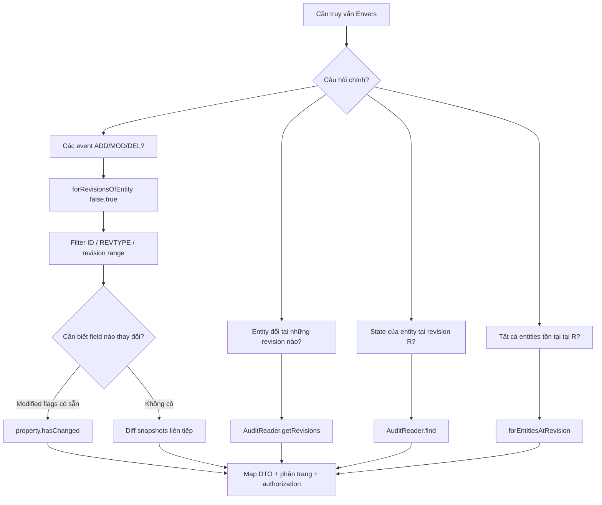

# Truy vấn các lần thay đổi và xác định kiểu thêm, sửa hoặc xóa với Hibernate Envers

Trong ứng dụng dùng Hibernate ORM, dữ liệu hiện tại thường chỉ trả lời được “đơn hàng đang ở trạng thái nào?”. Nhưng nhiều hệ thống còn cần biết **đơn hàng được tạo khi nào, đã sửa bao nhiêu lần, lần thay đổi nào là thêm/sửa/xóa, ai thực hiện và trạng thái trước đó là gì**. Hibernate Envers cung cấp cơ chế audit dựa trên **revision** để lưu lại những phiên bản lịch sử của entity được đánh dấu bằng `@Audited`.

Để dùng Envers đúng, cần phân biệt hai câu hỏi:

1. **Một entity thay đổi ở những revision nào?** Đây là lịch sử **sự kiện thay đổi** với kiểu `ADD`, `MOD` hoặc `DEL`.
2. **Một entity có trạng thái gì tại revision R?** Đây là truy vấn **ảnh chụp lịch sử (as-of snapshot)**, kể cả khi entity không thay đổi ở chính revision R.

Hai câu hỏi có thể cho kết quả khác nhau. Ví dụ, một đơn hàng được tạo ở revision 100, sửa ở 103, còn revision 102 chỉ có khách hàng khác thay đổi. Ở revision 102, đơn hàng vẫn tồn tại và có thể được `AuditReader.find` trả về, nhưng **không có sự kiện MOD của đơn hàng tại revision 102**.

Bài học đi sâu vào Envers `AuditReader`, `AuditQuery`, `RevisionType`, cách đọc metadata revision, lọc sự kiện, xác định field thay đổi, xử lý bản ghi đã xóa, phân trang lịch sử và những giới hạn quan trọng khi hệ thống còn dùng bulk DML, JDBC hoặc stored procedures.

## 1. Envers là gì và ghi lại những gì?

Envers là module audit của Hibernate ORM. Khi một entity được đánh dấu `@Audited` và thay đổi qua đường Hibernate entity lifecycle phù hợp, Envers có thể ghi thêm audit records vào các bảng lịch sử.

Ví dụ:

```java
@Entity
@Table(name = "purchase_orders")
@Audited
public class PurchaseOrder {
    @Id
    private Long id;

    @Enumerated(EnumType.STRING)
    private OrderStatus status;

    private BigDecimal totalAmount;
}
```

Khi ứng dụng:

```java
PurchaseOrder order = entityManager.find(
    PurchaseOrder.class,
    10L
);

order.confirm();
entityManager.flush();
```

Hibernate có thể thực thi UPDATE bảng chính. Envers theo dõi audited entity change và ghi phiên bản lịch sử tương ứng vào bảng audit trong transaction.

### Điều Envers không tự cung cấp

Envers không mặc nhiên ghi:

- Mọi lần người dùng mở form hoặc nhấn nút nhưng không có thay đổi persisted.
- Mọi lần setter được gọi.
- Tất cả domain events như “đơn được thanh toán” hay “yêu cầu hoàn tiền đã được phê duyệt”.
- Những SQL writes đi vòng qua Hibernate entity lifecycle.
- Tên người thực hiện nếu ứng dụng không cấu hình revision metadata riêng.
- Thời điểm commit chính xác trong mọi môi trường.

Vì vậy, Envers là **lịch sử các phiên bản entity được audit**, không thay thế hoàn toàn application event log, database trigger hoặc CDC.

## 2. Dependency và phạm vi áp dụng

Đối với các dòng Hibernate ORM hiện đại, module Envers thường dùng artifact `hibernate-envers` cùng version với `hibernate-core`.

Ví dụ Gradle:

```kotlin
dependencies {
    implementation("org.hibernate.orm:hibernate-envers:<hibernate-version>")
}
```

Ví dụ Maven:

```xml
<dependency>
    <groupId>org.hibernate.orm</groupId>
    <artifactId>hibernate-envers</artifactId>
    <version>REPLACE_WITH_HIBERNATE_VERSION</version>
</dependency>
```

Trong Spring Boot, có thể để dependency management/BOM quản lý version phù hợp. Không trộn Hibernate Core và Envers khác major version. Nếu codebase đang dùng Hibernate 5, tọa độ artifact và namespace Jakarta/Javax có thể khác; phải đối chiếu dependency của chính stack đó.

Entity cần khai báo `@Audited` ở class/property tương ứng. Thêm dependency không làm Envers tự audit toàn bộ entities.

## 3. Entity minh họa cho toàn bài

Giả sử có một entity đơn hàng:

```java
import jakarta.persistence.*;
import org.hibernate.envers.Audited;

import java.math.BigDecimal;
import java.time.Instant;
import java.util.Objects;

@Entity
@Table(name = "purchase_orders")
@Audited
public class PurchaseOrder {

    @Id
    @GeneratedValue(strategy = GenerationType.SEQUENCE)
    private Long id;

    @Column(nullable = false, unique = true)
    private String orderCode;

    @Enumerated(EnumType.STRING)
    @Column(nullable = false)
    private OrderStatus status;

    @Column(nullable = false, precision = 19, scale = 2)
    private BigDecimal totalAmount;

    @Column(nullable = false)
    private Instant createdAt;

    @Version
    private long version;

    protected PurchaseOrder() {}

    public PurchaseOrder(String orderCode, BigDecimal amount) {
        this.orderCode = Objects.requireNonNull(orderCode);
        this.totalAmount = Objects.requireNonNull(amount);
        this.status = OrderStatus.NEW;
        this.createdAt = Instant.now();
    }

    public void confirm() {
        if (status != OrderStatus.NEW) {
            throw new IllegalStateException("Cannot confirm");
        }
        status = OrderStatus.CONFIRMED;
    }

    public void changeTotal(BigDecimal newTotal) {
        if (newTotal == null || newTotal.signum() < 0) {
            throw new IllegalArgumentException("Invalid total");
        }
        this.totalAmount = newTotal;
    }

    public Long getId() { return id; }
    public String getOrderCode() { return orderCode; }
    public OrderStatus getStatus() { return status; }
    public BigDecimal getTotalAmount() { return totalAmount; }
}

enum OrderStatus {
    NEW, CONFIRMED, CANCELLED
}
```

`@Audited` khiến Envers theo dõi những persistent properties phù hợp của entity. `@Version` là optimistic locking field, khác với revision number của Envers; cấu hình Envers thường không audit version field theo mặc định, nhưng cần kiểm tra setup/version.

Đối với field không muốn audit:

```java
@NotAudited
private String internalCacheHint;
```

Một field không được audit sẽ không có đầy đủ lịch sử giá trị chỉ vì entity có `@Audited`. Associations, collections và embeddables có thêm quy tắc mapping riêng.

## 4. Revision là gì?

Một **revision** đại diện mốc lịch sử của các audited changes được Envers ghi, thường gắn với một transaction. Một revision có thể chứa changes của nhiều entities.

Ví dụ:

```text
Transaction A:
  INSERT PurchaseOrder#10
  INSERT OrderLine#201
  INSERT OrderLine#202
COMMIT
  -> REV 41

Transaction B:
  UPDATE PurchaseOrder#10
COMMIT
  -> REV 44

Transaction C:
  DELETE PurchaseOrder#10
COMMIT
  -> REV 52
```

Các revision numbers `41`, `44`, `52` là ví dụ, không phải yêu cầu số revision của cùng entity phải liên tiếp. Transactions khác có thể tạo các revisions ở giữa.

### Revision không phải lần gọi setter

```java
order.changeTotal(new BigDecimal("200000"));
order.changeTotal(new BigDecimal("250000"));
order.changeTotal(new BigDecimal("300000"));
```

Nếu mọi lệnh nằm trong cùng transaction và Envers ghi state cuối, thường không có ba revisions riêng chỉ vì ba lần gán. Envers không phải event sourcing ghi từng method invocation.

### Revision number không phải optimistic-lock version

- `@Version` bảo vệ concurrent updates của entity.
- `REV` là khóa của audit revision.
- Nhiều entity ID có thể cùng dùng một REV.
- REV có thể có gaps.
- REV không tương đương timestamp commit.

## 5. Bảng domain, bảng audit và bảng revision

Envers thường có bảng audit theo tên entity table kèm hậu tố `_AUD`, và bảng revision metadata mặc định như `REVINFO`.

Một sơ đồ khái niệm:

```text
purchase_orders
  id
  order_code
  status
  total_amount
  created_at
  version

purchase_orders_AUD
  id
  REV
  REVTYPE
  order_code
  status
  total_amount
  created_at

REVINFO
  REV
  REVTSTMP
```

Minh họa DDL:

```sql
create table REVINFO (
    REV integer primary key,
    REVTSTMP bigint not null
);

create table purchase_orders_AUD (
    id bigint not null,
    REV integer not null,
    REVTYPE smallint,
    order_code varchar(80),
    status varchar(30),
    total_amount decimal(19,2),
    created_at timestamp,
    primary key (id, REV)
);
```

Đây là DDL **minh họa**, không phải schema được Envers bảo đảm sinh y hệt. Naming strategy, revision ID generator, Dialect, inheritance và audit strategy ảnh hưởng tên và columns. Nếu ứng dụng dùng Flyway/Liquibase, cần quản lý audit schema bằng migrations như schema chính.

## 6. Ý nghĩa REV, REVTYPE và REVTSTMP

| Thành phần | Ý nghĩa |
|---|---|
| Entity ID | Identity của bản ghi được audit |
| `REV` | Mốc revision gắn với transaction audit |
| `REVTYPE` | Loại thay đổi entity |
| `REVTSTMP` | Thời điểm revision metadata được ghi nhận |
| Audited columns | Trạng thái entity được lưu tại revision |

Với entity Order#10:

| REV | REVTYPE | status | totalAmount |
|---:|---|---|---:|
| 41 | ADD | NEW | 250000 |
| 44 | MOD | CONFIRMED | 250000 |
| 49 | MOD | CONFIRMED | 300000 |
| 52 | DEL | *có thể null* | *có thể null* |

Ở revision 52, DEL row thường không chứa toàn bộ giá trị trước xóa nếu không bật `store_data_at_delete`. Không giải thích giá trị null trong DEL row như một business update set field về null.

## 7. Các loại thay đổi với `RevisionType`

Envers định nghĩa enum:

```java
import org.hibernate.envers.RevisionType;

RevisionType.ADD
RevisionType.MOD
RevisionType.DEL
```

Ý nghĩa:

- **`ADD`:** entity được thêm theo đường Envers audit.
- **`MOD`:** entity được cập nhật theo audited lifecycle.
- **`DEL`:** entity được remove theo đường Envers audit.

Trong schema mặc định phổ biến, `REVTYPE` lưu mã:

| Mã | Enum | Nhãn gợi ý |
|---:|---|---|
| 0 | `RevisionType.ADD` | CREATED |
| 1 | `RevisionType.MOD` | UPDATED |
| 2 | `RevisionType.DEL` | DELETED |

Không hardcode 0/1/2 trong business service. Dùng enum để tránh phụ thuộc representation và giảm nhầm với order status.

### REVTYPE không phải nghiệp vụ

`MOD` không có nghĩa tự động “Approved”, “Paid” hoặc “Shipped”. Nó chỉ biểu diễn thay đổi ở tầng persistence. Nếu API cần label nghiệp vụ, có thể so sánh historical fields hoặc kết hợp với business event log.

## 8. Lấy AuditReader

Jakarta Persistence/Hibernate Envers cung cấp:

```java
import org.hibernate.envers.AuditReader;
import org.hibernate.envers.AuditReaderFactory;

AuditReader reader =
    AuditReaderFactory.get(entityManager);
```

Trong Spring service:

```java
@Service
public class OrderHistoryService {

    @PersistenceContext
    private EntityManager entityManager;

    @Transactional(readOnly = true)
    public List<Number> getRevisionNumbers(Long id) {
        AuditReader reader =
            AuditReaderFactory.get(entityManager);

        return reader.getRevisions(
            PurchaseOrder.class,
            id
        );
    }
}
```

`AuditReader` hoạt động với Hibernate persistence context. Giữ EntityManager/Session phù hợp trong thời gian xử lý, nhất là khi historical entities có lazy associations.

## 9. `getRevisions`: những mốc entity đã thay đổi

```java
List<Number> revisions =
    reader.getRevisions(PurchaseOrder.class, 10L);
```

Ví dụ kết quả:

```text
[41, 44, 49, 52]
```

Nó hữu ích khi chỉ cần danh sách revision numbers của một entity. Nhưng **không trả trực tiếp RevisionType**. Không thể suy:

- Revision đầu luôn là ADD nếu history đã bị retention truncate.
- Revision cuối luôn là DEL.
- Mọi revision liên tiếp đều của cùng entity.
- `getRevisions.size()` bằng số Java setter calls.

### Khi nào nên chọn?

- Hiển thị lịch sử ngắn theo revision IDs.
- Xác định một số revision candidate để đọc snapshot.
- Kiểm tra entity có audited history không.
- Lấy previous changed revision của cùng entity.

Nếu UI phải biết ADD/MOD/DEL, nên dùng `forRevisionsOfEntity`.

## 10. `find`: trạng thái entity tại revision

```java
PurchaseOrder atRevision44 = reader.find(
    PurchaseOrder.class,
    10L,
    44
);
```

Đây là **as-of snapshot**: entity ở trạng thái hiệu lực tại revision 44.

Nếu Order#10 được ADD ở 41 rồi MOD ở 44, thì:

```java
PurchaseOrder at43 =
    reader.find(PurchaseOrder.class, 10L, 43);
```

có thể trả snapshot từ revision 41, dù Order#10 không thay đổi ở 43.

```text
REV 41: Order#10 ADD, status=NEW
REV 42: Customer#20 MOD
REV 43: Product#9 MOD
REV 44: Order#10 MOD, status=CONFIRMED

find(Order#10, 43) -> status=NEW
find(Order#10, 44) -> status=CONFIRMED
```

**Không dùng `find` để suy ra entity có thay đổi đúng revision đó không.**

### Khi find trả null?

- Entity chưa được tạo tại mốc revision đó.
- Entity đã bị xóa tại/trước mốc đó.
- Có điều kiện mapping/history khiến state không còn khả dụng.

Vì vậy, `find()==null` không tự chứng minh entity **bị xóa ngay tại revision đang xét**. Nó cũng có thể chưa từng tồn tại.

## 11. `forEntitiesAtRevision`: tập state tại revision

Muốn biết **tất cả PurchaseOrders còn tồn tại tại revision 49**:

```java
List<?> orders = reader.createQuery()
    .forEntitiesAtRevision(PurchaseOrder.class, 49)
    .getResultList();
```

Một order tồn tại từ REV 41 và không đổi ở REV 49 vẫn có thể xuất hiện. Vì vậy, kết quả **không phải danh sách orders đã đổi ở REV 49**.

So sánh:

| API | Câu hỏi |
|---|---|
| `getRevisions(Order.class,id)` | ID này đổi ở các revisions nào? |
| `find(Order.class,id,rev)` | ID này có state gì tại rev? |
| `forEntitiesAtRevision(Order.class,rev)` | Những IDs nào tồn tại tại rev và có state gì? |
| `forRevisionsOfEntity(Order.class,false,true)` | Những change events ADD/MOD/DEL của Order là gì? |

Đây là bảng phân biệt cần nhớ trước khi xây màn hình audit.

## 12. `forRevisionsOfEntity`: truy vấn sự kiện thay đổi

Đây là API trọng tâm khi cần xác định **thêm/sửa/xóa**:

```java
import org.hibernate.envers.query.AuditEntity;
import org.hibernate.envers.query.AuditQuery;

AuditQuery query = reader.createQuery()
    .forRevisionsOfEntity(
        PurchaseOrder.class,
        false,
        true
    )
    .add(AuditEntity.id().eq(orderId))
    .addOrder(AuditEntity.revisionNumber().asc());

List<?> rows = query.getResultList();
```

Hai tham số boolean:

```java
forRevisionsOfEntity(
    PurchaseOrder.class,
    selectEntitiesOnly,
    selectDeletedEntities
)
```

- `selectEntitiesOnly=false`: kết quả gồm snapshot entity, revision metadata và RevisionType.
- `selectDeletedEntities=true`: bao gồm audit rows loại DEL.
- Nếu `selectEntitiesOnly=true`, query thường trả entity versions trực tiếp và không có tuple RevisionType tương ứng.
- Nếu `selectDeletedEntities=false`, DEL rows bị loại khỏi kết quả.

**Để xây timeline đầy đủ ADD/MOD/DEL, thông thường dùng `false, true`.**

## 13. Đọc tuple kết quả đúng cách

Khi `selectEntitiesOnly=false`, mỗi result thường là `Object[]`:

```text
tuple[0] : entity snapshot
tuple[1] : revision entity metadata
tuple[2] : RevisionType
```

Ví dụ:

```java
for (Object raw : rows) {
    Object[] tuple = (Object[]) raw;

    PurchaseOrder snapshot =
        (PurchaseOrder) tuple[0];

    Object revisionMetadata =
        tuple[1];

    RevisionType type =
        (RevisionType) tuple[2];

    switch (type) {
        case ADD -> System.out.println("Đã thêm");
        case MOD -> System.out.println("Đã sửa");
        case DEL -> System.out.println("Đã xóa");
    }
}
```

### Hai lỗi cast phổ biến

**Sai 1:**

```java
PurchaseOrder order = (PurchaseOrder) rows.get(0);
```

Sai nếu query trả tuple.

**Sai 2:**

```java
Object[] tuple = (Object[]) rows.get(0);
```

Sai nếu bạn tạo query với `selectEntitiesOnly=true` và result là entity instance.

Khi audit query có projection đặc thù, result shape có thể thay đổi. Luôn dựa vào API signature và cấu hình query thật.

## 14. Chọn đúng tổ hợp hai boolean

| Gọi API | Kết quả | Dùng khi |
|---|---|---|
| `forRevisionsOfEntity(E.class,true,false)` | Entity snapshots ADD/MOD, bỏ DEL | Chỉ cần các versions có dữ liệu |
| `forRevisionsOfEntity(E.class,true,true)` | Entity snapshots gồm deletion revisions | Không cần type metadata |
| `forRevisionsOfEntity(E.class,false,false)` | Tuples snapshot/metadata/type, bỏ DEL | Chỉ ADD và MOD |
| `forRevisionsOfEntity(E.class,false,true)` | Tuples snapshot/metadata/type, gồm DEL | Timeline đầy đủ |

Nếu trang lịch sử có yêu cầu “Đã xóa lúc nào?”, tổ hợp cuối phù hợp hơn vì DEL event có thể được phân biệt rõ.

## 15. Lọc theo entity ID

```java
AuditQuery query = reader.createQuery()
    .forRevisionsOfEntity(PurchaseOrder.class, false, true)
    .add(AuditEntity.id().eq(orderId));
```

`AuditEntity.id()` biểu diễn ID của audited entity, không phải revision ID.

Nếu entity dùng composite key:

```java
@EmbeddedId
private OrderLineId id;
```

giá trị truyền vào phải khớp identifier mapping. Không tự thay composite key bằng một `Long` ngẫu nhiên.

Trong multi-tenancy, ID có thể chưa đủ phân biệt tenant. Xem thêm phần bảo mật và tenant isolation.

## 16. Lọc theo ADD, MOD và DEL

### Chỉ ADD

```java
List<?> additions = reader.createQuery()
    .forRevisionsOfEntity(PurchaseOrder.class, false, true)
    .add(AuditEntity.id().eq(orderId))
    .add(AuditEntity.revisionType().eq(RevisionType.ADD))
    .getResultList();
```

### Chỉ MOD

```java
List<?> modifications = reader.createQuery()
    .forRevisionsOfEntity(PurchaseOrder.class, false, true)
    .add(AuditEntity.id().eq(orderId))
    .add(AuditEntity.revisionType().eq(RevisionType.MOD))
    .getResultList();
```

### Chỉ DEL

```java
List<?> deletions = reader.createQuery()
    .forRevisionsOfEntity(PurchaseOrder.class, false, true)
    .add(AuditEntity.id().eq(orderId))
    .add(AuditEntity.revisionType().eq(RevisionType.DEL))
    .getResultList();
```

Với code trên, `selectDeletedEntities=true` cần thiết để DEL rows có thể xuất hiện. Tránh cố xác định loại event bằng cách xem snapshot có null hoặc không: deletion row có thể thiếu audited fields, nhưng ADD/MOD cũng có thể chứa nullable properties.

## 17. Sắp xếp theo revision number

Dùng:

```java
.addOrder(AuditEntity.revisionNumber().asc())
```

để xem từ cũ đến mới.

Dùng:

```java
.addOrder(AuditEntity.revisionNumber().desc())
```

để xem mới nhất trước.

Revision number là khóa sắp thứ tự audit phổ biến. Không dùng timestamp làm duy nhất ordering key khi cần thứ tự mốc revision, vì timestamps có thể cùng giá trị hoặc không phản ánh chính xác thứ tự commit giữa concurrent transactions.

Với màn hình quản trị, hiển thị cả `revision number` lẫn thời điểm để dễ chẩn đoán.

## 18. Truy vấn lần thay đổi mới nhất

```java
List<?> latest = reader.createQuery()
    .forRevisionsOfEntity(PurchaseOrder.class, false, true)
    .add(AuditEntity.id().eq(orderId))
    .addOrder(AuditEntity.revisionNumber().desc())
    .setMaxResults(1)
    .getResultList();

if (!latest.isEmpty()) {
    Object[] tuple = (Object[]) latest.get(0);
    RevisionType lastType = (RevisionType) tuple[2];
}
```

Nếu `lastType=DEL`, đây là deletion event cuối được Envers ghi cho entity identity đó. Nhưng còn phải xét soft delete, ID reuse, audit retention và external writes nếu dùng nó để kết luận entity hiện không tồn tại.

**Muốn biết state hiện tại, hãy đọc bảng domain authoritative theo transaction policy**, không suy luận mọi điều từ audit table.

## 19. Truy vấn revisions sau một mốc

```java
AuditQuery query = reader.createQuery()
    .forRevisionsOfEntity(PurchaseOrder.class, false, true)
    .add(AuditEntity.id().eq(orderId))
    .add(AuditEntity.revisionNumber().gt(lastSeenRevision))
    .addOrder(AuditEntity.revisionNumber().asc());
```

Các comparator khác như `ge`, `le`, `lt`, `eq` có thể dùng tùy mục tiêu.

Dạng này phù hợp với incremental timeline: client đã nhận đến revision 100 và chỉ muốn records có revision lớn hơn 100.

Không tính `lastSeenRevision + 1` rồi mong revision kế tiếp tồn tại. Revision IDs có thể có gaps và có thể bị dùng bởi entity khác.

## 20. Phân trang audit history

Khi một entity có hàng nghìn revisions:

```java
List<?> page = reader.createQuery()
    .forRevisionsOfEntity(PurchaseOrder.class, false, true)
    .add(AuditEntity.id().eq(orderId))
    .addOrder(AuditEntity.revisionNumber().desc())
    .setFirstResult(0)
    .setMaxResults(50)
    .getResultList();
```

Lấy toàn bộ lịch sử rồi cắt trong Java có thể tốn RAM và DB I/O. Audit table thường tăng trưởng mãi, nên pagination rất quan trọng.

### Keyset pagination theo revision

Nếu client có cursor `beforeRevision`:

```java
List<?> nextPage = reader.createQuery()
    .forRevisionsOfEntity(PurchaseOrder.class, false, true)
    .add(AuditEntity.id().eq(orderId))
    .add(AuditEntity.revisionNumber().lt(beforeRevision))
    .addOrder(AuditEntity.revisionNumber().desc())
    .setMaxResults(50)
    .getResultList();
```

Cách này tránh offset lớn và giảm nguy cơ trùng/bỏ kết quả khi lịch sử tiếp tục phát triển. Nếu không có cursor, tạo query không có điều kiện `lt`.

## 21. Đọc revision metadata

Envers dùng revision entity để lưu metadata, thường có ID và timestamp. Trong các cấu hình mặc định phổ biến, element thứ hai của tuple là `DefaultRevisionEntity`:

```java
import org.hibernate.envers.DefaultRevisionEntity;

Object[] tuple = (Object[]) raw;

DefaultRevisionEntity revision =
    (DefaultRevisionEntity) tuple[1];

int number = revision.getId();
long epochMillis = revision.getTimestamp();

Instant when = Instant.ofEpochMilli(epochMillis);
```

**Chỉ cast như trên nếu persistence unit thực sự dùng default revision entity.** Một `@RevisionEntity` custom sẽ tạo class metadata riêng.

Các tên bảng/cột mặc định như `REVINFO`, `REV`, `REVTSTMP` có thể thay đổi theo mapping và naming strategy.

## 22. Lấy thời điểm bằng `getRevisionDate`

Nếu chỉ có revision number:

```java
Date date = reader.getRevisionDate(revisionNumber);
Instant at = date.toInstant();
```

Đây là API tiện khi không có revision metadata tuple. Nhưng trong timeline dài, gọi cho từng revision có thể tăng số audit queries. Tối ưu hơn là đọc timestamp trực tiếp từ metadata đã có.

### Thời điểm này có phải commit time?

Không nên mặc định như vậy. Revision timestamp gắn với thời điểm metadata được tạo theo Hibernate Envers/provider, không phải cam kết tuyệt đối về thứ tự commit của các transactions concurrent.

Nếu yêu cầu pháp lý “mọi thay đổi commit trong khoảng UTC chính xác”, cân nhắc cơ chế commit timestamp authoritative riêng khi Envers timestamp chưa đáp ứng.

## 23. Tìm revision gần một mốc thời gian

`AuditReader` có API dạng:

```java
Number revisionForTime =
    reader.getRevisionNumberForDate(
        Date.from(targetInstant)
    );
```

Nó giúp quy đổi mốc thời gian sang revision theo contract API. Cần chú ý:

- Nếu không có revision phù hợp, API có thể ném exception.
- Timestamp precision phụ thuộc persistence representation.
- Không bảo đảm revision timestamp chính là thời điểm người dùng nhấn nút.
- Concurrent transactions có thể tạo khác biệt giữa thứ tự revision và thời điểm commit.

Phân biệt “các changes xảy ra trong ngày” với “state as-of cuối ngày”. Hai báo cáo cần truy vấn và diễn giải khác nhau.

## 24. `findRevision` khi có custom metadata

Nếu có revision entity do dự án tạo:

```java
CustomRevisionEntity metadata = reader.findRevision(
    CustomRevisionEntity.class,
    revisionNumber
);
```

Có thể đọc actor, correlation ID hoặc tenant nếu chúng thực sự được custom metadata lưu.

Nhưng nếu bạn đã query `forRevisionsOfEntity(..., false, true)`, element tuple thứ hai thường đã chứa revision metadata object. Truy vấn thêm `findRevision` cho từng row có thể gây N+1.

## 25. Tạo custom revision entity ghi actor

Một custom revision entity minh họa:

```java
import jakarta.persistence.*;
import org.hibernate.envers.*;

@Entity
@Table(name = "audit_revisions")
@RevisionEntity(ActorRevisionListener.class)
public class ActorRevisionEntity {

    @Id
    @GeneratedValue(strategy = GenerationType.SEQUENCE)
    @RevisionNumber
    private int id;

    @RevisionTimestamp
    private long timestamp;

    @Column(name = "actor", length = 120)
    private String actor;

    @Column(name = "correlation_id", length = 120)
    private String correlationId;

    protected ActorRevisionEntity() {}

    public int getId() { return id; }
    public long getTimestamp() { return timestamp; }
    public String getActor() { return actor; }
    public String getCorrelationId() { return correlationId; }

    public void setActor(String actor) { this.actor = actor; }
    public void setCorrelationId(String value) {
        this.correlationId = value;
    }
}
```

Listener:

```java
public class ActorRevisionListener
        implements RevisionListener {

    @Override
    public void newRevision(Object revisionEntity) {
        ActorRevisionEntity revision =
            (ActorRevisionEntity) revisionEntity;

        revision.setActor(
            AuditActorContext.currentActorOrSystem()
        );
        revision.setCorrelationId(
            AuditActorContext.currentCorrelationId()
        );
    }
}
```

`AuditActorContext` là helper **do ứng dụng tự định nghĩa**, không phải class có sẵn trong Envers.

### Các yêu cầu quan trọng

- Actor phải đến từ authentication context tin cậy.
- Xử lý background jobs và message consumers không có HTTP user.
- Tránh thread-local bị rò rỉ hoặc mất context trong asynchronous execution.
- Revision listener chạy khi revision được tạo, không phải after-commit.
- Một revision có thể chứa nhiều entity changes; actor metadata là thuộc tính của revision, không phải tự động có actor khác cho từng row.
- Nếu multi-tenant, lưu tenant identifier một cách phù hợp với authorization policy.

## 26. Đọc custom revision entity trong tuple

```java
Object[] tuple = (Object[]) raw;

PurchaseOrder snapshot =
    (PurchaseOrder) tuple[0];

ActorRevisionEntity revision =
    (ActorRevisionEntity) tuple[1];

RevisionType type =
    (RevisionType) tuple[2];

System.out.printf(
    "rev=%d, actor=%s, type=%s%n",
    revision.getId(),
    revision.getActor(),
    type
);
```

Khi dùng custom revision metadata, không cast sang `DefaultRevisionEntity`.

### Lọc theo actor

```java
List<?> changesByJob = reader.createQuery()
    .forRevisionsOfEntity(PurchaseOrder.class, false, true)
    .add(
        AuditEntity.revisionProperty("actor")
            .eq("system-job")
    )
    .addOrder(AuditEntity.revisionNumber().desc())
    .getResultList();
```

`revisionProperty("actor")` là property của revision metadata, không phải field `actor` trong PurchaseOrder.

## 27. Đóng gói kiểu thay đổi thành domain-facing DTO

Không nên expose trực tiếp Envers tuple qua HTTP. Tạo kiểu API rõ ràng:

```java
public enum ChangeAction {
    CREATED,
    UPDATED,
    DELETED
}

public record OrderChange(
    Long orderId,
    int revision,
    Instant changedAt,
    ChangeAction action,
    String actor,
    OrderStatus status,
    BigDecimal totalAmount
) {}
```

Map Envers enum:

```java
static ChangeAction toAction(RevisionType type) {
    return switch (type) {
        case ADD -> ChangeAction.CREATED;
        case MOD -> ChangeAction.UPDATED;
        case DEL -> ChangeAction.DELETED;
    };
}
```

Nếu audit entry là DEL và không lưu property values at delete, API có thể trả `status=null` hoặc một payload riêng cho deletion event. Không tự điền status cuối cùng bằng assumption nếu chưa đọc snapshot trước deletion.

## 28. Service đọc timeline với default revision entity

Ví dụ:

```java
@Service
public class OrderAuditService {

    @PersistenceContext
    private EntityManager entityManager;

    @Transactional(readOnly = true)
    public List<OrderChange> timeline(Long orderId) {
        AuditReader reader =
            AuditReaderFactory.get(entityManager);

        List<?> rows = reader.createQuery()
            .forRevisionsOfEntity(
                PurchaseOrder.class,
                false,
                true
            )
            .add(AuditEntity.id().eq(orderId))
            .addOrder(AuditEntity.revisionNumber().asc())
            .getResultList();

        List<OrderChange> result = new ArrayList<>();

        for (Object raw : rows) {
            Object[] tuple = (Object[]) raw;

            PurchaseOrder snapshot =
                (PurchaseOrder) tuple[0];

            DefaultRevisionEntity revision =
                (DefaultRevisionEntity) tuple[1];

            RevisionType type =
                (RevisionType) tuple[2];

            result.add(new OrderChange(
                snapshot.getId(),
                revision.getId(),
                Instant.ofEpochMilli(
                    revision.getTimestamp()
                ),
                toAction(type),
                null, // Default metadata chưa có actor.
                type == RevisionType.DEL
                    ? null : snapshot.getStatus(),
                type == RevisionType.DEL
                    ? null : snapshot.getTotalAmount()
            ));
        }
        return result;
    }
}
```

Ví dụ cần các imports phù hợp `jakarta.persistence`, `org.hibernate.envers`, `org.springframework`, `java.time` và `java.util`. Record, helper `toAction` và entity được định nghĩa ở các phần trước.

Đây là phương pháp minh họa với **default revision entity**. Nếu đã cài `ActorRevisionEntity`, thay cast và map actor theo class custom đó.

## 29. Lần xóa và `store_data_at_delete`

Khi entity được remove qua Hibernate Envers-aware lifecycle, audit table có thể chứa DEL row. Theo cấu hình thông thường `store_data_at_delete=false`, Envers thường chỉ giữ ID/revision metadata ở DEL row, còn audited property values để null.

Có property Envers phổ biến:

```properties
org.hibernate.envers.store_data_at_delete=true
```

Khi bật theo version/config tương ứng, DEL row có thể lưu trạng thái entity ngay trước khi xóa.

| Cấu hình | Ưu điểm | Đổi lại |
|---|---|---|
| Không lưu data at delete | DEL row nhỏ hơn | Phải tìm snapshot trước DEL nếu muốn fields |
| Lưu data at delete | Dễ hiển thị “trước khi xóa” | Lặp dữ liệu, audit table lớn hơn |

### Migration giữa hai chế độ

Bật property hôm nay không tự backfill các DEL rows cũ. API có thể cần xử lý hai nhóm: history cũ không đủ fields và history mới có fields.

Không diễn giải DEL row với `totalAmount=null` như một hành động nghiệp vụ đặt total về null.

## 30. Lấy trạng thái cuối trước deletion

Giả sử:

```text
REV 41 ADD
REV 44 MOD
REV 49 MOD
REV 52 DEL
```

Muốn hiển thị “Đơn hàng có tổng tiền 300.000 khi bị xóa”:

1. Xác định DEL event ở revision 52 bằng `RevisionType.DEL`.
2. Tìm previous changed revision của cùng Order#10 (ở đây 49).
3. Đọc snapshot ở 49.
4. Hiển thị action DELETED tại thời gian revision 52.
5. Gắn last-known state từ 49 như một trường “trước xóa”.

Nếu ID có thể được tái sử dụng sau xóa, thuật toán phải phân biệt các chu kỳ tồn tại. Nếu history bị retention truncate, previous snapshot có thể thiếu.

**Không lấy `REV - 1` để tìm previous entity revision.** Revision 51 có thể thuộc entity khác.

## 31. Modified flags: biết property nào đã đổi

Envers hỗ trợ modified flags, cho phép theo dõi field-level changes.

Ví dụ:

```java
@Audited(withModifiedFlag = true)
private OrderStatus status;
```

Hoặc cấu hình global theo version:

```properties
org.hibernate.envers.global_with_modified_flag=true
```

Envers có thể sinh thêm cột audit dạng:

```text
status_MOD
totalAmount_MOD
```

Tên thực phụ thuộc naming strategy, flag suffix và annotation overrides.

### So sánh hai tầng thông tin

- `REVTYPE.MOD`: entity có audited change ở revision.
- `status_MOD=true`: field `status` được đánh dấu thay đổi.
- `totalAmount_MOD=false`: field total không bị đánh dấu thay đổi trong revision đó.

Một MOD event có thể có nhiều flags true.

**Phải bật modified flags và migration audit schema phù hợp trước khi query**. Việc thêm flags mới không tự điền lịch sử cũ chính xác.

## 32. Query field `status` thay đổi

```java
List<?> statusChanges = reader.createQuery()
    .forRevisionsOfEntity(PurchaseOrder.class, false, true)
    .add(AuditEntity.id().eq(orderId))
    .add(AuditEntity.property("status").hasChanged())
    .addOrder(AuditEntity.revisionNumber().asc())
    .getResultList();
```

Nếu chỉ quan tâm **sửa status** (không tính lần tạo/xóa), lọc thêm:

```java
List<?> statusUpdates = reader.createQuery()
    .forRevisionsOfEntity(PurchaseOrder.class, false, true)
    .add(AuditEntity.id().eq(orderId))
    .add(
        AuditEntity.revisionType()
            .eq(RevisionType.MOD)
    )
    .add(AuditEntity.property("status").hasChanged())
    .addOrder(AuditEntity.revisionNumber().asc())
    .getResultList();
```

`AuditEntity.property("status")` dùng **entity persistent property name**, không nhất thiết là physical column name `status_code` trong DB.

### Có `hasNotChanged()` không?

Envers cũng có thể cung cấp điều kiện `hasNotChanged()` theo property nếu modified flags được hỗ trợ. Nó có nghĩa property **không đổi trong revision event đang xét**, không phải “property chưa bao giờ đổi trong đời entity”.

## 33. Không có modified flags thì so sánh snapshots

Nếu audit schema cũ không lưu `status_MOD`, có thể so sánh hai snapshots:

```java
PurchaseOrder before =
    reader.find(PurchaseOrder.class, orderId, 41);

PurchaseOrder after =
    reader.find(PurchaseOrder.class, orderId, 44);

boolean statusChanged =
    !Objects.equals(
        before.getStatus(),
        after.getStatus()
    );

boolean amountChanged =
    before.getTotalAmount().compareTo(
        after.getTotalAmount()
    ) != 0;
```

Với `BigDecimal`, `compareTo` thường diễn đạt so sánh giá trị số đúng hơn `equals` nếu scale không phải một phần của business semantics.

### Chọn đúng previous revision

Nếu revisions của entity là `41,44,49`, previous của 49 là 44. Không dùng `48` hoặc đơn giản `49-1`.

Một cách:

```java
List<Number> revisions =
    reader.getRevisions(PurchaseOrder.class, orderId);

for (int i = 1; i < revisions.size(); i++) {
    Number previousRevision = revisions.get(i - 1);
    Number currentRevision = revisions.get(i);

    // Load và diff, nhưng có thể null nếu current là DEL.
}
```

Cách lặp qua `getRevisions` đơn giản nhưng có thể tạo nhiều queries. Với timeline lớn, nên dùng snapshots đã trả từ `forRevisionsOfEntity`.

## 34. Diff trực tiếp từ timeline tuples

Nếu đã truy vấn lịch sử tăng dần:

```java
PurchaseOrder previous = null;

for (Object raw : rows) {
    Object[] tuple = (Object[]) raw;

    PurchaseOrder current =
        (PurchaseOrder) tuple[0];

    RevisionType type =
        (RevisionType) tuple[2];

    if (type == RevisionType.MOD
            && previous != null) {
        compareSnapshots(previous, current);
    }

    if (type == RevisionType.DEL) {
        showDeleteEventWithLastState(previous);
        previous = null;
    } else {
        previous = current;
    }
}
```

Hàm `compareSnapshots` và `showDeleteEventWithLastState` là helper minh họa do ứng dụng tự viết.

Chú ý:

- Nếu trang bắt đầu giữa history, previous snapshot không có trong trang.
- DEL snapshot có thể không chứa audited field values.
- ID reuse có thể bắt đầu một chu kỳ ADD mới sau DEL.
- Associations có thể trỏ tới current non-audited entities.
- Diff business values cần semantics riêng cho numeric/collections/null.

## 35. Revision metadata tùy biến và truy vấn theo actor

Giả sử custom `ActorRevisionEntity` có field `actor` và `timestamp`.

Tìm những thay đổi do một system job:

```java
List<?> results = reader.createQuery()
    .forRevisionsOfEntity(PurchaseOrder.class, false, true)
    .add(
        AuditEntity.revisionProperty("actor")
            .eq("nightly-job")
    )
    .addOrder(AuditEntity.revisionNumber().desc())
    .setMaxResults(100)
    .getResultList();
```

`revisionProperty` truy vấn **revision metadata**, không phải property của PurchaseOrder.

Nếu cần lọc theo tenant, hãy định nghĩa tenant identity và security policy rõ. Revision-level tenant metadata có thể không diễn đạt đủ nếu một transaction chứa changes thuộc nhiều tenants; entity audit state vẫn phải được filter đúng.

## 36. Tất cả changes của một entity type trong revision

```java
List<?> changes = reader.createQuery()
    .forRevisionsOfEntity(PurchaseOrder.class, false, true)
    .add(
        AuditEntity.revisionNumber()
            .eq(revisionNumber)
    )
    .getResultList();
```

Điều này tìm PurchaseOrder changes trong revision đã chọn. Nếu transaction đó còn sửa Customer hoặc OrderLine, query vẫn chỉ trả **PurchaseOrder**.

Nếu muốn “mọi entity types đã sửa trong transaction này”, Envers có các cross-type revision APIs/configurations ở một số versions, ví dụ theo dõi entity names changed in revision. Điều này có thể yêu cầu cấu hình như `track_entities_changed_in_revision`. Đừng giả định query một entity type bao phủ toàn bộ revision.

## 37. Một revision có thể chứa nhiều entity changes

Ví dụ:

```text
REVINFO:
    REV = 100

purchase_orders_AUD:
    id = 10, REV = 100, REVTYPE = MOD

order_lines_AUD:
    id = 201, REV = 100, REVTYPE = ADD
    id = 202, REV = 100, REVTYPE = MOD
```

Cả ba audit rows có thể cùng metadata actor/time của REV 100. Nhưng một sửa đổi OrderLine không bắt buộc tạo MOD của PurchaseOrder, tùy mapping collection auditing, versioning và thay đổi thực tế của parent.

Nếu nghiệp vụ cần “lịch sử toàn bộ aggregate”, phải xác định sẽ tổng hợp audit rows của child entities như thế nào, hoặc kết hợp domain event log riêng.

## 38. Query theo thời gian và as-of snapshot là hai bài toán

Câu hỏi A:

> Cuối ngày 31/03, danh sách đơn hàng đang tồn tại là gì?

Có thể xác định revision mốc thời gian rồi dùng `forEntitiesAtRevision`. Đây là **as-of state**.

Câu hỏi B:

> Ngày 31/03, đơn hàng nào đã được tạo, sửa hoặc xóa?

Cần query **change events**, lọc revision timestamps/ranges, lấy `RevisionType`.

Không dùng `forEntitiesAtRevision` rồi dán nhãn mọi result là “đã sửa trong ngày”, vì rất nhiều entities có thể tồn tại nhưng không thay đổi trong khoảng đó.

Revision timestamp không nhất thiết là commit timestamp tuyệt đối, nên với báo cáo pháp lý cần hiểu ngữ nghĩa thời gian rõ.

## 39. Giới hạn Envers với bulk DML

Một câu bulk JPQL:

```java
int changed = entityManager.createQuery("""
    update PurchaseOrder o
    set o.status = :status
    where o.createdAt < :cutoff
    """)
    .setParameter("status", OrderStatus.CANCELLED)
    .setParameter("cutoff", cutoff)
    .executeUpdate();
```

không tải và dirty-check từng entity. Vì vậy, nó **không phát các Envers entity change events per row** như khi gọi domain method rồi flush.

Tương tự, bulk DELETE:

```java
entityManager.createQuery("""
    delete from PurchaseOrder o
    where o.status = :status
    """)
    .setParameter("status", OrderStatus.CANCELLED)
    .executeUpdate();
```

không tương đương vòng `em.remove(entity)` và không tự tạo DEL audit entries cho từng row.

### Khi audit là bắt buộc

- Giữ entity-by-entity operations theo chunk, có thể bật JDBC batching.
- Hoặc thiết kế audited bulk path set-based có transaction và dữ liệu lịch sử rõ ràng.
- Hoặc chuyển bao phủ mọi writers sang trigger/CDC thích hợp.

Đừng trộn bulk DML với Envers mà không xử lý khoảng trống lịch sử.

## 40. JDBC và stored procedures cũng có thể bypass Envers

Nếu service dùng:

```java
session.doWork(connection -> {
    try (PreparedStatement ps = connection.prepareStatement(
            "update purchase_orders set status=? where id=?")) {
        ps.setString(1, "CONFIRMED");
        ps.setLong(2, orderId);
        ps.executeUpdate();
    }
});
```

đây là raw JDBC SQL; Envers không tự quan sát mỗi row như entity lifecycle.

Một stored procedure có thể cập nhật nhiều bảng nhưng Envers không tự suy ra side effects bên trong procedure. External scripts và ETL cũng có thể thay đổi dữ liệu mà không có Envers history.

**Sự vắng mặt của một MOD row không chứng minh dữ liệu chưa từng đổi.** Phải kiểm kê toàn bộ write paths.

## 41. JDBC batching khác bulk DML trong audit

Khi Hibernate thực hiện nhiều `persist` hoặc managed-entity updates qua stateful `Session`, JDBC batching có thể gộp các SQL executions nhưng entity lifecycle vẫn diễn ra.

Ví dụ:

```java
for (PurchaseOrder order : orders) {
    entityManager.persist(order);
}

entityManager.flush();
```

Với `hibernate.jdbc.batch_size` và generator/SQL shape phù hợp, Hibernate có thể JDBC batch inserts. Envers vẫn ghi audit changes theo entity operations.

Ngược lại, một JPQL bulk UPDATE là set-based mutation, bỏ qua per-entity auditing.

Số **JDBC batch executions** không tương đương số **Envers revisions**. Một transaction có thể chứa nhiều batches nhưng chỉ một audit revision dùng chung cho những audited changes.

## 42. Transaction và rollback

Giả sử:

```java
@Transactional
public void confirmThenFail(Long id) {
    PurchaseOrder order =
        entityManager.find(PurchaseOrder.class, id);

    order.confirm();
    entityManager.flush();

    throw new RuntimeException("rollback");
}
```

Envers audit SQL có thể đã chạy trong transaction, nhưng transaction rollback nên audit writes cũng rollback theo database transactional semantics.

Do đó, history API sau rollback không nên thấy một committed MOD revision của thao tác đã thất bại.

### Revision IDs không cần gapless

Sequence/counter cấp revision IDs có thể tiêu thụ values trước khi rollback. Gaps không tự động cho thấy audit data corruption.

### Revision metadata không phải after-commit event

`RevisionListener.newRevision` cũng chạy trước kết cục transaction. Đừng gửi email/Kafka từ revision listener với giả định revision đã commit. Nếu cần side effect ngoài DB sau commit, dùng transactional outbox hoặc cơ chế hậu commit thích hợp.

## 43. Soft delete và REVTYPE

Một mapping soft-delete có thể biến `remove()` thành SQL UPDATE cờ thay vì DELETE vật lý. Hibernate versions có các tính năng như `@SoftDelete` hoặc custom `@SQLDelete`.

Trong trường hợp đó, Envers behavior cần được kiểm thử theo version/mapping:

- Remove lifecycle có tạo DEL row không?
- Soft-delete flag có được audit không?
- Restore/undelete có được hỗ trợ và ghi history như thế nào?
- Historical query có bị current filters ảnh hưởng không?

Không gắn cứng “`RevisionType.DEL` = SQL DELETE vật lý” trong business API nếu ứng dụng dùng soft delete. Không mặc định mọi direct SQL update soft-delete flag được Envers audit.

## 44. Historical associations có thể gây nhầm lẫn

Với association:

```java
@Entity
@Audited
public class PurchaseOrder {

    @Id
    private Long id;

    @ManyToOne(fetch = FetchType.LAZY)
    private Customer customer;
}
```

Nếu Customer cũng audited, Envers có thể resolve historical Customer theo revision mapping. Nếu Customer không audited, application có thể cấu hình relation target audit mode khác, ví dụ `RelationTargetAuditMode.NOT_AUDITED`, dẫn tới association tham chiếu current target state.

Điều này quan trọng khi serializing old Order snapshot: một phần graph có thể là **historical state**, phần khác là **current state**. Không tự giả định toàn bộ object graph đã được time-travel tại cùng revision.

Nếu API cần lịch sử chính xác, DTO nên chỉ lấy fields/relationships có audit semantics đã xác định.

## 45. Modified flags và migrations

Nếu bật `withModifiedFlag=true` sau khi hệ thống đã hoạt động nhiều năm, audit table có thể cần cột flag mới. Nhưng những revision rows cũ chưa có flag history đáng tin cậy.

Một migration cần quyết định:

1. Thêm các modified flag columns.
2. Giá trị cho old audit rows (nullable/default/backfill) được định nghĩa thế nào.
3. API lịch sử cũ có chuyển sang snapshot diff không.
4. Envers mapping mới có tương thích schema không.
5. Query `hasChanged` có cần chỉ áp dụng từ revision boundary nào không.

Không dùng `hasChanged` trên audit history cũ rồi mặc định mọi field-level change đã được ghi chính xác từ trước.

## 46. DefaultAuditStrategy và ValidityAuditStrategy

Envers có những audit strategies ảnh hưởng cách tìm historical state.

### DefaultAuditStrategy

Một audit row thường có starting revision. Khi truy vấn state ở R, Envers chọn version có revision phù hợp, xét deletion semantics và entity identifier.

### ValidityAuditStrategy

Có thể lưu ending revision để biểu diễn khoảng hiệu lực, thường với các cột như `REVEND`, và tùy config `REVEND_TSTMP`.

Ví dụ:

```text
ADD at REV=41    valid until REV=44
MOD at REV=44    valid until REV=49
MOD at REV=49    valid until REV=52
DEL at REV=52    closes entity existence
```

Hai strategies có thể tạo SQL as-of khác nhau nhưng **không đổi nghĩa ADD/MOD/DEL**.

Không chuyển audit strategy trên dữ liệu cũ chỉ bằng property config; có thể cần migration/backfill các ending revisions.

## 47. Indexing cho audit table

Một entity hiện tại chỉ có một domain row, nhưng có thể có hàng nghìn audit rows:

```text
purchase_orders:
  id = 10, state=current

purchase_orders_AUD:
  (id=10, REV=41)
  (id=10, REV=44)
  (id=10, REV=49)
  ...
  (id=10, REV=20000)
```

Truy vấn timeline thường lọc `id` và sort `REV`. Index phù hợp giúp tăng tốc.

Ví dụ ý tưởng:

```sql
create index ix_purchase_orders_aud_id_rev
on purchase_orders_AUD (id, REV);
```

Nếu audit table đã có primary key `(id, REV)` và DBMS index đủ phục vụ truy vấn, index trên có thể dư thừa. Chọn theo DDL thật và execution plan, không tạo mọi index minh họa một cách máy móc.

Query lớn còn phụ thuộc joins với revision metadata, audit strategy và page size.

## 48. Cẩn thận query lịch sử tất cả entities không giới hạn

```java
reader.createQuery()
    .forRevisionsOfEntity(PurchaseOrder.class, false, true)
    .getResultList();
```

Trên hệ thống lớn, câu này có thể trả hàng triệu audit rows. Nguy cơ:

- Heap pressure/OutOfMemoryError.
- Query timeout.
- Full table scan.
- Serialize nhiều historical associations.
- Gây tải lớn lên database production.

Hãy thêm ID, tenant, revision range, action filter, pagination hoặc chuyển sang offline reporting pipeline cho xuất dữ liệu lớn.

## 49. Multi-tenancy và quyền xem lịch sử

Audit history chứa thông tin quá khứ, có thể cả thông tin đã bị xóa khỏi bảng hiện tại. Vì thế, authorization cho lịch sử cần nghiêm ngặt.

Một query:

```java
reader.createQuery()
    .forRevisionsOfEntity(PurchaseOrder.class, false, true)
    .add(AuditEntity.id().eq(requestedId))
    .getResultList();
```

chưa chắc đủ an toàn nếu:

- IDs có thể trùng giữa tenants.
- Một user chỉ có quyền trên một phần entities.
- Entity đã bị chuyển ownership ở các revisions.
- Audit query không tự áp dụng mọi filter mà current entity query dùng.
- Revision metadata chứa PII từ user khác.

Cần tenant-aware key/filters và authorization ở service boundary, kiểm thử với hai tenants trùng ID khi dữ liệu cho phép.

### Không gửi thẳng snapshot entity qua API

Chuyển sang DTO để hạn chế fields, ẩn audit metadata nhạy cảm và tránh lazy graph traversal. User có quyền xem current order không nhất thiết có quyền xem mọi historical versions của order đó.

## 50. Retention và tính đầy đủ của lịch sử

Audit tables có thể tăng rất nhanh. Một policy có thể giữ:

- Toàn bộ revisions cho dữ liệu bắt buộc kiểm toán.
- 12/24 tháng cho dữ liệu thông thường.
- Revisions cũ ở archive/warehouse.
- Một phần fields được anonymize theo quy định riêng tư.

Nếu lịch sử đã bị retention truncate, không thể kết luận “không có ADD revision” nghĩa là entity không được tạo. Tương tự, previous snapshot dùng diff có thể không còn.

Các audit rows của nhiều entity types cùng tham chiếu một revision metadata row; không được xóa `REVINFO` cũ tùy tiện nếu các bảng audit vẫn cần nó. Với ValidityAuditStrategy còn phải xét ending revision references.

## 51. Lịch sử và yêu cầu xóa dữ liệu cá nhân

Xóa entity khỏi domain table không tự xóa lịch sử Envers. Nếu audit snapshots chứa email, địa chỉ hay PII, chúng có thể tồn tại lâu hơn dữ liệu hiện tại.

Cần thiết kế:

- Những fields nào thực sự cần `@Audited`.
- `@NotAudited` cho dữ liệu không nên lưu phiên bản.
- Retention/anonymization policy.
- Quyền truy vấn audit.
- Backup và archive behavior.
- Encryption, logging và data access review.
- Quy trình đáp ứng yêu cầu xóa dữ liệu phù hợp pháp luật/chính sách.

Envers lưu lịch sử; nó không tự triển khai privacy compliance.

## 52. Khôi phục state cũ: đọc không đồng nghĩa cập nhật

`AuditReader.find` trả historical state để xem, **không phải current managed entity để sửa tùy tiện**.

Sai về ý tưởng:

```java
PurchaseOrder historical =
    reader.find(PurchaseOrder.class, orderId, 44);

historical.confirm();
// Không coi đây là cách cập nhật current row.
```

Muốn khôi phục:

1. Đọc historical snapshot.
2. Xác minh quyền restore và business constraints.
3. Load current managed entity bằng EntityManager bình thường.
4. Áp các giá trị cần phục hồi qua domain methods.
5. Để optimistic locking và database constraints bảo vệ update.
6. Commit transaction.
7. Envers ghi **revision mới** cho thao tác phục hồi nếu audited state thay đổi.

Không `persist` trực tiếp old snapshot có ID cũ nếu chưa có chủ đích về recreate và identity.

## 53. Ví dụ restore một trường

```java
@Transactional
public void restoreTotal(Long id, Number oldRevision) {
    AuditReader reader =
        AuditReaderFactory.get(entityManager);

    PurchaseOrder old = reader.find(
        PurchaseOrder.class,
        id,
        oldRevision
    );

    if (old == null) {
        throw new IllegalArgumentException(
            "No state at requested revision"
        );
    }

    PurchaseOrder current =
        entityManager.find(PurchaseOrder.class, id);

    if (current == null) {
        throw new IllegalStateException(
            "Order has been deleted"
        );
    }

    current.changeTotal(old.getTotalAmount());
}
```

Đây là một ví dụ phục hồi có giới hạn. Nếu current entity đã bị xóa, business logic tái tạo cần xem ID generator, external references, associations và uniqueness. Không tự `merge(old)` rồi kỳ vọng lịch sử trở lại theo cách an toàn.

## 54. Integration test: ADD, MOD, DEL ở ba transactions

Một kịch bản test quan trọng:

1. Transaction T1: persist Order, commit.
2. Transaction T2: load Order, confirm, commit.
3. Transaction T3: load Order, remove, commit.
4. Transaction T4: query audit history bằng EntityManager riêng.
5. Assert các event types theo thứ tự ADD → MOD → DEL.
6. Assert ADD/MOD snapshots có giá trị đúng.
7. Assert DEL xuất hiện khi `selectDeletedEntities=true`.
8. Assert historical as-of state trước/giữa/sau các revisions.

Ví dụ skeleton:

```java
@Test
void recordsAddModifyDelete() {
    Long id = createOrderAndCommit();
    confirmOrderAndCommit(id);
    removeOrderAndCommit(id);

    List<RevisionType> types =
        readRevisionTypesInNewTransaction(id);

    assertEquals(
        List.of(
            RevisionType.ADD,
            RevisionType.MOD,
            RevisionType.DEL
        ),
        types
    );
}
```

Helpers cần test infrastructure và transaction setup tương ứng. Không thực hiện ADD/MOD/DEL trong **một transaction** rồi đòi ba revisions tách biệt; Envers ghi lịch sử theo transaction/unit of work.

## 55. Test rollback không để lại committed revision

```java
@Test
void rollbackDoesNotKeepModRevision() {
    Long id = createOrderAndCommit();

    int before = readRevisionNumbers(id).size();

    assertThrows(RuntimeException.class, () ->
        transactionTemplate.executeWithoutResult(tx -> {
            PurchaseOrder order =
                entityManager.find(PurchaseOrder.class, id);

            order.confirm();
            entityManager.flush();

            throw new RuntimeException("rollback");
        })
    );

    int after = readRevisionNumbers(id).size();

    assertEquals(before, after);
}
```

Sau rollback, đọc qua transaction/EntityManager mới. Không dùng lại persistence context đã gặp exception để kết luận audit state.

## 56. Test modified flags

Với `@Audited(withModifiedFlag=true)`:

- Persist entity `status=NEW`, commit.
- Update chỉ `totalAmount`, commit.
- Update chỉ `status`, commit.
- Query `RevisionType.MOD` + `status.hasChanged()`.
- Assert chỉ revision đổi status được trả.
- Tương tự cho amount.
- Kiểm tra schema đã có flag columns.
- Chạy trên DBMS/driver thật.

Nếu field dùng custom converter, embeddable hoặc mutable type, dirty checking/flag semantics có thể cần test riêng.

## 57. Test bulk DML bypass Envers

```java
@Test
void bulkUpdateSkipsPerEntityAudit() {
    Long id = createOrderAndCommit();
    int before = readRevisionNumbers(id).size();

    transactionTemplate.executeWithoutResult(tx -> {
        entityManager.createQuery("""
            update PurchaseOrder o
            set o.status = :status
            where o.id = :id
            """)
            .setParameter("status", OrderStatus.CANCELLED)
            .setParameter("id", id)
            .executeUpdate();
    });

    int after = readRevisionNumbers(id).size();

    assertEquals(before, after);
}
```

Nếu test chứng minh database thay đổi nhưng Envers history không tăng, đó là phát hiện quan trọng về **audit coverage**. Không nên bỏ qua khi yêu cầu tuân thủ đòi audit mọi thay đổi.

## 58. Kiểm thử database production-equivalent

Audit tables và revision metadata phụ thuộc Hibernate Dialect, generators, SQL types và migration schema. H2 có thể không phản ánh PostgreSQL/Oracle/MySQL/SQL Server behavior.

Nên dùng database giống production, thường qua Testcontainers hoặc test environment được quản lý:

- Hibernate/Envers versions trùng production.
- Migrations tạo domain/audit schema chính xác.
- Revision ID generator/sequence hoạt động.
- Constraints và indexes tồn tại.
- Transaction rollback đã được xác nhận.
- IDENTITY/SEQUENCE behavior được kiểm tra.
- Timeline pagination có query plans hợp lý.
- Custom revision actor/tenant metadata hoạt động trong HTTP và background jobs.

Đừng chỉ chạy `hbm2ddl.auto=create-drop` rồi kết luận Flyway production schema tương thích.

## 59. Các lỗi thường gặp

### Không thấy DEL row

Có thể `selectDeletedEntities=false`. Dùng `true` và xác nhận delete đi qua Envers-aware entity remove.

### `ClassCastException` từ `getResultList()`

`selectEntitiesOnly=false` trả tuple `Object[]`, không phải entity trực tiếp. Cast đúng ba thành phần.

### Cast `DefaultRevisionEntity` bị lỗi

Ứng dụng dùng custom `@RevisionEntity`. Thay cast bằng class thực tế.

### `find` trả entity ở revision mà entity không đổi

Đó là as-of semantics. Dùng `forRevisionsOfEntity` nếu cần events đúng revision.

### Revisions có gaps

Không yêu cầu gapless; những entity khác và sequence allocation/rollback có thể tạo gaps.

### DEL row có fields null

`store_data_at_delete=false` hoặc mapping tương ứng. Lấy last pre-delete snapshot.

### `hasChanged()` không hoạt động

Chưa bật modified flags, schema thiếu cột hoặc query dùng sai property name.

### Audit thiếu khi dùng bulk JPQL

Bulk mutations bypass per-entity Envers event listeners. Thiết kế write/audit path khác.

### Lịch sử không đủ vì retention

Có thể đã xóa/archive revisions cũ. API phải thể hiện giới hạn completeness.

### Lần thay đổi cuối là MOD nhưng database có trạng thái khác

Có thể external JDBC/procedure/ETL writer không qua Envers. Kiểm tra mọi write paths.

## 60. Checklist thiết kế lịch sử thay đổi

- Entity và properties nào có `@Audited`?
- Hibernate Envers có cùng version với Core?
- Audit schema được Flyway/Liquibase quản lý chưa?
- Revision entity là mặc định hay custom?
- Có cần actor, tenant, correlation ID không?
- Cần **change events** hay **as-of snapshots**?
- Có cần include DEL rows?
- `store_data_at_delete` đang là gì?
- Entity ID có thể tái sử dụng không?
- Có cần modified flags cho field-level diff không?
- Audit schema cũ đã được backfill flags chưa?
- Pagination/cursor và indexes đã thiết kế chưa?
- Có multi-tenant authorization cho historical data không?
- Đã kiểm soát PII trong API audit chưa?
- Có external/native/bulk write paths không được Envers thấy không?
- Có soft-delete mapping hay DB triggers không?
- Audit strategy là Default hay Validity?
- Revision timestamp có đủ đáp ứng yêu cầu báo cáo thời gian không?
- Retention/archiving có làm lịch sử thiếu phần đầu không?
- Đã test ADD/MOD/DEL/rollback trên DBMS production chưa?
- Có tránh N+1 khi đọc metadata và diff không?

## 61. Sơ đồ quyết định chọn API



Sơ đồ giúp tách rõ **trạng thái tại mốc lịch sử** khỏi **lần thay đổi tại mốc đó**.

## 62. Một luồng end-to-end cho REST audit timeline

Giả sử client muốn GET lịch sử Order#10:

1. Service xác thực user/tenant có quyền đọc historical data.
2. Mở read transaction, lấy `AuditReader` từ `EntityManager`.
3. Dùng `forRevisionsOfEntity(PurchaseOrder.class,false,true)`.
4. Lọc `AuditEntity.id().eq(10L)`.
5. Sắp xếp `revisionNumber.desc()`.
6. Áp `setMaxResults(50)` và revision cursor.
7. Unpack tuple snapshot, metadata, `RevisionType`.
8. Map `ADD/MOD/DEL` sang API action enum.
9. Đọc timestamp/actor từ revision metadata class thật.
10. Với DEL, xác định có dữ liệu at delete hay phải lấy pre-delete snapshot.
11. Nếu UI yêu cầu field-level changes, dùng flags hoặc diff.
12. Chuyển sang DTO, không serialize entity graph trực tiếp.
13. Trả cursor để tải thêm.
14. Ghi metrics latency và error rates.
15. Test rollback, soft delete, external writes và audit retention.

API tốt không chỉ trả records; nó còn truyền tải chính xác điều mà audit history thực sự **bảo đảm** và những giới hạn được biết.

## 63. Tổng kết: xác định đúng ADD/MOD/DEL bằng AuditQuery

Hibernate Envers cho phép đọc lịch sử entity theo revisions. Để **truy vấn các lần thay đổi và phân biệt thêm, sửa, xóa**, cần nhớ:

1. **`@Audited`** quy định entity/property nào được theo dõi.
2. **`REV`** là revision ID dùng chung cho audited changes của một transaction, khác entity `@Version`.
3. **`REVTYPE`** được biểu diễn bằng `RevisionType.ADD/MOD/DEL`.
4. **`getRevisions`** trả những revision numbers entity đã thay đổi, chưa có loại event.
5. **`forRevisionsOfEntity(Entity.class,false,true)`** là lựa chọn tự nhiên để lấy tuple snapshot + revision metadata + RevisionType, gồm DEL.
6. **`selectDeletedEntities=true`** cần thiết nếu UI muốn thấy deletion events.
7. **`find(Entity.class,id,R)`** trả state hiệu lực ở R, không chứng minh thay đổi xảy ra ngay R.
8. **`forEntitiesAtRevision`** là as-of set query, không phải danh sách change events tại revision.
9. **`hasChanged()` cần modified flags**; nếu không có flags, so sánh snapshots ở những revisions entity thực sự thay đổi.
10. **DEL row có thể thiếu property values**; dùng `store_data_at_delete` hoặc pre-delete snapshot theo policy.
11. **Custom `@RevisionEntity`** có thể bổ sung actor/correlation metadata, nhưng không tự lưu mọi business events.
12. **Bulk DML, JDBC, stored procedures và external SQL** có thể bypass Envers auditing; cần thiết kế coverage toàn hệ thống.
13. **Rollback không tạo committed audit history**, nhưng revision IDs có thể có gaps.
14. **Pagination, index, retention, authorization và PII minimization** là yêu cầu quan trọng khi audit history mở rộng.
15. **Integration test trên DBMS thực** nên kiểm tra ADD → MOD → DEL, rollback, modified flags và query result types.

Câu hỏi quyết định khi dùng Envers là: **“Tôi cần ảnh chụp của dữ liệu tại revision đó hay cần biết thay đổi gì đã xảy ra trong revision đó?”** Chọn đúng API cho câu hỏi trước, sau đó dùng `RevisionType`, ID filters, revision metadata và field-level diff để tạo lịch sử chính xác. Khi phân biệt được hai dạng truy vấn này, một màn hình audit không còn là danh sách snapshot dễ diễn giải sai mà trở thành công cụ tra cứu các lần thêm/sửa/xóa có ý nghĩa và giới hạn được định nghĩa rõ.
