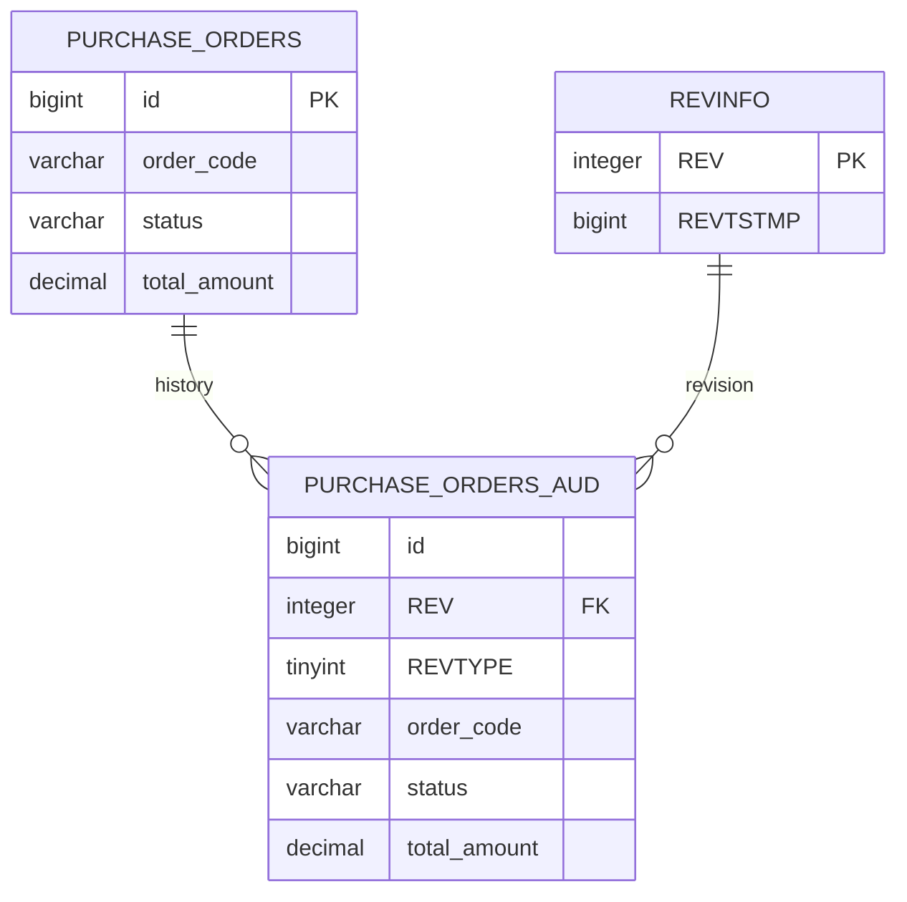
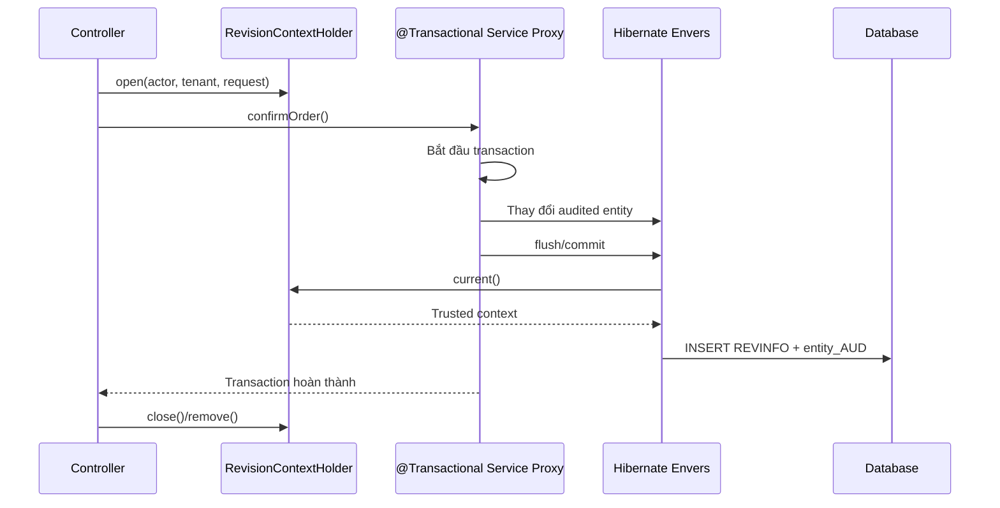
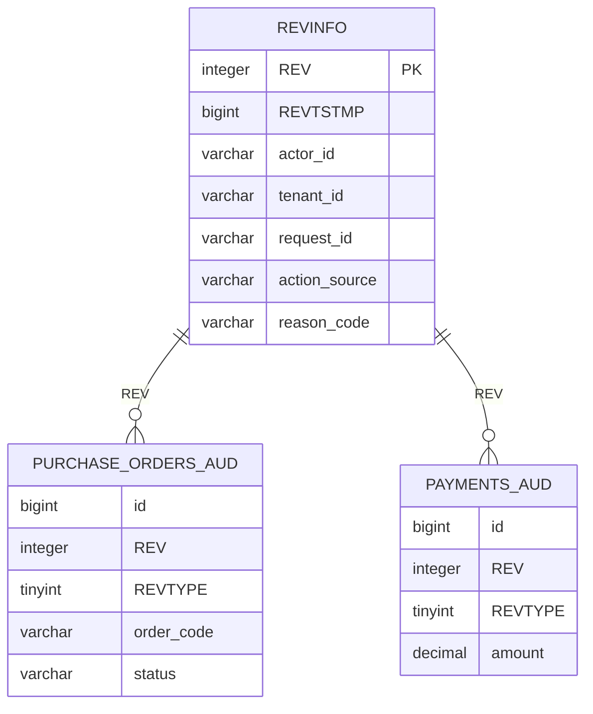
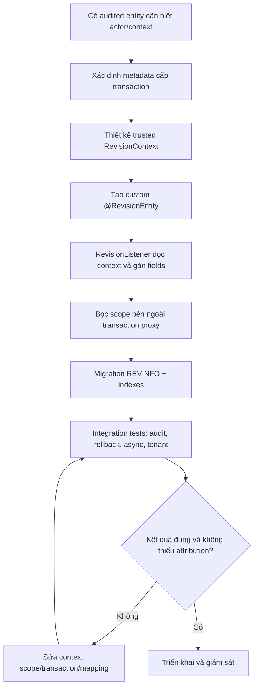

# Revision entity tùy chỉnh cho người thao tác hoặc ngữ cảnh yêu cầu

Khi bật Hibernate Envers bằng `@Audited`, ứng dụng có thể lưu lịch sử những lần thêm, sửa hoặc xóa entity. Mặc định, Envers tạo dữ liệu revision để trả lời các câu hỏi:

- Entity này có trạng thái gì ở revision số 25?
- Những lần thay đổi của một đơn hàng xảy ra ở revision nào?
- Một revision xuất hiện vào khoảng thời gian nào?
- Đó là thao tác thêm (`ADD`), sửa (`MOD`) hay xóa (`DEL`)?

Trong ứng dụng thực tế, những câu hỏi đó thường chưa đủ. Nhóm vận hành còn muốn biết:

- **Ai** là người gây ra thay đổi?
- Thao tác xuất phát từ **HTTP API, admin console, job hay integration service**?
- Thay đổi diễn ra trong **request/correlation ID** nào?
- Thuộc **tenant** nào trong hệ thống đa khách hàng?
- Có **lý do nghiệp vụ** hoặc mã tác vụ nào cần truy vết không?

**Revision entity tùy chỉnh** cho phép thêm các metadata trên vào bản ghi revision dùng chung của Envers. Thay vì chỉ có số revision và timestamp, mỗi revision có thể chứa mã định danh người thao tác cùng ngữ cảnh đáng tin cậy ở thời điểm Envers ghi nhận thay đổi.

Tuy nhiên, revision **không đồng nghĩa HTTP request** và cũng **không đồng nghĩa một entity change đơn lẻ**. Một transaction có thể sửa nhiều audited entities và chúng thường cùng tham chiếu một revision; một HTTP request có thể tạo nhiều transactions/revisions hoặc không tạo revision nào. Hiểu đúng đơn vị dữ liệu này là điều kiện để thiết kế audit log không gây hiểu nhầm.

Bài học hướng dẫn cách dùng `@RevisionEntity`, `DefaultRevisionEntity`, `RevisionListener`, cách lấy user/request context trong Spring Boot, cách truy vấn metadata bằng `AuditReader`, quản lý schema/migration và kiểm thử độ đúng của audit trail.

---

## 1. Revision trong Envers gồm những gì?

Envers là module audit của Hibernate ORM, cung cấp cơ chế ghi lịch sử cho các entity được đánh dấu `@Audited`. Thường cần dependency `hibernate-envers` **cùng phiên bản tương thích** với `hibernate-core`.

Ví dụ Gradle khi dùng dependency management:

```kotlin
dependencies {
    implementation("org.hibernate.orm:hibernate-envers")
}
```

Nếu build không dùng BOM hoặc dependency management, phải chọn phiên bản khớp Hibernate ORM và Jakarta Persistence stack. Không lắp tùy ý Envers 7.x với Hibernate Core 6.x.

Một entity:

```java
import jakarta.persistence.*;
import org.hibernate.envers.Audited;

@Entity
@Table(name = "purchase_orders")
@Audited
public class PurchaseOrder {

    @Id
    @GeneratedValue(strategy = GenerationType.SEQUENCE)
    private Long id;

    @Column(nullable = false)
    private String orderCode;

    @Enumerated(EnumType.STRING)
    private OrderStatus status;

    @Column(nullable = false)
    private BigDecimal totalAmount;

    protected PurchaseOrder() {}

    public void confirm() {
        this.status = OrderStatus.CONFIRMED;
    }
}
```

Envers có thể duy trì bảng lịch sử như `purchase_orders_AUD`, với dữ liệu entity theo revision, ngoài bảng nghiệp vụ `purchase_orders`.

Một mô hình khái niệm:



Tên bảng audit, tên cột và kiểu SQL thực tế phụ thuộc naming configuration, Envers strategy, Hibernate version và Dialect. `REVINFO`, `REV`, `REVTSTMP` là các tên thường gặp với mapping revision mặc định.

### 1.1. Hai lớp dữ liệu khác nhau

| Dữ liệu | Ví dụ | Câu hỏi |
|---|---|---|
| Audited entity snapshot | `purchase_orders_AUD` | Đơn hàng có giá trị gì ở revision N? |
| Revision metadata | `REVINFO` hoặc custom table | Revision N xảy ra khi nào, bởi ai, trong ngữ cảnh gì? |
| Revision type | `REVTYPE` trong audit row | Entity được thêm, sửa hay xóa tại N? |
| Current business table | `purchase_orders` | Trạng thái đang có bây giờ là gì? |

**Metadata người thao tác nên nằm ở revision entity khi nó áp dụng cho cả transaction**, tránh lặp lại user/request data ở mọi audit row.

### 1.2. Revision number không phải entity version

Entity có thể có:

```java
@Version
private long version;
```

`@Version` dùng cho optimistic locking và có semantics riêng của entity. **Envers revision number** biểu diễn một mốc audit (thường trên phạm vi những thay đổi được audit trong một persistence unit/schema) và có thể được chia sẻ giữa nhiều entity snapshots.

Không dùng revision number thay thế `@Version` để phòng lost update. Ngược lại, version tăng không nhất thiết có cùng giá trị với số revision Envers.

## 2. Một transaction có thể tạo một revision cho nhiều entity

Giả sử trong một transaction:

```java
@Transactional
public void confirmOrder(Long orderId) {
    PurchaseOrder order = orderRepository.findById(orderId)
        .orElseThrow();

    order.confirm();

    Payment payment = new Payment(orderId);
    entityManager.persist(payment);

    AuditNote note = new AuditNote("Confirmed");
    entityManager.persist(note);
}
```

Nếu `PurchaseOrder`, `Payment` và `AuditNote` đều được audit và có thay đổi thực sự, Envers thường dùng **cùng một revision** cho các audit rows được tạo trong transaction đó.

```text
Revision #150
  actor_id     = "user-782"
  request_id   = "req-5ab9"
  source       = "HTTP"
  timestamp    = ...
       |
       +-- purchase_orders_AUD (id=42, REV=150, MOD)
       +-- payments_AUD        (id=81, REV=150, ADD)
       +-- audit_notes_AUD     (id=11, REV=150, ADD)
```

Lợi ích là metadata được lưu một lần và mọi audited rows trong transaction có thể join qua `REV` để biết cùng người thao tác/ngữ cảnh.

### 2.1. Những trường hợp không có revision

Envers không tự tạo một revision cho mọi HTTP request. Ví dụ:

- Request chỉ đọc entity.
- Transaction không thay đổi audited state.
- Chỉ thay đổi entity không đánh dấu `@Audited`.
- Một thao tác có thay đổi Java nhưng dirty checking cho thấy persistent state thực tế không đổi.
- Giao dịch rollback trước khi commit.
- Bulk SQL/HQL đi ngoài cơ chế event/listener mà Envers dựa vào.

Không nên phát biểu “một request = một REVINFO row”. Nếu cần nhật ký **mọi HTTP request hoặc mọi business command**, hãy dùng request audit/application event log riêng, kết hợp Envers nơi cần lưu state history.

### 2.2. Một request có thể có nhiều revisions

Một HTTP request có thể gọi hai service transactions riêng, ví dụ qua `REQUIRES_NEW` hoặc nhiều bước nghiệp vụ:

```text
Request req-5ab9
  Transaction A -> Revision 150
  Transaction B -> Revision 151
```

Cả hai revision có thể lưu cùng `requestId` nhưng có số revision khác nhau. Nhờ đó có thể truy vết các transaction cùng xuất phát từ một request, nhưng **requestId không phải khóa chính của revision entity**.

### 2.3. Timestamp và thứ tự sự kiện

Revision entity mặc định có timestamp. Nó là một chỉ dấu thời gian của revision, không tự chứng minh thứ tự tuyệt đối của các sự kiện ở mọi database node và mọi clock. Với concurrency, transaction lifetime và độ chính xác timestamp, không nên dùng timestamp một mình để thay thế revision identity/order.

Nếu cần truy vết order có ý nghĩa nghiệp vụ hoặc external event ordering, phải định nghĩa mô hình riêng và xem xét transaction commit sequence.

## 3. Mặc định Envers lưu revision metadata thế nào?

Một revision entity cơ bản chứa:

- **Revision number**: định danh revision, được đánh dấu `@RevisionNumber`.
- **Revision timestamp**: thời gian Envers tạo revision, được đánh dấu `@RevisionTimestamp`.

Khi không cấu hình custom revision entity, Envers dùng mapping revision entity mặc định. Thông thường có bảng `REVINFO` với các cột `REV` và `REVTSTMP`.

Muốn thêm `actorId` hoặc `requestId`, cần khai một **revision entity tùy chỉnh**, được đánh dấu `@RevisionEntity`.

Hai hướng thực hiện:

1. **Kế thừa `DefaultRevisionEntity`**: đơn giản, tái sử dụng mapping revision number/timestamp mặc định.
2. **Tự khai đầy đủ revision entity**: chủ động ID strategy, column types, names và các metadata khác bằng `@RevisionNumber`/`@RevisionTimestamp`.

Với hầu hết ứng dụng chỉ cần thêm actor/request fields, **kế thừa `DefaultRevisionEntity`** là cách bắt đầu hợp lý.

## 4. Tạo custom revision entity bằng DefaultRevisionEntity

Ví dụ:

```java
package com.example.audit;

import jakarta.persistence.Column;
import jakarta.persistence.Entity;
import jakarta.persistence.Table;

import org.hibernate.envers.DefaultRevisionEntity;
import org.hibernate.envers.RevisionEntity;

@Entity
@Table(name = "REVINFO")
@RevisionEntity(ApplicationRevisionListener.class)
public class ApplicationRevisionEntity
        extends DefaultRevisionEntity {

    @Column(name = "actor_id", length = 96)
    private String actorId;

    @Column(name = "tenant_id", length = 96)
    private String tenantId;

    @Column(name = "request_id", length = 96)
    private String requestId;

    @Column(name = "action_source", length = 32)
    private String actionSource;

    @Column(name = "reason_code", length = 64)
    private String reasonCode;

    protected ApplicationRevisionEntity() {}

    public String getActorId() {
        return actorId;
    }

    public void setActorId(String actorId) {
        this.actorId = actorId;
    }

    public String getTenantId() {
        return tenantId;
    }

    public void setTenantId(String tenantId) {
        this.tenantId = tenantId;
    }

    public String getRequestId() {
        return requestId;
    }

    public void setRequestId(String requestId) {
        this.requestId = requestId;
    }

    public String getActionSource() {
        return actionSource;
    }

    public void setActionSource(String actionSource) {
        this.actionSource = actionSource;
    }

    public String getReasonCode() {
        return reasonCode;
    }

    public void setReasonCode(String reasonCode) {
        this.reasonCode = reasonCode;
    }
}
```

`DefaultRevisionEntity` cung cấp mapping của revision identifier và revision timestamp, cùng getter tương ứng. Trong ví dụ này không cần khai lại `@Id`, `@RevisionNumber` và `@RevisionTimestamp`.

### 4.1. Tại sao chọn actorId thay cho username?

Một username có thể được đổi. Email, họ tên hoặc số điện thoại còn là dữ liệu cá nhân và có thể không phù hợp để lưu lâu dài trong audit.

Một `actorId` **ổn định, không mang bí mật và ít thay đổi** thường phù hợp hơn:

```text
actor_id = "usr-01JF..."
actor_id = "svc-payment-sync"
actor_id = "system"
```

Hệ thống phân quyền có thể tra cứu thông tin hiển thị hiện tại từ actor ID. Nếu account bị xóa hoặc anonymize theo chính sách dữ liệu, audit cần phương án hiển thị tương ứng.

### 4.2. Nên lưu những context fields nào?

| Trường | Mục đích | Lưu ý |
|---|---|---|
| `actorId` | Xác định người hoặc service gây thay đổi | ID ổn định, do hệ thống tin cậy cấp |
| `tenantId` | Phân vùng dữ liệu đa tenant | Không lấy mù quáng từ header không xác thực |
| `requestId` | Liên kết với request/trace | Có thể xuất hiện ở nhiều revisions |
| `actionSource` | HTTP, JOB, MESSAGE, SYSTEM, CLI | Dùng controlled vocabulary |
| `reasonCode` | Mã lý do nghiệp vụ đã chuẩn hóa | Tránh chứa thông tin nhạy cảm/free-text không kiểm soát |

Không cần mặc định lưu toàn bộ URL, headers, raw IP, access token, user agent, body request hoặc exception stack trace vào revision entity. Đó có thể là thông tin nhạy cảm, dung lượng lớn và có yêu cầu retention khác audit state.

### 4.3. Nullable fields và migrations

Các `@Column` trong ví dụ chưa đặt `nullable=false` để dễ giải thích chuyện dữ liệu lịch sử không có metadata mới.

Với schema mới, có thể yêu cầu `actor_id NOT NULL` nếu mọi transaction audited đều được gán actor fallback rõ ràng. Với schema đã có hàng nghìn revisions, không thể chỉ thêm cột NOT NULL rồi không backfill. Cần migration theo giai đoạn.

### 4.4. Một revision entity trên một audit configuration

Envers cần một revision entity mapping thống nhất cho persistence unit/audit setup tương ứng. Không nên tạo nhiều class khác nhau cùng gắn `@RevisionEntity` và mong Envers tự chọn theo controller, tenant hoặc entity type.

Nếu cần metadata phân biệt từng loại thao tác, dùng fields như `actionSource`/`reasonCode` hoặc một bảng application audit riêng. Envers revision entity là metadata **cấp revision**, không phải cấp mỗi request handler.

## 5. RevisionListener nhận nhiệm vụ gì?

`RevisionListener` của Envers có một callback:

```java
void newRevision(Object revisionEntity);
```

Envers gọi callback khi tạo revision entity mới. Listener có cơ hội gán custom metadata **trước khi revision được ghi**.

Ví dụ đơn giản:

```java
package com.example.audit;

import org.hibernate.envers.RevisionListener;

public class ApplicationRevisionListener
        implements RevisionListener {

    @Override
    public void newRevision(Object revisionEntity) {
        ApplicationRevisionEntity revision =
            (ApplicationRevisionEntity) revisionEntity;

        revision.setActorId("system");
        revision.setActionSource("SYSTEM");
    }
}
```

Tất cả các revision phát sinh từ application sẽ có actor/source mặc định như trong ví dụ. Nhưng thực tế cần lấy **actor của transaction hiện tại**.

### 5.1. Listener không phải callback của từng entity

`RevisionListener.newRevision(...)` được gọi khi Envers tạo một revision, không phải mỗi lần một entity field thay đổi.

Do đó trong callback thông thường **không có `PurchaseOrder.id` hoặc danh sách tất cả changed entities** như một tham số mặc định. Muốn biết entity nào thay đổi, cần dùng cơ chế query Envers hoặc entity tracking extension phù hợp, không cố lấy entity ID bằng cách suy diễn từ request.

### 5.2. Listener có thể được gọi muộn

Envers thường làm việc cùng transaction/flush processing. Callback không nhất thiết chạy chính xác tại thời điểm service gọi `entityManager.persist()` hoặc setter.

Nếu người thao tác được lưu trong ngữ cảnh chỉ có mặt ở một đoạn code rất ngắn nhưng đã bị xóa trước flush/commit, listener có thể đọc sai hoặc không có thông tin.

**Phạm vi sống của actor context phải bao trùm thời điểm Envers tạo revision**, không chỉ thời điểm gọi method domain.

## 6. Cách lấy người thao tác: Spring Security và context nghiệp vụ

Trong một ứng dụng web Spring Security, principal thường có thể truy xuất từ `SecurityContextHolder` trong request thread:

```java
import org.springframework.security.core.Authentication;
import org.springframework.security.core.context.SecurityContextHolder;

Authentication authentication =
    SecurityContextHolder.getContext().getAuthentication();
```

Sau đó cần phân biệt:

- Người dùng đã đăng nhập.
- Anonymous authentication.
- Service account.
- Batch job không có web SecurityContext.
- Internal command do hệ thống sinh.
- Thread khác không được propagate SecurityContext.

Ví dụ khái niệm:

```java
String actorId = "system";

if (authentication != null &&
        authentication.isAuthenticated() &&
        !(authentication instanceof AnonymousAuthenticationToken)) {
    actorId = authentication.getName();
}
```

Đây là demo cơ bản. `authentication.getName()` có thể là username/email, **không mặc nhiên là stable internal ID**. Với production, lấy định danh ổn định từ custom principal/claim đã được xác thực và ánh xạ đúng tenant.

### 6.1. Không đặt toàn bộ logic bảo mật trực tiếp vào RevisionListener

Nếu listener tự gọi nhiều Spring beans, SecurityContext, request object và external services để suy ra actor, nó trở nên khó kiểm thử và phụ thuộc HTTP context.

Một thiết kế rõ ràng hơn:

1. Ở ranh giới application, nhận biết actor/tenant/request theo nguồn tin cậy.
2. Chuẩn hóa metadata thành một object nhỏ.
3. Đảm bảo metadata hiện diện trong suốt transaction/flush.
4. RevisionListener chỉ đọc metadata đã chuẩn hóa và gán vào revision entity.
5. Nếu thiếu metadata, áp chính sách fallback/throw exception đã định.

Cách tiếp cận này xử lý được cả HTTP, async, scheduled jobs và message consumers theo những nguồn context riêng.

## 7. Định nghĩa RevisionContext nhỏ, rõ trách nhiệm

Có thể dùng một Java record:

```java
package com.example.audit;

public record RevisionContext(
    String actorId,
    String tenantId,
    String requestId,
    String actionSource,
    String reasonCode
) {}
```

Ví dụ values:

```java
new RevisionContext(
    "usr-481",
    "tenant-22",
    "req-7f3c",
    "HTTP",
    "ORDER_CONFIRMATION"
);
```

Đây là **metadata đã được xác thực/chuẩn hóa**, không phải bản sao nguyên văn request headers.

### 7.1. Actor có thể là người hoặc hệ thống

Một người dùng web:

```text
actorId      = usr-481
actionSource = HTTP
```

Một scheduled job:

```text
actorId      = svc-expiration-job
actionSource = JOB
```

Một message consumer:

```text
actorId      = svc-payment-handler
actionSource = MESSAGE
requestId    = correlation ID từ messaging
```

Không cố gán mọi thay đổi cho người dùng có tên “admin” khi chúng thực sự do một background process tự động thực hiện. Audit cần phản ánh **nguồn tác động thật**.

### 7.2. Vì sao reasonCode nên là mã?

Mã `ORDER_CONFIRMATION` hoặc `ADMIN_CORRECTION` ổn định và có thể truy vấn. Free-text reason có thể chứa PII, bí mật hoặc payload rất dài, khó kiểm soát.

Nếu cần lưu lời giải thích dài, thiết kế bảng business event/change request riêng có retention và authorization phù hợp; revision metadata giữ mã tham chiếu hoặc correlation ID.

## 8. Truyền context đến listener qua ThreadLocal có kiểm soát

Một lựa chọn đơn giản trong Spring MVC đồng bộ là ThreadLocal. Listener của Envers chạy trong transaction/flush của cùng thread, nên có thể đọc context mà không phụ thuộc dependency injection của listener.

**Lưu ý:** ThreadLocal chỉ phù hợp khi logic được kiểm soát trên cùng thread. Nó **không tự truyền qua `@Async`, thread pools, reactive pipelines hay message handlers**.

Ví dụ holder có hỗ trợ nested scope:

```java
package com.example.audit;

public final class RevisionContextHolder {

    private static final ThreadLocal<RevisionContext> CURRENT =
        new ThreadLocal<>();

    private RevisionContextHolder() {}

    public static Scope open(RevisionContext context) {
        RevisionContext previous = CURRENT.get();
        CURRENT.set(context);

        return () -> {
            if (previous == null) {
                CURRENT.remove();
            } else {
                CURRENT.set(previous);
            }
        };
    }

    public static RevisionContext current() {
        return CURRENT.get();
    }

    @FunctionalInterface
    public interface Scope extends AutoCloseable {
        @Override
        void close();
    }
}
```

### 8.1. Vì sao phải remove trong finally/close?

Servlet container dùng lại threads. Nếu một request để lại ThreadLocal:

```text
Request A: actor usr-1
Thread reused
Request B: actor usr-2 nhưng holder vẫn usr-1
```

thì một revision của request B có thể bị ghi nhầm người thao tác. Đó là lỗi audit nghiêm trọng.

`try-with-resources` giúp cleanup tự động ngay cả khi service ném exception:

```java
try (RevisionContextHolder.Scope ignored =
         RevisionContextHolder.open(context)) {

    commandService.confirmOrder(orderId);

} // Tự restore/remove context.
```

Không để context dưới dạng một static mutable field duy nhất dùng chung mọi threads. Cũng không quên xử lý nested calls để không xóa nhầm context của outer scope.

### 8.2. Không cần Spring Bean injection trong listener

Với holder trên, listener có thể chỉ dùng Java API và logic gán metadata:

```java
package com.example.audit;

import org.hibernate.envers.RevisionListener;

public class ApplicationRevisionListener
        implements RevisionListener {

    @Override
    public void newRevision(Object revisionEntity) {
        ApplicationRevisionEntity revision =
            (ApplicationRevisionEntity) revisionEntity;

        RevisionContext context =
            RevisionContextHolder.current();

        if (context == null) {
            revision.setActorId("system");
            revision.setActionSource("SYSTEM");
            return;
        }

        revision.setActorId(context.actorId());
        revision.setTenantId(context.tenantId());
        revision.setRequestId(context.requestId());
        revision.setActionSource(context.actionSource());
        revision.setReasonCode(context.reasonCode());
    }
}
```

Cách này không dựa vào việc Hibernate có tạo RevisionListener bằng Spring constructor injection hay không. Nó cũng không gọi DB/network từ callback.

### 8.3. Fallback không nên che lỗi trách nhiệm

Trong ví dụ, thiếu context được gán `system`. Đây có thể là policy phù hợp cho các ứng dụng có jobs cũ, nhưng **không nên tự động gán system cho mọi command nhạy cảm** nếu yêu cầu pháp lý phải biết chính xác human actor.

Một policy nghiêm ngặt hơn:

```java
if (context == null) {
    throw new IllegalStateException(
        "Missing trusted audit revision context"
    );
}
```

Việc throw từ listener có thể làm transaction ghi dữ liệu thất bại/rollback, nên phải áp dụng có chủ đích, bảo đảm mọi entry point (HTTP, job, message) cung cấp context trước.

## 9. Bao scope cho Spring service transaction đúng thời điểm

Giả sử controller gọi một Spring bean service có `@Transactional`:

```java
@RestController
@RequestMapping("/api/orders")
public class OrderCommandController {

    private final OrderCommandService commandService;
    private final AuthenticatedAuditContextFactory auditFactory;

    public OrderCommandController(
            OrderCommandService commandService,
            AuthenticatedAuditContextFactory auditFactory) {
        this.commandService = commandService;
        this.auditFactory = auditFactory;
    }

    @PostMapping("/{id}/confirm")
    public ResponseEntity<Void> confirm(@PathVariable Long id) {
        RevisionContext context =
            auditFactory.forOrderConfirmation();

        try (RevisionContextHolder.Scope ignored =
                 RevisionContextHolder.open(context)) {

            commandService.confirmOrder(id);
        }

        return ResponseEntity.noContent().build();
    }
}
```

`AuthenticatedAuditContextFactory` là một **application component giả định** có trách nhiệm lấy actor ID/tenant ID từ nguồn đã xác thực, tạo request/correlation ID và reasonCode đáng tin cậy.

Service:

```java
@Service
public class OrderCommandService {

    private final PurchaseOrderRepository orders;

    public OrderCommandService(PurchaseOrderRepository orders) {
        this.orders = orders;
    }

    @Transactional
    public void confirmOrder(Long id) {
        PurchaseOrder order = orders.findById(id)
            .orElseThrow(() -> new OrderNotFoundException(id));

        order.confirm();
    }
}
```

### 9.1. Vì sao scope bao bên ngoài lời gọi service?

Spring `@Transactional` chạy qua proxy: khi `commandService.confirmOrder(id)` được gọi từ controller, transaction advice có thể mở transaction trước khi method chạy và commit/flush trước khi proxy trả control.

Vì scope `RevisionContextHolder.open(context)` vẫn còn đang mở trong lúc service proxy hoàn tất transaction, RevisionListener có thể đọc metadata ngay cả khi revision chỉ được tạo trong flush/commit.

Sơ đồ:



### 9.2. Khi nào cách này chưa đủ?

Nếu transaction commit **sau** khi scope đã đóng, listener có thể không thấy context. Ví dụ:

- Code mở scope bên trong method nhưng `@Transactional` proxy commit sau method return.
- Work được gửi tới `@Async` và hoàn thành ở thread khác.
- Một transaction chạy bất đồng bộ sau response.
- Một resource/transaction boundary khác không cùng thread.

Hãy đặt scope ở một tầng **bao ngoài transaction boundary thật**, hoặc dùng cơ chế context propagation/transaction synchronization phù hợp thiết kế hệ thống.

### 9.3. Không dùng ThreadLocal thay transaction manager

RevisionContextHolder chỉ chuyển metadata. Nó không bắt đầu hoặc commit transaction, không định nghĩa tenant routing/DB connection và không bảo vệ dữ liệu khỏi concurrency. Các trách nhiệm đó vẫn thuộc Spring transaction manager, Hibernate Session và application business logic.

## 10. Dùng servlet filter để tạo request context

Với nhiều controllers, có thể dùng một `OncePerRequestFilter` để chuẩn hóa context cho request đồng bộ:

```java
public class AuditRevisionContextFilter
        extends OncePerRequestFilter {

    private final AuthenticatedAuditContextFactory contextFactory;

    public AuditRevisionContextFilter(
            AuthenticatedAuditContextFactory contextFactory) {
        this.contextFactory = contextFactory;
    }

    @Override
    protected void doFilterInternal(
            HttpServletRequest request,
            HttpServletResponse response,
            FilterChain chain)
            throws ServletException, IOException {

        RevisionContext context =
            contextFactory.fromTrustedRequest(request);

        try (RevisionContextHolder.Scope ignored =
                 RevisionContextHolder.open(context)) {
            chain.doFilter(request, response);
        }
    }
}
```

Cần imports từ Spring Web và `jakarta.servlet` tương ứng với Spring Boot 3+/Jakarta stack. Đăng ký filter với vị trí phù hợp **sau khi security principal và tenant đã được xác thực** nếu `contextFactory` cần thông tin đó.

### 10.1. Filter ordering và SecurityContext

Nếu filter chạy trước Spring Security authentication, nó có thể chỉ thấy anonymous principal. Khi đó dù request được xác thực sau, actor trong revision vẫn sai.

Không chỉ thêm `@Component` rồi mặc định filter được sắp đúng vị trí. Cần xét Spring Security filter chain, servlet filter order và cách lấy SecurityContext tại thời điểm context được tạo.

### 10.2. Request ID từ đâu?

Ưu tiên correlation ID/trace ID do gateway hoặc application tạo và có validation rõ. Nếu lấy từ HTTP header:

- Giới hạn length và charset.
- Phân biệt external correlation ID với trusted server-generated trace ID.
- Không cho header tùy ý ghi đè identity/tenant.
- Không dùng request ID như bằng chứng danh tính.

Trong một implementation đơn giản, có thể tạo server-side UUID:

```java
String requestId = UUID.randomUUID().toString();
```

Nhưng trong hệ thống có tracing phân tán, nên dùng context trace đã được chuẩn hóa để liên kết logs/audits.

### 10.3. Async servlet dispatch

`OncePerRequestFilter` và Spring MVC async có quy tắc dispatch riêng. Một ThreadLocal đặt ở filter của request thread **không đương nhiên xuất hiện trong worker thread**. Nếu audited transaction chạy sau khi đã chuyển thread, phải tạo/propagate context mới tại nơi transaction thực thi.

Không dựa vào request scope của servlet để xử lý mọi batch/async workload.

## 11. RevisionListener có được Spring inject dependency không?

Một số phiên bản/cấu hình Hibernate hỗ trợ các cơ chế bean container hoặc CDI cho những thành phần mở rộng; Spring integration có nhiều đường khởi tạo beans. Tuy nhiên **không nên giả định** rằng class khai trong `@RevisionEntity(SomeListener.class)` luôn được Spring constructor-inject như một `@Service`.

Các lựa chọn:

- Dùng context holder như ví dụ để listener không phụ thuộc Spring injection.
- Tích hợp Hibernate BeanContainer/Spring hoặc CDI theo tài liệu đúng version.
- Cấu hình một provider/wrapper chịu trách nhiệm cung cấp audit context rõ ràng.
- Với custom event infrastructure, truyền metadata theo transaction boundary do application kiểm soát.

Tránh cách lấy `ApplicationContext` bằng một static global service locator rồi gọi nhiều services từ RevisionListener. Điều này làm listener khó test, dễ tạo dependency cycle và tăng rủi ro thực thi ngoài transaction.

**Listener nên nhẹ:** đọc metadata đã chuẩn hóa, validate, gán fields. Không gọi HTTP API hoặc query database chỉ để xác định username.

## 12. Spring Security actor ID: xác thực, không chỉ hiển thị

Trong Spring Security, có thể có:

- Principal với `getName()` là username/email.
- JWT principal với subject (`sub`).
- Custom `UserDetails` chứa internal account ID.
- Machine-to-machine credentials.
- Anonymous authentication.
- Impersonation/delegation flow.

Một actor model tốt có thể tách:

```text
actorId       = "usr-782"      // Ai thực hiện thực tế
onBehalfOfId  = "usr-102"      // Nếu được ủy quyền/thay mặt
actionSource  = "ADMIN_PANEL"
requestId     = "req-91ab"
```

Nếu hệ thống có impersonation, chỉ lưu “người được giả lập” sẽ làm mất dấu người thực thi. Cần xác định audit semantics và chính sách phân quyền riêng.

### 12.1. Không tin tenantId từ request header đơn thuần

Ví dụ một request gửi:

```text
X-Tenant-Id: competitor-tenant
```

Không lấy giá trị này làm trusted `tenantId` nếu chưa xác thực người gọi có quyền trong tenant đó. Revision metadata sai tenant làm giảm giá trị audit và có thể dẫn đến sai lọc dữ liệu khi truy vấn lịch sử.

### 12.2. Authenticated identity và business owner khác nhau

Một admin thay đổi order của customer A:

```text
actorId   = admin-7
tenantId  = tenant-A
entityId  = order-42
```

Người thao tác là admin-7; chủ thể của entity có thể là customer A. Hai định danh trả lời hai câu hỏi khác nhau, không nên thay actor bằng `order.customer.id`.

## 13. Scheduled job, message consumer và hệ thống tự động

OSIV/HTTP request context không tồn tại trong scheduled jobs. Nếu chỉ có servlet filter set RevisionContext, những thay đổi do job có thể được gán actor fallback `system` không rõ nguồn.

Hãy tạo context rõ ở job entry point:

```java
@Scheduled(cron = "0 0 2 * * *")
public void expireOldOrders() {
    RevisionContext context = new RevisionContext(
        "svc-order-expiration",
        null,
        "job-" + UUID.randomUUID(),
        "JOB",
        "ORDER_EXPIRATION"
    );

    try (RevisionContextHolder.Scope ignored =
             RevisionContextHolder.open(context)) {

        orderCommandService.expireOldOrders();
    }
}
```

Nếu `orderCommandService.expireOldOrders()` là method của bean Spring khác và có `@Transactional`, transaction proxy commit khi lời gọi method trở về, lúc context vẫn còn mở.

### 13.1. Message handler

Một message từ payment service có thể chứa correlation ID và business event ID. Consumer nên:

1. Xác minh nguồn và schema message.
2. Xác định service actor từ identity đã được tin cậy.
3. Tạo `RevisionContext` cho transaction hiện tại.
4. Gọi command service transactional.
5. Close/restore context.
6. Xử lý retry/idempotency rõ ràng.

Không lấy username từ một field bất kỳ trong message rồi coi nó là người đã được xác thực nếu producer chưa có trust contract.

### 13.2. Một job chia nhiều transactions

Nếu job chạy 100 chunks, mỗi chunk commit một transaction, có thể tạo 100 revisions (hoặc ít hơn nếu không có audited change), cùng `actionSource=JOB` và một `jobRunId`/correlation ID.

Điều này là hợp lý. Không ép tất cả chunks vào một transaction khổng lồ chỉ để có một revision number, vì nó làm tăng lock/resource/rollback cost.

## 14. @Async và ThreadLocal propagation

Ví dụ **không an toàn** nếu kỳ vọng ThreadLocal tự truyền:

```java
try (var ignored = RevisionContextHolder.open(context)) {
    asyncService.updateOrderAsync(orderId);
}
```

Nếu `updateOrderAsync` thực thi trong thread pool, ThreadLocal ở request thread thường không xuất hiện ở worker thread. RevisionListener trong worker có thể chỉ thấy `null`.

Các phương án:

- Truyền `RevisionContext` dưới dạng tham số explicit tới async job và mở scope **bên trong worker** trước transaction.
- Dùng TaskDecorator/context propagation được cấu hình và kiểm thử.
- Lưu actor/correlation metadata trong event/message payload đáng tin cậy.
- Không chuyển managed JPA entities/proxies qua async boundary; truyền IDs/DTOs.

Ví dụ về mặt ý tưởng:

```java
public void submitAsync(
        Long orderId,
        RevisionContext context) {

    taskExecutor.execute(() -> {
        try (var ignored =
                 RevisionContextHolder.open(context)) {
            orderCommandService.updateInTransaction(orderId);
        }
    });
}
```

Cần bảo đảm `orderCommandService` là Spring proxy bean phù hợp và phương thức transactional được gọi qua proxy. Không tạo transaction ở caller rồi mong nó đi qua thread pool.

### 14.1. Reactor/WebFlux không dùng ThreadLocal đơn giản

Trong reactive execution, một logical request có thể chuyển threads nhiều lần. ThreadLocal không đủ làm nguồn ngữ cảnh đáng tin cậy. Nếu ứng dụng dùng Hibernate Reactive hoặc R2DBC, cơ chế audit/transactions khác với JPA Envers thông thường; không sao chép nguyên thiết kế ThreadLocal này sang reactive pipeline.

### 14.2. Dọn sạch context sau mỗi task

Thread pools dùng lại threads; quên `remove()` có thể khiến một task mới thừa hưởng actor/tenant của task trước. Dùng try-finally/AutoCloseable tại **chính worker thread**.

## 15. Có nên tự khai đầy đủ revision entity?

Nếu cần kiểm soát revision ID và timestamp mapping mà `DefaultRevisionEntity` không đáp ứng, có thể tự khai:

```java
@Entity
@Table(name = "audit_revisions")
@RevisionEntity(ApplicationRevisionListener.class)
public class ApplicationRevisionEntity {

    @Id
    @GeneratedValue(
        strategy = GenerationType.SEQUENCE,
        generator = "audit_revision_seq_gen"
    )
    @SequenceGenerator(
        name = "audit_revision_seq_gen",
        sequenceName = "audit_revision_seq",
        allocationSize = 1
    )
    @RevisionNumber
    @Column(name = "rev")
    private int id;

    @RevisionTimestamp
    @Column(name = "revtstmp")
    private long timestamp;

    @Column(name = "actor_id", length = 96)
    private String actorId;

    // Getters/setters và các metadata fields khác.
}
```

Ví dụ này là **phương án thay thế** cho việc kế thừa DefaultRevisionEntity, không phải dùng đồng thời cả hai class trong cùng persistence unit. Imports cho annotations `@RevisionNumber`, `@RevisionTimestamp` và `@RevisionEntity` thuộc `org.hibernate.envers`.

### 15.1. Yêu cầu cốt lõi

Một custom revision entity đầy đủ cần:

- Là JPA entity được Hibernate quản lý.
- Có một property revision number đánh dấu `@RevisionNumber`, với kiểu số nguyên thích hợp theo Envers API.
- Có property timestamp đánh dấu `@RevisionTimestamp` theo kiểu được release hỗ trợ.
- Có `@RevisionEntity` khai báo revision listener nếu dùng.
- Có ID generation/naming tương thích với database schema.
- Không trùng với revision entity khác trong cùng audit setup.

Không dùng một chuỗi UUID tùy ý làm `@RevisionNumber` rồi giả định mọi API Envers hoạt động như với số revision nguyên; revision identifiers cần kiểu và semantics do Envers hỗ trợ.

### 15.2. Khi nào nên kế thừa mặc định?

Nếu chỉ cần `actorId`/`tenantId`/`requestId`, cách kế thừa ít boilerplate hơn và tránh phải tái tạo mappings chuẩn. Chỉ dùng full custom mapping khi đã có lý do về tên cột, generator, physical schema hoặc legacy migrations.

### 15.3. Revision timestamp là metadata do Envers quản lý

Tránh tự set thời gian bằng application request timestamp rồi ghi đè `@RevisionTimestamp`. Thời điểm request bắt đầu và thời điểm revision được tạo có thể khác nhau. Nếu muốn lưu **business event timestamp** hoặc **request received timestamp**, thêm field riêng có tên rõ ràng, đồng thời giữ revision timestamp của Envers để API lịch sử làm việc nhất quán.

## 16. Schema revision entity và audit tables

Mặc định, các audit rows tham chiếu revision number qua cột `REV`. Khi custom revision entity có các fields mới, physical revision table cần có các cột tương ứng.

Mô hình:



### 16.1. Không cần copy actor vào mọi _AUD table

Khi metadata là cấp revision, cột `actor_id` nằm ở revision table. Để biết ai thay đổi Order#42, query join `purchase_orders_AUD.REV = REVINFO.REV`.

Đưa actor vào mọi audit row có thể làm duplicate data và tăng chi phí migration. Tuy nhiên, nếu một transaction thực sự cần metadata khác nhau cho các entity changes riêng lẻ, revision-level field **không biểu diễn được sự khác biệt đó**; cần thiết kế audit event bảng riêng hoặc cơ chế mở rộng tracking chi tiết.

### 16.2. Existing REVINFO table: giữ lịch sử và FK

Nếu ứng dụng đã chạy Envers nhiều năm với `REVINFO` và hàng triệu audit rows, việc đổi `@Table(name="audit_revisions")` mà không migration có thể làm Hibernate tìm sai bảng.

Lựa chọn an toàn thường là:

1. Giữ tên `REVINFO` ở revision entity mới.
2. Thêm custom columns bằng migration.
3. Backfill/nullability phù hợp cho revisions cũ.
4. Không thay revision IDs hoặc foreign keys đang tồn tại.
5. Validate mapping và đọc lại lịch sử trước/sau deploy.

Muốn đổi tên revision table phải xét mọi audit tables có FK/reference tới revision table, dữ liệu lịch sử và cấu hình Envers liên quan.

## 17. Migration thêm metadata vào REVINFO

Giả sử bảng `REVINFO` đã tồn tại với `REV` và `REVTSTMP`. Một migration PostgreSQL-oriented minh họa:

```sql
ALTER TABLE REVINFO
    ADD COLUMN actor_id VARCHAR(96),
    ADD COLUMN tenant_id VARCHAR(96),
    ADD COLUMN request_id VARCHAR(96),
    ADD COLUMN action_source VARCHAR(32),
    ADD COLUMN reason_code VARCHAR(64);
```

Nếu đã có revisions lịch sử, giá trị mới có thể `NULL` vì ở thời điểm đó ứng dụng chưa lưu metadata.

### 17.1. Có nên backfill actor = legacy?

Không nên bịa một tên user cụ thể cho những revisions không có dữ liệu. Có thể đặt mã như `legacy-unknown` hoặc giữ NULL và ghi rõ ý nghĩa “không có dữ liệu attribution”. Thời điểm migration không thể suy ra ai đã gây thay đổi trong quá khứ nếu hệ thống không ghi log đó.

### 17.2. Siết NOT NULL theo giai đoạn

Nếu yêu cầu mọi revision **mới** có actor:

1. Bổ sung các cột nullable.
2. Deploy listener có fallback hoặc strict policy.
3. Kiểm tra không còn revisions mới thiếu actor.
4. Chọn xử lý legacy rows (giữ null hay set sentinel).
5. Chỉ sau khi dữ liệu hợp lệ mới thêm constraint NOT NULL nếu thật sự cần.

Một số DBMS/versions có cách thêm constraints online khác nhau; với bảng lớn, cần migration giảm lock và kiểm thử downtime.

### 17.3. Index cho metadata queries

Nếu thường xuyên tìm revisions theo actor và thời điểm:

```sql
-- PostgreSQL-oriented, tên chỉ minh họa
CREATE INDEX ix_revinfo_actor_rev
ON REVINFO (actor_id, REV);
```

Hoặc theo request:

```sql
CREATE INDEX ix_revinfo_request
ON REVINFO (request_id);
```

Không thêm index cho mọi metadata column. Đo query patterns, index selectivity và write overhead. Nếu tenantId là filter bắt buộc:

```sql
CREATE INDEX ix_revinfo_tenant_rev
ON REVINFO (tenant_id, REV);
```

Index ở revision table **không thay thế indexes trên từng audit table**. Một query theo actor nhưng lọc entity ID có thể cần cả `purchase_orders_AUD(id, REV)` và revision metadata indexes, tùy execution plan.

### 17.4. Không để Hibernate ddl-auto=update tự suy migration production

Với schema đang vận hành, dùng Flyway/Liquibase hoặc migration được review. `hibernate.hbm2ddl.auto=update` không phải engine đáng tin cậy cho backfill, đổi tên cột, online index creation hoặc schema rollout nhiều phiên bản application.

Trong production có thể dùng `validate`/`none` theo policy, rồi kiểm thử Envers trên DBMS đích.

## 18. Khi nào Envers thực sự tạo audit rows?

Khi entity `@Audited` được quản lý bởi Hibernate qua lifecycle thông thường:

```java
@Transactional
public void changeStatus(Long id) {
    PurchaseOrder order =
        entityManager.find(PurchaseOrder.class, id);

    order.confirm(); // Dirty checking tại flush.
}
```

Hibernate flush tạo entity UPDATE nếu state đổi và Envers có thể ghi audit row tương ứng.

### 18.1. INSERT

```java
entityManager.persist(new PurchaseOrder(...));
```

Envers có thể tạo audit row loại `RevisionType.ADD`.

### 18.2. UPDATE

Một managed entity thay đổi persistent state có thể tạo `RevisionType.MOD`. Nếu setter được gọi nhưng giá trị không đổi, có thể không có SQL UPDATE hay audit revision tương ứng, tùy dirty checking/mapping.

### 18.3. DELETE

```java
entityManager.remove(order);
```

Envers có thể tạo audit row `RevisionType.DEL`. Dữ liệu đầy đủ còn được giữ trong delete audit row hay không phụ thuộc cấu hình như `store_data_at_delete` và audit strategy.

### 18.4. Bulk HQL/Criteria UPDATE hoặc DELETE

```java
entityManager.createQuery(
    """
    update PurchaseOrder o
    set o.status = :status
    where o.createdAt < :cutoff
    """
)
.setParameter("status", OrderStatus.CANCELLED)
.setParameter("cutoff", cutoff)
.executeUpdate();
```

**Không mặc định được Envers ghi lịch sử từng entity**. Bulk DML thường bỏ qua lifecycle/dirty checking trên managed entity instances và có thể bypass các events mà Envers dùng để tạo audit entries.

Tương tự, native SQL, stored procedures, database triggers, ETL jobs hoặc external writers không tự đi qua Envers.

Nếu thao tác bulk vẫn phải có lịch sử, cần thiết kế audit khác: dùng entity-by-entity lifecycle (và đo hiệu năng), application events, database triggers hoặc một audit pipeline đủ tin cậy.

### 18.5. Transaction rollback

Nếu transaction bị rollback, những audit rows được ghi trong cùng transaction thường rollback theo; không coi chúng là log cho mọi **nỗ lực thất bại**. Nếu cần nhật ký login thất bại, lệnh bị từ chối hoặc request bị rollback, dùng security/application event logs với transaction/retention strategy phù hợp.

## 19. @NotAudited và phạm vi audit

Có thể chọn thuộc tính không lưu trong history:

```java
@Audited
@Entity
public class Customer {

    @Id
    private Long id;

    private String displayName;

    @NotAudited
    private String temporaryUiToken;
}
```

`@NotAudited` yêu cầu Envers không audit một property theo mapping tương ứng. Nó không ngăn ứng dụng log field đó ở nơi khác và không tự mã hóa dữ liệu còn lưu.

Quan trọng với custom revision metadata:

- Chỉ những entity được audit mới có audit rows.
- RevisionListener lưu metadata cho revision được tạo.
- Thêm actorId vào revision entity **không tự biến mọi database write thành audited event**.
- Một transaction chỉ sửa các non-audited fields có thể không tạo audit row/revision theo semantics và cấu hình cụ thể.

### 19.1. Audit metadata không thay business event

Envers trả lời “state nào đổi trong transaction”. Một business event như `ORDER_APPROVED_BY_MANAGER` có thể có ý nghĩa domain sâu hơn. Nếu cần lý do, approval chain và chữ ký, đừng chỉ dựa vào `RevisionType.MOD`; lưu business event được định nghĩa riêng, có thể link tới revision/request ID.

## 20. Truy vấn lịch sử cùng custom revision entity

Envers cung cấp `AuditReader`:

```java
import org.hibernate.envers.AuditReader;
import org.hibernate.envers.AuditReaderFactory;

AuditReader reader =
    AuditReaderFactory.get(entityManager);
```

`entityManager` phải được cung cấp trong một ngữ cảnh phù hợp cho database access, thường là query service read-only transaction.

### 20.1. Lấy danh sách revision numbers của một entity

```java
List<Number> revisionNumbers =
    reader.getRevisions(PurchaseOrder.class, orderId);
```

Danh sách cho biết những revision có lịch sử của order đó, không trả trực tiếp actor metadata.

### 20.2. Đọc custom revision metadata

```java
for (Number revisionNumber : revisionNumbers) {
    ApplicationRevisionEntity rev =
        reader.findRevision(
            ApplicationRevisionEntity.class,
            revisionNumber
        );

    System.out.println(
        "REV=" + rev.getId() +
        ", actor=" + rev.getActorId() +
        ", request=" + rev.getRequestId()
    );
}
```

Phương thức `findRevision` lấy revision entity theo number. Nếu chỉ dùng để hiển thị một trang lịch sử lớn, vòng lặp nhiều lookups có thể gây SQL bổ sung. Cân nhắc Envers audit query trả snapshot và revision metadata cùng lúc.

### 20.3. Đọc entity ở một revision cụ thể

```java
PurchaseOrder oldOrder =
    reader.find(
        PurchaseOrder.class,
        orderId,
        revisionNumber
    );
```

Kết quả biểu diễn trạng thái entity ở revision thích hợp theo Envers semantics. Nó không phải entity hiện tại đang được Hibernate dirty-check để cập nhật. Đừng dùng audit snapshot rồi `merge` như một “rollback” không kiểm soát; nghiệp vụ phục hồi phải tạo command/update mới.

### 20.4. Lấy snapshot, revision metadata và RevisionType

```java
List<Object[]> rows = reader.createQuery()
    .forRevisionsOfEntity(
        PurchaseOrder.class,
        false,
        true
    )
    .add(AuditEntity.id().eq(orderId))
    .getResultList();

for (Object[] row : rows) {
    PurchaseOrder snapshot = (PurchaseOrder) row[0];

    ApplicationRevisionEntity revision =
        (ApplicationRevisionEntity) row[1];

    RevisionType revisionType =
        (RevisionType) row[2];

    System.out.println(
        revisionType + " by " + revision.getActorId()
    );
}
```

Imports:

```java
import org.hibernate.envers.RevisionType;
import org.hibernate.envers.query.AuditEntity;
```

Với `forRevisionsOfEntity(Entity.class, false, true)`, bộ kết quả thường chứa:

1. Audited entity snapshot.
2. Revision entity.
3. `RevisionType`.

Tham số thứ hai `selectEntitiesOnly=false` yêu cầu metadata trong tuple; tham số thứ ba `selectDeletedEntities=true` cho phép đưa delete revisions vào kết quả theo API. Các result shapes và limitations cần đối chiếu đúng Hibernate Envers release.

## 21. Truy vấn revisions theo actorId hoặc requestId

Một yêu cầu phổ biến: “Cho xem tất cả lần thay đổi Order#42 do usr-481 thực hiện.”

Với Envers AuditQuery:

```java
List<Object[]> rows = reader.createQuery()
    .forRevisionsOfEntity(
        PurchaseOrder.class,
        false,
        true
    )
    .add(AuditEntity.id().eq(orderId))
    .add(
        AuditEntity.revisionProperty("actorId")
            .eq("usr-481")
    )
    .getResultList();
```

`AuditEntity.revisionProperty("actorId")` trỏ đến property trên custom revision entity, không phải property của PurchaseOrder.

### 21.1. Tìm theo request ID

```java
List<Object[]> rows = reader.createQuery()
    .forRevisionsOfEntity(
        PurchaseOrder.class,
        false,
        true
    )
    .add(
        AuditEntity.revisionProperty("requestId")
            .eq(requestId)
    )
    .getResultList();
```

Nhưng một request có thể tạo nhiều revisions và thay đổi nhiều entity types. Query trên chỉ tìm lịch sử của **PurchaseOrder**, không tự trả các hàng thuộc Payment, Customer hay mọi entity types khác.

Muốn “mọi entity bị thay đổi bởi request” cần một tracking/index strategy riêng hoặc nhiều audit queries.

### 21.2. Phân trang và sorting lịch sử

Các bảng `_AUD` có thể tăng rất lớn. Khi hiển thị lịch sử:

- Giới hạn số records/page.
- Sort theo revision number/timestamp rõ ràng.
- Lọc theo entity ID, tenant, actor hoặc time range khi phù hợp.
- Kiểm soát permission đọc lịch sử.
- Tránh đọc hàng triệu snapshots rồi phân trang trong Java.
- Đo SQL plan và indexes theo DBMS thật.

### 21.3. Authorization trên audit data

Audit record có thể chứa values đã bị xóa/ẩn khỏi bảng chính. Một user có quyền xem Product hiện tại không nhất thiết có quyền xem **lịch sử price, token, email hoặc internal notes**.

Không công khai `AuditReader` kết quả thẳng ra REST như một entity bình thường. Dùng service authorization/tenant filter và DTO history response rõ.

## 22. Truy vấn actor ở cấp revision so với cấp entity

Một revision có thể chứa thay đổi của nhiều entity types. Nếu muốn báo cáo “usr-481 đã làm gì trong tuần”, chỉ lọc revision table theo actor sẽ cho biết các revision numbers, nhưng chưa nói cụ thể tất cả entity rows ở những bảng `_AUD` nào đã thay đổi.

Các lựa chọn:

1. Query từng audited entity type theo revision property.
2. Dùng cơ chế **modified entity names tracking** của Envers nếu phù hợp.
3. Duy trì bảng application-level audit event index với entity type/ID/action.
4. Dùng outbox/event sourcing khi yêu cầu truy vấn và lưu lịch sử nghiệp vụ phức tạp hơn.

Không xây một query “join REVINFO với mọi audit table” không có giới hạn chỉ vì cần timeline người dùng; số bảng/rows và cardinality có thể rất lớn.

### 22.1. Tracking entity names có giới hạn

Envers có những cơ chế như `EntityTrackingRevisionListener`, `@ModifiedEntityNames` hoặc các revision entity hỗ trợ tracking tùy release. Chúng có thể ghi nhận **loại entity** bị thay đổi trong revision.

Nhưng loại entity không tự đồng nghĩa mọi entity ID, old/new field-level delta hoặc business reason. Nếu UI cần chi tiết “actor sửa field price từ A sang B”, cần query snapshots, modified flags hoặc audit log domain-specific.

### 22.2. @ModifiedEntityNames và metadata người thao tác

Nếu sử dụng entity-name tracking, có thể kết hợp thông tin actor/request trên cùng revision entity, nhưng phải chọn đúng base class và mapping theo Hibernate version. Không thêm collection field cùng tên tùy ý vào `DefaultRevisionEntity` rồi mong Envers tự đổ entity names.

## 23. Modified flags và câu hỏi “field nào thay đổi?”

Envers có khả năng ghi modified flags cho những audited properties:

```java
@Audited(withModifiedFlag = true)
@Entity
public class Product {
    @Id
    private Long id;

    private String name;
    private BigDecimal price;
}
```

Theo Envers configuration, bảng audit có thể chứa các cột cho biết property nào thay đổi ở một revision.

Điều này phục vụ câu hỏi khác với custom revision entity:

- `actorId`: ai gây ra revision?
- `requestId`: thay đổi liên quan request nào?
- `RevisionType`: ADD/MOD/DEL?
- Modified flags: trong entity snapshot, property nào bị thay đổi?

Cả ba có thể dùng cùng nhau để xây timeline, nhưng phải có thiết kế schema/index/query phù hợp.

### 23.1. Modified flag không phải JSON Patch

Một flag chỉ cho biết property bị đánh dấu thay đổi; nó không nhất thiết là một payload old/new value hoàn chỉnh. Muốn hiển thị before/after, có thể cần lấy snapshot ở revision trước và revision hiện tại, xử lý deleted rows và association state theo Envers semantics.

### 23.2. Có thể audit association changes khác scalar changes

Collection membership, association to-one và embeddables có mapping/audit behavior riêng. Không kết luận mọi thay đổi quan hệ đều có flag hoặc snapshot chính xác theo cùng một cách. Kiểm thử trên mapping thực tế.

## 24. Multi-tenancy: tenantId trong revision có nghĩa gì?

Trong shared-schema multi-tenancy, cùng một bảng nghiệp vụ có thể chứa `tenant_id`; revision table cũng có thể được dùng chung. Lưu tenantId ở custom revision giúp audit querying và phân vùng metadata.

Tuy nhiên:

- `tenantId` phải được xác thực từ tenant context của service.
- Không cho user tự chọn tenant người khác qua HTTP header.
- Một transaction thay đổi data của hai tenants khác nhau có thể khiến **một revision-level tenantId** không thể diễn đạt chính xác toàn bộ changes.
- Với schema/database-per-tenant, revision table có thể nằm trong schema/database riêng và revision numbering scope khác; kiểm tra physical deployment.
- Tenant filter trên entity hiện tại không tự bảo đảm mọi Envers audit query đã được cô lập đúng theo security policy.

### 24.1. Một transaction một tenant

Một invariant hữu ích là **mỗi transaction nghiệp vụ chỉ thao tác dữ liệu của một tenant**. Khi đó revision-level tenantId có ý nghĩa rõ và ít mâu thuẫn.

Nếu operation được thiết kế để chạy cross-tenant, có thể:

- Tách transactions theo tenant.
- Dùng actor/source ở revision, còn tenant per audited entity/history row.
- Tạo application audit events cho mỗi tenant-bound change.

Không nhồi một chuỗi tenantId đại diện vào revision duy nhất rồi coi các audited rows cùng tenant trong khi transaction đã sửa dữ liệu nhiều tenants.

## 25. Revision timestamp, request time và event time

Ba thời gian có thể khác nhau:

| Thời gian | Ví dụ | Nguồn |
|---|---|---|
| HTTP request received | T0 | Gateway/Web layer |
| Business event occurred | T1 | Application domain |
| Revision timestamp | T2 | Envers revision creation |
| Database commit | T3 | Transaction/DB |

Không phải mọi API có thể truy xuất chính xác T3 chỉ từ `@RevisionTimestamp`.

Nếu audit cần lưu request start time hoặc event time, thêm field riêng `requestStartedAt`/`eventOccurredAt` với data type và timezone policy rõ ràng. Đừng gán nhầm revision timestamp là thời điểm client bấm nút hoặc thời điểm row đã commit.

### 25.1. Timestamp trong DefaultRevisionEntity

`DefaultRevisionEntity` cung cấp timestamp thông thường có độ chính xác milliseconds. Với các hệ thống phân tán, clock skew và độ chính xác timestamp có thể làm hai revisions cùng timestamp; revision numbers vẫn là định danh audit phù hợp hơn để join entity histories.

Nếu yêu cầu thứ tự pháp lý/đối soát theo commit order chính xác tuyệt đối, cần thiết kế thêm cơ chế chứng minh thứ tự hoặc lưu sự kiện trong DB theo hợp đồng rõ, không chỉ so sánh Java wall-clock timestamps.

## 26. Audit không thay authorization và chống giả mạo

Nếu client gửi:

```json
{
  "actorId": "admin",
  "reasonCode": "CORRECTION"
}
```

không được đưa nguyên `actorId=admin` vào revision entity mà không xác thực. Client có thể giả danh user khác.

Audit metadata nên lấy từ:

- Authenticated principal hoặc machine identity.
- Server-side tenant resolution.
- Trusted tracing/correlation infrastructure.
- Business operation do service xác định.
- Đã validate/allowlist source và reason code.

### 26.1. Giới hạn độ dài và nội dung

Revision metadata có thể được tạo cho hàng triệu giao dịch. Hãy:

- Giới hạn `actorId`, `requestId`, `reasonCode` theo chiều dài cột.
- Tránh raw JWT/access token, passwords và secrets.
- Tránh lưu full HTTP body.
- Sanitize/truncate hoặc reject invalid correlation IDs.
- Thiết kế index/retention theo yêu cầu.
- Xem xét encryption at rest và quyền đọc audit tables.

### 26.2. Audit trail có thể bị sửa bởi DBA

Envers tạo bảng lịch sử trong database, nhưng **không mặc nhiên là hệ thống bất biến chống sửa đổi bởi tài khoản có quyền DB cao**.

Nếu cần audit có mức chứng cứ pháp lý cao, cân nhắc:

- Quyền database append-only ở mức phù hợp.
- Tách vai trò application và DB admin.
- Centralized immutable logging/WORM storage.
- Digital signatures/hashes/tamper evidence.
- Retention/legal hold và giám sát truy cập.
- CDC/outbox pipeline độc lập.

Không mô tả Envers là tamper-proof chỉ vì dữ liệu nằm trong `_AUD` tables.

## 27. Privacy, retention và dữ liệu đã bị xóa

Audit data có thể chứa lịch sử email, tên, địa chỉ, số tiền, trạng thái và actor identity. Khi user yêu cầu xóa/anonymize dữ liệu hoặc theo chính sách pháp luật, cần xác định cách lưu giữ lịch sử.

Một số thực hành:

- Lưu actor ID opaque thay vì email/họ tên nếu mục đích chỉ cần truy vết.
- Không lưu dữ liệu nhạy cảm trong `reasonCode`.
- Định nghĩa retention theo loại dữ liệu/tenant.
- Hạn chế ai được query audit histories.
- Thiết kế quy trình anonymization phù hợp với nghĩa vụ lưu giữ.
- Mã hóa hoặc tách dữ liệu nhạy cảm khi cần.
- Không để logs vô tình in toàn bộ revision entity.

Một revision entity được dùng chung có thể liên kết hàng triệu audit rows. Xóa revision row tùy tiện có thể phá foreign keys/lịch sử. Quy trình retention phải hiểu quan hệ giữa revision table và audited tables.

## 28. Persistence context, flushing và thời điểm lấy context

Envers tích hợp vào Hibernate entity lifecycle, được kích hoạt qua change detection/events và flush. Những thao tác như:

```java
entityManager.persist(order);
order.setStatus(OrderStatus.CONFIRMED);
entityManager.flush();
```

có thể dẫn tới audit work được lập và revision được tạo trong quá trình flush hoặc transaction completion theo cơ chế Envers.

### 28.1. Đặt context trước khi audited changes được flush

Nếu code:

```java
entityManager.persist(order);

try (var ignored =
         RevisionContextHolder.open(context)) {
    // Làm việc gì đó không flush.
}

entityManager.flush(); // Scope đã đóng.
```

listener có thể không có metadata đúng lúc revision được tạo.

Cách hợp lý là đặt scope bao ngoài **toàn bộ transactional invocation**, hoặc một transaction-aware context mechanism bảo đảm tồn tại khi Envers cần nó.

### 28.2. Flush nhiều lần trong cùng transaction

Không suy rằng gọi `flush()` ba lần luôn tạo ba revisions. Envers thường quản lý revision theo **transaction**, không per-flush. Chi tiết cần kiểm tra khi có nhiều Envers sessions, forced revisions hoặc custom transaction boundaries.

### 28.3. readOnly transaction

Một transaction read-only không thay đổi audited state thì thường không tạo revision. Nếu application vẫn có side-effect writes do cấu hình/logic sai, cần đánh giá lại; không dùng Envers revision để đếm mọi read-only request.

### 28.4. Exception trong listener

Nếu listener ném exception khi không có context và transaction đang flush, business transaction có thể thất bại. Đây có thể là điều mong muốn cho audit bắt buộc, nhưng phải có error handling và test rollback rõ. Không giấu exception bằng catch-and-ignore rồi tạo revision thiếu actor.

## 29. Integration test: kiểm chứng actor được lưu

Test nên dùng database giống production và ít nhất **hai transaction phases**: một phase ghi commit, một phase đọc lịch sử trong transaction mới.

Ví dụ skeleton Spring:

```java
@SpringBootTest
class OrderAuditIT {

    @Autowired
    OrderCommandService commandService;

    @Autowired
    EntityManager entityManager;

    @Test
    void revisionIncludesActor() {
        RevisionContext context = new RevisionContext(
            "usr-782",
            "tenant-22",
            "req-10",
            "HTTP",
            "ORDER_CONFIRMATION"
        );

        try (var ignored =
                 RevisionContextHolder.open(context)) {
            commandService.confirmOrder(42L);
        }

        // Đọc audit sau commit trong một transaction riêng.
        AuditReader reader =
            AuditReaderFactory.get(entityManager);

        List<Number> revs =
            reader.getRevisions(PurchaseOrder.class, 42L);

        Number latest = revs.get(revs.size() - 1);

        ApplicationRevisionEntity revision =
            reader.findRevision(
                ApplicationRevisionEntity.class,
                latest
            );

        assertEquals("usr-782", revision.getActorId());
        assertEquals("req-10", revision.getRequestId());
    }
}
```

Đây là skeleton: dữ liệu Order#42 phải được chuẩn bị, audit enabled, `EntityManager` phải usable trong phase đọc, và test transaction boundaries cần được thiết kế rõ. Không đặt outer `@Transactional` lên test rồi tưởng đã commit business changes khi thực tế test còn rollback ở cuối.

### 29.1. Kiểm chứng cùng revision cho nhiều audited entities

Trong một transaction, thay đổi Order và Payment rồi commit. Dùng Envers đọc revision numbers của mỗi entity, kiểm tra cùng revision khi chúng thuộc một audited transaction theo semantics mặc định.

Cũng kiểm tra hai transactions riêng tạo revisions riêng, dù cùng requestId.

### 29.2. Kiểm chứng không có revision cho no-op

Chạy command không đổi persistent state và đo revision count trước/sau. Khi mapping/callbacks có thể gây thay đổi ngầm, cần giải thích kết quả theo dirty checking.

### 29.3. Kiểm chứng ThreadLocal cleanup

Chạy tuần tự hai tasks trên cùng worker thread hoặc simulated requests:

```java
try (var ignored =
         RevisionContextHolder.open(contextA)) {
    assertEquals(
        contextA,
        RevisionContextHolder.current()
    );
}

assertNull(RevisionContextHolder.current());
```

Test này quan trọng vì thread reuse có thể làm audit attribution bị nhiễm giữa requests.

### 29.4. Kiểm chứng thiếu context

Nếu policy là fail-closed, gọi audited command không có context và kỳ vọng transaction rollback. Nếu policy là system fallback, kiểm tra revision mới có `actorId=system` và `actionSource=SYSTEM`, không lưu actor của request trước.

### 29.5. Kiểm chứng multi-tenant isolation

Tạo history cho hai tenants. Query audit dưới quyền tenant A không được lộ snapshot hoặc actor/request metadata của tenant B, bất kể query ORM bình thường có tenant filter. Test trực tiếp Envers query service và HTTP endpoint.

## 30. Integration test: các giới hạn của Envers

### 30.1. Bulk UPDATE

Thử cập nhật hàng loạt:

```java
entityManager.createQuery(
    """
    update PurchaseOrder o
    set o.status = :status
    where o.id in :ids
    """
)
.setParameter("status", OrderStatus.CANCELLED)
.setParameter("ids", ids)
.executeUpdate();
```

Sau commit, kiểm tra audit rows thực sự được tạo. Thường bulk update bypass entity events nên không tạo lịch sử per entity. Đây phải là một test cảnh báo cho code paths dựa vào bulk DML khi audit là bắt buộc.

### 30.2. Native SQL/external writer

Thay đổi dữ liệu từ một JDBC connection khác hoặc migration script. Envers không tự biết sự kiện đó. Nếu yêu cầu history đầy đủ qua mọi writers, cần database audit trigger/CDC hoặc hệ thống event log khác.

### 30.3. Rollback

Trong transaction, sửa audited entity rồi ném exception gây rollback. Xác nhận không có committed revision/audit state của thay đổi đó. Nếu nghiệp vụ cần log cả attempts bị rollback, tạo security/command audit riêng với transaction scope khác.

### 30.4. Envers và entity deletion

Test `RevisionType.DEL`, cách diễn giải snapshot ở thời điểm xóa và việc truy vấn revision range sau delete. Không giả định deleted row luôn chứa toàn bộ field values; behavior liên quan Envers audit strategy/settings.

## 31. Testing SQL và index thực tế

Một timeline endpoint theo `orderId` có thể cần:

```sql
SELECT *
FROM purchase_orders_AUD a
JOIN REVINFO r ON r.REV = a.REV
WHERE a.id = ?
ORDER BY a.REV DESC;
```

Một index theo `(id, REV)` ở audit table có thể rất quan trọng, tùy PK/index đã được Envers/schema tool tạo ra. Revision table thường có PK `REV` để join.

Nếu tìm theo actor:

```sql
SELECT a.*, r.actor_id
FROM purchase_orders_AUD a
JOIN REVINFO r ON r.REV = a.REV
WHERE r.actor_id = ?
ORDER BY a.REV DESC;
```

cân nhắc index `REVINFO(actor_id, REV)`. Nhưng một index có lợi hay không phụ thuộc selectivity, row counts, join order và DB optimizer.

### 31.1. Không đo query bằng một fixture nhỏ

Một test có 2 revisions không cho biết hiệu năng khi hệ thống có 50 triệu audit rows. Dùng production-like data size/EXPLAIN khi audit screens cần truy vấn thường xuyên.

### 31.2. Metadata fields tăng kích thước audit storage

Mỗi revision record lớn thêm vài cột. Với nhiều entity changes/transaction, việc để metadata trong một revision row thường tiết kiệm hơn copy vào mọi audit row. Nhưng một hệ thống ghi nhiều transactions nhỏ vẫn có thể tạo rất nhiều revision rows; cần retention/index/partition strategy.

### 31.3. Custom audit tables và database permissions

Revision table và `_AUD` tables có thể chứa dữ liệu nhạy cảm. Runtime application cần quyền ghi/đọc theo chức năng; reporting users thường chỉ nên có quyền đọc hạn chế. Không để một user API tự viết hoặc sửa `REVINFO.actor_id` trong transaction tách biệt mà không authorization.

## 32. Envers revision entity và audit event bảng riêng

Một số nhu cầu vượt quá revision-level metadata:

| Nhu cầu | Envers custom revision entity | Application audit/event log |
|---|---|---|
| Ai đã thay đổi audited entity trong transaction? | Phù hợp | Cũng có thể |
| Snapshot entity ở revision N | Envers phù hợp | Cần tự mô hình hóa |
| Request/correlation ID cho revision | Phù hợp | Phù hợp |
| Lý do chung của một transaction | Phù hợp | Phù hợp |
| Một transaction có 5 entities, mỗi entity actor khác nhau | Không phù hợp revision-level | Phù hợp nếu model per-event |
| Log lệnh bị từ chối/rollback | Không mặc định | Phù hợp với transaction scope riêng |
| Audit bulk SQL/external writers | Không tự động | Cần tích hợp/DB-level capture |
| Tamper-evident immutable ledger | Không mặc định | Thiết kế riêng |
| Truy vấn timeline mọi loại entity nhanh | Cần extension/index/queries | Có thể thiết kế chuyên biệt |
| Business event có payload riêng | Hạn chế | Phù hợp |

Nhiều hệ thống kết hợp cả hai: Envers lưu **state history**; outbox/audit events lưu **business action semantics**, correlation và các hành động không được thực hiện qua entity lifecycle.

### 32.1. Tránh nhầm revision với request log

Nếu người dùng nhấn nút “Confirm” nhưng validation thất bại, không có entity update và không có Envers revision; một HTTP request log vẫn có thể ghi request thất bại. Hai hệ thống trả lời những câu hỏi khác nhau.

### 32.2. Tránh nhầm revision với changelog pháp lý

Envers audit có thể là một phần của compliance pipeline nhưng không tự đáp ứng mọi yêu cầu bất biến, chữ ký số, retention, legal hold hay cross-service causal ordering.

## 33. Các lỗi phổ biến khi tùy chỉnh revision entity

### 33.1. “Thêm actorId vào @Audited entity là đủ”

Nếu actorId chỉ dùng để biết **ai thay đổi transaction**, đặt vào business entity có thể làm thay đổi schema nghiệp vụ và yêu cầu update giá trị trên mọi entity. Custom revision entity diễn đạt đúng revision-level attribution hơn.

### 33.2. “RevisionListener chạy khi gọi setter”

Không nên giả định. Callback gắn với lúc Envers tạo revision, thường liên quan flush/transaction; cần bảo đảm context còn hiệu lực.

### 33.3. “Một HTTP request chắc chắn tạo một revision”

Sai. Một request có thể chỉ đọc, không có audited change hoặc có nhiều transactions/revisions.

### 33.4. “Một entity update luôn tạo một revision mới”

Không nhất thiết. Nhiều changes trong cùng transaction thường chia sẻ revision; no-op changes có thể không tạo audit row.

### 33.5. “Revision entity chứa actor cho từng entity change”

Actor trong revision entity áp dụng cho cả revision. Nếu transaction có hai người thao tác/thay mặt khác nhau, cần business event metadata chi tiết hoặc thiết kế lại transaction boundaries.

### 33.6. “ThreadLocal tự truyền qua @Async”

Sai. Worker thread cần context propagation hoặc explicit context setup riêng, kèm cleanup.

### 33.7. “Không remove ThreadLocal thì JVM sẽ dọn”

Thread pool threads có thể sống lâu và tái sử dụng; context cũ có thể làm sai user/tenant attribution. Luôn restore/remove.

### 33.8. “Authentication.getName() luôn là user ID ổn định”

Không. Nó có thể là email/username hoặc representation khác. Dùng internal stable ID từ principal đã xác thực.

### 33.9. “Lấy tenantId từ bất kỳ header nào là đủ”

Không. Phải xác minh tenant ownership/quyền truy cập trước khi lưu.

### 33.10. “Envers tự audit bulk HQL update”

Thường sai. Bulk DML bypass entity lifecycle và Envers hooks; phải kiểm chứng và thiết kế cơ chế audit khác nếu cần.

### 33.11. “Đổi bảng REVINFO không ảnh hưởng audit cũ”

Sai nếu audit tables đang tham chiếu revision IDs ở bảng cũ. Cần migration giữ dữ liệu/FK và kiểm tra mọi mappings.

### 33.12. “Thêm @Column(nullable=false) tự backfill revisions cũ”

Không. Cần migration dữ liệu trước khi thêm constraint.

### 33.13. “Revision metadata là bất biến không thể sửa”

Không mặc nhiên. DB accounts có quyền UPDATE/DELETE có thể sửa; Envers không tự cung cấp tamper-evident ledger.

### 33.14. “RevisionTimestamp là thời điểm commit tuyệt đối”

Không nhất thiết. Nó là timestamp do Envers ghi nhận cho revision; transaction commit timing, clock precision và DB isolation là những vấn đề riêng.

### 33.15. “Có @RevisionEntity là mọi entity đã được audit”

Không. Các entity vẫn cần `@Audited`/mapping audit thích hợp; không-audited changes thường không tạo lịch sử Envers tương ứng.

## 34. Hướng dẫn quyết định schema metadata

Trước khi thêm một field vào revision entity, hỏi:

1. Field đó có **áp dụng chung cho tất cả audited changes trong transaction** không?
2. Giá trị có đến từ nguồn đáng tin cậy không?
3. Có cần lưu lâu dài không hay chỉ cần trong application logs?
4. Có PII/secrets không?
5. Có muốn query/filter revisions theo field này không?
6. Giá trị sẽ có thế nào với scheduled jobs/anonymous/system writes?
7. Nullability/backfill cho revisions cũ ra sao?
8. Có xảy ra cross-tenant transaction không?
9. Có cần kết nối với trace ID/business event ID không?
10. Có khả năng thay đổi format, rename user, xóa account không?

Nếu metadata là per-action/per-entity và không áp dụng chung cho revision, có thể nó thuộc **application audit event**, không phải revision entity.

### 34.1. Một schema hợp lý cho nhiều ứng dụng

```text
REVINFO:
  REV             revision PK
  REVTSTMP        Envers revision timestamp
  actor_id        opaque stable ID, nullable for legacy
  tenant_id       trusted tenant identity when applicable
  request_id      correlation ID, optional
  action_source   HTTP / JOB / MESSAGE / SYSTEM
  reason_code     controlled business reason
```

Hệ thống có compliance yêu cầu cao có thể thêm actor type, delegation ID, business command ID hoặc immutable trace reference. Nhưng tránh biến một bảng revision chung thành nơi chứa mọi HTTP header và payload không giới hạn.

## 35. Quy trình triển khai theo từng bước



Các bước thực tế:

1. **Chọn model metadata:** actorId, tenantId, requestId, actionSource và reasonCode.
2. **Giới hạn nguồn dữ liệu:** authenticated principal và trusted tenant resolver, không trust trực tiếp client-supplied actor.
3. **Thêm revision entity:** kế thừa `DefaultRevisionEntity` nếu chỉ cần custom fields.
4. **Viết listener nhẹ:** gán dữ liệu từ RevisionContext.
5. **Đảm bảo context tồn tại đến flush/commit:** scope bao ngoài method service transactional.
6. **Bổ sung entry points:** HTTP filter/controller, job, message consumer, async worker.
7. **Tạo migration:** thêm columns vào existing REVINFO thay vì thay tên bảng tùy tiện.
8. **Kiểm thử lifecycle:** ADD/MOD/DEL, nhiều entities một transaction, nhiều transactions một request, rollback/no-op.
9. **Kiểm thử giới hạn:** bulk DML, external SQL và cross-tenant operations.
10. **Xây audit query service:** AuditReader và revisionProperty, DTO với authorization.
11. **Đo performance:** indexes, rows/page, query plan và storage growth.
12. **Giám sát attribution:** tỷ lệ revisions actor=system/unknown bất thường có thể cho thấy một entry point chưa gắn context.

## 36. Ví dụ kết hợp: theo dõi việc xác nhận đơn hàng

Một command HTTP:

```text
POST /api/orders/42/confirm

Authenticated principal: usr-782
Trusted tenant: tenant-22
Request trace: req-7f3c
Business reason: ORDER_CONFIRMATION
```

Controller tạo trusted context và gọi service:

```java
RevisionContext ctx = new RevisionContext(
    "usr-782",
    "tenant-22",
    "req-7f3c",
    "HTTP",
    "ORDER_CONFIRMATION"
);

try (var ignored = RevisionContextHolder.open(ctx)) {
    orderCommandService.confirmOrder(42L);
}
```

Service transaction cập nhật `PurchaseOrder` và có thể tạo `Payment`. Envers ghi:

```text
REVINFO
  REV = 160
  REVTSTMP = 17...
  actor_id = "usr-782"
  tenant_id = "tenant-22"
  request_id = "req-7f3c"
  action_source = "HTTP"
  reason_code = "ORDER_CONFIRMATION"

purchase_orders_AUD
  id = 42
  REV = 160
  REVTYPE = MOD
  status = CONFIRMED

payments_AUD
  id = 91
  REV = 160
  REVTYPE = ADD
```

Các giá trị revision/time/IDs chỉ minh họa, không phải output cố định. Ở một transaction khác, cùng requestId có thể nhận REV khác.

Khi nhân viên điều tra lịch sử Order#42:

1. Service kiểm tra quyền xem audit của tenant-22.
2. `AuditReader` tìm revisions của Order#42.
3. Service lấy `ApplicationRevisionEntity` và RevisionType.
4. Trả DTO gồm timestamp, actorId, reasonCode, requestId và summary thay đổi.
5. UI có thể mở trace/log theo requestId nếu chính sách retention còn cho phép.

Audit record trả lời **ai/ở đâu/lúc nào** ở cấp revision; snapshots cho biết **đã thay đổi state gì**. Đó là sự kết hợp mà revision entity tùy chỉnh đem lại.

## 37. Kết luận

**Custom revision entity của Hibernate Envers** là cách có cấu trúc để gắn người thao tác và request/business context vào lịch sử thay đổi entity. Thành phần trung tâm gồm:

- `@Audited` trên các entity cần lịch sử.
- `@RevisionEntity` trên một custom revision entity.
- `DefaultRevisionEntity` hoặc custom `@RevisionNumber`/`@RevisionTimestamp` mapping.
- `RevisionListener.newRevision(...)` để điền metadata khi Envers tạo revision.
- `AuditReader`/`AuditEntity.revisionProperty(...)` để tìm và hiển thị lịch sử.

Những nguyên tắc quan trọng nhất:

1. **Revision là metadata cấp transaction/audited revision**, không phải một HTTP request, không phải một row change riêng biệt.
2. **Lưu stable actor ID và context đáng tin cậy**, không lấy actor/tenant trực tiếp từ untrusted request fields.
3. **Context phải tồn tại lúc flush/commit**; với Spring proxy transaction, đặt scope ở ngoài transactional service invocation và cleanup bằng try-finally.
4. **ThreadLocal không tự đi qua async/thread pools**; scheduled jobs và message handlers phải tạo context riêng.
5. **Không nhầm Envers với application/security event log**: bulk DML, native/external SQL và failed attempts không được tự audit đầy đủ.
6. **Giữ tính tương thích schema**: thêm fields bằng migration có backfill/nullability policy; không xóa hoặc đổi revision table đang có lịch sử một cách tùy tiện.
7. **Bảo vệ audit data**: kiểm tra authorization/tenant, retention, PII và không tuyên bố Envers mặc nhiên tamper-proof.
8. **Kiểm thử thực tế**: một transaction nhiều entities, nhiều transactions một request, rollback, no-op, async context, external writes và concurrency.

Khi triển khai đúng, revision entity tùy chỉnh giúp liên kết các snapshots của Envers với user/request trace để điều tra thay đổi nhanh hơn, trong khi vẫn giữ ranh giới rõ giữa **lịch sử trạng thái do ORM ghi lại** và **nhật ký sự kiện nghiệp vụ hoặc bảo mật**.

### Tài liệu tham khảo

- [Hibernate ORM Envers User Guide — Audit and Revision entities](https://docs.hibernate.org/orm/6.6/userguide/html_single/#envers) — `@Audited`, revision entity, listener, audit strategies và queries.
- [Hibernate Envers Reference Documentation](https://docs.jboss.org/hibernate/orm/6.6/userguide/html_single/Hibernate_User_Guide.html#envers) — mô hình audit, revision metadata và cấu hình.
- [Hibernate ORM Javadocs — DefaultRevisionEntity](https://docs.hibernate.org/orm/6.6/javadocs/org/hibernate/envers/DefaultRevisionEntity.html) — revision number/timestamp mapping có sẵn.
- [Hibernate ORM Javadocs — RevisionEntity](https://docs.hibernate.org/orm/6.6/javadocs/org/hibernate/envers/RevisionEntity.html) — khai báo custom revision entity và listener.
- [Hibernate ORM Javadocs — RevisionListener](https://docs.hibernate.org/orm/6.6/javadocs/org/hibernate/envers/RevisionListener.html) — callback `newRevision(Object)`.
- [Hibernate ORM Javadocs — AuditReader](https://docs.hibernate.org/orm/6.6/javadocs/org/hibernate/envers/AuditReader.html) — tìm revisions, snapshots và custom revision metadata.
- [Hibernate ORM Javadocs — AuditEntity](https://docs.hibernate.org/orm/6.6/javadocs/org/hibernate/envers/query/AuditEntity.html) — query theo revision number/property và entity identity.
- [Spring Framework — Transaction Management](https://docs.spring.io/spring-framework/reference/data-access/transaction.html) — `@Transactional`, proxy interception và transaction boundaries.
- [Spring Security — Authentication and SecurityContextHolder](https://docs.spring.io/spring-security/reference/servlet/authentication/architecture.html) — principal, thread-local security context và authentication semantics.
- [Jakarta Persistence Specification](https://jakarta.ee/specifications/persistence/) — entity lifecycle, persistence context, flush và transactions.

Khi áp dụng vào codebase cụ thể, hãy đối chiếu **Hibernate Envers/Core cùng phiên bản**, Spring transaction infrastructure, schema hiện có, DBMS và cách ứng dụng xử lý request/async. Revision metadata chỉ có giá trị khi nguồn context đúng, scope đúng và mỗi thay đổi thuộc phạm vi audit được xác định rõ.
