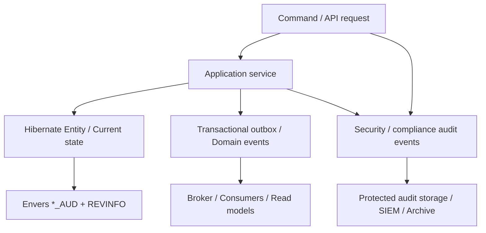
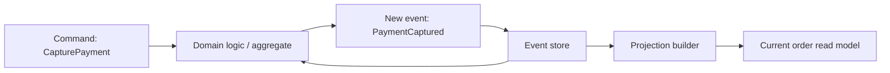

# Phân biệt Envers, event sourcing và nhật ký phục vụ tuân thủ

Khi xây dựng ứng dụng Java với Hibernate, một yêu cầu quen thuộc là: **“Cần lưu lịch sử mọi thay đổi để sau này biết chuyện gì đã xảy ra.”** Câu này nghe đơn giản nhưng có thể đại diện cho ba nhu cầu rất khác nhau:

1. Muốn biết **một entity trong database đã có trạng thái gì ở một thời điểm hoặc revision trước đây**.
2. Muốn mô hình hóa toàn bộ nghiệp vụ bằng **chuỗi sự kiện đã xảy ra**, từ đó xây dựng lại trạng thái hiện tại.
3. Muốn có **bằng chứng kiểm toán và truy vết** ai đã thực hiện hành động nào, khi nào, vì sao, có thành công hay không, và bản ghi có bị sửa/xóa trái phép không.

Ba hướng tiếp cận phổ biến tương ứng là:

- **Hibernate Envers:** audit lịch sử thay đổi của các entity JPA/Hibernate được đánh dấu theo dõi.
- **Event sourcing:** lưu các sự kiện nghiệp vụ không thể bỏ qua làm nguồn sự thật để tính lại trạng thái.
- **Nhật ký phục vụ tuân thủ** (*compliance/security audit log*): thu thập bằng chứng theo các yêu cầu bảo mật, pháp lý, nội bộ và vận hành; thường cần khả năng chống giả mạo, phân quyền độc lập và retention rõ ràng.

Chúng có thể cùng tồn tại nhưng **không có cái nào tự động thay thế hoàn toàn hai cái còn lại**.

Ví dụ: một đơn hàng chuyển từ `DRAFT` sang `PAID`. Envers có thể lưu bản sao giá trị `status=PAID` ở revision mới. Event sourcing có thể lưu sự kiện `PaymentCaptured` chứa định danh giao dịch thanh toán và quyết định nghiệp vụ. Audit log có thể lưu bằng chứng rằng request của người dùng X với quyền Y đã gửi lệnh xác nhận thanh toán, kết quả authorization và correlation ID — kể cả khi request bị từ chối và không hề có entity update.

**Đích học của bài:** hiểu rõ nguồn sự thật, loại thông tin được lưu, phạm vi quan sát, cơ chế truy vấn và mức tin cậy của từng cách; biết chọn công nghệ theo yêu cầu thực tế, thiết kế kết hợp khi cần, và tránh dùng Envers như một “event store” hoặc một hệ thống compliance log mặc định.

> **Bối cảnh phiên bản:** ví dụ dùng Jakarta Persistence và Hibernate Envers theo cách dùng phổ biến trên Hibernate 6.x/7.x. Hibernate 5.x thường dùng namespace `javax.persistence`, dependency/một số API/configuration khác. Cần kiểm tra Javadocs và migration guide đúng phiên bản đang chạy, nhất là khi tự tạo revision entity, cấu hình audit strategy hoặc xử lý lazy associations.

---

## 1. Trả lời nhanh: ba cơ chế trả lời ba câu hỏi khác nhau

| Câu hỏi | Envers | Event sourcing | Audit log phục vụ tuân thủ |
| --- | --- | --- | --- |
| “Entity Order#10 có giá trị gì trước lần sửa?” | Rất phù hợp | Có thể tái dựng bằng replay | Có thể, nếu log lưu đủ dữ liệu |
| “Vì sao Order được thanh toán?” | Không nhất thiết biết | Sự kiện nghiệp vụ có thể giải thích | Ghi actor/lý do/quyết định, nếu được thiết kế |
| “Tính lại state từ đầu được không?” | Không phải mục đích thiết kế | Là nguyên tắc trung tâm | Không phải mặc định |
| “Ai đọc hồ sơ nhạy cảm này?” | Không theo dõi SELECT thông thường | Không tự theo dõi đọc | Phải ghi bằng cơ chế access audit |
| “Ai thử sửa nhưng bị từ chối?” | Không có entity change thì thường không có revision | Thường không có domain event thành công | Có thể/đôi khi phải ghi cả failed attempt |
| “Có bằng chứng bản ghi không bị sửa bởi DBA?” | Không tự bảo đảm | Không tự bảo đảm | Cần các kiểm soát bảo vệ tính toàn vẹn |
| “Có thể rollback transaction ghi không?” | Audit row thường rollback cùng entity | Event append cũng có transaction semantics | Failure/security logs có thể cần ghi độc lập |
| “Ai là nguồn sự thật?” | Thường là các bảng entity hiện tại | Event stream | Phụ thuộc phạm vi chứng cứ, không mặc định là nguồn domain state |

**Quy tắc thực hành:** trước khi chọn công nghệ, hãy viết lại yêu cầu dưới dạng một câu hỏi có thể kiểm chứng, thay vì dùng từ “audit” chung chung.

## 2. Ba tầng dữ liệu trong một ứng dụng

Một hệ thống có thể có sơ đồ:



Đây là sơ đồ **hệ thống kết hợp**, không phải mô hình bắt buộc mọi ứng dụng đều cần.

- Các bảng entity chứa **trạng thái hiện tại**.
- Các bảng Envers chứa **lịch sử revision của những entity đã audited**.
- Event store chứa **các sự kiện nghiệp vụ** nếu kiến trúc chọn event sourcing.
- Outbox có thể chuyển domain/integration events sang broker một cách đáng tin; chỉ dùng outbox **không có nghĩa hệ thống là event-sourced**.
- Security/compliance log lưu **bằng chứng tương tác, truy cập và kết quả xử lý** theo yêu cầu kiểm soát.

Một thiết kế đơn giản có thể chỉ cần bảng entity và Envers. Một hệ thống tài chính hoặc có yêu cầu truy vết nghiêm ngặt có thể cần cả nhật ký riêng và event-oriented architecture.

## 3. Từ vựng cơ bản

### Current state

Trạng thái hiện tại được query trực tiếp từ bảng nghiệp vụ, ví dụ:

```sql
SELECT id, status, total_amount
FROM purchase_orders
WHERE id = 10;
```

### Revision

Một lần thay đổi được Envers ghi nhận theo **revision number** và metadata liên quan. Nhiều audited entities được thay đổi trong cùng transaction thường chia sẻ một revision.

### Audit row

Một bản ghi trong bảng audit của một entity, chẳng hạn `purchase_orders_AUD`. Nó mang state của entity ở revision tương ứng theo chiến lược lưu trữ.

### Domain event

Một **sự kiện nghiệp vụ đã xảy ra**, có ý nghĩa domain, ví dụ `PaymentCaptured`, `OrderCancelled` hoặc `CreditLimitChanged`.

### Event stream

Chuỗi events cho một aggregate/stream identity, được append theo thứ tự với quy tắc concurrency.

### Projection/read model

Dữ liệu được xây từ event stream hoặc query để phục vụ đọc. Trong event sourcing, current state thường là kết quả replay/snapshot+replay.

### Compliance/security audit record

Thông tin có thể dùng làm chứng cứ: actor, action, resource, thời điểm, kết quả, lý do, nguồn, correlation ID, và bằng chứng về nguồn gốc/tính toàn vẹn.

**Revision**, **domain event** và **audit record** không phải ba tên cho cùng một object.

## 4. Ví dụ xuyên suốt: đơn hàng được thanh toán

Giả sử một đơn hàng có:

```text
Order ID: 10
Status: DRAFT
Total: 250.00 USD
```

Một request thanh toán dẫn tới:

```text
DRAFT -> PAID
Payment reference: pay_abc_123
Actor: user-42
Request: req-9fe
```

Ba cách ghi thông tin:

**Envers** có thể lưu:

```text
REV=102, REVTYPE=MOD
order_id=10, status=PAID, total_amount=250.00
```

**Event sourcing** có thể lưu:

```json
{
  "eventId": "evt-1002",
  "streamId": "order-10",
  "streamVersion": 7,
  "eventType": "PaymentCaptured",
  "schemaVersion": 2,
  "payload": {
    "paymentId": "pay_abc_123",
    "amount": "250.00",
    "currency": "USD"
  }
}
```

**Audit log** có thể lưu:

```json
{
  "auditEventId": "audit-88",
  "actorId": "user-42",
  "action": "order.capture-payment",
  "resourceId": "order-10",
  "requestId": "req-9fe",
  "outcome": "SUCCESS",
  "occurredAt": "2026-11-15T07:10:00Z",
  "policyVersion": "payments-v3"
}
```

Các giá trị trên là dữ liệu **minh họa**. Một bản ghi tuân thủ thật cần schema, phân quyền, nguồn thời gian, integrity controls, retention và validation phù hợp.

Khác biệt lớn nhất: Envers cho thấy **state thay đổi thế nào**; event sourcing ghi **business fact nào khiến state thay đổi**; audit log cố gắng chứng minh **hành động và người/nguồn thực hiện trong bối cảnh nào**.

---

## 5. Envers hoạt động ở tầng nào?

Hibernate Envers là module mở rộng lịch sử cho các entity JPA/Hibernate.

Khi entity/field được đánh dấu `@Audited` và thay đổi thông qua lifecycle ORM được Envers hỗ trợ, Envers ghi lịch sử vào các bảng audit trong cùng đơn vị transaction tương ứng.

Ví dụ:

```java
import jakarta.persistence.*;
import org.hibernate.envers.Audited;
import org.hibernate.envers.NotAudited;

import java.math.BigDecimal;

@Entity
@Audited
@Table(name = "purchase_orders")
public class PurchaseOrder {

    @Id
    private Long id;

    @Column(nullable = false)
    private String orderNumber;

    @Enumerated(EnumType.STRING)
    private OrderStatus status;

    @Column(nullable = false, precision = 19, scale = 2)
    private BigDecimal totalAmount;

    @NotAudited
    private String ephemeralUiHint;

    protected PurchaseOrder() {}

    public OrderStatus getStatus() {
        return status;
    }

    public void markPaid() {
        if (status != OrderStatus.DRAFT) {
            throw new IllegalStateException(
                "Chỉ đơn DRAFT mới được thanh toán"
            );
        }

        status = OrderStatus.PAID;
    }
}
```

Trong ví dụ:

- Entity được audit nhờ `@Audited`.
- `status`, `totalAmount` và những thuộc tính được audit khác có thể có state lịch sử.
- `ephemeralUiHint` không được Envers audit vì `@NotAudited`.
- Không có yêu cầu nghiệp vụ đặt domain event type hoặc event stream chỉ để Envers hoạt động.

**Envers là cơ chế lưu lịch sử ORM-managed state**, không phải một service ghi mọi thao tác đối với database.

## 6. Dependency Envers phải khớp Hibernate ORM

Với Hibernate ORM 6/7, artifact thông dụng là:

```kotlin
dependencies {
    implementation("org.hibernate.orm:hibernate-envers")
}
```

Khi dùng Spring Boot BOM/dependency management phù hợp, version có thể được quản lý tập trung. Nếu khai version thủ công, `hibernate-envers` và `hibernate-core` cần tương thích, thường cùng dòng version.

Với Hibernate 5, tọa độ dependency và namespace có thể khác. Không trộn `hibernate-envers` 5.x với `hibernate-core` 6.x.

Bật Envers không đồng nghĩa Hibernate tự audit mọi entity: phải cấu hình mapping/thành phần thực tế theo công nghệ đang dùng. Trong ứng dụng production, schema audit table nên được tạo bởi migration kiểm soát được, thay vì tự động `hbm2ddl.auto=update` không qua review.

## 7. Envers tạo những bảng gì?

Với mapping mặc định, có thể thấy:

```text
purchase_orders          -- bảng current state
purchase_orders_AUD      -- lịch sử trạng thái đã audit
REVINFO                  -- metadata về revisions
```

Tên thực tế có thể được tùy biến bằng annotation/property và naming strategy.

Một audit row thường có:

| Cột | Vai trò |
| --- | --- |
| `id` | Identifier của entity được audit |
| `REV` | Revision number |
| `REVTYPE` | Loại thay đổi: add, modify, delete |
| `status` | Giá trị trạng thái của entity tại revision |
| `total_amount` | Giá trị thuộc tính được audit |
| Các cột khác | State của những thuộc tính audit phù hợp mapping |

Bảng revision metadata có thể chứa:

| Cột | Vai trò |
| --- | --- |
| `REV` | Revision identifier |
| `REVTSTMP` | Timestamp của revision |
| Thuộc tính bổ sung | Actor, tenant, correlation ID... nếu custom revision entity |

Đây là cấu trúc khái niệm. Với association/mapping phức tạp, Envers có thể sinh thêm audit join tables; tên cột, khóa và indexing phụ thuộc schema/mapping.

### `REVTYPE`

Các giá trị enum Envers:

- `ADD`: entity được thêm.
- `MOD`: entity bị sửa.
- `DEL`: entity bị xóa.

Không hiểu `REVTYPE=MOD` như “PaymentCaptured”. Nó chỉ nói có một **entity modification**, không giải thích domain cause.

## 8. Một revision không đồng nghĩa một API request

Trong một transaction:

```java
@Transactional
public void payOrder(Long orderId) {
    PurchaseOrder order = em.find(
        PurchaseOrder.class,
        orderId
    );

    order.markPaid();

    Payment payment = new Payment(orderId);
    em.persist(payment);
}
```

Nếu cả Order và Payment đều được audited, Envers có thể ghi nhiều audit rows thuộc **cùng một revision number** cho các thay đổi audited trong transaction.

Một request có thể khởi tạo nhiều transactions; một transaction có thể xử lý nhiều commands; hệ thống có thể chạy background job không gắn HTTP request.

Do đó không suy:

```text
1 HTTP request = 1 revision = 1 domain event
```

Chúng là các ranh giới khác nhau.

### Timestamp revision không phải timestamp pháp lý chắc chắn

Timestamp revision thường phản ánh thời điểm Hibernate tạo revision metadata, không mặc định là **thời điểm commit thực tế được hệ thống chứng thực** hoặc “thời điểm người dùng ấn nút”.

Nếu cần thứ tự commit, transaction ID, nguồn giờ tin cậy hoặc timestamp chứng thực, phải thiết kế thêm.

## 9. Đọc entity ở một revision cụ thể

Envers cung cấp `AuditReader`:

```java
import org.hibernate.envers.AuditReader;
import org.hibernate.envers.AuditReaderFactory;

AuditReader reader = AuditReaderFactory.get(entityManager);

PurchaseOrder oldOrder = reader.find(
    PurchaseOrder.class,
    orderId,
    revisionNumber
);
```

Ý nghĩa: đọc state lịch sử của PurchaseOrder theo revision yêu cầu, nếu entity tồn tại ở revision đó theo Envers semantics.

`reader.find(...)` **không** tự đảo ngược các giao dịch đã xảy ra. Kết quả phục vụ đọc, so sánh và tạo DTO lịch sử.

Để liệt kê revisions:

```java
List<Number> revisions = reader.getRevisions(
    PurchaseOrder.class,
    orderId
);
```

Có thể dùng số revision để xây màn hình “Xem các lần thay đổi”.

### Lịch sử không phải bản ghi “before/after” do Envers tự giải thích

Bạn có thể so sánh state tại revision trước và sau:

```java
PurchaseOrder before = reader.find(
    PurchaseOrder.class, id, revBefore
);

PurchaseOrder after = reader.find(
    PurchaseOrder.class, id, revAfter
);
```

Nhưng lý do chuyển trạng thái, lệnh nào được gửi, external payment reference hoặc actor không nhất thiết có trong hai snapshots.

## 10. Query lịch sử và loại thay đổi

Có thể query các revisions bằng `AuditQuery`:

```java
import org.hibernate.envers.AuditReader;
import org.hibernate.envers.AuditReaderFactory;
import org.hibernate.envers.RevisionType;
import org.hibernate.envers.query.AuditEntity;

AuditReader reader = AuditReaderFactory.get(em);

@SuppressWarnings("unchecked")
List<Object[]> changes = reader.createQuery()
    .forRevisionsOfEntity(
        PurchaseOrder.class,
        false, // trả entity + revision metadata + revision type
        true   // include deleted revisions
    )
    .add(AuditEntity.id().eq(orderId))
    .addOrder(AuditEntity.revisionNumber().asc())
    .getResultList();

for (Object[] change : changes) {
    PurchaseOrder snapshot = (PurchaseOrder) change[0];
    Object revisionMetadata = change[1];
    RevisionType type = (RevisionType) change[2];

    // Chuyển snapshot + type + metadata thành DTO lịch sử.
}
```

Khi tham số `selectEntitiesOnly=false`, Envers trả tuple gồm entity snapshot, revision entity và revision type theo query API tương ứng.

Một màn hình audit trail cần phân trang và giới hạn dữ liệu: không trả tất cả lịch sử của một aggregate có hàng triệu revisions trong một request.

### Query theo revision hay theo wall-clock time?

`REV` là revision number logic. Có thể tìm các revision theo thời gian qua AuditReader/revision metadata, nhưng không được mặc định revision timestamp tương đương commit timestamp hay có thứ tự thời gian hoàn hảo giữa mọi node.

Nếu báo cáo đòi thời điểm sự kiện nghiệp vụ phát sinh (*effective time*), cần ghi thuộc tính đó riêng.

## 11. Audit strategy: Default và Validity

Envers có hai chiến lược audit phổ biến.

| Chiến lược | Cách biểu diễn hiệu lực | Đánh đổi |
| --- | --- | --- |
| `DefaultAuditStrategy` | Tìm audit row có revision lớn nhất không vượt revision cần đọc | Ghi đơn giản; truy vấn as-of có thể dùng subquery |
| `ValidityAuditStrategy` | Ghi thời điểm bắt đầu/end revision cho mỗi khoảng hiệu lực | Query as-of có thể đơn giản/nhanh hơn; ghi cần cập nhật audit row trước |

### Default

Khái niệm:

```text
Order#10:
REV 1: DRAFT
REV 4: CONFIRMED
REV 9: PAID

Tại REV 6 -> CONFIRMED
```

Envers phải chọn row audit gần nhất không vượt `REV=6` và kiểm tra deletion semantics.

### Validity

Khái niệm:

```text
REV_START=1, REV_END=4: DRAFT
REV_START=4, REV_END=9: CONFIRMED
REV_START=9, REV_END=NULL: PAID
```

DB có thể tìm khoảng revision chứa thời điểm cần đọc.

Cấu hình Hibernate-specific:

```properties
spring.jpa.properties.org.hibernate.envers.audit_strategy=org.hibernate.envers.strategy.ValidityAuditStrategy
```

Tên property/class và schema phải kiểm tra theo phiên bản. Chuyển từ Default sang Validity với bảng audit đã có dữ liệu không đơn thuần là thay property: có thể cần migration/backfill `REVEND` và indexes.

**Không chọn Validity chỉ vì tin rằng nó “phù hợp pháp lý hơn”.** Đây là lựa chọn cơ chế lưu trữ/truy vấn lịch sử, không phải cấp độ chứng cứ.

## 12. Envers lưu state hay delta?

Envers thường lưu state của audited properties tại các revisions. Nó không mặc định lưu một event nghiệp vụ có hành vi, lý do và toàn bộ input của command.

Ví dụ:

```text
REV 30: status=DRAFT, total=250
REV 31: status=PAID,  total=250
```

Từ hai row có thể suy ra `status` đổi, nhưng không suy ra:

- Thanh toán bằng thẻ hay chuyển khoản?
- Có bao nhiêu lần retry?
- Payment gateway đã trả result nào?
- User nào phê duyệt?
- Thanh toán thành công trước hay sau khi reserve inventory?
- Vì sao business rule cho phép chuyển status?

Một số thông tin có thể được bổ sung bằng revision metadata hoặc entity fields, nhưng **audit snapshot không tự mang đầy đủ causal domain semantics**.

### Modification flags

Envers hỗ trợ modification flags cho thuộc tính, ví dụ:

```java
@Audited(withModifiedFlag = true)
@Entity
public class PurchaseOrder {
    // ...
}
```

Có thể truy vấn một property đã thay đổi bằng API như:

```java
reader.createQuery()
    .forRevisionsOfEntity(PurchaseOrder.class, false, true)
    .add(AuditEntity.property("status").hasChanged());
```

Điều này giúp biết field nào changed, nhưng không biến snapshot thành `PaymentCaptured` event. Tên các cột flag và support query phụ thuộc mapping/configuration.

## 13. Thêm actor, request ID và lý do vào Envers

Envers default revision metadata **không tự biết authenticated user, ticket, mục đích thay đổi**. Bạn có thể mở rộng revision entity bằng `@RevisionEntity` và `RevisionListener`.

Ví dụ cấu trúc:

```java
import jakarta.persistence.Column;
import jakarta.persistence.Entity;
import jakarta.persistence.Table;

import org.hibernate.envers.DefaultRevisionEntity;
import org.hibernate.envers.RevisionEntity;

@Entity
@Table(name = "app_revision")
@RevisionEntity(ActorRevisionListener.class)
public class AppRevision extends DefaultRevisionEntity {

    @Column(name = "actor_id", length = 128)
    private String actorId;

    @Column(name = "request_id", length = 128)
    private String requestId;

    public String getActorId() {
        return actorId;
    }

    public void setActorId(String actorId) {
        this.actorId = actorId;
    }

    public String getRequestId() {
        return requestId;
    }

    public void setRequestId(String requestId) {
        this.requestId = requestId;
    }
}
```

Revision listener:

```java
import org.hibernate.envers.RevisionListener;

public class ActorRevisionListener
        implements RevisionListener {

    @Override
    public void newRevision(Object revisionEntity) {
        AppRevision revision = (AppRevision) revisionEntity;

        revision.setActorId(
            AuditContext.currentActorIdOrSystem()
        );

        revision.setRequestId(
            AuditContext.currentRequestIdOrNull()
        );
    }
}
```

`AuditContext` ở ví dụ là **một adapter do ứng dụng phải triển khai**; nó không phải class của Hibernate. Có thể tích hợp Spring Security/context propagation theo contract của ứng dụng.

### Những lưu ý bắt buộc

- Revision listener có thể được gọi trong transaction/flush lifecycle; không dựa vào việc nó chạy đúng lúc controller bắt đầu.
- Request context và thread-local có thể **không tồn tại** trong scheduled jobs, async tasks hoặc message consumers.
- Actor ID phải đến từ nguồn đã được authentication/authorization xác thực; không tin giá trị client gửi tùy ý.
- Một revision chứa nhiều entity changes trong cùng transaction, nên metadata ở revision level không thay thế thông tin actor cho từng operation nếu một transaction phục vụ nhiều actors (một thiết kế thường cần tránh).
- Không gửi email, Kafka hoặc gọi remote service từ `newRevision(...)`.
- Nếu actor/context thiếu ở một action cần compliance, phải có policy chặn hoặc đánh dấu lỗi; không âm thầm ghi `"unknown"` rồi coi đã đạt yêu cầu.

Custom revision metadata giúp lịch sử Envers hữu ích hơn nhưng vẫn chưa tạo ra **bằng chứng bất biến và đầy đủ** của compliance audit.

## 14. Envers không ghi SELECT/read access

Envers chủ yếu quan sát những thay đổi state của audited entities thông qua ORM. Một request chỉ đọc:

```java
@Transactional(readOnly = true)
public CustomerDto viewCustomer(Long id) {
    Customer customer = em.find(Customer.class, id);
    return mapToDto(customer);
}
```

không khiến Envers tự tạo revision chỉ vì có người đọc một hồ sơ.

Trong hệ thống có yêu cầu:

- Ai đã xem thông tin lương?
- Ai đã xuất danh sách khách hàng?
- Ai đã tải hồ sơ y tế?
- Ai đã xem dữ liệu của tenant khác?
- Có bao nhiêu lần đọc bị từ chối?

cần **access audit** riêng tại API/security/query boundary, không chỉ `@Audited`.

### Bài toán “đọc” còn khó hơn “ghi”

Một câu SQL SELECT có thể trả hàng nghìn rows. DB audit ở mức statement biết câu query nhưng có thể không biết ứng dụng đã tiết lộ trường dữ liệu nào sau khi áp authorization/filter. API audit biết user và endpoint nhưng có thể không có toàn bộ IDs.

Cần xác định granularity của bằng chứng:

- Request/resource-level.
- Record-level.
- Field-level hoặc category-level.
- Export/bulk retrieval.
- Administrative data access.

Chi phí, privacy và khả năng bảo vệ log sẽ rất khác nhau.

## 15. Envers không mặc định bắt mọi đường ghi database

Một số đường cập nhật có thể bỏ qua entity lifecycle:

- JPQL/HQL bulk UPDATE/DELETE.
- Native SQL qua `EntityManager.createNativeQuery` hoặc `Session.doWork`.
- JDBC thuần.
- Database trigger.
- ETL/import chạy ngoài Hibernate.
- Service khác ghi chung database.
- DBA/manual SQL.
- Stored procedure có side effects.

Ví dụ:

```java
em.createQuery(
    "update PurchaseOrder o " +
    "set o.status = :newStatus " +
    "where o.status = :oldStatus"
)
.setParameter("newStatus", OrderStatus.CANCELLED)
.setParameter("oldStatus", OrderStatus.DRAFT)
.executeUpdate();
```

HQL bulk DML được thực hiện trực tiếp trên database và **không đồng nghĩa Envers ghi từng entity revision như khi update managed entity**.

Nếu ứng dụng dùng bulk DML, không được quảng bá rằng “Envers theo dõi mọi thay đổi trong bảng” trừ khi hệ thống có một cơ chế bổ sung để audit những đường ghi ấy.

### Tại sao đây là giới hạn thiết kế?

Envers tích hợp với persistence events của Hibernate để biết entity nào đã thay đổi. Một SQL UPDATE có predicate phức tạp có thể ảnh hưởng hàng triệu rows mà Hibernate không materialize mỗi entity. Để thu đầy đủ history ở database level, có thể cần DB trigger, CDC, temporal tables hoặc giải pháp auditing khác.

Ngay cả khi dùng DB triggers/CDC, vẫn cần giải quyết actor identity, integrity, tính đầy đủ và compliance semantics.

## 16. Envers và transaction rollback

Nếu trong một transaction:

```java
@Transactional
public void cancelOrder(Long id) {
    PurchaseOrder order = em.find(
        PurchaseOrder.class,
        id
    );

    order.cancel();

    throw new BusinessException("Không thể hoàn tất");
}
```

và outer transaction rollback theo policy, cả thay đổi entity lẫn Envers audit writes thuộc transaction đó thông thường đều được rollback.

Đây là điều tốt cho **lịch sử trạng thái đã commit**: không lưu một revision thể hiện thay đổi DB không bao giờ thành công.

Nhưng với **compliance/security**, request bị từ chối hoặc transaction thất bại vẫn có thể cần lưu bằng chứng:

```text
User X cố hủy Order#10
Authorization: DENIED
Entity state: không đổi
Envers revision: không có
Security audit event: có thể bắt buộc ghi
```

Vì vậy không nên phụ thuộc Envers để ghi mọi unsuccessful attempt.

### Đừng ghi compliance audit “trong cùng transaction” rồi nghĩ sẽ còn sau rollback

Nếu gọi `auditRepository.save(...)` cùng transaction nghiệp vụ và transaction rollback, audit record đó cũng có thể biến mất.

Đối với failure/denial log, cần cơ chế ghi có failure isolation/acknowledgement phù hợp, ví dụ audit pipeline độc lập với action bị từ chối, có độ bền và cơ chế theo dõi lỗi.

Ngược lại, nếu audit sự kiện `OrderPaid` khẳng định đã commit, phát nó **trước commit** vào pipeline độc lập cũng nguy hiểm vì có thể lưu sự kiện thành công của transaction về sau rollback. Phải phân loại **attempt** với **committed outcome**.

---

## 17. Event sourcing là gì?

Event sourcing là một cách tổ chức persistence trong đó **chuỗi domain events đã xảy ra** là nguồn sự thật của trạng thái aggregate.

Thay vì:

```sql
UPDATE purchase_orders
SET status = 'PAID'
WHERE id = 10;
```

là nguồn duy nhất của sự thật, hệ thống ghi một domain fact:

```text
OrderPlaced
LineAdded
PaymentAuthorized
PaymentCaptured
```

Trạng thái hiện tại có thể được tính bằng cách áp dụng lần lượt events.



Về nguyên tắc, event store là **bản ghi có thẩm quyền**; current-state table là projection/cache/read model có thể tái tạo từ event history (nếu events và các phụ thuộc cần thiết được giữ đầy đủ).

### “Event” ở đây phải có ý nghĩa nghiệp vụ

```text
Good:
PaymentCaptured(paymentId, amount, currency)
OrderCancelled(reason)
AddressChanged(old/new or meaningful new address)

Weak:
OrderRowUpdated
FieldStatusSetToPaid
EntityDirty
```

Các dạng kỹ thuật không nhất thiết sai, nhưng nếu event store chỉ lưu “entity updated” kèm serialized snapshot mà không có semantics, lợi ích lớn nhất của event sourcing sẽ giảm mạnh.

## 18. Một aggregate được khôi phục từ events

Một mô hình Java rất giản lược:

```java
sealed interface OrderEvent
        permits OrderOpened, PaymentCaptured,
                OrderCancelled {}

record OrderOpened(
    long orderId,
    BigDecimal totalAmount
) implements OrderEvent {}

record PaymentCaptured(
    String paymentId
) implements OrderEvent {}

record OrderCancelled(
    String reason
) implements OrderEvent {}
```

Domain state:

```java
public final class OrderState {

    private boolean exists;
    private boolean paid;
    private boolean cancelled;
    private BigDecimal totalAmount;

    public void apply(OrderEvent event) {
        if (event instanceof OrderOpened opened) {
            exists = true;
            totalAmount = opened.totalAmount();
        } else if (event instanceof PaymentCaptured) {
            paid = true;
        } else if (event instanceof OrderCancelled) {
            cancelled = true;
        } else {
            throw new IllegalArgumentException(
                "Unsupported event: " + event
            );
        }
    }

    public static OrderState from(
            List<OrderEvent> events) {
        OrderState state = new OrderState();

        for (OrderEvent event : events) {
            state.apply(event);
        }

        return state;
    }
}
```

Mẫu trên minh họa replay, **không phải production state machine đầy đủ**. Nó chưa kiểm tra thứ tự, “không thể thanh toán order đã hủy”, event IDs, schema evolution, aggregate version hoặc nhiều đồng tiền.

### Command ≠ event

- Command: “Hãy thanh toán đơn hàng”.
- Domain event: “Thanh toán đã được ghi nhận thành công”.

Một command có thể bị từ chối, không sinh event thành công nào. Hoặc một command có thể sinh nhiều domain events trong cùng transaction.

## 19. Event store phải có hợp đồng append và concurrency

Một event stream thường chứa:

| Field | Vai trò |
| --- | --- |
| `event_id` | Định danh event, hỗ trợ deduplication |
| `stream_id` | Aggregate/stream identifier |
| `stream_version` | Vị trí/phiên bản trong stream |
| `event_type` | Tên loại domain fact |
| `schema_version` | Phiên bản payload |
| `payload` | Dữ liệu cần replay/consume |
| `metadata` | Actor/correlation/causation, theo contract |
| `recorded_at` | Thời điểm lưu, theo nguồn đồng hồ được chọn |

Ví dụ DDL quan niệm:

```sql
CREATE TABLE order_events (
    event_id VARCHAR(80) PRIMARY KEY,
    stream_id VARCHAR(80) NOT NULL,
    stream_version BIGINT NOT NULL,
    event_type VARCHAR(100) NOT NULL,
    schema_version INTEGER NOT NULL,
    payload_json TEXT NOT NULL,
    recorded_at TIMESTAMP NOT NULL,
    UNIQUE (stream_id, stream_version)
);
```

Đây là **schema minh họa**. Production event stores còn cần lưu metadata, indexes, retention/partitioning, payload serialization, uniqueness/idempotency, atomic append và safeguards cho multi-tenant.

### Optimistic concurrency

Giả sử stream `order-10` có version 7. Hai commands đồng thời muốn append version 8:

```text
Command A: expectedVersion=7
Command B: expectedVersion=7
```

Chỉ một append nên được chấp nhận; command kia phải reload/re-evaluate business invariants hoặc báo conflict.

Không giải quyết bằng cách đọc `MAX(stream_version)+1` rồi INSERT không có uniqueness/transaction protocol. Unique index là rào chắn cuối, nhưng application cần expected-version check và retry policy đúng.

## 20. Replay khác đọc snapshot Envers

**Envers:**

```text
REV 10 -> OrderState {DRAFT, 250}
REV 20 -> OrderState {PAID, 250}
```

Muốn đọc trạng thái ở REV 20, query bản lịch sử tương ứng.

**Event sourcing:**

```text
OrderOpened(250)
LineAdded(...)
PaymentAuthorized(...)
PaymentCaptured(...)
    |
    v
apply tất cả events theo thứ tự
    |
    v
OrderState {PAID, 250}
```

Sự khác biệt:

- Envers có **historical state snapshots/revisions** sau các ORM changes.
- Event sourcing có **facts và state transition logic**.
- Event sourcing có thể tính lại read models theo một projection mới, miễn events chứa đủ thông tin.
- Envers có thể so sánh field changes nhưng không bảo đảm đủ domain semantics để tái chạy business model.

### Không “replay side effects” bừa bãi

Khi rebuild event-sourced state, `apply(event)` phải là phép biến đổi state deterministic và **không gửi email, gọi payment gateway hoặc phát hành hàng** một lần nữa.

Side effects được xử lý ở command/workflow boundary hoặc projection consumer có idempotency. Replay events là tính lại state, không phải thực hiện lại nghiệp vụ ngoài thế giới.

## 21. Snapshot trong event sourcing không làm event store biến mất

Event stream lớn có thể khiến replay từ đầu tốn thời gian. Event-sourced systems thường tạo snapshots:

```text
Snapshot at streamVersion=10,000
  + Events 10,001..10,123
  = Current state at 10,123
```

Snapshot là **tối ưu khôi phục**, không phải thay thế event history trong những hệ thống yêu cầu event store đầy đủ.

Cần lưu:

- Snapshot schema version.
- Last included event version.
- Aggregate type/identity.
- Checksum/validation nếu thiết kế yêu cầu.
- Chính sách invalidation khi business rules/upcasters thay đổi.

Nếu snapshot thiếu/tệ, hệ thống vẫn nên có con đường khôi phục từ events hợp lệ, trong phạm vi retention được cam kết.

## 22. Event sourcing có chi phí phát triển và vận hành lớn

Không nên đưa event sourcing vào mọi CRUD service chỉ vì muốn lịch sử.

Một số chi phí:

- Thiết kế event types có ý nghĩa domain bền vững.
- Expected-version optimistic concurrency.
- Idempotency và duplicate event handling.
- Event schema evolution/upcasters.
- Snapshot/replay performance.
- Read projections và consistency delay.
- Rebuild projections sau đổi logic.
- Event ordering, partitioning và causal relationships.
- GDPR/privacy, retention và quyền xóa trong append-only stream.
- Monitoring corrupt streams, missing events và replay drift.
- Khả năng audit có chứng cứ độc lập nếu có requirement tuân thủ.

Với một ứng dụng quản lý nội bộ chỉ cần “xem giá trị hồ sơ trước lần cập nhật”, Envers thường là lựa chọn nhỏ hơn và có lợi hơn so với chuyển toàn bộ persistence sang event sourcing.

## 23. Domain events trong CRUD không đồng nghĩa event sourcing

Một service có thể lưu entity hiện tại:

```java
@Transactional
public void markPaid(Long orderId) {
    PurchaseOrder order = em.find(
        PurchaseOrder.class,
        orderId
    );

    order.markPaid();

    outbox.save(
        PaymentCapturedEvent.of(orderId)
    );
}
```

Nếu `purchase_orders` vẫn là **nguồn sự thật**, còn `PaymentCapturedEvent` chỉ dùng để thông báo cho hệ thống khác, đây là một kiến trúc CRUD + domain/integration events + outbox — **không phải event sourcing** theo nghĩa đầy đủ.

### Đừng đánh đồng event-driven architecture và event sourcing

| Event-driven | Event-sourced |
| --- | --- |
| Hệ thống phát/nhận events để phối hợp services | Event stream là nguồn sự thật để dựng lại state |
| State có thể lưu trong bảng CRUD truyền thống | State hiện tại được diễn giải từ events |
| Event retention có thể ngắn hoặc theo integration policy | Events cần được giữ đủ để rebuild theo contract |
| Có thể không replay state | Replay/rebuild là năng lực cốt lõi |
| Dễ thêm vào một service CRUD | Đòi thay đổi cách mô hình hóa persistence |

Một hệ thống có thể **vừa event-driven vừa event-sourced**, nhưng hai nhãn không thay thế nhau.

## 24. Envers có thể cùng tồn tại với event sourcing không?

Có, nhưng nên biết mình đang lưu cái gì để tránh trùng lặp vô ích.

Một hệ thống event-sourced có thể:

- Lưu events làm nguồn sự thật.
- Xây các projection vào relational tables.
- Dùng Hibernate để đọc/ghi projection.
- Dùng Envers cho một số projection tables nếu cần xem lịch sử thay đổi cách projection được áp dụng.

Tuy nhiên Envers history của projection **không phải nguồn sự thật gốc**. Nếu rebuild projection từ events, audit entries của projection có thể bị thay đổi/nhân lên tùy cách rebuild. Vì vậy có thể cần loại trừ auditing trong replay process hoặc phân biệt rebuild revisions với business changes.

Ngược lại, một hệ thống CRUD có Envers có thể phát business events, nhưng không vì thế đã chuyển sang event sourcing.

### Chọn một canonical source of truth

Không nên có hai nguồn sự thật cạnh tranh:

```text
Order table nói PAID
Event stream nói CANCELLED
Cả hai đều được coi là canonical
```

Cần xác định rõ aggregate nào canonical ở event store hay current-state DB; nguồn còn lại được cập nhật như projection/derived view với cơ chế reconciliation.

---

## 25. Nhật ký phục vụ tuân thủ là gì?

Trong bài này, *compliance audit log* là hệ thống ghi bằng chứng phục vụ những yêu cầu được xác định bởi tổ chức, khách hàng, ngành nghề hoặc pháp luật.

Nó khác với **application debug log**:

```text
DEBUG: findById(10) took 7 ms
```

và khác với **Envers revision**:

```text
REV 20, Order status=PAID
```

Một bản ghi kiểm toán có thể cần:

```text
Actor:
  người dùng, service account, role, session identity

Action:
  đọc/sửa/xóa/xuất dữ liệu, phê duyệt, đăng nhập, thay quyền

Target:
  loại tài nguyên và ID, tenant hoặc phạm vi dữ liệu

Context:
  request ID, IP/client context theo policy,
  business reason, approval/ticket reference

Time:
  event time, recorded time, time source

Outcome:
  SUCCESS / DENIED / FAILED / PARTIAL

Evidence:
  changed fields hoặc hashes trước/sau theo policy,
  revision/transaction correlation,
  integrity metadata

Control:
  lưu giữ, quyền truy cập, chống sửa/xóa, tìm kiếm/khôi phục
```

**Không phải mọi hệ thống cần lưu tất cả trường trên.** Danh sách thực tế phụ thuộc chính sách cụ thể; logging quá nhiều dữ liệu nhạy cảm cũng là rủi ro bảo mật và riêng tư.

## 26. Ghi cả những hành động không thay đổi entity

Các sự kiện mà Envers không tự ghi nhưng compliance có thể yêu cầu:

| Hành động | Có thay đổi JPA entity không? | Có thể cần audit log riêng không? |
| --- | --- | --- |
| Đăng nhập thất bại | Không | Có |
| Xem hồ sơ khách hàng | Không | Có nếu policy yêu cầu |
| Tải báo cáo chứa PII | Có thể không | Có |
| Thay đổi vai trò truy cập | Có thể có | Có, cả actor và approval |
| Request bị từ chối vì thiếu quyền | Không | Có |
| Truy xuất dữ liệu qua DBA SQL console | Không qua Hibernate | Có, qua DB/security tooling |
| Thay đổi cấu hình bảo mật | Không nhất thiết qua entity | Có |
| Gửi lệnh thanh toán rồi timeout | Có thể transaction không commit | Có, với outcome phân biệt |
| Background job xử lý dữ liệu | Có thể có | Có nếu phạm vi chính sách yêu cầu |
| Tạo/sửa tài khoản qua service | Có thể có | Có thể kết hợp Envers và security audit |

Do đó “chúng ta đã gắn `@Audited` cho tất cả entities” **không đủ** để tuyên bố đã đáp ứng mọi yêu cầu kiểm toán.

## 27. Tính toàn vẹn của audit log là thuộc tính vận hành

Một bảng `audit_log` trong cùng database với ứng dụng có thể hữu ích, nhưng nếu application account/DBA có quyền UPDATE/DELETE audit rows, thì nó không tự là bằng chứng chống sửa đổi.

Các lớp kiểm soát có thể cần:

- **Append-only access policy:** application chỉ được ghi thêm, không được sửa/xóa.
- **Tách quyền:** đội vận hành ứng dụng không cùng quyền xóa log chứng cứ.
- **Lưu trữ được bảo vệ:** object storage có retention lock/WORM tương ứng.
- **Transport bảo mật:** TLS, authentication giữa producer và collector.
- **Integrity protection:** hash chain, HMAC/signature hoặc external timestamp/anchor nếu threat model cần.
- **Centralization:** thu log từ app, DB, gateway, identity provider và infrastructure.
- **Monitoring:** alert mất heartbeat, log gap, producer errors hoặc integrity mismatch.
- **Backup/retention:** backup riêng, kiểm tra phục hồi, chính sách xóa theo yêu cầu pháp lý.
- **Audit truy cập log:** ai xem/export chính các bản ghi audit.

Không có một công cụ duy nhất tự cung cấp tất cả lớp bảo vệ này.

### Mối đe dọa phải được định nghĩa

Chống nhân viên application sửa log là một mức. Chống DBA có đặc quyền cao hay một cloud administrator bị xâm nhập là mức khác. Hash chain lưu cùng DB có thể bị kẻ nắm toàn DB tính lại. Muốn phát hiện việc đó, cần **anchor/chứng thực ngoài miền tin cậy có thể bị sửa**, cùng cơ chế xác minh độc lập.

## 28. Hash chain không tự chứng minh log đầy đủ

Ví dụ khái niệm:

```text
H0 = trusted initial anchor
H1 = HASH(H0 || canonicalize(record1))
H2 = HASH(H1 || canonicalize(record2))
H3 = HASH(H2 || canonicalize(record3))
```

Nếu ai đó sửa record2 mà không cập nhật chain, kiểm tra integrity có thể phát hiện.

Nhưng:

- Kẻ có quyền ghi toàn bộ chain có thể tính lại nếu không có external anchor/key protection.
- Nếu một sự kiện **không bao giờ được ghi**, hash chain không tự biết nó tồn tại ngoài đời.
- Không có thứ tự canonical ổn định sẽ khó xác minh.
- Timestamp do host bị xâm nhập tạo không tự trở thành trusted time.
- Hash plain không chứng minh ai tạo event; cần identity/signature hoặc các bằng chứng khác.

**Tamper-evident**, **tamper-resistant**, **complete**, **authentic** và **legally admissible** là các yêu cầu khác nhau. Không gắn chúng thành một checkbox “audit=true”.

## 29. Envers có chống tampering không?

Envers lưu trong database. Nó không tự đảm bảo:

- DBA không sửa/xóa audit tables.
- Một migration script không làm mất lịch sử.
- Application superuser không có quyền xóa audit rows.
- Một entity update ngoài ORM có audit row tương ứng.
- Audit entries không bị thiếu vì một producer thất bại.
- Chữ ký số/time-stamping độc lập.
- Retention bất biến theo thời hạn pháp lý.
- Evidence chain được một bên độc lập xác nhận.

Có thể áp thêm DB privileges, backup, CDC, exports, protected storage và monitoring để củng cố Envers. Nhưng **Envers đơn lẻ** nên được đánh giá là một **ORM history feature**, không phải giải pháp compliance hoàn chỉnh.

## 30. Event sourcing có tự chống tampering không?

Event sourcing thường được mô tả là *append-only*. Nhưng “application chỉ append” khác với “storage chống được sửa/xóa bởi người có đặc quyền”.

Một event store viết vào bảng SQL với quyền admin có thể vẫn bị thay đổi.

Để dùng event store như một phần chứng cứ compliance, có thể cần:

- Privilege model và append-only enforcement.
- Event ID, sequence, optimistic concurrency.
- Integrity checks và external anchors.
- Backups/protected archives.
- Retention đúng chính sách.
- Đối chiếu với nguồn bên ngoài.
- Ghi các attempt/read/denied actions mà event store domain không chứa.

**Nguồn sự thật nghiệp vụ** không mặc nhiên đồng nghĩa **nguồn chứng cứ an ninh đầy đủ**.

## 31. Một lớp audit log tập trung có thể kết hợp ba nguồn

Một kiến trúc có thể nhận:

```text
Hibernate/Envers change notifications
Business domain/integration events
HTTP gateway authorization events
Identity provider login/MFA events
Database access/change logs
Infrastructure/admin actions
           |
           v
Audit normalization / correlation
           |
           v
Protected storage + search + monitoring
```

Mỗi nguồn có độ bao phủ khác nhau.

Ví dụ Envers record nói Order đổi `DRAFT → PAID`. Payment event nói capture payment thành công. API security audit nói action do user-42 được cho phép. Khi gắn cùng `requestId`/`correlationId`/`transactionId`, hệ thống có thể hỗ trợ điều tra tốt hơn.

Tuy nhiên correlation không tự tạo absolute causal ordering. Cần mô hình sequence/version/time và xử lý clock skew để không suy sai thứ tự giữa services.

## 32. Một mô hình AuditRecord riêng

Ví dụ DTO dành cho audit pipeline:

```java
import java.time.Instant;
import java.util.Map;

public record SecurityAuditRecord(
    String auditId,
    String actorId,
    String action,
    String resourceType,
    String resourceId,
    String tenantId,
    String requestId,
    String outcome,
    Instant occurredAt,
    Instant recordedAt,
    Map<String, String> attributes
) {}
```

Đây là model minh họa, chưa đủ mọi yêu cầu compliance và chưa có integrity metadata.

### Vì sao có occurredAt và recordedAt?

- `occurredAt`: nguồn phát sự kiện cho rằng hành động xảy ra lúc nào.
- `recordedAt`: audit collector đã tiếp nhận/lưu sự kiện khi nào.

Hai mốc khác nhau khi có queue/network delay.

Nếu cần thời gian có giá trị chứng cứ cao, phải lựa chọn clock synchronization, trusted timestamping và provenance rõ. Không dựa vào `Instant.now()` trên một host bất kỳ như nguồn thời gian đáng tin tuyệt đối.

### Dữ liệu trong `attributes` phải có allowlist

Không lưu toàn bộ HTTP request body hoặc entity JSON vô điều kiện: có thể chứa password, token, số thẻ, dữ liệu cá nhân hoặc bí mật doanh nghiệp.

Nên có schema rõ, masking/redaction và data classification.

## 33. Lưu audit thành công sau commit: bài toán dual write

Giả sử:

```text
1. Commit Order = PAID trong DB.
2. Gửi audit message sang hệ thống bên ngoài.
```

Nếu process chết giữa bước 1 và 2, Order đã PAID nhưng audit event có thể mất.

Nếu đổi thứ tự:

```text
1. Gửi audit message "Order paid".
2. Commit Order.
```

và transaction DB rollback, audit pipeline có thể ghi “Order paid” sai sự thật.

Đây là **dual-write problem**.

### Transactional outbox

Một giải pháp phổ biến khi muốn thông điệp về thay đổi đã commit:

```text
Trong cùng DB transaction:
    UPDATE orders SET status=PAID
    INSERT INTO outbox(eventType, payload, correlationId)
COMMIT

Sau commit:
    Relay đọc outbox -> publish audit/business event
    Mark delivered/retry
```

Outbox row commit cùng entity change, giúp tránh event về success bị phát trước khi transaction thành công và tránh mất intent publish sau commit nếu relay có durability/retry.

Nhưng:

- Relay có thể publish **ít nhất một lần**, nên consumer phải idempotent.
- Một event thành công không bao gồm các request bị từ chối trước transaction.
- Outbox vẫn cần quyền và lifecycle riêng.
- Nó không tự cung cấp WORM, retention hoặc forensic integrity.

**Outbox là cơ chế delivery consistency**, không phải đồng nghĩa event sourcing hay compliance solution.

## 34. Ghi các failed attempts như thế nào?

Khi request bị từ chối trước business transaction:

```java
if (!authorization.canApprove(actor, orderId)) {
    auditPublisher.recordDeniedAttempt(
        actor,
        "order.approve",
        orderId
    );

    throw new AccessDeniedException(
        "Không có quyền phê duyệt"
    );
}
```

`auditPublisher` là abstraction ứng dụng; việc implement phải tuân theo policy bảo mật.

Những điều cần quyết định:

- Nếu audit write thất bại, có từ chối thao tác/đóng cửa (*fail closed*) không?
- Với hành vi chỉ đọc, có tiếp tục đáp ứng request khi collector unavailable không?
- Có queue local bền vững hay retry buffer không?
- Khi request bị abuse, có rate-limit audit event để tránh DOS vào logging infrastructure không?
- Làm sao chứng minh không có khoảng trống log sau outage?
- Có thể mất PII vào log khi exception chứa raw input không?

Không có một answer chung cho mọi ngành. Nhưng failure logging cần có semantics **độc lập** với transaction business bị rollback.

## 35. “Exactly once” không tự đến từ Envers hoặc message broker

Trong một transaction Hibernate, Envers audit row có thể được ghi atomically cùng entity update theo DB transaction.

Khi chuyển message ra ngoài DB:

- Producer có thể retry.
- Broker có thể redeliver.
- Consumer có thể process rồi crash trước ack.
- Hai events cùng request có thể đến không theo thứ tự mạng.
- Một action có thể được retry bởi client.

Do đó audit pipeline và event projections thường cần:

- `eventId`/`auditId` unique.
- Idempotent consumer.
- Deduplication/unique constraints.
- Ordering per aggregate/stream.
- Retry/backoff và dead-letter queue.
- Reconciliation/monitoring.

Không tuyên bố “exactly once end to end” chỉ vì dùng `@Transactional`, Envers hay Kafka transaction. Phải phân tích từng resource và consumer side effect.

## 36. So sánh khả năng phục hồi trạng thái

| Nhu cầu phục hồi | Envers | Event sourcing | Compliance log |
| --- | --- | --- | --- |
| Xem state entity tại revision cũ | Trực tiếp | Replay đến event/version | Chỉ khi log có đủ data |
| Tạo lại current state sau mất bảng projection | Không phải cam kết tổng quát | Có, nếu stream đầy đủ và replay logic đúng | Không phải mục đích |
| “Undo” một nghiệp vụ | Cần domain command/compensation | Phát sự kiện bù theo business rule | Chỉ ghi bằng chứng |
| Khôi phục nhiều aggregates nhất quán | Cần transaction/schema và quan hệ lịch sử | Cần global ordering/process model phù hợp | Không tự giải quyết |
| Khôi phục dữ liệu sau xóa vật lý entity | Có thể có revision lịch sử nếu chưa purge | Có nếu events được giữ | Phụ thuộc retention/payload |
| Khôi phục phiên bản rules/phép tính cũ | Không tự bảo đảm | Cần event schema/rules version hoặc logic tương ứng | Không tự bảo đảm |

### Envers “restore” không nên là `persist(oldSnapshot)`

Một entity đọc từ lịch sử có thể chứa IDs, associations và state không còn hợp lệ theo schema/domain hiện tại.

Nếu cần khôi phục, nên:

1. Đọc state lịch sử.
2. Xác định người yêu cầu và quyền thực hiện.
3. So sánh với state hiện tại.
4. Validate invariants/business rules hiện hành.
5. Thực thi một **command mới**/transaction mới để áp dụng những field được phép.
6. Ghi actor/reason và audit của hành động khôi phục.

Không copy nguyên historical entity graph rồi gọi `merge` mà không xét version/concurrency/constraints.

## 37. Event sourcing “undo” cũng thường là compensation

Một event `PaymentCaptured` đã xảy ra không nên bị “xóa khỏi quá khứ” chỉ vì người dùng muốn hoàn tiền.

Thay vào đó:

```text
PaymentCaptured(paymentId, 250 USD)
PaymentRefunded(refundId, paymentId, 250 USD)
```

State mới được diễn giải từ cả hai facts.

Đây là thế mạnh của event sourcing đối với domain có các sự kiện bất biến và bù trừ nghiệp vụ rõ. Nhưng việc phát compensation cần transaction, authorization, idempotency và side effects thực tế — không chỉ replay events theo chiều ngược.

## 38. Truy vấn “ai đã làm gì?” bằng Envers có đủ không?

Giả sử thêm `actorId` vào custom revision entity.

Có thể tra:

```text
Revision 110
actorId = user-42
Order#10 changed DRAFT -> PAID
```

Điều đó hữu ích, nhưng còn những câu hỏi:

- User được xác thực bằng phương pháp nào?
- Có ủy quyền thay mặt người khác không?
- Action được phê duyệt theo policy version nào?
- Request có bị sửa qua proxy không?
- IP/client context có đáng tin không?
- Có thao tác trực tiếp database ngoài ORM không?
- Có ai có quyền sửa `app_revision`?
- Những yêu cầu bị DENIED có được ghi không?
- Bản ghi có được giữ đúng thời hạn và chống xóa không?

Envers metadata có thể là **một nguồn đầu vào** cho audit trail, không tự hoàn thành các yêu cầu chứng cứ đó.

## 39. Khi nào chỉ dùng Envers là hợp lý?

Ví dụ một ứng dụng nội bộ quản lý danh mục sản phẩm:

- Admin chỉnh tên, mô tả, giá đề xuất.
- Muốn xem ai đổi field nào và xem lại giá trị trước.
- Không cần truy vết read access từng bản ghi.
- Thay đổi chủ yếu đi qua ORM.
- Không có yêu cầu chứng cứ bất biến độc lập.
- Có thể quản lý audit tables/retention trong database.

Khi đó có thể dùng:

- `@Audited` cho entity cần lịch sử.
- `@NotAudited` cho field không cần/mang dữ liệu nhạy cảm tạm thời.
- Custom revision metadata cho actor/request.
- AuditReader để hiển thị lịch sử.
- Kiểm tra bulk SQL/native writes, DB permissions, backups và retention.

**Một giải pháp vừa đủ tốt** không bắt buộc chuyển toàn bộ system sang event sourcing hoặc xây SIEM phức tạp.

## 40. Khi nào event sourcing đáng cân nhắc?

Các dấu hiệu:

- Domain mang tính chuỗi quyết định/sự kiện rõ ràng.
- Cần giải thích và tái dựng trạng thái từ business facts.
- Nhiều read models/projections khác nhau cần xây từ cùng stream.
- Cần replay một dòng xử lý với logic mới.
- Cần lịch sử nghiệp vụ đầy đủ để điều tra quyết định.
- Team có năng lực quản lý schema evolution, replay, concurrency và operational complexity.

Ví dụ có thể gồm ledger, workflow phức tạp, đơn hàng với nhiều state transitions hoặc hệ thống cần mô phỏng lại business state. Nhưng “có audit requirement” một mình không đủ để chọn event sourcing.

### Cảnh báo ledger

Event sourcing **không đồng nghĩa** một ledger kế toán có cân đối, double-entry, reconciliation và controls chuẩn. Ledger là mô hình domain/constraint riêng. Nếu dùng event sourcing cho tài chính, vẫn phải enforce các invariants và regulatory controls cụ thể.

## 41. Khi nào cần audit log riêng?

Nên đánh giá nghiêm túc khi có yêu cầu:

- Ghi và tra cứu đăng nhập/thất bại/denied actions.
- Theo dõi quyền truy cập thông tin nhạy cảm.
- Bằng chứng actor, approval, reason và kết quả.
- Lưu log ngoài quyền sửa/xóa của application admin.
- Hợp nhất nguồn từ ứng dụng, DB, identity provider và infrastructure.
- Retention/tamper evidence/forensic investigation.
- Xuất bằng chứng audit theo phạm vi có kiểm soát.

Không có nghĩa tất cả dữ liệu phải được lưu **trùng lặp nguyên bản**. Có thể lưu references/hashes/correlation IDs và truy xuất Envers/event history có kiểm soát, với điều kiện reference data có retention và integrity tương ứng.

## 42. Bảng quyết định cho bốn tình huống

| Tình huống | Đề xuất nền tảng | Bổ sung khi cần |
| --- | --- | --- |
| CRUD quản lý sản phẩm, cần xem lịch sử sửa | Envers | Actor revision metadata, access logging nếu bắt buộc |
| Quy trình thanh toán nhiều sự kiện có replay | Event sourcing hoặc event-oriented domain tùy yêu cầu | Envers cho projections nếu hữu ích; compliance log cho hành động |
| Truy xuất hồ sơ nhạy cảm, cần audit cả xem và từ chối | Security/compliance audit log | Envers cho thay đổi nội dung, DB audit cho truy cập đặc quyền |
| Hệ thống cũ đã có relational source of truth, cần phát tích hợp | CRUD + outbox | Envers cho history; audit pipeline riêng cho controls |

Tránh chọn công nghệ theo nhãn “enterprise”, “advanced” hoặc “audit-ready”. Bắt đầu từ acceptance criteria có thể kiểm thử.

---

## 43. Nên ghi gì để nối Envers, events và audit records?

Một số correlation fields hữu ích:

| Field | Ý nghĩa |
| --- | --- |
| `requestId` | Theo dõi một HTTP/API request |
| `correlationId` | Liên kết một workflow xuyên services |
| `causationId` | Event/command nào gây ra event này |
| `actorId` | Người hoặc service thực thi |
| `tenantId` | Phạm vi tenant |
| `aggregateId` | Đối tượng nghiệp vụ |
| `transactionId` hoặc revision | Liên kết giao dịch/Envers revision khi có |
| `eventId` | Deduplication và lookup |
| `schemaVersion` | Cách diễn giải payload |
| `policyVersion` | Chính sách authorization/quyết định được áp dụng |
| `occurredAt`/`recordedAt` | Phân biệt event time và ingestion time |

Không nhất thiết mọi nơi đều có tất cả field. Những trường có thể nhận dạng cá nhân cần có kiểm soát truy cập/retention đúng chính sách.

### Không dùng mỗi timestamp để nối events

Hai events xảy ra cùng mili-giây có thể đến theo thứ tự khác vì network/clock skew. Khi cần biết quan hệ nhân quả, dùng correlation/causation/stream version/transaction mapping, không chỉ sort theo `createdAt`.

## 44. Schema evolution của Envers và event store khác nhau

### Envers

Audit tables thường mang columns tương ứng với audited entity state.

Khi entity thêm `currency_code`:

- Bảng hiện tại cần migration.
- Bảng `_AUD` có thể cần cột tương ứng.
- Historical rows cũ không tự có giá trị currency code.
- Một báo cáo historical cần hiểu NULL do data legacy hay do business.
- Nếu đổi kiểu/cột, mapping và AuditReader của version mới cần đọc lịch sử có cấu trúc phù hợp.

Envers không tự bảo đảm mọi lịch sử cũ luôn đọc được sau mọi refactor entity. Cần migration strategy và integration tests với dữ liệu audit thật.

### Event sourcing

Events là immutable historical facts theo schema phiên bản:

```text
OrderPlaced v1 {amountCents}
OrderPlaced v2 {amount, currency}
```

Consumers cần:

- Upcasters/decoders có version.
- Không thay nghĩa của event type cũ một cách âm thầm.
- Khả năng rebuild projections từ mọi version được hỗ trợ.
- Schema registry/contracts khi dùng message formats.
- Chính sách bỏ event versions cũ chỉ khi retention/migration cho phép.

Đây là một chi phí dài hạn của event sourcing: không thể coi schema của event payload là JSON tùy ý thay đổi theo deploy.

## 45. Không dùng `@Audited` cho mọi field vô điều kiện

Một entity có thể chứa:

- Password hash hoặc secret material.
- API token.
- Dữ liệu thanh toán nhạy cảm.
- Văn bản PII.
- Blob/file lớn.
- Các giá trị được tính có thể tái dựng.
- Dữ liệu tạm thời không cần history.

Nếu gắn `@Audited` lên mọi thứ:

- Audit tables tăng dung lượng mạnh.
- Dữ liệu nhạy cảm được sao chép nhiều nơi.
- Quyền xóa/ẩn dữ liệu trở nên phức tạp.
- Retention/backups có thể giữ PII lâu ngoài ý muốn.
- Hệ thống truy vấn lịch sử có thêm bề mặt tấn công.

Dùng `@NotAudited` hoặc mapping có kiểm soát; cân nhắc lưu hash/reference thay nội dung gốc nếu phù hợp yêu cầu, nhưng hash của dữ liệu có entropy thấp vẫn có thể cho phép suy đoán giá trị.

### Dữ liệu nhạy cảm trong event stream cũng vậy

Một event store append-only có thể giữ PII lâu dù current-state DB đã xóa. Cần data minimization, encryption/key management, tokenization và mô hình xóa/hạn chế sử dụng đúng pháp luật/chính sách cụ thể.

Không hứa “event store không bao giờ xóa” nếu doanh nghiệp có nghĩa vụ xóa dữ liệu. Cần thiết kế sao cho **immutability và data subject rights** được giải quyết trong threat model và compliance policy thực tế.

## 46. Retention: lưu lâu không phải luôn tốt

Ba loại dữ liệu có thể có retention khác nhau:

| Dữ liệu | Khả năng retention | Nguy cơ |
| --- | --- | --- |
| Current-state entity | Theo vòng đời nghiệp vụ | Mất state khi xóa |
| Envers audit history | Theo nhu cầu history và policy | Tăng storage/PII, khó purge có quan hệ |
| Event source history | Theo khả năng replay được cam kết | Payload evolution, privacy, chi phí lâu dài |
| Compliance/security logs | Theo yêu cầu chính sách/pháp luật | Lưu thiếu/đủ lâu, quyền truy cập và evidence integrity |

Không tự đưa ra một thời hạn cụ thể cho mọi ngành. Nhu cầu audit và pháp luật thay đổi theo khu vực, loại dữ liệu và hợp đồng.

### Purge audit history cần hiểu tính nhất quán

Xóa audit rows tùy tiện có thể làm AuditReader không còn trả được những revision cũ, hoặc làm hỏng mô hình reconstruct lịch sử. Nên dùng lifecycle/archive/purge được thiết kế và kiểm thử, đặc biệt với ValidityAuditStrategy hoặc liên kết revisions.

### Purge event store có thể phá replay

Nếu ứng dụng cam kết replay từ đầu nhưng đã xóa các events gốc, snapshot và retention policy phải được tái định nghĩa. Không còn đủ events thì không thể bảo đảm rebuild đầy đủ theo nghĩa ban đầu.

## 47. Quyền truy cập lịch sử thường nhạy cảm hơn bảng hiện tại

Bảng current-state có thể đã loại thông tin cũ, nhưng audit history vẫn giữ nó. Một user có quyền xem Order hôm nay không tự có quyền xem:

- Giá cũ của đối tác.
- Địa chỉ trước khi khách hàng yêu cầu xóa.
- Dữ liệu nhân sự cũ.
- Thông tin đơn bị hủy.
- Phê duyệt và ghi chú nội bộ.
- Actor identity của những người khác.

Ứng dụng cần authorization trên **audit API**, không chỉ trên CRUD API.

Với multi-tenancy, query Envers by entity ID cần enforce tenant scope; không chỉ tin rằng cache/query lịch sử tự biết tất cả quy tắc truy cập của request.

### Audit UI không nên trả entity lịch sử trực tiếp

Dùng DTO rõ ràng:

```java
public record OrderHistoryDto(
    long revision,
    String status,
    BigDecimal totalAmount,
    String actorId,
    Instant revisionTime
) {}
```

Map dữ liệu lịch sử sang DTO trong transaction phù hợp, giới hạn fields và permissions. Tránh serialize nguyên entity history graph, có thể chứa associations nhạy cảm hoặc lazy data không như mong đợi.

## 48. Liên kết audited với non-audited association

Ví dụ `PurchaseOrder` audited nhưng `Category` không audited. Khi truy vấn Order ở revision cũ, một association trỏ đến Category hiện tại có thể không phản ánh Category ở thời điểm lịch sử.

Hibernate Envers có `RelationTargetAuditMode.NOT_AUDITED` cho những trường hợp quan hệ đến target không audited, ví dụ:

```java
@Audited(
    targetAuditMode =
        RelationTargetAuditMode.NOT_AUDITED
)
@ManyToOne(fetch = FetchType.LAZY)
private Category category;
```

Ví dụ cần áp trên association/target phù hợp với mapping đã chọn. Khi target không có lịch sử, giá trị target được truy cập có thể là **trạng thái hiện tại**, không phải target as-of revision.

Đây là khác biệt quan trọng khi xây lịch sử:

```text
Order at REV 5 -> category_id=7
Category#7 hôm nay -> name="Home & Living"
Category#7 ở REV 5 -> từng là "Furniture"
```

Nếu Category không audited, không thể dùng Envers để suy ra tên cũ chỉ từ quan hệ đến Category hiện tại.

### Cần historical consistency theo đồ thị?

Nếu yêu cầu snapshot “toàn bộ aggregate như tại REV 5”, phải audit những entity/relationships cần thiết và hiểu relation semantics, hoặc thiết kế DTO snapshot có dữ liệu denormalized đúng lúc ghi. Không mặc định `reader.find(Order, REV5)` cho ra một graph lịch sử nhất quán của mọi entity liên quan.

## 49. Soft delete và hard delete

Với Envers:

- Hard delete qua ORM lifecycle được audit có thể tạo `DEL` revision.
- Cấu hình default thường không lưu đầy đủ state của entity bị xóa ở DELETE audit row.
- Property `org.hibernate.envers.store_data_at_delete=true` có thể thay đổi cách lưu dữ liệu tại deletion, với chi phí storage.
- Soft delete thường là một UPDATE status/flag: Envers có thể thấy MOD revision, không phải DEL.
- Bulk SQL DELETE ngoài Hibernate có thể không tạo Envers history tương ứng.

Không hiểu `REVTYPE=DEL` là “người dùng xóa hồ sơ vì lý do X”. Để giải thích lý do, cần domain command/reason và audit metadata riêng.

### Phục hồi sau hard delete

Ngay cả khi Envers giữ snapshot trước xóa, tạo lại entity có thể bị cản bởi unique constraints, FK, dữ liệu liên quan đã bị xóa hoặc những quy định retention. Việc “restore” cần application command riêng và đánh giá hiệu lực nghiệp vụ.

## 50. Độ chính xác của lịch sử: update trong một transaction

Giả sử trong cùng transaction:

```java
order.setStatus(CONFIRMED);
order.setStatus(PAID);
entityManager.flush();
```

Envers có thể ghi state cuối cùng theo ORM transaction/revision handling, chứ không nhất thiết ghi một revision riêng cho từng lời gọi setter.

Nếu Hibernate phát nhiều SQL updates trong cùng transaction, Envers vẫn có revision-level semantics, không phải guarantee một domain event cho mỗi lần đổi value trong memory.

Event sourcing có thể ghi hai business facts khác nhau nếu command/domain logic quyết định:

```text
OrderConfirmed
PaymentCaptured
```

Ngay cả khi cả hai được append trong một transaction, stream chứa hai events có meaning riêng.

**Envers là lịch sử persistence state, không phải call trace của mọi setter/method trong Java.**

## 51. Truy vấn theo thời gian: transaction time và business-effective time

Một nghiệp vụ có thể có:

```text
Sự kiện thanh toán thực tế: 10:00
Hệ thống nhận callback:     10:02
DB commit:                 10:03
Envers revision created:   khoảng transaction commit processing
```

Các mốc này không đồng nghĩa.

- **Recorded/transaction time:** hệ thống đã biết/lưu thông tin khi nào.
- **Effective/valid time:** sự kiện có hiệu lực nghiệp vụ từ khi nào.
- **Ingestion time:** log collector nhận lúc nào.
- **Revision number:** thứ tự logic trong Envers, không phải timestamp chuẩn pháp lý.

Nếu yêu cầu **bitemporal history** (state có hiệu lực trong nghiệp vụ theo khoảng thời gian và thời điểm hệ thống biết về nó), Envers alone thường không đủ. Cần mô hình valid_from/valid_to và transaction-time rõ, hoặc cơ chế temporal database phù hợp.

Event sourcing cũng không tự có bitemporal semantics nếu event payload không lưu effective date và rule xử lý late-arriving events.

## 52. CDC và database temporal tables nằm ở đâu?

Ngoài ba khái niệm chính, còn có:

### Change Data Capture (CDC)

Đọc thay đổi từ database log hoặc cơ chế tương đương. CDC có thể bắt cả writers ngoài ORM mà Envers không thấy, tùy nguồn/cấu hình.

Nhưng CDC records thường là **row-level data changes**, chưa tự có business intent/actor identity/compliance protection.

### Temporal/system-versioned tables

Một số DBMS có system-versioned temporal tables hoặc flashback features để xem state theo thời gian transaction/database.

Chúng có thể phù hợp cho lịch sử row-level toàn nguồn ghi, nhưng không tự giải thích domain event và không bảo đảm mọi yêu cầu compliance.

### Application audit logs

Ghi actor/action/context ở request/service/security boundary.

Có thể kết hợp với CDC/Envers để cho cả “DB thay đổi gì” và “ứng dụng cho phép ai làm gì”.

**Không chọn Envers vs CDC vs temporal table bằng tên gọi**; cần kiểm tra nguồn ghi dữ liệu, loại lịch sử cần truy vấn, retention, performance và quyền truy cập.

## 53. Kịch bản so sánh: đổi địa chỉ khách hàng

Yêu cầu: “Cho biết địa chỉ trước ngày 1/7 và ai đã sửa.”

**Envers:**

- Audit thuộc tính address của Customer.
- Query revision trước mốc tương ứng.
- Custom revision metadata ghi actor.
- Kiểm tra liệu có writers ngoài ORM không.

**Event sourcing:**

- Domain event `CustomerAddressChanged` chứa old/new hoặc new address cùng business context.
- Replay/customer state as-of event version.
- Actor metadata nếu cần.

**Compliance log:**

- Record thao tác sửa địa chỉ, actor và nguồn xác thực.
- Ghi cả denied attempts nếu policy yêu cầu.
- Bảo vệ record khỏi sửa/xóa trái phép và có retention.

Nếu chỉ cần lịch sử địa chỉ để support xử lý khiếu nại, Envers có thể đủ. Nếu cần chứng cứ pháp lý có integrity/approval, cần kiểm soát bổ sung. Nếu event-sourced CRM có nhiều projections, dùng event stream làm canonical.

## 54. Kịch bản so sánh: đơn bị hoàn tiền

Yêu cầu: “Vì sao khách nhận hai lần hoàn tiền?”

Envers có thể cho thấy:

```text
Refund.status:
PENDING -> COMPLETED
PENDING -> COMPLETED
```

nhưng không nhất thiết giải thích hai payment gateway requests, retry keys, causation và state machine.

Event sourcing/business events có thể lưu:

```text
RefundRequested
RefundAuthorizationGranted
RefundSentToGateway
RefundConfirmed
```

với reference/idempotency keys. Điều này giúp hiểu workflow, nhưng vẫn phải đảm bảo không log dữ liệu nhạy cảm quá mức.

Compliance log giúp biết operator nào phê duyệt, policy nào cho phép, ai export dữ liệu và có ai cố replay request bị từ chối.

Trong trường hợp này có thể cần **cả event/business trace lẫn security audit**, chứ không chỉ Envers.

## 55. Kịch bản so sánh: truy cập hồ sơ nhạy cảm

Yêu cầu: “Ai đã xem hồ sơ số 123 trong 90 ngày qua?”

Envers **không phải lựa chọn chính**, vì SELECT không phải entity update.

Event sourcing cũng không phải mặc định: “UserViewedRecord” có thể là domain event nhưng lưu mọi view thành canonical event stream của record thường gây nhiễu và không phục vụ state rebuild.

Audit log ở API/security/data access boundary là lựa chọn trung tâm. Có thể kết hợp database audit nếu DBA/ứng dụng ngoài cũng truy cập.

Cần xác định chính sách dữ liệu:

- Có ghi user ID, record ID, timestamp, purpose không?
- Có ghi result count và data classification không?
- Có phân biệt view và export không?
- Request bị denied có ghi không?
- Audit collector thất bại thì hành vi gì?
- Ai có quyền truy vấn chính audit logs?

## 56. Kịch bản so sánh: thay đổi bảng bằng SQL migration

Yêu cầu: “Ai đã đổi trạng thái 50.000 orders bằng một lệnh SQL?”

Nếu chạy direct SQL/DB script, Envers thường không ghi 50.000 ORM entity revisions tự động.

Event sourcing không tự phát domain events nếu migration bypass event store; điều này có thể phá source-of-truth model.

Compliance/audit infrastructure cần ghi:

- Change ticket/approval.
- Actor/service account.
- Query hoặc migration identifier an toàn.
- Thời điểm và phạm vi thay đổi.
- Outcome và row count.
- Bằng chứng vận hành/cập nhật DB.

Nếu domain state được event-sourced, không được âm thầm update projection rows rồi coi đã đổi canonical state; phải thực hiện event migration/compensation hoặc rebuild đúng policy.

---

## 57. Tác động hiệu năng và lưu trữ

| Tiêu chí | Envers | Event sourcing | Compliance audit |
| --- | --- | --- | --- |
| Chi phí ghi | Thêm audit rows và revision metadata | Append events + có thể update projections/outbox | Ingestion/storage ở nhiều nguồn |
| Chi phí đọc lịch sử | Truy vấn audit tables/indexes | Replay hoặc snapshots+replay | Search/index/archives |
| Tăng dung lượng | Theo số audited changes/fields | Theo số events/payloads/snapshots | Theo số actions/accesses/retention |
| Query current state | Các bảng entity hiện tại | Projection/read model | Không dùng làm source của UI |
| Tác động bulk DML | Có thể bypass ORM audit | Phải append events tương ứng | Cần audit riêng cho migration |
| Operational burden | Schema/index/cache/purge | Replay, schema versions, concurrency | Security, integrity, retention, access controls |

### Envers có chi phí ghi thật

Một UPDATE entity có thể dẫn tới INSERT vào `_AUD` và revision metadata; với ValidityAuditStrategy còn có thể cần update audit row trước.

Nếu bảng update rất thường xuyên hoặc entity chứa nhiều fields, audit storage và write throughput có thể tăng đáng kể.

### Event sourcing không tự rẻ hơn

Một command có thể append nhiều events, update projections và publish integrations. Cần cân nhắc consistency và indexing/partitioning event store.

### Compliance audit có chi phí lớn ở read-heavy systems

Nếu lưu event cho mỗi hồ sơ được xem hoặc mỗi row export, lượng log có thể rất lớn. Cần sampling **chỉ nếu policy cho phép**, aggregation hoặc batch audit semantics được định nghĩa rõ; không tự bỏ log bắt buộc để tiết kiệm storage.

## 58. Quyền và bảo mật trên audit tables

Một thiết kế Hibernate có Envers nên xem xét:

1. App account có quyền SELECT/INSERT audit tables theo nhu cầu.
2. Có thể hạn chế UPDATE/DELETE audit tables không?
3. Có job maintenance nào cần quyền đặc biệt?
4. Ai xem API lịch sử?
5. DB backup/replica có bảo vệ PII trong `_AUD` không?
6. Nếu cần chứng cứ, có export protected archive không?
7. Có detection khi audit table bị truncate/alter không?
8. Có data retention/purge workflow được phê duyệt không?
9. Có index giúp queries mà không tạo overhead quá lớn không?
10. Có đối soát audit coverage của những SQL writers ngoài ORM không?

**Không cấp quyền UPDATE/DELETE rộng cho tài khoản ứng dụng rồi tuyên bố audit rows “không thể sửa”.** Tính chất immutable phải được enforcement theo threat model.

## 59. Multi-tenancy và audit

Một hệ thống shared schema có thể có:

```text
tenant_id, order_id, status
```

Mọi audit/history/event/compliance query phải bảo đảm scope tenant:

- Envers audit row/query cần có cách nhận tenant và authorization đúng mapping.
- Event stream keys nên phân biệt tenant nếu ID không unique toàn cục.
- Compliance log cần lưu tenant context do hệ thống tin cậy cung cấp.
- Cache keys/search indexes cần tránh trộn tenant data.
- Cross-tenant admin audit access phải có policy/justification riêng.
- Export/retention theo tenant có thể có nghĩa vụ khác nhau.

Không dựa vào việc tên bảng `orders_AUD` có hậu tố AUD để suy ra đã an toàn đa tenant.

## 60. Cách viết yêu cầu có thể kiểm thử

Một câu mơ hồ:

> “Mọi thay đổi phải được audit.”

Nên được chuyển thành các acceptance criteria cụ thể:

- Với một Order được cập nhật qua ORM, có audit revision với state trước/sau và revision metadata.
- Với một bulk SQL update, có bằng chứng và cơ chế lưu history tương ứng theo policy (không giả định Envers tự làm).
- Với request bị DENIED, có security audit record chứa actor/action/resource/outcome.
- Với successful business operation, audit event được phát sau commit hoặc qua outbox atomic.
- Người quản trị ứng dụng không được sửa/xóa protected audit records.
- Có truy vấn audit API phân quyền, phân trang và lọc theo tenant.
- Có retention và quy trình purge/archive được phê duyệt.
- Có test mất audit pipeline/DB failover và cảnh báo coverage.
- Có khả năng xác minh integrity trong threat model đã định nghĩa.

Khi yêu cầu được cụ thể hóa, quyết định dùng Envers, event sourcing hay audit log riêng trở nên rõ ràng.

## 61. Checklist chọn công nghệ

### Nếu nghiêng về Envers

- [ ] Nguồn ghi quan trọng có đi qua Hibernate entity lifecycle không?
- [ ] Cần historical entity state hơn là domain event semantics?
- [ ] Audit table/migration/retention phù hợp ngân sách?
- [ ] Có những fields/associations không nên audit?
- [ ] Có yêu cầu actor metadata không?
- [ ] Có bulk/native SQL cần giải pháp khác?
- [ ] Lịch sử được truy vấn qua DTO với authorization?
- [ ] Đã hiểu deletion, audit strategy, relation to non-audited target?

### Nếu nghiêng về event sourcing

- [ ] Event stream thật sự là nguồn sự thật?
- [ ] Domain events có ý nghĩa nghiệp vụ và đủ để rebuild?
- [ ] Đã thiết kế expected-version concurrency/idempotency?
- [ ] Có schema evolution/upcasters?
- [ ] Có snapshots/projection rebuild và monitoring?
- [ ] Side effects được tách khỏi replay?
- [ ] Có kế hoạch xử lý PII/retention và multi-tenant?
- [ ] Team chấp nhận chi phí vận hành dài hạn?

### Nếu cần compliance audit log

- [ ] Đã xác định loại event bắt buộc: read/write/deny/export/admin?
- [ ] Có actor identity tin cậy, action, outcome, context?
- [ ] Thành công sau commit và failed attempts được phân biệt?
- [ ] Audit pipeline có durability/retry/idempotency?
- [ ] Có quyền độc lập, protected storage, tamper evidence nếu cần?
- [ ] Có retention, access control, privacy/redaction?
- [ ] Có phát hiện missing events và audit log tampering?
- [ ] Có quyền truy xuất/kiểm tra bằng chứng theo chính sách?

Một hệ thống có thể đánh dấu cả ba nhóm, nhưng phải biết vì sao và mỗi nhóm chịu trách nhiệm cụ thể cho câu hỏi nào.

## 62. Bài thực hành 1 — Bật Envers

Tạo entity `PurchaseOrder` với `@Audited`; thực hiện trong ba transactions riêng:

1. INSERT Order DRAFT.
2. UPDATE status=CONFIRMED.
3. UPDATE status=PAID.

Dùng `AuditReader.getRevisions` để liệt kê revision numbers, sau đó `reader.find` lấy state ở từng revision. Đối chiếu với dữ liệu `_AUD` và `REVINFO` theo schema thực tế.

## 63. Bài thực hành 2 — Actor metadata

Tạo `@RevisionEntity` custom ghi `actorId` và `requestId` qua `RevisionListener`.

Thử:

- HTTP request có authenticated user.
- Background job chạy không có HTTP context.
- Async consumer xử lý message.
- Transaction update hai entities.

Xác định actor fallback policy và kiểm tra một revision có thể chứa nhiều entity changes.

## 64. Bài thực hành 3 — Rollback

Trong transaction mới, sửa entity rồi cố tình ném unchecked exception để rollback.

Đọc lại trong Session/transaction khác và xác nhận:

- Current state không đổi.
- Không có Envers revision mới thể hiện thay đổi đã rollback.
- Nếu policy yêu cầu log failed attempt, audit pipeline riêng vẫn ghi đúng outcome.

## 65. Bài thực hành 4 — Bulk SQL

So sánh:

```java
em.find(PurchaseOrder.class, id)
  .markPaid();
```

với:

```java
em.createQuery(
    "update PurchaseOrder o " +
    "set o.status = :s where o.id = :id"
)
.setParameter("s", OrderStatus.PAID)
.setParameter("id", id)
.executeUpdate();
```

Quan sát audit rows của hai đường ghi. Giải thích vì sao bulk DML không được mặc định kích hoạt Envers theo từng entity.

## 66. Bài thực hành 5 — Modification flags

Bật `@Audited(withModifiedFlag=true)`, thay lần lượt status và totalAmount trong các revisions. Dùng `AuditEntity.property("status").hasChanged()` tìm revisions liên quan.

So sánh việc biết **field nào đổi** với việc biết **business action nào gây ra thay đổi**.

## 67. Bài thực hành 6 — Event sourcing từ đầu

Tạo một Order stream:

```text
OrderOpened
LineAdded
PaymentCaptured
```

Viết `apply(OrderEvent)` để rebuild current state. Test replay hai lần cho kết quả giống nhau và không gửi bất kỳ external side effect nào.

## 68. Bài thực hành 7 — Expected-version append

Giả sử stream version=4, hai commands cùng muốn append version 5.

Thiết kế unique index `(stream_id, stream_version)` và optimistic append protocol. Kiểm tra chỉ một command thành công và command còn lại được xử lý conflict, không âm thầm ghi trùng.

## 69. Bài thực hành 8 — Outbox khác event sourcing

Tạo CRUD service cập nhật `Order.status` rồi ghi `outbox_events` trong cùng transaction.

Giải thích:

- Vì sao outbox giúp phát business message sau commit.
- Vì sao entity table vẫn là source of truth.
- Vì sao consumer phải idempotent.
- Vì sao kiến trúc này chưa phải event sourcing.

## 70. Bài thực hành 9 — Compliance denied access

Thiết kế audit record cho request xem hồ sơ nhạy cảm nhưng bị từ chối quyền. Bằng chứng cần có actor/action/resource/outcome/time, không log raw secret.

Giải thích vì sao không có Envers revision và tại sao event store domain không nhất thiết chứa action này.

## 71. Bài thực hành 10 — Kiểm thử chống tampering

Tạo audit log append-only trên một bảng test. Giả lập người có quyền admin sửa một row:

- Kiểm tra hash chain không có external anchor thì còn lỗ hổng gì.
- Nếu có external anchor, xác minh mismatch.
- Phân biệt phát hiện sửa bản ghi với phát hiện event chưa bao giờ được phát.

## 72. Bài thực hành 11 — Xóa và quyền riêng tư

Một Customer yêu cầu xóa dữ liệu cá nhân. Trả lời:

- Current entity được xử lý thế nào?
- Envers có giữ PII cũ không?
- Event payload đã lưu có PII không?
- Compliance record có thể cần giữ gì theo policy?
- Ai có quyền truy cập sau khi xóa?
- Có yêu cầu retention/legal hold thực tế hay không?

Không trả lời bằng “append-only thì không xóa được” như một lý do bỏ qua quyền riêng tư.

## 73. Bài thực hành 12 — Actor và transaction outcome

Một request `CapturePayment`:

1. Authorization thành công.
2. ORM UPDATE Order PAID.
3. Gửi audit message ra broker.
4. DB transaction rollback.

Chỉ ra lỗi logic nếu bước 3 gửi message thành công trước commit. Thiết kế lại bằng outbox và một security audit record ghi attempt/outcome theo semantics khác.

## 74. Bài thực hành 13 — Lịch sử liên kết

Order audited nhưng Category không audited.

Đổi tên Category sau revision cũ rồi đọc Order lịch sử. Kiểm tra target association được resolve theo mapping thế nào và tại sao không thể coi graph kết quả là snapshot lịch sử đầy đủ.

## 75. Bài thực hành 14 — Audit data quality

Định nghĩa một phép đối soát:

- Số transactions nghiệp vụ đã commit.
- Số domain/outbox events được mong đợi.
- Số audit records đã ingest.
- Số lỗi publish/retry/dead-letter.
- Số access denials recorded.

Giải thích những trường hợp một audit row Envers không tương đương một business command/event.

## 76. Bài thực hành 15 — Quyết định kiến trúc

Cho ba yêu cầu:

A. “Muốn xem trạng thái Product trước mỗi lần sửa.”

B. “Muốn rebuild ledger từ các business facts, phục hồi projections.”

C. “Muốn chứng minh ai đã xem và xuất hồ sơ, kể cả denied attempts, bảo vệ log khỏi sửa đổi.”

Hãy đề xuất Envers, event sourcing hoặc audit log (có thể kết hợp) và mô tả những controls cần bổ sung.

---

## 77. Những lỗi thường gặp

### Lỗi 1: coi Envers là event sourcing

Audit rows lưu state changes chứ không phải chuỗi domain facts có semantics/replay.

**Sửa:** xác định canonical source of truth và replay requirement.

### Lỗi 2: coi `@Audited` là compliance-ready

Không có chứng cứ đầy đủ về reads, denied access, tampering hoặc external writes.

**Sửa:** định nghĩa requirements và thêm audit pipeline/controls.

### Lỗi 3: mặc định Envers biết actor

Default revision metadata không tự có authenticated principal.

**Sửa:** custom revision entity/listener với context đáng tin.

### Lỗi 4: một revision được hiểu là một API command

Một transaction có thể đổi nhiều entities; một request có thể có nhiều transactions.

**Sửa:** dùng request/correlation/causation IDs.

### Lỗi 5: gọi `@PreUpdate` rồi nghĩ sẽ audit bulk SQL

Bulk/native SQL có thể bypass ORM lifecycle.

**Sửa:** xác định coverage và dùng DB audit/CDC/trigger hoặc command-level logging khi phù hợp.

### Lỗi 6: ghi failed attempt cùng transaction sẽ rollback

Audit row bị rollback cùng nghiệp vụ.

**Sửa:** có pipeline riêng cho denied/failed actions với outcome rõ.

### Lỗi 7: publish “success” trước commit

Có thể phát event dù DB rollback.

**Sửa:** outbox hoặc cơ chế đảm bảo commit-aware phù hợp.

### Lỗi 8: outbox được gọi là event sourcing

Outbox giải quyết integration delivery; không xác định event stream là source of truth.

**Sửa:** phân biệt kiến trúc persistence và giao tiếp.

### Lỗi 9: replay events lại gọi payment gateway

Gây side effects lặp và có thể charge hai lần.

**Sửa:** `apply(event)` chỉ cập nhật state deterministic.

### Lỗi 10: event store không có expected-version concurrency

Hai commands có thể append conflicting events.

**Sửa:** stream version, atomic append, unique constraint và conflict policy.

### Lỗi 11: coi hash chain lưu cùng DB là không thể giả mạo

Admin có thể rewrite cả chain nếu không có external trust anchor.

**Sửa:** thiết kế threat model/keys/anchors.

### Lỗi 12: log cả secrets

Audit storage trở thành nơi rò rỉ tokens, credentials hoặc PII.

**Sửa:** allowlist fields, mask, encryption, data classification.

### Lỗi 13: audit toàn entity không phân loại fields

Tăng dữ liệu nhạy cảm, storage và retention complexity.

**Sửa:** `@NotAudited` và policy từng field.

### Lỗi 14: đọc lịch sử không authorization

Audit tables có thể chứa những thông tin hiện tại đã xóa/ẩn.

**Sửa:** bảo vệ history API, tenant scope và audit chính access to history.

### Lỗi 15: audit association non-audited được tưởng là state cũ

Target có thể resolve theo state hiện tại.

**Sửa:** audit dependencies cần thiết hoặc lưu historical DTO snapshot thích hợp.

### Lỗi 16: dùng Envers để undo bằng `merge(old)`

Có thể ghi đè update mới hoặc phá domain invariant.

**Sửa:** restore qua command, authorization, optimistic locking và validation.

### Lỗi 17: xóa event để “undo” thanh toán

Lịch sử business fact bị thay đổi.

**Sửa:** compensation event như RefundIssued.

### Lỗi 18: entity deleted vẫn phải còn full audit row

DELETE audit data phụ thuộc cấu hình.

**Sửa:** hiểu `store_data_at_delete` và đọc revision trước DEL.

### Lỗi 19: quên schema migration cho `_AUD`

Entity mới thêm cột nhưng audit table chưa phù hợp.

**Sửa:** migration cho cả current và audit schema.

### Lỗi 20: dùng audit timestamps làm strict global ordering

Clocks và revision creation time có giới hạn.

**Sửa:** stream versions/transaction sequence/causal IDs.

### Lỗi 21: dùng compliance log làm current-state database

Audit log không nhất thiết có đầy đủ invariants hoặc projection model.

**Sửa:** tách nguồn trạng thái với bằng chứng.

### Lỗi 22: coi event sourcing tự đáp ứng retention/được quyền xóa

Append-only events có thể chứa PII tồn tại lâu.

**Sửa:** privacy-by-design và legal review theo chính sách cụ thể.

### Lỗi 23: không đo audit storage write overhead

Envers và audit pipeline làm tăng IO/storage.

**Sửa:** benchmark, index/partition/archive policy.

### Lỗi 24: giả định mọi DB writer đi qua Hibernate

ETL, triggers và admin SQL có thể bypass Envers.

**Sửa:** audit coverage inventory và controls ở DB/source boundary.

### Lỗi 25: không phát hiện mất audit events

Producer/queue outage có thể tạo gaps mà UI không hay.

**Sửa:** monitoring delivery, reconciliation, heartbeat và alerts.

### Lỗi 26: dùng `@Audited` lên read model rebuild được rồi coi audit là domain truth

Projection rebuild có thể sinh audit entries kỹ thuật không phải business facts.

**Sửa:** phân biệt canonical events và projection history.

### Lỗi 27: chỉ đo số audit rows để kết luận đầy đủ

Một revision có thể tương ứng nhiều rows; một hành động không thay đổi entity có thể không có row.

**Sửa:** so coverage theo defined actions/transactions/outcomes.

### Lỗi 28: dùng retention một mức cho tất cả log

History, events và compliance records có nghĩa vụ khác nhau.

**Sửa:** policy riêng theo data class/nguồn và jurisdiction.

### Lỗi 29: không xử lý duplicates khi relay outbox

At-least-once delivery làm audit event bị nhân đôi.

**Sửa:** eventId, deduplication, idempotent consumers.

### Lỗi 30: tin rằng “có đủ logs” đồng nghĩa “có chứng cứ đáng tin”

Tính đầy đủ, authenticity, integrity và access controls cần kiểm chứng riêng.

**Sửa:** acceptance criteria, threat model và kiểm thử forensic controls.

## 78. Câu hỏi tự kiểm tra

**1. Envers trả lời câu hỏi chính nào?**

Entity audited có state như thế nào ở một revision và đã được thay đổi qua các revisions ra sao.

**2. Event sourcing khác Envers ở đâu?**

Event sourcing dùng domain events làm nguồn sự thật và dựng lại state bằng replay; Envers lưu lịch sử state của entity do ORM quản lý.

**3. Compliance audit log nhấn mạnh điều gì?**

Bằng chứng actor/action/resource/outcome/context cùng tính toàn vẹn, bảo mật, retention và quyền truy cập theo policy.

**4. `@Audited` có theo dõi mọi SELECT không?**

Không.

**5. Envers có tự biết authenticated actor không?**

Không; cần custom revision metadata hoặc mechanism khác.

**6. Revision number có đồng nghĩa HTTP request ID không?**

Không.

**7. Một transaction cập nhật ba audited entities có thể có bao nhiêu revision?**

Thông thường cùng một revision cho những audited changes trong transaction, nhưng có nhiều audit rows cho các entities.

**8. HQL bulk UPDATE có đảm bảo từng row Envers revision không?**

Không.

**9. Nếu transaction rollback, Envers có nên lưu state PAID chưa commit không?**

Không, audit writes thuộc DB transaction thường rollback cùng entity.

**10. Làm sao audit một request bị DENIED?**

Ghi security/compliance audit event độc lập với ORM entity update theo policy.

**11. Modification flags có biến Envers thành event sourcing không?**

Không; chúng giúp biết property changed, không tự mang business meaning.

**12. DefaultAuditStrategy và ValidityAuditStrategy khác nhau?**

Khác cách biểu diễn/query khoảng revision hiệu lực và chi phí ghi.

**13. Event sourcing có cần business events đủ nghĩa để replay không?**

Có, nếu muốn rebuild state đúng theo domain.

**14. Snapshot trong event sourcing là nguồn sự thật không?**

Thông thường là tối ưu replay; event stream là nguồn sự thật.

**15. Domain event khác command thế nào?**

Command là yêu cầu thực hiện hành động; event là business fact đã xảy ra.

**16. Domain event được publish từ CRUD có chứng minh event sourcing không?**

Không; có thể chỉ là event-driven integration.

**17. Transactional outbox giải quyết vấn đề gì?**

Giúp commit state change và lưu intent publish message atomically trong cùng DB transaction.

**18. Outbox có tự ngăn duplicate delivery không?**

Không; relay/consumers thường cần idempotency.

**19. Event store append-only có tự chống DBA sửa dữ liệu không?**

Không, cần controls và threat model thích hợp.

**20. Hash chain có tự phát hiện event bị bỏ qua ngay từ đầu không?**

Không; nó bảo vệ integrity của những bản ghi đã được đưa vào chain dưới giả định trust/anchors phù hợp.

**21. Envers có thể biết lịch sử của non-audited target association không?**

Không đầy đủ; non-audited target có thể được resolve theo state hiện tại.

**22. Envers có tự ghi đầy đủ state khi hard delete không?**

Không theo mọi cấu hình; cần xem `store_data_at_delete` và lịch sử trước DEL.

**23. Vì sao cần authorization cho AuditReader API?**

Lịch sử có thể chứa dữ liệu nhạy cảm đã thay đổi hoặc xóa khỏi current state.

**24. Vì sao không replay side effects?**

Replay có thể diễn ra nhiều lần, và side effects bên ngoài như charge payment không được lặp.

**25. Khi nào Envers thường phù hợp hơn event sourcing?**

Khi ứng dụng CRUD cần xem historical entity state mà không yêu cầu domain event stream làm nguồn sự thật.

**26. Khi nào event sourcing có giá trị?**

Khi events có meaning là nguồn truth, cần replay/projections và chấp nhận chi phí evolution/operational complexity.

**27. Khi nào cần audit log riêng?**

Khi phải ghi accesses, denials, actors, administrative actions hoặc cần protected evidence/retention.

**28. Một hệ thống có thể dùng cả ba không?**

Có, nếu ranh giới trách nhiệm và nguồn truth rõ.

**29. Vì sao Envers không phải audit bất biến mặc định?**

Audit tables nằm trong DB, không tự có WORM/independent integrity hoặc bảo vệ khỏi privileged tampering.

**30. Tại sao schema evolution là bài toán riêng của event store?**

Events cũ phải tiếp tục được decode/replay khi producer và domain model thay đổi.

**31. Thời gian revision có tương đương thời gian sự kiện nghiệp vụ không?**

Không nhất thiết; cần phân biệt event time, recorded/transaction time và revision semantics.

**32. Compliance audit log có nên chứa mọi request body không?**

Không; cần data minimization, allowlist, masking và retention.

**33. Ai nên được phép xem lịch sử audit?**

Những vai trò đã được phân quyền theo tenant/data classification và audit-access policy.

**34. Có thể xóa Envers rows tùy ý để tiết kiệm storage không?**

Không; cần archive/retention/purge strategy hiểu lịch sử và tính nhất quán.

**35. Sự khác biệt lớn nhất giữa “đã thay đổi gì”, “đã xảy ra việc gì” và “ai đã làm gì”?**

Tương ứng với entity-state history, domain event semantics và evidence/actor-outcome audit.

---

## 79. Cách áp dụng trong dự án thực tế

Một lộ trình triển khai vừa phải:

**Bước 1 — Viết rõ câu hỏi cần trả lời.** Ví dụ “state trước khi sửa”, “chuỗi quyết định thanh toán”, hoặc “ai đã xem hồ sơ”.

**Bước 2 — Kiểm kê các đường đọc/ghi.** ORM entity lifecycle, bulk SQL, ETL, admin SQL, message consumer, API/gateway và background jobs. Từ đó biết Envers có phủ được yêu cầu không.

**Bước 3 — Chọn nguồn sự thật.** Current-state relational tables hay domain event store? Đừng tạo hai canonical sources cho một aggregate mà không có reconciliation protocol.

**Bước 4 — Nếu dùng Envers,** đánh dấu chính xác entities/fields, chuẩn bị schema/migrations, revision metadata và AuditReader API có quyền truy cập.

**Bước 5 — Nếu dùng event sourcing,** thiết kế domain event contracts, stream version, atomic append, replay, snapshots và read projections. Không để replay kích hoạt external side effects.

**Bước 6 — Nếu có compliance requirements,** định nghĩa event taxonomy, actor identity, outcomes, access logs, storage integrity, retention, data minimization và failure behavior của audit pipeline.

**Bước 7 — Kết nối các nguồn bằng identifiers có ngữ nghĩa.** Request/correlation/causation/aggregate/event/revision IDs khi thích hợp.

**Bước 8 — Kiểm thử failures.** Rollback, denied access, broker outage, duplicated message, bulk SQL, DB admin change, cache stale, read access và restore/retention.

**Bước 9 — Đo và vận hành.** Storage growth, audit query latency, event replay duration, delivery lag, missing event alerts và quyền truy cập audit records.

**Bước 10 — Đánh giá định kỳ.** Việc tuân thủ dựa trên các yêu cầu và kiểm soát được xác minh, không chỉ dựa vào checkbox “audit enabled”.

## 80. Tổng kết

- **Hibernate Envers**: lưu lịch sử *entity state* gắn với các thay đổi ORM được audit; mạnh ở đọc revision cũ và so sánh trạng thái.
- **Event sourcing**: lưu *business facts* làm nguồn sự thật; mạnh ở replay, rebuild projections và mô hình hóa diễn biến domain.
- **Compliance/security audit log**: lưu *bằng chứng hành động và truy cập*; mạnh khi được thiết kế cùng actor identity, outcome, integrity, retention và controls độc lập.
- **Envers không tự biết mọi actor, đọc dữ liệu, failed attempts, native/bulk SQL hoặc thay đổi của external writers.**
- **Event sourcing không tự trở thành hệ thống chứng cứ chống giả mạo**, và domain events không tự ghi mọi denial/read access.
- **Append-only không đồng nghĩa tamper-proof.** Cần định nghĩa threat model, privilege separation, protected storage và khả năng xác minh.
- **Outbox giải quyết rủi ro dual write khi publish events sau DB commit**, nhưng không biến CRUD thành event sourcing hay đảm bảo compliance đầy đủ.
- **Chọn công nghệ theo câu hỏi và acceptance criteria**; có thể phối hợp cả ba với một nguồn sự thật rõ ràng.
- **Lịch sử thường mang dữ liệu nhạy cảm lâu hơn current state** nên phải có authorization, data minimization và retention phù hợp.
- **Kiểm thử rollback, bulk writes, audit pipeline failures và unauthorized access** trước khi tuyên bố hệ thống có khả năng truy vết đáng tin.

**Ghi nhớ cuối cùng:** “Biết bản ghi *đã có giá trị gì*” là bài toán của lịch sử trạng thái; “biết *sự kiện nghiệp vụ nào đã xảy ra*” là bài toán của event sourcing; còn “chứng minh *ai đã làm gì, vào lúc nào và bản ghi chứng cứ có đáng tin không*” là bài toán của kiểm toán và tuân thủ. Chọn đúng ranh giới này giúp ứng dụng Hibernate có lịch sử hữu ích mà không đặt kỳ vọng sai lên Envers hoặc xây một kiến trúc event sourcing quá mức cần thiết.

---

## Tài liệu tham khảo để đọc sâu hơn

- [Hibernate ORM User Guide — Envers](https://docs.hibernate.org/orm/6.6/userguide/html_single/Hibernate_User_Guide.html#envers): cấu hình, revision entity, audit strategies và truy vấn lịch sử.
- [Hibernate Envers `AuditReader` Javadocs](https://docs.hibernate.org/orm/6.6/javadocs/org/hibernate/envers/AuditReader.html): tìm state ở revision và liệt kê revisions.
- [Hibernate Envers `AuditQueryCreator` Javadocs](https://docs.hibernate.org/orm/6.6/javadocs/org/hibernate/envers/query/AuditQueryCreator.html): query revision và tuples.
- [Hibernate Envers `RevisionListener` Javadocs](https://docs.hibernate.org/orm/6.6/javadocs/org/hibernate/envers/RevisionListener.html): mở rộng revision metadata.
- [Martin Fowler — Event Sourcing](https://martinfowler.com/eaaDev/EventSourcing.html): nền tảng khái niệm event stream, replay và projection.
- [OWASP Logging Cheat Sheet](https://cheatsheetseries.owasp.org/cheatsheets/Logging_Cheat_Sheet.html): gợi ý về loại sự kiện bảo mật, dữ liệu nhạy cảm, chống giả mạo và quản trị log.

Tài liệu trên cung cấp điểm khởi đầu để đối chiếu API/khái niệm. Không thể kết luận một hệ thống đã đạt chuẩn tuân thủ cụ thể chỉ từ việc sử dụng Envers, event sourcing hoặc một bảng audit log; phải đánh giá yêu cầu và kiểm soát áp dụng cho hệ thống thực tế.
