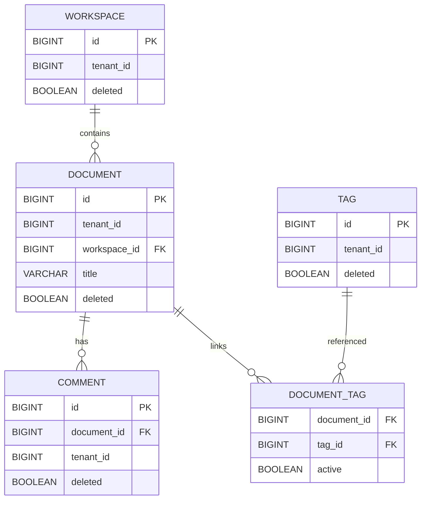

# Quan hệ, truy vấn gốc và ranh giới được áp dụng điều kiện ẩn trong Hibernate

Trong ứng dụng Hibernate, một hàng có thể tồn tại trong database nhưng không xuất hiện khi truy vấn qua ORM. Chẳng hạn, hệ thống tài liệu có quy tắc:

- Chỉ hiển thị tài liệu thuộc tenant hiện tại.
- Không hiển thị tài liệu đã xóa mềm.
- Chỉ hiển thị bình luận chưa bị ẩn.
- Chỉ hiển thị tag còn hiệu lực trong quan hệ nhiều-nhiều.

Người phát triển có thể dùng `@Filter`, `@SQLRestriction`, `@SoftDelete` hoặc những điều kiện được thêm ở tầng repository. Những quy tắc ấy thường được gọi là **điều kiện ẩn** (*implicit predicates*) bởi code gọi `findAll()` hay `document.getComments()` không viết trực tiếp mọi biểu thức `WHERE`.

Điểm khó nhất không phải cú pháp annotation mà là **điều kiện được áp dụng trên alias/bảng nào, trong loại truy vấn nào, vào thời điểm nào**:

1. Truy vấn gốc: `select d from Document d` có được giới hạn không?
2. Join quan hệ: `join d.workspace` và `join d.comments` có được lọc theo cùng quy tắc không?
3. Nạp theo khóa: `entityManager.find(Document.class, id)` có giống JPQL query không?
4. Collection lazy loading: truy cập `d.getComments()` có được lọc không?
5. Link table: khi một tag hợp lệ nhưng liên kết đã vô hiệu, điều kiện nằm ở bảng tag hay bảng nối?
6. Native SQL, bulk HQL, cache và persistence context có luôn tuân theo bộ lọc không?
7. Nếu filter bị disable hoặc context tenant thay đổi, dữ liệu đã managed có biến mất không?

> **Nguyên tắc cốt lõi:** Bộ lọc được gắn vào **điểm áp dụng cụ thể của ORM**, không phải một điều kiện toàn năng bao phủ mọi đường truy cập database. Muốn truy cập dữ liệu đúng và an toàn, phải xác định ranh giới giữa **root entity, association target, collection, join table, load-by-key, HQL/Criteria/native SQL và persistence context**.

Các ví dụ dưới đây theo phong cách Hibernate ORM 6.x/Jakarta Persistence; một số tính năng như `@SoftDelete` hoặc `@SQLRestriction` chỉ xuất hiện từ các phiên bản Hibernate 6.x nhất định. Đối chiếu annotation, thuộc tính và SQL thực tế với phiên bản đang chạy. Các đoạn minh họa tách riêng **những chiến lược thay thế**, không có ý định gắn tất cả annotation lên cùng một entity trong production.

---

## 1. Bộ lọc ẩn là gì?

Một truy vấn ứng dụng viết:

```java
List<Document> documents =
    entityManager.createQuery(
        "select d from Document d",
        Document.class
    ).getResultList();
```

Về mặt ý định, đó là “lấy các tài liệu”. Nhưng nếu mapping/configuration có filter tenant và soft-delete, SQL thực tế có thể có điều kiện bổ sung:

```sql
SELECT d.*
FROM document d
WHERE d.tenant_id = ?
  AND d.deleted = false;
```

Hai biểu thức này có thể đến từ provider mapping hoặc filter được bật trên `Session`, dù JPQL không viết tường minh.

Đây là lợi ích của điều kiện ẩn: giảm lỗi quên lọc ở nhiều câu query. Đồng thời đây là rủi ro: người đọc source chỉ thấy `select d` có thể không biết SQL bị ràng buộc, và người viết dễ tưởng mọi đường truy cập đều bị chặn.

### 1.1. Đừng gọi mọi điều kiện WHERE là filter của Hibernate

```hql
select d from Document d where d.deleted = false
```

Đây là điều kiện **tường minh của truy vấn**. Nó không tự xuất hiện trong `findById` hoặc query khác.

Ngược lại, `@Filter`/`@SQLRestriction` được cấu hình ở mapping có khả năng tác động tới những query/load mà Hibernate xây cho đối tượng tương ứng. Phạm vi cụ thể tùy annotation, loại association, loading path và version.

## 2. Mô hình dữ liệu xuyên suốt

Giả sử nền tảng quản lý tài liệu có:

- `Workspace` thuộc một tenant.
- `Document` thuộc một tenant và một workspace.
- `Comment` thuộc một document.
- `Tag` có thể gắn với nhiều document.
- `document_tag` là bảng nối, có cờ vô hiệu hóa liên kết.



### 2.1. Các hàng dữ liệu giả định

| Bảng | ID | Tenant | Trạng thái |
|---|---:|---:|---|
| workspace | 1 | 10 | active |
| workspace | 2 | 10 | deleted |
| document | 101 | 10 | active, workspace 1 |
| document | 102 | 10 | deleted, workspace 1 |
| document | 103 | 20 | active |
| document | 104 | 10 | active, workspace 2 |
| comment | 201 | 10 | active, document 101 |
| comment | 202 | 10 | deleted, document 101 |
| tag | 301 | 10 | active |
| tag | 302 | 10 | deleted |

Ví dụ này cố ý chứa các tình huống khó:

- Document 102 phải ẩn khi tìm danh sách active documents.
- Document 103 thuộc tenant khác.
- Document 104 là active nhưng workspace đã deleted.
- Comment 202 deleted dù Document 101 active.
- Tag 302 deleted.
- Một liên kết `document_tag` có thể không active dù cả Document và Tag đều active.

**Một cờ `Document.deleted=false` không tự quy định tất cả các trường hợp còn lại.**

## 3. Entity mapping cơ sở, chưa có điều kiện ẩn

```java
import jakarta.persistence.*;
import java.util.HashSet;
import java.util.Set;

@Entity
@Table(name = "document")
public class Document {

    @Id
    private Long id;

    @Column(name = "tenant_id", nullable = false)
    private Long tenantId;

    @Column(nullable = false, length = 200)
    private String title;

    @Column(nullable = false)
    private boolean deleted;

    @ManyToOne(fetch = FetchType.LAZY, optional = false)
    @JoinColumn(name = "workspace_id", nullable = false)
    private Workspace workspace;

    @OneToMany(mappedBy = "document")
    private Set<Comment> comments = new HashSet<>();

    @ManyToMany
    @JoinTable(
        name = "document_tag",
        joinColumns = @JoinColumn(name = "document_id"),
        inverseJoinColumns = @JoinColumn(name = "tag_id")
    )
    private Set<Tag> tags = new HashSet<>();

    protected Document() {}

    public Long getId() { return id; }
    public Long getTenantId() { return tenantId; }
    public boolean isDeleted() { return deleted; }
    public Set<Comment> getComments() { return comments; }
    public Set<Tag> getTags() { return tags; }
    public Workspace getWorkspace() { return workspace; }
}
```

Các entity còn lại được mapping tương ứng. Ví dụ Comment:

```java
@Entity
@Table(name = "comment")
public class Comment {

    @Id
    private Long id;

    @Column(name = "tenant_id", nullable = false)
    private Long tenantId;

    @Column(nullable = false)
    private boolean deleted;

    @ManyToOne(fetch = FetchType.LAZY, optional = false)
    @JoinColumn(name = "document_id", nullable = false)
    private Document document;

    protected Comment() {}
}
```

Khi chưa có rule ẩn, Hibernate không tự hiểu “deleted=true phải bị giấu” chỉ vì thuộc tính tên `deleted`. Ta phải mô tả chính sách bằng query, mapping, provider feature hoặc database policy.

## 4. Ba trục cần xét khi thiết kế bộ lọc

Một bộ lọc ẩn có ít nhất **ba trục độc lập**.

**Trục 1 — Đối tượng cần lọc:**

- Root entity (`Document`).
- Target entity của to-one (`Workspace`).
- Elements của collection (`Comment`, `Tag`).
- Rows của join table (`document_tag`).

**Trục 2 — Đường truy cập:**

- JPQL/HQL root query.
- Criteria/Spring Data derived query.
- `EntityManager.find()` hoặc `Session.get()` theo ID.
- Lazy proxy initialization.
- Collection load/fetch join.
- Native SQL/JDBC.
- Bulk HQL/Criteria DML.

**Trục 3 — Thời điểm/trạng thái:**

- Trước khi filter được enable.
- Sau khi enable/disable filter.
- Trước hay sau khi entity/collection đã có trong persistence context.
- Trong transaction hiện tại hay transaction/session mới.
- Sau soft delete nhưng trước flush/commit.
- Dưới các isolation levels khác nhau.

Không thể chứng minh bộ lọc an toàn chỉ bằng một test `findAll()`.

## 5. Những cơ chế thường gặp và phạm vi thiết kế

| Cơ chế | Bản chất | Thay đổi động? | Điểm cần chú ý |
|---|---|---|---|
| Điều kiện tường minh `WHERE` trong JPQL | Filter nằm trong query | Theo tham số | Không tự lan sang query khác |
| `@FilterDef` + `@Filter` | Điều kiện Hibernate có tên, enable trên Session | Có | Scope mapping, load-by-key và session state |
| `@FilterJoinTable` | Điều kiện trên bảng nối collection | Có | Khác lọc entity target |
| `@SQLRestriction` | SQL predicate cố định gắn mapping | Không | Không nhận runtime parameter |
| `@SQLJoinTableRestriction` | Predicate cố định trên join table | Không | Dùng cho link-row condition |
| `@SoftDelete` | Cơ chế soft delete tích hợp của Hibernate ở versions hỗ trợ | Cố định theo mapping | Tạo DML soft-delete và quy tắc visibility |
| `@SQLDelete` + restriction | Custom SQL thay ORM delete | Định nghĩa cố định | Dễ lệch version/locking/bulk paths |
| Spring Data `Specification` | Hàm xây predicate cho query | Có | Chỉ áp trên query sử dụng Specification |
| DB row-level security | Policy do database thực thi | Theo DB/session policy | Có thể bảo vệ cả direct SQL nếu cấu hình đúng |

Tên annotation không bảo đảm nó bao phủ mọi nhánh. Với rủi ro lộ tenant dữ liệu, cần chính sách kiểm soát cả những truy cập ngoài ORM.

## 6. Bộ lọc động: `@FilterDef` và `@Filter`

Một cách điển hình là định nghĩa filter tenant có tham số:

```java
import org.hibernate.annotations.Filter;
import org.hibernate.annotations.FilterDef;
import org.hibernate.annotations.ParamDef;

@Entity
@Table(name = "document")
@FilterDef(
    name = "tenantScope",
    parameters = @ParamDef(
        name = "tenantId",
        type = Long.class
    )
)
@Filter(
    name = "tenantScope",
    condition = "tenant_id = :tenantId"
)
public class Document {
    // mapping các trường như ở ví dụ cơ sở
}
```

Đây là ví dụ theo phong cách Hibernate 6.x. `@FilterDef` khai báo tên và parameter type; `@Filter` gắn điều kiện SQL với mapped entity.

### 6.1. Ai bật bộ lọc?

`@FilterDef` không đồng nghĩa mọi `Session` đã tự bật filter. Theo cấu hình thông dụng, phải enable trên Session:

```java
Session session = entityManager.unwrap(Session.class);

session.enableFilter("tenantScope")
       .setParameter("tenantId", 10L);
```

Các query Hibernate **sau khi filter được bật** có thể được bổ sung điều kiện tương ứng ở những vị trí mapping/filter hỗ trợ.

### 6.2. Filter trên Document không tự lọc Comment

Nếu `@Filter(name="tenantScope")` chỉ gắn vào `Document`, một câu:

```hql
select c from Comment c
```

không tự bị giới hạn bởi filter của Document. Muốn `Comment` có cùng tenant rule ở truy vấn gốc, cần có chính sách áp dụng cho `Comment` (và những entity khác có thể truy cập độc lập).

Tương tự, lọc Document root không chứng minh mọi Workspace, Tag hay bảng nối đều được lọc theo cùng tenant.

## 7. Ví dụ bật và tắt filter quanh query

Trong Spring service:

```java
@Service
public class DocumentReadService {

    @PersistenceContext
    private EntityManager entityManager;

    @Transactional(readOnly = true)
    public List<Document> findForTenant(long tenantId) {
        Session session =
            entityManager.unwrap(Session.class);

        session.enableFilter("tenantScope")
               .setParameter("tenantId", tenantId);

        try {
            return entityManager.createQuery(
                """
                select d
                from Document d
                order by d.id
                """,
                Document.class
            ).getResultList();
        } finally {
            session.disableFilter("tenantScope");
        }
    }
}
```

**Giới hạn quan trọng của ví dụ:** `tenantId` ở service phải được xác định từ authenticated server-side context, không lấy tùy ý từ request do client gửi. Ngoài ra, trả entities managed ra khỏi method có thể giữ những association chưa load; lời gọi lazy ở một thời điểm khác không còn cùng cấu hình filter.

Nếu filter phải áp dụng cho **toàn bộ unit of work**, hãy enable trước mọi query/load trong transaction, giữ nó hoạt động trong suốt use case và chuyển sang DTO trước khi kết thúc scope. Không disable quá sớm rồi mới truy cập association.

### 7.1. Enable filter trên một Session không phải cấu hình toàn cục

Filter state gắn với Session. Session khác, transaction khác hoặc một asynchronous task không nhất thiết có cùng filter state.

Trong môi trường quản lý Session tự động, hãy định nghĩa rõ nơi enable và cleanup filter ở tầng request/transaction. Đừng assume một annotation ở controller làm tất cả Session trong ứng dụng được lọc.

## 8. Filter tĩnh: `@SQLRestriction`

Với điều kiện **không thay đổi theo request** như `deleted=false`, một số Hibernate 6.x versions cung cấp:

```java
import org.hibernate.annotations.SQLRestriction;

@Entity
@Table(name = "document")
@SQLRestriction("deleted = false")
public class Document {
    // ...
}
```

`@SQLRestriction` gắn một SQL predicate cố định vào mapping. Trong những đường ORM hỗ trợ, Hibernate thêm điều kiện để các hàng deleted không xuất hiện.

**Đặc điểm:**

- Không cần gọi `session.enableFilter(...)`.
- Không thể dùng placeholder runtime `:tenantId` như dynamic `@Filter`.
- Không thể disable tùy ý trên Session.
- SQL fragment phụ thuộc tên cột database, không phải property Java.
- Cần đối chiếu syntax với Dialect và phiên bản Hibernate.

### 8.1. Điều kiện tĩnh và điều kiện động khác nhau

`@SQLRestriction("deleted = false")` phù hợp rule “không hiện deleted” cho mọi query thông thường. `@Filter(condition="tenant_id=:tenantId")` phù hợp rule theo tenant đang được truy cập.

Nhưng nếu cần admin xem cả deleted documents, restriction tĩnh sẽ không tự có nút tắt. Có thể cần repository/path đặc biệt, Session khác với mapping khác, native SQL có kiểm soát hoặc mô hình view/audit riêng tùy yêu cầu.

**Không chọn static restriction nếu use case thường xuyên cần thay đổi chính sách hiển thị trên cùng entity type mà không có thiết kế cho privileged reads.**

## 9. Soft delete tích hợp: `@SoftDelete`

Trong Hibernate ORM 6.4+ có annotation `org.hibernate.annotations.SoftDelete` hỗ trợ cơ chế soft deletion tích hợp trong các phạm vi mapping được hỗ trợ.

Ví dụ độc lập với `deleted` property của mô hình cơ sở:

```java
import org.hibernate.annotations.SoftDelete;
import org.hibernate.annotations.SoftDeleteType;

@Entity
@Table(name = "document")
@SoftDelete(
    strategy = SoftDeleteType.DELETED,
    columnName = "deleted"
)
public class Document {
    @Id
    private Long id;

    @Column(name = "tenant_id", nullable = false)
    private Long tenantId;

    @Column(nullable = false)
    private String title;

    protected Document() {}
}
```

Theo `SoftDeleteType.DELETED`, cột indicator thường thể hiện deleted state; đối lập là một kiểu indicator nói row còn active. Trước khi triển khai, xác nhận boolean converter/column semantics, provider version, mapping và schema đang có.

### 9.1. Đừng chồng hai mapping có quyền ghi cùng một cột

Nếu vừa khai báo:

```java
@SoftDelete(columnName = "deleted")
@Column(name = "deleted")
private boolean deleted;
```

thì có thể gây conflict mapping hoặc semantics khi cả framework và property đều tìm cách ghi cột. Với built-in soft delete, nên để Hibernate quản lý indicator theo API của version hoặc thiết kế read-only view nếu thật sự cần trình bày state.

### 9.2. Điểm khác biệt của built-in soft delete

Khác `@SQLRestriction` chỉ thể hiện visibility, `@SoftDelete` còn đưa ra semantics cho một số ORM delete operations. Nó không chỉ là chữ viết tắt của `WHERE deleted = false`.

Tuy nhiên, **đừng khẳng định mọi bulk HQL, native SQL, cascade và association mode luôn được xử lý giống nhau**. Các khả năng và giới hạn phụ thuộc Hibernate version, entity mapping và loại operation; cần test trên runtime mục tiêu.

### 9.3. Dữ liệu hiện hữu và migration

Nếu thêm `@SoftDelete` vào một bảng production đang có dữ liệu:

- Tạo indicator column với default/backfill đúng.
- Đảm bảo existing active rows có trạng thái tương ứng.
- Review indexes và constraints.
- Xác nhận các SQL writers khác có tuân thủ indicator không.
- Test load-by-id, association loads và delete behavior.

Không chỉ bật annotation rồi coi old rows tự có state đúng.

## 10. Legacy: `@SQLDelete` kết hợp với restriction

Trong các dự án cũ có thể thấy:

```java
@SQLDelete(sql = "UPDATE document SET deleted = true WHERE id = ?")
@Where(clause = "deleted = false")
@Entity
class Document {
    // ...
}
```

`@Where` là annotation legacy và đã bị deprecated ở những Hibernate 6.x versions mới. Hướng thay thế thường là `@SQLRestriction` cho điều kiện tĩnh, hoặc `@SoftDelete` cho soft deletion tích hợp nếu version/mapping hỗ trợ.

Không xem ví dụ cũ là cấu hình production có thể copy nguyên:

- Với entity có `@Version`, custom delete SQL có thể cần các parameters/row-count semantics bổ sung.
- `@SQLDelete` thay ORM delete SQL, không tạo automatic visibility filter nếu không có cơ chế khác.
- Bulk delete/native SQL không nhất thiết đi qua custom per-entity delete SQL.
- Cascade, row-count checking và multiple tables/inheritance có quy tắc riêng theo phiên bản.
- Việc đổi từ `@Where`/`@SQLDelete` sang `@SoftDelete` cần migration/test.

Trọng tâm của bài này là **điểm áp dụng visibility**, không chỉ DML xóa mềm.

## 11. Truy vấn gốc (*root query*) và điều kiện ẩn

Một root query:

```hql
select d from Document d
order by d.id
```

mở một query root tương ứng alias `d`. Nếu `Document` được mapping với static restriction và dynamic tenant filter đã bật, SQL có thể tương đương:

```sql
SELECT d.*
FROM document d
WHERE d.deleted = false
  AND d.tenant_id = ?
ORDER BY d.id;
```

Giả định source data ở phần 2, tenant=10 và deleted=false thì root result gồm IDs `101` và `104`.

Tại thời điểm này, **chưa xét Workspace đã deleted**. Vì root Document active và thuộc tenant 10, Document 104 vẫn có thể nằm trong danh sách nếu query không yêu cầu lọc Workspace target hoặc business rule khác.

### 11.1. Root condition không chứng minh join target hợp lệ

Một Document trỏ đến Workspace đã deleted là tình huống có thể cần ẩn toàn bộ Document theo nghiệp vụ. Nhưng entity-level rule trên Document không thể tự suy ra:

```text
Document.deleted=false
AND Document.workspace.deleted=false
```

Bạn phải biểu đạt điều kiện trên Workspace/join hoặc có database invariant ngăn references tới workspace deleted theo policy.

### 11.2. Derived query của Spring Data vẫn là query có root

```java
List<Document> findByTitleContaining(String text);
```

Nếu Spring Data sinh JPQL/Criteria query cho Document, điều kiện mapping phù hợp có thể được Hibernate áp thêm. Nhưng không coi đây là bằng chứng tất cả repository operations đều qua cùng query path (ví dụ `findById` có thể là direct identifier load).

## 12. Root query của một entity khác là root mới

```hql
select c from Comment c
```

lấy `Comment` làm root. Dù `Document` có filter tenant/soft delete, query Comment **không mặc định** trở thành:

```sql
SELECT c.*
FROM comment c
JOIN document d ON c.document_id = d.id
WHERE d.deleted = false
  AND d.tenant_id = ?;
```

Một query như vậy cần được tạo từ mapping/query có chủ đích. Nếu Comment có `tenant_id` và `deleted`, hãy đặt quy tắc tương ứng lên Comment hoặc đưa explicit join predicate vào query.

### 12.1. Quy tắc thiết kế

**Mọi entity có thể được query độc lập cần được xem như một điểm vào bảo mật/visibility độc lập.** Không chỉ lọc ở entity cha rồi tin rằng entity con sẽ không bao giờ bị truy cập trực tiếp.

Điều này đặc biệt quan trọng với:

- Comment API theo comment ID.
- Attachment download.
- Search index/export jobs.
- Count/exists queries.
- Background notifications.
- Admin/import tools.
- Native SQL.

## 13. `JOIN` trên quan hệ to-one

Giả sử:

```hql
select d
from Document d
join d.workspace w
where w.name = :name
```

Có **hai alias được quan tâm**:

- `d` cho Document.
- `w` cho Workspace.

Nếu Document có restriction tenant/deleted, và Workspace có restriction riêng, SQL có thể cần điều kiện cho cả hai:

```sql
SELECT d.*
FROM document d
JOIN workspace w
  ON d.workspace_id = w.id
 AND w.deleted = false
WHERE d.tenant_id = ?
  AND d.deleted = false
  AND w.name = ?;
```

Đây là SQL minh họa logical requirements, không phải cam kết Hibernate đặt mọi predicate vào đúng vị trí literal này. Với inner join, nhiều predicate có thể được chuyển giữa `ON` và `WHERE` mà không làm đổi tập kết quả trong trường hợp phù hợp.

### 13.1. Filter trên target và filter trên root khác nhau

- Document filter kiểm soát những root documents xuất hiện.
- Workspace filter kiểm soát rows workspace được xem là hợp lệ.
- Điều kiện join có thể khiến Document bị loại nếu workspace không match.
- Với lazy to-one load theo ID, cơ chế áp dụng filter lại có thể khác root join query.

Không kết luận chỉ từ một SELECT JOIN rằng `document.getWorkspace()` ở một truy vấn khác sẽ có semantics giống hệt.

## 14. `LEFT JOIN`: nơi đặt điều kiện quyết định kết quả

Xét Document 101 có một comment active và một comment deleted; Document 105 không có comment.

Mục tiêu: **giữ mọi Document root hợp lệ**, kể cả root không có comment active.

Cách giữ điều kiện ở `ON`:

```sql
SELECT d.id, c.id
FROM document d
LEFT JOIN comment c
  ON c.document_id = d.id
 AND c.deleted = false
WHERE d.deleted = false
  AND d.tenant_id = 10
ORDER BY d.id;
```

Kết quả minh họa:

```text
d.id | c.id
-----+------
101  | 201
105  | NULL
```

Nhưng nếu đặt child condition ở `WHERE`:

```sql
SELECT d.id, c.id
FROM document d
LEFT JOIN comment c
  ON c.document_id = d.id
WHERE d.deleted = false
  AND d.tenant_id = 10
  AND c.deleted = false;
```

Document 105 có `c.deleted=NULL` và bị loại vì predicate không true. `LEFT JOIN` đã mất tác dụng giữ root không có child trong case này.

### 14.1. Một lỗi tinh vi hơn: chỉ có child deleted

Nếu Document 106 có duy nhất Comment 206 với `deleted=true`:

- Filter trong `ON`: không có child match, nhưng Document 106 vẫn xuất hiện với `c.id=NULL`.
- Filter `c.deleted=false` trong `WHERE`: joined child 206 bị loại, và **không có** một NULL child row thay thế; Document 106 biến mất.

Trường hợp này thường làm lộ lỗi khi dataset test chỉ có root không có child hoặc root có child active.

### 14.2. Predicate trên joined alias có thể triệt tiêu outer join

Điều kiện:

```hql
where c.authorName = :name
```

cũng loại root không có Comment, kể cả khi JOIN khai báo `LEFT`, vì `c.authorName` là null. Nếu muốn giữ root khi child không match, cần diễn đạt business semantics khác (ON filtering, EXISTS, OR null có cân nhắc) thay vì chỉ đổi từ `JOIN` thành `LEFT JOIN`.

## 15. Mapping filter có tự đặt predicate ở ON không?

Hibernate có logic SQL AST và quyết định predicate placement theo loại join/filter, Dialect và version. Nhiều trường hợp provider cố gắng giữ đúng semantics collection filtering trên outer join, nhưng **không nên đoán vị trí alias chỉ từ annotation**.

Khi tính đúng phụ thuộc vào giữ root của LEFT JOIN:

1. Xác định rõ expectation: “Document không có comment active có còn xuất hiện không?”.
2. Xem SQL Hibernate sinh ra trong query path thực tế.
3. Test cả root không có child, chỉ có child deleted và có cả active/deleted.
4. Nếu viết explicit JPQL/HQL conditions, cân nhắc `JOIN ... ON` hoặc subquery `EXISTS`.
5. Không tự thêm filter vào WHERE sau outer join rồi giả định semantics không đổi.

Đây là một trong những ranh giới quan trọng nhất của điều kiện ẩn.

## 16. Truy vấn JPQL có `JOIN ... ON`

Ví dụ cần tìm Document và Comment active nhưng vẫn giữ Document không có Comment:

```hql
select d.id, c.id
from Document d
left join d.comments c on c.deleted = false
where d.tenantId = :tenantId
order by d.id, c.id
```

Ở đây điều kiện `c.deleted=false` là **điều kiện tường minh của join**, không phải filter mapping.

Lưu ý query này trả các cặp scalar/root-row; nó **không** tự coi collection `d.comments` của mỗi entity là initialized/filtered. Nếu muốn initialize collection, phải thiết kế fetch strategy hoặc mapping filter tương ứng.

### 16.1. Đừng gắn `ON` tùy tiện lên `JOIN FETCH`

Nhiều HQL/JPQL implementations hạn chế thêm join restriction `ON/WITH` vào fetched association, vì fetch collection một phần có thể làm collection state sai hoặc dễ gây nhầm lẫn. Hibernate có thể từ chối kiểu `left join fetch ... on ...` trong những phiên bản nhất định.

Nếu chỉ cần kết quả subset của child, thường nên dùng **DTO projection** hoặc collection query riêng thay vì cố thay đổi association fetch semantics bằng `ON`.

## 17. Collection load: `document.getComments()`

Khi `Document.comments` là `LAZY`:

```java
Document d = em.find(Document.class, 101L);

int count = d.getComments().size();
```

Access collection có thể kích hoạt SQL riêng:

```sql
SELECT c.*
FROM comment c
WHERE c.document_id = ?
  AND c.deleted = false;
```

Điều kiện `c.deleted=false` **chỉ có mặt nếu filter/static restriction được áp dụng cho đường collection load này**.

### 17.1. Filter trên Comment entity và filter trên collection mapping

Hibernate cho phép đặt filter ở entity hoặc ở collection mapping theo phạm vi hỗ trợ:

```java
@OneToMany(mappedBy = "document")
@Filter(name = "visibleComments", condition = "deleted = false")
private Set<Comment> comments = new HashSet<>();
```

Với filter definition `visibleComments` được khai báo và enabled, điều kiện có thể giới hạn **collection load** này. Tuy nhiên:

```hql
select c from Comment c
```

không nhất thiết bị ảnh hưởng nếu `@Filter` chỉ đặt trên `Document.comments` mà không đặt trên `Comment` root mapping.

### 17.2. Lọc collection không đồng nghĩa lọc entity type

Đây là sự khác nhau rất quan trọng:

- `@Filter` trên `Document.comments` kiểm soát association collection trong đường tải phù hợp.
- `@Filter` trên `Comment` kiểm soát entity-level paths được provider áp dụng.
- Hai scope có thể trùng một phần nhưng **không nên giả định tương đương** trên mọi load path/fetch strategy.

Nếu Comment có thể được query độc lập và qua Document, cần đảm bảo cả hai access paths tuân thủ policy hoặc có database policy bắt buộc.

## 18. Collection đã initialize không tự thay đổi khi filter đổi

Trong cùng persistence context:

```java
session.enableFilter("visibleComments");
Document d = em.find(Document.class, 101L);
int filteredCount = d.getComments().size();

session.disableFilter("visibleComments");
int countAgain = d.getComments().size();
```

Nếu collection đã được initialized, lần gọi `size()` thứ hai có thể dùng **cùng collection state trong memory**, không tự query lại đầy đủ bình luận. Thay filter state không đồng nghĩa các managed collections được xây dựng lại.

Tương tự, enable filter sau khi collection đã load không làm collection đang managed tự loại entries.

### 18.1. Muốn thấy chính sách khác phải thiết kế load boundary

Hướng an toàn:

- Dùng Session/persistence context riêng cho từng policy/tenant visibility.
- Tạo DTO query riêng thay vì sử dụng cùng managed collection với hai semantics khác nhau.
- Nếu dùng `clear/refresh`, hiểu rằng nó detach/reload managed state và có nguy cơ ảnh hưởng pending changes; không dùng tùy tiện giữa transaction ghi.
- Không chia sẻ Session qua requests/threads.

**Persistence context là một bộ nhớ trạng thái, không phải một view SQL tái tính tức thời mỗi khi bật filter.**

## 19. Nạp theo ID: khác với root query

So sánh:

```java
// A: HQL root query
Document byQuery = em.createQuery(
    "select d from Document d where d.id = :id",
    Document.class
)
.setParameter("id", 102L)
.getResultStream()
.findFirst()
.orElse(null);
```

và:

```java
// B: Direct identifier lookup
Document byId = em.find(Document.class, 102L);
```

Cả hai cùng muốn Document 102, nhưng đường nội bộ khác nhau.

Với **dynamic `@Filter`**, Hibernate có quy tắc đặc biệt cho **load-by-key** (direct identifier load). Ở các Hibernate 6.x series, filter thông thường có thể **không áp dụng** lên direct load-by-ID, trừ khi filter definition/configuration yêu cầu áp dụng cho load-by-key và đường tải tương ứng hỗ trợ.

Đây là lỗ hổng nhận thức thường gặp: `findAll()` bị lọc nhưng `findById()` có thể có behavior khác.

### 19.1. `@FilterDef.applyToLoadByKey`

Trong các Hibernate versions hỗ trợ:

```java
@FilterDef(
    name = "tenantScope",
    parameters = @ParamDef(
        name = "tenantId",
        type = Long.class
    ),
    applyToLoadByKey = true
)
```

Thuộc tính `applyToLoadByKey` yêu cầu xem xét filter trong các load-by-key paths được hỗ trợ.

**Cảnh báo:** điều này còn ảnh hưởng loading associations to-one. Nếu một entity có khóa ngoại đến entity bị filter che, việc resolve reference có thể gây exception thay vì “tự đổi to-one thành null” — tùy mapping và Hibernate version. Vì vậy không bật tùy chọn mà không test `@ManyToOne`, `@OneToOne`, lazy proxy, eager joins và nullable semantics.

### 19.2. Static restriction và soft delete

`@SQLRestriction`/`@SoftDelete` có semantics không giống dynamic filter enable/disable; các đường ORM load theo ID có thể áp restriction/soft-delete rules tùy mapping/version. Đừng lấy kết quả test `@SQLRestriction` rồi áp cho `@Filter` hoặc ngược lại.

**Luôn test cả `findById` lẫn HQL root query** trước khi kết luận dữ liệu deleted/tenant khác đã bị ẩn ở mọi đường.

## 20. `getReferenceById` và proxy initialization

Spring Data JPA:

```java
Document reference =
    repository.getReferenceById(102L);
```

JPA:

```java
Document reference =
    em.getReference(Document.class, 102L);
```

Hai API có thể trả proxy/reference mà chưa phát SELECT ngay. Khi truy cập field không nằm trong proxy state, Hibernate có thể load entity theo ID.

Điểm cần kiểm tra:

- Filter đã được enable khi proxy được khởi tạo hay chưa?
- Đường load-by-ID có áp filter không?
- Target deleted/khác tenant được xem là không tồn tại hay exception?
- Persistence context đã có managed instance cùng ID chưa?
- Session còn mở khi proxy initialized không?

Không coi việc lấy được reference là xác nhận entity có quyền truy cập hoặc thậm chí tồn tại trong DB.

## 21. To-one association: một Document có Workspace đã bị ẩn

Ví dụ Document 104 active nhưng Workspace 2 deleted:

```text
Document 104:
    deleted = false
    workspace_id = 2

Workspace 2:
    deleted = true
```

Truy vấn root Document có thể trả Document 104. Sau đó:

```java
Workspace workspace = document.getWorkspace();
String name = workspace.getName();
```

Nếu Workspace được lọc như “không tồn tại” trong đường load to-one này, có nhiều khả năng tùy provider/mapping:

- Target không tìm thấy và báo entity not found.
- Filter-aware load-by-key ném exception đặc thù của Hibernate.
- Một đường load không áp dynamic filter và vẫn tải Workspace 2.
- Eager join fetch dùng điều kiện khác làm Document 104 bị loại.
- Trường hợp optional/nullable association có semantics riêng.

**Không có quy tắc “ẩn Workspace thì getter chắc chắn trả null” cho mọi @ManyToOne.** Khóa ngoại có giá trị và annotation `optional=false` vẫn biểu đạt reference bắt buộc.

### 21.1. Chính sách nghiệp vụ nào là đúng?

Có ít nhất ba cách diễn đạt:

1. **Document active vẫn được thấy**, nhưng Workspace deleted không được hiển thị: cần DTO/null/placeholder policy rõ.
2. **Không thấy Document nếu Workspace deleted**: filter root query theo Workspace bằng `EXISTS`/join hoặc enforce invariant.
3. **Không cho Workspace deleted nếu còn Document active**: chặn thao tác xóa mềm parent theo domain rule.

Chọn một policy rồi kiểm thử các đường truy cập. Filter annotation không tự chọn business semantics thay ứng dụng.

## 22. Filter bật cho to-one có thể gây exception

Khi bật `applyToLoadByKey=true`, một FK có thể trỏ đến target bị filter loại. Hibernate phải phân biệt:

```text
Target tồn tại nhưng bị filter che
Target thực sự không tồn tại trong database
```

Tùy version và association mapping, Hibernate có thể ném exception thay vì âm thầm thay reference bằng `null`, vì làm như vậy có thể vi phạm contract của mandatory to-one và gây mất thông tin.

### 22.1. Không dùng `@NotFound` như cách chữa mặc định

Một số Hibernate-specific association mappings có `@NotFound` để xử lý missing targets, nhưng nó có hệ quả fetch/semantics và không phải một policy bảo mật/soft delete tổng quát.

Nếu FK trỏ đến một row soft-deleted, hãy giải quyết bằng domain constraints, explicit query/DTO hoặc thiết kế lifecycle parent-child trước khi thêm annotation để che exception.

## 23. To-many association: parent có bị loại khi children bị lọc?

Với collection:

```hql
select d
from Document d
left join d.comments c
```

Một filter trên `Comment` có thể làm child rows biến mất ở SQL join/load phù hợp. Nhưng câu hỏi “Document có còn hiện không?” phụ thuộc:

- Join là inner hay left.
- Condition trên child nằm ở ON hay WHERE.
- Query có predicate nào trên alias `c`.
- Query có `distinct` hay aggregate.
- Mapping/fetch path có áp collection filter hay không.

Câu:

```hql
select d
from Document d
join d.comments c
```

với inner join có thể loại Document không có Comment active. Đây là hệ quả của join cardinality, không nhất thiết là “filter trên Document root”.

### 23.1. Dùng `EXISTS` nếu muốn chọn root có child thỏa điều kiện

```hql
select d
from Document d
where exists (
    select 1
    from Comment c
    where c.document = d
      and c.deleted = false
)
```

Câu này diễn đạt rõ “chỉ tài liệu có ít nhất một Comment active”, và thường tránh nhân root rows trong kết quả như join to-many. Nếu còn tenant filter trên Comment, cần bảo đảm scope chính xác của subquery/entity mapping.

### 23.2. Dùng `NOT EXISTS` để tìm root không có child active

```hql
select d
from Document d
where not exists (
    select 1
    from Comment c
    where c.document = d
      and c.deleted = false
)
```

Kết quả gồm Documents không có comment và Documents chỉ có comments deleted, theo rule trên. Đừng dùng `left join ... where c.id is null` mà không kiểm tra condition placement khi dữ liệu có deleted children.

## 24. Join table và target entity là hai lớp khác nhau

Quan hệ nhiều-nhiều:

```text
Document 101 ---- document_tag(active=false) ---- Tag 301(active=true)
```

Nếu chỉ lọc `Tag.deleted=false` thì Tag 301 vẫn hợp lệ, nhưng **link** đã bị vô hiệu. Truy vấn association có thể vẫn trả Tag 301 vì điều kiện trên target không kiểm soát `document_tag.active`.

Cần hai chính sách:

1. **Target visibility:** tag chưa deleted, tenant hợp lệ.
2. **Membership visibility:** link `document_tag` đang active.

### 24.1. SQL minh họa

```sql
SELECT t.*
FROM document_tag dt
JOIN tag t ON t.id = dt.tag_id
WHERE dt.document_id = ?
  AND dt.active = true
  AND t.deleted = false
  AND t.tenant_id = ?;
```

Mỗi điều kiện gắn đúng bảng/alias. Nếu bỏ `dt.active`, inactive memberships vẫn có thể xuất hiện; nếu bỏ `t.deleted`, deleted Tag có thể xuất hiện qua active membership.

## 25. `@FilterJoinTable` cho điều kiện động ở bảng nối

Hibernate cung cấp `@FilterJoinTable` cho collection có join table.

Ví dụ:

```java
import org.hibernate.annotations.FilterDef;
import org.hibernate.annotations.FilterJoinTable;

@FilterDef(name = "activeDocumentTag")
@Entity
class Document {

    @ManyToMany
    @JoinTable(
        name = "document_tag",
        joinColumns = @JoinColumn(name = "document_id"),
        inverseJoinColumns = @JoinColumn(name = "tag_id")
    )
    @FilterJoinTable(
        name = "activeDocumentTag",
        condition = "active = true"
    )
    private Set<Tag> tags = new HashSet<>();
}
```

Sau khi bật filter `activeDocumentTag` trên Session, Hibernate có thể áp điều kiện cho **rows của join table** khi load collection theo đường hỗ trợ.

```java
session.enableFilter("activeDocumentTag");
```

### 25.1. Khác `@Filter` trên `Tag`

- `@FilterJoinTable` gắn với **relationship rows**, không kiểm soát root query `select t from Tag t`.
- `@Filter` trên `Tag` gắn với entity target, không đủ để biết link `document_tag.active`.
- Trong những trường hợp cần cả hai, phải khai báo và enable các rule tương ứng.

Đừng đặt `@FilterJoinTable` lên association không có join table phù hợp rồi mong provider biết cột thuộc bảng nào.

## 26. `@SQLJoinTableRestriction` cho điều kiện tĩnh ở bảng nối

Với những Hibernate versions hỗ trợ:

```java
import org.hibernate.annotations.SQLJoinTableRestriction;

@ManyToMany
@JoinTable(name = "document_tag",
    joinColumns = @JoinColumn(name = "document_id"),
    inverseJoinColumns = @JoinColumn(name = "tag_id"))
@SQLJoinTableRestriction("active = true")
private Set<Tag> tags = new HashSet<>();
```

Đây là restriction **cố định** của join table, không cần enableFilter. Nó phù hợp khi mọi lần load association bình thường đều phải bỏ link inactive.

Phân biệt với `@SQLRestriction("deleted = false")` trên `Tag`:

| Điều kiện | Bảng | Ý nghĩa |
|---|---|---|
| `document.deleted=false` | document | Root/owner còn hiển thị |
| `document_tag.active=true` | document_tag | Link owner–tag còn hiệu lực |
| `tag.deleted=false` | tag | Target tag còn hiển thị |
| `tag.tenant_id=:tenantId` | tag | Target ở đúng tenant |

Nếu dùng Hibernate cũ, có thể gặp `@WhereJoinTable` legacy. Không giả định legacy annotation luôn còn được khuyến nghị hoặc có cùng availability trong những series mới.

## 27. Một association có thể có cả filter join table và target filter

Ví dụ policy:

```text
Document.tags chỉ chứa:
  link.active = true
  AND tag.deleted = false
  AND tag.tenant_id = currentTenant
```

Có thể cần một tổ hợp mapping/filter phù hợp cho:

- Root Document tenant/deleted.
- Join table membership active.
- Tag target tenant/deleted.

Nhưng **việc có đủ annotation trên ba entity không chứng minh mọi load path áp đúng cả ba**. Đường query có thể là root Document + lazy collection, root Tag, HQL explicit join, fetch join hoặc native SQL.

Cần xác định SQL kỳ vọng cho từng đường và test riêng.

### 27.1. Đừng nhầm việc “không nhìn thấy link” với xóa link

Nếu restriction loại các rows `document_tag.active=false`, chúng vẫn tồn tại trong database. Một lần fetch collection không thấy chúng **không phải** bằng chứng chúng đã bị DELETE. Truy vấn native/audit phù hợp vẫn có thể thấy.

## 28. Chỉnh sửa một collection đang bị lọc: rủi ro dữ liệu

Một collection được load chỉ chứa visible items không nhất thiết đại diện cho toàn bộ association thực trong database.

Giả sử:

```text
document_tag:
  (doc=101, tag=301, active=true)
  (doc=101, tag=302, active=false)
```

Nếu mapping/filter chỉ cho thấy Tag 301, ứng dụng thực hiện:

```java
document.getTags().clear();
```

Bạn phải hỏi:

- Hibernate coi collection initialized có gồm đủ rows cần quản lý không?
- Với kiểu collection này, SQL xóa quan hệ sẽ target rows nào?
- ORM có xóa/mutate những link bị filter che không?
- Link row có soft-delete semantics hay xóa vật lý?
- Cascade/orphanRemoval có liên quan không?
- Nếu filter thay đổi trong transaction, snapshot của collection còn đúng không?

Không dùng một **filtered collection view** như danh sách đầy đủ để điều khiển thao tác xóa hàng loạt khi correctness cần cả hidden rows.

### 28.1. Tách read model và write model khi cần

Nếu user chỉ được nhìn active tags, có thể dùng DTO query riêng để đọc active tags. Khi admin muốn sửa toàn bộ memberships, dùng workflow truy cập rõ ràng vào toàn bộ link records với authorization và transaction tương ứng.

Với join table chứa metadata (`active`, `createdAt`, `createdBy`), một **entity riêng** như `DocumentTagMembership` thường dễ model hơn `@ManyToMany` thuần vì link row có lifecycle nghiệp vụ.

## 29. Quan hệ một-nhiều với `orphanRemoval` và hidden children

Ví dụ:

```java
@OneToMany(
    mappedBy = "document",
    cascade = CascadeType.ALL,
    orphanRemoval = true
)
@Filter(name = "visibleComments", condition = "deleted = false")
private Set<Comment> comments;
```

`orphanRemoval=true` có nghĩa remove child khỏi managed collection có thể kích hoạt entity removal theo mapping. Nhưng collection bị lọc có thể không chứa mọi child persisted.

Hệ quả:

- Hidden children có thể vẫn tồn tại và chiếm FK/index.
- Một thao tác replace collection theo danh sách visible có thể không có nghĩa “đồng bộ toàn bộ quan hệ”.
- Business invariant “Document có tối đa N comments kể cả hidden” không thể chỉ đếm visible collection.
- Cascade REMOVE khi xóa parent có thể tác động rộng khác với load filtered view, tùy provider và mapping.

**Không dựa vào filter hiển thị để thực thi invariant hoặc cleanup toàn bộ children.** Sử dụng truy vấn có phạm vi đầy đủ, DB constraints hoặc admin workflow được review.

## 30. Filter và `JOIN FETCH`

`JOIN FETCH` yêu cầu ORM materialize association ngay cùng query:

```hql
select distinct d
from Document d
left join fetch d.comments
where d.id = :id
```

Nếu collection có filter, SQL/result shape có thể khác so với query không filter. Những điểm cần chú ý:

- To-many fetch join có thể tạo nhiều SQL rows cho cùng root.
- Filter trên child/collection cần áp đúng alias.
- `distinct` không nhất thiết làm JDBC trả ít rows khi child columns khác nhau.
- Collection initialized dưới filter là một view giới hạn.
- Sau khi disable filter, collection đã initialized không tự có thêm hidden items.
- Fetch join của to-one có thể khác lazy target load-by-key.

### 30.1. Collection fetch và pagination

```java
query.setFirstResult(0).setMaxResults(20);
```

với join fetch collection không được mặc định hiểu là 20 root Documents. Mỗi root có thể có nhiều child rows; Hibernate có cơ chế/warning theo version, nhưng không nên phụ thuộc vào pagination trong memory để “sửa” semantics.

Khi cần page root + children:

1. Query trang Document IDs theo root filter và thứ tự xác định.
2. Fetch children phù hợp cho nhóm IDs.
3. Gắn visibility rule cho children rõ ràng.
4. Sắp lại root order theo ID page.
5. Query count riêng theo root semantics.

## 31. Điều kiện ẩn thay đổi ý nghĩa của `COUNT` và `EXISTS`

Giả sử root `Document` có filter tenant/deleted:

```hql
select count(d) from Document d
```

Kết quả có thể là số documents **hiển thị theo filter hiện hành**, không phải tổng rows vật lý của bảng `document`.

Tương tự:

```java
boolean exists =
    repository.existsById(documentId);
```

có thể dùng một query mechanism khác với `findById` hoặc direct identifier load, tùy Spring Data/Hibernate version. Không suy ra `existsById` và `findById` có cùng visibility chỉ vì cả hai đều nhận ID.

### 31.1. Count JOIN có thể nhân root

```hql
select count(d)
from Document d
join d.comments c
```

Nếu một Document có ba visible comments, join có thể tạo ba rows. Nếu nghiệp vụ muốn đếm số Documents có comment, dùng `count(distinct d.id)` hoặc `exists`.

Một filter child có thể thay đổi số rows join, nhưng **không tự biến count(join) thành count(root distinct)**.

## 32. Spring Data Specification: điều kiện tường minh trên root

Ví dụ một specification:

```java
public static Specification<Document> visibleForTenant(
        long tenantId) {

    return (root, query, cb) -> cb.and(
        cb.equal(root.get("tenantId"), tenantId),
        cb.isFalse(root.get("deleted"))
    );
}
```

Khi repository gọi:

```java
repository.findAll(visibleForTenant(10L));
```

predicate này được áp trong query do Specification tạo.

Nhưng:

```java
repository.findById(101L);
```

không tự dùng Specification trên. Cần bảo đảm các entry points khác cũng tuân thủ tenant/soft-delete policy.

### 32.1. Tránh dùng filter ẩn và Specification với các semantics mâu thuẫn

Nếu mapping luôn có `deleted=false` nhưng Specification định nghĩa tìm deleted rows:

```java
cb.isTrue(root.get("deleted"))
```

query có thể trở thành logic:

```sql
WHERE deleted = false
  AND deleted = true
```

→ không có kết quả. Điều này không có nghĩa database không có deleted rows; chỉ là các điều kiện không thể cùng đúng.

Định nghĩa rõ privileged admin path thay vì cố “ghi đè” restriction tĩnh bằng predicate ngược.

## 33. Filter root và query select scalar/projection

```hql
select d.id, d.title
from Document d
where d.title like :prefix
```

Đây vẫn là query có root Document, nên mapped filter phù hợp có thể áp dụng vào root query, dù kết quả là scalar tuple chứ không phải managed entity.

Nhưng:

```sql
SELECT id, title FROM document
```

trong `createNativeQuery` là **native SQL**; Hibernate không có nghĩa vụ chèn entity filter của `Document` vào SQL thuần này, vì query không nhất thiết gắn với mapping Document alias.

**Không đánh giá filter coverage dựa vào kiểu trả về List/DTO, mà dựa vào đường query và mapping source.**

## 34. Native SQL và JDBC bỏ qua điều kiện ẩn của ORM

Ví dụ:

```java
List<Object[]> rows = em.createNativeQuery(
    """
    select id, title
    from document
    order by id
    """
).getResultList();
```

Không có `WHERE tenant_id=...` hoặc `deleted=false` trong SQL này. `@Filter`/`@SQLRestriction`/`@SoftDelete` trên entity không tự biến câu native SQL thành câu truy vấn được bảo vệ ở mọi trường hợp.

Tương tự:

```java
jdbcTemplate.queryForList(
    "select * from document"
);
```

là đường JDBC trực tiếp của Spring, không đi qua Hibernate entity filtering.

### 34.1. Giải pháp đúng theo mức yêu cầu

- Với truy vấn native có thể quản lý: thêm điều kiện tường minh và bind parameter.
- Với bảng nhạy cảm/đa tenant: dùng database row-level security hoặc schema/database-per-tenant và role/connection isolation theo chính sách.
- Với export/report: xác định đầy đủ visibility trước khi phát SQL.
- Với API người dùng: xác thực và phân quyền ở service + query.
- Với cache/search index: bảo đảm scope khi index/truy vấn và khi trả response.

**Không xem `@Filter` là hàng rào bảo mật duy nhất chống data leak giữa tenants.**

## 35. Bulk UPDATE/DELETE không phải per-entity filtering

JPQL bulk DML:

```java
int affected = em.createQuery(
    """
    update Document d
    set d.deleted = true
    where d.tenantId = :tenantId
    """
)
.setParameter("tenantId", 10L)
.executeUpdate();
```

Không tương đương:

```java
for (Document d : loadedDocuments) {
    d.setDeleted(true);
}
```

Bulk HQL/Criteria DML chạy qua mutation query path với semantics khác per-entity lifecycle. Không giả định mọi filter entity, `@SQLDelete`, Envers listener, optimistic version increment hoặc cascade đều tự áp giống managed entity operations.

Trong các Hibernate versions khác nhau, soft-delete-aware bulk delete support và filter behavior có thể thay đổi. Cần **kiểm chứng SQL trên chính đường DML đó** trước khi dùng cho dữ liệu có policy tenant/soft-delete.

### 35.1. Luôn đặt điều kiện tenant tường minh khi tác động hàng loạt

Ví dụ HQL:

```hql
update Document d
set d.title = :title
where d.id = :id
  and d.tenantId = :tenantId
  and d.deleted = false
```

Dù đã bật `tenantScope` dynamic filter, explicit tenant/visibility guard trong bulk mutation là lớp bảo vệ quan trọng. Còn cần authorization ở service và transaction phù hợp.

### 35.2. `@Modifying` trong Spring Data

```java
@Modifying
@Query("""
    update Document d
    set d.deleted = true
    where d.id = :id and d.tenantId = :tenantId
    """)
int softDeleteForTenant(Long id, Long tenantId);
```

Đây là HQL bulk update, không phải `entityManager.remove`. Nếu ứng dụng dùng built-in `@SoftDelete` để quản lý indicator, cần tránh ghi đè semantics của provider bằng DML thủ công không được test.

### 35.3. Persistence context stale sau bulk

Nếu `Document 101` đang managed với `deleted=false`, sau bulk UPDATE database có thể là `deleted=true` nhưng object trong Session vẫn giữ state cũ. `@Filter` không làm object đó tự refresh.

Cần tính tới `flush`, `clear`/`refresh` hoặc sử dụng transaction mới, đặc biệt khi kết hợp bulk DML với business logic managed entities.

## 36. `deleteById`, `remove` và soft-delete behavior

Spring Data:

```java
repository.deleteById(101L);
```

JPA:

```java
Document d = em.find(Document.class, 101L);
em.remove(d);
```

Các đường này có thể đi qua entity removal semantics của Hibernate. Nếu entity có `@SoftDelete` hoặc custom `@SQLDelete` được mapping đúng, ORM delete operation có thể tạo SQL UPDATE indicator thay vì physical DELETE.

Tuy nhiên:

- `deleteById` có thể load entity trước khi remove, và lookup đó có thể bị filter che.
- Cascade/remove có thể tác động association phụ thuộc mapping.
- Database `ON DELETE CASCADE` chỉ chạy nếu có physical DELETE tương ứng.
- Bulk `deleteAllInBatch`/JPQL delete có semantics riêng.
- Delete row đã soft-deleted có thể được coi là không visible ở load path.
- Không suy luận behavior chỉ từ tên repository method.

Một test đúng phải xác nhận cả **row vật lý còn hay không**, indicator thay đổi thế nào và query root/load-by-ID trả gì sau commit.

## 37. Filter thay đổi trong cùng Session không retroactively áp cho managed objects

Một ví dụ sai nguy hiểm trong ứng dụng đa tenant:

```java
session.enableFilter("tenantScope")
       .setParameter("tenantId", 10L);

Document tenant10 = em.find(Document.class, 101L);

// Sau đó đổi filter sang tenant 20
session.enableFilter("tenantScope")
       .setParameter("tenantId", 20L);

Document stillManaged = em.find(Document.class, 101L);
```

Nếu object ID 101 đã có trong persistence context, ORM có thể trả lại managed instance theo identity map mà không cần SQL mới. Filter chỉ tác động những SQL được tạo, không thực thi authorization check trên object đã quản lý.

**Tuyệt đối không tái sử dụng cùng Session để phục vụ hai tenants với kỳ vọng đổi filter sẽ xóa dữ liệu tenant trước khỏi memory.**

### 37.1. Session per unit of work/tenant

Đảm bảo:

- Một Session/transaction chỉ có một tenant principal context theo policy.
- Context được thiết lập trước mọi load.
- Không chia sẻ `EntityManager` instance state qua threads.
- Không giữ managed entities vượt ranh giới tenant.
- Admin cross-tenant workflows dùng scope và authorization tách biệt.
- Đường cache/DTO serialization không rò rỉ dữ liệu đã load từ tenant khác.

## 38. Dynamic filter không phải row-level security

Một filter như:

```java
session.enableFilter("tenantScope")
       .setParameter("tenantId", 10L);
```

có thể bị quên enable, bị disable trong code quản trị, hoặc không áp trên native SQL/direct key paths theo cấu hình.

Nếu yêu cầu bảo mật là “không một request tenant nào được đọc/ghi rows của tenant khác”, nên đánh giá thêm:

- Database RLS với policy được cưỡng chế tại DB.
- Schema/database-per-tenant.
- Tenant-aware repository/API architecture.
- DB roles và grants tối thiểu.
- Global query guards và audit logs.
- Automated security tests cho mọi entry path.

### 38.1. RLS cũng cần quản lý session connection state

Với PostgreSQL, ví dụ ý tưởng về RLS thường dựa trên database policies và tenant context đặt trên connection/transaction. Nhưng connection pools tái sử dụng connection, nên phải đặt/reset session variables chính xác để không leak tenant context giữa requests.

Không mặc định “có RLS là tự động đúng” nếu connection identity/SET LOCAL/transaction scoping sai.

## 39. Cache: filter và identity map không phải một thứ

Các tầng:

| Tầng | Phạm vi | Vấn đề liên quan filter |
|---|---|---|
| First-level cache | Một Hibernate Session | Object đã managed có thể được trả không chạy SQL mới |
| Second-level cache | Nhiều Sessions nếu bật | Cache key/state và association loading cần xét theo tenant/filter strategy |
| Query cache | Query results khi bật | Filter parameters có thể ảnh hưởng cache key theo provider |
| Spring `@Cacheable` | Result của service/repository method | Cache key phải chứa tenant/visibility context |
| Database buffer cache | DB page cache | Không chịu trách nhiệm auth/filter semantics |

Không kết luận rằng “filter vẫn an toàn vì cache biết tenant”. Từng cache layer có contract khác nhau và version/provider-specific behavior.

### 39.1. Spring cache có thể làm lộ dữ liệu

Sai ý tưởng:

```java
@Cacheable("documents")
public DocumentDto find(Long id) {
    // thực tế kết quả phụ thuộc tenant
}
```

Nếu cache key chỉ có `id` nhưng DTO có thể khác theo tenant/principal, response có thể bị reuse sai.

Cache key nên chứa tenant và mọi yếu tố authorization/visibility ảnh hưởng result, hoặc không cache method này nếu invalidation/authorization phức tạp.

### 39.2. Collection cache và filter

Filtered collections, initialized state và cache entries cần được hiểu theo Hibernate version/cache strategy. Đừng giả định cached collection được dùng/không dùng như nhau khi filter thay đổi. Test cache hits/misses với nhiều tenant và soft-delete states.

## 40. Bộ lọc ẩn và transaction isolation là hai vấn đề khác nhau

Filter quy định **row nào được phép xuất hiện trong query**. Transaction isolation quy định **những thay đổi concurrent nào transaction có thể nhìn thấy** theo DBMS.

Ví dụ:

- Tenant filter chỉ cho thấy tenant 10.
- Transaction A chạy `READ_COMMITTED`.
- Transaction B soft-delete Document 101 và commit.
- Transaction A query lại hoặc truy cập managed Document 101.

Kết quả phụ thuộc cả:

1. SQL query mới có được thực thi không.
2. Filter/soft-delete predicate có áp trên query đó không.
3. Persistence context đã giữ Document 101 chưa.
4. Transaction isolation/database snapshot.
5. Thời điểm flush/commit.

Không dùng filter như một cơ chế bảo đảm “repeatable read” hay tránh lost update. Dùng transaction/locking/`@Version` và database constraints phù hợp.

## 41. Index cho điều kiện tenant + soft delete

Nếu mọi listing đều lọc:

```sql
WHERE tenant_id = ?
  AND deleted = false
ORDER BY created_at DESC, id DESC
```

có thể cân nhắc composite index:

```sql
CREATE INDEX idx_document_tenant_visible_created
    ON document (tenant_id, deleted, created_at DESC, id DESC);
```

Đây là SQL minh họa; cú pháp và chiến lược index tùy DBMS, query workload và tỉ lệ deleted rows.

Trên một số DBMS, partial index cho active rows có thể hiệu quả:

```sql
-- PostgreSQL example:
CREATE INDEX idx_document_active_by_tenant
    ON document (tenant_id, created_at DESC, id DESC)
    WHERE deleted = false;
```

### 41.1. Index phụ thuộc query root và join

Nếu tìm child:

```sql
SELECT c.*
FROM comment c
WHERE c.document_id = ?
  AND c.deleted = false
```

index bắt đầu bằng `(document_id, deleted)` có thể hữu ích. Nếu join `document_tag` theo `document_id` và `active`, hãy đo index trên join table.

Không tạo index chỉ vì thấy annotation. Cần `EXPLAIN`/execution plan và dữ liệu thật; mỗi index tăng chi phí INSERT/UPDATE/soft-delete.

## 42. Bảng dữ liệu deleted có thể tích lũy lâu dài

Soft delete không giải phóng row vật lý:

```sql
UPDATE document SET deleted = true WHERE id = ?;
```

Vì vậy:

- Table và index vẫn chứa deleted rows.
- Unique constraint có thể tiếp tục chặn tạo row mới cùng business key.
- Foreign keys vẫn tham chiếu deleted rows.
- Aggregate/report native SQL có thể vô tình tính cả deleted.
- Backup/retention/PII vẫn áp dụng.
- Dữ liệu tenant có thể bị lộ qua query khác nếu không lọc.

### 42.1. Unique key với soft delete

Giả sử:

```sql
UNIQUE (tenant_id, slug)
```

Khi Document `slug='intro'` bị soft-delete, tạo Document mới với cùng tenant/slug vẫn có thể vi phạm unique constraint.

Nếu nghiệp vụ cho phép tái sử dụng slug sau soft delete, cần thiết kế constraint phù hợp (chẳng hạn partial unique index ở DBMS hỗ trợ) và tính đến restore semantics. Hibernate filter không thay đổi uniqueness do database enforce.

### 42.2. Purge vật lý theo retention

Một job xóa hẳn rows deleted lâu ngày cần xử lý:

- Foreign keys và audit history.
- Associated comments/tags.
- Tenant/privacy/legal retention rules.
- Lock contention và batch transaction.
- DB backups và downstream search indexes.
- Sự khác biệt giữa admin hard delete và ORM soft-delete behavior.

Không gọi `repository.deleteAllInBatch` với mong muốn purge vật lý nếu mapping đang chuyển deletes thành soft delete theo provider. Xác định SQL thực tế và dùng cơ chế phù hợp.

## 43. Điều kiện ẩn trên kế thừa và nhiều bảng

Trong inheritance mapping (`SINGLE_TABLE`, `JOINED`, `TABLE_PER_CLASS`), một entity có thể cần điều kiện ở root table, subclass table hoặc discriminator.

Tương tự, `@SecondaryTable` đặt thuộc tính trên nhiều bảng vật lý; một `deleted` predicate cần gắn đúng table alias.

Các điểm lưu ý:

- `@SQLRestriction` SQL fragment phụ thuộc mapping/alias availability.
- Association target có thể là subclass có điều kiện riêng.
- Filter có tham số trên inheritance query có thể generate SQL phức tạp hơn.
- Native SQL không tự kế thừa ORM restriction.
- Update/delete dùng nhiều table có thể có semantics khác.

Khi dùng inheritance/secondary tables, không suy ra hành vi filter chỉ từ ví dụ entity một bảng. Dùng integration test và đọc generated SQL cho từng polymorphic query.

## 44. Auto-enabled filter và version differences

Một số Hibernate 6.x versions hỗ trợ `@FilterDef(autoEnabled = true)` hoặc parameter resolver mechanisms để bộ lọc được enable tự động. Ví dụ ý tưởng:

```java
@FilterDef(
    name = "activeRows",
    autoEnabled = true
)
@Filter(
    name = "activeRows",
    condition = "deleted = false"
)
```

Tính năng cụ thể, parameter resolver, scope và bootstrap requirements thay đổi theo version.

### 44.1. Auto-enabled không đồng nghĩa an toàn tuyệt đối

Ngay cả filter auto-enabled:

- Cần biết nó có áp lên direct load-by-key không.
- Các entity/collections nào đã gắn filter?
- Native SQL có bỏ qua không?
- Admin paths disable filter thế nào?
- Entity đã managed trước đó còn trong persistence context không?
- Parameter resolver có lấy tenant từ correct thread/transaction context không?
- Async/connection pool có làm mất context không?

Nếu policy là security boundary, không chỉ dựa vào auto-enable flag.

## 45. Quy trình kiểm tra khi thấy “điều kiện ẩn không hoạt động”

Một checklist chẩn đoán theo đường truy cập:

1. Xác định Hibernate ORM và Spring Data versions thực tế.
2. Xác định annotation thuộc entity, collection hay join table.
3. Xác định filter `enabled` chưa, parameter value nào và trên Session nào.
4. Xác định query là HQL root, Criteria, direct find, lazy load, native hay bulk DML.
5. Xác định entity/collection đã có trong persistence context chưa.
6. Bật logging SQL trong môi trường an toàn.
7. Kiểm tra predicate gắn đúng SQL alias/table không.
8. Với LEFT JOIN, kiểm tra predicate ở ON hay WHERE và root có bị loại ngoài ý muốn không.
9. Với to-one, kiểm tra target bị filter và load-by-key semantics.
10. Với join table, kiểm tra condition gắn link row hay target row.
11. Với multi-tenant, kiểm tra actor/tenant context và cache keys.
12. Kiểm tra transaction/flush/clear trước khi đọc lại.
13. Kiểm tra dữ liệu thực có deleted/tenant values đúng.
14. Không “chữa” bằng thêm `WHERE` ngẫu nhiên trước khi rõ nguyên nhân.

Mục tiêu của quy trình là chứng minh **một access path cụ thể** tuân thủ đúng policy, chứ không phải thấy một SELECT có `deleted=false` rồi kết luận toàn hệ thống an toàn.

## 46. Ma trận kiểm thử ranh giới filter

Dưới đây là ma trận **test cases nên xây trong dự án**, không phải cam kết mọi provider có cùng expected result. Với dynamic filters, expected behavior phải dựa trên cấu hình/load path đã chọn.

| Đường truy cập | Câu hỏi cần xác minh |
|---|---|
| HQL `select d from Document d` | Root tenant/deleted restriction có áp không? |
| Spring Data `findAll` | Có cùng root query semantics không? |
| Spring Data `findById` | Load-by-key có áp dynamic filter không? |
| `EntityManager.getReference` | Proxy initialization xử lý hidden target thế nào? |
| `select c from Comment c` | Comment có scope riêng không? |
| `document.getComments()` | Lazy collection có lọc deleted comments không? |
| `left join d.comments` | Root không có visible comments còn không? |
| `join fetch d.comments` | Filter và initialized collection có đúng không? |
| `document.getWorkspace()` | To-one target deleted thì điều gì xảy ra? |
| `document.getTags()` | Link inactive và target deleted có đều bị loại không? |
| Native SQL | Có explicit tenant/deleted guard không? |
| HQL bulk UPDATE/DELETE | Có thể ghi rows hidden không? |
| Sau `enable/disableFilter` | Managed entity/collection có giữ state cũ không? |
| Session mới | Visibility được áp lại đúng policy không? |
| Spring cache/2LC | Có reuse result sai tenant không? |
| Rollback/commit soft delete | Indicator và queries phản ánh trạng thái nào? |

Một test suite có đủ ma trận này mạnh hơn nhiều so với một unit test chỉ mock repository trả ba rows.

## 47. Test dataset biên bắt buộc

Fixture tối thiểu:

```text
Tenant 10:
  Workspace 1 (active)
  Workspace 2 (deleted)
  Document 101 (active, workspace 1)
    Comment 201 (active)
    Comment 202 (deleted)
    Tag 301 (active, link active)
    Tag 302 (deleted, link active)
    Tag 303 (active, link inactive)
  Document 102 (deleted, workspace 1)
  Document 104 (active, workspace 2)
  Document 105 (active, workspace 1, zero comments)
  Document 106 (active, workspace 1, only deleted comments)

Tenant 20:
  Document 103 (active)
```

Dùng chính fixture này cho:

- Root HQL query.
- `findById` và proxy access.
- Lazy collection.
- LEFT/INNER JOIN.
- EXISTS/NOT EXISTS.
- Many-to-many with join table restrictions.
- Tenant switching across Sessions.
- Native/bulk DML.
- Cache isolation.

Nếu chỉ test Document có một comment active, bạn dễ bỏ qua mọi lỗi về outer join, deleted-only children và link-row visibility.

## 48. Tổ chức integration test trong Spring

Một test service dùng `@DataJpaTest` hoặc Spring Boot integration test với DBMS mục tiêu:

```java
@DataJpaTest
class DocumentVisibilityTest {

    @Autowired
    EntityManager entityManager;

    @Test
    void rootQueryRespectsTenantFilter() {
        Session session =
            entityManager.unwrap(Session.class);

        session.enableFilter("tenantScope")
               .setParameter("tenantId", 10L);

        List<Document> documents =
            entityManager.createQuery(
                "select d from Document d order by d.id",
                Document.class
            ).getResultList();

        // Assert theo fixture và mapping của project.
    }
}
```

Ví dụ chỉ là khung test, không mô tả implementation assertions vì mapping/filter policy của dự án phải được định nghĩa cụ thể.

### 48.1. Test path theo ID trong persistence context mới

Nếu trước đó đã load Document bằng HQL, rồi gọi `em.find` trong cùng context, first-level cache có thể che khác biệt load-by-key.

Để test đúng semantics, tạo transaction/persistence context mới hoặc `clear` khi không còn pending changes. Với managed entity đã load, một phép `find` không nhất thiết phát SQL để kiểm tra filter.

### 48.2. Test trên DBMS production

H2 có thể khác PostgreSQL/MySQL/SQL Server/Oracle về boolean SQL, outer join optimization, index, quoting và soft-delete DDL. Tính đúng ranh giới ON/WHERE cơ bản thuộc SQL, nhưng exact generated SQL/mapping cần test với Hibernate/Dialect/driver mục tiêu.

## 49. Bài thực hành A — Root filter và ID load

Cho:

```text
Document 101: tenant=10, deleted=false
Document 102: tenant=10, deleted=true
Document 103: tenant=20, deleted=false
```

Filter:

```java
@FilterDef(
    name = "tenantScope",
    parameters = @ParamDef(name="tenantId", type=Long.class)
)
@Filter(name="tenantScope", condition="tenant_id=:tenantId")
@SQLRestriction("deleted = false")
```

**Câu hỏi:**

1. `select d from Document d` với tenant=10 nên thấy ID nào?
2. `em.find(Document.class, 103L)` có chắc áp dynamic filter không?
3. Điều gì thay đổi nếu `applyToLoadByKey=true` được hỗ trợ và bật?
4. Nếu Document 103 đã managed trước khi đổi tenant filter, có thể vẫn được trả lại không?
5. Vì sao không dùng filter này làm cơ chế authorization duy nhất?

**Gợi ý:** Root query thường chịu mapping filters tương ứng. Direct identifier load phải xem load-by-key semantics, và persistence context có thể trả object đã managed mà không chạy SQL. DB RLS/authorization cần được cân nhắc.

## 50. Bài thực hành B — LEFT JOIN và deleted children

Cho:

```text
Document A: Comment 1 active
Document B: không có Comment
Document C: Comment 2 deleted
```

**Yêu cầu:**

1. Viết SQL LEFT JOIN có `c.deleted=false` nằm ở `ON`.
2. Viết SQL LEFT JOIN có `c.deleted=false` nằm ở `WHERE`.
3. Dự đoán A/B/C xuất hiện ở mỗi query.
4. Viết HQL `NOT EXISTS` tìm Documents không có Comment active.
5. Giải thích vì sao `JOIN FETCH ... ON ...` không nên được coi là giải pháp tùy tiện.

**Gợi ý đáp án:** Predicate trong ON giữ B/C dưới dạng child NULL; predicate trong WHERE có thể loại cả B/C. `NOT EXISTS` thể hiện trực tiếp điều kiện “không có child thỏa”.

## 51. Bài thực hành C — Root và to-one target

Cho:

```text
Document 104 active, workspaceId=2
Workspace 2 deleted=true
```

**Câu hỏi:**

1. Nếu chỉ Document có `deleted=false` rule, Document 104 có thể xuất hiện trong `findAll` không?
2. `d.getWorkspace()` có chắc trả null không?
3. Query `join d.workspace w where w.deleted=false` tác động đến Document 104 thế nào?
4. Nếu business rule yêu cầu không thấy Document khi Workspace deleted, nên thể hiện ở đâu?
5. Vì sao filter-aware load-by-key có thể gây exception ở mandatory `@ManyToOne`?

**Gợi ý:** Root/target scopes khác nhau. To-one không tự chuyển thành optional. Thiết kế root query filter, domain invariant hoặc DTO tùy policy.

## 52. Bài thực hành D — Join table và target visibility

Cho:

```text
Document 101
  link -> Tag 301 (link.active=true, tag.deleted=false)
  link -> Tag 302 (link.active=true, tag.deleted=true)
  link -> Tag 303 (link.active=false, tag.deleted=false)
```

**Yêu cầu:**

1. Viết SQL chỉ trả Tag 301.
2. Chỉ ra condition nào thuộc bảng `document_tag`.
3. Chỉ ra condition nào thuộc bảng `tag`.
4. Nêu sự khác nhau giữa `@FilterJoinTable` và `@Filter` trên target.
5. Nếu Tag 303 được query trực tiếp từ Tag repository, link.active=false có làm Tag 303 biến mất không?

**Gợi ý:** Truy vấn root Tag không gắn với membership row Document 101; link filter chỉ áp với association phù hợp.

## 53. Bài thực hành E — Hai requests, một Session

Một service tái sử dụng `Session` theo cách không an toàn:

```text
Request 1: tenant=10, load Document 101
Request 2: tenant=20, enable filter=20,
           em.find(Document.class,101)
```

**Câu hỏi:**

1. Vì sao đổi filter không buộc first-level cache quên Document 101?
2. Cần session/transaction boundary nào để cô lập tenants?
3. Nếu dùng Spring cache, cache key nên chứa gì?
4. Vì sao không chia sẻ EntityManager qua threads?
5. Có thể đặt bảo vệ nào ở database thay vì chỉ ORM filter?

**Gợi ý:** Persistence context identity map và filter state là các cơ chế khác nhau. Dùng unit of work theo tenant, RBAC/ABAC và RLS/tenant partitioning theo yêu cầu.

## 54. Bài thực hành F — Soft delete và bulk mutation

Một entity có built-in `@SoftDelete`, nhưng admin job viết:

```java
em.createNativeQuery(
    "DELETE FROM document WHERE tenant_id = :tenantId"
)
.setParameter("tenantId", tenantId)
.executeUpdate();
```

**Câu hỏi:**

1. Đây là soft delete hay physical delete?
2. Hibernate entity annotation có tự rewrite native SQL thành UPDATE không?
3. Envers có tự nhận biết từng entity bị xóa qua native SQL không?
4. Hệ quả tới foreign keys, audit, retention và soft-delete policy?
5. Muốn purge vật lý có kiểm soát, cần thiết kế job/authorization thế nào?

**Gợi ý:** Native SQL chạy theo ý nghĩa SQL trực tiếp; annotation Hibernate không phải SQL firewall. Đánh giá database constraints, audit coverage và purge protocol.

## 55. Bài thực hành G — Thiết kế một API an toàn

Endpoint:

```text
GET /tenants/{tenantId}/documents/{documentId}
GET /tenants/{tenantId}/documents/{documentId}/comments
GET /tenants/{tenantId}/documents/{documentId}/tags
```

**Yêu cầu thiết kế:**

- Tenant ID lấy từ authenticated context và đối chiếu route.
- Direct lookup theo document ID được scope tenant rõ.
- Document deleted phải không trả dữ liệu cho người không được phép.
- Comment deleted không có trong response.
- Tag deleted hoặc inactive membership không xuất hiện.
- LEFT JOIN không làm mất Document khi không có visible Comment.
- Không trả managed entity/proxy trực tiếp ra JSON.
- Không reuse Session giữa hai tenant requests.
- Có integration test root, to-one, to-many, join table, load-by-ID và native/bulk paths.
- Nếu có admin xem deleted dữ liệu, thiết kế privileged query riêng kèm audit/authorization.

**Gợi ý:** Kết hợp domain authorization + query scope, DTO, static/dynamic ORM filters trong phạm vi phù hợp và DB security policy nếu cần defense in depth.

## 56. Checklist trước khi sử dụng điều kiện ẩn

- [ ] Đã xác định phiên bản Hibernate và annotation thực sự được hỗ trợ.
- [ ] Biết `@Filter` dynamic khác `@SQLRestriction` static.
- [ ] Biết `@SoftDelete` có semantics DML riêng, không chỉ một query filter.
- [ ] Không chồng nhiều annotation cùng cột mà không hiểu mapping conflict.
- [ ] Có policy cho Document root, Workspace target, Comment collection và Tag link table.
- [ ] Biết `@FilterJoinTable` khác lọc target entity.
- [ ] Đã định nghĩa load-by-key semantics của `find`, `getReference` và `findById`.
- [ ] Đã test `applyToLoadByKey` với mandatory/optional to-one associations.
- [ ] Đã test LEFT JOIN với root không có child và chỉ có hidden child.
- [ ] Không dùng `JOIN FETCH ... ON` tùy tiện để fetch partial collection.
- [ ] Không nhầm collection đã initialized với view SQL tự đổi theo filter.
- [ ] Mỗi Session có tenant/context đúng và không bị reuse sai.
- [ ] Query count/exists/join aggregate có đúng root semantics.
- [ ] Các root entry points khác cũng được bảo vệ.
- [ ] Native SQL, JdbcTemplate, bulk DML và admin tools có guard riêng.
- [ ] Không coi dynamic filter là authorization barrier duy nhất.
- [ ] Cache keys/second-level/query caches được đánh giá theo tenant/filter.
- [ ] Soft delete uniqueness, foreign keys, purge và retention được thiết kế.
- [ ] Có schema migration/index phù hợp với điều kiện thường dùng.
- [ ] Có SQL logging và integration tests trên DBMS mục tiêu.
- [ ] Có chính sách authorization cho privileged reads và restore.
- [ ] Không dùng filtered collection để suy ra toàn bộ quan hệ khi sửa/xóa.
- [ ] Dữ liệu đã soft-delete vẫn được bảo vệ theo chính sách PII/backup.
- [ ] Transaction isolation và optimistic locking được giải quyết riêng.

## 57. Tổng kết

**Điều kiện ẩn của Hibernate không tồn tại như một bộ lọc toàn cục áp cho tất cả SQL.** Nó được gắn vào những vị trí rõ ràng của mô hình ORM và được thực thi khi Hibernate tạo truy vấn/load tương ứng.

Hãy nhớ các ranh giới trọng yếu:

1. **Root khác association target:** lọc `Document` không tự bảo đảm `Workspace`, `Comment` hay `Tag` cũng bị lọc.
2. **Entity khác collection:** filter collection có thể chỉ áp lên collection loader; root query của child cần rule riêng.
3. **Target khác join table:** `Tag.deleted` không thay `document_tag.active`.
4. **Inner join khác LEFT JOIN:** predicate child trong `WHERE` có thể loại root mà `LEFT JOIN` định giữ; `ON` và `WHERE` không hoán đổi vô điều kiện.
5. **Root query khác load-by-ID:** dynamic `@Filter` có load-by-key semantics riêng; `applyToLoadByKey` cần test với to-one.
6. **Filter state khác persistence context:** đổi filter không xóa managed entities hoặc initialized collections.
7. **`@SQLRestriction` khác `@Filter`:** điều kiện tĩnh không có runtime parameters/tắt linh hoạt; dynamic filter cần enable/context.
8. **`@SoftDelete` khác `@SQLDelete`:** built-in soft-delete kiểm soát cả một phần thao tác xóa của ORM, còn legacy custom SQL cần phối hợp restriction và hiểu version.
9. **HQL/Criteria khác native/bulk:** native/JDBC và nhiều mutation paths không tự đi qua entity filter hay lifecycle callbacks.
10. **Visibility khác security:** tenant filters là tiện ích query, không thay authorization/DB row-level policy khi dữ liệu nhạy cảm.
11. **Soft delete khác physical cleanup:** hidden rows vẫn tác động tới FK, uniqueness, storage, retention và audit.
12. **Tính đúng cần kiểm thử theo access path:** root, to-one, to-many, join table, load-by-ID, fetch, pagination, cache và mutation đều có ranh giới riêng.

Khi gặp tình huống “query danh sách đã lọc đúng nhưng getter/lookup trực tiếp vẫn thấy dữ liệu”, câu hỏi đầu tiên không phải “Hibernate bỏ qua annotation sao?”, mà là **“tôi đang đi qua loại truy vấn nào, filter được gắn lên đối tượng nào, alias nào, Session nào, và dữ liệu đã nằm trong persistence context hay chưa?”**. Xác định đúng những điều đó giúp xây hệ thống có soft-delete và tenant visibility vừa dễ bảo trì, vừa không che giấu các lỗ hổng truy cập dữ liệu.
