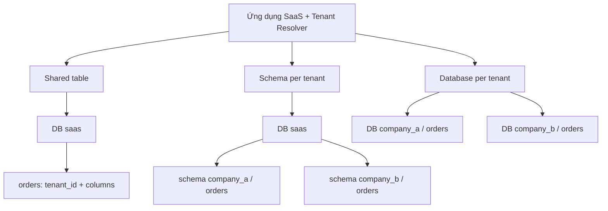
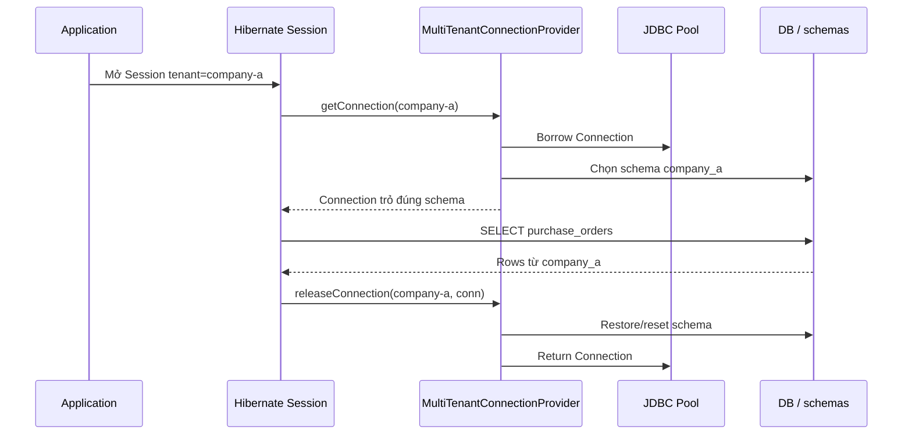
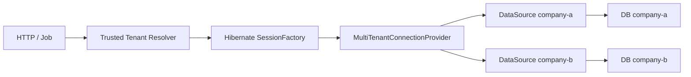
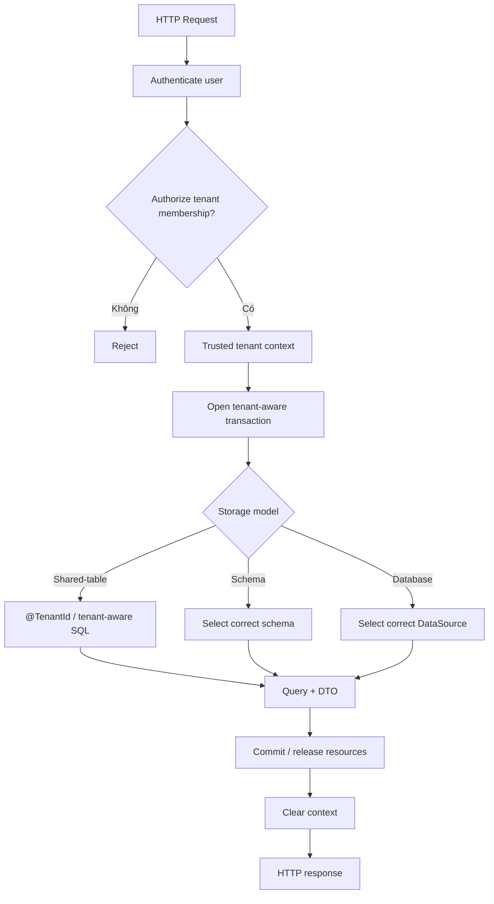

# Phân biệt nhiều tổ chức dùng chung bảng, tách schema hoặc tách cơ sở dữ liệu

Một ứng dụng SaaS thường phục vụ nhiều **tổ chức** (organizations), ví dụ nhiều công ty sử dụng cùng một hệ thống quản lý đơn hàng. Mỗi tổ chức có người dùng, đơn hàng, khách hàng và cấu hình riêng. Trong kiến trúc **multi-tenancy**, mỗi tổ chức thường được gọi là một **tenant**.

Cùng một nghiệp vụ “lấy danh sách đơn hàng” có thể được triển khai bằng ba cách lưu trữ rất khác nhau:

1. **Dùng chung bảng (shared tables / discriminator-based)**: tất cả tổ chức lưu trong cùng bảng, mỗi hàng có `tenant_id`.
2. **Tách schema (schema-per-tenant)**: các tổ chức nằm trong cùng database nhưng mỗi tổ chức có một schema với các bảng riêng.
3. **Tách cơ sở dữ liệu (database-per-tenant)**: mỗi tổ chức có database riêng, ứng dụng chọn nguồn kết nối tương ứng.

Hibernate hỗ trợ cả ba hướng nhưng **cách phân biệt tenant trong SQL, cách cấp JDBC connection, mức cô lập dữ liệu và chi phí vận hành** không giống nhau. Việc chọn mô hình không chỉ là đổi một property: nó tác động đến khóa ngoại, unique constraints, indexes, transaction, cache, migration, backup, cấp phát tenant mới và bảo mật.

Mục tiêu của bài là giúp phân biệt chính xác ba mô hình, hiểu Hibernate ORM xử lý `tenantIdentifier` ra sao, biết nơi cần triển khai `@TenantId` hoặc `MultiTenantConnectionProvider`, và chọn phương án dựa trên đặc tính workload thay vì chỉ theo số lượng khách hàng.

---

## 1. Tenant là gì, và tenant khác user như thế nào?

Giả sử một SaaS có ba công ty:

```text
Tenant: company-a
  User: alice
  User: bob
  Orders: A-001, A-002, ...

Tenant: company-b
  User: bob
  Orders: B-001, B-002, ...

Tenant: company-c
  User: carol
  Orders: C-001, ...
```

Một `User` có thể thuộc một hoặc nhiều tenant, và hai tenant có thể có username giống nhau. Do đó:

- **User identity** trả lời “ai đang thao tác?”.
- **Tenant identity** trả lời “dữ liệu của tổ chức nào đang được truy cập?”.
- **Authorization** trả lời “người này có được phép thao tác với tenant và đối tượng cụ thể hay không?”.
- **Database isolation** quyết định dữ liệu được lưu và phân tách bằng cơ chế nào.

Một HTTP header `X-Tenant-Id: company-b` **không tự chứng minh** người gửi được phép truy cập company-b. Hệ thống phải giải quyết tenant từ một nguồn được xác thực, kiểm tra membership/role, rồi mới mở phiên làm việc Hibernate với tenant tương ứng.

### 1.1. Multi-tenancy không đồng nghĩa nhiều user

Một ứng dụng có 100.000 users nhưng toàn bộ dữ liệu thuộc một tổ chức duy nhất có thể không phải multi-tenant. Ngược lại, một ứng dụng có ba tổ chức, mỗi tổ chức chỉ một user, vẫn có yêu cầu cô lập dữ liệu tenant.

### 1.2. Tenant không nhất thiết trùng company pháp lý

Một khách hàng có thể có nhiều workspace/tenants; một tenant có thể chứa nhiều chi nhánh. Điều quan trọng là **ranh giới cô lập dữ liệu** được định nghĩa rõ theo hợp đồng sản phẩm, không phải chỉ đặt tên field là `organizationId`.

### 1.3. Một yêu cầu truy vấn

Service logic:

```java
public List<PurchaseOrder> recentOrders() {
    return entityManager.createQuery(
        """
        select o
        from PurchaseOrder o
        order by o.createdAt desc
        """,
        PurchaseOrder.class
    )
    .setMaxResults(20)
    .getResultList();
}
```

Code HQL không nhất thiết viết tên tenant vào text. Hibernate sẽ dùng tenant context theo mô hình đã cấu hình; tuy nhiên, cách áp điều kiện tenant **khác nhau giữa ba mô hình** và đặc biệt cần lưu ý native SQL.

## 2. Nhìn ba mô hình trên cùng một sơ đồ



### 2.1. Mô hình dùng chung bảng

```text
database: saas
schema: public

orders
+----+-----------+----------+--------+
| id | tenant_id | code     | amount |
+----+-----------+----------+--------+
|  1 | company-a | A-001    | 100.00 |
|  2 | company-b | B-001    | 220.00 |
|  3 | company-a | A-002    |  80.00 |
+----+-----------+----------+--------+
```

Câu SQL logic cần cô lập:

```sql
SELECT *
FROM orders
WHERE tenant_id = :tenantId
ORDER BY id DESC;
```

Nếu quên tenant condition trong một đường truy vấn không được Hibernate bảo vệ, có nguy cơ đọc nhầm dữ liệu của tổ chức khác.

### 2.2. Mô hình tách schema

```text
database: saas

company_a.orders
+----+------+--------+
| id | code | amount |
+----+------+--------+
|  1 | A-001| 100.00 |
+----+------+--------+

company_b.orders
+----+------+--------+
| id | code | amount |
+----+------+--------+
|  1 | B-001| 220.00 |
+----+------+--------+
```

Ứng dụng dùng connection/query context trỏ tới schema đúng của tenant. SQL có thể vẫn là:

```sql
SELECT * FROM orders ORDER BY id DESC;
```

Nhưng `orders` được resolve thành `company_a.orders` hoặc `company_b.orders` theo connection/schema selection. Dữ liệu không nằm trong cùng table vật lý.

### 2.3. Mô hình tách database

```text
database: saas_company_a
  schema: public
  table: orders

database: saas_company_b
  schema: public
  table: orders
```

Hibernate chọn connection tới database của company-a hoặc company-b. SQL table name có thể giống nhau, còn nguồn kết nối khác hoàn toàn.

**Điểm mấu chốt:** *shared-table* cô lập bằng điều kiện trên rows; *schema-per-tenant* cô lập bằng namespace bảng; *database-per-tenant* cô lập bằng đích kết nối database.

## 3. Bảng so sánh tổng quan

| Tiêu chí | Dùng chung bảng | Tách schema | Tách database |
|---|---|---|---|
| Số bảng vật lý | Một bộ bảng | Một bộ bảng mỗi schema | Một bộ bảng mỗi database |
| Cột tenant trong business table | Thường bắt buộc | Thường không cần | Thường không cần |
| JDBC connection | Có thể dùng pool chung | Pool chung hoặc quản lý schema trên connection | Thường route đến pool/database của tenant |
| Chi phí tenant mới | Thấp | Tạo schema + tables/migrations | Cấp DB + credentials/pool + migrations |
| Migrations | Một schema chung | N schema phải đồng bộ | N databases phải đồng bộ |
| Mức cô lập dữ liệu | Logic/row-level | Namespace/schema-level | Database-level |
| Nguy cơ thiếu tenant predicate | Cao trong SQL tự viết | Thấp hơn nhưng còn rủi ro chọn schema sai | Thấp hơn nhưng còn rủi ro route sai |
| Khả năng backup/restore từng tenant | Khó hơn | Trung bình, phụ thuộc DBMS | Thường thuận tiện hơn |
| Scale nhiều tenants nhỏ | Thường tốt | Cần cân nhắc nhiều schema/objects | Dễ phát sinh quá nhiều pools/DBs |
| Scale một tenant rất lớn | Có thể noisy-neighbor | Cùng database resources | Có thể cấp tài nguyên riêng |
| Báo cáo cross-tenant | Có thể query cùng bảng có kiểm soát | Cần liên schema hoặc tập hợp kết quả | Cần liên DB/data warehouse |
| Điều chỉnh cấu hình từng tenant | Hạn chế hơn | Một phần | Linh hoạt hơn |
| Portability DBMS | Tenant predicate thông dụng | Schema semantics khác giữa DBMS | DataSource routing khá phổ quát |
| Hibernate mechanism | `@TenantId` (Hibernate 6+) | `MultiTenantConnectionProvider` trên Hibernate 6.x; mapper ở 7.1+ | `MultiTenantConnectionProvider` |

Không có cột nào mặc nhiên “tốt nhất”. Một SaaS có nhiều nghìn tenant nhỏ sẽ ưu tiên vận hành khác một nền tảng phục vụ vài khách hàng doanh nghiệp có yêu cầu cô lập pháp lý cao.

## 4. Ranh giới quan trọng: một Hibernate Session gắn với một tenant

Hibernate hiểu tenant qua **tenant identifier** của `Session`/`EntityManager`. Session được mở cho một tenant cụ thể và không nên bị chuyển qua tenant khác giữa vòng đời.

Ví dụ Hibernate native:

```java
try (Session session = sessionFactory
        .withOptions()
        .tenantIdentifier("company-a")
        .openSession()) {

    List<PurchaseOrder> orders =
        session.createSelectionQuery(
            "from PurchaseOrder",
            PurchaseOrder.class
        ).getResultList();
}
```

Ví dụ JPA API với Hibernate-specific hint:

```java
import org.hibernate.jpa.HibernateHints;

EntityManager em = entityManagerFactory.createEntityManager(
    Map.of(
        HibernateHints.HINT_TENANT_ID,
        "company-a"
    )
);

try {
    // JPA operations ở tenant company-a.
} finally {
    em.close();
}
```

Ở đây `HibernateHints.HINT_TENANT_ID` là extension của Hibernate, không phải một JPA constant portable giữa mọi provider.

### 4.1. Tenant identifier phải được biết trước khi Session mở

Không nên:

1. Mở EntityManager mặc định.
2. Load entity company-a.
3. Đổi ThreadLocal tenantId thành company-b.
4. Query tiếp trong cùng EntityManager.

Identity map, pending changes, collections và JDBC routing có thể còn gắn với tenant cũ. Một tenant identifier mới không có nghĩa mọi managed entities được “chuyển nhà”.

**Mỗi business operation phải dùng tenant cố định từ đầu transaction/session.** Muốn truy cập tenant khác, mở context/transaction đúng cách và có authorization rõ.

### 4.2. Tenant context và security context là hai việc

Tenant resolver có thể đọc tenant đã được xác thực, nhưng nó không thay thế kiểm tra:

- Người dùng có thuộc tenant đó không?
- Có quyền xem dữ liệu đó không?
- Có quyền cross-tenant admin không?
- Tenant có đang active/suspended không?

Một Session company-a là ranh giới dữ liệu, không phải bằng chứng tất cả queries đều được authorized ở cấp record/role.

## 5. Hibernate 6: ba mô hình và API thực tế

Hibernate ORM 6.0 đã đơn giản hóa cấu hình multi-tenancy:

- Khi dùng `MultiTenantConnectionProvider`, Hibernate hiểu rằng việc chọn connection theo tenant là trách nhiệm provider. Về cơ chế này, schema- và database-based multitenancy tương tự nhau.
- Khi dùng `@TenantId`, Hibernate nhận diện mô hình discriminator/row-based multitenancy.
- Những ví dụ Hibernate 5 dùng `hibernate.multiTenancy` hoặc enum `MultiTenancyStrategy` **không nên copy sang Hibernate 6**; những cấu hình/types cũ đã bị loại bỏ hoặc bỏ qua.

Các setting quan trọng trong Hibernate 6:

```properties
hibernate.tenant_identifier_resolver=...
hibernate.multi_tenant_connection_provider=...
```

Trong ứng dụng Spring Boot, thường truyền instance qua `HibernatePropertiesCustomizer` hoặc cơ chế cấu hình tương ứng thay vì gõ class name tùy tiện trong properties.

**Lưu ý phiên bản:** Hibernate **7.1+** giới thiệu thêm `TenantSchemaMapper` và setting `hibernate.multi_tenant.schema_mapper` cho schema-based multitenancy. Điều này không có nghĩa Hibernate 6.x có cùng API hoặc 7.x phải dùng provider cho schema như 6.x.

## 6. Shared-table: một bảng chứa dữ liệu nhiều tổ chức

Với mô hình dùng chung bảng, gần như mọi entity thuộc tenant phải có cột `tenant_id`.

DDL khái niệm:

```sql
CREATE TABLE purchase_orders (
    id BIGINT PRIMARY KEY,
    tenant_id VARCHAR(64) NOT NULL,
    order_code VARCHAR(40) NOT NULL,
    status VARCHAR(24) NOT NULL,
    created_at TIMESTAMP NOT NULL
);

CREATE INDEX ix_orders_tenant_created
    ON purchase_orders (tenant_id, created_at);

CREATE UNIQUE INDEX uk_orders_tenant_code
    ON purchase_orders (tenant_id, order_code);
```

Dữ liệu company-a và company-b trộn trong bảng, nhưng có thể dùng cùng `order_code` khác tenant vì uniqueness nằm trên cặp `(tenant_id, order_code)`.

### 6.1. Hibernate 6 @TenantId

Hibernate 6 có annotation:

```java
import org.hibernate.annotations.TenantId;

@Entity
@Table(
    name = "purchase_orders",
    uniqueConstraints = {
        @UniqueConstraint(
            name = "uk_orders_tenant_code",
            columnNames = {"tenant_id", "order_code"}
        )
    },
    indexes = {
        @Index(
            name = "ix_orders_tenant_created",
            columnList = "tenant_id, created_at"
        )
    }
)
public class PurchaseOrder {
    @Id
    @GeneratedValue(strategy = GenerationType.SEQUENCE)
    private Long id;

    @TenantId
    @Column(name = "tenant_id", nullable = false, updatable = false)
    private String tenantId;

    @Column(name = "order_code", nullable = false, length = 40)
    private String orderCode;

    @Column(name = "created_at", nullable = false)
    private Instant createdAt;

    protected PurchaseOrder() {}
}
```

`@TenantId` xác định property chứa tenant identifier. Khi entity mới được persist, Hibernate điền giá trị tenant ID của Session. Khi truy vấn entity qua cơ chế ORM được hỗ trợ, Hibernate áp giới hạn tenant cho entities đó.

Ví dụ HQL:

```java
List<PurchaseOrder> orders = session
    .createSelectionQuery(
        "from PurchaseOrder o order by o.createdAt desc",
        PurchaseOrder.class
    )
    .getResultList();
```

SQL về mặt ý tưởng:

```sql
SELECT ...
FROM purchase_orders o
WHERE o.tenant_id = ?
ORDER BY o.created_at DESC;
```

Dấu `?` nhận tenant ID của Session. SQL thật còn phụ thuộc Hibernate version, mapping, query shape và Dialect.

### 6.2. Không tự điền tenantId từ request DTO

Sai về trust boundary:

```java
PurchaseOrder order = new PurchaseOrder();
order.setTenantId(request.tenantId());
entityManager.persist(order);
```

Nếu request gửi tenant ID khác, có thể tạo lỗi hoặc cross-tenant security issue trong một cơ chế tự quản lý tenant field. Với `@TenantId`, field nên được quản lý theo Session tenant; không expose setter từ input người dùng.

### 6.3. @TenantId không phải Jakarta Persistence chuẩn

`@TenantId` thuộc `org.hibernate.annotations`, không phải `jakarta.persistence`. Nếu ứng dụng cần di chuyển sang JPA provider khác, phải thiết kế lại cơ chế discriminator bằng filters, query predicates, DB row-level security hoặc abstraction repository.

Ưu tiên cách Hibernate hỗ trợ trực tiếp khi ứng dụng xác định phụ thuộc Hibernate ORM; nhưng phải kiểm tra hành vi của mọi đường truy vấn không qua ORM.

## 7. Shared-table: khóa chính và uniqueness

Có hai chiến lược ID hay gặp.

### 7.1. ID duy nhất trên toàn bộ bảng

```sql
CREATE TABLE customers (
    id BIGINT PRIMARY KEY,
    tenant_id VARCHAR(64) NOT NULL,
    customer_code VARCHAR(40) NOT NULL,
    UNIQUE (tenant_id, customer_code)
);
```

Nếu `id` là sequence/UUID duy nhất toàn cục, `Customer#100` chỉ là một hàng duy nhất về vật lý. Nhưng **việc lookup theo ID vẫn phải tuân thủ tenant context**, vì ID không phải quyền truy cập.

Ưu điểm:

- Mapping `@Id Long id` đơn giản.
- Các khóa ngoại có thể dùng `customer_id`.
- ID uniqueness không va chạm giữa tenants.

Nhược điểm: schema FK chỉ trên `customer_id` **chưa buộc tenant của Order trùng tenant của Customer** nếu application viết sai SQL.

### 7.2. Composite key theo tenant

DDL:

```sql
CREATE TABLE customers (
    tenant_id VARCHAR(64) NOT NULL,
    local_id BIGINT NOT NULL,
    customer_code VARCHAR(40) NOT NULL,
    PRIMARY KEY (tenant_id, local_id),
    UNIQUE (tenant_id, customer_code)
);

CREATE TABLE purchase_orders (
    tenant_id VARCHAR(64) NOT NULL,
    local_id BIGINT NOT NULL,
    customer_local_id BIGINT NOT NULL,
    PRIMARY KEY (tenant_id, local_id),
    FOREIGN KEY (tenant_id, customer_local_id)
        REFERENCES customers (tenant_id, local_id)
);
```

Một FK chứa `tenant_id` giúp DB chặn order thuộc company-a tham chiếu customer của company-b dù có lỗi application. Đây là một mức bảo vệ tính toàn vẹn quan trọng.

Nhưng composite PK/FK làm mapping JPA (`@EmbeddedId`, `@MapsId`, `@JoinColumns`), indexes, joins và các integration contracts phức tạp hơn.

### 7.3. Dùng global ID vẫn nên có tenant-aware FK

Có thể giữ `id` global unique đồng thời khai unique key `(tenant_id, id)` trên bảng cha để tạo composite FK từ bảng con. Cách này cho phép Hibernate mapping identity đơn giản hơn ở một số chỗ nhưng FK schema vẫn đảm bảo cùng tenant.

SQL minh họa:

```sql
ALTER TABLE customers
ADD CONSTRAINT uk_customers_tenant_id UNIQUE (tenant_id, id);

ALTER TABLE purchase_orders
ADD CONSTRAINT fk_orders_customer_same_tenant
FOREIGN KEY (tenant_id, customer_id)
REFERENCES customers (tenant_id, id);
```

Cần thiết kế các `@JoinColumns`/updatable/insertable flags cẩn thận nếu một tenant column tham gia nhiều mappings. Không chỉ thêm composite FK trong migration mà bỏ qua mapping ownership/cascade test.

### 7.4. Business key phải scoped theo tenant

Ví dụ email là duy nhất **trong từng tenant**:

```sql
UNIQUE (tenant_id, email)
```

khác với:

```sql
UNIQUE (email)
```

Cách thứ hai ngăn hai tổ chức có cùng email, có thể không đúng nghiệp vụ. Ngược lại, một key cần unique toàn hệ thống (ví dụ public slug) phải có constraint global rõ.

## 8. Shared-table: indexes gần như luôn cần tenant làm leading key

Nếu query phổ biến:

```sql
SELECT id, order_code
FROM purchase_orders
WHERE tenant_id = ?
  AND status = ?
ORDER BY created_at DESC
LIMIT 20;
```

một composite B-tree index có thể là:

```sql
CREATE INDEX ix_orders_tenant_status_created
ON purchase_orders (tenant_id, status, created_at DESC);
```

Cột tenant thường nên nằm gần đầu composite index khi phần lớn queries luôn filter theo tenant; nhưng đây **không phải luật cứng cho mọi index**. Workload có cross-tenant admin reporting, filter cardinality khác và DB optimizer riêng có thể cần index khác.

### 8.1. Một vài hệ quả của shared-table

- Một tenant lớn có thể chiếm phần lớn rows/index pages.
- Vacuum/reindex/stats trong DB dùng chung.
- Một query thiếu tenant condition có thể scan lượng dữ liệu rất lớn.
- Partitioning theo tenant hoặc time có thể giúp ở quy mô lớn nhưng tăng operational complexity.
- TenantId type và collation ảnh hưởng kích thước index; UUID vs VARCHAR có trade-off.

### 8.2. Không lập một index cho mỗi tenant nếu số tenant lớn

Một partial index riêng cho từng tenant có thể gây bùng nổ DDL/object count. Thường ưu tiên composite indexes chung, partition strategy có kiểm chứng hoặc đưa các tenant cực lớn sang storage riêng.

### 8.3. Database RLS như lớp phòng vệ bổ sung

PostgreSQL có Row-Level Security (RLS) và `CREATE POLICY`:

```sql
-- Mã minh họa PostgreSQL, chưa phải cấu hình production đầy đủ.
ALTER TABLE purchase_orders ENABLE ROW LEVEL SECURITY;

CREATE POLICY tenant_isolation_policy
ON purchase_orders
USING (
    tenant_id = current_setting('app.tenant_id', true)
);
```

Để RLS có hiệu lực đúng, phải thiết kế cách set tenant session variable, database roles và xử lý connection reuse/transaction scope. Không tin `SET app.tenant_id` từ untrusted client và không giả định application DB role có quyền owner/bypass RLS sẽ bị policy chặn.

**RLS là defense in depth**, không tự thay `@TenantId`/authorized tenant resolution hoặc thay trách nhiệm kiểm thử.

## 9. Shared-table: giới hạn của @TenantId

Một câu rất quan trọng trong tài liệu Hibernate: **native SQL không tự được lọc theo tenant ID** bởi `@TenantId`.

Ví dụ nguy hiểm:

```java
List<Object[]> rows = entityManager.createNativeQuery(
    "select id, order_code from purchase_orders"
).getResultList();
```

Nếu dùng chung bảng và chỉ dựa vào `@TenantId`, native query có thể trả rows của nhiều tenants.

Cần thêm điều kiện tenant một cách chủ động, ví dụ:

```java
List<Object[]> rows = entityManager.createNativeQuery(
    """
    select id, order_code
    from purchase_orders
    where tenant_id = :tenantId
    """
)
.setParameter("tenantId", trustedTenantId)
.getResultList();
```

`trustedTenantId` phải khớp tenant identity của Session/transaction và đã được xác thực.

### 9.1. Những đường ghi không qua entity lifecycle

Cẩn trọng với:

- Native SQL `UPDATE`, `DELETE`, `INSERT`.
- JDBC template được dùng chung.
- Stored procedures/functions.
- Bulk imports, migrations, ETL jobs.
- Query của reporting tool.
- DB admin scripts.
- Một service khác cùng ghi database.

Các đường này có thể bỏ qua Hibernate `@TenantId` hoàn toàn.

### 9.2. Bulk HQL/Criteria DML

Không nên suy từ behavior của SELECT rằng mọi biến thể bulk HQL/Criteria UPDATE/DELETE và mọi version Hibernate đều được bảo vệ tương đương trong các custom query paths. Với bulk DML, luôn kiểm tra SQL phát sinh theo ORM version, binding của tenant predicate, row count và transactional correctness.

Nếu nghiệp vụ quan trọng, có thể viết explicit tenant condition với trusted ID như một lớp an toàn bổ sung khi query design cho phép; tránh nhầm lẫn tenant context đang có.

### 9.3. Entity không đánh dấu @TenantId

Một entity tenant-specific nhưng thiếu `@TenantId` có thể không tự được discriminator filtering theo cách mong đợi. Cần rà soát toàn bộ model: entities, associations, join tables và global/reference tables.

Không phải mọi bảng đều tenant-specific. Ví dụ `countries` là reference table global có thể dùng chung. Cần phân biệt **global data** có chủ đích với **tenant data** để không bỏ sót dữ liệu nhạy cảm.

## 10. Shared-table: các bảng nối và quan hệ nhiều-nhiều

Ví dụ user thuộc nhiều tenant và nhiều groups:

```text
users
groups
user_groups
```

Nếu `groups` là tenant-specific, bảng `user_groups` cần bảo đảm không liên kết user/group thuộc tenant sai.

Một schema có thể dùng:

```sql
CREATE TABLE tenant_groups (
    tenant_id VARCHAR(64) NOT NULL,
    group_id BIGINT NOT NULL,
    PRIMARY KEY (tenant_id, group_id)
);

CREATE TABLE tenant_user_groups (
    tenant_id VARCHAR(64) NOT NULL,
    user_id BIGINT NOT NULL,
    group_id BIGINT NOT NULL,
    PRIMARY KEY (tenant_id, user_id, group_id),
    FOREIGN KEY (tenant_id, group_id)
        REFERENCES tenant_groups(tenant_id, group_id)
);
```

Nếu `user_id` là global identity, cần thiết kế FK/authorization riêng cho tenant membership. Không giả định mối quan hệ nhiều-nhiều Hibernate tự thêm tenant condition vào mọi junction table khi schema/association mapping thiếu thông tin.

Với shared-table model, **cross-tenant references** là một loại lỗi dữ liệu đáng sợ: query có thể lọc root theo tenant nhưng join sang row của tenant khác nếu FK/association được thiết kế sai. Kiểm thử quan hệ và ràng buộc DB là rất quan trọng.

## 11. Schema-per-tenant: mỗi tenant có namespace riêng

Ví dụ PostgreSQL:

```sql
CREATE SCHEMA company_a;
CREATE SCHEMA company_b;

CREATE TABLE company_a.purchase_orders (
    id BIGINT PRIMARY KEY,
    order_code VARCHAR(40) NOT NULL
);

CREATE TABLE company_b.purchase_orders (
    id BIGINT PRIMARY KEY,
    order_code VARCHAR(40) NOT NULL
);
```

Hai tables có thể có cùng PK `id=1` mà không va chạm vì nằm trong schema khác nhau.

Trong mô hình này, entity Java thường **không cần `@TenantId`** trên mọi bảng, vì Hibernate kết nối và truy vấn vào schema của tenant.

### 11.1. Ưu điểm

- Dữ liệu được phân cách bởi schema namespace.
- Mỗi schema có indexes, sequences và constraints riêng.
- Có thể dùng cùng mã định danh hoặc business key giữa tenants.
- Một số database tools cho phép quản lý quyền theo schema.
- Không cần thêm tenant predicates cho mọi business query thông thường.

### 11.2. Đánh đổi

- Số lượng objects tăng theo số tenants: tables, indexes, sequences, constraints.
- Migrations phải chạy cho mỗi schema.
- DB-level shared CPU/memory/storage/locks vẫn tạo noisy-neighbor.
- Query cross-schema/reporting cần chủ đích và permissions.
- Một số DBMS định nghĩa “schema” khác, ví dụ MySQL thường dùng database/schema gần như đồng nghĩa.
- Connection/schema state bị rò giữa tenants nếu provider không reset đúng.

### 11.3. Không hardcode schema trong entity mapping

Nếu mọi tenant dùng cùng Java entity class:

```java
@Table(name = "purchase_orders")
public class PurchaseOrder { /* ... */ }
```

Không gắn:

```java
@Table(schema = "company_a", name = "purchase_orders")
```

vì như vậy entity đã cố định vào một schema và không thể tự route company-b theo Session tenant.

Hibernate cần biết cách chọn schema đúng trên JDBC connection hoặc thông qua mapper theo version.

## 12. Schema-per-tenant trong Hibernate 6.x

Với Hibernate 6.x, tài liệu mô tả `MultiTenantConnectionProvider` dùng được cho **schema-based** hoặc **database-based**. Hibernate yêu cầu connection tương ứng với tenant; provider có thể chọn schema trên cùng DataSource.

Sơ đồ:



### 12.1. Interface MultiTenantConnectionProvider

Các method quan trọng của contract trong Hibernate 6.x bao gồm:

```java
getAnyConnection()
releaseAnyConnection(Connection connection)

getConnection(tenantIdentifier)
releaseConnection(tenantIdentifier, Connection connection)

supportsAggressiveRelease()
```

Nó còn có các phương thức theo `Wrapped`/SPI mà implementation phải đáp ứng. Interface có thể có generic type/return signatures thay đổi theo release; ví dụ trên liệt kê **ý nghĩa API**, không phải một class tự biên dịch hoàn chỉnh.

### 12.2. getAnyConnection dùng để làm gì?

Hibernate cần connection khi bootstrap để đọc `DatabaseMetaData` và cấu hình provider. Ở thời điểm này có thể **chưa có tenant ID**.

`getAnyConnection()` trả một connection thích hợp để đọc metadata, và `releaseAnyConnection()` giải phóng nó. Không lấy bừa tenant context từ HTTP ThreadLocal trong quá trình khởi động ứng dụng.

Với các tenants có DB schema/type khác nhau, việc dùng một tenant mẫu để lấy metadata có thể không đủ. Multi-tenancy dạng chung `SessionFactory` thường giả định tenants có schema tương thích.

### 12.3. Chọn schema trên JDBC Connection

Một phương án ở JDBC:

```java
String oldSchema = connection.getSchema();
connection.setSchema(mappedSchemaName);
```

`mappedSchemaName` phải do **server-side tenant registry** ánh xạ từ tenant ID, không nhận trực tiếp từ request header. Driver/DBMS phải hỗ trợ `setSchema` phù hợp.

Khi trả connection về pool:

```java
connection.setSchema(originalSchema);
```

hoặc reset về schema mặc định xác định của pool. Nếu không reset, connection company-a có thể được dùng lại cho company-b khi borrow lần sau.

### 12.4. Không dùng SQL string ghép tên schema tùy ý

Nguy hiểm:

```java
statement.execute(
    "SET search_path TO " + request.getHeader("X-Tenant")
);
```

Schema name là SQL identifier, không thể bảo vệ chỉ bằng bind parameter như data value thông thường. Cần **whitelist/registry ID → tên schema đã provisioned**, quoting đúng DBMS hoặc dùng JDBC API phù hợp và kiểm tra tên đầu vào.

### 12.5. Connection cleanup bắt buộc

Nếu business query ném exception:

1. Connection vẫn phải được release/reset.
2. Không đưa connection với schema company-a về pool chung khi state chưa được reset.
3. Nếu reset lỗi, có thể cần loại bỏ/discard connection thay vì trả nó cho tenant khác.
4. Test cần chạy nhiều requests luân phiên tenants trên cùng pool size nhỏ để phát hiện lỗi.

Đây là vấn đề **security isolation**, không chỉ memory leak.

## 13. Hibernate 7.1+: TenantSchemaMapper

Hibernate 7.1 có API `TenantSchemaMapper` cùng setting:

```properties
hibernate.multi_tenant.schema_mapper=...
```

Mục đích là ánh xạ từ tenant identifier sang schema name. Theo tài liệu Hibernate 7.1, Hibernate có thể dùng `Connection.setSchema(String)` trên các JDBC connections mới được acquire theo mapping đó.

Ví dụ **ý tưởng**, không phải code cho Hibernate 6.x:

```text
tenantId = "company-a"
       |
       v
TenantSchemaMapper
       |
       v
schemaName = "company_a"
       |
       v
Connection.setSchema("company_a")
```

Điểm đáng nhớ:

- `TenantSchemaMapper` là API **từ 7.1**; Hibernate 6.6 chưa có cùng interface.
- Không kết hợp cả custom schema-changing connection provider và schema mapper mà chưa đọc hợp đồng phối hợp của release.
- Cần kiểm tra cách schema state được reset, driver support, tenant registry và JDBC pool.
- Không nhầm `TenantSchemaMapper` với `CurrentTenantIdentifierResolver`: một cái ánh xạ tenant → schema, một cái xác định tenant hiện tại.

Khi nâng Hibernate 6 sang 7.1+, một implementation schema-per-tenant có thể cân nhắc API mới nhưng không nhất thiết phải viết lại nếu provider hiện tại vẫn hoạt động và đã được kiểm chứng.

## 14. Database-per-tenant: mỗi tổ chức có database riêng

Ví dụ:

```text
Tenant company-a
  JDBC URL: jdbc:postgresql://db-a:5432/app
  Pool A: 10 connections

Tenant company-b
  JDBC URL: jdbc:postgresql://db-b:5432/app
  Pool B: 10 connections
```

Trong Hibernate, `MultiTenantConnectionProvider` có nhiệm vụ:

1. Nhận `tenantIdentifier` của Session.
2. Tra cứu cấu hình/registry đáng tin cậy.
3. Chọn đúng `DataSource` hoặc connection pool.
4. Trả connection cho Hibernate.
5. Khi release, trả đúng pool.

Không cần thêm tenant column cho mỗi bảng nếu database chỉ chứa dữ liệu của một tenant; tuy nhiên, có thể lưu tenant metadata ở một số bảng để hỗ trợ tracing/export/business rules.

### 14.1. Sơ đồ routing



### 14.2. Bản thiết kế provider (pseudocode)

```java
// Sơ đồ logic: signatures chi tiết tùy Hibernate release.
class TenantDatabaseConnectionProvider {

    private final Map<String, DataSource> dataSources;

    Connection getConnection(String tenantId) throws SQLException {
        DataSource dataSource = dataSources.get(tenantId);

        if (dataSource == null) {
            throw new IllegalArgumentException(
                "Unknown tenant"
            );
        }
        return dataSource.getConnection();
    }

    void releaseConnection(
            String tenantId,
            Connection connection) throws SQLException {
        connection.close(); // Return to đúng pool nguồn.
    }
}
```

Đây **không phải** một implementation hoàn chỉnh của `MultiTenantConnectionProvider`: class thật cần implement mọi method, phục vụ bootstrap metadata, xử lý `supportsAggressiveRelease`, unwrap/Service SPI và quản lý pool/resource chính xác.

Điều quan trọng là **tenant ID chọn một DataSource đã được xác thực**, không tạo JDBC URL trực tiếp từ chuỗi do user nhập.

### 14.3. Ưu điểm

- Mỗi tenant có thể dùng riêng DB instance/cluster.
- Dễ cấp CPU/storage/replica tài nguyên riêng cho tenant lớn.
- Thường dễ backup/restore một tenant độc lập hơn.
- Có thể thực hiện maintenance/upgrade theo tenant.
- Cô lập lỗi, tài nguyên và quyền DB mạnh hơn mô hình chung nếu hạ tầng thật sự tách biệt.

### 14.4. Đánh đổi

- Cần cấp database, user/credentials, secrets và migration khi onboard tenant.
- Pool per-tenant có thể làm bùng nổ connection count.
- Migrations phải áp cho nhiều databases.
- Theo dõi metrics, health, version, backups nhiều nơi.
- Cross-tenant reporting thường cần warehouse/ETL hoặc query fan-out.
- Không thể tự tạo transaction ACID đơn giản xuyên nhiều databases nếu nghiệp vụ yêu cầu đồng thời.

### 14.5. Separate database không nhất thiết separate server

Hai databases có thể cùng chạy trên một DB server/cluster. Điều đó tạo **logical database isolation** nhưng vẫn chia CPU, IO và failure domain. Nếu hợp đồng yêu cầu dedicated resources hoặc geographic region, phải tách hạ tầng tương ứng; chỉ đặt tên database khác nhau chưa đủ.

## 15. Một SessionFactory hay nhiều SessionFactory?

Trong nhiều mô hình Hibernate multi-tenancy, ứng dụng dùng **một SessionFactory với mappings thống nhất** và để provider/resolver chọn tenant lúc mở Session.

Ưu điểm:

- Dùng chung entity model, HQL và metadata mapping.
- Ít overhead tạo SessionFactory.
- Có thể quản lý connections qua provider.

Nhưng nếu mỗi tenant có schema khác nhau đáng kể, dialect khác nhau hoặc feature flag làm entity mapping không tương thích, một SessionFactory chung có thể không còn phù hợp.

### 15.1. Điều kiện quan trọng của một SessionFactory chung

- Bảng/cột/mapping tương thích giữa tenants.
- SQL Dialect phù hợp với các đích kết nối.
- Identifier strategies phù hợp.
- Cache và entity metadata có cấu trúc chung.
- Migrations được điều phối để không có schema drift nguy hiểm.

Không dùng một `SessionFactory` tạo SQL PostgreSQL rồi route tenant khác sang MySQL với Dialect khác và kỳ vọng Hibernate tự dịch theo connection từng lần.

### 15.2. Khi cần nhiều persistence units/SessionFactory

Các tenant có DBMS khác loại, mapping hoặc schema versions khác nhau có thể cần nhiều persistence units/SessionFactories hoặc một tầng abstraction khác. Đây là lựa chọn tăng complexity và memory; nên xác định rõ số lượng tenants/features trước khi dùng.

### 15.3. Không tạo SessionFactory per HTTP request

`SessionFactory` được thiết kế là đối tượng nặng, sống dài. Mở/đóng SessionFactory cho mỗi request để thay schema/database gây chi phí cực lớn, không phải cách multi-tenancy phù hợp.

## 16. CurrentTenantIdentifierResolver: xác định tenant hiện tại

Khi không muốn mỗi nơi mở Session đều truyền tenant ID thủ công, Hibernate có SPI:

```java
org.hibernate.context.spi.CurrentTenantIdentifierResolver<T>
```

Ví dụ cho Hibernate 6.x:

```java
import org.hibernate.context.spi.CurrentTenantIdentifierResolver;

public final class AppTenantResolver
        implements CurrentTenantIdentifierResolver<String> {

    @Override
    public String resolveCurrentTenantIdentifier() {
        String tenantId = TrustedTenantContext.currentTenant();

        if (tenantId == null) {
            throw new IllegalStateException(
                "No trusted tenant selected"
            );
        }

        return tenantId;
    }

    @Override
    public boolean validateExistingCurrentSessions() {
        return true;
    }
}
```

`TrustedTenantContext` là một abstraction **do ứng dụng định nghĩa**, không phải class có sẵn của Hibernate; nó chỉ trả tenant ID đã được authentication/authorization kiểm tra.

`validateExistingCurrentSessions()` hữu ích với current-session infrastructure: khi Hibernate tìm thấy một Session đang có trong scope, nó có thể kiểm tra tenant ID có khớp resolver hiện tại hay không thay vì âm thầm tái sử dụng sai tenant.

### 16.1. Resolver không tự làm authorization

Một resolver đọc `X-Tenant-Id` từ HTTP rồi trả luôn giá trị đó là **không đủ an toàn**. Application phải kiểm tra user có quyền tenant ấy trước khi ghi tenant vào context.

### 16.2. Fail closed khi thiếu tenant

Trả một default tenant như `"public"` cho mọi request không có context có thể làm lỗi khó phát hiện và dẫn tới cross-tenant reads/writes.

Một policy an toàn hơn cho tenant-specific endpoints là **fail closed**: không mở Session nếu chưa xác định tenant hợp lệ.

Nếu có dữ liệu global/system, thiết kế Session/connection policy riêng, không “rơi về admin tenant” ngầm.

### 16.3. Root tenant là quyền đặc biệt

Ở một số Hibernate releases, `CurrentTenantIdentifierResolver` có khái niệm root tenant thông qua `isRoot(...)`. Cơ chế này có thể liên quan đến quyền truy cập qua nhiều partition trong discriminator-based multitenancy.

Không cho user thông thường chọn một tenant ID đặc biệt để trở thành root; phải hạn chế mạnh chức năng admin/cross-tenant query và kiểm thử. Một query root tenant không phải một cách thay thế authorization.

## 17. Tích hợp resolver trong Spring Boot

Với một project Spring Boot dùng Hibernate, có thể đăng ký resolver bằng `HibernatePropertiesCustomizer`.

```java
import java.util.Map;
import org.springframework.boot.autoconfigure.orm.jpa.HibernatePropertiesCustomizer;
import org.springframework.stereotype.Component;

@Component
public class TenantHibernateCustomizer
        implements HibernatePropertiesCustomizer {

    private final AppTenantResolver tenantResolver;

    public TenantHibernateCustomizer(
            AppTenantResolver tenantResolver) {
        this.tenantResolver = tenantResolver;
    }

    @Override
    public void customize(Map<String, Object> properties) {
        properties.put(
            "hibernate.tenant_identifier_resolver",
            tenantResolver
        );
    }
}
```

Cần khai `AppTenantResolver` thành Spring bean theo cấu hình ứng dụng, và đảm bảo resolver không có mutable state dùng chung giữa requests.

Với schema/database model, thêm provider:

```java
properties.put(
    "hibernate.multi_tenant_connection_provider",
    multiTenantConnectionProvider
);
```

`multiTenantConnectionProvider` là implementation đã được cấu hình chọn kết nối tenant chính xác.

### 17.1. Tránh cấu hình hai cơ chế trùng lặp

Không vừa cấu hình tenant-aware SessionFactory multi-tenancy vừa tự route mọi DataSource trong một cách mù quáng mà không hiểu:

- Resolver nào chọn tenant.
- Provider nào chọn connection/schema.
- Transaction manager nào lấy connection.
- `JdbcTemplate` bên ngoài Hibernate có dùng cùng tenant routing không.
- L2/query cache được phân tách ra sao.

Một project có hai cơ chế routing không đồng bộ có thể Hibernate query vào tenant A còn JDBC template query tenant B.

### 17.2. Đừng dựa vào @Transactional đặt tenant sau khi Session đã mở

Tenant context phải có trước khi transaction manager/Hibernate mở persistence context. Nếu một interceptor đặt tenant sau service transaction đã bắt đầu, có thể quá muộn.

Định nghĩa thứ tự:

```text
Authenticate request
  -> Resolve/authorize tenant
  -> Open tenant context
  -> Enter @Transactional service
  -> Use Hibernate
  -> Transaction commit/rollback
  -> Clear tenant context
```

## 18. Tenant context propagation và ThreadLocal

Một cách triển khai ở ứng dụng servlet đồng bộ là ThreadLocal đã được kiểm soát.

```java
public final class TrustedTenantContext {

    private static final ThreadLocal<String> CURRENT =
        new ThreadLocal<>();

    private TrustedTenantContext() {}

    public static Scope open(String trustedTenantId) {
        String previous = CURRENT.get();
        CURRENT.set(trustedTenantId);

        return () -> {
            if (previous == null) {
                CURRENT.remove();
            } else {
                CURRENT.set(previous);
            }
        };
    }

    public static String currentTenant() {
        return CURRENT.get();
    }

    @FunctionalInterface
    public interface Scope extends AutoCloseable {
        @Override
        void close();
    }
}
```

Một service invocation:

```java
try (var ignored =
         TrustedTenantContext.open(authorizedTenantId)) {
    orderCommandService.confirmOrder(orderId);
}
```

Transaction của `orderCommandService` cần được bắt đầu khi scope đang mở.

### 18.1. Tại sao phải remove?

Servlet/thread pool dùng lại threads. Quên cleanup có thể khiến request mới thừa hưởng tenant của request cũ:

```text
Request 1 trên thread-7: company-a
ThreadLocal không clear
Request 2 trên thread-7: company-b
Resolver vẫn trả company-a
```

Đây là lỗi cross-tenant dữ liệu nghiêm trọng.

### 18.2. ThreadLocal không tự truyền qua @Async

Một job ở thread khác không tự nhận TenantContext của caller. Cần truyền tenant ID explicit vào job/message payload đã được xác thực, hoặc dùng context propagation được kiểm soát.

Không truyền Hibernate `Session` hoặc managed entities qua thread pool để “giữ nguyên tenant”. `Session` không thread-safe.

### 18.3. Scheduled job và message consumer

Một job chạy trên tenant A:

```java
try (var ignored =
         TrustedTenantContext.open("company-a")) {
    tenantOrderService.processExpiredOrders();
}
```

Job chạy nhiều tenant nên iterate qua **tenant registry** và mở một transaction/context riêng cho từng tenant, không để context thay đổi giữa một transaction đang chạy.

### 18.4. Reactive stack

WebFlux/Reactor có execution model khác thread-bound JPA thông thường. Không sao chép thiết kế ThreadLocal tenant context vào reactive pipelines rồi cho rằng luôn đúng. Hibernate Reactive/R2DBC cần context/transaction propagation phù hợp stack đó.

## 19. Tenant là một phần của cache identity

Trong multitenant Hibernate, entity ID `42` của company-a và `42` của company-b có thể đều hợp lệ, nhất là schema/database-per-tenant.

Nếu cache key chỉ là:

```text
PurchaseOrder#42
```

thì có nguy cơ lấy nhầm trạng thái. Cơ chế cache được Hibernate quản lý phải nhận diện tenant phù hợp trong cache key/scope. Ứng dụng vẫn phải kiểm tra cache provider và custom integration theo release.

### 19.1. Hibernate L1

Một Session gắn với tenant; không chuyển tenant trong Session đó. Identity map thường không bị chia sẻ giữa Sessions khác tenant.

### 19.2. Hibernate L2

Hibernate second-level cache multi-tenancy được thiết kế để phân biệt tenant trong entity/collection cache keys tương ứng. Tuy nhiên, **application-managed caches** không tự có behavior này.

Ví dụ nguy hiểm:

```java
@Cacheable("orders")
public OrderDto load(Long id) {
    return repository.findById(id).map(this::toDto).orElseThrow();
}
```

Nếu Spring Cache key chỉ là `id` và company-a/company-b đều có `Order#42`, kết quả có thể bị chia sẻ sai tenant.

Cache key an toàn cần bao gồm tenant:

```java
@Cacheable(
    cacheNames = "orders",
    key = "#tenantId + ':' + #orderId"
)
public OrderDto load(
        String tenantId,
        Long orderId) {
    // Phải bảo đảm tenantId đã được authorize.
}
```

Cách dùng này vẫn cần kiểm tra arguments/authorization và consistency; cache key đủ tenant chỉ là một lớp bảo vệ.

### 19.3. Query cache

Query-result cache phải tách kết quả theo tenant/session context, không được dùng cùng cached query result company-a cho company-b.

Dù Hibernate quản lý query cache có logic multi-tenancy, các custom caches như Redis keys, CDN cache, GraphQL DataLoader, HTTP response cache phải được thiết kế tenant-aware.

### 19.4. Eviction và monitoring

Khi flush/evict cache cho tenant A, cần xác định API/cache provider có hỗ trợ eviction theo tenant hay eviction theo region sẽ ảnh hưởng mọi tenants. Tránh thao tác “evict all” thường xuyên trong hệ thống nhiều tenants lớn nếu không cân nhắc hiệu năng.

## 20. Transaction: mỗi tenant một unit of work

Mô hình transaction nên gắn với tenant:

```java
@Transactional
public void confirmOrder(Long orderId) {
    PurchaseOrder order =
        repository.findById(orderId).orElseThrow();

    order.confirm();
}
```

Tenant context được xác định trước khi service transaction bắt đầu. Một transaction không nên tự chuyển:

```text
Tenant A -> load OrderA -> switch tenant B -> persist OrderB
```

để cố commit cross-tenant trong cùng EntityManager.

### 20.1. Shared-table

Một transaction có thể thao tác rows cùng bảng nhưng tenant predicate/entity mapping phải chặn cross-tenant changes. Nếu app cần admin transaction cross-tenant, phải thiết kế quyền và query path đặc biệt thay vì bỏ filter tạm thời trong code thông thường.

### 20.2. Schema-per-tenant

Connection đã chọn schema cho tenant A. Nếu đổi schema giữa transaction, các SQL sau có thể chạm namespace khác, trong khi persistence context giữ entities của tenant A. Không làm điều này trong application business flow.

### 20.3. Database-per-tenant

Một DB transaction thường áp cho **một database/connection**. Một business workflow cần atomic update đồng thời company-a DB và company-b DB có thể đòi distributed transactions hoặc thiết kế eventual consistency/outbox/saga.

Không giả định `@Transactional` thông thường tự commit ACID trên nhiều độc lập DBs.

## 21. Hibernate session tenant không đồng nghĩa JDBC template đã được bảo vệ

Một ứng dụng Spring có thể dùng đồng thời:

```java
entityManager.createQuery(...)

jdbcTemplate.queryForList(...)

namedParameterJdbcTemplate.update(...)
```

Nếu Hibernate multi-tenancy được thiết lập qua `@TenantId`, các SQL của `JdbcTemplate` không tự biết tenant filter.

Với schema/database routing, `JdbcTemplate` có thể dùng một `DataSource` khác với Hibernate `MultiTenantConnectionProvider`. Cần xây một tầng routing chung hoặc định nghĩa rõ cách mọi data-access APIs xác định tenant.

### 21.1. Dùng Spring AbstractRoutingDataSource?

`AbstractRoutingDataSource` có thể chọn DataSource theo một routing key do ứng dụng định nghĩa. Nó hữu ích trong vài database-per-tenant designs, nhưng không tự là toàn bộ Hibernate multitenancy setup:

- Khi nào tenant context được set?
- Connection được lấy trước hay sau route key?
- Hibernate Session tenant identifier có khớp DataSource đã chọn?
- Transaction manager có dùng chính routing DataSource?
- Có fallback DataSource nguy hiểm không?
- Có đầy đủ tenant isolation tests không?

Không chỉ dùng `AbstractRoutingDataSource` mà bỏ cơ chế kiểm tra Session tenant hoặc coi nó thay thế security authorization.

### 21.2. Không route bằng tenantId không được kiểm tra

Khi user có thể đưa một string bất kỳ, không tạo JDBC URL hoặc schema name bằng string concatenation. Chỉ route qua tenant registry đã provisioned và đã được authorized.

## 22. Tenant registry: bảng điều phối không thuộc dữ liệu tenant

Dù chọn mô hình nào, một SaaS thường có **tenant registry/control plane**:

```text
tenant_id
display_name
status (ACTIVE, SUSPENDED, DELETING)
storage_mode
schema_name
database_key
region
schema_version
plan
created_at
```

Đây là dữ liệu thuộc hệ thống điều phối, không nhất thiết nằm trong từng tenant database.

Một yêu cầu:

```text
Authenticated user + tenant membership
      |
      v
Tenant Registry
      |
      v
Resolve ACTIVE tenant and storage location
      |
      v
Open tenant-aware transaction / Session
```

### 22.1. Tenant ID và tên schema/database không phải một

Tenant ID là định danh business ổn định, ví dụ `"org-f2b..."`. Tên schema có thể là `"tenant_01872"`. Tránh tạo schema name trực tiếp từ display name của tổ chức:

```text
"Company A - Production" -> ?? SQL identifier
```

Display name có thể đổi, có ký tự đặc biệt hoặc xung đột. Registry map ổn định giúp không phụ thuộc cách người dùng đặt tên.

### 22.2. Quản lý trạng thái tenant

Tenant suspended không nên tiếp tục nhận writes. Tenant deleting cần backup/retention/purge policy. Resolver nên kiểm tra status theo điểm thích hợp; không cho client tự chọn một tenant ID không còn active.

### 22.3. Control plane failure

Nếu registry unavailable, không fallback sang một tenant mặc định để request “chạy được”. Cần fail closed hoặc dùng cache registry đáng tin cậy có TTL/invalidation và chính sách outage rõ ràng.

## 23. Onboarding tenant mới

### 23.1. Shared-table

Các bước có thể là:

1. Tạo tenant registry record.
2. Thiết lập membership/roles.
3. Tạo cấu hình mặc định có `tenant_id` đúng.
4. Kiểm thử truy cập/authorization.
5. Đưa tenant ACTIVE.

Không phải tạo bảng vật lý mới, nên chi phí tạo tenant thấp.

### 23.2. Schema-per-tenant

Ngoài registry/membership:

1. Cấp tên schema không trùng.
2. `CREATE SCHEMA` bằng tài khoản migration.
3. Chạy toàn bộ migrations vào schema mới.
4. Seed reference data nếu cần.
5. Kiểm tra constraints/indexes/sequence generators.
6. Xác nhận provider route/`setSchema` đúng.
7. Đưa tenant ACTIVE.

Nếu provision lỗi giữa chừng, phải cleanup hoặc resumable provisioning có checkpoint; không đánh dấu ACTIVE trước khi schema sẵn sàng.

### 23.3. Database-per-tenant

Cần thêm:

1. Cấp database/cluster hoặc logical DB.
2. Tạo credentials/secrets và DataSource pool.
3. Thiết lập network/roles/permissions.
4. Chạy migrations.
5. Backup/monitoring/retention.
6. Kiểm tra health/connection routing.
7. Cập nhật tenant registry.
8. Đưa tenant ACTIVE.

Chi phí onboarding và vận hành lớn hơn nhưng có thể mang lại khả năng cô lập tốt hơn.

## 24. Migration schema theo ba mô hình

Một thay đổi entity:

```java
@Column(name = "shipping_region", length = 80)
private String shippingRegion;
```

có tác động khác nhau.

### 24.1. Shared-table

Thêm một cột vào bảng chung:

```sql
ALTER TABLE purchase_orders
ADD COLUMN shipping_region VARCHAR(80);
```

Một migration áp dụng cho tất cả tenants cùng lúc. Nhưng nếu bảng chung có hàng tỷ rows, backfill/constraints có thể tốn tài nguyên lớn và ảnh hưởng nhiều tenants.

### 24.2. Schema-per-tenant

Phải áp migration trong:

```text
company_a.purchase_orders
company_b.purchase_orders
company_c.purchase_orders
...
```

Nếu một tenant migration fail, schema versions có thể bị lệch. Cần:

- Per-tenant migration history.
- Retry/resume.
- Observability theo tenant.
- Compatibility window giữa app version mới và schema cũ.
- Tenant provisioning chạy đúng baseline migration.

### 24.3. Database-per-tenant

Mỗi database có migration history riêng, có thể ở region/cluster khác nhau. Dễ triển khai theo nhóm khách hàng nhưng cần orchestration và tránh app mới dùng feature chưa có ở DB tenant chưa migrate.

### 24.4. Không bật ddl-auto=update như migration fleet

Đối với production, chọn Flyway/Liquibase hoặc công cụ migration versioned. Hibernate `validate`/`none` thường phù hợp hơn để phát hiện schema drift sau migration.

`ddl-auto=update` không giải quyết tốt:

- Backfill hàng triệu rows.
- Rename columns an toàn.
- Online/concurrent index creation.
- Zero-downtime rollout giữa app/schema versions.
- Per-tenant migration checkpoints.
- Theo dõi migrations thất bại.

### 24.5. Expand–migrate–contract

Một lộ trình:

```text
Expand: thêm cột nullable, app cũ vẫn chạy
Migrate: backfill theo tenant/chunk
Switch: app mới bắt đầu dùng field
Contract: thêm constraints, bỏ field cũ
```

Đặc biệt quan trọng với schema/database-per-tenant khi migrations không hoàn tất đồng thời cho mọi tenant.

## 25. Backup, restore và quyền xóa dữ liệu

### 25.1. Shared-table

Backup thông thường chứa rows của nhiều tenants. Restore riêng company-a có thể cần:

- Export dữ liệu theo `tenant_id`.
- Restore vào staging/scratch DB.
- Chuyển những rows liên quan qua nhiều bảng, giữ FKs.
- Đồng bộ sequences/identifiers nếu cần.
- Xác nhận không trộn dữ liệu tenant khác.
- Xử lý point-in-time consistency.

Đây thường là operation khó nhất trong ba mô hình.

### 25.2. Schema-per-tenant

Một số DBMS hỗ trợ dump/restore schema riêng, nhưng FK tới global schema, extensions, ownership, large objects và transaction snapshot có thể làm restore phức tạp. Cần kiểm thử restore thực tế chứ không chỉ giả định “có schema riêng là dễ restore”.

### 25.3. Database-per-tenant

Backup/restore ở đơn vị database thường thuận tiện hơn, đặc biệt khi tenant có DB/cluster riêng. Tuy nhiên, database logical cùng server vẫn cần đảm bảo snapshot isolation, retention và phụ thuộc control plane.

### 25.4. Quyền xóa theo tenant

Một yêu cầu xóa dữ liệu company-a:

- Shared-table: xóa/anonymize rows tenant-a trong nhiều bảng, giữ audit/retention nghĩa vụ.
- Schema-per-tenant: có thể drop schema khi thật sự được phép, nhưng phải xét shared/global data và backups.
- Database-per-tenant: có thể drop database/credentials sau quy trình approval và retention.

Không dùng một lệnh DROP trực tiếp thiếu audit/backup/hold checks chỉ vì tenancy model cho phép.

## 26. Noisy neighbor và performance

**Noisy neighbor** xảy ra khi một tenant dùng quá nhiều CPU, IO, connections, memory hoặc query budget làm tenant khác bị ảnh hưởng.

### 26.1. Shared-table

Mọi tenants dùng chung bảng/index, query plans và pool DB. Một tenant ghi 100 triệu rows có thể làm indexes phình, maintenance nặng, ảnh hưởng mọi tenants.

Có thể cần:

- Indexes tenant-aware.
- Query quotas và rate limiting.
- Partitioning có kiểm chứng.
- Tenant-specific workload monitoring.
- Archive/retention.
- Đưa tenant lớn sang storage riêng khi cần.

### 26.2. Schema-per-tenant

Mỗi tenant có tables/indexes riêng nhưng vẫn dùng cùng database instance CPU/IO/WAL/connection resources. Một tenant chạy report nặng vẫn có thể ảnh hưởng tenants khác.

### 26.3. Database-per-tenant

Nếu mỗi tenant ở dedicated DB instance/cluster, có khả năng cô lập resources tốt. Nếu nhiều logical DB nằm cùng instance, noisy-neighbor vẫn tồn tại.

### 26.4. Connection pools

Với 2.000 tenants, mỗi tenant một Hikari pool tối thiểu 5 connections có thể dẫn đến nhu cầu **10.000 connections** nếu mọi pool đều khởi tạo đủ. Không mặc định tạo pool cố định cho từng tenant không có traffic.

Các chiến lược:

- Lazy pool initialization.
- Evict pools của tenants ít dùng.
- External connection proxy/pooler.
- Phân nhóm tenants thành DB shards.
- Giới hạn active connections per tenant.
- Dedicated resources cho tenants lớn.

Cần đo concurrency thực tế và đặc tính pool/driver; không tạo/đóng pool trên từng HTTP request.

## 27. Cross-tenant reporting và thao tác quản trị

Một người quản trị sản phẩm có thể cần báo cáo “tổng doanh thu của mọi tenants”. Cách làm khác nhau.

### 27.1. Shared-table

Có thể có query aggregate xuyên tenant:

```sql
SELECT tenant_id, SUM(total_amount)
FROM purchase_orders
GROUP BY tenant_id;
```

Nhưng đây là query **cross-tenant được đặc quyền**, không nên chạy từ Session tenant thông thường rồi bỏ filter tùy tiện. Nó cần authorization, isolation, audit và workload control riêng.

### 27.2. Schema-per-tenant

Cần query qua nhiều schemas, dynamic SQL/union hoặc ETL vào warehouse. Dynamic schema identifiers phải lấy từ registry và quoting đúng DBMS; không ghép từ user input.

### 27.3. Database-per-tenant

Có thể chạy báo cáo trên warehouse/data lake với pipeline xuất dữ liệu từ từng DB, hoặc fan-out queries có giới hạn. Không kỳ vọng một JPA EntityManager thông thường tự JOIN qua các databases độc lập.

### 27.4. Khuyến nghị common pattern

Với báo cáo cross-tenant lớn, một analytical store/read model chuyên biệt thường tốt hơn để OLTP ORM query trực tiếp qua hàng nghìn tenants. Nó còn cho phép ẩn hoặc tổng hợp dữ liệu nhạy cảm theo chính sách truy cập.

## 28. Tenant isolation và dữ liệu toàn cục

Không phải bảng nào cũng phải thuộc một tenant.

Ví dụ:

```text
global_countries
global_currencies
global_product_taxonomy

tenant_customers
tenant_orders
tenant_invoices
```

Cần phân biệt:

- **Global read-only reference data**: dùng chung có chủ đích.
- **Tenant-owned data**: bắt buộc cô lập.
- **Platform operational data**: billing, tenant registry, tenant health.
- **Cross-tenant analytics**: dữ liệu tổng hợp với quyền riêng.

### 28.1. Shared-table

Global tables có thể không có `tenant_id` và không đánh dấu `@TenantId`; truy cập phải được thiết kế rõ ràng, không để global table chứa nhầm dữ liệu tenant-specific.

### 28.2. Schema-per-tenant

Có thể đặt global reference tables vào schema chung và cấp quyền đọc, trong khi tenant tables nằm ở schema riêng. Cần kiểm soát search_path, schema qualification và quyền DB.

### 28.3. Database-per-tenant

Global reference data có thể được đồng bộ vào từng tenant DB hoặc phục vụ từ một control-plane service/database riêng. Một transaction không tự join across DB nếu ứng dụng tách dữ liệu này.

### 28.4. Không biến global data thành lỗ hổng

Nếu một `GlobalUser` liên kết tới tenant-owned `Order`, association/query cần bảo đảm không tự lộ orders thuộc tenant khác chỉ vì user/global data tồn tại ở mọi tenants.

## 29. Security threat model: lỗi hay gây rò dữ liệu

### 29.1. Tenant spoofing

User A tự gửi `tenantId=B` trong request mà không membership validation. Cần xác thực token/principal và quyền tenant trước khi mở Session.

### 29.2. Insecure direct object reference

API nhận `GET /orders/42`. Dù `orderId` đoán được, Session của company-a không được trả Order#42 thuộc company-b. Với shared-table, kiểm tra `@TenantId` và native paths; với schema/database, kiểm tra provider routing đúng.

### 29.3. Missing tenant predicate

Native SQL, JdbcTemplate, reporting scripts quên `WHERE tenant_id`. Cần query templates có kiểm soát, policy/RLS nếu phù hợp và integration tests cố tình đặt cùng IDs ở nhiều tenants.

### 29.4. Connection state leak

Connection pool trả về schema của tenant trước. Cần restore/reset session state, test pool reuse, fail closed khi cleanup lỗi.

### 29.5. Cache key collision

Redis/Spring Cache key chỉ theo entity ID. Cần include tenant, permissions khi cần và invalidate tenant-aware.

### 29.6. Search/analytics leakage

Elasticsearch/OpenSearch index hoặc BI warehouse chứa dữ liệu nhiều tenants nhưng application chỉ filter relational DB. Phải thiết kế tenant filter/authorization ở **mọi store**, không chỉ Hibernate.

### 29.7. Object storage leakage

File attachments ở S3/object storage có keys không tenant-aware hoặc presigned URLs được cấp sai. Hibernate multi-tenancy không tự bảo vệ object store.

### 29.8. Log và audit leakage

Log exceptions/SQL bind parameters có thể chứa tenant-specific data. Không đặt tenantId vào log context nhưng bỏ actor/authorization/PII policy; cần data minimization.

## 30. Kiểm thử cô lập bằng hai tenants có ID trùng nhau

Một test quan trọng dùng **hai tenants** với business identifiers giống nhau, vì những test chỉ có một tenant dễ bỏ sót rủi ro.

Ví dụ fixture:

```text
company-a:
  order id=42, code="COMMON-001", amount=100

company-b:
  order id=42, code="COMMON-001", amount=900
```

Với shared-table dùng global surrogate ID, có thể không trùng physical primary key; khi đó tạo cùng **business key** hoặc tenant-local ID và kiểm tra query isolation bằng mã tenant-scoped.

### 30.1. Test đọc đúng tenant

```java
try (Session a = sessionFactory.withOptions()
        .tenantIdentifier("company-a")
        .openSession()) {

    List<PurchaseOrder> orders =
        a.createSelectionQuery(
            "from PurchaseOrder",
            PurchaseOrder.class
        ).getResultList();

    // Kỳ vọng chỉ rows của company-a.
}
```

Làm tương tự với company-b và so sánh contents. Mọi query paths quan trọng phải tuân tenant boundary.

### 30.2. Test ghi đúng tenant

Ở shared-table, persist Order trong Session company-a và kiểm tra `tenant_id` được điền đúng. Ở schema/database-per-tenant, kiểm tra row xuất hiện trong đúng physical schema/DB và không xuất hiện ở tenant khác.

### 30.3. Test missing/unauthorized tenant

- Không có tenant context.
- Tenant ID không tồn tại.
- Tenant suspended.
- User company-a cố chọn company-b.
- Admin/root tenant context không được cấp đặc quyền.
- Tenant context thay đổi giữa một transaction.

Hệ thống nên fail closed theo policy.

### 30.4. Test native SQL

Với shared-table, cố tình dùng native query không filter trong test sandbox để chứng minh rủi ro; sửa query path production để bind tenant đúng. Không đưa “unsafe query” vào application endpoint production.

### 30.5. Test connection reuse

Với schema-per-tenant:

1. Giới hạn pool còn một vài connections.
2. Thực hiện request A.
3. Release connection.
4. Thực hiện request B.
5. Kiểm tra data từ schema B, không phải A.
6. Thực hiện tiếp request A để phát hiện state leak.
7. Thử exception trong giữa transaction để kiểm tra reset.

### 30.6. Test cache

Warm cache company-a, rồi query company-b cùng logical ID và HQL. Không được trả DTO/entity từ company-a. Test cả Hibernate L2/query cache và custom Redis/Spring Cache.

## 31. Không để @Transactional test che lỗi routing

Nếu test method có một outer `@Transactional`, EntityManager/connection có thể đã được mở **trước khi tenant context của test được set**. Khi đổi tenant trong cùng test transaction, resolver có thể không được hỏi lại và test cho kết quả sai hoặc che lỗi.

Thiết kế test:

- Seed mỗi tenant ở transaction riêng.
- Đóng Session/EntityManager giữa tenants.
- Chạy service request trong tenant context bao ngoài transaction boundary.
- Không đổi tenant giữa một EntityManager đang sống.
- Dùng JDBC verification trực tiếp đúng schema/database khi cần.
- Cấu hình runtime giống production, không chỉ H2 một schema.

### 31.1. Test với DBMS đích

Schema switching trong PostgreSQL, MySQL, Oracle, SQL Server khác nhau. Test `Connection.setSchema`, permissions, search_path, transaction and connection pooling trên DBMS thật hoặc testcontainer production-like.

Không xem H2 test xanh là bằng chứng schema routing đúng trên PostgreSQL production.

## 32. Schema/database tenancy và connection lifecycle

Provider cần xử lý:

- Tenant ID validation.
- Tenant registry lookup.
- Connection acquisition.
- Schema/database routing.
- Failure handling.
- Release/reset.
- Bootstrap metadata connection.
- Pool metrics và timeouts.

Một failure:

```text
getConnection(company-a)
  -> borrow pooled connection
  -> setSchema(company_a)
  -> lỗi JDBC giữa chừng
```

phải đảm bảo connection không bị leak hoặc trả pool với schema state không rõ ràng.

### 32.1. supportsAggressiveRelease

`MultiTenantConnectionProvider.supportsAggressiveRelease()` liên quan khả năng provider có thể lấy lại đúng connection semantics khi Hibernate release sớm rồi reacquire, phụ thuộc connection management/environment. Không mặc định trả `true` chỉ để giảm resource usage.

### 32.2. Connection reset khác transaction rollback

Rollback transaction không tự bảo đảm mọi session-level variables/schema/search_path được reset về mặc định trong mọi DBMS/driver. Provider phải hiểu và reset các trạng thái cần thiết, kể cả khi transaction kết thúc bất thường.

### 32.3. Credentials và rotation

Database-per-tenant có thể dùng credentials riêng. Rotation secrets phải phối hợp DataSource/pool và tenant registry; không tạo connection với mật khẩu do user nhập. Khi một tenant bị deprovisioned, phải đóng/revoke connections phù hợp.

## 33. Schema-based portability: schema nghĩa khác nhau theo DBMS

Trên PostgreSQL, một database có nhiều schemas; connection có thể chọn current schema/search_path. Trên MySQL, “schema” thường tương ứng database namespace, và nhiều thao tác thay database mặc định có semantics khác PostgreSQL. Oracle gắn schema với user/owner theo cách riêng, còn SQL Server có schemas trong database với quyền riêng.

Vì thế:

- `Connection.setSchema("company_a")` cần được test trên driver.
- Không mặc định `SET search_path` dùng được ở Oracle/MySQL.
- Không nhúng tên schema vào entity `@Table` nếu muốn routing dynamic qua cùng mapping.
- Không coi schema-level isolation luôn tương đương security isolation nếu DB account có quyền đọc nhiều schemas.
- Hiểu schema/catalog properties và Hibernate naming strategy đúng DBMS.

Nếu phải hỗ trợ nhiều DBMS khác nhau, một abstraction connection provider có thể cần các implementations riêng, hoặc chọn database-per-tenant routing để tránh DBMS-specific schema switching.

## 34. Monitoring multi-tenant operations

Những metrics hữu ích:

- Active tenants và tenants theo storage mode.
- Request throughput, p95/p99 latency theo tenant tier (tránh cardinality quá cao).
- JDBC pool active/pending/timeouts theo shard/database.
- SQL count, slow queries, locks và deadlocks.
- DB CPU/IO/storage theo tenant khi đo được.
- Migration version và failed migrations theo tenant.
- Provisioning/deprovisioning failures.
- Cache hit/miss và evictions.
- Số lần thiếu tenant context hoặc unauthorized tenant attempts.
- Connection schema-reset failures.
- Backup freshness, restore test status.

### 34.1. Tenant ID trong logs/traces

Có thể gắn `tenantId` vào logging MDC/tracing tags sau khi đã xác thực. Đảm bảo cleanup MDC/ThreadLocal khi thread reuse và không đưa PII vào high-cardinality metrics tràn lan.

### 34.2. Không log SQL bind ở production vô kiểm soát

Hibernate bind logging có thể chứa dữ liệu tenant như email, tài khoản, tokens. Nếu cần SQL tracing, dùng redaction, sampling và quyền truy cập phù hợp.

### 34.3. Phát hiện truy cập chéo tenant

Security audit có thể ghi attempts chọn unauthorized tenant, unknown tenant IDs hoặc root/admin operations. Điều này khác với audit state của một entity; cả hai đều có vai trò trong vận hành SaaS.

## 35. Chọn mô hình theo yêu cầu sản phẩm

### 35.1. Nhiều tenant nhỏ, chung feature set

**Shared-table** thường là khởi đầu hiệu quả khi:

- Hàng nghìn tenants nhỏ.
- Cùng schema và release cadence.
- Tải ghi/đọc có thể chia sẻ.
- Có kỹ thuật bảo vệ tenant predicates chặt.
- Backup/restore riêng tenant không phải yêu cầu cứng.

Đổi lại, mọi developer phải ý thức về tenant isolation ở mọi query/data store.

### 35.2. Vài chục hoặc vài trăm tenants vừa

**Schema-per-tenant** có thể hợp lý khi:

- Muốn namespace tables/indexes tách biệt.
- Dùng cùng DBMS và mapping.
- Chấp nhận migrations cho N schemas.
- Shared DB instance vẫn đáp ứng throughput.
- Có đội vận hành đủ khả năng quản lý schema fleet.

Nếu có hàng chục nghìn schemas, metadata/DDL/migration overhead có thể trở thành vấn đề lớn.

### 35.3. Tenant lớn, SLA hoặc compliance riêng

**Database-per-tenant** thường phù hợp hơn khi:

- Khách hàng yêu cầu dedicated isolation/backup.
- Có data residency riêng theo region.
- Muốn cấp tài nguyên riêng.
- Có lịch maintenance/upgrade khác.
- Có yêu cầu restore từng tenant độc lập.
- Chấp nhận chi phí provisioning/pooling/monitoring.

Không mặc định database-per-tenant đã đáp ứng mọi compliance; phải xem quyền DB, region, backup, encryption, audit, keys và infrastructure thực tế.

### 35.4. Mô hình hybrid

Một hệ thống có thể đặt:

```text
SMB tenants -> shared tables / shared DB
Mid-tier     -> dedicated schema
Enterprise   -> dedicated database
```

Đây là **hybrid tenancy**. Nó có thể giúp scale và phân tầng dịch vụ, nhưng đặt thêm yêu cầu:

- Tenant registry chứa `storageMode` và routing location.
- Repository/service contract thống nhất.
- Migrations cho nhiều storage modes.
- Data move/cutover khi upgrade tenant.
- Cache namespace/tenant-aware keys nhất quán.
- Schema versions và backup policy theo mode.

Không chọn hybrid khi nhóm chưa đủ khả năng vận hành và test ba đường code khác nhau.

## 36. Di chuyển tenant từ shared-table sang database riêng

Một khách hàng tăng trưởng có thể cần chuyển từ shared-table sang database riêng mà không đổi API.

Lộ trình khái niệm:

1. **Chuẩn bị tenant registry:** lưu current storage location và trạng thái migration.
2. **Cấp database mới:** schema, constraints, indexes, generator IDs.
3. **Chụp snapshot dữ liệu tenant:** tất cả tenant-specific tables, associations, attachments references.
4. **Backfill/copy:** giữ referential integrity, audit metadata và ID mappings.
5. **Bắt kịp thay đổi mới:** CDC, dual-write có kiểm soát hoặc tạm ngừng writes.
6. **Kiểm chứng:** row counts, checksums, referential integrity và business invariants.
7. **Freeze/cutover:** chặn writes hoặc dùng fencing token, đổi registry routing nguyên tử theo thiết kế.
8. **Theo dõi:** so sánh queries, latency, correctness.
9. **Rollback window:** giữ dữ liệu cũ theo policy, tránh dual-authoritative writers.
10. **Cleanup:** xóa/anonymize nguồn cũ khi hết retention và đã xác nhận.

### 36.1. Vấn đề ID và foreign keys

Nếu source dùng global surrogate ID còn target dùng tenant-local IDs, có thể cần ID remapping ở tất cả foreign keys, audit histories và external references. Giữ nguyên global IDs trong target DB thường đơn giản hơn, nhưng phải xem sequence starting values và future IDs.

### 36.2. Không dual-write mù quáng

Hai databases có thể commit khác nhau. Nếu application gửi write tới cả source và target mà không có idempotency, reconciliation và cutover strategy, có thể mất dữ liệu hoặc tạo hai nguồn dữ liệu thẩm quyền không đồng bộ.

### 36.3. Schema version compatibility

Target DB phải có schema đủ tương thích với application đang chạy. Cutover không chỉ là đổi JDBC URL; Hibernate mappings, generators, cache, migrations và SQL Dialect đều phải được kiểm tra.

## 37. Checklist thực hành cho một endpoint tenant-aware

Giả sử `GET /api/orders/{id}`:

1. Authenticate principal.
2. Resolve tenant từ principal/membership/request context đã được validate.
3. Kiểm tra tenant active và role có quyền xem đơn.
4. Set trusted tenant context **trước** transaction.
5. Mở tenant-aware Session/EntityManager.
6. Query order theo tenant isolation model.
7. Dùng fetch plan/DTO để tránh lazy loading ngoài transaction.
8. Không dùng native SQL thiếu tenant predicate trong shared-table.
9. Không dùng app cache key thiếu tenant.
10. Commit/close transaction/Session.
11. Clear ThreadLocal/logging context và release/reset connection.
12. Trả DTO không lộ dữ liệu tenant khác.
13. Ghi metrics/audit phù hợp, không log secrets.



## 38. Những nhầm lẫn thường gặp

### 38.1. “Đa tenant tức mỗi tenant một database”

Sai. Shared-table, schema-per-tenant và database-per-tenant đều là multi-tenancy.

### 38.2. “Có @TenantId là native SQL tự filter”

Sai. Hibernate documentation nêu rõ native SQL không tự được lọc bởi `@TenantId`.

### 38.3. “Tenant ID lấy từ header là đủ”

Sai. Phải xác thực user/tenant membership và không cho client giả mạo tenant.

### 38.4. “CurrentTenantIdentifierResolver tự kiểm tra quyền”

Không. Nó xác định tenant identifier, không thay business authorization.

### 38.5. “Hibernate 6 phải đặt hibernate.multiTenancy=SCHEMA”

Sai. Hibernate 6 đã bỏ cách cấu hình multiTenancy strategy cũ; dùng provider/@TenantId theo mô hình.

### 38.6. “TenantSchemaMapper có ở mọi bản Hibernate”

Sai. API schema mapper được đưa vào từ Hibernate 7.1; Hibernate 6.x thường cần connection provider cho schema model.

### 38.7. “Schema riêng có nghĩa đã tách database”

Không trên những DBMS có nhiều schemas trong một database như PostgreSQL.

### 38.8. “Database riêng luôn là máy chủ riêng”

Không. Các logical databases có thể dùng chung DB server/cluster, vẫn chia tài nguyên và failure domain.

### 38.9. “Entity ID đã global unique thì không cần tenant check”

Sai. ID uniqueness không phải authorization; query vẫn phải tenant-scoped.

### 38.10. “Hibernate @TenantId bảo vệ mọi JDBC writer”

Sai. JdbcTemplate, stored procedures, ETL và external writers không tự qua Hibernate filtering.

### 38.11. “Connection.setSchema một lần ở startup là đủ”

Không nếu pooled connections được tái sử dụng giữa tenants. Cần set/reset khi acquire/release đúng context.

### 38.12. “Đổi ThreadLocal tenant giữa transaction là an toàn”

Sai. Session/persistence context/connection có thể vẫn gắn với tenant ban đầu.

### 38.13. “Cache key chỉ cần entity ID”

Sai với custom application caches, nhất là khi IDs trùng giữa tenants. Hibernate-managed cache có logic tenant-aware nhưng custom caches phải tự thiết kế.

### 38.14. “@Transactional tự commit nhiều database”

Không với JPA transaction thông thường. Multi-DB atomicity cần cơ chế khác hoặc eventual consistency.

### 38.15. “Schema-per-tenant không có noisy neighbor”

Không. Các schemas trên cùng DB instance vẫn dùng chung CPU, IO, locks và connection capacity.

### 38.16. “Database-per-tenant giúp migrations đơn giản hơn”

Nó cho phép triển khai riêng nhưng làm tăng số databases cần migrate, kiểm tra và theo dõi.

### 38.17. “Shared-table là không thể an toàn”

Không đúng tuyệt đối. Nó có thể an toàn khi tenant scoping, authorization, FK constraints, RLS, test và mọi data-access paths được thiết kế nghiêm túc; nhưng attack surface của thiếu tenant predicate cao hơn.

### 38.18. “Một Hibernate SessionFactory có thể dùng mọi DBMS Dialect”

Không. SessionFactory metadata/SQL dialect thường được xác định theo một SQL dialect; không route tùy tiện PostgreSQL/MySQL với cùng mapping rồi mong SQL luôn đúng.

## 39. Case study: hệ thống quản lý đơn hàng cho 2.000 doanh nghiệp

Yêu cầu:

- 2.000 tenants, mỗi tenant có 10–50 users.
- Phần lớn tenants có vài nghìn orders.
- Một số tenants lớn có hàng triệu orders.
- UI và API dùng chung Java code.
- Khách hàng lớn có thể mua dedicated database tier.
- Phải kiểm tra tenant isolation và báo cáo tổng hợp.

### 39.1. Giai đoạn đầu

Shared-table có thể giảm object count và migration overhead:

```text
orders(tenant_id, id, ...)
customers(tenant_id, id, ...)
order_lines(tenant_id, id, ...)
```

Cần:

- `@TenantId` cho tenant-owned entities trên Hibernate 6+.
- Tenant-aware unique/FK/index policy.
- Tenant resolver lấy từ authenticated membership.
- Kiểm soát native SQL/JdbcTemplate.
- Cache keys và tests cross-tenant.
- Observability theo tenant tier.

### 39.2. Khi tenant lớn vượt mức shared resources

Thay vì tối ưu mãi một bảng chung, có thể:

- Tăng indexes/partitioning phù hợp.
- Đưa tenant lớn sang database riêng.
- Giữ cùng API/service contract.
- Dùng tenant registry để chọn storage mode.
- Định nghĩa data migration/cutover pipeline.

### 39.3. Reporting

Không bắt ứng dụng OLTP fan-out hàng nghìn DB queries ở request UI. Dùng warehouse/read model tổng hợp với authorization cross-tenant và data freshness SLA rõ.

### 39.4. Một kết luận từ case study

Mô hình tenancy có thể thay đổi theo tăng trưởng. Chọn **tenant identity**, authorization, event schema và API contract độc lập tối đa với physical storage giúp giảm chi phí di chuyển sau này.

## 40. Kết luận

**Ba mô hình multi-tenancy khác nhau ở đơn vị cô lập dữ liệu**:

- **Shared-table:** mọi tenant cùng bảng; row có `tenant_id`, Hibernate 6+ có `@TenantId` để tự phân biệt tenant cho ORM operations được hỗ trợ. Phù hợp nhiều tenants nhỏ nhưng đòi hỏi kỷ luật security/SQL/FK/cache cao.
- **Schema-per-tenant:** một database có nhiều bộ bảng theo schema; Hibernate 6.x dùng tenant-aware connection provider, Hibernate 7.1+ có thêm `TenantSchemaMapper`. Giảm rủi ro nhầm rows nhưng cần quản lý rất nhiều schemas/migrations và reset connection state.
- **Database-per-tenant:** mỗi tenant có database riêng; `MultiTenantConnectionProvider` route đến DataSource đúng. Cô lập và tùy biến tốt hơn nhưng provisioning, pools, migrations, backup và reporting phức tạp hơn.

Những quy tắc kỹ thuật cần luôn nhớ:

1. Tenant phải được **xác thực và ủy quyền trước khi mở Session**.
2. Một `Session`/`EntityManager` và transaction nên có tenant identity ổn định.
3. `@TenantId` không tự filter **native SQL**, và Hibernate multi-tenancy không tự bảo vệ JdbcTemplate, search indexes hay object storage.
4. Schema/database routing cần registry đáng tin cậy, pool lifecycle và connection reset rõ.
5. Hibernate 6 bỏ property/enum `MultiTenancyStrategy` kiểu cũ; Hibernate 7.1 có thêm API schema mapper.
6. Unique keys, FK constraints, indexes và cache keys phải được thiết kế **tenant-aware**.
7. Backup/restore, migrations, noisy-neighbor, latency, data residency và compliance là những yếu tố quyết định mô hình, không chỉ code ORM.
8. Kiểm thử phải chủ động tạo hai tenants có IDs/business keys giống nhau, cache warm, native queries và connection reuse để tìm lỗ hổng.

Bắt đầu bằng câu hỏi nghiệp vụ “**mỗi tổ chức cần được cô lập ở mức nào, có bao nhiêu tổ chức, mỗi tổ chức cần tài nguyên và quyền vận hành riêng ra sao?**” rồi chọn shared-table, schema hoặc database phù hợp. Hibernate giúp thực hiện chiến lược, nhưng **ranh giới bảo mật và vận hành multi-tenant phải được bảo vệ xuyên suốt toàn bộ hệ thống**.

### Tài liệu tham khảo

- [Hibernate ORM 6.6 — Introduction: Multi-tenancy](https://docs.hibernate.org/orm/6.6/introduction/html_single/#multitenancy) — ba mô hình, `@TenantId`, tenantIdentifier và MultiTenantConnectionProvider.
- [Hibernate ORM 6.6 — User Guide: Multi-tenancy](https://docs.hibernate.org/orm/6.6/userguide/html_single/#multitenancy) — connection provider, resolver, session và cấu hình.
- [Hibernate ORM 6.0 Migration Guide — Multitenancy simplification](https://docs.hibernate.org/orm/6.0/migration-guide/migration-guide/#multitenancy) — bỏ `hibernate.multiTenancy`/`MultiTenancyStrategy`, bổ sung `@TenantId`.
- [Hibernate ORM 6.6 Javadocs — @TenantId](https://docs.hibernate.org/orm/6.6/javadocs/org/hibernate/annotations/TenantId.html) — discriminator-based multitenancy.
- [Hibernate ORM 6.6 Javadocs — CurrentTenantIdentifierResolver](https://docs.hibernate.org/orm/6.6/javadocs/org/hibernate/context/spi/CurrentTenantIdentifierResolver.html) — tenant resolution và session validation.
- [Hibernate ORM 6.6 Javadocs — MultiTenantConnectionProvider](https://docs.hibernate.org/orm/6.6/javadocs/org/hibernate/engine/jdbc/connections/spi/MultiTenantConnectionProvider.html) — tenant-aware JDBC connections.
- [Hibernate ORM 7.1 — Introduction: Multi-tenancy](https://docs.hibernate.org/orm/7.1/introduction/html_single/#multitenancy) — database/schema/shared-table và `TenantSchemaMapper`.
- [Hibernate ORM 7.1 Javadocs — MultiTenancySettings](https://docs.hibernate.org/orm/7.1/javadocs/org/hibernate/cfg/MultiTenancySettings.html) — `MULTI_TENANT_SCHEMA_MAPPER` có từ 7.1.
- [Spring Boot Reference — Data Access](https://docs.spring.io/spring-boot/reference/data/sql.html) — JPA/DataSource integration và Hibernate configuration.
- [Spring Framework Reference — Transaction Management](https://docs.spring.io/spring-framework/reference/data-access/transaction.html) — transaction boundaries, resource binding và proxies.
- [PostgreSQL Documentation — Schemas](https://www.postgresql.org/docs/current/ddl-schemas.html) — schema namespaces, search path và privileges.
- [PostgreSQL Documentation — Row Security Policies](https://www.postgresql.org/docs/current/ddl-rowsecurity.html) — RLS như lớp bảo vệ bổ sung.
- [Jakarta Persistence Specification](https://jakarta.ee/specifications/persistence/) — entity lifecycle, `EntityManager` và transaction semantics; Hibernate-specific tenant APIs không thuộc JPA chuẩn.

Khi triển khai, đối chiếu đúng **Hibernate ORM version, JDBC driver, DBMS/Dialect, Spring transaction manager và kiến trúc connection pool**. Mọi minh họa SQL và code tenant routing cần được kiểm thử trên hạ tầng thật, đặc biệt ở ranh giới security, cache, schema switching và migration.
