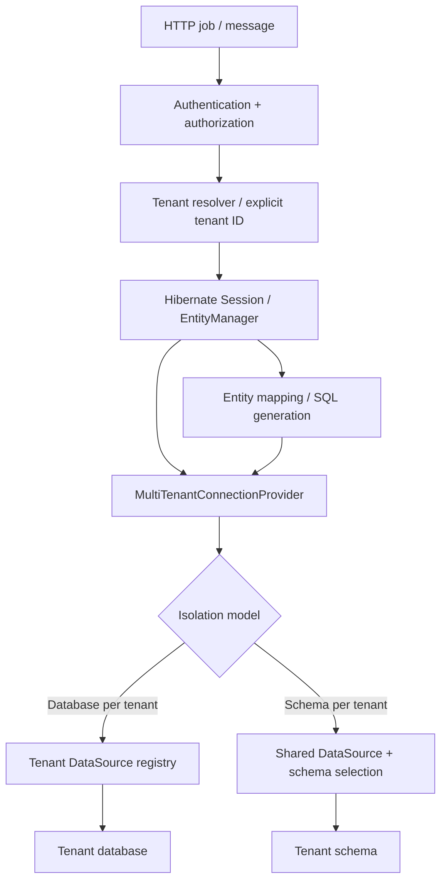
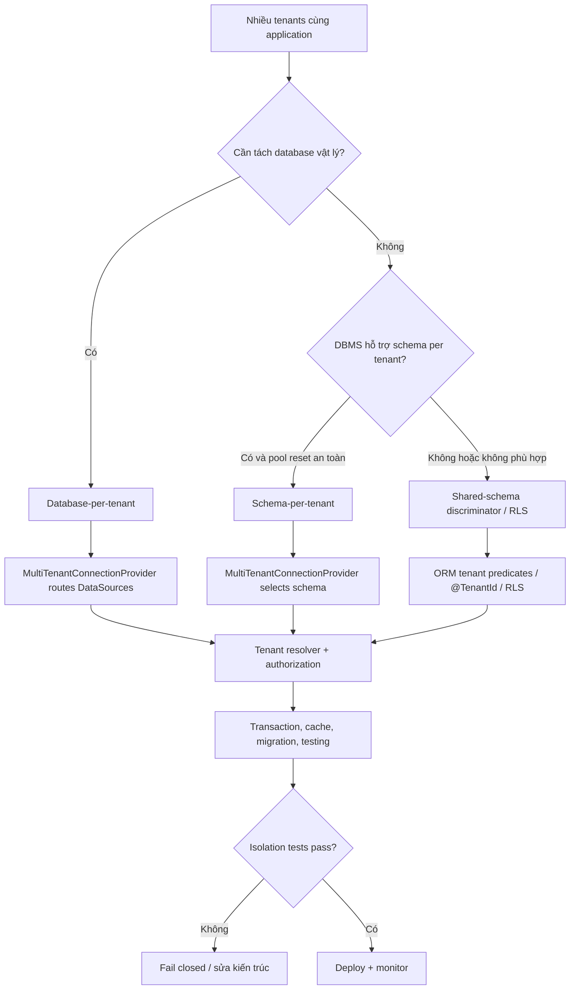

# MultiTenantConnectionProvider cho cách ly kết nối theo khả năng hỗ trợ

Trong hệ thống **multi-tenant** (nhiều tổ chức hoặc nhiều khách hàng dùng chung một ứng dụng), một yêu cầu đọc đơn hàng của tenant A **không được** vô tình chạy trên database hoặc schema của tenant B. Đây là yêu cầu cách ly dữ liệu, không đơn thuần là cách tổ chức mã nguồn.

Hibernate ORM hỗ trợ mở rộng quá trình lấy kết nối JDBC thông qua `MultiTenantConnectionProvider`. Thành phần này giúp Hibernate lấy **kết nối phù hợp tenant** khi ứng dụng dùng mô hình **mỗi tenant một database** hoặc **mỗi tenant một schema**, tùy khả năng của database, JDBC driver và connection provider. Nó hoạt động cùng cơ chế xác định tenant identifier, vòng đời `Session`/`EntityManager`, transaction và connection pool.

Bài học tập trung vào những điểm then chốt:

- `MultiTenantConnectionProvider` thực hiện công việc gì và không làm gì?
- Phân biệt `getAnyConnection()` với `getConnection(tenantId)`.
- Làm sao chọn `DataSource` theo tenant hoặc đổi schema trên một connection chung?
- Khi nào cần `CurrentTenantIdentifierResolver` và khi nào chỉ định tenant tường minh?
- Làm sao **không trả một connection đang mang state tenant A** về pool để rồi cấp cho tenant B?
- Vì sao `supportsAggressiveRelease()` liên quan đến transaction và tính an toàn?
- Những khác biệt giữa schema/database multi-tenancy và cách ly theo cột `tenant_id`.
- Những giới hạn về Dialect, schema đồng nhất, migrations, cache, audit, SQL native và bảo mật.
- Cách kiểm thử isolation, connection cleanup, lỗi giữa chừng và chạy đồng thời.

Mục tiêu không phải chỉ có một ví dụ code “chuyển schema thành công”, mà là thiết kế một **hợp đồng cấp phát kết nối an toàn**: không chọn sai tenant, không rò rỉ context, không cho phép tenant tự chỉ định schema tùy ý và có phương án xử lý khi driver/pool không hỗ trợ khả năng cần thiết.

## 1. Multi-tenancy trong Hibernate là gì?

Một ứng dụng multi-tenant phục vụ nhiều nhóm dữ liệu độc lập, thường được gọi là tenant, organization hoặc account.

Ví dụ:

```text
                      Application
                           |
           +---------------+---------------+
           |               |               |
        Tenant A        Tenant B        Tenant C
         "acme"          "beta"          "gamma"
           |               |               |
      Orders của A    Orders của B    Orders của C
```

Các tenants có thể dùng chung entity classes và business logic, nhưng dữ liệu phải được phân vùng theo một chính sách rõ ràng.

**Tenant identity** cần được xác định ở server từ thông tin đã xác thực/ủy quyền. Không nên mặc định lấy tenant ID từ query parameter rồi tin ngay rằng người gửi yêu cầu có quyền truy cập tenant đó.

Multi-tenancy còn liên quan tới:

- Phân quyền giữa tổ chức.
- Transaction boundaries.
- Kết nối và connection pool.
- Migrations khi có tenant mới.
- Second-level/query cache.
- Background jobs và asynchronous tasks.
- Observability và audit trails.
- Disaster recovery và tenant deletion.

`MultiTenantConnectionProvider` xử lý **một lát cắt cụ thể** của bài toán: chọn/chuẩn bị JDBC connection cho tenant khi Hibernate cần làm việc với database.

## 2. Ba mô hình phân vùng dữ liệu thông dụng

| Mô hình | Cách lưu dữ liệu | Đường chọn dữ liệu | Vai trò của `MultiTenantConnectionProvider` |
|---|---|---|---|
| Database per tenant | Mỗi tenant có database riêng | Chọn connection/`DataSource` của database tenant | Trung tâm của routing |
| Schema per tenant | Nhiều schemas trong một DB/catalog | Kết nối tới schema tenant, hoặc đặt schema trên connection | Trung tâm nếu driver/DB hỗ trợ đổi schema |
| Shared schema, discriminator column | Chung tables có `tenant_id` | SQL predicates, ORM tenant mapping/RLS | Không tự động thêm `WHERE tenant_id = ?` |

Ví dụ database-per-tenant:

```text
App -> tenant acme -> DataSource A -> database_acme
    -> tenant beta -> DataSource B -> database_beta
```

Ví dụ schema-per-tenant:

```text
App -> common DataSource -> one database
                           +-- schema acme
                           +-- schema beta
```

Ví dụ shared schema:

```sql
select *
from purchase_orders
where tenant_id = ?;
```

**Một MultiTenantConnectionProvider không thể tự thêm tenant predicate vào SQL.** Nếu hệ thống chọn shared-schema discriminator strategy, cần cơ chế ORM mapping/filters/`@TenantId` (theo Hibernate version), database Row-Level Security hoặc truy vấn có tenant condition được kiểm soát. Không thể trông chờ provider routing connection xử lý cách ly theo row.

## 3. Ranh giới của bài học: cấp kết nối không đồng nghĩa phân quyền

Giả sử server nhận request:

```http
GET /organizations/acme/orders/100
Authorization: Bearer <access-token>
```

Request chứa `acme` nhưng identity token chỉ có quyền trên `beta`. Nếu ứng dụng chuyển thẳng path segment `acme` vào `MultiTenantConnectionProvider`, kết nối có thể được mở đúng database acme nhưng **vi phạm bảo mật**.

Quy trình đúng:

```text
Authenticate user
     |
Authorize organization membership / permission
     |
Resolve a canonical tenant identifier
     |
Open tenant-bound Hibernate Session
     |
MultiTenantConnectionProvider gets tenant connection
     |
Run domain operations within transaction
```

Provider nên yêu cầu tenant ID đã được chuẩn hóa và được cho phép trong registry. Phân quyền thuộc application/security layer; provider là lớp phòng thủ bổ sung, không nên là tuyến kiểm soát duy nhất.

## 4. Kiến trúc tổng thể



**Lưu ý:** SQL generation và connection routing là hai hoạt động khác nhau. Hibernate xác định entity/table/column mappings và tạo SQL; provider đảm nhiệm connection đúng tenant. Nếu mọi schema không đồng nhất, SQL sinh ra từ cùng entity mapping có thể chạy trên schema A nhưng lỗi ở B.

## 5. Hợp đồng `MultiTenantConnectionProvider`

Trong các Hibernate versions hiện đại, interface ở:

```java
org.hibernate.engine.jdbc.connections.spi.MultiTenantConnectionProvider
```

Chữ ký thường gặp (minh họa cho phiên bản hỗ trợ type parameter):

```java
public interface MultiTenantConnectionProvider<T> {

    Connection getAnyConnection() throws SQLException;

    void releaseAnyConnection(Connection connection)
        throws SQLException;

    Connection getConnection(T tenantIdentifier)
        throws SQLException;

    void releaseConnection(
        T tenantIdentifier,
        Connection connection
    ) throws SQLException;

    boolean supportsAggressiveRelease();

    // Đồng thời có các phương thức unwrap /
    // isUnwrappableAs theo service contracts.
}
```

Đây là **mô tả những phương thức quan trọng**, không phải toàn bộ source của interface. Các superclass/interfaces, generic parameter và cách bootstrap có thể khác giữa Hibernate 5, 6 và 7.

Trước khi sao chép implementation, phải kiểm tra Javadocs theo version cụ thể: một code snippet `MultiTenantConnectionProvider<String>` hợp lệ ở phiên bản generic có thể cần chỉnh ở version cũ không generic.

## 6. `getAnyConnection()` có vai trò gì?

`getAnyConnection()` cấp một connection **không gắn với tenant ID cụ thể trong call đó**. Hibernate có thể cần nó khi bootstrap `SessionFactory` để lấy JDBC metadata, xác định Dialect capabilities hoặc kiểm tra schema tùy cấu hình.

Ví dụ:

```java
@Override
public Connection getAnyConnection()
        throws SQLException {
    return bootstrapDataSource.getConnection();
}
```

Tại thời điểm này chưa chắc có request user, tenant context hay HTTP authentication. Vì vậy **không triển khai `getAnyConnection()` bằng cách đọc tenant từ ThreadLocal bắt buộc phải tồn tại**.

Một implementation sai về ý tưởng:

```java
@Override
public Connection getAnyConnection()
        throws SQLException {
    String tenant = RequestTenantContext.requireTenant();

    return getConnection(tenant);
}
```

`SessionFactory` có thể khởi động ngoài HTTP request và không có tenant context; bootstrap sẽ thất bại.

### Bootstrap connection cần đại diện cái gì?

Nó nên trỏ tới một database/schema có metadata tương thích với các tenants (ví dụ cùng DBMS family, version và SQL Dialect). Với database-per-tenant, bootstrap datasource có thể trỏ tới một database chuẩn hoặc một tenant mẫu đã provisioning.

Đừng dùng `getAnyConnection()` để vô tình trao quyền đọc toàn bộ tenant schemas cho request bình thường.

## 7. `releaseAnyConnection()`

Kết nối do `getAnyConnection()` trả ra phải được giải phóng đúng cách:

```java
@Override
public void releaseAnyConnection(
        Connection connection) throws SQLException {
    connection.close();
}
```

Khi connection đến từ pool, `close()` thường có nghĩa trả logical connection về pool, không nhất thiết đóng physical TCP session.

Hãy bảo đảm `getAnyConnection` và `releaseAnyConnection` là một cặp nhất quán. Không dùng cách giải phóng dành cho tenant-specific connection nếu nó có protocol reset riêng mà bootstrap connection không mang.

## 8. `getConnection(tenantIdentifier)`

Đây là operation cấp connection dành cho tenant:

```java
@Override
public Connection getConnection(String tenantId)
        throws SQLException {

    DataSource source = registry.requiredDataSource(tenantId);
    return source.getConnection();
}
```

Ý tưởng:

1. Hibernate cung cấp một tenant identifier.
2. Provider tra registry đã kiểm soát.
3. Registry trả datasource hoặc thông số định tuyến tương ứng tenant.
4. Provider trả `Connection` để Hibernate dùng trong transaction.

**Không được âm thầm fallback về tenant mặc định nếu tenant không tồn tại.** Nếu `"acm"` bị gõ nhầm thành `"acme"`, tốt hơn thất bại rõ ràng thay vì đọc sai tổ chức.

Tenant ID cần có canonical representation: `acme`, `ACME`, `acme/` không được tự biến thành những tên schema khác nhau nếu hệ thống coi chúng là một identity.

## 9. `releaseConnection(tenantIdentifier, connection)`

Hibernate gọi phương thức này khi trả lại connection tenant-aware:

```java
@Override
public void releaseConnection(
        String tenantId,
        Connection connection) throws SQLException {
    connection.close();
}
```

Đối với **DataSource riêng từng tenant**, thường chỉ cần đóng logical connection đúng datasource/pool mà nó đến từ.

Đối với **schema switching trên shared pool**, phải có thêm bước reset state tenant trước khi logical connection được tái sử dụng. Đây là vấn đề isolation tối quan trọng và được phân tích ở các phần tiếp theo.

### Không được đổi connection provider ngẫu nhiên lúc release

`tenantId` và `connection` cần tương ứng. Đừng tra tenant registry mới rồi đóng connection qua một pool khác hoặc assume datasource chưa đổi trong khi tenant provisioning có thể rotate pool.

Connection thường biết pool mà nó thuộc về thông qua wrapper. Thiết kế registry lifecycle phải xử lý pool rotation và in-flight connections rõ ràng.

## 10. `supportsAggressiveRelease()` có nghĩa gì?

Hibernate có thể áp dụng connection release modes khác nhau. Với **aggressive release**, connection có thể được trả sau một JDBC statement và reacquire về sau trong cùng session/transaction, tùy môi trường.

Provider cần trả lời liệu việc đó có an toàn:

```java
@Override
public boolean supportsAggressiveRelease() {
    return false;
}
```

`false` là lựa chọn thận trọng khi chưa chứng minh provider/transaction manager có khả năng reacquire một connection tương đương, đúng tenant và đúng transactional context.

Nếu trả `true`, cần bảo đảm:

- Hibernate có thể lấy lại connection cho **cùng tenant**.
- Transaction context vẫn chính xác.
- Schema/catalog/role/session variables được thiết lập đúng ở mỗi lần acquire.
- Pool/transaction manager hỗ trợ release/reacquire semantics theo integration.
- Không vô tình mất temporary session state bắt buộc.
- Không biến connection của tenant A thành connection tenant B.

**`supportsAggressiveRelease()=true` không phải công cụ tăng performance luôn đúng.** Nó là một claim về khả năng của connection infrastructure. Chỉ bật khi được provider/transaction manager và integration tests chứng minh.

## 11. Một Session phải gắn với một tenant ổn định

Một `Session`/`EntityManager` không nên bắt đầu với tenant A rồi giữa chừng đổi sang B.

Ví dụ nguy hiểm:

```text
Session opened: tenant A
  |
load Order#10 from A
  |
request context changed to B
  |
next SELECT uses B connection
  |
L1 cache still contains Order#10 from A
```

Persistence context giữ identity map, dirty checking state và association proxies. Nếu tenant được thay đổi giữa transaction, object identities và SQL connection có thể không còn cùng phạm vi dữ liệu.

Nguyên tắc:

- Tenant ID được xác định **trước khi Session được mở**.
- Tenant ID được giữ ổn định suốt Session/transaction.
- Không đổi context cho đến khi Session/transaction kết thúc.
- Một business operation xuyên nhiều tenants cần orchestration rõ ràng qua nhiều Sessions/transactions, không “đổi tenant” trên cùng Session.
- Khi ứng dụng dùng tenant resolver, không giả định một ThreadLocal được cập nhật sau đó sẽ làm Session hiện tại đổi tenant một cách an toàn.

## 12. CurrentTenantIdentifierResolver bổ sung điều gì?

Trong Hibernate, interface thường ở:

```java
org.hibernate.context.spi.CurrentTenantIdentifierResolver
```

Với phiên bản hỗ trợ generic ID type, ví dụ:

```java
public final class TenantResolver
        implements CurrentTenantIdentifierResolver<String> {

    @Override
    public String resolveCurrentTenantIdentifier() {
        return TenantContext.requireTenantId();
    }

    @Override
    public boolean validateExistingCurrentSessions() {
        return true;
    }
}
```

`TenantContext` là abstraction do ứng dụng tự định nghĩa. Nó phải trả tenant đã được xác thực và chuẩn hóa, không phải mọi input do client cung cấp.

### Vai trò hai interface

| Thành phần | Trả lời câu hỏi |
|---|---|
| `CurrentTenantIdentifierResolver` | “Khi mở current Session, tenant identifier nào được chọn?” |
| `MultiTenantConnectionProvider` | “Với tenant identifier đã chọn, connection nào phù hợp?” |

Hai thành phần phối hợp nhưng không thay thế nhau.

### `validateExistingCurrentSessions()`

Trong các Hibernate current-session contexts, setting này cho phép kiểm tra tenant ID resolver có phù hợp Session hiện có đang bound hay không, theo contract version. Nó giúp phát hiện trường hợp context tenant đã thay đổi trong khi current Session vẫn gắn tenant khác.

Không nên hiểu đây là một security policy hoàn chỉnh. Authorization phải được thực thi riêng.

## 13. Tenant context trong Spring MVC blocking application

Một mẫu ThreadLocal có thể dùng trong ứng dụng servlet đồng bộ **nếu cleanup đúng**:

```java
public final class TenantContext {

    private static final ThreadLocal<String> CURRENT =
        new ThreadLocal<>();

    private TenantContext() {}

    public static void set(String tenantId) {
        if (tenantId == null || tenantId.isBlank()) {
            throw new IllegalArgumentException("Missing tenant");
        }
        CURRENT.set(tenantId);
    }

    public static String requireTenantId() {
        String tenant = CURRENT.get();
        if (tenant == null) {
            throw new IllegalStateException(
                "No authorized tenant in context"
            );
        }
        return tenant;
    }

    public static void clear() {
        CURRENT.remove();
    }
}
```

Một request filter sau khi authenticate và authorize:

```java
try {
    String authorizedTenant =
        tenantAuthorization.resolveAndCheck(request);

    TenantContext.set(authorizedTenant);
    filterChain.doFilter(request, response);
} finally {
    TenantContext.clear();
}
```

Đây là flow minh họa; `tenantAuthorization` là component do ứng dụng định nghĩa.

### Vì sao phải `finally remove()`?

Servlet thread pool tái sử dụng threads. Nếu request A set `tenant=acme` nhưng không clear, request B chạy trên cùng thread có thể kế thừa tenant cũ nếu resolver không fail closed.

Đó là lỗi **cross-tenant data leakage**, không phải chỉ là memory leak.

## 14. ThreadLocal có giới hạn trong asynchronous/reactive code

Với `@Async`, `CompletableFuture`, virtual threads, Reactor/WebFlux hoặc message processing, request context có thể không nằm cùng thread khi Hibernate mở Session.

Ví dụ:

```text
HTTP thread: TenantContext = acme
         |
       @Async
         v
worker thread: TenantContext = null / stale
         |
    Hibernate opens Session
```

Không khắc phục bằng cách trả tenant mặc định. Hãy dùng:

- Tenant ID như một tham số tường minh của job/service.
- Security context propagation đã được kiểm soát.
- Scoped context mechanisms phù hợp execution model.
- Message envelope có tenant ID được xác thực/ủy quyền.
- Reactor Context/reactive integration nếu framework hỗ trợ.
- Cleanup trong `finally` với blocking thread-bound tasks.

Tenant propagation là vấn đề application architecture; `MultiTenantConnectionProvider` không tự biết tenant của một coroutine/reactive signal.

## 15. Khai báo tenant tường minh khi mở Session

Khi có tenant ID rõ ràng, Hibernate có API kiểu:

```java
try (Session session = sessionFactory
        .withOptions()
        .tenantIdentifier("acme")
        .openSession()) {

    Transaction tx = session.beginTransaction();
    try {
        PurchaseOrder order =
            session.find(PurchaseOrder.class, 10L);

        tx.commit();
    } catch (RuntimeException e) {
        tx.rollback();
        throw e;
    }
}
```

Cú pháp exact builder methods phải khớp Hibernate version. Phương án này thuận lợi cho batch jobs, admin tasks hoặc services có tenant ID explicit.

**Không lấy chuỗi `"acme"` từ dữ liệu client chưa được authorize.** Ví dụ chỉ minh họa phần API binding.

Trong JPA EntityManager, Hibernate cũng có tenant identifier hints/properties theo version. Nếu dùng Spring JPA, hãy kiểm tra cách transaction-scoped EntityManager được mở và tenant resolved, thay vì giả định đổi tenant ThreadLocal giữa service method làm EntityManager đang bound đổi theo.

## 16. Mô hình A — database riêng cho mỗi tenant

```text
                             +-----------------------+
                             | Tenant DataSource Map |
                             +-----------------------+
                              |         |           |
                           acme       beta        gamma
                              |         |           |
                              v         v           v
                          Database A Database B Database C
```

Mỗi tenant có database hoặc logical JDBC endpoint riêng. Một registry có thể ánh xạ canonical tenant IDs tới `DataSource`:

```java
public interface TenantDataSourceRegistry {

    DataSource requireDataSource(String tenantId);
}
```

Implementation có thể dựa trên:

- Cấu hình tĩnh.
- Service discovery/control plane.
- Tenant metadata table ở admin database.
- Secrets manager chứa credentials.
- Các pools được tạo/provision theo tenant lifecycle.

**Registry phải fail closed:** tenant không tồn tại hoặc chưa active phải bị từ chối, không tự rơi sang connection mặc định.

## 17. Ví dụ provider chọn DataSource theo tenant

Dưới đây là một mẫu minh họa cho Hibernate version có `MultiTenantConnectionProvider<String>`:

```java
import java.sql.Connection;
import java.sql.SQLException;
import javax.sql.DataSource;

import org.hibernate.engine.jdbc.connections.spi
    .MultiTenantConnectionProvider;

public final class DatabaseTenantConnectionProvider
        implements MultiTenantConnectionProvider<String> {

    private final TenantDataSourceRegistry registry;
    private final DataSource bootstrapDataSource;

    public DatabaseTenantConnectionProvider(
            TenantDataSourceRegistry registry,
            DataSource bootstrapDataSource) {
        this.registry = registry;
        this.bootstrapDataSource = bootstrapDataSource;
    }

    @Override
    public Connection getAnyConnection()
            throws SQLException {
        return bootstrapDataSource.getConnection();
    }

    @Override
    public void releaseAnyConnection(Connection c)
            throws SQLException {
        c.close();
    }

    @Override
    public Connection getConnection(String tenantId)
            throws SQLException {
        return registry.requireDataSource(tenantId)
            .getConnection();
    }

    @Override
    public void releaseConnection(
            String tenantId,
            Connection c) throws SQLException {
        c.close();
    }

    @Override
    public boolean supportsAggressiveRelease() {
        return false;
    }

    @Override
    public boolean isUnwrappableAs(Class<?> type) {
        return type.isInstance(this);
    }

    @Override
    public <T> T unwrap(Class<T> type) {
        if (type.isInstance(this)) {
            return type.cast(this);
        }
        throw new IllegalArgumentException(
            "Unsupported unwrap type: " + type
        );
    }
}
```

**Lưu ý phiên bản:** import, generic ID type và SPI wrapping contract cần xác nhận trên Hibernate major version đang dùng. Ví dụ tập trung vào trách nhiệm routing và release; một implementation production còn cần tenant registry lifecycle, monitoring, secrets rotation và error handling.

### Vì sao cách này dễ cách ly hơn schema switching?

Connection từ pool A luôn trỏ database A. Khi `close()`, nó quay về pool A, không cần chuyển schema qua lại trên một pool dùng chung. Nhưng số lượng pools có thể tăng rất nhanh và trở thành chi phí vận hành đáng kể.

## 18. Registry không nên tạo DataSource mới cho mỗi request

Một implementation sai:

```java
DataSource requireDataSource(String tenantId) {
    return new HikariDataSource(
        configurationFor(tenantId)
    );
}
```

Nếu method được gọi cho mỗi statement/transaction, ứng dụng tạo pool liên tục, gây:

- Connection explosion.
- Không đóng pool và cạn database max connections.
- Tăng memory/thread overhead.
- Secrets/connection properties bị tạo lại liên tục.
- Khó đóng pool khi tenant inactive.
- Latency mở connection lớn.

Registry nên quản lý pools theo tenant lifecycle, với bounded capacity, idle eviction và explicit shutdown:

```text
Tenant enabled
    -> create/reuse a bounded pool
Tenant active
    -> borrow and return connections
Tenant disabled
    -> stop new acquisition
    -> drain in-flight work
    -> close pool and revoke credentials
```

Nếu có hàng chục nghìn tenants, **một pool cho mỗi tenant** có thể không khả thi; cần thiết kế routing/cache pool theo quy mô hoặc chọn mô hình isolation khác.

## 19. Metadata bootstrap trong database-per-tenant

`getAnyConnection()` có thể trỏ tới `bootstrapDataSource`. Nhưng các tenant databases cần tương thích với Hibernate `SessionFactory` metadata và Dialect.

Ví dụ:

- Hibernate mapping dùng PostgreSQL JSON type.
- Tenant A là PostgreSQL 16.
- Tenant B lại chạy một DBMS khác không hỗ trợ cùng SQL.
- Hibernate có thể đã bootstrap một Dialect từ database A.

Không nên giả định một `SessionFactory` có thể tự đổi Dialect và SQL generation cho từng tenant connection. Với single SessionFactory multi-tenancy, cần các tenants tương thích về:

- DBMS/dialect features.
- Table/column names.
- Mapping schema.
- Identifier generators/sequences.
- SQL types và custom converters.
- Stored procedures/function availability.
- Collation hoặc timezone behavior quan trọng.

Nếu tenants thực sự dùng DBMS khác nhau, một `SessionFactory` per compatible group, service boundary khác, hoặc kiến trúc multi-database riêng có thể cần thiết.

## 20. Mô hình B — schema riêng trong cùng database

```text
                  One JDBC DataSource
                         |
                    one database
                         |
             +-----------+-----------+
             |           |           |
          schema A     schema B    schema C
          purchase_    purchase_   purchase_
          orders       orders      orders
```

Một shared connection pool có thể được dùng để mở connections tới cùng database. Provider chọn schema tương ứng tenant bằng JDBC API hoặc database-specific session command.

Ưu điểm:

- Ít DataSource/pool hơn database-per-tenant.
- Có thể dùng chung một DBMS instance.
- Tenant provisioning có thể tạo schema và migrations.

Rủi ro:

- **Connection là stateful session.** Schema đã chọn có thể còn trên connection.
- JDBC driver có thể không hỗ trợ `Connection.setSchema`.
- SQL native có thể dùng fully qualified names vượt default schema.
- Quyền DB user có thể truy cập nhiều schemas nếu không hạn chế.
- Schema migrations phải chạy trên nhiều tenants.
- Cross-schema FK/objects có thể gây ràng buộc phức tạp.

## 21. Chọn schema bằng `Connection.setSchema()`

JDBC có API:

```java
connection.setSchema("tenant_acme");
```

Nó yêu cầu JDBC driver/database hỗ trợ chuyển default schema ở connection/session context.

**Không phải mọi driver hoặc DBMS hỗ trợ `setSchema` với semantics giống nhau**. Trên một số hệ thống, đổi schema có thể thực hiện qua `SET search_path`, `ALTER SESSION` hoặc lệnh đặc thù khác, nhưng những lệnh đó cần quản lý injection, quoting, transactions và reset state.

Không giả định chỉ vì method tồn tại trong `Connection` thì nó hoạt động đầy đủ trên database production. Kiểm tra:

- `Connection.setSchema` được implement hay ném `SQLFeatureNotSupportedException`.
- Tác động tới statement resolution và search path.
- Thời điểm có hiệu lực trước/sau transaction start.
- Schema được khôi phục ra sao khi rollback/close.
- Pool có reset schema tự động hay không.
- Driver có giữ prepared statement/server-side statement state qua schema change không.

## 22. Tenant ID không được đồng nghĩa SQL schema name tùy ý

Nếu URL request chứa:

```text
tenant = acme
```

thì registry nên ánh xạ tới schema đáng tin:

```text
acme -> tenant_0042
beta -> tenant_0087
```

Không được dùng raw input như một SQL fragment:

```java
statement.execute(
    "SET search_path TO " + requestTenantId
);
```

Đây có thể là SQL injection và privilege escalation. Identifiers thường không bind bằng `PreparedStatement.setString` theo cách bind values thông thường, nên phải dùng identifier quoting/validation đúng Dialect hoặc API driver tin cậy.

Một giải pháp tốt hơn:

- Tenant ID phải được authorize và normalized.
- Registry tra schema name từ server-owned metadata.
- Schema name có allowlist/format kiểm soát.
- Dùng JDBC `setSchema` nếu driver hỗ trợ đúng.
- Nếu phải dùng SQL command, dựng identifier theo quoting rules đã được kiểm chứng, không nối request raw input.
- DB credentials bị giới hạn quyền theo chính sách isolation.

## 23. Ví dụ provider đổi schema trên shared DataSource

Ví dụ sau là mô hình **tối giản để giải thích đường acquire và release**, không phải một pool-hardening implementation hoàn chỉnh.

```java
import java.sql.Connection;
import java.sql.SQLException;
import javax.sql.DataSource;

import org.hibernate.engine.jdbc.connections.spi
    .MultiTenantConnectionProvider;

public final class SchemaTenantConnectionProvider
        implements MultiTenantConnectionProvider<String> {

    private final DataSource dataSource;
    private final TenantSchemaRegistry registry;
    private final String baselineSchema;

    public SchemaTenantConnectionProvider(
            DataSource dataSource,
            TenantSchemaRegistry registry,
            String baselineSchema) {
        this.dataSource = dataSource;
        this.registry = registry;
        this.baselineSchema = baselineSchema;
    }

    @Override
    public Connection getAnyConnection()
            throws SQLException {
        return dataSource.getConnection();
    }

    @Override
    public void releaseAnyConnection(Connection c)
            throws SQLException {
        c.close();
    }

    @Override
    public Connection getConnection(String tenantId)
            throws SQLException {

        String schema =
            registry.requireSchemaFor(tenantId);

        Connection c = dataSource.getConnection();

        try {
            c.setSchema(schema);
            return c;
        } catch (SQLException | RuntimeException e) {
            try {
                c.close();
            } catch (SQLException closeFailure) {
                e.addSuppressed(closeFailure);
            }
            throw e;
        }
    }

    @Override
    public void releaseConnection(
            String tenantId,
            Connection c) throws SQLException {

        try {
            c.setSchema(baselineSchema);
        } finally {
            c.close();
        }
    }

    @Override
    public boolean supportsAggressiveRelease() {
        return false;
    }

    @Override
    public boolean isUnwrappableAs(Class<?> type) {
        return type.isInstance(this);
    }

    @Override
    public <T> T unwrap(Class<T> type) {
        if (type.isInstance(this)) {
            return type.cast(this);
        }
        throw new IllegalArgumentException(
            "Unsupported unwrap type: " + type
        );
    }
}
```

`TenantSchemaRegistry` là abstraction do ứng dụng định nghĩa; nó **không** được trả schema từ raw request parameter.

### Cảnh báo quan trọng về lỗi reset

Trong đoạn code minh họa, nếu `setSchema(baselineSchema)` thất bại, `close()` vẫn được gọi. Với một số connection pools, close có thể **trả connection còn tenant schema sai** về pool. Đây là rủi ro cách ly dữ liệu.

Production implementation phải có **failure path để invalidate/evict physical connection thay vì tái sử dụng connection bẩn**, theo API của pool thực tế. Đồng thời nên thiết lập schema đúng **mỗi lần acquire**, không dựa riêng vào reset khi release.

Không copy nguyên ví dụ này làm giải pháp production nếu chưa tích hợp pool-specific discard/eviction và chứng minh reset semantics bằng integration tests.

## 24. Những state khác trên connection cần xem xét

Schema không phải state duy nhất có thể tồn tại trên một physical JDBC connection.

| Connection/session state | Rủi ro khi tái sử dụng |
|---|---|
| Current schema/search path | SELECT nhắm sai tenant tables |
| Catalog/database selection | Query sai database |
| Current role/authorization | Quyền tenant A còn khi xử lý B |
| Session variables | Tenant ID/RLS context cũ |
| Auto-commit | Thao tác chạy ngoài transaction kỳ vọng |
| Transaction isolation | Isolation sai chính sách |
| Read-only mode | Query write fail hoặc thực thi khác kỳ vọng |
| Timezone/date settings | Dữ liệu thời gian sai |
| Temporary tables | Dữ liệu tenant cũ còn tồn tại |
| Advisory locks | Lock state không được giải phóng |
| Prepared statement/session caches | Name resolution phụ thuộc schema cũ |
| Search path bao gồm fallback schemas | SQL không qualified có thể đọc sai object |

Một pool có thể reset vài thuộc tính chuẩn JDBC nhưng không biết custom SQL session variables hoặc `SET ROLE`. Phải xác định **ai chịu trách nhiệm khôi phục mọi state đã thay**.

Nguyên tắc defense in depth: reset khi trả connection, reassert tenant state khi lấy connection, và **không đưa connection không thể làm sạch về pool**.

## 25. Vì sao cần đặt tenant schema mỗi lần acquire?

Giả sử:

```text
Connection C1 lấy cho tenant A
    -> setSchema(A)
    -> chạy SELECT

Release xảy ra lỗi reset
    -> C1 về pool khi còn schema A

Request tenant B lấy C1
    -> nếu chỉ tin pool đã reset: đọc A
```

Một implementation an toàn hơn sẽ **setSchema(B) trước khi trả C1 cho Hibernate**. Nhưng nếu setSchema(B) thất bại, phải dừng, không chạy query trong schema A.

Điều đó **không giải quyết hết vấn đề** nếu statement cache hoặc role/session state còn dư; pool-specific reset/connection eviction vẫn cần.

Nếu infrastructure không thể bảo đảm cleanup/verification, database-per-tenant pools hoặc một kiến trúc cách ly khác có thể đáng tin cậy hơn schema-switching shared pool.

## 26. Database-specific schema switching

Vài cơ chế hay gặp:

- **PostgreSQL:** `search_path` quyết định thứ tự schema khi resolve unqualified names; JDBC `setSchema`/driver behavior cần kiểm tra.
- **Oracle:** có khái niệm current schema qua session settings; không đồng nghĩa thay đổi database user hoặc quyền được cấp.
- **SQL Server:** schema resolution còn phụ thuộc user/default schema và cách database/catalog được chọn; chuyển schema bằng generic JDBC API có thể không giống PostgreSQL.
- **MySQL:** “schema” thường được dùng gần nghĩa với database/catalog; `setCatalog`, JDBC URL hoặc datasource routing có thể phù hợp hơn tùy driver.

Không dùng một implementation `SET SCHEMA tenant` chung cho mọi DBMS. Cần chọn approach theo driver/DBMS production, test DDL, SELECT, INSERT, transaction commit/rollback và pool reset.

Đặc biệt, schema-per-tenant không tự bảo đảm database account không thể dùng fully qualified SQL để đọc schema khác. Quyền SQL và application query review vẫn phải đúng.

## 27. Khi nên dùng DataSource riêng cho mỗi tenant?

Database-per-tenant với datasource riêng thường được xem xét khi:

- Tenants có data residency hoặc backup requirements khác nhau.
- Cần tách database credentials.
- Cần dễ di chuyển tenant sang instance khác.
- Muốn cấp resource quotas độc lập.
- Có ít tenants hoặc tenant population có giới hạn quản lý được.
- Dữ liệu lớn hoặc workload có quy mô riêng.
- Yêu cầu isolation cao hơn shared-schema model.

Đổi lại:

- Mỗi pool tốn connections/threads/memory.
- Migrations chạy trên nhiều databases.
- Monitoring và disaster recovery phức tạp.
- Hibernate SessionFactory metadata vẫn phải tương thích.
- Tenant provisioning/rotation cần lifecycle an toàn.

**Không chọn một pool mỗi tenant chỉ vì code routing dễ viết**, khi hệ thống có thể có hàng chục nghìn tenants nhỏ.

## 28. Khi nên dùng shared DataSource với schema switching?

Schema-per-tenant có thể phù hợp khi:

- DBMS hỗ trợ schemas thực sự và schema switching rõ ràng.
- Tenants dùng cùng DDL/model.
- Có thể giới hạn quyền, quản lý search path và kiểm thử isolation.
- Muốn giảm số database connection pools.
- Có quy trình migrate tất cả tenant schemas.
- Có pool cho phép reset/evict connections lỗi.

Rủi ro đặc biệt là **stateful connection reuse**. Nếu team không thể chứng minh cleanup khi release, lỗi exception, pool timeout và các concurrent requests, ưu tiên mô hình đơn giản hơn dù chi phí cao hơn.

## 29. Khi nào `MultiTenantConnectionProvider` không đủ?

Với shared-schema row-level isolation:

```sql
create table purchase_orders (
    tenant_id varchar(80) not null,
    id bigint not null,
    status varchar(30) not null,
    primary key (tenant_id, id)
);
```

Một connection đến đúng database vẫn có thể query mọi tenants nếu SQL thiếu tenant predicate.

Các lựa chọn khác:

- Hibernate `@TenantId` ở những versions hỗ trợ discriminator multi-tenancy.
- Hibernate filters với enable/disable lifecycle được kiểm soát.
- Database Row-Level Security.
- SQL xây bằng repository luôn có tenant condition.
- Tenant-aware keys/unique constraints và privilege isolation.

`MultiTenantConnectionProvider` chỉ thực thi **chọn kết nối**, không tự tạo `WHERE tenant_id = :tenant` cho mọi SQL, đặc biệt native SQL/stored procedures.

## 30. `@TenantId` và discriminator multi-tenancy

Trong các Hibernate versions hỗ trợ `org.hibernate.annotations.TenantId`, entity có thể khai báo tenant discriminator:

```java
@Entity
public class Invoice {

    @Id
    private Long id;

    @TenantId
    private String tenantId;

    private BigDecimal amount;
}
```

Ý tưởng là Hibernate quản lý tenant field/filtering cho các ORM operations thích hợp. Khả năng cụ thể thay đổi theo Hibernate major version, mapping và SQL path.

Điểm quan trọng:

- `@TenantId` không đồng nghĩa mỗi tenant có schema riêng.
- Entity shared-table và schema routing giải quyết hai vấn đề khác nhau.
- Native SQL, stored procedures, raw JDBC không tự được bảo vệ bởi mọi ORM tenant predicates.
- Không dựa vào annotation này như lớp authorization duy nhất.
- Kiểm tra key design: hai tenants có cùng ID hay cần globally unique ID.

Dữ liệu cần strong security có thể kết hợp ORM tenant mapping với database RLS và API-level authorization.

## 31. Bootstrap configuration trong Hibernate

Một ứng dụng cần đăng ký provider bằng Hibernate setting tương ứng. Ví dụ khái niệm:

```properties
hibernate.multi_tenant_connection_provider=<provider-instance-or-class>
hibernate.tenant_identifier_resolver=<resolver-instance-or-class>
```

Khi dùng Spring Boot, có thể đăng ký beans và gắn vào Hibernate properties:

```java
@Configuration
public class TenantHibernateConfiguration {

    @Bean
    HibernatePropertiesCustomizer tenantCustomizer(
            DatabaseTenantConnectionProvider provider,
            TenantResolver tenantResolver) {

        return hibernateProperties -> {
            hibernateProperties.put(
                "hibernate.multi_tenant_connection_provider",
                provider
            );
            hibernateProperties.put(
                "hibernate.tenant_identifier_resolver",
                tenantResolver
            );
        };
    }
}
```

Tên property và API integration cần được xác nhận theo Hibernate/Spring Boot version. Đặc biệt khi nâng Hibernate 5 lên 6/7, đừng giữ mù quáng một `MultiTenancyStrategy` enum/property cũ mà không xem migration guide: cách kích hoạt multi-tenancy trong Hibernate đã thay đổi theo versions.

### Cảnh báo về thời điểm bean tạo

Provider/tenant resolver phải sẵn sàng trước khi `EntityManagerFactory`/`SessionFactory` bootstrap. Nếu provider cần đọc tenant metadata từ chính EntityManagerFactory đang được khởi tạo, có thể gây circular dependency.

Dùng một control-plane datasource/registry riêng hoặc bootstrap metadata mechanism không phụ thuộc SessionFactory tenant-aware đang khởi động.

## 32. Tenant resolver và SessionFactory bootstrap khác nhau

Hai phương thức có ngữ cảnh khác:

```text
SessionFactory startup
    -> getAnyConnection()
    -> JDBC metadata / Dialect
    -> releaseAnyConnection()

Request for tenant acme
    -> resolve tenant / Session tenantIdentifier=acme
    -> getConnection("acme")
    -> SQL for acme
    -> releaseConnection("acme", connection)
```

Nếu `getAnyConnection` dựa trên request ThreadLocal, khởi động có thể lỗi. Nếu `getConnection` tự lựa chọn “default tenant” khi không có ID, request có thể truy cập nhầm.

Design đúng: **bootstrap path độc lập tenant**, còn runtime tenant path **bắt buộc có tenant identity hợp lệ**.

## 33. Một tenant nên có canonical ID riêng với schema/database name

Tránh coupling trực tiếp:

```text
tenantId = schemaName = databaseName
```

Bởi vì:

- Tenant branding có thể đổi tên.
- Schema name có giới hạn ký tự/độ dài.
- Tenant có thể được chuyển sang database khác.
- User nhập organization slug có thể chứa ký tự không hợp lệ SQL identifier.
- Data residency có thể thay đổi JDBC endpoint.
- Tenant ID xuất hiện trong logs/API, còn schema internal.

Một model tốt hơn:

```java
public record TenantDescriptor(
    String tenantId,
    String schemaName,
    String datasourceKey,
    boolean active
) {}
```

Server-owned registry tra:

```text
Tenant acme -> tenantId=org_42
             -> schemaName=tenant_0042
             -> datasourceKey=cluster_east_1

Tenant beta -> tenantId=org_87
             -> schemaName=tenant_0087
             -> datasourceKey=cluster_east_1
```

Provider nhận `tenantId`, xác định connection route từ registry. Tenant có thể được chuyển database mà không thay đổi identity dùng trong application events.

## 34. Tenant registry phải kiểm tra trạng thái và giới hạn

Không phải tenant nào có record trong registry cũng được phép nhận connection.

Các trạng thái có thể gồm:

- `PROVISIONING` — schema/database chưa sẵn sàng.
- `ACTIVE` — cho phép runtime operations.
- `SUSPENDED` — có thể hạn chế write hoặc toàn bộ truy cập.
- `MIGRATING` — đang chuyển database/schema.
- `DELETING` — không nhận request mới.
- `DELETED` — không còn cấp connection.

Nếu tenant không active, provider thường nên **fail closed** hoặc trả lỗi rõ theo policy. Không tự routing sang một database khác.

Việc tạm khóa tenant write-only có thể yêu cầu policy ở service/DB permission, không chỉ provider, vì provider không hiểu statement sắp chạy là SELECT hay UPDATE nếu chỉ được yêu cầu Connection.

## 35. Transaction boundary và tenant isolation

Một business transaction thường gồm:

```text
BEGIN tenant A
  read Order A
  update Order A
  insert Audit A
COMMIT tenant A
```

Tenant phải được cố định trước khi transaction mở connection hoặc persistence context.

Trong Spring:

```java
@Transactional
public void confirmOrder(Long orderId) {
    PurchaseOrder order =
        entityManager.find(PurchaseOrder.class, orderId);

    order.confirm();
}
```

Nếu tenant context được set ở filter **sau** khi transaction interceptor đã mở EntityManager/Connection, có thể quá muộn. Cần kiểm tra thực tế thứ tự filters, interceptors, Open-EntityManager-in-View và transaction setup.

### Open Session in View và tenant context

Nếu web application giữ EntityManager mở đến hết request, lazy loads có thể xảy ra khi render response. Tenant context phải vẫn chính xác và transaction/read policy vẫn hợp lệ. Vì lý do bảo mật/hiệu năng, nhiều ứng dụng chọn tắt Open Session in View và fetch đủ DTO trong service transaction.

Không dựa vào một connection route xảy ra “một lần duy nhất” rồi quên rằng Hibernate có thể acquire connection ở thời điểm lazy query.

## 36. Một transaction nhiều tenants có làm được không?

Một `Session` của Hibernate multi-tenancy thường gắn một tenant ID. Nếu một use case cần chuyển tiền/di chuyển dữ liệu giữa A và B:

```text
Read tenant A
Write tenant B
Update central registry
```

Không nên cố đổi tenant context ở giữa một `Session` đang quản lý entities của A.

Các lựa chọn kiến trúc:

- Hai Sessions/EntityManagers riêng, mỗi cái gắn tenant tương ứng.
- Transaction orchestration rõ ràng.
- Saga/outbox nếu cross-database atomicity không khả thi.
- XA/distributed transaction chỉ khi hạ tầng và yêu cầu thật sự hỗ trợ.
- Tenant export/import service qua API thay vì truy cập bảng trực tiếp.

Một provider route được từng connection **không tự cung cấp ACID transaction xuyên nhiều tenant databases**.

## 37. Connection pool và transaction manager

Một tenant-aware provider cần hợp tác với pool/transaction manager:

- Nếu dùng một datasource per tenant, mỗi connection phải thuộc pool đúng tenant.
- Nếu dùng shared pool, schema/session state phải được set/reset an toàn.
- Nếu dùng JTA, provider phải phù hợp enlistment và connection release contract.
- Nếu dùng local JDBC transactions, transaction/connection lifecycle phải được Hibernate quản lý nhất quán.
- Nếu pool tự reset isolation/autocommit/schema, phải biết chính xác thuộc tính nào được reset.
- Nếu connection trở nên broken hoặc reset thất bại, phải có đường invalidate physical resource.

### Không tự đóng connection Hibernate đang sử dụng

Trong application service, không gọi `connection.close()` tùy tiện sau mỗi repository operation. Hibernate/transaction manager điều phối lifecycle. `releaseConnection` của provider mới là nơi xử lý khi Hibernate trả connection.

Nếu dùng `Session.doWork()`/`doReturningWork()`, connection được cho mượn để thao tác JDBC trực tiếp trong Hibernate session; không nên tự close connection đó.

## 38. Bảo đảm schema selection khi dùng prepared statements

Trên một số DBMS/driver, prepared statement/session cache có thể phụ thuộc schema/search path ở thời điểm chuẩn bị. Nếu đổi schema trên cùng physical connection, cần xác nhận:

- SQL name resolution xảy ra lúc prepare hay execute?
- Server-side statement cache có cần invalidation khi schema đổi?
- Driver có cache plan gắn với schema/role cũ không?
- Các stored procedures có fully qualified object names không?
- Native SQL có hardcode `public.` hoặc tenant schema cụ thể không?

Không thể suy từ việc `setSchema` trả về thành công rằng mọi prepared statement cache behavior đã an toàn. Test luân phiên tenant A/B trên **cùng physical connection** là cần thiết.

## 39. Naming strategy và schema-per-tenant

Hibernate entity mapping:

```java
@Entity
@Table(name = "purchase_orders")
public class PurchaseOrder {
    @Id
    private Long id;
}
```

Khi dùng schema-per-tenant qua connection default schema, SQL có thể dùng unqualified table `purchase_orders`. Nếu annotation lại cố định:

```java
@Table(schema = "tenant_acme", name = "purchase_orders")
```

thì SQL có thể nhắm cố định schema A, bỏ qua schema được chọn trên connection. Đây là rủi ro lớn.

Để runtime schema switching hoạt động, các mapping/table qualifiers phải được thiết kế theo chiến lược multi-tenancy thực tế. Không hardcode tenant-specific schema names trong annotations hoặc custom native queries nếu muốn một entity model phục vụ mọi schemas.

Tên sequences, functions và tables trong stored procedures cũng cần cùng nguyên tắc.

## 40. Identifier generation và tenant isolation

Database-per-tenant hoặc schema-per-tenant thường có sequences/IDENTITY generators riêng.

Ví dụ:

```java
@Id
@GeneratedValue(
    strategy = GenerationType.SEQUENCE,
    generator = "order_seq"
)
@SequenceGenerator(
    name = "order_seq",
    sequenceName = "order_id_seq",
    allocationSize = 50
)
private Long id;
```

Cần xác nhận sequence được resolve trong đúng tenant schema/database, không vô tình dùng một global sequence hoặc fully qualified schema khác.

Câu hỏi vận hành:

- Mỗi tenant có `order_id_seq` không?
- Sequence state có khớp bảng dữ liệu tenant đó không?
- Hibernate optimizer/sequence allocation có caching mà cần tenant-aware behavior không?
- Schema migration tạo sequence trước khi tenant active chưa?
- Tên sequence có bị naming strategy đổi sau Hibernate upgrade không?
- Hai tenants có thể dùng cùng ID mà API không bị nhầm identity không?

ID `42` trong tenant A và ID `42` trong tenant B là bình thường ở nhiều mô hình. Application authorization và API references phải mang đúng tenant context.

## 41. Second-level cache và tenant ID

L2 cache chia sẻ qua các Sessions trong một `SessionFactory`. Với multi-tenancy, một cache key không thể được hiểu chỉ qua `entityType + id` nếu hai tenants có thể cùng entity ID.

Hibernate có cơ chế tenant-aware cache keys trong các multi-tenant configurations phù hợp, nhưng điều đó cần được kiểm chứng theo version/provider và cách bạn cấu hình L2/query cache.

Test bắt buộc:

```text
Tenant A: PurchaseOrder#10.status = NEW
Tenant B: PurchaseOrder#10.status = CANCELLED

Read A -> NEW
Read B -> CANCELLED
Read A -> NEW (even with L2 hits)
Read B -> CANCELLED
```

Nếu một application cache tự chế dùng:

```java
Map<Long, PurchaseOrderDto> cache;
```

thì **không an toàn** trong môi trường IDs có thể trùng. Key nên bao gồm canonical tenant ID:

```java
record TenantOrderKey(
    String tenantId,
    Long orderId
) {}
```

Ngoài entity cache, query cache, collection cache và natural-id cache cũng cần kiểm tra tenant isolation.

## 42. Query cache, Hibernate filters và native SQL

Một truy vấn HQL/JPQL ORM có thể dùng mapped table names và được route tới tenant connection. Nhưng các đường khác cần kiểm chứng:

| Đường truy vấn | Rủi ro cần xét |
|---|---|
| HQL/JPQL | Table/schema qualifier, Session tenant ID |
| Criteria API | Cùng mapping rules, join associations |
| Native SQL | Hardcoded schema/catalog hoặc thiếu tenant filter |
| Stored procedure | Procedure có thể dùng fixed schema hoặc dynamic SQL |
| `Session.doWork()` | JDBC trực tiếp không tự có tenant predicates |
| Bulk HQL DML | Cập nhật nhiều rows trong schema tenant, không tự gọi lifecycle callbacks |
| L2/query cache | Isolation giữa cùng entity IDs của nhiều tenants |
| Custom JDBC templates | Có thể dùng datasource không qua Hibernate provider |

Nếu ứng dụng có `JdbcTemplate` hoặc một SQL client kết nối trực tiếp tới datasource chung, nó **có thể bypass `MultiTenantConnectionProvider`**. Cần có tenant-aware JDBC routing tương ứng hoặc cấm đường này với bảng tenant.

## 43. Database permissions là lớp bảo vệ quan trọng

Schema switching chỉ thay đổi default schema cho SQL resolution; nó **không nhất thiết giảm database privileges**.

Nếu cùng DB user có quyền:

```sql
select * from tenant_acme.purchase_orders;
select * from tenant_beta.purchase_orders;
```

thì một truy vấn fully qualified sai có thể vượt default schema selection.

Các mô hình bảo mật:

- Một DB principal/credential per tenant, nếu hạ tầng cho phép.
- DB roles và grants hạn chế cross-schema access.
- Row-Level Security trong shared table model.
- Không cho app tenant queries dùng administrator credentials.
- Code review native SQL và stored procedures.
- Audit database access đến cross-tenant objects.
- Test negative paths: tenant A cố đọc B và phải bị từ chối.

Cách ly ở application routing là cần thiết nhưng chưa đủ nếu quyền DB cho phép vượt ranh giới.

## 44. Schema provisioning cho tenant mới

Với schema-per-tenant:

```text
Tenant registration
    |
Create tenant metadata in control plane
    |
Allocate schema name and DB privileges
    |
Create schema/database
    |
Apply migrations
    |
Seed required reference data
    |
Health-check schema + generator
    |
Mark tenant ACTIVE
```

Provider không nên cấp connection vào schema chưa được migrate đầy đủ. Nếu tenant đang `PROVISIONING`, registry nên từ chối runtime traffic hoặc route tới trạng thái chờ rõ ràng.

### Không dùng Hibernate auto-update thay migration

Nếu có hàng trăm tenant schemas, chạy `hbm2ddl.auto=update` tự động khi app startup dễ tạo schema drift. Flyway/Liquibase hoặc migration orchestrator có trạng thái version per tenant thường đáng kiểm soát hơn.

Tenant schema cần có:

- Tables/columns/constraints.
- Sequences/ID generators.
- Indexes.
- Stored procedures/functions nếu mapping yêu cầu.
- Grants và role policies.
- Audit tables/Envers metadata nếu applicable.

## 45. Migration đồng loạt nhiều tenants

Một release mới cần thêm column `tax_code` cho mọi tenant schemas.

Nếu schema-per-tenant:

```text
acme -> schema version 21
beta -> schema version 20
gamma -> schema version 21
```

Trong quá trình rolling migration, app mới có thể query column chưa tồn tại ở beta.

Cần chiến lược:

1. DDL change backward-compatible trước.
2. Migrate tenants có retry/checkpoint.
3. Track schema version riêng từng tenant.
4. Chỉ enable feature sau khi tenant được migrate.
5. Rollout app tương thích cả old/new schema trong transition nếu cần.
6. Giám sát tenant migration failures.
7. Hạn chế tenant ACTIVE khi schema chưa đáp ứng minimum version.

`MultiTenantConnectionProvider` không tự giải quyết schema drift giữa tenants. Nó chỉ route connection.

## 46. L2 cache và tenant migrations

Sau schema/data migration hoặc provisioning, caches có thể chứa stale dữ liệu tenant.

Cần:

- Tenant-specific cache key and region strategy.
- Eviction sau thay đổi data ngoài ORM.
- Xác định cache warm-up theo tenant.
- Không dùng một region name tự chế có data collisions.
- Thận trọng với serialization khi rolling Hibernate upgrades.
- Phân quyền API cache admin (không cho tenant A flush/inspect cache B tùy ý).

Nếu migration chạy raw SQL, Hibernate L2 cache có thể không biết dữ liệu đã đổi. Có thể cần eviction hoặc không dùng L2 cho bảng có nhiều external writes.

## 47. Envers và nhiều tenants

Nếu một entity được `@Audited`, Envers audit writes cũng cần nằm trong đúng tenant database/schema.

Kiểm tra:

- Audit table `*_AUD` tồn tại trong mỗi tenant.
- Revision table/sequence có phạm vi tenant đúng.
- AuditReader queries sử dụng Session/connection đúng tenant.
- Revision metadata actor/tenant được ghi khi cần.
- Native audit/reporting SQL không bypass route.
- Retention và GDPR deletion policy áp dụng theo tenant.
- Dữ liệu tenant A không xuất hiện khi query history tenant B cùng entity ID.

Nếu schema-per-tenant nhưng revision metadata table nằm cố định ở một global schema, cần architecture rõ ràng và tested. Không giả định default Envers mapping tự đáp ứng mọi multi-tenant topology.

## 48. Monitoring và logging

Một provider production nên có metrics như:

- Connection acquisition latency theo tenant hoặc nhóm tenant.
- Pool active/idle/pending connections.
- Failed/unknown tenant lookup count.
- Schema switch time và switch failures.
- Connection reset failures/evictions.
- Transaction timeouts.
- Number of active tenant pools.
- Migration version/readiness per tenant.
- Cross-tenant negative test/alert events.

### Tránh log dữ liệu nhạy cảm

Tenant ID có thể là thông tin kinh doanh; có thể dùng opaque canonical ID hoặc hashed label trong metrics. Không log password, JDBC URL có credentials, token hoặc SQL bind values chứa PII.

Metrics gắn tenant label trực tiếp có thể tạo **high cardinality** nếu có nhiều tenant. Cân nhắc sampling/aggregation theo tier/cluster, giữ logs truy vết theo correlation ID khi cần.

## 49. Lỗi thường gặp: tenant context bị mất

Một request qua `@Async` bắt đầu ở tenant A nhưng job mới có ThreadLocal null. Nếu resolver tự trả `"public"`:

```java
@Override
public String resolveCurrentTenantIdentifier() {
    return Optional.ofNullable(CURRENT.get())
        .orElse("public");
}
```

nó có thể đọc sai tenant mà không báo lỗi.

Thay bằng fail-closed:

```java
@Override
public String resolveCurrentTenantIdentifier() {
    String tenant = TenantContext.requireTenantId();
    return tenant;
}
```

Job background phải truyền tenant explicit hoặc dựng context được xác thực, sau đó cleanup.

## 50. Lỗi thường gặp: connection còn schema cũ

Một test chạy tuần tự:

```text
Request A -> schema A
Request B -> schema B
```

có thể pass vì pool cấp hai connections khác nhau. Trong production khi pool chỉ có một physical connection, bug hiện ra:

```text
Borrow C -> setSchema(A)
Return C -> reset thất bại
Borrow C -> không setSchema(B)
Query -> A
```

Test phải **cố ý ép tái sử dụng cùng physical connection**, đổi tenant nhiều lần và inject failure lúc release/reset.

Nếu reset thất bại, connection phải được mark unusable và evicted, không được trả lại pool như một resource sạch.

## 51. Lỗi thường gặp: sử dụng schemaName từ client

Sai:

```java
public Connection getConnection(String tenant) {
    Connection c = datasource.getConnection();
    statement.execute("SET search_path TO " + tenant);
    return c;
}
```

Vấn đề:

- SQL injection/identifier injection.
- Không authorization.
- Không cleanup nếu execute lỗi.
- Không reset state.
- Không dùng driver-specific quoting.
- Rủi ro cross-schema privilege abuse.

Đúng hơn: registry cấp schema name đã được whitelist, dùng `Connection.setSchema` khi thực sự hỗ trợ; nếu dùng SQL fallback, identifier quoting và reset/eviction phải được thiết kế đầy đủ.

## 52. Lỗi thường gặp: trả `supportsAggressiveRelease=true` theo cảm tính

Nếu Hibernate release connection sau statement, rồi reacquire trong transaction, provider cần bảo đảm connection phù hợp transactional context.

Sai lầm:

```java
@Override
public boolean supportsAggressiveRelease() {
    return true; // Vì nghĩ sẽ nhanh hơn.
}
```

Nếu datasource không transaction-aware hoặc schema selection state không được khôi phục, session có thể có lỗi khó tái hiện.

Lựa chọn `false` thường an toàn hơn cho custom provider cho tới khi hạ tầng chứng minh hỗ trợ aggressive release. Benchmark performance không thay thế consistency proof.

## 53. Lỗi thường gặp: dùng một `SessionFactory` với tenants khác DBMS

Tenant A dùng PostgreSQL, tenant B dùng SQL Server. Hibernate bootstrap Dialect từ `getAnyConnection()` rồi sinh SQL cho cả hai.

Ngay cả khi provider route đúng JDBC URL, SQL có thể không tương thích dialect, identity/sequence, pagination, JSON syntax hoặc locking semantics.

Giải pháp thường là phân nhóm tenants theo compatible DBMS/dialect và dùng SessionFactory/connection architecture riêng. Không coi `MultiTenantConnectionProvider` như một router SQL dialect tự động.

## 54. Lỗi thường gặp: dùng fully qualified names

Mapping hoặc native SQL:

```sql
select *
from tenant_acme.purchase_orders
where id = ?;
```

sẽ truy cập schema acme dù connection đã được setSchema beta, nếu DB user có quyền. Đây là lý do schema routing yêu cầu **SQL mapping không hardcode tenant schema**.

Kiểm tra:

- `@Table(schema=...)`.
- `@SequenceGenerator(sequenceName=...)` với schema qualifier.
- Named native queries.
- Views và stored procedures.
- DB functions gọi schema khác.
- SQL fragments trong Hibernate custom types.

## 55. Một integration test cách ly cơ bản

Thiết lập cùng ID ở hai tenants:

```text
Tenant acme:
  purchase_orders(id=10, status=NEW)

Tenant beta:
  purchase_orders(id=10, status=CANCELLED)
```

Test:

```java
@Test
void sameEntityIdIsIsolatedByTenant() {
    OrderStatus statusA =
        readStatusWithTenant("acme", 10L);

    OrderStatus statusB =
        readStatusWithTenant("beta", 10L);

    assertEquals(OrderStatus.NEW, statusA);
    assertEquals(OrderStatus.CANCELLED, statusB);
}
```

`readStatusWithTenant` là helper test mở Session riêng với tenant ID explicit, bắt đầu/đóng transaction và trả scalar state.

Chạy test ở cả hai directions, nhiều lần, với pool size = 1 hoặc setup buộc physical connection reuse. Chỉ test hai tenants với IDs khác nhau có thể bỏ sót cache-key collision.

## 56. Test connection release/reuse giữa tenants

Một test có ý nghĩa:

1. Borrow connection cho tenant A.
2. Query bảng đặc trưng của A.
3. Release về pool.
4. Borrow cùng physical connection cho tenant B.
5. Query bảng đặc trưng của B.
6. Xác minh không thấy dữ liệu A.
7. Lặp lại nhiều lần, xen kẽ UPDATE và rollback.
8. Inject exception trong query A và verify cleanup.
9. Inject failure reset schema và verify physical connection bị discard, không được reused.
10. Thử đường `getAnyConnection/releaseAnyConnection` ngoài request context.

Nếu framework/pool không cung cấp deterministic cách kiểm soát physical connection trong test, dùng datasource proxy hoặc pool-specific instrumentation.

## 57. Test transaction rollback và schema reset

Ví dụ tình huống:

```text
Begin transaction for tenant A
  -> getConnection(A)
  -> setSchema(A)
  -> UPDATE
  -> exception
  -> rollback
  -> releaseConnection(A)
  -> reset schema
Next transaction for tenant B
  -> getConnection(B)
  -> setSchema(B)
  -> SELECT must see only B
```

Rollback thường phục hồi database changes, **không được giả định nó reset mọi session-level configuration**. DBMS có thể có transaction-local versus session-local settings khác nhau.

Cần test cả commit, rollback, timeout, connection broken và release khi transaction manager hủy connection.

## 58. Test concurrency và thread reuse

Một test chịu tải:

- 20 workers gọi xen kẽ A/B/C.
- Mỗi worker lặp 1.000 reads/writes nhỏ.
- IDs intentionally overlap across tenants.
- Tất cả operations mở/đóng tenant-bound Sessions.
- Pool được giới hạn để buộc connection reuse.
- Ghi correlation ID để đối chiếu expected vs actual tenant.
- Assert không có row của tenant khác.
- Assert số connections không tăng không kiểm soát.
- Assert no tenant context leftover sau mỗi task.

Không chỉ test “200 OK” từ HTTP; phải xác minh **nội dung đúng tenant** trong database và response.

## 59. Test negative authorization paths

Một số case quan trọng:

- User thuộc acme gửi header `X-Tenant: beta`.
- User gửi tenant ID không tồn tại.
- Tenant bị suspended/deleted.
- Tenant ID có ký tự injection hoặc Unicode bất thường.
- Background job thiếu tenant context.
- Session đang mở A nhưng code đổi context sang B.
- Raw JDBC query cố tham chiếu schema khác.
- L2 cache có cùng ID nhưng tenant khác.

Expected outcome: từ chối rõ ràng hoặc isolation được DB enforce. Không fallback sang default tenant.

## 60. Test schema migrations và ID generators

Một tenant mới phải có:

- Domain tables.
- Audit tables nếu Envers enabled.
- Sequences/identities.
- Constraints/indexes.
- Required functions/views.
- Permissions.
- Schema version marker.

Test provisioning → migration → activate → persist → query → delete. Với schema-per-tenant, thử tạo cùng sequence name trong hai schemas và xác minh Hibernate không dùng nhầm global sequence.

Với database-per-tenant, test bootstrap connection metadata compatible với từng tenant database.

## 61. Troubleshooting nhanh

| Triệu chứng | Khả năng nguyên nhân | Hướng kiểm tra |
|---|---|---|
| “No tenant identifier” | Resolver không có context | ThreadLocal, async propagation, session open timing |
| Hibernate startup fail | `getAnyConnection` phụ thuộc tenant | Bootstrap datasource/metadata path |
| Query tenant B thấy data A | Schema không set/reset đúng | Pool reuse, search_path, mapping qualifiers |
| Table not found chỉ với tenant C | Schema chưa migrate hoặc naming drift | Tenant schema version, DDL |
| Wrong Dialect SQL | DBMS tenant không đồng nhất | SessionFactory bootstrap/Dialect |
| Pool exhausted | Pool per tenant quá nhiều hoặc leak | Pool sizing, release, lifecycle |
| Transaction lỗi sau aggressive release | Reacquire không giữ tenant/tx context | `supportsAggressiveRelease` |
| Insert sequence not found | Generator trỏ schema khác | Sequence names, schema resolution |
| L2 trả entity sai tenant | Cache key/custom cache collision | Tenant-aware key, same IDs tests |
| Native query leak | Hardcoded schema/bypass provider | SQL audit, permissions |
| Async job đọc default tenant | Tenant context mất | Explicit tenant parameter, fail closed |
| Connection reset exception | Driver không hỗ trợ hoặc pool state issue | Discard connection, integration tests |
| Migration chạy vào schema mặc định | Runner không tenant-aware | Per-schema migration routing |
| Envers history sai tenant | Audit table/revision routing | AuditReader Session tenant ID, qualifiers |

## 62. Checklist trước khi đưa production

### Isolation model

- Chọn rõ DB-per-tenant, schema-per-tenant hay shared-table.
- Hiểu `MultiTenantConnectionProvider` chỉ route connections, không tạo tenant predicates.
- DBMS/JDBC driver hỗ trợ cách chọn connection/schema đã chọn.
- Có quy định database privileges và tenant isolation.

### Tenant identity

- Tenant được xác thực/ủy quyền trước khi mở Session.
- Tenant ID canonical và map qua server-owned registry.
- Unknown/suspended tenant fail closed.
- Không fallback tenant mặc định.
- Không tin raw request header/path làm schema name.

### Provider contract

- `getAnyConnection` hoạt động khi không có tenant context.
- `getConnection(tenantId)` route chính xác.
- `releaseAnyConnection` và `releaseConnection` không leak.
- Schema switch failure không trả connection sai.
- Reset failure làm connection bị invalidate, không tái sử dụng.
- `supportsAggressiveRelease` phản ánh capability thực.

### Hibernate/transactions

- Tenant ID cố định suốt Session.
- Transaction manager và pool tương thích.
- Connection/schema state không bị đổi giữa statements ngoài ý muốn.
- Naming/sequence/schema mappings không hardcode tenant khác.
- Shared SessionFactory chỉ dùng compatible DBMS/schema.
- Hibernate version/SPI signatures đã được kiểm chứng.

### Operations

- Tenant provisioning/migration có versioning.
- Pool capacity, idle eviction và graceful shutdown.
- L2/query cache tenant-aware.
- Native SQL/Stored Procedures/JDBC templates có isolation policy.
- Audit/Envers và retention theo tenant.
- Metrics/logs đủ quan sát mà không lộ secrets/PII.

### Testing

- Cùng ID ở hai tenants cho dữ liệu khác nhau.
- Pool reuse buộc chạy A→B→A.
- Commit/rollback/timeout/reset failure.
- Multiple concurrent workers.
- Missing tenant/unauthorized tenant negative tests.
- Production-like DBMS/driver/Dialect.
- Cache/audit/migration tests.

## 63. Sơ đồ chọn mô hình cách ly



Không chọn schema-per-tenant chỉ vì DB có câu lệnh `SET search_path`. Cần chứng minh pool, session state, privileges và SQL patterns đều giữ isolation.

## 64. Tổng kết

`MultiTenantConnectionProvider` là một SPI quan trọng của Hibernate ORM để định tuyến/chuẩn bị JDBC connections trong hệ thống đa tenant.

Ghi nhớ:

1. **Database-per-tenant:** provider chọn `DataSource` hoặc endpoint phù hợp cho tenant.
2. **Schema-per-tenant:** provider chọn schema trên connection nếu DBMS/driver và pool hỗ trợ semantics đó.
3. **Shared-table với `tenant_id`:** provider không tự thêm tenant predicates; cần ORM mapping/`@TenantId`, RLS hoặc giải pháp khác.
4. **`getAnyConnection()`** phục vụ bootstrap/metadata khi chưa có tenant context; không được phụ thuộc HTTP request.
5. **`getConnection(tenantId)`** phải nhận canonical tenant ID, tra server-owned registry và fail closed.
6. **`releaseConnection()`** không chỉ trả connection; với shared pool cần cleanup tenant state và discard resource nếu reset thất bại.
7. **`supportsAggressiveRelease()`** là tuyên bố về transaction/reacquire capability, không phải knob hiệu năng vô hại.
8. **`CurrentTenantIdentifierResolver`** xác định tenant khi mở current Session; provider dùng ID đó để chọn connection.
9. **Tenant ID phải ổn định suốt Session/transaction.** Không đổi tenant bằng ThreadLocal khi persistence context vẫn chứa entity của tenant cũ.
10. **ThreadLocal cần cleanup và không tự truyền qua async/reactive tasks.** Background jobs nên truyền tenant explicit.
11. **Database/schema privileges, native SQL, stored procedures và JDBC ngoài Hibernate** là những đường có thể vượt qua routing nếu không được kiểm soát.
12. **Một SessionFactory thường giả định metadata/Dialect/schema mapping tương thích giữa tenants**.
13. **Cache, Envers, ID generators và migrations** cũng phải có tenant-aware design.
14. **Kiểm thử bằng IDs trùng, pool reuse, rollback và reset failures**, không chỉ happy-path SELECT ở hai tenants.
15. **Không chọn solution chỉ vì code ngắn.** Chọn mô hình theo độ mạnh isolation, số tenants, tính năng DBMS/driver và khả năng vận hành thực.

Tư duy đúng là: **tenant identity được xác thực trước, Session gắn tenant cố định, provider cấp connection phù hợp, mọi tầng dữ liệu tôn trọng ranh giới tenant và pool không bao giờ tái sử dụng connection mang state tenant khác**. Khi hạ tầng không thể bảo đảm các điều kiện này, hãy thay đổi mô hình cách ly hoặc giới hạn capability, thay vì âm thầm dùng một fallback connection thiếu an toàn.
