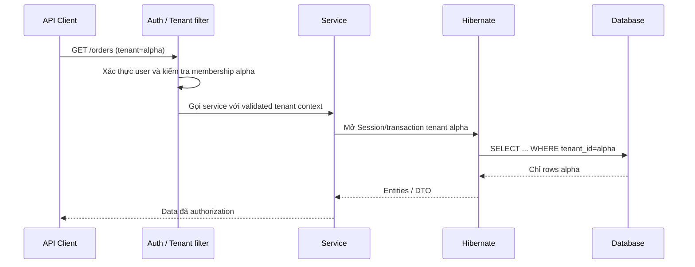

# @TenantId trong mô hình phân biệt dữ liệu theo tổ chức

Một ứng dụng SaaS có thể phục vụ hàng trăm tổ chức (**tenant**) trên cùng hệ thống Java và Hibernate. Tổ chức A và tổ chức B dùng chung code, cùng màn hình “Đơn hàng”, nhưng **không được nhìn thấy, sửa hoặc liên kết dữ liệu của nhau**.

Ví dụ, hai tổ chức có bảng dữ liệu:

| tenant_id | id | order_number | amount |
| --- | ---: | --- | ---: |
| `alpha` | 101 | `SO-001` | 250.00 |
| `beta` | 102 | `SO-001` | 400.00 |
| `alpha` | 103 | `SO-002` | 125.00 |

Với người dùng thuộc `alpha`, API liệt kê đơn hàng chỉ được trả hàng 101 và 103. Nếu người dùng tự thay URL thành `/orders/102`, hệ thống vẫn không được trả đơn hàng của `beta`.

Trong mô hình nhiều tenant **chia sẻ bảng, phân biệt theo cột** (*shared schema / discriminator-based multitenancy*), Hibernate cung cấp annotation `org.hibernate.annotations.TenantId`. Annotation này xác định thuộc tính lưu tenant identifier để Hibernate xử lý việc **gán tenant ID lúc persist** và **hạn chế dữ liệu theo tenant của Session** trong các thao tác ORM được hỗ trợ.

```java
@Entity
@Table(name = "purchase_orders")
public class PurchaseOrder {

    @Id
    @GeneratedValue(strategy = GenerationType.SEQUENCE)
    private Long id;

    @TenantId
    @Column(name = "tenant_id", nullable = false)
    private String tenantId;

    @Column(name = "order_number", nullable = false)
    private String orderNumber;

    protected PurchaseOrder() {}

    public String getTenantId() {
        return tenantId;
    }
}
```

Với Session của `alpha`, Hibernate xử lý query theo phạm vi `alpha` và đặt tenant ID cho entity mới. Nhưng **`@TenantId` không phải là cơ chế bảo mật toàn năng**: SQL viết tay, JDBC, các job bên ngoài ORM, kiểm soát tenant identity, ràng buộc khóa ngoại và cache riêng của ứng dụng vẫn có thể làm rò rỉ dữ liệu nếu thiết kế sai.

Bài học thuộc chương **Nhiều tổ chức**, tập trung vào ngữ nghĩa `@TenantId`, cách gắn tenant vào Session, mapping entity và database constraints, các vùng không được tự lọc, cùng chiến lược bảo mật, kiểm thử và vận hành trên hệ thống nhiều tenant.

> **Phạm vi phiên bản:** `@TenantId` xuất hiện từ Hibernate ORM 6.0. Các ví dụ chính dùng Hibernate 6.x, Jakarta Persistence (`jakarta.persistence`) và Java hiện đại. Hibernate 7.x bổ sung/tài liệu hóa một số trường hợp như tenant-root và composite identifier chi tiết hơn; tính năng HQL INSERT/UPDATE và cách xử lý custom SQL phải đối chiếu **User Guide của phiên bản đang chạy**. Hibernate 5.x không có `@TenantId` theo SPI hiện đại này, thường dùng filter hoặc phương án khác.

---

## 1. Tenant là đơn vị phân vùng dữ liệu, không nhất thiết là user

**Tenant** có thể là:

- Một công ty đăng ký sử dụng hệ thống.
- Một trường học/chi nhánh có vùng dữ liệu độc lập.
- Một tổ chức khách hàng có hàng trăm nhân viên.
- Một workspace/project nếu kiến trúc xác định project là ranh giới sở hữu dữ liệu.
- Một đơn vị kế toán/pháp nhân có chính sách quản trị riêng.

**User** là principal được xác thực; user có thể thuộc một hoặc nhiều tenants.

Ví dụ:

```text
User u-42
  Membership:
    - alpha / role=ADMIN
    - beta  / role=VIEWER

Request hiện tại:
  activeTenant=beta
  action=GET /orders
```

Tenant của Session phải là **tenant đã được chọn và kiểm tra quyền** của request hiện tại, không mặc nhiên là user ID. Ngay cả admin của tenant `alpha` cũng không tự có quyền truy cập tenant `beta`.

### Tenant isolation và authorization là hai lớp khác nhau

- **Isolation:** chỉ xem dữ liệu thuộc tenant đang hoạt động.
- **Authorization:** trong tenant ấy, user có quyền xem/sửa đối tượng cụ thể hay không.

`@TenantId` hỗ trợ lớp **isolation** tại những thao tác ORM được hỗ trợ. Nó không thay role-based permissions, ownership checks, approval workflow hoặc quy tắc “chỉ người tạo mới được sửa”.

## 2. Ba mô hình multi-tenancy chính

Hibernate mô tả ba cách phân tách dữ liệu thông dụng.

| Mô hình | Dữ liệu của mỗi tenant | Cách ORM chọn tenant | `@TenantId` |
| --- | --- | --- | --- |
| **Database per tenant** | Mỗi tenant một database | Connection/DataSource theo tenant | Không phải cơ chế cốt lõi |
| **Schema per tenant** | Mỗi tenant một schema riêng | Connection/schema mapping | Không phải cơ chế cốt lõi |
| **Shared schema / discriminator** | Cùng bảng; mỗi row có `tenant_id` | Session tenant + mapping `@TenantId` | **Mục tiêu trực tiếp** |

### 2.1. Database riêng

```text
Database alpha                 Database beta
  purchase_orders               purchase_orders
  customers                     customers
  invoices                      invoices
```

Ứng dụng cần chọn đúng connection cho tenant; `MultiTenantConnectionProvider` và những công cụ mapping DataSource theo phiên bản Hibernate có thể tham gia.

Ưu điểm: ranh giới dữ liệu ở database vật lý rõ. Đánh đổi: provisioning, migrations, backup và pool management theo tenant phức tạp hơn.

### 2.2. Schema riêng

```text
One database
  schema alpha.purchase_orders
  schema beta.purchase_orders
```

ORM cần chọn schema hoặc connection phù hợp. Tùy Hibernate version có `MultiTenantConnectionProvider` và các schema mapping APIs. Cần reset connection state đúng khi trả về pool.

### 2.3. Bảng dùng chung

```text
One database / one schema

purchase_orders
  id | tenant_id | order_number | amount
 101 | alpha     | SO-001       | 250
 102 | beta      | SO-001       | 400
 103 | alpha     | SO-002       | 125
```

Hibernate có thể gắn predicate tenant vào các thao tác ORM trên entity có `@TenantId`. Ứng dụng thường dùng chung DataSource; không cần `MultiTenantConnectionProvider` chỉ để lọc theo cột.

**Sai lầm phổ biến:** thêm `@TenantId` vào entity rồi tưởng Hibernate tự tạo database hoặc schema khác cho từng tenant. Annotation này nhắm tới **phân vùng dữ liệu trong bảng**.

## 3. `@TenantId` là annotation Hibernate-specific

```java
import org.hibernate.annotations.TenantId;
```

Nó không thuộc Jakarta Persistence chuẩn. Một persistence provider khác không có nghĩa bắt buộc hiểu annotation này.

Trong Hibernate ORM 6+, cách sử dụng cơ bản:

```java
@Entity
public class TenantDocument {

    @Id
    private Long id;

    @TenantId
    private String tenantId;

    private String title;

    protected TenantDocument() {}
}
```

Hibernate xác định `tenantId` là discriminator thuộc sở hữu của tenant context của Session.

Những cam kết quan trọng:

1. Khi entity được persist qua ORM, Hibernate gán tenant ID theo Session.
2. Khi truy vấn/load entity thuộc tenant-partitioned mapping, Hibernate dùng tenant của Session để hạn chế dữ liệu theo cơ chế ORM hỗ trợ.
3. Tenant gắn với **Session** chứ không phải tham số tùy ý của một query.
4. `@TenantId` không tự kiểm soát mọi SQL có thể được chạy qua cùng JDBC connection.
5. Một field tenant được generate/điều khiển bởi Hibernate; business code không nên tự dùng setter để chuyển quyền sở hữu row sang tenant khác.

Javadocs của Hibernate 7.x còn ghi rõ một số semantics khác nhau cho tenant field không phải ID và tenant field thuộc composite identifier. Khi dùng các trường hợp ấy cần kiểm tra đúng phiên bản ORM.

## 4. Mô hình entity mẫu: khách hàng và đơn hàng

Ta dùng hai entity đơn giản.

### 4.1. Customer

```java
package com.example.saas.domain;

import jakarta.persistence.*;
import org.hibernate.annotations.TenantId;

@Entity
@Table(name = "customers")
public class Customer {

    @Id
    @GeneratedValue(strategy = GenerationType.SEQUENCE)
    private Long id;

    @TenantId
    @Column(name = "tenant_id", nullable = false)
    private String tenantId;

    @Column(nullable = false)
    private String name;

    @Column(nullable = false)
    private String email;

    protected Customer() {}

    public Customer(String name, String email) {
        this.name = name;
        this.email = email;
    }

    public Long getId() { return id; }
    public String getTenantId() { return tenantId; }
    public String getName() { return name; }
    public String getEmail() { return email; }
}
```

### 4.2. PurchaseOrder

```java
package com.example.saas.domain;

import jakarta.persistence.*;
import org.hibernate.annotations.TenantId;

import java.math.BigDecimal;

@Entity
@Table(name = "purchase_orders")
public class PurchaseOrder {

    @Id
    @GeneratedValue(strategy = GenerationType.SEQUENCE)
    private Long id;

    @TenantId
    @Column(name = "tenant_id", nullable = false)
    private String tenantId;

    @Column(name = "order_number", nullable = false)
    private String orderNumber;

    @Column(nullable = false, precision = 19, scale = 2)
    private BigDecimal amount;

    @ManyToOne(fetch = FetchType.LAZY, optional = false)
    @JoinColumn(name = "customer_id", nullable = false)
    private Customer customer;

    protected PurchaseOrder() {}

    public PurchaseOrder(
            String orderNumber,
            BigDecimal amount,
            Customer customer) {
        this.orderNumber = orderNumber;
        this.amount = amount;
        this.customer = customer;
    }

    public Long getId() { return id; }
    public String getTenantId() { return tenantId; }
    public String getOrderNumber() { return orderNumber; }
    public BigDecimal getAmount() { return amount; }
    public Customer getCustomer() { return customer; }
}
```

**Chú ý:** mapping `@ManyToOne` ở trên chỉ cho thấy cách ORM biểu diễn association. Để ngăn một đơn hàng của `alpha` trỏ đến Customer của `beta` ngay cả khi dữ liệu bị ghi bởi native SQL/ETL, ta sẽ cần **khóa ngoại ghép theo tenant ở database**, trình bày ở phần sau.

## 5. Tenant ID được gán lúc persist

Một Session được tạo với tenant `alpha`:

```java
try (Session session = sessionFactory
        .withOptions()
        .tenantIdentifier("alpha")
        .openSession()) {

    Transaction tx = session.beginTransaction();

    Customer customer = new Customer(
        "Công ty Alpha",
        "info@alpha.example"
    );

    session.persist(customer);
    session.flush();

    System.out.println(customer.getTenantId()); // alpha

    tx.commit();
}
```

Hibernate lấy tenant identifier của Session rồi gán vào mapped `@TenantId` property khi entity được làm persistent.

SQL minh họa:

```sql
INSERT INTO customers (
    id,
    tenant_id,
    name,
    email
) VALUES (
    ?, 'alpha', ?, ?
);
```

SQL thực tế có thể dùng bind parameter, sinh ID bằng sequence/identity và đặt thứ tự cột khác; không dùng output minh họa như một SQL contract cố định.

### Không truyền tenantId từ request vào entity

Không nên:

```java
@PostMapping("/customers")
public void create(@RequestBody CreateCustomerRequest req) {
    Customer customer = new Customer();
    customer.setTenantId(req.tenantId()); // Không nên.
    repository.save(customer);
}
```

Lý do:

- Client có thể giả mạo `tenantId="beta"`.
- Hibernate đã có nguồn tenant ở Session.
- Có thể tạo mismatch hoặc exception tùy mapping/ORM version.
- API không nên cấp quyền chọn chủ sở hữu row chỉ bằng một field trong body.

Chỉ dùng tenant từ **security-validated application context**. Với nonidentifier `@TenantId`, tài liệu Hibernate mới mô tả giá trị tự gán không khớp tenant Session bị từ chối cho tenant thường; không dùng điều này thay server-side authorization.

## 6. Query HQL/JPQL được giới hạn theo tenant

Ứng dụng viết:

```java
List<PurchaseOrder> orders = em.createQuery(
        """
        select o
        from PurchaseOrder o
        where o.amount >= :minAmount
        order by o.id
        """,
        PurchaseOrder.class
    )
    .setParameter("minAmount", new BigDecimal("100.00"))
    .getResultList();
```

Trong Session tenant `alpha`, Hibernate xử lý tenant discrimination đối với mapped query. Có thể hình dung SQL:

```sql
SELECT o.*
FROM purchase_orders o
WHERE o.tenant_id = ?
  AND o.amount >= ?
ORDER BY o.id;
```

Khi parameter tenant = `alpha`, hai dòng của `beta` không hiện trong result set của entity đã mapped.

### Không cần truyền tenant vào từng query repository

Nếu dùng ORM multi-tenancy đúng:

```java
List<PurchaseOrder> findByOrderNumber(String orderNumber);
```

vẫn được xử lý trong phạm vi Session tenant. Đó là lợi ích chính so với việc quên thêm `tenantId` trong mỗi phương thức repository.

Tuy vậy, **không phải mọi câu SQL ứng dụng có thể gửi đều qua mapped query path**. Native queries, stored procedures và JDBC là các ngoại lệ cực kỳ quan trọng.

## 7. `EntityManager.find` cũng phải được kiểm thử theo tenant

Với tenant `alpha`:

```java
PurchaseOrder order =
    entityManager.find(PurchaseOrder.class, orderId);
```

Đối với entity có `@TenantId`, Hibernate hỗ trợ tenant-aware identifier loading. Nếu `orderId` thuộc tenant khác, caller không được đọc entity ấy qua Session của `alpha` theo contract multi-tenancy.

Về API, thường nên trả 404 hoặc một lỗi có chính sách anti-enumeration phù hợp, thay vì tiết lộ “ID này tồn tại nhưng thuộc tenant beta”.

### Tenant predicate không tự chứng minh user có quyền

Nếu Order thuộc `alpha` nhưng chỉ chủ dự án được xem, `@TenantId` chưa đủ. Service vẫn phải áp authorization:

```java
@Transactional(readOnly = true)
public OrderDto getOrder(Long id, Principal actor) {
    PurchaseOrder order = repository.findById(id)
        .orElseThrow(NotFoundException::new);

    orderPolicy.requireCanView(actor, order);

    return toDto(order);
}
```

`orderPolicy` là domain/application authorization component minh họa; không phải API Hibernate.

## 8. Tenant gắn với Session, không đổi giữa hai truy vấn

Có thể biểu diễn:

```text
Session S1:
  tenant = alpha
  query A -> rows của alpha
  query B -> rows của alpha

Session S2:
  tenant = beta
  query A -> rows của beta
```

**Không dùng một Session có tenant alpha rồi đổi thread-local thành beta để query beta.**

```java
TenantContext.set("alpha");

EntityManager em = createEntityManagerSomehow();

TenantContext.set("beta");

// Không có nghĩa em giờ phục vụ beta.
```

Hibernate chọn tenant khi Session/EntityManager được mở. Đổi application context hoặc gọi `entityManager.clear()` chỉ thay persistence-context managed state, **không retarget Session sang tenant mới**.

### Luôn mở persistence context mới khi chuyển tenant

Trong một workflow được phép đọc hai tenants, hãy:

1. Authorize rõ từng tenant.
2. Kết thúc transaction/Session hiện tại.
3. Tạo transaction/Session mới cho tenant thứ hai.
4. Không reuse managed entities giữa hai vùng.
5. Không giữ lazy proxies/collections từ Session cũ.

Không tạo “admin cross-tenant transaction” mặc định bằng cách đổi biến toàn cục giữa các repository calls.

## 9. Cung cấp tenant trực tiếp khi mở Hibernate Session

Đây là cách dễ hiểu nhất trong ví dụ standalone:

```java
import org.hibernate.Session;
import org.hibernate.Transaction;

public void createFor(
        SessionFactory sessionFactory,
        String tenant) {

    try (Session session = sessionFactory
            .withOptions()
            .tenantIdentifier(tenant)
            .openSession()) {

        Transaction tx = session.beginTransaction();

        try {
            session.persist(new Customer(
                "Khách hàng mới",
                "demo@example.test"
            ));

            tx.commit();
        } catch (RuntimeException ex) {
            if (tx.isActive()) {
                tx.rollback();
            }
            throw ex;
        }
    }
}
```

Giả định method `createFor` chỉ được gọi sau khi tenant string đã được kiểm tra/ủy quyền. Không đưa trực tiếp HTTP query parameter vào `tenantIdentifier(...)`.

### Lấy tenant hiện tại từ Session

Tùy Hibernate version, Session có API như:

```java
String tenant = session.getTenantIdentifier();
```

Các dòng Hibernate hiện đại còn cung cấp accessor typed tenant identifier value. Không dùng `tenantId` trích từ request để thay thế việc kiểm tra tenant đang thật sự gắn vào Session.

## 10. Dùng Jakarta EntityManager cùng Hibernate tenant hint

Hibernate giới thiệu hint để chọn tenant khi tạo EntityManager:

```java
import org.hibernate.jpa.HibernateHints;

EntityManager em =
    entityManagerFactory.createEntityManager(
        Map.of(
            HibernateHints.HINT_TENANT_ID,
            "alpha"
        )
    );

try {
    em.getTransaction().begin();

    // Entity operations trên tenant alpha.
    List<Customer> customers =
        em.createQuery(
            "from Customer c order by c.id",
            Customer.class
        ).getResultList();

    em.getTransaction().commit();
} finally {
    em.close();
}
```

Ví dụ dùng transaction resource-local. Với Spring/JTA, container/transaction manager thường quản lý EntityManager và transaction; không tự gọi `getTransaction().begin()` trên container-managed EntityManager.

`HibernateHints.HINT_TENANT_ID` là **Hibernate-specific**: đây không phải chuẩn portable mà mọi JPA provider buộc hỗ trợ.

## 11. `CurrentTenantIdentifierResolver`

Trong ứng dụng Spring/SaaS, service không thường xuyên tự mở Session. Hibernate có interface:

```java
org.hibernate.context.spi.CurrentTenantIdentifierResolver<T>
```

Implement để trả tenant của application context:

```java
import org.hibernate.context.spi
    .CurrentTenantIdentifierResolver;

public final class SecurityTenantResolver
        implements CurrentTenantIdentifierResolver<String> {

    private final TenantContextProvider contextProvider;

    public SecurityTenantResolver(
            TenantContextProvider contextProvider) {
        this.contextProvider = contextProvider;
    }

    @Override
    public String resolveCurrentTenantIdentifier() {
        return contextProvider.requireValidatedTenant();
    }

    @Override
    public boolean validateExistingCurrentSessions() {
        return true;
    }
}
```

`TenantContextProvider` là abstraction do ứng dụng triển khai để lấy tenant **đã kiểm tra từ authentication/membership**, không phải class Hibernate.

### `validateExistingCurrentSessions()`

Khi trả `true`, Hibernate có thể kiểm tra tenant identifier của **current Session** tồn tại có khớp resolver hay không trong những cơ chế current-session được hỗ trợ. Tài liệu Hibernate lưu ý kiểm tra này gắn với current-session context, không phải một quy tắc sẽ tự chặn mọi ThreadLocal change trong mọi integration.

Không dùng flag này làm thay thế cho lifecycle context đúng.

### Không trả tenant mặc định cho request chưa xác thực

Ví dụ rủi ro:

```java
return tenant == null ? "alpha" : tenant;
```

Nếu thiếu tenant vì lỗi security filter, request có thể rơi vào tenant `alpha` một cách âm thầm. Policy an toàn hơn là **fail closed** khi request bắt buộc có tenant mà context bị thiếu:

```java
String tenant = context.requireValidatedTenant();
if (tenant == null || tenant.isBlank()) {
    throw new IllegalStateException("Missing tenant");
}
return tenant;
```

Các thao tác public không có tenant hoặc migration/background jobs phải dùng đường chạy được thiết kế riêng, không “đi nhờ” tenant production ngẫu nhiên.

## 12. Cấu hình resolver cho Hibernate

Tên property thường dùng:

```properties
hibernate.tenant_identifier_resolver
```

Có thể đăng ký instance qua bootstrap API hoặc integration framework.

Với Spring Boot và Spring Data JPA, một cách phổ biến là:

```java
import org.springframework.boot.autoconfigure.orm.jpa
    .HibernatePropertiesCustomizer;

@Bean
HibernatePropertiesCustomizer tenantResolverCustomizer(
        SecurityTenantResolver resolver) {

    return properties -> properties.put(
        "hibernate.tenant_identifier_resolver",
        resolver
    );
}
```

Để mẫu chạy, resolver phải được tạo dưới dạng Spring bean cùng `TenantContextProvider` và môi trường Spring Boot phải quản lý Hibernate bootstrap. Tránh ép dùng đúng snippet này trên phiên bản Spring Boot mới/cũ không có cùng integration contract.

Có thể dùng constant:

```java
org.hibernate.cfg.MultiTenancySettings
    .MULTI_TENANT_IDENTIFIER_RESOLVER
```

trong các Hibernate versions có constant ấy, thay vì tự nhớ chuỗi.

### Cấu hình resolver không bằng cấp cho user quyền chọn bất kỳ tenant

Resolver nhận diện active tenant cho Session. Nó không phải access-control service. Request được xác thực phải đi qua membership/authorization trước khi resolver được gọi.

## 13. Xác lập tenant ở HTTP security boundary

Một flow hợp lý:



**Tenant filter phải thiết lập context trước khi transaction/EntityManager được mở.**

Trong Spring, một `@Transactional` method có thể kích hoạt Session creation trước khi business code chạy. Nếu active tenant chỉ được set **bên trong** method ấy thì thường đã quá muộn.

### Tenant header là gợi ý chọn, không phải bằng chứng quyền

Request:

```http
GET /api/orders
X-Tenant-Id: beta
Authorization: Bearer ...
```

Server phải xác thực principal và kiểm tra quyền trên `beta`. Không tin rằng client gửi header hợp lệ thì được truy cập.

Với web có host/subdomain theo tenant, cũng phải validate tenant-domain mapping, không tin bất kỳ Host header hoặc forwarded header chưa được proxy xác thực.

## 14. Context propagation và ThreadLocal

Một thiết kế dùng ThreadLocal:

```java
public final class TenantContext {

    private static final ThreadLocal<String> CURRENT =
        new ThreadLocal<>();

    private TenantContext() {}

    public static void set(String tenant) {
        CURRENT.set(tenant);
    }

    public static String require() {
        String tenant = CURRENT.get();

        if (tenant == null || tenant.isBlank()) {
            throw new IllegalStateException(
                "No validated tenant context"
            );
        }

        return tenant;
    }

    public static void clear() {
        CURRENT.remove();
    }
}
```

Nếu dùng trong servlet filter, phải bảo đảm context được đặt **sau auth** và xóa bằng `finally`:

```java
try {
    TenantContext.set(validatedTenant);
    filterChain.doFilter(request, response);
} finally {
    TenantContext.clear();
}
```

**Đây chỉ là mô hình kỹ thuật**, chưa phải filter bảo mật hoàn chỉnh. Trong ứng dụng thật có Spring Security hoặc framework khác, ưu tiên context abstraction đã được kiểm soát và phù hợp với request lifecycle.

### Vì sao phải `remove()`?

Thread pool tái sử dụng threads. Nếu tenant `alpha` còn trong ThreadLocal khi request `beta` chạy trên cùng thread, request sau có thể lấy tenant sai.

### Async/reactive

ThreadLocal không tự truyền qua:

- `CompletableFuture`.
- `@Async`.
- Scheduler/background worker.
- Kafka/message consumers.
- Reactive pipelines đổi thread.

Với async, mỗi task cần tenant context **được truyền qua dữ liệu công việc có xác thực**, sau đó thiết lập trước khi mở Session và dọn sạch cuối task. Với reactive stack, dùng context propagation thích hợp thay vì trông chờ plain ThreadLocal.

## 15. Transaction boundary và tenant context

Một service:

```java
@Service
public class OrderService {

    private final PurchaseOrderRepository repository;

    public OrderService(PurchaseOrderRepository repository) {
        this.repository = repository;
    }

    @Transactional(readOnly = true)
    public List<OrderDto> list() {
        return repository.findAll()
            .stream()
            .map(this::toDto)
            .toList();
    }

    // toDto minh họa mapping dữ liệu đã tải.
}
```

Khi resolver đã được cấu hình và context có tenant hợp lệ trước method call, Session phục vụ transaction theo tenant đó.

Những điểm cần hiểu:

- `@Transactional` không tự chọn tenant từ HTTP header.
- Transaction service không tự thay thế membership authorization.
- Nested service calls thường dùng chung persistence context/transaction; không được tự đổi tenant ở giữa.
- `REQUIRES_NEW` tạo transaction mới nhưng không tự cho phép tenant switch nếu context/Session lifecycle chưa được xử lý đúng.
- Không mở nhiều Session khác tenant trong cùng flow nếu không có policy transaction/reconciliation rõ.

### Nếu cần xử lý nhiều tenants trong batch job

Tổ chức vòng lặp ở **boundary bên ngoài** các transactions:

```java
for (String authorizedTenant : tenantCatalog.activeTenants()) {
    tenantJobRunner.runForTenant(authorizedTenant);
}
```

Trong `runForTenant`, thiết lập tenant trước khi gọi bean `@Transactional`, rồi dọn context sau khi transaction kết thúc. Không tạo một transaction chung rồi vòng qua 100 tenants và thay biến resolver.

## 16. Query repository không cần nhận tenant như parameter hiển thị

Với Spring Data JPA:

```java
public interface PurchaseOrderRepository
        extends JpaRepository<PurchaseOrder, Long> {

    List<PurchaseOrder> findByOrderNumber(String number);
}
```

Khi Hibernate Session được thiết lập đúng với tenant `alpha`, các mapped ORM queries áp dụng tenant discrimination theo configuration.

Một lợi ích thiết kế:

```java
repository.findByOrderNumber("SO-001");
```

không cần:

```java
repository.findByOrderNumberAndTenantId(
    "SO-001",
    request.getParameter("tenant")
);
```

Tuy nhiên, để dễ review trong hệ thống rủi ro cao, có thể giữ tenant id trong query/service signature như một business constraint hoặc audit context **nhưng tuyệt đối không tin tenant user-supplied**. Nguồn tenant ở Session vẫn phải hợp lệ.

## 17. DTO projection và pagination

Một API liệt kê đơn hàng nên trả DTO, không xuất nguyên managed entity.

```java
public record OrderListDto(
    Long id,
    String orderNumber,
    BigDecimal amount,
    String customerName
) {}
```

Query:

```java
@Query("""
    select new com.example.saas.api.OrderListDto(
        o.id, o.orderNumber, o.amount, c.name
    )
    from PurchaseOrder o
    join o.customer c
    where o.amount >= :minimum
    order by o.id
    """)
Page<OrderListDto> listForCurrentTenant(
    @Param("minimum") BigDecimal minimum,
    Pageable pageable
);
```

Trong tenant-aware Session, các mapped entities `PurchaseOrder` và `Customer` phải được xử lý theo tenant đúng theo semantics Hibernate version.

Cần đảm bảo:

- Tenant context được tạo trước repository call.
- Count query của `Page` cũng bị giới hạn theo tenant.
- Sort fields được whitelist; page size được giới hạn.
- DTO không mang entity/proxy của tenant khác.
- Không nhầm query projection ORM với native SQL projection.

### Vì sao DTO vẫn hữu ích?

`@TenantId` giúp phân vùng dữ liệu ORM, còn DTO giúp:

- Không lộ trường nội bộ như `tenantId` nếu không cần.
- Không lazy-load associations ngoài transaction.
- Tránh N+1 bằng projection phù hợp.
- Kiểm soát trường nào user/role được xem.
- Có contract API ổn định khi mapping DB thay đổi.

`@TenantId` và DTO giải quyết những vấn đề khác nhau; nên kết hợp.

## 18. Khóa chính toàn cục: `id` không nhất thiết trùng trong tenant khác

Với mapping:

```java
@Id
@GeneratedValue(strategy = GenerationType.SEQUENCE)
private Long id;

@TenantId
private String tenantId;
```

`tenantId` **không tự trở thành một phần PRIMARY KEY**. Database PK thường là `id`, nên ID phải duy nhất **trên toàn bộ bảng**.

Ví dụ DDL:

```sql
CREATE TABLE customers (
    id BIGINT PRIMARY KEY,
    tenant_id VARCHAR(64) NOT NULL,
    name VARCHAR(255) NOT NULL
);
```

Hai rows:

```text
alpha, id=1
beta,  id=1
```

**không thể** cùng tồn tại nếu `PRIMARY KEY(id)`. Việc ORM lọc theo `tenant_id` không thay quy tắc uniqueness vật lý của database.

### Vì sao global ID thường đơn giản?

- Repository `findById(Long)` phù hợp.
- Foreign keys dùng một cột `id` ở dạng đơn giản.
- Entity equality/identity dễ hơn composite identifiers.
- Sequence/identity generator chung có thể cấp IDs duy nhất.

Nhưng vẫn cần bảo vệ **tenant-scoped relationships và business uniqueness** bằng constraints thích hợp.

## 19. Business key thường chỉ cần unique trong mỗi tenant

Cùng số đơn `SO-001` có thể xuất hiện ở hai tenants.

Sai:

```sql
UNIQUE (order_number)
```

trên bảng shared schema, vì tenant beta không thể dùng mã đã có của tenant alpha.

Đúng hơn nếu business contract là “mã đơn duy nhất trong tenant”:

```sql
CONSTRAINT uk_order_number_per_tenant
    UNIQUE (tenant_id, order_number)
```

Tương tự:

- `UNIQUE(tenant_id, email)` nếu email chỉ cần unique trong tenant.
- `UNIQUE(tenant_id, sku)` cho sản phẩm.
- `UNIQUE(tenant_id, reference_code)` cho mã đơn/phiếu.
- `UNIQUE(tenant_id, external_system, external_id)` nếu external key phân vùng theo tổ chức.

### Không lấy global uniqueness nếu nghiệp vụ muốn per-tenant

Một API có thể cho phép cùng tên project hoặc cùng số đơn ở nhiều tổ chức. Constraint sai vừa gây lỗi chức năng vừa vô tình tiết lộ rằng một giá trị đã được dùng ở tenant khác.

## 20. Khóa ngoại phải có khả năng chống liên kết chéo tenant

Ví dụ dữ liệu sai:

```text
customers
  id=10, tenant_id=beta

purchase_orders
  id=101, tenant_id=alpha, customer_id=10
```

Nếu database chỉ có:

```sql
FOREIGN KEY (customer_id)
    REFERENCES customers(id)
```

thì row Order alpha có thể trỏ tới Customer beta hợp lệ về PK nhưng **sai về tenant ownership**.

Hibernate có thể áp tenant predicates trên những thao tác ORM, nhưng database vẫn nên ngăn một quan hệ không hợp lệ bị tạo qua native SQL, external writer hoặc lỗi ứng dụng.

### Thiết kế composite foreign key

Giả sử Customer có global PK `id`. Thêm unique constraint:

```sql
ALTER TABLE customers
    ADD CONSTRAINT uk_customers_tenant_id
    UNIQUE (tenant_id, id);
```

Bảng Order:

```sql
CREATE TABLE purchase_orders (
    id BIGINT PRIMARY KEY,
    tenant_id VARCHAR(64) NOT NULL,
    customer_id BIGINT NOT NULL,
    order_number VARCHAR(64) NOT NULL,
    amount DECIMAL(19,2) NOT NULL,

    CONSTRAINT fk_order_customer_same_tenant
        FOREIGN KEY (tenant_id, customer_id)
        REFERENCES customers(tenant_id, id),

    CONSTRAINT uk_order_number_per_tenant
        UNIQUE (tenant_id, order_number)
);
```

Với constraint này, một Order tenant alpha không thể tham chiếu Customer tenant beta.

### Mapping Hibernate tương ứng cần tránh ghi trùng cột

Nếu một entity đã map `tenant_id` bằng `@TenantId`, một association dùng cùng cột trong composite join phải được cấu hình thống nhất về insert/update ownership:

```java
@ManyToOne(fetch = FetchType.LAZY, optional = false)
@JoinColumns({
    @JoinColumn(
        name = "customer_id",
        referencedColumnName = "id"
    ),
    @JoinColumn(
        name = "tenant_id",
        referencedColumnName = "tenant_id",
        insertable = false,
        updatable = false
    )
})
private Customer customer;
```

Ví dụ chỉ minh họa cấu trúc mapping; cần kiểm tra mapping metadata, tên columns và DDL trên ORM version/dialect đang chạy. Hệ thống thực nên integration-test việc Hibernate generated joins nhất quán với composite FK constraint.

### Đây là defense in depth

- ORM giúp scope queries.
- DB composite FK bảo vệ toàn vẹn quan hệ.
- Authorization bảo vệ quyền thao tác.
- RLS (nếu có) có thể bảo vệ access của database role.

Không một lớp nào đủ để thay thế toàn bộ các lớp khác.

## 21. Local IDs với composite primary key

Một số hệ thống muốn ID được cấp **trong phạm vi từng tenant**:

```text
alpha, invoice_id=1
beta,  invoice_id=1
```

Lúc này `@Id Long id` toàn cục không phù hợp. Một lựa chọn là composite identifier `(tenant_id, id)`.

Hibernate 7.x Javadocs mô tả `@TenantId` có thể là một thành phần của composite key khi field đồng thời có `@Id`.

Ví dụ khai báo:

```java
import jakarta.persistence.*;
import org.hibernate.annotations.TenantId;

@Entity
@IdClass(LocalInvoiceKey.class)
@Table(name = "local_invoices")
public class LocalInvoice {

    @Id
    private Long localId;

    @Id
    @TenantId
    @Column(name = "tenant_id")
    private String tenantId;

    @Column(nullable = false)
    private String title;

    protected LocalInvoice() {}

    public LocalInvoice(Long localId, String title) {
        this.localId = localId;
        this.title = title;
    }
}
```

ID class:

```java
import java.io.Serializable;
import java.util.Objects;

public class LocalInvoiceKey implements Serializable {

    private Long localId;
    private String tenantId;

    public LocalInvoiceKey() {}

    public LocalInvoiceKey(
            Long localId,
            String tenantId) {
        this.localId = localId;
        this.tenantId = tenantId;
    }

    @Override
    public boolean equals(Object other) {
        if (this == other) return true;
        if (!(other instanceof LocalInvoiceKey key)) return false;

        return Objects.equals(localId, key.localId)
            && Objects.equals(tenantId, key.tenantId);
    }

    @Override
    public int hashCode() {
        return Objects.hash(localId, tenantId);
    }
}
```

DDL tương ứng:

```sql
CREATE TABLE local_invoices (
    tenant_id VARCHAR(64) NOT NULL,
    local_id BIGINT NOT NULL,
    title VARCHAR(255) NOT NULL,
    PRIMARY KEY (tenant_id, local_id)
);
```

### Khi tenant field là một phần `@Id`

Các phiên bản Hibernate hiện đại tài liệu hóa generation behavior của `@Id @TenantId` khác một field tenant bình thường: giá trị tenant trong composite identifier có thể được gán từ Session khi insert; không dựa vào giá trị application tự đưa là được giữ hoặc bị từ chối giống non-ID field.

Đây là **trường hợp nâng cao và phụ thuộc version**. Hãy để Hibernate cấp tenant component, dùng ID class chính xác, và test persist/find/merge dưới các tenants khác nhau. Không dựa vào JPA chuẩn tự hỗ trợ `@TenantId`.

### ID được cấp trong mỗi tenant cần allocator đúng

Nếu `localId` là 1..N theo từng tenant, phải có allocator/sequence đảm bảo uniqueness theo tenant, không dùng `SELECT MAX(local_id)+1` thiếu lock. Một database shared table với composite PK cần chọn chiến lược ID thực sự tương thích concurrency và indexing.

## 22. So sánh global ID và composite ID

| Tiêu chí | Global surrogate ID | Composite (tenant_id, local_id) |
| --- | --- | --- |
| Primary key | `id` | `tenant_id, local_id` |
| Có thể trùng local ID giữa tenants? | Không, nếu id là PK | Có |
| API path | `/orders/101` | Có thể `/tenants/alpha/orders/101`, nhưng vẫn phải authorize |
| Foreign key | Thường đơn giản hơn | Phải mang tenant component |
| Tenant integrity | Cần composite FK/constraints bổ sung | PK mang tenant scope; associations vẫn phải đúng |
| Index/SQL | Khóa ngắn hơn | Khóa ghép lớn hơn |
| ORM mapping | Đơn giản | `@IdClass`/`@EmbeddedId`, equality phức tạp hơn |
| Merge/identity | Theo ID toàn cục | Theo cặp tenant + local ID |

Không có lựa chọn luôn tối ưu. Nếu không cần local ID reuse, dùng global surrogate thường giảm độ phức tạp. Nếu database/tenant model bắt buộc local ID, composite identifier có thể phù hợp.

## 23. Entity kế thừa có thể dùng tenant mapping chung

Nhiều entity cùng có `tenant_id`. Có thể dùng `@MappedSuperclass`:

```java
import jakarta.persistence.*;
import org.hibernate.annotations.TenantId;

@MappedSuperclass
public abstract class TenantOwnedEntity {

    @TenantId
    @Column(name = "tenant_id", nullable = false)
    private String tenantId;

    public String getTenantId() {
        return tenantId;
    }
}
```

Entity:

```java
@Entity
@Table(name = "products")
public class Product extends TenantOwnedEntity {

    @Id
    @GeneratedValue(strategy = GenerationType.SEQUENCE)
    private Long id;

    private String sku;

    protected Product() {}
}
```

Lợi ích:

- Một mapping tenant nhất quán.
- Hạn chế quên tenant field ở một entity mới.
- Giảm lặp mapping.
- Thuận tiện thiết kế common tenant-aware validation/logging.

Nhưng:

- Không nên bắt entity **global reference data** kế thừa tenant field một cách vô tình.
- Inheritance/JPA access type phải nhất quán.
- Các hệ thống cần composite IDs có thể không dùng được chung một mapped superclass đơn giản.
- Audit/entity callbacks của superclass không thay tenant authorization.

## 24. Global reference entity không thuộc tenant

Ví dụ bảng `country_codes` dùng chung cho mọi tenant:

```java
@Entity
@Table(name = "country_codes")
public class CountryCode {

    @Id
    private String code;

    private String displayName;
}
```

Không bắt buộc mọi entity phải có `@TenantId`. Các bảng **thật sự global** có thể không cần tenant discrimination.

Tuy vậy, cần câu hỏi rõ:

- Một tenant có thể sửa `CountryCode` không?
- Dữ liệu global có bị lẫn với override theo tenant không?
- Tenant nào được phép tạo/sửa shared references?
- Có cần tách read-only global data và tenant-specific custom data?

Nếu một bảng có cả global rows `tenant_id=NULL` lẫn tenant rows trong cùng table, `@TenantId` đơn giản không tự tạo semantics “tenant rows OR global rows”. Nên thiết kế read model/filter/global entity riêng thay vì dùng NULL như một “tenant đặc biệt” ngầm định.

## 25. Không tự đổi tenant của một row đã persist

Một thực thể có thể thuộc tenant `alpha` từ lúc tạo. Đưa nó sang `beta` không giống đổi tên Customer.

Không làm:

```java
customer.setTenantId("beta");
```

hoặc thay private field qua reflection để “chuyển tổ chức”.

Đây là thay đổi **ownership/security boundary**, có thể kéo theo:

- Foreign keys và collections.
- Events/history/audit.
- External integrations.
- Cache keys.
- Tenant-scoped unique constraints.
- Data retention/consent.
- Permissions/authorization.
- Composite key identity.
- Billing/contractual boundaries.

Nếu nghiệp vụ thực sự cần transfer, phải thiết kế **một workflow migration/transfer được ủy quyền**, với transaction, constraints, reconciliation và kiểm toán riêng. Không coi tenant ID là field editable thông thường.

## 26. `@TenantId` không thay thế row-level security

`@TenantId` hoạt động ở tầng ORM. Database vẫn có thể được truy cập qua:

- JDBC thuần.
- SQL console của admin.
- ETL.
- Reporting tools.
- Stored procedures.
- Native SQL.
- Migration jobs.
- Ứng dụng khác dùng cùng database.

Một lớp bổ sung là **row-level security** (RLS) của DBMS nếu có. Ví dụ khái niệm với PostgreSQL:

```sql
ALTER TABLE purchase_orders
    ENABLE ROW LEVEL SECURITY;

CREATE POLICY order_tenant_policy
ON purchase_orders
USING (
    tenant_id = current_setting('app.tenant_id', true)
)
WITH CHECK (
    tenant_id = current_setting('app.tenant_id', true)
);
```

Câu SQL mang tính **PostgreSQL-specific**. Để policy có hiệu lực đúng:

1. Ứng dụng phải set `app.tenant_id` bằng giá trị đã được kiểm tra quyền trên **connection/transaction thực tế**.
2. Cần reset/giới hạn scope tenant variable khi connection trả về pool, ví dụ transaction-local setting phù hợp.
3. Database role không được có quyền bypass RLS nếu muốn dùng nó làm lớp an ninh.
4. Cần xem table-owner bypass, `FORCE ROW LEVEL SECURITY` và các đặc quyền DBA.
5. Phải test cả `SELECT`, `INSERT`, `UPDATE`, `DELETE`, foreign key behaviors và schema migration.

Hibernate `@TenantId` **không tự cấu hình RLS hoặc set PostgreSQL session variables**. Khi kết hợp hai lớp, application phải triển khai binding phù hợp và không để user tự chọn DB tenant bằng SQL tùy ý.

---

## 27. Native SQL là ranh giới quan trọng nhất

Tài liệu Hibernate nhấn mạnh: **native SQL không tự được thêm tenant predicate** bởi `@TenantId`.

Sai:

```java
List<Object[]> rows = em.createNativeQuery(
    """
    select id, order_number
    from purchase_orders
    order by id
    """
).getResultList();
```

Query đó có thể trả rows của nhiều tenants nếu database role cho phép.

Đúng hơn:

```java
List<Object[]> rows = em.createNativeQuery(
    """
    select id, order_number
    from purchase_orders
    where tenant_id = :tenantId
    order by id
    """
)
.setParameter("tenantId", validatedTenant)
.getResultList();
```

`validatedTenant` phải lấy từ tenant context đáng tin, không lấy trực tiếp query parameter/body.

### Đừng tin native entity mapping tự thêm WHERE

```java
em.createNativeQuery(
    "select * from purchase_orders",
    PurchaseOrder.class
);
```

Việc result được map vào `PurchaseOrder` **không đồng nghĩa Hibernate tự viết lại SQL text để thêm WHERE tenant_id**. Hãy coi native SQL là ranh giới phải audit độc lập.

### Những đường khác cũng phải review

- `Session.doWork(...)` và `doReturningWork(...)`.
- `JdbcTemplate`.
- Stored procedure và database function.
- `@SQLSelect` / custom loader.
- Custom mutation SQL (`@SQLInsert`, `@SQLUpdate`, `@SQLDelete` tùy version).
- Native bulk update/delete.
- Bulk imports/ETL và scheduler dùng JDBC.
- Database triggers và scripts.

Không đưa những API trên vào “vùng an toàn” chỉ vì chúng được gọi từ method `@Transactional` có một tenant Session.

## 28. SQL UPDATE/DELETE viết tay phải có tenant predicate

Ví dụ xóa nhầm:

```sql
DELETE FROM purchase_orders
WHERE status = 'CANCELLED';
```

Nếu mục đích là dọn dữ liệu của tenant alpha, câu này có thể xóa toàn bộ tenants.

Cần ràng buộc:

```sql
DELETE FROM purchase_orders
WHERE tenant_id = :tenant_id
  AND status = 'CANCELLED';
```

Tương tự:

```sql
UPDATE purchase_orders
SET amount = :amount
WHERE tenant_id = :tenant_id
  AND id = :id;
```

Nếu một job phải chạy nhiều tenants, loop theo tenants được ủy quyền với audit/metrics, không bỏ predicate tenant một cách tùy tiện.

### Bulk HQL/JPQL khác bulk native SQL

Hibernate phiên bản hiện đại có tenant-aware restrictions cho các HQL/Criteria mapped updates/deletes khi dùng `@TenantId`. Tuy nhiên, bulk mutation vẫn có semantics khác entity-by-entity mutation (L1 cache stale, callbacks, versioning, Envers, cascades).

Vì tính nhạy cảm của bulk writes, hãy kiểm tra SQL được sinh **trên phiên bản Hibernate đang chạy**; không chuyển suy luận về HQL update/delete sang native SQL hoặc HQL INSERT mà không test.

### HQL INSERT là trường hợp riêng

Tài liệu Hibernate hiện đại nêu rằng `insert ... select` và `insert ... values` của HQL không đi qua cùng tenant-value generation/validation của `persist(entity)`. Nếu dùng các lệnh này, phải cung cấp tenant attribute phù hợp ở INSERT target và kiểm tra DB constraints/RLS.

Không dùng:

```hql
insert into PurchaseOrder(orderNumber, amount)
select ...
```

và mong `@TenantId` chắc chắn gán tenant như `session.persist(new PurchaseOrder(...))` trên mọi phiên bản.

## 29. Tránh SQL injection trong tenant predicates

Dù tenant ID đã được xác thực, vẫn phải bind parameter:

```java
query.setParameter("tenantId", validatedTenant);
```

Không nối SQL:

```java
String sql =
    "select * from purchase_orders where tenant_id='" +
    requestTenant + "'";
```

Với DB/schema-per-tenant, schema/table identifiers không bind bằng parameter theo cách thông thường; phải dùng tenant → schema mapping allowlist/trusted configuration, không ghép raw user input vào SQL identifier.

**Tenant isolation và SQL injection là hai ranh giới bảo mật riêng**: cần xử lý cả hai.

## 30. HQL/Criteria queries và associations

Trong mô hình mapped entities:

```hql
select o
from PurchaseOrder o
join fetch o.customer c
where o.amount > :minimum
```

Query ORM sử dụng metadata của Order và Customer, nên Hibernate có thể áp tenant discrimination cho những entities tương ứng theo contract.

Nhưng association vẫn cần **integrity constraint**:

- Nếu Customer không có tenant discriminator, nó có thể là shared global entity; đó là quyết định data model.
- Nếu Customer có `@TenantId`, foreign key nên ngăn Order trỏ sai tenant.
- Nếu raw SQL đã tạo dữ liệu sai, query ORM có thể bỏ qua association không phù hợp hoặc trả kết quả khác kỳ vọng; không coi điều đó là sửa dữ liệu.
- Bulk operations có thể bypass entity callbacks.

**Tầng ORM giúp lọc; database phải bảo vệ toàn vẹn quan hệ.**

## 31. Lazy loading khi Session đã đóng

`@TenantId` không xóa các nguyên tắc thông thường của Hibernate lazy loading.

```java
OrderDto dto = orderService.get(id);
```

Nếu controller trả entity `PurchaseOrder` trực tiếp và JSON serializer gọi `getCustomer().getName()` sau khi Session đóng, vẫn có thể bị `LazyInitializationException`.

Giải pháp:

1. Tải association cần dùng trong transaction.
2. Map sang DTO chỉ chứa scalar/nested DTO.
3. Trả DTO độc lập với Session.
4. Đo N+1 khi query nhiều Orders.

Đừng bật Open Session in View hoặc EAGER tràn lan chỉ để che lỗi, vì có thể khiến query phát sinh ở serialization và tăng khả năng rò rỉ dữ liệu khi cấu hình tenant context sai.

## 32. L1/L2 và query cache phải mang đúng tenant scope

### L1 — Persistence Context

Một Session có identity map riêng và tenant đã chọn. Không reuse Session giữa hai tenants.

### L2 — Second-level cache

Hibernate thiết kế L2 cache keys trong môi trường multi-tenancy có thông tin tenant để tránh đọc lẫn entity state của hai tenants có cùng identifier khi mapping hỗ trợ.

Nhưng:

- Cache provider và Hibernate version phải được cấu hình đúng.
- Một cache interceptor tự viết không tự thừa hưởng mọi semantics của Hibernate.
- External SQL có thể làm cache stale nếu invalidation không đúng.
- Multi-tenant schema/database strategies có những cache namespaces/lifecycle khác.

### Query cache

Query cache phải gắn với ngữ cảnh tenant của các mapped ORM queries. Tuy vậy, query cache hit không thay authorization và không bảo đảm dữ liệu từ các nguồn SQL ngoài ORM đã invalidate cache.

### Application/Redis cache

Sai:

```java
@Cacheable(cacheNames = "orders", key = "#id")
public OrderDto getOrder(Long id) {
    return repository.findById(id).map(this::toDto).orElseThrow();
}
```

Nếu ID chỉ unique trong tenant hoặc cùng ID có thể xuất hiện ở nhiều tenant databases/schemas, một key chỉ gồm ID có thể lẫn dữ liệu.

Nên:

```text
order:{validatedTenant}:{orderId}
```

với tenant từ context đáng tin. Nếu data là per-user hoặc per-role, key/policy còn cần những thành phần quyền liên quan. Không đưa toàn bộ JWT/raw PII vào cache key hoặc logs.

### Cảnh báo khi session tenant thay đổi

Clear Persistence Context không “đổi cache key tenant”; phải mở Session mới đúng tenant. Chỉ đổi context ở lớp ứng dụng mà giữ Cache/Session cũ có thể tạo sai lệch khó phát hiện.

## 33. Index phục vụ truy vấn nhiều tenant

Các mapped queries thường thêm điều kiện trên `tenant_id`. Nên xem xét index bắt đầu bằng tenant ID cho những access patterns quan trọng.

Ví dụ liệt kê đơn hàng gần nhất:

```sql
SELECT id, order_number, amount
FROM purchase_orders
WHERE tenant_id = ?
  AND status = ?
ORDER BY created_at DESC, id DESC
LIMIT 20;
```

Một index ứng viên:

```sql
CREATE INDEX ix_orders_tenant_status_created
ON purchase_orders(
    tenant_id,
    status,
    created_at DESC,
    id DESC
);
```

Tác động thực tế phụ thuộc DBMS, cardinality, distribution và execution plan; không tạo mọi index có thể tưởng tượng.

### Vì sao tenant-leading index có ích?

Khi một bảng chứa hàng triệu rows của hàng trăm tenants, truy vấn một tenant thường nên thu hẹp search space sớm. Tuy nhiên một tenant rất lớn có thể khác hàng nghìn tenants nhỏ; cần benchmark trên dữ liệu đại diện.

### Unique index cũng phải phản ánh tenant scope

`UNIQUE(tenant_id, order_number)` vừa enforce business rule vừa hỗ trợ một số tenant-scoped lookups. Không dùng hai indexes trùng lặp nếu một unique index đã đáp ứng access pattern.

## 34. Tenant context trong logs và tracing

Khi một request thất bại:

```text
requestId=req-123
tenantId=alpha
principalId=user-42
operation=OrderService.list
sqlCount=3
```

Thông tin tenant hỗ trợ điều tra performance và security incidents.

Cần chú ý:

- Tenant ID đến từ validated context.
- Không log credential, secret, raw authorization header.
- Không dùng tenant ID bất kỳ làm high-cardinality metric label nếu hệ thống có quá nhiều tenants và monitoring policy không cho phép.
- Propagate correlation IDs qua async jobs.
- Audit tenant switching của privileged users.
- Không in SQL bind values chứa thông tin nhạy cảm ở production vô điều kiện.

### Tenant context khác transaction context

Log có `tenant=alpha` không chứng minh Session đã mở dưới alpha. Trong integration tests, nên xác nhận cả resolved tenant và SQL/result isolation.

## 35. Kiểm thử với hai tenant phải có dữ liệu dễ va chạm

Một fixture tối thiểu:

```text
Tenant alpha:
  Order#101, order_number=SO-001, amount=100

Tenant beta:
  Order#102, order_number=SO-001, amount=200
```

Kiểm tra:

- Trong Session alpha, query theo `SO-001` chỉ trả alpha.
- Trong Session beta, query theo `SO-001` chỉ trả beta.
- `find(Order.class, 102)` từ alpha không cho đọc Order beta.
- Tạo Order trong Session alpha tự gán `tenant_id=alpha`.
- Truy vấn native SQL **không** mặc nhiên được hạn chế nếu thiếu predicate.
- Dùng composite FK, INSERT Order alpha trỏ Customer beta phải fail.
- Repository pagination/count đúng tenant.
- Query aggregate SUM/COUNT không cộng chéo tenant.
- Không có stale cross-tenant values trong application cache.

**Một test chỉ có một tenant sẽ không phát hiện được nhiều lỗi nghiêm trọng.**

## 36. Test tenant context không được rò qua thread pool

Một test phục vụ lỗi ThreadLocal:

```text
Thread worker-1:
  Request A -> tenant alpha -> success
  finally clear tenant context

Thread worker-1 reused:
  Request B -> tenant beta -> success
  Query phải chỉ trả beta
```

Thử thêm:

- Request bị exception giữa filter chain.
- Authentication thất bại.
- Async task bị cancel/timeout.
- Scheduled job không có HTTP request context.
- Transaction nằm trong service method được proxy.
- Nested call đổi active tenant (phải fail hoặc bị chặn).
- Background listener nhận message chứa tenant ID không được xác thực.

### Không dùng resolver có biến toàn cục mutable

Ví dụ test-only:

```java
class UnsafeResolver
        implements CurrentTenantIdentifierResolver<String> {

    volatile String currentTenant;

    // ...
}
```

Dù `volatile` làm các threads nhìn thấy giá trị mới, nó vẫn chỉ có **một tenant hiện tại cho toàn JVM**. Hai requests song song sẽ đè nhau.

Dùng request/security/task context có scope đúng hoặc truyền tenant trực tiếp vào Session builder ở boundary được phép.

## 37. Test bulk HQL, native SQL và custom SQL

Ngoài `find` và query thông thường, phải chủ đích test:

- HQL UPDATE/DELETE.
- Criteria mutation nếu dùng.
- HQL INSERT (nếu Hibernate version hỗ trợ).
- Native SELECT/UPDATE/DELETE/INSERT.
- `@SQLInsert`/custom loaders nếu dùng.
- Stored procedures.
- `Session.doWork`.
- `JdbcTemplate`.
- ETL/jobs.
- Database RLS nếu có.

### Ví dụ negative test với native SQL

Không nên chỉ assert số rows trả bởi ORM query.

Trong môi trường test được cô lập, chạy:

```sql
SELECT COUNT(*)
FROM purchase_orders;
```

theo native JDBC và chứng minh rằng SQL thiếu predicate có thể thấy tập nhiều tenants nếu DB role không dùng RLS. Kết quả test này là lời nhắc cần review SQL-native boundary, **không phải chức năng nên mở cho user**.

Sau đó dùng SQL có `tenant_id = ?` hoặc RLS policy và assert không có leak.

---

## 38. Lưu ý về schema migrations

Khi thêm `@TenantId` vào hệ thống đơn tenant cũ, cần một quá trình migration rõ.

Ví dụ bảng ban đầu:

```sql
CREATE TABLE purchase_orders (
    id BIGINT PRIMARY KEY,
    order_number VARCHAR(64) NOT NULL
);
```

Mở rộng:

```sql
ALTER TABLE purchase_orders
ADD COLUMN tenant_id VARCHAR(64);
```

Backfill theo dữ liệu đã được xác định thuộc tenant nào:

```sql
UPDATE purchase_orders
SET tenant_id = 'legacy-tenant'
WHERE tenant_id IS NULL;
```

Ví dụ chỉ đúng nếu **toàn bộ hàng cũ thực sự thuộc cùng tenant**. Với dữ liệu nhiều khách hàng trộn từ trước, phải có mapping ownership đúng; không gán một giá trị giả cho tiện.

Tiếp theo:

1. Validate mọi row đã có tenant chính xác.
2. Thiết lập constraints `NOT NULL`.
3. Chuyển business unique constraints sang tenant-scoped.
4. Sửa foreign keys thành same-tenant constraints khi cần.
5. Bổ sung indexes theo access pattern.
6. Triển khai resolver và tenant-aware mapping.
7. Kiểm thử rolling deployment và các writers cũ.
8. Chặn/null-safe migration các jobs không truyền tenant.
9. Đảm bảo backups/replicas/reporting pipelines hiểu tenant.
10. Chỉ đóng compatibility window sau khi toàn bộ dữ liệu và traffic đã hợp lệ.

**Không bật `@TenantId` khi nhiều rows còn `tenant_id=NULL` rồi tin rằng chúng tự xuất hiện đúng tenant.** ORM sẽ lọc theo tenant hiện tại; dữ liệu không có tenant mapping hợp lệ có thể trở nên “vô hình” hoặc gây lỗi INSERT.

## 39. Rolling deployment và mixed-version writers

Giả sử phiên bản cũ không biết `tenant_id`, phiên bản mới yêu cầu cột tenant bắt buộc.

Trong giai đoạn cùng chạy:

- Old app có thể INSERT row thiếu tenant.
- New app không nhìn thấy row đó.
- `NOT NULL` có thể làm old app lỗi INSERT.
- Legacy jobs có thể tiếp tục ghi dữ liệu không được phân vùng.
- Query native của old app vẫn có thể đọc mọi row.

Một chiến lược expand–migrate–contract:

1. Add nullable column/constraints mềm.
2. Xác định và bảo vệ đường ghi legacy trong cửa sổ rollout.
3. Triển khai compatible writers hoặc DB mechanisms có kiểm soát.
4. Backfill và reconcile.
5. Cắt toàn bộ old writers/readers không có tenant scope.
6. Enforce `NOT NULL`, composite FKs và RLS/permissions nếu dùng.
7. Deploy/enable tenant-aware features cho toàn traffic.
8. Chặn rollback về phiên bản không tenant-safe.

Không có một quy trình tự động từ Hibernate annotation có thể thay kiến trúc deployment này.

## 40. Multi-tenant admin và quyền truy cập xuyên tổ chức

Có thể có nhân viên support cần xem dữ liệu nhiều tenants.

**Không** tạo một resolver trả tenant `"all"` mặc định cho bất kỳ user có header đặc biệt.

Tài liệu Hibernate `CurrentTenantIdentifierResolver` có phương thức `isRoot(tenantId)` cho phép nhận diện privileged root tenant trong các phiên bản tương ứng. Root behavior ảnh hưởng khả năng nhìn nhiều partitions trong shared-table mode.

Khi dùng:

- Chỉ account/service đặc quyền được chọn root tenant.
- Có authorization riêng và audit truy cập.
- Hạn chế exported fields/PII.
- Không dùng root Session làm mặc định cho jobs thuận tiện.
- Không nhầm root tenant của Hibernate với superuser của DB; database RLS/permissions có thể vẫn hạn chế.
- Không cho client truyền chuỗi `root` rồi tự có quyền.

Một lựa chọn khác là orchestration theo tenants được phép với các Sessions riêng, dù tốn round trips hơn nhưng có ranh giới trách nhiệm rõ.

## 41. @TenantId và Hibernate Filters

Một hệ thống Hibernate cũ có thể sử dụng:

```java
@FilterDef(
    name = "tenantFilter",
    parameters = @ParamDef(
        name = "tenantId",
        type = String.class
    )
)
@Filter(
    name = "tenantFilter",
    condition = "tenant_id = :tenantId"
)
```

và bật filter thủ công:

```java
session.enableFilter("tenantFilter")
    .setParameter("tenantId", validatedTenant);
```

Cách này có thể hữu ích cho query conditions tùy động, nhưng có rủi ro quên bật filter trên một Session và dễ dẫn tới leak.

`@TenantId` là cơ chế chuyên biệt cho discriminator multitenancy ở Hibernate 6+, liên kết tenant trực tiếp với Session. Không cần bật `@Filter` mỗi repository method để tái hiện cùng predicate khi `@TenantId` đã dùng đúng.

### Khi nào vẫn dùng `@Filter`?

- Soft/business visibility rules: active records, status.
- Quy tắc lọc phụ thuộc project/permissions bên trong tenant.
- Khoảng thời gian hiệu lực.
- Đọc dữ liệu với điều kiện nghiệp vụ không chỉ tenant.

Nhưng đừng dùng filter như thay thế cho authorization hoặc RLS. Với Hibernate 5 không có `@TenantId`, một filter tenant tự viết cần được review bật/tắt và các loading paths đặc biệt.

## 42. Soft delete không giống tenant partition

Ví dụ:

```java
@SoftDelete
@Entity
public class PurchaseOrder {
    // ...
}
```

Hibernate `@SoftDelete` hỗ trợ một số kiểu soft deletion từ những phiên bản Hibernate nhất định, nhưng nó trả lời: “Bản ghi đã bị xóa mềm chưa?”, không trả lời “thuộc tổ chức nào?”.

Có thể cần đồng thời:

```text
tenant_id = :currentTenant
AND deleted = false
```

Không dùng `deleted=false` thay tenant filter; cũng không dùng tenant isolation thay authorization/soft-delete rules.

## 43. @TenantId không tự bảo đảm tính nhất quán của báo cáo

Một ORM query:

```hql
select count(o), sum(o.amount)
from PurchaseOrder o
```

trong tenant-aware Session có thể được tenant-scoped.

Nhưng báo cáo SQL riêng:

```sql
SELECT COUNT(*), SUM(amount)
FROM purchase_orders;
```

có thể gộp mọi tenants nếu thiếu filter/RLS.

Các trường hợp dễ quên:

- Export CSV chạy bằng `JdbcTemplate`.
- BI dashboard kết nối trực tiếp read replica.
- Scheduled monthly billing.
- Search index được build từ CDC.
- Data lake import.
- Materialized views.
- Distributed cache aggregate.
- Admin reports bypass repository.

Mỗi pipeline cần tenant scoping/cross-tenant authorization **độc lập**, không dựa vào việc ở một entity đã viết `@TenantId`.

## 44. Search index và external projections

Nếu dữ liệu Order được chuyển sang Elasticsearch/OpenSearch hoặc một search engine khác:

```json
{
  "id": "101",
  "tenantId": "alpha",
  "orderNumber": "SO-001"
}
```

Một query search phải lọc theo `tenantId` (hoặc index-per-tenant/security mechanism tương đương).

`@TenantId` trên JPA entity **không tự thêm filter vào search query, Kafka stream hoặc Redis key**.

Nếu search index trả IDs của nhiều tenants rồi ứng dụng gọi `EntityManager.find` để hydrate, Hibernate có thể không trả entity cross-tenant, nhưng dữ liệu thô/search hit metadata đã có thể bị lộ ở lớp search. Phải lọc sớm tại source.

## 45. Sự kiện, outbox và background jobs

Một event:

```java
public record OrderCreatedEvent(
    String tenantId,
    Long orderId,
    String eventId
) {}
```

sử dụng tenant ID để worker biết phạm vi làm việc.

Nhưng:

- Tenant trên event phải được ký/xác thực hoặc đi qua trusted messaging route theo threat model.
- Worker phải validate sender và quyền truy cập tenant.
- Mở Session cho tenant trước khi truy vấn.
- Không truyền Hibernate entity/proxy qua message.
- Không dùng thread-local còn sót từ message trước.
- Consumer idempotency key nên cân nhắc tenant scope.
- Tenant và eventId không nên làm lộ dữ liệu trong logs/metrics quá mức.

### Một worker xử lý nhiều tenants

```text
Message alpha/order101
  -> validate envelope
  -> set tenant alpha
  -> begin transaction
  -> handle
  -> commit/rollback
  -> clear context

Message beta/order102
  -> set tenant beta
  -> new transaction
  -> handle
  -> clear
```

Không dùng một transaction/persistence context chứa hai tenant requests chỉ vì chúng nằm trong cùng batch Kafka.

## 46. Audit/Envers trong môi trường multi-tenant

Nếu dùng Hibernate Envers cho các entity tenant-partitioned, lịch sử có thể được lưu trong bảng audit chung. Cần đánh giá:

- Audit rows có đủ tenant context để phân quyền truy vấn không?
- Revision metadata có actor, tenant, request ID đúng không?
- Envers AuditReader queries có bị tenant-scoped đúng như yêu cầu version/mapping không?
- Native SQL truy vấn `_AUD` có tenant predicate không?
- Người dùng có thể xem lịch sử của tenant khác qua ID không?
- Backup/retention có phân biệt tenant không?

Không mặc định `@TenantId` trên entity hiện tại có nghĩa **mọi audit table, query lịch sử hoặc third-party audit tool** tự có isolation tương đương. Cần integration test và enforce tenant authorization ở application/audit boundaries.

## 47. Không đổ toàn bộ lỗi lên @TenantId

Nếu một user thấy dữ liệu tenant khác, có thể nguyên nhân là:

- Tenant resolver lấy từ header chưa validate.
- Session được mở trước khi tenant context được set.
- Session bị reuse sau tenant switch.
- Native SQL không có `WHERE tenant_id`.
- Cache của ứng dụng key theo ID nhưng thiếu tenant.
- Search index/query bỏ tenant filter.
- DB table có row sai tenant do external writer.
- Association không có composite FK.
- Report/export pipeline đọc toàn bộ tenants.
- Root-tenant privilege bị cấp sai.
- Tenant filter missing trong Hibernate version cũ.
- Object được lưu tạm rồi serialize sau khi chuyển context.
- RLS session setting bị leak qua pooled connections.

`@TenantId` giúp giảm một lớp lỗi phổ biến nhưng không chịu trách nhiệm thay mọi ranh giới.

## 48. Khi nào shared-schema không phù hợp?

Shared-schema có thể tiết kiệm vận hành khi nhiều tenants nhỏ, nhưng có những đánh đổi:

- Khó restore chỉ một tenant từ backup chung.
- Một truy vấn/index sai có thể ảnh hưởng toàn tenants.
- Cần kiểm soát tenant predicate xuyên mọi hệ thống.
- Một tenant lớn gây noisy-neighbor về CPU/IO/locks.
- Retention và data residency riêng có thể khó hơn.
- Quyền DBA/admin trên DB chung có phạm vi rộng.
- Migration schema ảnh hưởng tất cả tenants cùng lúc.

Khi có yêu cầu isolation pháp lý/mức dịch vụ cao, database-per-tenant hoặc schema-per-tenant có thể phù hợp hơn. `@TenantId` không phải lý do duy nhất để chọn shared schema.

## 49. Một khung quyết định kiến trúc

| Yêu cầu | Shared schema + `@TenantId` | Schema/database riêng |
| --- | --- | --- |
| Rất nhiều tenants nhỏ | Thường vận hành gọn | Có overhead provisioning |
| Query/report cross-tenant hợp lệ | Dễ thực hiện ở DB nhưng phải chặn lạm quyền | Cần kết hợp nhiều sources |
| Restore từng tenant | Có thể khó | Thường dễ khoanh vùng hơn |
| Database privilege isolation | Cần RLS/roles/controls | Tự nhiên hơn theo DB/schema |
| Cập nhật schema | Một migration chung | Nhiều schema/databases |
| Data residency | Cần partition/routing nâng cao | Dễ phân vùng vật lý |
| Nguy cơ quên tenant predicate | `@TenantId` giảm cho ORM paths | Connection routing là ranh giới khác |
| SQL/JDBC bên ngoài Hibernate | Bắt buộc tự phân vùng | Vẫn cần chọn đúng DB/schema |

Nhiều hệ thống kết hợp: tenants nhỏ ở shared schema, tenants lớn hoặc có yêu cầu riêng ở database khác. Khi đó phải quản lý cả tenant→storage routing và tenant→row scoping, không tự coi chúng như một cơ chế đồng nhất.

## 50. Những lỗi thường gặp

### Lỗi 1: hiểu `@TenantId` là database-per-tenant

Không đúng; nó phục vụ discriminator-based sharing.

**Sửa:** chọn đúng model và connection strategy.

### Lỗi 2: lấy tenant từ request header mà không kiểm tra membership

User có thể giả tenant khác.

**Sửa:** authentication + authorization trước khi tạo tenant context.

### Lỗi 3: tự set tenantId trong entity constructor

Hibernate sở hữu tenant value lúc persist.

**Sửa:** tạo entity từ dữ liệu nghiệp vụ, để Session gán tenant.

### Lỗi 4: cho phép setter đổi tenant của row đã persist

Phá isolation, FK và audit.

**Sửa:** không expose setter; transfer là workflow riêng.

### Lỗi 5: tenant resolver trả hardcoded fallback khi context thiếu

Lỗi auth có thể biến thành truy cập tenant mặc định.

**Sửa:** fail closed, xử lý tenantless jobs riêng.

### Lỗi 6: đổi ThreadLocal sau khi Session đã mở

Session vẫn thuộc tenant cũ.

**Sửa:** mở Session mới cho tenant mới.

### Lỗi 7: không clear ThreadLocal sau request

Thread pool có thể rò tenant context sang request kế.

**Sửa:** `try/finally` và context lifecycle phù hợp.

### Lỗi 8: dùng mutable global variable làm current tenant

Hai requests song song đè nhau.

**Sửa:** request/task scoped context hoặc explicit tenant Session.

### Lỗi 9: nghĩ native SQL được lọc như JPQL

Native SQL không tự rewrite predicate.

**Sửa:** explicit `tenant_id` filter/RLS.

### Lỗi 10: bulk JDBC DELETE không giới hạn tenant

Có thể xóa rows toàn tenants.

**Sửa:** bắt buộc predicate tenant và guard rails ở DB/job.

### Lỗi 11: HQL INSERT được xem giống `persist`

Có thể không gọi tenant value generator/validation.

**Sửa:** kiểm tra version và bind tenant rõ ở INSERT source/target.

### Lỗi 12: mapping `@TenantId` nhưng không có NOT NULL ở DB

External writers có thể tạo rows vô chủ.

**Sửa:** backfill rồi enforce `NOT NULL`.

### Lỗi 13: coi `@TenantId` tự thành composite PK

Không đúng nếu field không phải `@Id`.

**Sửa:** xác định PK global hoặc composite.

### Lỗi 14: composite ID dùng sai equals/hashCode

Có thể lỗi entity identity, cache và collections.

**Sửa:** ID class immutable/consistent và test.

### Lỗi 15: business uniqueness đặt global không đúng

Tenant beta bị chặn vì mã của alpha.

**Sửa:** `UNIQUE(tenant_id, business_key)`.

### Lỗi 16: foreign key chỉ trên customer_id

Có thể link Order alpha tới Customer beta.

**Sửa:** composite FK `(tenant_id, customer_id)`.

### Lỗi 17: map cùng tenant_id hai lần đều writable

Có thể gây repeated column mapping error.

**Sửa:** xác định write ownership và `insertable=false,updatable=false` cho joined column thích hợp.

### Lỗi 18: entity toàn cục cũng gắn tenant discriminator

Global reference data trở nên “vô hình” với tenants hoặc bị nhân bản không cần thiết.

**Sửa:** phân loại global vs tenant-owned entities.

### Lỗi 19: cache Redis chỉ dùng ID

Có thể lẫn tenants khi IDs trùng hoặc data scope khác.

**Sửa:** cache key chứa validated tenant và quyền nếu cần.

### Lỗi 20: export/search quên tenant

Hibernate không bảo vệ external engines.

**Sửa:** áp scope và authorization tại nguồn xuất/search.

### Lỗi 21: chia sẻ EntityManager giữa hai tenants

Persistence Context và tenant cố định không nên reuse.

**Sửa:** session lifecycle theo tenant.

### Lỗi 22: dùng root tenant cho tác vụ tiện lợi

Vô tình bypass isolation.

**Sửa:** root privilege giới hạn, audit và review.

### Lỗi 23: RLS policy có nhưng DB role bypass

RLS không bảo vệ như mong đợi.

**Sửa:** test roles, FORCE RLS/ownership và transaction-local context.

### Lỗi 24: nghĩ @Transactional tự phân vùng tenant

Annotation quản lý transaction, không xác thực tenant.

**Sửa:** resolver/context trước khi transaction mở.

### Lỗi 25: dùng `@Filter` legacy nhưng quên bật

Một Session có thể đọc toàn bộ data.

**Sửa:** dùng `@TenantId` khi thích hợp và test Hibernate version.

### Lỗi 26: chỉ test một tenant

Không phát hiện cross-tenant leak.

**Sửa:** fixtures hai tenants, dữ liệu va chạm và negative assertions.

### Lỗi 27: kết hợp soft-delete với tenant sai

Hai predicate xử lý hai vấn đề khác nhau.

**Sửa:** test tenant scope, deleted state và authorization riêng.

### Lỗi 28: không xem xét Envers/history tables

Audit API có thể lộ lịch sử tenant khác.

**Sửa:** kiểm tra audit schema và authorization.

### Lỗi 29: migration gán tenant giả cho mọi row

Có thể chuyển quyền dữ liệu sang sai tổ chức.

**Sửa:** mapping ownership và reconciliation trước backfill.

### Lỗi 30: xóa predicate tenant vì “ORM đã có sẵn” trong raw SQL

Một code review nhầm giữa HQL và JDBC có thể tạo leak nghiêm trọng.

**Sửa:** phân loại query path và enforce nguyên tắc cho từng lớp.

---

## 51. Thực hành 1 — Tạo hai tenants

Tạo các entities:

```text
Customer alpha: "A Corp"
Customer beta:  "B Corp"
```

Mở hai Hibernate Sessions khác tenant và persist mỗi Customer. Dùng SQL/ORM query xác nhận tenant_id được gán đúng.

## 52. Thực hành 2 — Query HQL tự động phân vùng

Tạo Order `SO-001` ở cả alpha và beta; query:

```hql
from PurchaseOrder where orderNumber = :number
```

trong hai Sessions. Mỗi Session phải chỉ thấy row của mình.

## 53. Thực hành 3 — Truy cập ID tenant khác

Dùng `EntityManager.find` từ alpha với ID thuộc beta, assert không được xem dữ liệu beta theo semantics ORM đã cấu hình. Thực hiện test bằng Persistence Context mới.

## 54. Thực hành 4 — Khóa trùng mã theo tenant

Tạo constraint:

```sql
UNIQUE(tenant_id, order_number)
```

Kiểm tra alpha và beta đều tạo `SO-001` được, nhưng alpha không thể tạo hai Order cùng mã.

## 55. Thực hành 5 — Composite foreign key

Bổ sung `FOREIGN KEY(tenant_id, customer_id) REFERENCES customers(tenant_id,id)`.

Thử insert Order alpha liên kết Customer beta bằng SQL trong test và xác nhận DB từ chối. Sau đó thử ORM relation mapping với cùng constraints.

## 56. Thực hành 6 — Tenant resolver và context lifecycle

Viết `CurrentTenantIdentifierResolver<String>` lấy tenant từ validated context.

Tạo request lifecycle có `try/finally`. Test request alpha sau đó beta trên cùng pooled thread không bị lẫn.

## 57. Thực hành 7 — Transaction boundary

Thử set tenant ở:

1. Web filter trước service.
2. Ngay trong method `@Transactional` sau khi repository đã được dùng.
3. Thread khác trong `CompletableFuture`.

Giải thích vì sao chỉ cách thứ nhất phù hợp theo request/Session lifecycle nếu framework thực thi như mô hình.

## 58. Thực hành 8 — Native SQL bypass

Trong test database không bật RLS, chạy native SELECT không có predicate và xem kết quả nhiều tenants. Thêm `tenant_id=:tenantId`, assert đúng. Không expose test query không lọc ra API production.

## 59. Thực hành 9 — Bulk updates

Chạy HQL UPDATE và raw SQL UPDATE trên dữ liệu của hai tenants trong môi trường test. Kiểm tra SQL được Hibernate sinh, tenant scoping, L1 cache stale và kết quả sau commit.

## 60. Thực hành 10 — Composite ID

Thiết kế `@IdClass` với `@Id @TenantId` (trên phiên bản hỗ trợ), chèn local ID 1 cho alpha và beta, test khóa ghép, lookup và associations.

## 61. Thực hành 11 — Cache key

Tạo custom cache key chỉ bằng Order ID và cho thấy thiết kế có nguy cơ leak khi IDs local trùng. Sửa thành tenant + ID và test cached DTO giữa hai tenants.

## 62. Thực hành 12 — Async job

Đưa `tenantId` và `orderId` vào message được xác thực; xử lý qua worker thread. Mỗi message cần context/Session mới; kiểm tra không rò tenant khi lỗi/retry.

## 63. Thực hành 13 — Reporting aggregate

So sánh COUNT/SUM theo ORM tenant-scoped query và native SQL. Với raw SQL, dùng tenant predicate hoặc DB RLS; test không cộng dữ liệu của beta vào báo cáo alpha.

## 64. Thực hành 14 — RLS defense in depth

Trên PostgreSQL test DB:

- Tạo RLS policy dựa trên transaction tenant variable.
- Dùng role không bypass RLS.
- Test SQL SELECT/INSERT/UPDATE/DELETE.
- Test connection pool reuse, thiếu tenant setting và tenant switching.

Chú ý rằng đây là phần DB policy tự cấu hình, không do `@TenantId` tự triển khai.

## 65. Thực hành 15 — Tenant migration

Thêm `tenant_id` vào bảng legacy, backfill từ owner mapping thực tế, thêm constraints/indexes, triển khai resolver và test rollback/mixed-version writers trong môi trường staging.

## 66. Câu hỏi tự kiểm tra

**1. `@TenantId` dùng cho mô hình multi-tenant nào?**

Shared-schema/discriminator-based, trong đó rows cùng bảng được phân biệt bằng tenant column.

**2. Có phải annotation Jakarta Persistence portable không?**

Không. Nó là API Hibernate.

**3. Từ phiên bản Hibernate nào có `@TenantId`?**

Hibernate ORM 6.0.

**4. TenantId được gán lúc nào?**

Khi entity được làm persistent thông qua cơ chế ORM tương ứng, từ tenant của Session.

**5. Có nên lấy tenant từ JSON body trực tiếp để set entity không?**

Không; phải xác thực và authorize active tenant, để ORM gán field.

**6. Tenant gắn với query hay Session?**

Gắn với Session/EntityManager; các mapped operations áp dụng tenant của Session.

**7. Đổi ThreadLocal có retarget Session cũ không?**

Không.

**8. `clear()` có đổi tenant không?**

Không, chỉ xử lý persistence context.

**9. Cách mở Session trực tiếp theo tenant?**

`sessionFactory.withOptions().tenantIdentifier(tenantId).openSession()`.

**10. Làm sao chọn tenant khi container tạo Session?**

Cấu hình `CurrentTenantIdentifierResolver` từ context đáng tin.

**11. Tên property resolver trong Hibernate là gì?**

`hibernate.tenant_identifier_resolver`.

**12. Resolver có phải authorization service không?**

Không. Nó chọn tenant context; quyền của principal phải được kiểm tra riêng.

**13. Native SQL có tự được thêm tenant WHERE không?**

Không.

**14. Native entity result mapping có tự biến raw SQL thành tenant-safe không?**

Không nên giả định; SQL text phải tự giới hạn tenant hoặc dựa vào DB policy đúng.

**15. HQL bulk UPDATE/DELETE có giống native bulk SQL không?**

Không. Hibernate hiện đại có tenant-aware mapped mutation semantics; native SQL phải tự bảo vệ. Cần test version cụ thể.

**16. HQL INSERT có tự gán @TenantId như persist không?**

Không nên giả định. Hibernate hiện đại phân biệt HQL INSERT với entity persist và yêu cầu cung cấp tenant ở target.

**17. Nếu tenant field không là @Id, nó có tự thành composite PK không?**

Không.

**18. Khi nào cần composite PK?**

Khi muốn định danh local trong tenant, cùng local ID có thể xuất hiện ở nhiều tenants và mapping hỗ trợ.

**19. `UNIQUE(order_number)` có đúng nếu mã đơn chỉ unique trong tenant?**

Không. Cần `UNIQUE(tenant_id, order_number)`.

**20. Vì sao composite foreign key có ích?**

Ngăn bản ghi tenant alpha trỏ tới entity tenant beta ngay cả khi SQL ngoài ORM tạo association.

**21. @TenantId có thay RLS không?**

Không. RLS bảo vệ ở database level nếu được triển khai đúng; Hibernate chỉ bảo vệ các ORM paths của nó.

**22. Tenant variable trong PostgreSQL RLS phải lấy từ đâu?**

Từ validated application context, set đúng transaction/connection và không để client chọn tùy ý.

**23. L2 cache của Hibernate có tính tenant scope không?**

Hibernate multi-tenancy thiết kế cache keys tenant-aware, nhưng custom caches phải tự scope.

**24. Vì sao Redis key chỉ dùng ID có thể nguy hiểm?**

Cùng ID có thể tồn tại giữa tenants hoặc cache entry có data scope không phù hợp.

**25. @TenantId có ngăn N+1 và LazyInitializationException không?**

Không. Cần fetch plan/DTO mapping bình thường.

**26. Tenant root là gì?**

Một privileged tenant context được resolver đánh dấu theo API Hibernate để truy cập nhiều partitions khi được hỗ trợ. Không phải quyền mặc định cho mọi admin.

**27. `@Filter` và `@TenantId` khác nhau?**

Filter là điều kiện động có thể cần enable; `@TenantId` là cơ chế tenant-specific trên Session của Hibernate 6+.

**28. Vì sao soft-delete không thay tenant isolation?**

Soft delete chỉ chọn rows chưa xóa, không phân biệt tổ chức.

**29. Hai tenants dùng chung bảng có thể có cùng business key không?**

Có nếu constraints được đặt theo tenant, ví dụ `UNIQUE(tenant_id, sku)`.

**30. Tại sao job export dùng JdbcTemplate cần audit?**

Vì JDBC không tự nhận Hibernate tenant predicate.

**31. Một background worker cần làm gì trước khi query?**

Validate tenant từ message/task, thiết lập context, mở Session/transaction mới và clear sau khi xong.

**32. Vì sao một test chỉ có tenant alpha là thiếu?**

Không thể phát hiện leak từ beta hoặc tenant switching/cache collisions.

**33. Có thể lấy tenant từ URL nếu user gửi không?**

Chỉ sau khi xác thực và xác nhận quyền trên tenant được chọn.

**34. Khi migrate bảng cũ, có thể gán cùng tenant cho mọi row không?**

Chỉ khi bằng chứng domain/data xác nhận toàn bộ rows thật sự thuộc tenant ấy.

**35. Nguyên tắc an toàn quan trọng nhất là gì?**

Tenant phải được xác thực/authorize trước khi Session mở; ORM mapping, database constraints và mọi đường truy cập ngoài ORM phải có cách giữ đúng phạm vi tenant.

## 67. Checklist production

Trước khi triển khai `@TenantId`:

1. [ ] Đã chọn đúng mô hình shared-schema và xác định những entities tenant-owned.
2. [ ] Dùng Hibernate phiên bản hỗ trợ annotation.
3. [ ] `tenant_id` có schema type, `NOT NULL` và index phù hợp.
4. [ ] Tenant ID type nhất quán trong mappings.
5. [ ] Có resolver/Session creation nhận tenant từ validated identity context.
6. [ ] Không có default tenant unsafe cho request thiếu auth.
7. [ ] Tenant context được tạo trước transaction/EntityManager và clear đúng lifecycle.
8. [ ] Không reuse Session giữa tenants.
9. [ ] Các entities và relationships không bị bỏ quên tenant scope.
10. [ ] PK model là global hoặc composite có chủ đích.
11. [ ] Business uniqueness được scope theo tenant.
12. [ ] Foreign keys ngăn cross-tenant references.
13. [ ] Native SQL, JdbcTemplate, stored procedures và custom SQL được review.
14. [ ] Bulk HQL/Criteria INSERT/UPDATE/DELETE được test trên version thực.
15. [ ] Có authorization trong tenant, không chỉ isolation.
16. [ ] Có RLS/DB privileges nếu threat model yêu cầu.
17. [ ] Cache keys, search indexes và reports có tenant scope.
18. [ ] DTO không trả entity/proxy và field nhạy cảm không cần thiết.
19. [ ] Async jobs propagate tenant an toàn, dọn context sau retry/exception.
20. [ ] Audit/Envers/history APIs không lộ tenants khác.
21. [ ] Migration/backfill xử lý dữ liệu legacy và old writers đúng.
22. [ ] Integration tests có ít nhất hai tenants và negative assertions.
23. [ ] Monitoring có cảnh báo cross-tenant mismatch và coverage tests.
24. [ ] Có kế hoạch vận hành cho tenant lớn, archive/restore và data residency.
25. [ ] Root-tenant privilege được bảo vệ và audit rõ.

## 68. Tổng kết

- **`@TenantId` là annotation của Hibernate 6+** dành cho các entity dùng chung bảng nhưng phân vùng rows theo tenant.
- Hibernate **gán tenant ID từ Session khi persist** và giới hạn các thao tác ORM mapped được hỗ trợ theo tenant hiện tại.
- **Tenant là context của Session**, không phải một tham số tùy ý có thể đổi giữa các query trong cùng persistence context.
- `CurrentTenantIdentifierResolver` giúp tích hợp tenant đã được xác thực vào Session creation; `hibernate.tenant_identifier_resolver` là cấu hình quan trọng.
- **Tenant header, subdomain hoặc message field không phải bằng chứng quyền**. Phải kiểm tra membership/authorization trước.
- **Native SQL, JDBC, stored procedures và custom SQL không tự nhận predicate của `@TenantId`**; cần SQL tenant-aware hoặc DB policy như RLS.
- Một **non-ID `@TenantId` không tự thêm tenant vào PK**. Chọn global IDs hoặc composite IDs, cùng constraints đúng phạm vi.
- **Composite foreign key và tenant-scoped unique constraints** giúp ngăn dữ liệu quan hệ sai ngay trong DB, kể cả khi writer bỏ qua ORM.
- L1/L2/cache và external projections cần tenant context đúng; custom application cache phải tự phân vùng.
- **Async context, rolling deployment, reporting, audit và migration** là các vùng dễ quên tenant scope.
- Test ít nhất hai tenants với dữ liệu trùng business keys, thử wrong-tenant IDs, native SQL, relationships, bulk writes và cache.
- `@TenantId` là một phần của **defense in depth**, không thay authorization, schema constraints hoặc bảo vệ database.

**Ghi nhớ cuối cùng:** tenant isolation không nằm trong một annotation đơn lẻ. `@TenantId` giúp Hibernate tự động hóa phân vùng **trên những thao tác ORM được hỗ trợ**, nhưng tính đúng đắn của một hệ thống nhiều tổ chức vẫn phụ thuộc tenant identity đáng tin, vòng đời Session, ràng buộc database và cách bảo vệ mọi đường đọc/ghi khác ngoài ORM.

---

## Tài liệu tham khảo chính thức

1. [Hibernate ORM 6.6 — Introduction, Multi-tenancy](https://docs.hibernate.org/orm/6.6/introduction/html_single/#multitenancy): ví dụ `@TenantId`, cách mở Session theo tenant và giới hạn native SQL.
2. [Hibernate ORM 6.6 User Guide — Multitenancy](https://docs.hibernate.org/orm/6.6/userguide/html_single/Hibernate_User_Guide.html#multitenancy): discriminator mapping, resolver, connection providers và L2 cache.
3. [Hibernate ORM 6.0 Migration Guide — Multitenancy simplification](https://docs.hibernate.org/orm/6.0/migration-guide/migration-guide/#multitenancy): `@TenantId` và loại bỏ `MultiTenancyStrategy`/`hibernate.multiTenancy` cũ.
4. [Hibernate ORM 7.2 Javadocs — @TenantId](https://docs.hibernate.org/orm/7.2/javadocs/org/hibernate/annotations/TenantId.html): generation semantics và composite identifier.
5. [Hibernate ORM 7.2 Javadocs — CurrentTenantIdentifierResolver](https://docs.hibernate.org/orm/7.2/javadocs/org/hibernate/context/spi/CurrentTenantIdentifierResolver.html): chọn tenant, validate existing Session và root tenant.
6. [Hibernate ORM User Guide 8.0 — Multi-tenancy](https://docs.hibernate.org/orm/8.0/userguide/html_single/#multitenancy): mô tả chi tiết mapped operations, HQL INSERT, RLS, database constraints và Session tenant lifecycle.

Đọc **đúng hướng dẫn của phiên bản Hibernate đang sử dụng** khi quyết định cấu hình ở production: chức năng core của `@TenantId` khá ổn định từ Hibernate 6, nhưng một số API và các trường hợp đặc biệt được mở rộng/tài liệu hóa chi tiết qua từng phiên bản.
