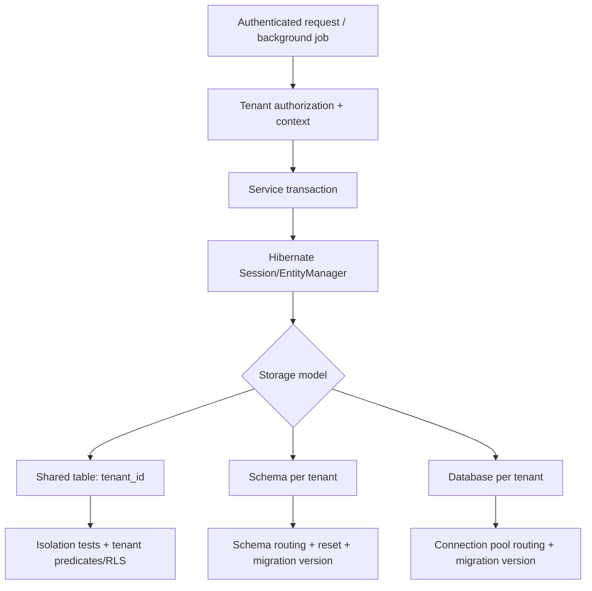
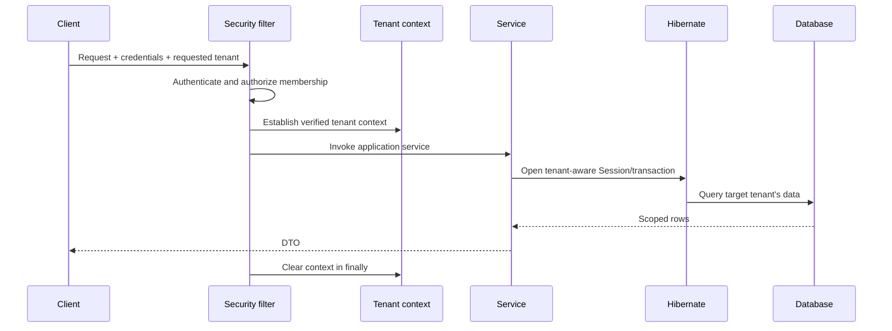
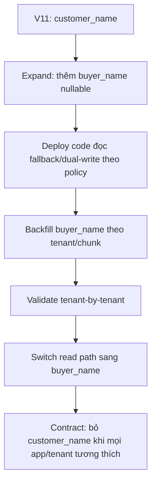

# Kiểm thử chống lộ dữ liệu và thay đổi lược đồ cho nhiều tổ chức trong Hibernate

Một ứng dụng SaaS có thể phục vụ hàng trăm tổ chức (*tenant*): công ty A lưu hợp đồng, công ty B lưu hóa đơn và công ty C quản lý đơn hàng. Cùng một entity Java như `Invoice` hoặc `Document` được dùng cho nhiều tổ chức, nhưng **người dùng của A không được đọc, sửa, đếm hoặc suy luận thông tin của B**.

Hibernate có thể hỗ trợ các cách tổ chức dữ liệu đa tenant như dùng cột phân biệt tenant, schema riêng hoặc database riêng. Tuy nhiên, chọn cách mapping và tạo `Session` mới là bước đầu. Hệ thống còn cần kiểm thử mọi đường truy cập dữ liệu và có quy trình cập nhật schema nhất quán khi một số tenant đã migrate còn một số tenant chưa.

Bài này trả lời hai câu hỏi lớn:

1. **Kiểm thử chống lộ dữ liệu:** Làm sao chứng minh root query, direct load-by-ID, association, native SQL, bulk mutation, cache, background job, connection pool và các API export không đọc/ghi nhầm tenant?
2. **Thay đổi lược đồ nhiều tổ chức:** Làm sao triển khai migration lên hàng chục hoặc hàng nghìn schema/database tenant, theo dõi phiên bản riêng, xử lý tenant lỗi, rolling deployment và khôi phục mà không làm mất dữ liệu?

> **Nguyên tắc cốt lõi:** *Tenant isolation là một bất biến bảo mật xuyên tầng, còn schema migration là một quy trình vận hành có trạng thái.* Không thể chứng minh điều thứ nhất chỉ bằng một repository filter, cũng không thể chứng minh điều thứ hai chỉ bằng việc bật Hibernate `ddl-auto=update`.

Các ví dụ dùng Java, Spring, Jakarta Persistence, Hibernate ORM và PostgreSQL để minh họa. API, tên property và mức hỗ trợ của từng mô hình multi-tenancy phụ thuộc phiên bản Hibernate, Spring Boot, Dialect và driver; cần kiểm tra phiên bản thực chạy. SQL PostgreSQL được ghi rõ nơi có tính đặc thù, không mặc định chạy nguyên văn trên MySQL, Oracle hoặc SQL Server.

---

## 1. Vì sao “test tạo và đọc dữ liệu” chưa đủ?

Một test thông thường:

```java
@Test
void saveAndFindInvoice() {
    Invoice invoice = repository.save(newInvoice("A", "INV-001"));
    assertThat(repository.findById(invoice.getId())).isPresent();
}
```

chỉ chứng minh workflow của một tenant có thể đọc lại dữ liệu mình ghi. Nó **không chứng minh** tenant B không đọc được cùng ID. Một implementation thậm chí có thể bỏ toàn bộ điều kiện tenant và test này vẫn pass.

Kiểm thử bảo mật cần có các **negative assertions**:

- Tenant A đọc ID của B → không nhận nội dung B.
- Tenant A gọi `existsById(idB)` → không được lộ sự tồn tại nếu contract yêu cầu giấu.
- Tenant A cập nhật/xóa ID của B → không thay đổi hàng của B.
- Tenant A gọi search/count/export → không chứa B, kể cả metadata.
- Cache đã chứa DTO của B → A không lấy được DTO đó.
- Async job nhận tenant A nhưng connection/session giữ context B → không chạy với B.
- Tenant A và B có business key trùng nhau → unique constraint không khóa sai tenant.
- Migration schema A thất bại → schema B không bị đánh dấu đã migrate và không bị dùng nhầm connection.

Đây là những bất biến phải được định nghĩa rõ ngay từ đầu, không phải chỉ kiểm tra sau khi xảy ra lộ dữ liệu.

## 2. Ba mô hình lưu trữ multi-tenancy

| Mô hình | Ví dụ | Isolation vật lý | Điểm cần kiểm thử |
|---|---|---|---|
| **Shared tables + tenant discriminator** | `invoice(tenant_id, id, ...)` | Các tenant cùng bảng | Mọi query/mutation phải giữ tenant predicate |
| **Schema per tenant** | `tenant_a.invoice`, `tenant_b.invoice` | Bảng tách theo schema | Đúng schema/search_path/connection, migration mỗi schema |
| **Database per tenant** | `db_tenant_a`, `db_tenant_b` | Database tách biệt | Đúng DataSource, credentials, pool và migration mỗi DB |

Các mô hình không loại trừ việc tách riêng những tenant có yêu cầu cao. Một SaaS có thể cho tenant nhỏ dùng shared tables, tenant lớn dùng database riêng, nhưng lúc đó routing/migration phức tạp hơn.

### 2.1. Một sơ đồ tổng quan



### 2.2. Tách “tenant identity” khỏi “quyền truy cập”

Một request mang đường dẫn:

```text
GET /tenants/123/invoices/9001
```

không có nghĩa caller được phép chọn bất kỳ `tenantId=123`. Hệ thống phải xác minh:

1. Caller đã được xác thực.
2. Caller thuộc tổ chức 123 hoặc có quyền quản trị hợp lệ.
3. Tenant 123 đang active, không suspended/deleted theo chính sách.
4. Tenant được ánh xạ đến datasource/schema hợp lệ.
5. Mọi thao tác bên dưới sử dụng chính tenant đã được xác minh.

**Tenant ID do request truyền vào là dữ liệu chưa tin cậy cho đến khi được kiểm quyền.**

## 3. Threat model: những đường lộ dữ liệu cần nghĩ đến

Lộ dữ liệu đa tenant không chỉ là một `SELECT *` thiếu `WHERE tenant_id`.

| Đường tấn công/lỗi | Ví dụ | Hậu quả |
|---|---|---|
| IDOR/direct object reference | A đoán ID hóa đơn của B | Đọc/sửa object B |
| Search/list | Quên tenant filter trong dynamic query | Dữ liệu B lọt vào danh sách A |
| Count/exists | Trả tổng số tài liệu toàn DB | Rò rỉ sự tồn tại/quy mô hoạt động |
| Association | A tải child thuộc B qua FK hỏng | Lộ graph B |
| Native SQL/JDBC | Query raw không có tenant | Bỏ qua ORM restriction |
| Bulk update/delete | `UPDATE ... WHERE status=?` | Sửa/xóa hàng của mọi tenant |
| Caching | Cache key chỉ chứa documentId | Trả DTO B cho A |
| Thread reuse | ThreadLocal tenant không clear | Request sau nhận context trước |
| Connection pool | `search_path` không reset | SQL A chạy trên schema B |
| Async/event | Message thiếu tenant context | Worker chọn tenant mặc định sai |
| Logging/export | Log/CSV chứa rows tenant khác | Rò rỉ gián tiếp |
| Migration routing | Migrator chọn sai schema/DB | DDL hoặc backfill nhầm tenant |

Một thiết kế tốt kết hợp các lớp bảo vệ: **authorization ở application, tenant-aware ORM/data access, constraint đúng scope, DB privileges/RLS khi phù hợp, cùng integration/security tests**.

## 4. Định nghĩa bất biến kiểm thử trước khi viết code

Giả sử request được cấp quyền cho tenant A. Tối thiểu:

**Bất biến đọc:** Mọi API trả dữ liệu thuộc A hoặc tài nguyên dùng chung được cho phép. Không trả object của B, kể cả qua nested association, pagination metadata và export.

**Bất biến ghi:** Tác động của transaction A lên dữ liệu riêng B bằng 0, kể cả khi A biết chính xác khóa chính B.

**Bất biến định tuyến:** EntityManager/connection được dùng cho A luôn trỏ tới storage partition dành cho A theo protocol; không giữ schema/tenant của request trước.

**Bất biến cache:** Cache không cho phép truy vấn của A sử dụng kết quả riêng B.

**Bất biến migration:** Tenant chỉ được đánh dấu schema version Vn sau khi các thay đổi tương ứng đã hoàn tất và được xác minh theo migration contract.

**Bất biến phục hồi:** Lỗi migrate A không làm runner “nhảy cóc” ghi Vn cho B hoặc ghi nhận hoàn thành nhầm A.

**Bất biến quản trị:** Super-admin cross-tenant access chỉ tồn tại trên đường được cấp phép, có log và không làm suy yếu đường truy cập user bình thường.

Những bất biến này là cơ sở cho ma trận test và deployment gates.

## 5. Ví dụ schema shared-table

Giả sử hai bảng:

```sql
CREATE TABLE invoice (
    id BIGINT PRIMARY KEY,
    tenant_id BIGINT NOT NULL,
    invoice_number VARCHAR(80) NOT NULL,
    amount NUMERIC(18, 2) NOT NULL,
    status VARCHAR(24) NOT NULL,
    CONSTRAINT uk_invoice_tenant_number
        UNIQUE (tenant_id, invoice_number),
    CONSTRAINT uk_invoice_tenant_id
        UNIQUE (tenant_id, id)
);

CREATE TABLE invoice_line (
    id BIGINT PRIMARY KEY,
    tenant_id BIGINT NOT NULL,
    invoice_id BIGINT NOT NULL,
    description VARCHAR(200) NOT NULL,
    CONSTRAINT fk_invoice_line_same_tenant
        FOREIGN KEY (tenant_id, invoice_id)
        REFERENCES invoice (tenant_id, id)
);
```

DDL này minh họa một chiến lược **FK cùng tenant**: một line mang tenant A không thể tham chiếu invoice tenant B nếu composite FK được enforce.

### 5.1. Vì sao chỉ có `invoice_id` chưa đủ?

Nếu `invoice_line(invoice_id)` tham chiếu `invoice(id)` mà không kiểm tra `tenant_id`, một bug mapper có thể tạo line tenant A trỏ invoice B. Query join theo FK có thể kéo object B vào graph A hoặc tạo quan hệ bất hợp lệ.

Composite FK hoặc domain constraints phù hợp giúp ngăn lỗi ở database, kể cả khi ORM service bỏ sót một kiểm tra.

### 5.2. Unique constraint phải theo phạm vi nghiệp vụ

Nếu hai tổ chức được phép có invoice number `INV-001`, thì:

```sql
UNIQUE (invoice_number)
```

là sai phạm vi. Constraint:

```sql
UNIQUE (tenant_id, invoice_number)
```

cho phép A và B cùng số hóa đơn nhưng chặn trùng trong một tenant. Ngược lại, những khóa toàn cục thực sự phải unique toàn hệ thống vẫn được định nghĩa theo scope riêng.

## 6. Entity với tenant discriminator

Ví dụ giản lược khi dùng Hibernate hỗ trợ `@TenantId` cho mô hình partition theo tenant:

```java
import jakarta.persistence.*;
import org.hibernate.annotations.TenantId;
import java.math.BigDecimal;

@Entity
@Table(name = "invoice")
public class Invoice {

    @Id
    private Long id;

    @TenantId
    @Column(name = "tenant_id", nullable = false)
    private Long tenantId;

    @Column(name = "invoice_number", nullable = false)
    private String invoiceNumber;

    @Column(nullable = false, precision = 18, scale = 2)
    private BigDecimal amount;

    @Enumerated(EnumType.STRING)
    @Column(nullable = false)
    private InvoiceStatus status;

    protected Invoice() {}

    public Long getId() { return id; }
    public Long getTenantId() { return tenantId; }
    public String getInvoiceNumber() { return invoiceNumber; }
}
```

`@TenantId` là **Hibernate-specific** chứ không phải annotation chuẩn Jakarta Persistence. Cách Hibernate dùng tenant discriminator, generator/ID requirements, collection handling và tenant resolver cần kiểm tra theo phiên bản ORM. Entity có thể có khóa `id` toàn cục như ví dụ hoặc khóa ghép, tùy kiến trúc.

### 6.1. Không thay `@TenantId` bằng một field đặt tên `tenantId` rồi mong tự lọc

Nếu chỉ có:

```java
@Column(name = "tenant_id")
private Long tenantId;
```

Hibernate không tự hiểu đó là tenant discriminator với multi-tenancy enforcement. Bạn phải dùng một mechanism phù hợp: `@TenantId` theo version, tenant-aware query guards, `@Filter`, DB RLS hoặc kết hợp theo threat model.

### 6.2. Ranh giới hỗ trợ theo Hibernate series

Các Hibernate versions có sự khác biệt về:

- Cách bootstrap multi-tenant mode.
- Cấu hình `CurrentTenantIdentifierResolver`.
- Support cho `@TenantId`.
- Tenant ID type.
- Database/schema routing APIs.
- Tenant isolation trong cache.
- HQL bulk/native/direct key behavior.

Đừng sao chép nguyên ví dụ của một version khác mà không kiểm thử trên thư viện đang chạy.

## 7. Tenant context được lấy từ đâu?

Luồng an toàn cho HTTP request:



**Không** lấy tenant từ untrusted header rồi đưa thẳng vào `Session`:

```java
String tenantId = request.getHeader("X-Tenant-Id");
tenantContext.set(tenantId); // Sai nếu chưa xác thực quyền.
```

Cần xác thực quyền sử dụng tenant trước khi thiết lập context; nếu caller được cấp quyền nhiều tenant, chọn tenant theo danh sách được phép.

### 7.1. Nguyên tắc fail closed

Nếu context không có tenant hoặc tenant không hợp lệ:

- Từ chối thao tác trên dữ liệu tenant, không tự chọn “default tenant” vô điều kiện.
- Không chuyển sang schema `public` hoặc database chung chỉ vì resolver trả null.
- Với background job, tenant phải là thông tin bắt buộc từ metadata đã xác minh.
- Chỉ có administrative cross-tenant mode theo giao thức và quyền rõ ràng.

Mặc định không an toàn thường biến một lỗi thiếu context thành lộ dữ liệu diện rộng.

## 8. `CurrentTenantIdentifierResolver`

Hibernate có interface giúp xác định tenant hiện tại khi khởi tạo Session theo chế độ multi-tenancy được cấu hình. Ví dụ ý tưởng:

```java
import org.hibernate.context.spi.CurrentTenantIdentifierResolver;

public class TenantResolver
        implements CurrentTenantIdentifierResolver<String> {

    private final TenantContext context;

    public TenantResolver(TenantContext context) {
        this.context = context;
    }

    @Override
    public String resolveCurrentTenantIdentifier() {
        return context.requireAuthorizedTenant();
    }

    @Override
    public boolean validateExistingCurrentSessions() {
        return true;
    }
}
```

`TenantContext` là abstraction ứng dụng tự định nghĩa; ví dụ `requireAuthorizedTenant()` phải ném lỗi nếu chưa có tenant được cấp quyền. Kiểu generic và cách cung cấp resolver cho Hibernate có thể thay đổi theo Hibernate series.

### 8.1. `validateExistingCurrentSessions()` giúp gì?

Trong các cấu hình dùng current-session context, tùy implementation, Hibernate có thể kiểm tra Session hiện có có tenant phù hợp với tenant resolver hiện tại hay không. Điều này hữu ích để phát hiện việc đổi tenant context khi vẫn giữ Session cũ.

Nhưng nó không thay thế tenant-aware connection routing, constraints, API authorization hay kiểm thử cache. Không xem boolean này là “đã bật bảo mật đa tenant cho mọi query”.

### 8.2. Tenant ID là danh tính của Session, không phải query parameter tùy ý

Một Hibernate Session đã được tạo cho tenant A không nên bị dùng như Session B chỉ bằng thay `ThreadLocal`.

Nếu cần xử lý tenant khác, đóng unit of work hiện tại và tạo Session/transaction phù hợp cho tenant mới theo framework contract.

## 9. Schema-per-tenant: định tuyến connection

Với mô hình một database nhiều schemas, Hibernate có thể dùng `MultiTenantConnectionProvider` để lấy connection và chọn schema theo tenant.

Sơ đồ:

```text
Tenant A -> Connection -> schema tenant_a -> invoice
Tenant B -> Connection -> schema tenant_b -> invoice
Tenant C -> Connection -> schema tenant_c -> invoice
```

Một implementation phải xử lý cẩn thận:

- Trả đúng connection cho tenant.
- Đổi schema trước khi chạy query (nếu driver/DBMS hỗ trợ).
- Reset schema khi trả connection về pool.
- Không dùng tenant ID trực tiếp làm SQL identifier nếu chưa whitelist.
- Đảm bảo connection metadata/DDL bootstrap không chạy nhầm schema.
- Kiểm soát transaction isolation và pool reuse.

### 9.1. Pseudocode routing

```java
Connection getConnection(String tenantId) throws SQLException {
    String schema = registry.requireAllowedSchema(tenantId);
    Connection connection = dataSource.getConnection();

    try {
        connection.setSchema(schema);
        return connection;
    } catch (SQLException ex) {
        connection.close();
        throw ex;
    }
}

void releaseConnection(
        String tenantId, Connection connection) throws SQLException {
    try {
        connection.setSchema("app_default");
    } finally {
        connection.close();
    }
}
```

Đây là **pseudocode ở mức connection provider**, không phải implementation đầy đủ `MultiTenantConnectionProvider`. Một số DBMS/driver không hỗ trợ `Connection.setSchema` giống nhau; connection pool có thể có behavior riêng. Trong ứng dụng thật, cần test reset dưới lỗi, transaction rollback, timeout và reuse.

### 9.2. Không ghép tên schema từ request

Sai:

```java
statement.execute("SET search_path TO " + requestTenant);
```

Tenant ID hoặc schema name là **identifier**, thường không bind được như giá trị `?` trong SQL. Cần ánh xạ server-side từ tenant ID đã được cấp quyền sang một tên schema **đã đăng ký và được validate/quote**.

Ví dụ:

```text
tenantId="org-42" -> registry.schemaName="tenant_000042"
```

Không cho client tự cung cấp `tenant_000042` hoặc một chuỗi SQL làm schema identifier.

## 10. Database-per-tenant: định tuyến datasource

Mô hình database riêng:

```text
Tenant A -> Pool A -> DB A
Tenant B -> Pool B -> DB B
Tenant C -> Pool C -> DB C
```

Đặc điểm:

- Dễ định nghĩa backup/restore/migration theo tenant.
- Có mức cô lập vật lý cao hơn shared schema.
- Tốn tài nguyên quản lý pools, connections, secrets và monitoring.
- Cross-tenant analytics khó hơn.
- Nâng cấp schema cần theo dõi version của từng DB.
- Có nguy cơ định tuyến sai nếu registry/cache mapping lỗi.

### 10.1. Registry là thành phần quan trọng

Ví dụ metadata:

| tenant_id | storage_mode | target | schema_version | state |
|---|---|---|---|---|
| org-10 | DATABASE | db_customer_10 | V12 | ACTIVE |
| org-20 | SCHEMA | shared/tenant_20 | V11 | MIGRATING |
| org-30 | SHARED | app/shared | V12 | ACTIVE |

Thông tin `target` phải được bảo vệ khỏi sửa trái phép, có validation và không chỉ đến một database/schema khác với chủ sở hữu tenant.

**Tenant registry là control plane, không phải dữ liệu request tùy tiện.**

## 11. Mối nguy của tenant ID trùng và identity map

Nếu shared-table model dùng `invoice.id` không unique toàn cục mà chỉ unique theo `(tenant_id,id)`, Hibernate phải nhận biết danh tính entity và tenant đúng theo mapping/multi-tenancy strategy.

Một `Session` không thể coi:

```text
Tenant A, invoice ID 7
Tenant B, invoice ID 7
```

là cùng business object. Cần thiết kế entity key/multi-tenancy identifier đúng theo Hibernate version.

Với schema/database-per-tenant, cùng số `id=7` ở nhiều tenant là bình thường, nhưng **không chia sẻ cùng Session giữa tenants**.

### 11.1. Đừng dựa vào ID khó đoán để bảo mật

Dùng UUID ngẫu nhiên thay ID tuần tự giúp khó đoán nhưng không thay kiểm quyền. Người dùng có thể lấy UUID B từ logs, email, event, URL hoặc chia sẻ nhầm.

Một test tốt phải dùng **ID thật của B** rồi thử mọi access path từ A.

## 12. Bộ fixture kiểm thử bắt buộc

Tạo ít nhất ba tenant:

```text
Tenant A (org-a):
    invoice A1: id=101, number=INV-001, amount=100
    invoice A2: id=102, number=INV-002, amount=200
    line A1-L1 -> invoice A1

Tenant B (org-b):
    invoice B1: id=201, number=INV-001, amount=9000
    invoice B2: id=202, number=INV-003, amount=8000
    line B1-L1 -> invoice B1

Tenant C (org-c):
    empty tenant, no invoices
```

Nếu dùng schema/database riêng, có thể cố tình dùng **cùng id=101** trong A và B để kiểm tra định tuyến; còn trong shared-table ví dụ khóa chính toàn cục thì nên giữ IDs khác và kiểm tra business number trùng.

### 12.1. Vì sao cần cùng business key?

Nếu A và B đều có `invoice_number=INV-001`, test sẽ phát hiện query:

```sql
SELECT * FROM invoice WHERE invoice_number='INV-001';
```

không có tenant scope, thay vì vô tình pass do giá trị unique toàn DB trong fixture nhỏ.

### 12.2. Vì sao cần tenant rỗng?

Tenant C là negative fixture cho count/list. Nếu một request C trả dữ liệu A/B thì rõ ràng routing/query policy đã sai, thay vì kết quả trông có vẻ hợp lệ do dữ liệu C cũng có sẵn.

## 13. Test đầu tiên: root query chỉ thấy tenant hiện tại

Ví dụ integration test ý tưởng:

```java
@Test
void tenantAOnlySeesItsInvoices() {
    List<InvoiceView> result =
        runAsTenant("org-a", () -> invoiceQuery.list());

    assertThat(result)
        .extracting(InvoiceView::invoiceNumber)
        .containsExactlyInAnyOrder("INV-001", "INV-002");

    assertThat(result)
        .allMatch(row -> row.tenantId().equals("org-a"));
}
```

`runAsTenant` là test helper **tự triển khai** phải thiết lập authenticated tenant context và tạo transaction/Session phù hợp. Không đơn giản chỉ sửa một global variable trong Session đang mở.

### 13.1. Test cả count

```java
long aCount = runAsTenant("org-a", invoiceQuery::count);
long bCount = runAsTenant("org-b", invoiceQuery::count);
long cCount = runAsTenant("org-c", invoiceQuery::count);

assertThat(aCount).isEqualTo(2L);
assertThat(bCount).isEqualTo(2L);
assertThat(cCount).isZero();
```

Count có thể leak quy mô tổ chức nếu query quên scope. Không chỉ test danh sách và bỏ qua summary metrics.

### 13.2. Test không được tự che lỗi bằng filter trong assertion

Nếu service trả toàn bộ 4 invoices rồi test viết:

```java
result.stream()
      .filter(x -> x.tenantId().equals("org-a"))
      .toList();
```

trước khi assert, test có thể pass dù API đã leak. **Assert trực tiếp response thật**, không làm lọc “hộ” implementation đang kiểm thử.

## 14. Truy cập theo ID: test IDOR

Trong nhiều hệ thống, một bug phổ biến:

```java
@GetMapping("/invoices/{id}")
public InvoiceDto getInvoice(@PathVariable Long id) {
    return mapper.toDto(repository.findById(id).orElseThrow());
}
```

Nếu `findById` không được tenant-scope đúng trong strategy/provider đang dùng, A có thể yêu cầu ID B.

Một test bắt buộc:

```java
@Test
void tenantACannotGetTenantBInvoiceByKnownId() {
    assertThatThrownBy(() ->
        runAsTenant("org-a", () -> invoiceService.get(201L))
    ).isInstanceOf(NotFoundOrForbiddenException.class);
}
```

`NotFoundOrForbiddenException` là exception application minh họa; API có thể trả HTTP 404 để che sự tồn tại hoặc 403 theo policy. Quan trọng là **không trả dữ liệu B**.

### 14.1. Kiểm tra các biến thể

- `repository.findById(idB)`.
- `entityManager.find(Invoice.class, idB)`.
- `getReferenceById(idB)` và truy cập field.
- `existsById(idB)`.
- `getByInvoiceNumber("INV-001")` khi A/B cùng number.
- `SELECT` với ID trong `@Query`.
- Graph traversal từ entity A qua association có FK B.
- Service admin/reconciliation path.

Kết quả các API không nhất thiết giống nhau giữa multi-tenant strategies. **Test theo contract bảo mật thay vì đoán behavior Hibernate.**

## 15. Tính đúng của `getReference` và lazy loading

`getReferenceById`/`EntityManager.getReference` có thể trả proxy không phát SQL ngay. Vì thế:

```java
Invoice reference = repository.getReferenceById(201L);
```

không chứng minh tenant A có quyền xem invoice B, và cũng không chứng minh B bị chặn.

Test cần **kích hoạt proxy**:

```java
assertThatThrownBy(() ->
    runAsTenant("org-a", () -> {
        Invoice ref = repository.getReferenceById(201L);
        return ref.getInvoiceNumber();
    })
).isInstanceOfAny(
    EntityNotFoundException.class,
    SecurityException.class
);
```

Đoạn assert là ý tưởng: exception có thể khác do strategy/provider; sản phẩm nên chuẩn hóa thành contract API. Test không được kết thúc ngay sau khi lấy reference nếu muốn kiểm tra lazy loading.

### 15.1. Thời điểm load quan trọng

Khi serialize DTO sau khi service transaction đã đóng, lazy load có thể gây `LazyInitializationException` trước khi tenant policy được kiểm. Vì vậy truy cập dữ liệu cần thiết bên trong transaction có tenant scope và trả DTO, không trả managed graph cho serializer quyết định.

## 16. Test association không bắc cầu qua tenant

Một `Invoice` có nhiều `InvoiceLine`. Nếu FK chỉ đảm bảo invoice ID mà không đảm bảo tenant, có thể tạo link sai tenant.

Fixture cố tình thử:

```text
Invoice A1 (tenant=A)
Line X (tenant=B, invoice_id=A1.id)
```

Với composite FK như phần 5, database phải từ chối. Nếu schema không có constraint tương tự, test service/query phải phát hiện và từ chối link bất hợp lệ.

### 16.1. To-one và to-many đều cần kiểm tra

- `invoice.getCustomer()` có thể tải target không tenant-scope nếu mapping sai.
- `customer.getInvoices()` có thể tải collection con của tenant khác nếu FK/tenant filter thiếu.
- Many-to-many link table có thể bắc cầu A-B.
- Eager join fetch và lazy collection load có thể dùng SQL khác.
- Native query load graph có thể bỏ rule ORM.

Không chỉ kiểm tra root `Invoice`; kiểm tra **các đường đi trong đồ thị đối tượng**.

## 17. LEFT JOIN, COUNT và paging có thể leak gián tiếp

Ví dụ list invoices kèm số lines:

```hql
select i.id, count(l.id)
from Invoice i
left join i.lines l
group by i.id
```

Nếu join line/filter không được scope đúng, số lines của tenant khác có thể được tính vào aggregate dù không trả từng line.

Các kiểm thử:

1. A có invoice không có lines → count phải 0.
2. A có invoice với hai lines → count 2.
3. B có lines dùng business number giống A → không làm count A thay đổi.
4. Tenant C rỗng → count 0.
5. `Page.totalElements` đếm số root invoices đúng, không đếm join rows.
6. Sort/pagination trả đúng tenant qua nhiều pages.

### 17.1. Không để SQL filter làm đổi LEFT JOIN ngoài ý muốn

Điều kiện child trong `WHERE` có thể biến outer join thành inner-like behavior, làm mất root không có child. Nếu muốn giữ root, chọn `ON`/subquery đúng và kiểm SQL. Vừa chống leak vừa phải bảo đảm logic nghiệp vụ.

## 18. Native SQL và JDBC: đường bypass phải được test

Ví dụ nguy hiểm:

```java
em.createNativeQuery(
    "SELECT id, amount FROM invoice WHERE id = :id"
)
.setParameter("id", invoiceId)
.getResultList();
```

Với shared-table discriminator, query native này **không mặc nhiên được Hibernate viết lại** để thêm tenant predicate trong mọi trường hợp.

An toàn hơn khi có explicit scope:

```java
em.createNativeQuery(
    """
    SELECT id, amount
    FROM invoice
    WHERE tenant_id = :tenantId
      AND id = :id
    """
)
.setParameter("tenantId", authorizedTenantId)
.setParameter("id", invoiceId)
.getResultList();
```

`authorizedTenantId` phải được lấy từ identity/authorization context hợp lệ. Nếu shared table có RLS, database còn có thể enforce thêm một lớp bảo vệ.

### 18.1. SQL không có tenant vẫn có thể “đúng” ở schema-per-tenant

`SELECT * FROM invoice` có thể chỉ đọc tenant hiện tại nếu connection thực sự gắn với `tenant_a` schema và không thể nhìn schema khác. Nhưng nếu `search_path` còn giữ `tenant_b` từ pool, đó sẽ là leak dù SQL bản thân không có `tenant_id`.

Do đó test native SQL cần xét **storage model**, không chỉ tìm một chuỗi `WHERE tenant_id`.

## 19. Bulk UPDATE/DELETE: kiểm thử chống sửa nhầm tenant

Một job có thể viết:

```java
em.createQuery(
    "update Invoice i set i.status = :status"
)
.setParameter("status", InvoiceStatus.CANCELLED)
.executeUpdate();
```

Nếu không có tenant guard, một HQL bulk mutation có thể ảnh hưởng ngoài phạm vi dự kiến. Các mutation paths có semantics riêng, không giống cập nhật managed entity từng hàng; Hibernate filters/callbacks/`@Version` không được mặc định áp giống nhau.

Một query có guard tường minh:

```java
int affected = em.createQuery(
    """
    update Invoice i
    set i.status = :status
    where i.tenantId = :tenantId
      and i.id = :id
    """
)
.setParameter("status", InvoiceStatus.CANCELLED)
.setParameter("tenantId", authorizedTenantId)
.setParameter("id", invoiceId)
.executeUpdate();
```

### 19.1. Test điều kiện ghi qua trạng thái database mới

Với tenant A:

1. Lưu snapshot invoices B trước mutation.
2. Chạy bulk UPDATE/DELETE từ context A, thử truyền ID B.
3. Commit hoặc rollback theo kịch bản.
4. Mở Session/transaction mới với tenant B.
5. So sánh mọi field có thể bị tác động của B.
6. Kỳ vọng B không thay đổi.
7. Kiểm tra rows affected, auditing/side effects và optimistic version policy.

Không chỉ assert controller trả lỗi mà bỏ qua database state sau request.

## 20. Database Row-Level Security như lớp phòng thủ bổ sung

Ở PostgreSQL, **Row-Level Security (RLS)** có thể cưỡng chế chính sách tenant ở tầng database ngay cả khi một SQL query quên `WHERE tenant_id`.

Ví dụ minh họa cho bảng shared-table:

```sql
ALTER TABLE invoice ENABLE ROW LEVEL SECURITY;
ALTER TABLE invoice FORCE ROW LEVEL SECURITY;

CREATE POLICY invoice_tenant_policy
ON invoice
USING (
    tenant_id = NULLIF(
        current_setting('app.tenant_id', true), ''
    )::bigint
)
WITH CHECK (
    tenant_id = NULLIF(
        current_setting('app.tenant_id', true), ''
    )::bigint
);
```

Giả định tenant ID numeric và DB session context `app.tenant_id` được đặt an toàn. Predicate phải được review theo PostgreSQL version, role ownership, policies khác và nhu cầu admin. RLS **không thay authentication**: nếu app user có thể tùy ý đặt tenant variable từ request không kiểm quyền, policy vẫn có thể bị vượt qua.

### 20.1. Vai trò DB cần được cấu hình đúng

- Runtime role không nên có `BYPASSRLS`.
- Table owner có đặc quyền bypass nhất định trừ khi `FORCE ROW LEVEL SECURITY`; phải hiểu role/ownership cụ thể.
- Migration/admin role có quyền riêng, không dùng chung credential với app runtime.
- Các policy `USING`/`WITH CHECK` được áp theo operation/role.
- Không mở đường native SQL bằng superuser connection cho application code.

### 20.2. `SET LOCAL` và connection pooling

Trong transaction PostgreSQL, ứng dụng có thể đặt context:

```sql
SELECT set_config('app.tenant_id', '10', true);
```

Tham số `true` nghĩa là local to current transaction. Có thể dùng bind parameter:

```java
entityManager.createNativeQuery(
    "select set_config('app.tenant_id', :tenant, true)"
)
.setParameter("tenant", authorizedTenantId.toString())
.getSingleResult();
```

Phải đảm bảo lệnh thiết lập context và các query thực thi trong **cùng transaction/connection** và được chạy trước access dữ liệu. Nếu code không có transaction, connection pool có thể chọn connection khác, khiến context không tồn tại. Test cả commit/rollback và connection reuse.

## 21. Kiểm thử pool leak giữa tenant A và B

Với schema-per-tenant hoặc RLS session context, cần test chuỗi:

```text
1. Borrow physical connection #1
2. Set tenant A / schema tenant_a
3. Query A
4. Return connection
5. Borrow same physical connection #1
6. Set tenant B / schema tenant_b
7. Query B
8. Assert không còn A
```

Các bài test bổ sung:

- A query ném SQLException trước khi release.
- A transaction rollback.
- A request bị timeout/cancel.
- Connection eviction/reconnect/failover.
- Prepared statement/cache reuse.
- Async task chuyển thread.
- Pool nhỏ, chỉ 1 connection để ép reuse.
- Pool lớn, chạy concurrent requests.

### 21.1. Tài liệu kiểm thử cần xác nhận SQL context thực

Với schema strategy, có thể query metadata DB như `current_schema()` (PostgreSQL) trong test để xác minh connection đang đúng schema. Nhưng đừng dùng câu introspection này như cơ chế authorization trong production; nó chỉ là công cụ quan sát.

Với RLS, test raw SELECT thiếu tenant predicate dưới runtime role để bảo đảm database policy thực sự chặn rows khác tenant.

## 22. First-level cache và việc đổi tenant context

Một `EntityManager`/Hibernate `Session` giữ identity map. Nếu đã load một Invoice của tenant A, rồi chỉ thay một `ThreadLocal tenant` sang B mà vẫn dùng same Session, có thể xảy ra hành vi không an toàn: ORM trả object managed từ context mà không chạy SQL mới.

Vì vậy:

- Không đổi tenant của một unit of work đang hoạt động.
- Không reuse cùng persistence context giữa requests của tenant khác nhau.
- Không dùng `EntityManager` như singleton stateful object.
- Trong test isolation, mở transaction/Session mới khi chuyển tenant.
- Có thể dùng kiểm tra current tenant Session ở Hibernate khi được hỗ trợ, nhưng không thay những invariant trên.

**Tenant context là một phần của lifecycle Session, không chỉ một giá trị trang trí trong request.**

## 23. Cache key: không được lẫn dữ liệu giữa tenants

Cache có nhiều tầng:

| Cache | Nguy cơ |
|---|---|
| Hibernate first-level | Dùng cùng Session với tenant context khác |
| Hibernate second-level | Cấu hình keys/provider không tương thích tenant separation |
| Hibernate query cache | Query cache key/filter parameters và tenant phải đúng |
| Spring `@Cacheable` | Method key chỉ có ID, không có tenant |
| Distributed cache (Redis, v.v.) | Namespace/key collision giữa tenants |
| CDN/API cache | Response có auth/tenant scope nhưng cache public |

Ví dụ đáng ngờ:

```java
@Cacheable("invoice-view")
public InvoiceDto loadInvoice(long invoiceId) {
    return repository.findById(invoiceId)
        .map(mapper::toDto)
        .orElseThrow();
}
```

Nếu invoice ID có thể trùng giữa DB/schema tenants, cache key chỉ có ID chắc chắn không đủ. Ngay cả khi IDs toàn cục, tenant authorization có thể khác và response có field được phép hiển thị khác.

### 23.1. Cách kiểm thử cache poisoning

1. Từ B, gọi endpoint invoice B; xác nhận cache chứa kết quả.
2. Từ A, gọi cùng ID.
3. Kỳ vọng A không nhận B, dù truy vấn không đến DB.
4. Đổi thứ tự A→B, đổi context trong nhiều threads.
5. Kiểm tra invalidation sau delete/role changes.
6. Test cả null/not-found cache entries theo scope.

Có thể thêm tenant vào cache key **và** enforce authorization mỗi request hoặc cache only tenant-scoped DTOs; không coi cache key là lớp duy nhất chống truy cập trái phép.

## 24. Background jobs, events và async

HTTP filter có thể thiết lập tenant context, nhưng một worker nhận message:

```json
{"jobId":"job-12","tenantId":"org-b","invoiceId":201}
```

không tự có authenticated HTTP security context.

Cần:

1. Message provenance được xác minh hoặc xuất phát từ queue nội bộ đáng tin.
2. Tenant ID tồn tại và được phép cho job.
3. Registry chỉ đúng storage partition.
4. Worker tạo Session/transaction cho tenant tương ứng.
5. Context được clear trong `finally`.
6. Retry vẫn mang tenant ID và idempotency key chính xác.
7. Log/metrics không lộ PII vượt policy.

### 24.1. `ThreadLocal` không tự truyền qua `@Async`

Với thread pools, Reactor hoặc CompletableFuture, `ThreadLocal` có thể không được propagate, hoặc thread cũ giữ context nếu cleanup sai.

Không khắc phục bằng một global static `currentTenant`. Dùng explicit tenant parameter trong job payload/transaction runner hoặc context propagation được thiết kế và test theo concurrency model.

## 25. Test đa tenant phải dùng transaction thật

Một `@DataJpaTest` có thể mở outer transaction cho test rồi rollback khi kết thúc. Nếu tenant context thay đổi trong cùng transaction, Hibernate Session đã được tạo cho tenant đầu tiên có thể không được tái định tuyến.

Với isolation test:

- Dùng helper mở transaction mới mỗi tenant.
- Tách setup fixture và assertions bằng các committed transactions.
- Không để outer test transaction join các tenant sessions.
- Nếu dùng `TransactionTemplate`, hiểu propagation `REQUIRED` có thể join outer transaction.
- Có thể dùng service được gọi qua Spring proxy hoặc transaction manager trực tiếp.
- Kiểm tra database sau commit/rollback bằng fresh EntityManager.

### 25.1. Vì sao test cùng context dễ pass giả?

Nếu setup đã persist Invoice B trong cùng Session, rồi assertion A gọi `findById(idB)`, first-level cache có thể trả object B dù SQL filter sẽ chặn ở Session mới. Đây là một bug thật nếu production có context reuse, nhưng cũng có thể khiến test không phân biệt được routing SQL với cache state.

Thiết kế **hai nhóm test**: isolation khi Session mới, và failure case khi context bị reuse không đúng. Đừng gộp thành một test mơ hồ.

## 26. Test concurrent requests có tenant khác nhau

Ví dụ kịch bản:

```text
Thread 1: tenant A, loop đọc invoice A1 100 lần
Thread 2: tenant B, loop đọc invoice B1 100 lần
Thread 3: tenant C, loop count = 0
Thread 4: admin job nhập invoice cho B
```

Test dùng concurrency barriers để buộc các request xen kẽ khi connections và worker threads được reuse. Assertions:

- Không response nào chứa tenant khác.
- A/B counts đúng.
- B ghi không làm A thay đổi.
- Connection schema/context không rò.
- Exception path không để lại tenant context.
- Thread pool task tiếp theo không kế thừa tenant cũ.

Không chỉ chạy sequential A→B trong cùng test rồi coi đã kiểm concurrency.

## 27. Cross-tenant IDOR ở API và authorization

Các endpoint nguy hiểm:

```text
GET /invoices/{id}
PATCH /invoices/{id}
DELETE /invoices/{id}
GET /customers/{id}/invoices
POST /files/{id}/download
GET /reports?invoiceId={id}
```

Test nên thử với **ID hợp lệ của tenant khác**. Các trường hợp:

- Path ID.
- Nested path ID.
- Query parameter.
- Request body IDs.
- GraphQL node ID.
- CSV export request.
- Webhook callback.
- Search filters.
- Attachments signed URLs.
- Batch API nhiều IDs chứa lẫn A/B.

Với batch API, cần quy định: reject toàn batch hay chỉ chấp nhận allowed IDs? Tránh tình trạng “âm thầm bỏ qua ID B” nếu caller có thể suy luận sự tồn tại từ count/error detail.

### 27.1. Response status và timing

Một sản phẩm có thể trả 404 cho object thuộc tenant khác để không xác nhận sự tồn tại; sản phẩm khác trả 403 theo security policy. Cần giữ semantics nhất quán, không leak qua thông điệp lỗi chi tiết hoặc response differences không cần thiết.

Timing side-channel rất khó loại bỏ hoàn toàn, nhưng các count/search/debug endpoints dễ leak trực tiếp hơn và cần ưu tiên kiểm thử.

## 28. Repository convenience không phải authorization

`JpaRepository<Invoice, Long>` cung cấp `findAll`, `findById`, `deleteById`, `count`. Nó không biết người gọi được phép xem tenant nào trừ khi data access layer/ORM/DB được cấu hình và dùng đúng.

Một pattern rõ cho shared-table:

```java
public interface InvoiceRepository
        extends JpaRepository<Invoice, Long> {

    Optional<Invoice> findByIdAndTenantId(
        Long id, Long tenantId
    );

    Page<Invoice> findByTenantId(
        Long tenantId, Pageable pageable
    );

    long countByTenantId(Long tenantId);
}
```

Và service lấy tenant ID từ authenticated context, không từ input tùy ý.

Nhưng **cũng không nên kết luận** rằng chỉ cần đặt `AndTenantId` vào vài method là đủ. Những method thừa kế như `findAll` vẫn có thể được gọi ở nơi khác; native/bulk/custom queries và association traversal cần policy chung.

## 29. Kiểm tra query logging mà không lộ dữ liệu nhạy cảm

Ở test environment, có thể bật Hibernate SQL logging/statistics:

```properties
spring.jpa.show-sql=true
spring.jpa.properties.hibernate.format_sql=true
spring.jpa.properties.hibernate.generate_statistics=true
```

Test cần xác minh SQL có đúng table/schema/tenant predicate khi model yêu cầu. Tuy nhiên, log query là **quan sát phụ**, assertions vẫn phải kiểm tra actual persisted data và response.

### 29.1. Log các thông tin điều phối an toàn

Hữu ích:

```text
requestId=req-42
tenantAlias=org-a
sessionTenant=org-a
storageTarget=shared/tenant_0001
queryCategory=invoice-list
rowsReturned=2
```

Không log customer email, invoice amount chi tiết, tokens, JDBC password hoặc raw SQL bind params chứa PII tùy tiện. Tenant identifier cũng có thể là dữ liệu nhạy cảm theo hệ thống; sử dụng alias an toàn hoặc hashing/retention phù hợp.

## 30. Ma trận test isolation theo strategy

| Test | Discriminator shared table | Schema per tenant | Database per tenant |
|---|---|---|---|
| Root HQL query | Check `tenant_id` scope | Check schema selected | Check datasource selected |
| Direct `findById` | Check tenant-aware load | Same ID in A/B returns respective row | Same ID in A/B returns respective row |
| Native SQL | Explicit tenant/RLS | Correct schema/search_path | Correct DB |
| Bulk DML | Explicit tenant guard/RLS | Correct schema | Correct DB |
| FK cross-tenant | Composite FK/guards | FK scope within schema | Cross-DB FK not generally available |
| Cache | Tenant-aware keys/provider | Tenant-aware keys/provider | Tenant-aware keys/provider |
| Pool reuse | DB session tenant/RLS context | Schema reset on release | Pool/datasource routing |
| Migration | One shared schema with tenant data backfill | Migration every tenant schema | Migration every tenant DB |
| Restore | Per-tenant logical restore may be difficult | Schema-level restore depends DB features | Database-level restore often simpler |

**Không có chiến lược nào cho phép bỏ toàn bộ security testing.** Các lỗi có thể chuyển từ query predicate sang connection routing hoặc tenant registry.

## 31. Thiết kế test helper đúng boundary

Một helper có thể nhận tenant và lambda, nhưng phải mở Session/transaction theo tenant **sau khi** context được thiết lập:

```java
public <T> T runAsTenant(
        AuthorizedTenant tenant,
        Supplier<T> work) {

    tenantContext.set(tenant);
    try {
        return transactionTemplate.execute(status -> work.get());
    } finally {
        tenantContext.clear();
    }
}
```

Ví dụ này chỉ là skeleton. `transactionTemplate` mặc định có thể join outer transaction; cần đảm bảo không có Session cũ hoặc transaction ngoại lai. `AuthorizedTenant` phải được tạo sau authorization (trong test có thể là fixture trusted). Nếu dùng tenant-per-connection routing, provider phải nhận tenant identifier đúng thời điểm.

### 31.1. Không dùng helper test để bypass security layer

Một test unit trực tiếp gọi `setTenant("A")` không chứng minh HTTP auth middleware hoạt động. Cần cả:

- **Repository/ORM tests** để kiểm tenant semantics ở data layer.
- **HTTP integration tests** để kiểm membership/role/header/path handling.
- **Database policy tests** nếu có RLS.
- **End-to-end tests** để kiểm response/cache/export.

## 32. Kiểm thử RLS như một thành phần độc lập

Nếu dùng PostgreSQL RLS, tạo tests bằng **runtime DB role**, không dùng migration/superuser role:

1. Set `app.tenant_id=A` trong transaction.
2. Chạy `SELECT * FROM invoice` không có tenant predicate.
3. Kỳ vọng chỉ A.
4. Thử `UPDATE invoice SET amount=0 WHERE id=idB`.
5. Kỳ vọng B không đổi.
6. Thử `INSERT` row có tenant_id=B từ context A.
7. Kỳ vọng `WITH CHECK` từ chối.
8. Reset transaction, dùng context B.
9. Kiểm kết quả B.
10. Không set tenant context → fail closed.

Nếu test dùng role có `BYPASSRLS`, nó không kiểm được policy người dùng thực tế.

### 32.1. Phân quyền migration role

Migration runner có thể cần quyền vượt RLS hoặc DDL cao hơn. Nó phải dùng identity khác runtime role và chỉ hoạt động trong deployment pipeline. Không để controller vô tình inject migration DataSource rồi chạy query của người dùng dưới superuser.

## 33. Vì sao migration multi-tenant phức tạp hơn single schema?

Trong database đơn, một release có thể chạy:

```text
V12__add_payment_reference.sql
```

một lần rồi khởi động ứng dụng. Với schema-per-tenant:

```text
tenant_a: V12 complete
tenant_b: V11 (migration failed)
tenant_c: V12 complete
tenant_d: V10 (offline, waiting)
```

Một app version mới có thể truy cập tenant chưa được migrate. Vì vậy cần biết **schema version theo tenant**, **compatibility window** và **cách ngăn traffic/routing đến tenant không tương thích**.

Với database-per-tenant, bài toán tương tự nhưng mỗi DB có connection/migration history riêng.

### 33.1. Multi-tenancy có hai loại lịch sử

- **Application release version:** build của service đang chạy.
- **Tenant schema version:** tập migrations đã áp dụng cho storage tenant đó.

Chúng không bắt buộc trùng nhau. Một release có thể tương thích với schema V11 và V12 trong giai đoạn rollout.

## 34. Tenant registry và migration state

Một control-plane table minh họa:

```sql
CREATE TABLE tenant_registry (
    tenant_id VARCHAR(100) PRIMARY KEY,
    storage_mode VARCHAR(24) NOT NULL,
    storage_locator VARCHAR(500) NOT NULL,
    schema_name VARCHAR(100),
    tenant_state VARCHAR(24) NOT NULL,
    desired_schema_version VARCHAR(30) NOT NULL,
    observed_schema_version VARCHAR(30),
    last_migration_at TIMESTAMP,
    last_error_code VARCHAR(100)
);
```

Trạng thái có thể là:

```text
ACTIVE
PROVISIONING
MIGRATING
MIGRATION_FAILED
PAUSED
SUSPENDED
```

Bảng này dùng để điều phối; **nguồn sự thật migration** còn gồm Flyway/Liquibase history nằm trong chính schema/DB tenant, nếu công cụ được cấu hình theo cách đó.

### 34.1. Không đánh dấu version bằng dự đoán

Sai:

```text
Khi dispatch migration V12 -> registry.version=V12
```

Nếu migration thất bại giữa chừng, registry sẽ nói đã nâng trong khi schema chưa hoàn chỉnh.

An toàn hơn:

1. Claim/lock tenant.
2. Chạy migrations.
3. Kiểm migration tool state và DB schema.
4. Xác nhận phiên bản áp dụng thành công.
5. Cập nhật registry observed version.
6. Mở traffic theo compatibility policy.

Nếu registry nằm ngoài tenant DB, không thể giả định atomicity của cả hai cập nhật. Cần reconciliation/idempotent control plane.

## 35. Flyway/Liquibase: quản lý phiên bản theo tenant

Với schema-per-tenant, một lựa chọn là chạy Flyway/Liquibase riêng cho từng schema.

Pseudo-flow:

```text
for each tenant in registry:
    validate storage locator
    acquire tenant migration lock
    create tenant-specific migration configuration
    target the tenant schema or datasource
    inspect current migration history
    migrate to desired compatible version
    validate schema/migration history
    record observed version and timestamp
    release lock
```

**Không chỉ set Hibernate `ddl-auto=update` và coi đã có migration.** Hibernate không quản lý đầy đủ rename/data backfill/compatibility giữa releases, cũng không có một lịch sử versioned migration per tenant theo nghĩa Flyway/Liquibase.

### 35.1. PostgreSQL schema-per-tenant, ví dụ API khái niệm

```java
for (TenantDescriptor tenant : registry.activeTenants()) {
    Flyway flyway = Flyway.configure()
        .dataSource(adminDataSource)
        .schemas(tenant.requireValidatedSchemaName())
        .defaultSchema(tenant.requireValidatedSchemaName())
        .locations("classpath:db/migration/tenant")
        .load();

    flyway.migrate();
}
```

Đây là ví dụ minh họa ý tưởng (phải bổ sung imports, locks, retries, status, error handling, validation và quyền DB). Cấu hình schema history table, defaultSchema, placeholder, current schema/search_path và phương pháp quote identifiers phải được kiểm tra đúng Flyway/DBMS version.

### 35.2. Migration history table ở đâu?

Có hai thiết kế:

- **Mỗi schema/DB tenant có history riêng**: dễ thấy từng version, cách ly thay đổi.
- **History tập trung có tenant key**: cần custom orchestration/model, không tự đạt được bằng mọi migration tool.

Nếu dùng Flyway mặc định theo schema, hãy xác minh nó đặt schema history table ở vị trí mong muốn. Không chạy tất cả tenant migration với một history table chung rồi ngộ nhận mọi schema đều đã nâng.

## 36. Thay đổi shared-table schema khác schema-per-tenant

Với shared-table discriminator, cột mới thường được thêm **một lần**:

```sql
ALTER TABLE invoice
ADD COLUMN payment_reference VARCHAR(100);
```

Nhưng **data migration** có thể cần xử lý theo từng tenant:

```sql
UPDATE invoice
SET payment_reference = invoice_number
WHERE tenant_id = :tenantId
  AND payment_reference IS NULL;
```

Chia theo tenant giúp giới hạn phạm vi và theo dõi progress; vẫn cần kiểm soát transaction/chunk để tránh một UPDATE hàng triệu rows kéo dài.

### 36.1. Phân biệt version schema và version dữ liệu

Một shared schema đã có cột V12 không có nghĩa mọi tenant đã được backfill payment_reference. Có thể cần:

- Schema version chung V12.
- Tenant data migration status riêng: `PENDING/BACKFILLING/COMPLETE`.
- Compatibility code đọc fallback khi chưa backfill.
- Validation per tenant trước khi siết NOT NULL.

Đây là lý do migrate multi-tenant đôi khi đòi hỏi nhiều lớp trạng thái hơn một con số version.

## 37. Migrate một tenant thất bại: tiếp tục hay dừng tất cả?

Giả sử migration V13 thêm bảng `payment_schedule`. Tenant B lỗi do thiếu quyền hoặc dữ liệu cũ không hợp lệ.

Có ba policy phổ biến:

1. **Fail whole rollout:** dừng cả campaign để xử lý B, phù hợp thay đổi không thể hỗ trợ version skew.
2. **Isolate failure:** đánh dấu B MIGRATION_FAILED; tiếp tục C/D và giữ B ở app/schema cũ hoặc maintenance mode.
3. **Canary first:** nâng một vài tenant được chọn rồi mở rộng khi metrics/test đạt.

Không có một đáp án cho mọi tổ chức. Policy phải dựa trên compatibility của application với schema cũ và mức độ ảnh hưởng.

### 37.1. Không dùng tenant migration state để che lỗi dữ liệu

Nếu B đang V11 nhưng app chỉ tương thích V12+, không được chuyển B sang ACTIVE với V11 để “hệ thống vẫn hoạt động”. Cần route B sang version app tương thích, giữ maintenance, hoặc hoàn tất migration.

## 38. Migration cần khả năng resume/idempotency

Một worker có thể crash giữa 1.000 tenant schemas. Khi chạy lại, nó cần:

- Biết tenant nào đã hoàn tất migrations.
- Biết tenant nào có migration failed/incomplete.
- Không chạy lại DDL nguy hiểm mù quáng.
- Không tạo trùng bảng/index.
- Không đánh dấu tenant đã hoàn tất nếu chưa được validate.
- Không mất dấu tenant chưa từng nhận job.

Flyway/Liquibase history và checksums hỗ trợ quản lý migration, nhưng **không thay hoàn toàn** nhu cầu kiểm tra idempotency, backfill state, DBMS DDL transaction behavior và recovery procedure.

### 38.1. DDL không phải lúc nào rollback nguyên tử

PostgreSQL có hỗ trợ transactional DDL cho nhiều lệnh, nhưng các DBMS và operations có semantics khác nhau. Có thể có migration thực hiện một phần trước khi fail.

Với MySQL/Oracle hoặc các lệnh đặc biệt, cần đánh giá implicit commit và repair/forward-fix policy. Không giả định toàn bộ file migration là một transaction rollback được ở mọi database.

## 39. Tenant onboarding và migration race

Một race dễ bị bỏ qua:

```text
T1: Migrator lấy danh sách tenants A..Z
T2: Hệ thống tạo tenant NEW
T3: Migrator hoàn tất A..Z
T4: NEW chưa được migrate nhưng traffic đã mở
```

Cần một **tenant provisioning protocol**:

1. Tạo registry row trạng thái PROVISIONING.
2. Tạo database/schema.
3. Chạy migrations đến minimum compatible version.
4. Seed baseline/reference data.
5. Verify indexes/constraints và test smoke tenant.
6. Chuyển ACTIVE.
7. Chỉ sau đó cho phép định tuyến traffic.

Khi deploy migration campaign, tenant mới phải được đưa vào orchestration hoặc provisioning tự chạy đến version yêu cầu. Không được tự active trước schema-ready gate.

## 40. Concurrent migration workers và locking

Hai migrators có thể cùng xử lý tenant A do retry/job duplication. Nếu không coordination:

- Cả hai kiểm tra table chưa có.
- Cả hai cố `CREATE TABLE`.
- Một worker báo lỗi hoặc làm trạng thái nửa vời.
- Registry có thể bị ghi version không nhất quán.

Các biện pháp:

- Dùng migration tool locking ở scope đúng.
- Thêm claim/lease/owner cho tenant migration job.
- Dùng optimistic version hoặc database lock trên registry.
- Thiết lập bounded retry/backoff.
- Có fencing khi lease hết hạn mà worker cũ vẫn còn chạy.
- Kiểm tra version/history sau khi lock được cấp.

**Lease chỉ giảm cạnh tranh; không thay thế idempotent migration và recovery.**

## 41. Expand-and-contract khi rolling deployment

Giả sử V12 đổi `invoice.customer_name` thành `invoice.buyer_name`. Nếu drop/rename ngay, app cũ đang chạy sẽ lỗi.

Quy trình an toàn hơn:



### 41.1. Thêm trước, xóa sau

Migration expand:

```sql
ALTER TABLE invoice
ADD COLUMN buyer_name VARCHAR(200);
```

Backfill minh họa trong một tenant schema hoặc có `WHERE tenant_id` đúng:

```sql
UPDATE invoice
SET buyer_name = customer_name
WHERE buyer_name IS NULL;
```

Sau khi tất cả tenant và app versions đã đồng bộ, mới drop old column. Với shared table, backfill theo chunks/tenant để kiểm soát load.

### 41.2. Tại sao cần compatibility matrix?

| App version | Schema V11 | Schema V12-expanded | Schema V13-contracted |
|---|---|---|---|
| App cũ chỉ đọc customer_name | Có | Có nếu còn cột | Không |
| App trung gian đọc fallback | Có nếu mapping compatible | Có | Cần kiểm |
| App mới chỉ đọc buyer_name | Không | Có sau backfill | Có |

Đây là bảng minh họa. Release pipeline phải mô tả chính xác code/schema combinations được hỗ trợ, không gọi mọi kết hợp là tương thích chỉ vì startup pass.

## 42. Dữ liệu backfill theo tenant phải đo và checkpoint

Một migration lớn:

```sql
UPDATE invoice
SET buyer_name = customer_name
WHERE buyer_name IS NULL;
```

trên bảng nhiều trăm triệu rows có thể gây lock/transaction bloat và ảnh hưởng người dùng.

Một backfill worker nên:

- Xác định tenant scope từ registry.
- Xử lý theo ID/keyset hoặc range trong transactions ngắn.
- Lưu checkpoint và thống kê tiến độ.
- Có idempotent condition như `WHERE buyer_name IS NULL` khi phù hợp.
- Có bounded retry cho deadlocks/timeouts.
- Không đánh dấu tenant COMPLETE trước khi validate toàn bộ rows cần chuyển.
- Có metrics cho last progress/rows failed.

### 42.1. Checkpoint không phải chỉ “đã duyệt đến ID N”

Nếu dữ liệu nguồn thay đổi trong lúc backfill, checkpoint theo ID có thể bỏ sót rows được insert/update sau khi cursor đi qua. Cần high watermark/snapshot, dual-write trong compatibility window hoặc CDC để bắt thay đổi mới.

Đối với shared-table, checkpoint nên có ít nhất `tenantId` cộng cursor. Dùng cursor chung cho A/B có thể làm B mất dữ liệu nếu ID ranges khác nhau.

## 43. Migrate riêng từng database tenant

Với database-per-tenant, orchestration:

```text
Tenant A -> DB A -> Flyway history V12
Tenant B -> DB B -> Flyway history V11
Tenant C -> DB C -> Flyway history V12
```

Lợi ích: rollback/backup có thể khoanh theo tenant tùy DBMS. Nhưng cần:

- Khám phá đúng datasource/secret.
- Giới hạn số kết nối đồng thời.
- Không scan toàn bộ databases bằng superuser credential nếu tránh được.
- Đảm bảo migration scripts tương thích DBMS version từng tenant.
- Theo dõi downtime/canary tenant.
- Reconcile registry version với actual migration history.
- Thử backup restore tenant trước thay đổi rủi ro.

### 43.1. Không chạy migrations với cùng transaction manager của HTTP request

Migration job thường có quyền DDL cao và lifecycle độc lập. Nên tách runner, credentials, resource limits và scheduling khỏi app request path, tránh một request mở transaction rồi “nâng cấp schema ngay trong query”.

## 44. Schema drift giữa tenant A và B

Hai tenant cùng được ghi `V12` nhưng có thể có schema khác do manual hotfix, migration skip hoặc permission failure:

```text
A: V12, index idx_invoice_buyer tồn tại
B: V12, index idx_invoice_buyer bị thiếu
```

Migration version chỉ là một tín hiệu. Cần drift detection:

- Kiểm migration history/checksum.
- So sánh DDL metadata được chuẩn hóa.
- Kiểm columns/types/nullability/constraints/indexes quan trọng.
- Test query plans cho tenant lớn.
- Kiểm role/grants và RLS policy khi shared DB.
- Phát hiện tenant chạy sai storage locator/schema.

**Không dùng `ddl-auto=update` để tự sửa drift production**; nó có thể tạo schema sai/thiếu migration history, che vấn đề gốc.

## 45. Hibernate `validate` trong môi trường nhiều tenant

`hibernate.hbm2ddl.auto=validate` giúp phát hiện một phần mismatch giữa mapping và schema Hibernate kiểm tra lúc bootstrap.

Nhưng với schema/database-per-tenant, **không mặc định việc app startup validate một schema đồng nghĩa mọi tenant schema đã được validate**. Cần biết Hibernate bootstrap dùng connection/tenant nào và strategy/provider hỗ trợ kiểm tra đến đâu.

Một migration pipeline mạnh hơn:

```text
for tenant:
    inspect Flyway/Liquibase history
    apply migrations
    verify required schema objects
    run tenant-scoped smoke queries
    compare compatibility version
    mark tenant ready
```

Có thể dùng riêng công cụ schema diff/validation hoặc chạy một kiểm chứng mapping theo tenant nếu framework hỗ trợ, nhưng phải tránh bootstrap Hibernate `create`/`update` tự thay schema ngoài ý định.

## 46. Schema permission và security khi migrate

Một thiết kế thường có:

| Role | Quyền | Dùng ở đâu |
|---|---|---|
| Application runtime | SELECT/INSERT/UPDATE/DELETE theo policy | HTTP/workers |
| Migration runner | DDL trên tenant schemas/DB được giao | Deployment job |
| Tenant provisioning | CREATE schema/DB và setup roles | Control plane |
| Read-only auditor | SELECT giới hạn | Audit/report |
| Emergency administrator | Quyền đặc biệt, có quy trình | Incident response |

Hạn chế khả năng runtime app gọi `DROP TABLE`/`ALTER TABLE`. Với shared tables + RLS, đảm bảo runtime role không bypass policies; migration/admin roles tách biệt và có giám sát.

### 46.1. Không để migration SQL nhận identifier không được validate

Nếu tên schema đến từ registry bị sửa trái phép, chuỗi SQL dynamic:

```text
ALTER TABLE <schemaName>.invoice ...
```

có thể định tuyến sai hoặc injection. Sử dụng tenant registry có kiểm soát, identifier allowlist/quoting qua thư viện database phù hợp và không build SQL từ header/client string.

## 47. Canary rollout và tenant lớn

Một SaaS có 1.000 tenants, trong đó 5 tenants chiếm 80% dữ liệu. Migration cùng SQL có thể chạy vài giây trên tenant nhỏ và nhiều giờ trên tenant lớn.

Chiến lược:

1. Chọn một vài tenants đại diện để canary.
2. Quan sát migration duration, locks, errors và query latency.
3. Giới hạn concurrency theo DB instance, không chỉ số tenants.
4. Thực thi tenant lớn ở maintenance/low-traffic window nếu cần.
5. Theo dõi phiên bản giữa các tenants.
6. Ngăn app mới dùng feature chỉ có ở schema Vn khi tenant còn V(n-1).
7. Có kill switch/feature flags và pause/resume an toàn.

Feature flag không thay migration. Nếu schema chưa có cột mới, chỉ bật flag sau khi xác nhận tenant đã sẵn sàng.

## 48. Rollback, restore và point-in-time recovery

Đổi schema và dữ liệu có thể không đảo lại được bằng chạy ngược SQL:

- Drop column làm mất nội dung cũ.
- Backfill có thể chuyển đổi giá trị không thể đảo.
- Rename có thể phá app cũ.
- Index/constraint có thể tạo lock dài hoặc fail giữa chừng.
- Partial migrations ở DBMS có DDL implicit commit.

Nên chuẩn bị:

- Backup/snapshot đã xác minh.
- Test restore tenant riêng.
- Point-in-time recovery (PITR) nếu DBMS hỗ trợ và RPO/RTO yêu cầu.
- Forward-fix/rollback plan tương thích app releases.
- Reconciliation những writes phát sinh sau snapshot.
- Audit trail ai chạy migration, code version, tenant và timestamp.
- Contingency cho registry version sai.

### 48.1. Khác nhau giữa models

Shared-table tenant restore có thể khó hơn vì nhiều tenants cùng database và một restore toàn DB có thể ảnh hưởng các tenants không lỗi. Schema-per-tenant cũng phụ thuộc khả năng selective restore của DBMS. Database-per-tenant có thể dễ tách restore hơn nhưng không tự động hoàn toàn, nhất là khi dùng shared external services/events.

## 49. Test migration từ schema cũ có dữ liệu thật

Một migration chỉ chạy trên database trống không chứng minh được production sẽ thành công. Fixture cần có:

- NULL trong cột sắp được NOT NULL.
- Duplicate values trước khi UNIQUE.
- Foreign-key orphan cases.
- Enum strings cũ.
- Tenant với rất nhiều rows.
- Tenant có bảng rỗng.
- Dữ liệu được ghi đồng thời.
- Tenant schema vắng một index/constraint do drift.
- Tenant chưa có một migration trước.
- Tenant bị suspended trong quá trình migrate.

Chạy migration V(n-1) → Vn, sau đó:

1. Kiểm data counts và invariants.
2. Kiểm tenant isolation.
3. Kiểm app cũ/mới compatibility theo matrix.
4. Kiểm read/write queries.
5. Kiểm migration history.
6. Kiểm rollback/restore hoặc forward-fix.
7. Không dựa chỉ vào `EntityManagerFactory` khởi động thành công.

## 50. Fault injection cho migration runner

Các tình huống cần diễn tập:

| Điểm lỗi | Kỳ vọng |
|---|---|
| Process crash trước claim tenant | Tenant vẫn chờ xử lý |
| Crash sau claim, trước DDL | Lease/recovery cho phép tiếp tục |
| Crash giữa backfill | Checkpoint/version không nhảy cóc |
| DDL fail do quyền thiếu | Tenant ghi FAILED, không mark Vn |
| DB failover sau commit không nhận ACK | Đọc history/schema để xác minh outcome |
| Hai workers claim cùng tenant | Lock/fencing ngăn double migration |
| Tenant tạo mới giữa campaign | Provision lên minimum version trước ACTIVE |
| Migration A thành công, B fail | Không làm sai version A/C |
| Registry mất kết nối sau migration | Reconcile registry với tenant DB history |
| App mới nhận tenant schema cũ | Compatibility gate chặn feature/route |
| Connection pool giữ schema A | Test B không đọc A |
| Restore tenant B | Registry và migration history được đồng bộ lại |

**Đừng chỉ test happy path chạy một Flyway script trên DB trống.**

## 51. Ma trận kiểm thử end-to-end trước release

Một pipeline có thể chia thành các tầng:

### Tầng A — ORM/JPA integration

- Root HQL query theo tenant.
- Direct `findById`, proxy, lazy association.
- Join/collection/count/page.
- Update/delete/bulk/native.
- `@TenantId` hoặc schema routing đúng.
- First-level cache và second-level cache isolation.

### Tầng B — API/security

- Authenticated user A thử mọi ID của B.
- Header/path tenant spoofing.
- Search/filter/export/report.
- Nested resource and file downloads.
- Admin permission boundaries.
- 403/404/error body không leak metadata.

### Tầng C — Infrastructure

- Connection pool reuse, schema reset.
- RLS policies dưới runtime role nếu dùng.
- Async/queue/scheduler tenant propagation.
- Tenant registry routing.
- Concurrent requests và failover.

### Tầng D — Schema migration

- Tenant schema V(n-1) → Vn.
- Tenant schema trống onboarding → Vn.
- Drifted tenant.
- Partial failure và resume.
- App/schema compatibility khi rolling deploy.
- Backfill theo tenant.
- Canary/large tenant performance.
- Backup restore/reconciliation.

Bốn tầng bổ sung nhau. Một số lỗi ở tầng infrastructure sẽ không lộ ra trong unit test mock repository.

## 52. Ví dụ HTTP integration test chống IDOR

Pseudocode Spring MVC test:

```java
@Test
void orgACannotReadOrgBInvoice() throws Exception {
    mockMvc.perform(get("/invoices/201")
            .with(authenticatedUserOf("org-a")))
        .andExpect(status().isNotFound());
}

@Test
void orgBCanReadItsOwnInvoice() throws Exception {
    mockMvc.perform(get("/invoices/201")
            .with(authenticatedUserOf("org-b")))
        .andExpect(status().isOk())
        .andExpect(jsonPath("$.invoiceNumber").value("INV-001"));
}
```

`authenticatedUserOf` là test helper do dự án định nghĩa. Kỳ vọng 404 là policy giả định; có thể dùng 403 nếu hệ thống quy định. Test cần xác nhận principal thật được middleware chuyển thành authorized tenant context.

### 52.1. Test write denial phải đọc lại database

```java
@Test
void orgACannotModifyOrgBInvoice() throws Exception {
    BigDecimal before =
        loadAmountAsTenant("org-b", 201L);

    mockMvc.perform(patch("/invoices/201")
            .with(authenticatedUserOf("org-a"))
            .contentType(APPLICATION_JSON)
            .content(validUpdateBody()))
        .andExpect(status().isNotFound());

    BigDecimal after =
        loadAmountAsTenant("org-b", 201L);

    assertThat(after).isEqualByComparingTo(before);
}
```

Không chỉ assert response 404; phải xác nhận tài nguyên B không bị sửa vì có thể code ghi DB trước rồi mới ném exception, hoặc transaction propagation sai.

## 53. Quan sát migration mà không lộ tenant data

Metrics:

- Tenant schema versions (phân bố Vn).
- Count tenants ACTIVE/MIGRATING/FAILED.
- Migration success/failure/latency.
- Backfill rows committed và cursor per tenant.
- Lock wait/deadlock/connection pool load.
- Application errors theo schema compatibility.
- Query latency/plan theo tenant size.
- Cross-tenant access denial alerts.
- Security exception counts và suspicious IDOR patterns.

Log correlation:

```text
campaign=rollout-2026-11
tenantAlias=org-a
targetSchema=tenant_0001
fromVersion=V11
toVersion=V12
operation=backfill-buyer-name
attempt=2
status=COMPLETED
```

Không log secrets/raw SQL bind values chứa PII, và không tự gửi dữ liệu khách hàng giữa tenant vào dashboard không được phân quyền.

## 54. Những lỗi thiết kế thường gặp

| Triệu chứng | Nguyên nhân | Hướng xử lý |
|---|---|---|
| A đọc được B qua `findById` | Direct load path chưa tenant-aware | Test `find`/proxy, dùng mapping/guard/DB policy |
| List đúng nhưng count sai | Count query thiếu tenant scope | Count tests và explicit predicates |
| Cache trả invoice B cho A | Key thiếu tenant/security context | Tenant-aware keys và authorization |
| Native report có data B | SQL bypass ORM filter | Explicit tenant predicate hoặc RLS |
| Bulk UPDATE sửa mọi tenant | Thiếu WHERE/RLS | Explicit tenant guard + tests |
| A dùng schema B sau request trước | Connection pool schema không reset | Release/borrow verification |
| Async worker dùng tenant trước | ThreadLocal không clear/propagate | Explicit tenant job context |
| FK nối A line đến B invoice | Constraint thiếu tenant component | Composite FK và integration tests |
| App mới lỗi với một tenant | Tenant schema chưa migrate | Compatibility gate/version registry |
| Migrator đánh dấu Vn trước DDL | Registry update quá sớm | Verify actual history rồi reconcile |
| Hai migrators làm cùng tenant | Thiếu lock/claim | Migration lock + fencing |
| Tenant mới chưa có bảng | Onboarding race | Provision/migrate trước ACTIVE |
| `validate` pass nhưng tenant B lệch | Startup chỉ validate một schema | Per-tenant verification |
| Không rollback được DDL | DBMS implicit commit/data transform | Backup, forward-fix, incident plan |
| Report leak tenant qua export | Export path thiếu policy | Security testing mọi output channels |
| UUID ID không đoán được nên không test | Nhầm obscurity với auth | Thử known valid foreign-tenant IDs |

## 55. Bài thực hành A — Thiết kế test chống leak

Cho tenant A và B mỗi bên có hai invoices, cùng invoice number `INV-001`. B có invoice ID 201.

**Yêu cầu:**

1. Viết test root list của A chỉ thấy hai invoices A.
2. Viết test count A=2, B=2, tenant C=0.
3. Viết test `findById(201)` từ A không trả invoice B.
4. Viết test `existsById(201)` không leak theo policy.
5. Viết test `PATCH /invoices/201` từ A không làm đổi B.
6. Viết test `GET /invoices/201` từ B trả đúng B.
7. Thêm test native SQL và bulk DML.
8. Tạo một test cache poisoning B→A.

**Gợi ý:** Đo actual API responses và database state trong transaction mới. Không lọc kết quả trong assertion code để che leak.

## 56. Bài thực hành B — Schema-per-tenant connection leak

Ứng dụng dùng `setSchema(tenantSchema)` trên pool size=1.

**Kịch bản:**

```text
A request selects tenant_a.invoice
A request throws SQLException
Connection returned
B request selects invoice without schema qualifier
```

**Câu hỏi:**

1. B có thể thấy gì nếu schema không reset?
2. Vì sao dùng một connection trong test giúp tái hiện?
3. Reset nên ở điểm nào?
4. Nên phản ứng ra sao nếu reset thất bại?
5. Vì sao tenant schema name phải đến từ registry thay vì request?
6. Có cần kiểm tra trên DBMS/driver thực tế không?

**Gợi ý:** Connection state sống vượt request khi pool reuse; reset phải nằm trong release/cleanup path có `finally`, và connection lỗi cần được loại khỏi pool nếu không thể đảm bảo trạng thái sạch.

## 57. Bài thực hành C — Migration trên 1.000 tenants

Cho:

```text
600 tenants ở V10
350 tenants ở V11
50 tenants ở V12
Desired version V12
```

Migration V11 thêm cột nullable, V12 backfill và tạo index.

**Yêu cầu:**

1. Xây plan phân lô tenants.
2. Chọn canary tenants theo kích thước dữ liệu.
3. Không migrate lại vô nghĩa tenants V12 đã verified.
4. Với tenants V10, phải áp V11 trước V12.
5. Thiết kế registry state và migration lock.
6. Nếu tenant 17 fail V11, xử lý các tenants khác ra sao?
7. Kiểm version history và schema drift.
8. Test app compatibility với V10/V11/V12 trong rollout.
9. Không tự mark COMPLETE chỉ vì migration job được dispatch.
10. Có metrics và resume sau worker crash.

**Gợi ý:** Chọn fail-all/partial rollout theo compatibility contract; mỗi tenant cần durable progress và recovery path.

## 58. Bài thực hành D — Expand-and-contract

Schema V1 có `customer_name NOT NULL`. Schema mới muốn `buyer_name NOT NULL`.

**Câu hỏi:**

1. Vì sao rename/drop ngay nguy hiểm khi rolling deploy?
2. Bước expand nên thêm cột thế nào?
3. Code trung gian nên đọc/ghi thế nào?
4. Backfill theo tenant và chunk ra sao?
5. Khi nào có thể siết NOT NULL?
6. Khi nào được xóa cột cũ?
7. Nếu B đang V1 nhưng A ở V2, app phải quyết định ra sao?
8. Nếu backfill crash sau 40%, resume thế nào?

**Gợi ý:** Dùng compatibility window, dual-write/fallback theo policy, checkpoints và verification; feature gate theo tenant schema version.

## 59. Bài thực hành E — RLS và native SQL

Một hệ thống shared-table dùng PostgreSQL. App runtime role có RLS theo `app.tenant_id`.

**Yêu cầu:**

1. Viết policy `USING` và `WITH CHECK` cho invoice.
2. Thiết lập tenant context trong same DB transaction.
3. Test `SELECT * FROM invoice` không có WHERE tenant.
4. Test UPDATE/DELETE invoice tenant khác.
5. Test INSERT row có tenant khác bị chặn.
6. Test không có context thì không thấy dữ liệu.
7. Test pool reuse A→B, transaction rollback.
8. Xác minh runtime role không bypass RLS.

**Gợi ý:** RLS là defense in depth, không thay xác thực tenant input; migration role khác runtime role.

## 60. Checklist release multi-tenant

### Isolation và security

- [ ] Tenant ID được xác minh từ authenticated identity/membership.
- [ ] Không có fallback tenant mặc định thiếu kiểm quyền.
- [ ] Root query/list/count/exists theo đúng tenant.
- [ ] Direct `findById`, `getReference` và association loads được test.
- [ ] Native SQL/JdbcTemplate/bulk HQL được tenant-scope hoặc DB policy chặn.
- [ ] FK/unique constraints có scope đúng.
- [ ] Cache keys và invalidation không lẫn tenants.
- [ ] Session/persistence context không đổi tenant giữa unit of work.
- [ ] Connection pool được reset đúng sau success/error/rollback.
- [ ] Async jobs/queues truyền tenant context rõ và cleanup.
- [ ] HTTP API IDOR/exports/search/files/metrics không leak.
- [ ] Admin cross-tenant path có authorization/audit riêng.
- [ ] RLS được test bằng runtime role nếu dùng.
- [ ] Test concurrency trên DBMS/driver mục tiêu.

### Migration và vận hành

- [ ] Có registry lưu storage locator và schema compatibility per tenant.
- [ ] Migration tool quản lý history/checksum phù hợp từng schema/DB.
- [ ] Runtime app không có DDL quyền không cần thiết.
- [ ] Tenant mới được provision/migrate trước khi ACTIVE.
- [ ] Migration workers có lock/lease/fencing và bounded retry.
- [ ] Có trạng thái FAILED và resume/reconciliation rõ.
- [ ] Không mark Vn trước khi verify history + schema.
- [ ] Test nâng cấp từ schema cũ chứa data edge cases.
- [ ] Có expand-and-contract cho rolling deployments.
- [ ] Backfill chia chunk/checkpoint và không bỏ sót concurrent writes.
- [ ] Có canary, concurrency limit và large-tenant plan.
- [ ] Mọi tenant schema được validate, không chỉ bootstrap schema.
- [ ] Có backup/PITR/restore rehearsal và forward-fix.
- [ ] Metrics cho migration progress/errors/DB load.
- [ ] Có gate ngăn app mới phục vụ schema tenant không tương thích.

## 61. Kết luận

**Kiểm thử chống lộ dữ liệu và migration schema trong hệ thống nhiều tổ chức là hai phần không thể tách rời của tính đúng đắn.** Một tenant được định tuyến đúng hôm nay nhưng schema cũ, cache sai hoặc native SQL thiếu scope vẫn có thể gặp lỗi dữ liệu; một migration chạy thành công trên một tenant không chứng minh những tenant khác an toàn.

Cần nhớ mười nguyên tắc:

1. **Multi-tenancy là security boundary**; mỗi entry path phải được kiểm tra bằng negative tests với ID thật của tenant khác.
2. **Discriminator, schema và database** có những điểm rò rỉ khác nhau: query predicate, connection schema và datasource routing.
3. **Root/list thành công chưa đủ**: kiểm direct ID, proxy, association, count, pagination, bulk/native SQL, export và cache.
4. **Tenant context phải được xác minh và cố định cho Session/transaction**, không dựa vào header không kiểm quyền hay ThreadLocal không cleanup.
5. **DB constraints và RLS** có thể bảo vệ thêm những đường bypass ORM, nhưng phải cấu hình roles, context và connection pool đúng.
6. **Migration tool/history theo tenant** cung cấp khả năng kiểm soát phiên bản; Hibernate `ddl-auto=update` không thay thế được.
7. **Schema version có thể lệch giữa tenants**; app rollout cần compatibility matrix, feature gate và schema readiness checks.
8. **Onboarding, retries và concurrent migrators cần protocol**: claim/lock, verify, reconcile và resume; không tăng version bằng suy đoán.
9. **Backfill có dữ liệu thật cần chunk, checkpoint và kiểm tra concurrent changes**; expand-and-contract giúp rolling deployment an toàn hơn.
10. **Độ tin cậy phải được chứng minh trên DBMS thực** bằng integration/security tests, fault injection, observability và backup/restore rehearsal.

Tư duy kiểm thử quan trọng nhất là: **“Nếu tenant A chủ động gửi đúng ID của B, dùng một đường API khác, gặp một connection vừa được B trả về, hoặc đang chạy trên schema chưa migrate, hệ thống có còn giữ được ranh giới dữ liệu và trạng thái nhất quán không?”** Khi trả lời được bằng test lặp lại được và các bảo vệ vận hành, ứng dụng Hibernate nhiều tổ chức mới có nền tảng đáng tin cậy.
