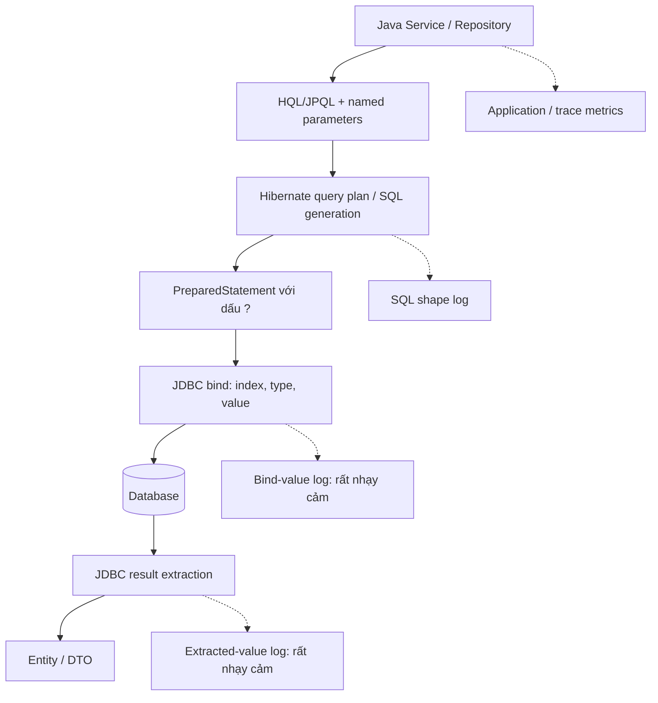

# Log SQL và log giá trị tham số với giới hạn dữ liệu nhạy cảm trong Hibernate

## 1. Vì sao quan sát SQL phải đi cùng kiểm soát dữ liệu?

Một màn hình tìm kiếm đơn hàng chạy chậm. Đội phát triển bật log Hibernate để xem ứng dụng đang gửi câu SQL nào, có JOIN thừa không, có tạo N+1 queries không và tham số lọc có được truyền đúng không. Vấn đề là **câu SQL và giá trị được bind vào câu SQL là hai loại thông tin khác nhau**.

Một câu SQL có thể tương đối an toàn khi chỉ cho thấy cấu trúc:

```sql
select c.id, c.email, c.status
from customers c
where c.email = ?
  and c.status = ?;
```

Nhưng log giá trị bind có thể biến nó thành một bản ghi về dữ liệu người dùng:

```text
binding parameter (1:VARCHAR) <- [demo@example.test]
binding parameter (2:VARCHAR) <- [ACTIVE]
```

Hai dòng trên chỉ dùng **dữ liệu giả**. Trong production, cùng cách ghi log có thể làm lộ email thật, số điện thoại, địa chỉ, thông tin thanh toán, token đăng nhập, mã OTP, nội dung hồ sơ hoặc dữ liệu của tenant khác.

**Nguyên tắc xuyên suốt bài:** chỉ bật loại quan sát tối thiểu đủ để trả lời câu hỏi chẩn đoán. Để hiểu hình dạng SQL, thường không cần log giá trị bind. Để đo hiệu năng, thường không cần lưu từng câu SQL. Nếu thực sự cần quan sát bind values trong môi trường kiểm thử, hãy dùng dữ liệu tổng hợp và một cấu hình có giới hạn phạm vi/thời gian, không bật TRACE tràn lan trên production.

Bài này nằm trong chủ đề **Quan sát và chẩn đoán** của Hibernate: mục tiêu là phân biệt đúng các tầng logging, hiểu thông tin nào có thể bị lộ, và xây một quy trình debug có thể áp dụng trong Spring Boot hoặc ứng dụng Hibernate Java SE.

### 1.1. Kết quả học tập

Sau khi học, bạn có thể:

1. Phân biệt log câu SQL, log JDBC bind values, log JDBC extracted values và application logs.
2. Cấu hình đúng các logging categories của Hibernate 6, đồng thời nhận diện tên logger Hibernate 5.
3. Hiểu khác nhau giữa `hibernate.show_sql` và `org.hibernate.SQL=DEBUG`.
4. Đọc SQL có `?` placeholder, kiểm tra parameter order/type mà không phụ thuộc vào việc ghi giá trị thật.
5. Dùng Spring Boot logging profiles, Logback và thông số Hibernate cho debug **có giới hạn**.
6. Biết vì sao SQL log đôi khi vẫn chứa literal/PII dù không bật bind TRACE.
7. Phân biệt diagnostics bằng query statistics, slow-query logging, query comments và APM/tracing.
8. Thiết kế an toàn cho MDC, query IDs, retention, redaction và incident response.
9. Viết integration test chứng minh số lượng truy vấn mà không phải ghi dữ liệu nhạy cảm.
10. Chọn được công cụ quan sát phù hợp với sự cố N+1, sai kiểu bind, query chậm, lỗi transaction và batching.

## 2. Từ Java tới SQL: các điểm có thể phát sinh log

Xét code:

```java
List<Customer> customers = entityManager.createQuery(
        """
        select c
        from Customer c
        where c.email = :email
          and c.status = :status
        """,
        Customer.class
    )
    .setParameter("email", email)
    .setParameter("status", CustomerStatus.ACTIVE)
    .getResultList();
```

Luồng xử lý khái niệm:



Đây là mô hình khái niệm. Tùy ORM, driver, dialect, batch và caching, số lượt gọi thực tế khác nhau.

### 2.1. SQL text log

Hibernate thường log câu SQL được tạo với các placeholder `?`:

```sql
select c1_0.id,c1_0.email,c1_0.status
from customers c1_0
where c1_0.email=? and c1_0.status=?
```

Thông tin hữu ích:

- Bảng nào được truy vấn.
- Điều kiện WHERE, JOIN, ORDER BY.
- Có phân trang và giới hạn kết quả không.
- Có phát N SELECT cho N entities không.
- Các câu UPDATE/INSERT/DELETE được tạo khi flush.
- Câu SQL có đúng với mapping và dialect không.

**Giới hạn:** chỉ nhìn SQL text thường không biết giá trị chính xác của tham số. Nhưng một số câu SQL chứa *literals được viết trực tiếp*, comments hoặc native SQL được nối chuỗi; khi đó SQL text vẫn có thể lộ dữ liệu nhạy cảm. Vì vậy SQL logging chỉ **ít rủi ro hơn**, không hoàn toàn an toàn.

### 2.2. JDBC bind-value log

Khi Hibernate gọi `PreparedStatement.setString(...)`, `setLong(...)`, `setTimestamp(...)` hoặc binding API tương ứng, logger bind có thể ghi:

```text
binding parameter (1:VARCHAR) <- [demo@example.test]
binding parameter (2:VARCHAR) <- [ACTIVE]
```

Hình thức log cụ thể khác theo phiên bản và kiểu dữ liệu. Điều cốt lõi là có thể thấy **vị trí, JDBC type và giá trị**.

Thông tin này hữu ích khi debug:

- Sai parameter index/order.
- Sai Java type so với JDBC type.
- `null` bind sai.
- Enum mapping sai.
- Ngày giờ/timezone bị truyền ngoài kỳ vọng.
- `LIKE` wildcard hoặc `IN` parameters không như ý định.

Nhưng đồng thời đây là loại log có nguy cơ **phơi bày dữ liệu đầu vào** cao nhất trong ORM diagnostics.

### 2.3. JDBC result extraction log

Hibernate còn có logging category cho các giá trị **được trích từ ResultSet**, ví dụ dữ liệu email, tên người, địa chỉ hoặc thông tin nội bộ trả về từ database.

Đừng chỉ tắt `jdbc.bind` mà quên `jdbc.extract`: một truy vấn đọc dữ liệu nhạy cảm vẫn có thể làm lộ giá trị nếu extractor được bật TRACE.

### 2.4. Application logs, exceptions và tracing

Ngoài Hibernate còn có:

- `log.info("customer={}", customer)`, có thể gọi `toString()` và lộ PII.
- `log.debug("search filters={}", request)`, có thể lộ form fields hoặc token.
- `SQLException` message, stack traces hoặc framework error handlers có thể chứa SQL hay giá trị.
- JDBC proxy, P6Spy, datasource-proxy hoặc APM agents có thể log/reconstruct câu SQL với bindings.
- Database server log hoặc slow-query log có thể chứa câu SQL nguyên văn.

**Một hệ thống log an toàn phải xét toàn bộ đường đi của dữ liệu, không chỉ một Hibernate logger.**

## 3. Cấu hình Hibernate 6: ba logging categories quan trọng

Với Hibernate ORM 6.x, các category được sử dụng phổ biến:

| Logger/category | Mức thường dùng khi bật | Nội dung quan sát | Rủi ro |
|---|---|---|---|
| `org.hibernate.SQL` | `DEBUG` | SQL statement text do Hibernate phát | Có thể chứa SQL literals/comments/schema |
| `org.hibernate.orm.jdbc.bind` | `TRACE` | JDBC parameter type và giá trị được bind | **Rất cao**, có thể lộ đầu vào |
| `org.hibernate.orm.jdbc.extract` | `TRACE` | Các giá trị được đọc từ JDBC ResultSet | **Rất cao**, có thể lộ dữ liệu đã lưu |
| `org.hibernate.orm.jdbc.batch` | `TRACE` | Thông tin liên quan JDBC batching | Độ chi tiết lớn; cần kiểm soát production |
| `org.hibernate.stat` / session metrics | Theo backend/version | Thống kê ORM/session | Thường ít nhạy cảm hơn bind values, nhưng vẫn phải xét log message |

### 3.1. Cấu hình SQL text logger

Trong Spring Boot `application.properties`:

```properties
spring.jpa.show-sql=false
logging.level.org.hibernate.SQL=DEBUG

# Không bật ghi giá trị thực nếu không có quy trình phê duyệt.
logging.level.org.hibernate.orm.jdbc.bind=OFF
logging.level.org.hibernate.orm.jdbc.extract=OFF
```

Với cấu hình này, SQL được gửi qua logging backend của ứng dụng ở `DEBUG`, thay vì dùng `show_sql` để in trực tiếp ra console.

### 3.2. Bind logger chỉ dành cho kiểm thử có dữ liệu giả

Trong một **local test profile** riêng, có thể tạm bật:

```properties
# application-local-sql-debug.properties
spring.jpa.show-sql=false
logging.level.org.hibernate.SQL=DEBUG
logging.level.org.hibernate.orm.jdbc.bind=TRACE
logging.level.org.hibernate.orm.jdbc.extract=OFF
```

**Cảnh báo:** `TRACE` ở `org.hibernate.orm.jdbc.bind` ghi giá trị bind thật do Hibernate gửi. Chỉ chạy với dữ liệu **synthetic** hoặc dữ liệu đã được tạo riêng cho test, không dùng bản sao database production chứa thông tin thực. Không commit cấu hình này như cấu hình mặc định của một môi trường có dữ liệu khách hàng.

### 3.3. Cấu hình bằng application.yml

```yaml
spring:
  jpa:
    show-sql: false
    properties:
      hibernate:
        format_sql: true
        highlight_sql: false
        use_sql_comments: false

logging:
  level:
    org.hibernate.SQL: DEBUG
    org.hibernate.orm.jdbc.bind: OFF
    org.hibernate.orm.jdbc.extract: OFF
```

Trong YAML, `logging` là key **cấp cao nhất**, không phải con của `spring`. Ở ví dụ này `format_sql` giúp dễ đọc SQL khi output qua cấu hình tương ứng, còn `highlight_sql=false` tránh mã màu ANSI gây nhiễu log aggregator.

### 3.4. Cấu hình Java SE / persistence.xml

Nếu không dùng Spring Boot, có thể đặt Hibernate properties:

```xml
<persistence-unit name="catalogPU"
                  transaction-type="RESOURCE_LOCAL">
    <properties>
        <property name="hibernate.show_sql" value="false"/>
        <property name="hibernate.format_sql" value="true"/>
    </properties>
</persistence-unit>
```

Nhưng `logging.level.org.hibernate.SQL` là cấu hình của **logging backend/Spring Boot**, không phải thuộc tính chuẩn của JPA `persistence.xml`. Với Java SE, hãy cấu hình SLF4J backend như Logback hoặc Log4j2 tương ứng. Không trộn hai loại cấu hình mà mặc định mọi property có hiệu lực.

### 3.5. Hibernate 5 khác Hibernate 6

Trong các dự án Hibernate 5, log bind parameter thường được cấu hình qua:

```properties
logging.level.org.hibernate.type.descriptor.sql.BasicBinder=TRACE
```

Đây là cách làm **cũ**, không phải category khuyến nghị cho Hibernate 6. Với Hibernate 6 nên dùng:

```properties
logging.level.org.hibernate.orm.jdbc.bind=TRACE
```

Trước khi áp hướng dẫn lấy từ blog cũ, hãy xác nhận Hibernate Core version và logging backend thực tế. Spring Boot 3 thường đi với Hibernate 6/Jakarta Persistence, còn Spring Boot 2 thường đi với Hibernate 5/javax.persistence, nhưng phải xem dependency thực tế thay vì chỉ suy luận từ major version của Boot.

## 4. `show_sql` và logger `org.hibernate.SQL` không giống nhau

### 4.1. `hibernate.show_sql=true`

```properties
spring.jpa.show-sql=true
# Tương đương bật thuộc tính:
# hibernate.show_sql=true
```

Hibernate có thể in SQL trực tiếp ra console/stdout, thường có tiền tố như:

```text
Hibernate: select c1_0.id,c1_0.email from customers c1_0 where c1_0.id=?
```

Đây là tiện ích khi học hoặc debug nhanh, nhưng **không phải lựa chọn tốt nhất cho log quản trị tập trung**:

- Output đi trực tiếp tới console, có thể không đi qua pipeline xử lý log như appender có kiểm soát.
- Khó gắn structured fields/trace ID nhất quán.
- Dễ bị trùng với `org.hibernate.SQL=DEBUG`.
- Có thể đi vào container stdout và được hệ thống thu log mặc định gửi lên dịch vụ khác.
- Khi log có SQL literals, masking ở appender không nhất thiết xử lý được dữ liệu đã in ra stdout.

### 4.2. `org.hibernate.SQL=DEBUG`

```properties
spring.jpa.show-sql=false
logging.level.org.hibernate.SQL=DEBUG
```

Câu SQL được ghi theo logging framework mà ứng dụng đã cấu hình, thuận lợi hơn cho:

- Phân tuyến output theo môi trường.
- Logging format có timestamp/trace ID.
- Chính sách appender và quyền truy cập.
- Giới hạn log level.
- Tắt/bật có kiểm soát trong một phiên chẩn đoán.

**Nhưng logger framework không tự làm SQL an toàn.** Nội dung SQL do Hibernate hoặc code tạo vẫn có thể chứa literals/comments; và các appenders có khả năng redact cũng không nên được xem là bảo đảm duy nhất.

### 4.3. `format_sql` và `highlight_sql`

```properties
spring.jpa.properties.hibernate.format_sql=true
spring.jpa.properties.hibernate.highlight_sql=false
```

`format_sql` thay đổi cách trình bày câu SQL cho dễ đọc; nó **không làm thay đổi nghĩa truy vấn** và không che giá trị nhạy cảm. `highlight_sql` thêm ANSI colors trong môi trường phù hợp; đôi khi làm log ingestion khó parse hoặc tạo escape sequences không cần thiết.

Khi cần debug trong CI logs, nhiều dòng SQL format đẹp có thể làm log volume tăng; hãy chọn cấu hình theo mục đích.

## 5. Ví dụ HQL: log SQL khác log bind thế nào?

### 5.1. Entity và repository method

```java
@Entity
@Table(name = "invoices")
public class Invoice {
    @Id
    private Long id;

    @Column(nullable = false)
    private String referenceCode;

    @Column(nullable = false)
    private BigDecimal total;

    @Column(nullable = false)
    private LocalDate issuedDate;
}
```

Read service:

```java
@Transactional(readOnly = true)
public List<Invoice> findInvoices(
        LocalDate fromDate,
        BigDecimal minTotal
) {
    return entityManager.createQuery(
            """
            select i
            from Invoice i
            where i.issuedDate >= :fromDate
              and i.total >= :minTotal
            order by i.issuedDate, i.id
            """,
            Invoice.class
        )
        .setParameter("fromDate", fromDate)
        .setParameter("minTotal", minTotal)
        .getResultList();
}
```

### 5.2. SQL shape log

```sql
select i1_0.id,i1_0.issued_date,i1_0.reference_code,i1_0.total
from invoices i1_0
where i1_0.issued_date>=? and i1_0.total>=?
order by i1_0.issued_date,i1_0.id
```

Từ đây đã có thể quan sát:

- Hibernate dùng cột `issued_date` và `total`.
- Có hai JDBC placeholders `?`.
- Query có ORDER BY ổn định theo ngày và ID.
- Có thể xem index phù hợp với predicate/sort.

Không cần log ngày phát hành hoặc số tiền thực của khách hàng để phát hiện vấn đề join/order.

### 5.3. Bind log chỉ trong local test

Với dữ liệu test giả định:

```text
binding parameter (1:DATE) <- [2026-01-01]
binding parameter (2:NUMERIC) <- [100.00]
```

Dòng log này cho phép xác nhận thứ tự và kiểu bind. Nhưng trong production, giá trị minTotal có thể lộ chiến lược định giá, truy vấn nội bộ hoặc dữ liệu cá nhân tùy use case.

Không coi vì một giá trị là số/boolean thì nó chắc chắn an toàn. Ví dụ `tenant_id`, `account_id`, `fraud_score` hoặc một flag phản ánh trạng thái sức khỏe vẫn có thể mang thông tin nhạy cảm.

### 5.4. Named parameter khác JDBC position

HQL dùng:

```hql
where i.issuedDate >= :fromDate
  and i.total >= :minTotal
```

SQL đã dịch dùng `?` theo thứ tự Hibernate bind. Khi HQL chứa điều kiện lặp, `IN` lists, joins hoặc SQL function expansions, thứ tự/ số placeholder không nhất thiết trùng danh sách named parameter ban đầu.

Vì vậy việc map “bind parameter thứ 3 là named parameter X” chỉ bằng nhìn source HQL là không đáng tin cho mọi query. Hãy đọc SQL shape, số placeholder và log binding trong **môi trường được phép**.

## 6. Vì sao SQL log vẫn có thể chứa PII khi không bật bind TRACE?

Một hiểu nhầm nguy hiểm là: “Tôi chỉ bật `org.hibernate.SQL`, nên log chắc chắn không có dữ liệu”.

### 6.1. SQL literal xuất hiện trực tiếp trong query

Ví dụ không nên viết:

```java
String hql = "from Customer c where c.email = '" + email + "'";
List<Customer> result = em.createQuery(
        hql, Customer.class
    )
    .getResultList();
```

Ngoài nguy cơ injection, HQL/SQL có thể chứa email literal và bị ghi ra SQL logs hoặc statement comments. Phải dùng binding:

```java
List<Customer> result = em.createQuery(
        "from Customer c where c.email = :email",
        Customer.class
    )
    .setParameter("email", email)
    .getResultList();
```

### 6.2. Native SQL được nối chuỗi

```java
// Không nên:
String sql = "select * from customers where email = '"
        + input + "'";
```

Với native SQL, dùng named/positional parameters qua JPA Query hoặc PreparedStatement. Parameter binding vừa tăng tính an toàn vừa giúp SQL log thường chỉ chứa placeholders.

### 6.3. SQL comments hoặc query hints chứa thông tin động

Nếu dùng:

```java
query.unwrap(org.hibernate.query.Query.class)
     .setComment("find customer " + email);
```

và bật SQL comments, email có thể xuất hiện trong SQL log hoặc database-side logs. Chỉ đưa **hằng số truy vấn/operation name** vào comment, ví dụ:

```java
query.unwrap(org.hibernate.query.Query.class)
     .setComment("CustomerReadRepository.findByEmail");
```

Không cho client điều khiển nội dung comment, tags hay SQL hints.

### 6.4. Query được in đầy đủ trong exception

Một số thông báo lỗi database, SQLGrammarException, constraint violation hoặc query API exception có thể kèm SQL text, parameter metadata hoặc các giá trị liên quan. Khi thiết kế exception handler và error monitoring, không tự động gửi mọi exception message chứa SQL tới client hoặc logging sink có phạm vi truy cập rộng.

### 6.5. JSON/array/literal mapping và driver plugins

Một số SQL function, native mapping hoặc thư viện SQL instrumentation có thể in lại biểu thức với literal/JSON. Logging JDBC proxy có thể dựng SQL đã thay dấu `?` bằng dữ liệu bind. Đừng giả định “câu SQL từ ORM” có cùng mức bảo vệ với một PreparedStatement nguyên bản.

**Kết luận:** parameter binding là nền tảng tốt, nhưng SQL logging vẫn cần chính sách phân loại và kiểm soát truy cập.


## 7. Những loại dữ liệu không nên xuất hiện trong SQL/bind/extract logs

### 7.1. Nhóm dữ liệu cần bảo vệ

| Loại dữ liệu | Ví dụ | Vì sao log nguy hiểm |
|---|---|---|
| Credentials | Password, refresh token, API key, cookie, OAuth code | Có thể bị tái sử dụng để truy cập |
| One-time secrets | OTP, reset-password token, magic link | Có giá trị trong một khoảng thời gian |
| Thông tin cá nhân | Email, điện thoại, địa chỉ, tên đầy đủ, ngày sinh | Lộ danh tính hoặc profile khách hàng |
| Dữ liệu tài chính | Tài khoản ngân hàng, số thẻ, giao dịch, hạn mức | Lộ tài chính; có nghĩa vụ tuân thủ riêng |
| Dữ liệu nhạy cảm đặc biệt | Hồ sơ sức khỏe, định danh pháp lý, private notes | Rủi ro riêng tư và pháp lý cao |
| Dữ liệu tenant | Tenant ID, organization ID, internal object IDs | Có thể tiết lộ cấu trúc và liên kết dữ liệu |
| Nội dung nghiệp vụ | SQL với giá thầu, kế hoạch giá, đánh giá nhân viên | Có thể lộ bí mật thương mại |
| LOB/JSON payloads | Document text, metadata JSON, large binary | Log volume lớn và khó che dữ liệu bên trong |
| Kết quả truy vấn | Các hàng trả từ DB qua extract logger | Có thể lộ dữ liệu ngay cả khi input không nhạy cảm |

Ngay cả hashed passwords hoặc masked tokens cũng không nên được đưa vào logs tùy tiện. Hashed values có thể cho phép kiểm tra trùng lặp, phân tích dictionary hoặc tái định danh; masked value vẫn có thể nguy hiểm nếu quy tắc che quá lỏng.

### 7.2. Rò rỉ còn xảy ra ở môi trường phát triển

Local environment vẫn có thể:

- Dùng database snapshot lấy từ production chưa được khử danh tính.
- Có file log được đồng bộ vào cloud drive.
- Được chia sẻ qua màn hình hỗ trợ hoặc ticket.
- Gửi logs tới shared APM/tracing.
- Chạy dưới CI có artifacts tồn tại nhiều ngày.
- Ghi stdout vào Docker/Kubernetes log collector.

Do đó “chỉ dùng để debug” không đủ làm lý do bật bind TRACE. Phải bảo đảm **dataset thật sự là dữ liệu giả/được phép sử dụng** và đường lưu log được kiểm soát.

### 7.3. Dữ liệu giả phải được tạo có chủ đích

Ví dụ tốt:

```text
customer_id = 1001
email = example.user@invalid.test
phone = 000-000-0000
invoice_ref = DEMO-INVOICE-001
access_token = dummy-token-not-valid
```

Không dùng tài khoản test nhưng có thể đăng nhập thật, API key sandbox vẫn còn hiệu lực, hoặc dữ liệu người dùng thật chỉ được thay tên hiển thị. Token “test” có quyền thực cũng là secret.

### 7.4. Tránh log trực tiếp object entity

```java
log.debug("Customer entity = {}", customer);
```

Nếu `toString()` sinh bởi Lombok `@Data` hoặc tự viết liệt kê email, address, token hoặc lazy associations, câu log gây hai vấn đề: rò rỉ dữ liệu và kích hoạt SQL bổ sung/N+1.

Tốt hơn:

```java
log.debug("Loaded Customer entity; queryKey={}",
          "customers.by-id");
```

Trong một số trường hợp cần correlation key, dùng request/trace ID do hệ thống tạo hoặc pseudonymous token được phê duyệt; không mặc định ghi entity ID khi nó có thể được liên kết với dữ liệu cá nhân.

## 8. Profile cấu hình theo môi trường

Một chính sách thực tế nên tách ba mức quan sát.

### 8.1. Production mặc định: không log SQL text/bind

```properties
# application-prod.properties
spring.jpa.show-sql=false
logging.level.org.hibernate.SQL=WARN
logging.level.org.hibernate.orm.jdbc.bind=OFF
logging.level.org.hibernate.orm.jdbc.extract=OFF

# Cân nhắc tắt query comments trong production
# nếu chưa kiểm soát nội dung comment của toàn bộ ứng dụng.
spring.jpa.properties.hibernate.use_sql_comments=false
```

Đây là baseline bảo thủ; production vẫn có thể dùng metrics và slow-query diagnostics được kiểm soát để điều tra hiệu năng mà không stream mọi SQL.

**Không đặt `root=TRACE` hoặc bật cả `org.hibernate=TRACE`** trên production: phạm vi đó có thể rộng hơn nhiều so với một SQL logger cụ thể.

### 8.2. Staging có dữ liệu synthetic: SQL text được phép trong thời gian ngắn

```properties
# application-staging-sql.properties
spring.jpa.show-sql=false
logging.level.org.hibernate.SQL=DEBUG
logging.level.org.hibernate.orm.jdbc.bind=OFF
logging.level.org.hibernate.orm.jdbc.extract=OFF
spring.jpa.properties.hibernate.format_sql=true
```

Dùng để kiểm tra JOIN, pagination, SQL schema và query count. Nếu staging chứa production-like dữ liệu cá nhân thì không được tự động coi cấu hình này an toàn; SQL text vẫn có thể chứa literals/comments và schema sensitive.

### 8.3. Local isolated: bind TRACE có điều kiện

```properties
# application-local-synthetic.properties
spring.jpa.show-sql=false
logging.level.org.hibernate.SQL=DEBUG
logging.level.org.hibernate.orm.jdbc.bind=TRACE
logging.level.org.hibernate.orm.jdbc.extract=OFF
```

Chỉ bật khi:

- Dữ liệu là synthetic, không có credentials có giá trị.
- Log output chỉ lưu local/ephemeral theo chính sách.
- Không tự đồng bộ hoặc upload logs.
- Bật trong một khoảng chẩn đoán cụ thể.
- Đã xác định cách tắt và dọn artifacts sau test.

Đừng biến bind TRACE thành “mặc định local cho cả đội” nếu mọi developer dùng nhiều loại database khác nhau.

### 8.4. Spring profiles không phải cơ chế security

`application-local-synthetic.properties` được kích hoạt qua profile là công cụ cấu hình. Nếu một deployment production vô tình bật profile local, bind TRACE vẫn có thể chạy.

Hãy có các lớp bảo vệ bổ sung: cấu hình phân tầng, CI config validation, deployment policy, secret management, RBAC của log sinks và cảnh báo khi level không phù hợp.

### 8.5. Không đặt giá trị nhạy cảm vào environment logs

Ngay cả file cấu hình cũng có thể chứa secret JDBC password; không log nguyên object `Environment`, datasource configuration, connection URLs có credentials, hoặc toàn bộ application properties khi debug. Dùng secret store và loại các key nhạy cảm khỏi output.

## 9. Logback ví dụ: điều khiển logger nhưng không hứa che bind values

Spring Boot thường dùng Logback theo dependency mặc định. Một đoạn `logback-spring.xml` minh họa các mức logger:

```xml
<configuration>
    <springProfile name="prod">
        <logger name="org.hibernate.SQL" level="WARN"/>
        <logger name="org.hibernate.orm.jdbc.bind" level="OFF"/>
        <logger name="org.hibernate.orm.jdbc.extract" level="OFF"/>
    </springProfile>

    <springProfile name="local-synthetic">
        <logger name="org.hibernate.SQL" level="DEBUG"/>
        <logger name="org.hibernate.orm.jdbc.bind" level="TRACE"/>
        <logger name="org.hibernate.orm.jdbc.extract" level="OFF"/>
    </springProfile>

    <!-- Các appenders/root loggers phải do ứng dụng
         cấu hình theo chính sách lưu trữ và truy cập. -->
</configuration>
```

Đây là đoạn **logger-level configuration**, không phải file Logback đầy đủ gồm appender/root. Nếu triển khai, cần có appenders và retention policy phù hợp.

### 9.1. Vì sao không dựa hoàn toàn vào regex masking?

Một appender có thể dùng regex thay email, số tài khoản hoặc token bằng `[REDACTED]`. Nhưng dữ liệu nhạy cảm có vô số kiểu biểu diễn:

- JSON escaped, URL encoded, base64.
- UUID, numeric IDs, IBAN, chuỗi Unicode.
- Truncated/multiline values.
- SQL string literal chứa quote/escape.
- JDBC driver log với format khác Hibernate.
- Stack traces và exception messages có cùng dữ liệu.

Regex có thể bỏ sót dữ liệu hoặc che nhầm đoạn SQL vô hại. Nó cũng có thể không xử lý output `hibernate.show_sql=true` đi thẳng stdout hoặc log do database/APM ghi ở sink khác.

**Ưu tiên ngăn nguồn phát log dữ liệu nhạy cảm**, coi redaction ở sink là một lớp bảo vệ bổ sung, không phải lý do bật bind TRACE trên production.

### 9.2. Chỉ một appender “an toàn” không đủ

Nếu có ConsoleAppender, FileAppender và remote TCP appender, một filter chỉ áp trên FileAppender không bảo vệ console hoặc remote sink. Structured logging pipelines, sidecar collectors và error reporting phải có chính sách thống nhất.

### 9.3. JSON structured logs cũng có thể làm lộ dữ liệu

Structured format giúp tìm kiếm dễ hơn, nhưng nếu field `jdbc.bind.value` chứa token thì rủi ro cao hơn vì data dễ query/export. Không coi JSON logs mặc nhiên ít nhạy cảm hơn plaintext.

## 10. Thiết kế application logs an toàn: log metadata, không log giá trị

Thay vì log:

```java
log.info(
    "Searching customers by email={} status={}",
    email, status
);
```

có thể log:

```java
log.debug(
    "queryKey={} filterCount={} pageSize={}",
    "CustomerRepository.search",
    2,
    Math.min(pageSize, 100)
);
```

Đây là ví dụ về **metadata có kiểm soát**:

- `queryKey`: tên operation cố định, không chứa PII.
- `filterCount`: số lượng điều kiện chung, không chứa giá trị.
- `pageSize`: số lượng tối đa; cân nhắc cardinality và privacy tùy nghiệp vụ.

Nếu cần biết một filter có được cung cấp không, có thể log boolean **chỉ khi nó không tiết lộ thông tin nhạy cảm theo context**:

```java
log.debug("queryKey={} hasStatusFilter={}",
          "CustomerRepository.search",
          status != null);
```

Không đưa tên field nhạy cảm vào log theo cách tự tiết lộ business event (ví dụ “hasHivDiagnosis=true” hoặc một permission flag bí mật). Việc có/không của một field đôi khi cũng là dữ liệu nhạy cảm.

### 10.1. Query ID/operation name nên có cardinality thấp

Tốt:

```text
query_key=OrderRepository.findRecent
query_key=InvoiceRepository.findByPeriod
query_key=CustomerRepository.countActive
```

Không tốt:

```text
query_key=find_customer_email_demo@example.test
query_key=sql_ + raw_user_input
```

Giá trị query key nên nằm trong danh sách hữu hạn do developer định nghĩa, không phát sinh từ request values.

### 10.2. Đếm kết quả cũng cần cân nhắc

`resultCount` và `durationMs` thường hữu ích và ít nhạy cảm hơn bind values, nhưng ở những hệ thống nhạy cảm, số kết quả cho một cá nhân hoặc một nhóm nhỏ có thể suy ra thông tin riêng tư. Dùng aggregate metrics ở đủ kích thước, sampling và access controls nếu cần.

## 11. MDC, trace ID và correlation an toàn

Một request đi qua Controller → Service → Repository có thể phát nhiều SQL queries. Muốn biết chúng thuộc cùng request nào, logging backend có thể chèn **trace ID** hoặc **request correlation ID**:

```text
traceId=9f3d... component=OrderQueryService queryKey=orders.list
traceId=9f3d... component=HibernateSQL select ... from orders ...
```

Ví dụ này chỉ minh họa trace ID synthetic. Trace ID nên được tạo/chuẩn hóa bởi tracing infrastructure đáng tin; không cần lấy email/username làm correlation ID.

### 11.1. Đừng đưa raw request body vào MDC

MDC thường được đính kèm vào **mọi dòng log trong cùng execution context**. Nếu cho vào MDC trường như email, account ID có tính định danh hoặc JWT, một lần ghi cũng có thể nhân dữ liệu đó ra hàng trăm SQL logs.

Ưu tiên metadata:

- Trace/span ID.
- Service/component name.
- Query key cố định.
- Mã lỗi đã phân loại.
- Thông tin environment không bí mật.

### 11.2. Thread pools và MDC propagation

Trong Spring `@Async`, thread pool hoặc Reactor context, MDC không phải lúc nào tự truyền và dọn đúng. Một ThreadLocal không được clear có thể làm request sau mang nhãn của request trước, gây **sai correlation** và thậm chí rò dữ liệu nếu context có fields nhạy cảm.

Dùng tracing integration được hỗ trợ, try/finally hoặc scope APIs của logging/tracing library; không sao chép raw security context vào log.

### 11.3. Trace IDs không thay quyền truy cập

Có trace ID không cho phép log mọi payload. Tracing chỉ giúp nối các observations; policy không ghi secrets vẫn được ưu tiên.

## 12. Query comments: định vị SQL, nhưng tránh dữ liệu đầu vào

Hibernate hỗ trợ thêm SQL comments:

```properties
spring.jpa.properties.hibernate.use_sql_comments=true
```

Query-level comment có thể được đặt bằng Hibernate `Query#setComment(...)`:

```java
org.hibernate.query.Query<Customer> query =
    entityManager.createQuery(
            "select c from Customer c where c.status = :status",
            Customer.class
        )
        .unwrap(org.hibernate.query.Query.class);

query.setComment("CustomerReadRepository.findActive");
query.setParameter("status", CustomerStatus.ACTIVE);

List<Customer> rows = query.getResultList();
```

SQL có thể chứa comment nhận diện nơi tạo query:

```sql
/* CustomerReadRepository.findActive */
select c1_0.id,c1_0.status
from customers c1_0
where c1_0.status=?
```

### 12.1. Rủi ro của use_sql_comments

Hibernate có thể prepend nội dung HQL hoặc custom comment tùy cấu hình. HQL chứa literals, comments tùy biến hoặc user-generated string có thể dẫn tới lộ dữ liệu.

Đừng viết:

```java
query.setComment("Find by email " + email);
```

Hãy dùng tên operation tĩnh và xét có nên bật comments trong production hay không.

### 12.2. Comments có thể xuất hiện ở database-side telemetry

SQL comments không chỉ dành cho application logs; chúng có thể đi vào database query logs, monitoring agents, execution plan capture hoặc audit tooling. Vì thế phải coi comments là dữ liệu được chia sẻ nhiều sink, không được chứa secrets.

### 12.3. Comments không thay trace spans

Một query comment có thể giúp truy ngược method, nhưng nó không mang đầy đủ trace lifecycle hay transaction context. Nên kết hợp query key/trace ID có giới hạn và metrics thay vì nhét một JSON payload vào SQL comment.


## 13. Theo dõi query chậm mà không bật bind TRACE

Để tìm SQL chậm, không nhất thiết phải xem từng giá trị tham số. Hibernate có tùy chọn:

```properties
spring.jpa.properties.hibernate.log_slow_query=500
```

Trong Hibernate 6.6, `hibernate.log_slow_query` đặt ngưỡng thời gian thực thi (millisecond) để ghi nhận query chậm ở mức logging thích hợp. Ví dụ trên dùng ngưỡng **500 ms**.

**Lưu ý:** slow-query log có thể chứa SQL text. Nếu SQL chứa literals/comments hoặc statement text nhạy cảm, rủi ro vẫn còn. Không bật ngưỡng này trước khi xem nội dung và tuyến lưu log.

### 13.1. Slow query khác query chạy nhiều lần

Một query mỗi lần mất 8 ms nhưng thực thi 400 lần trong một request có thể gây latency cao do **N+1**. Ngược lại, một query chạy một lần mất 700 ms là vấn đề slow query.

Cần quan sát cả:

- Thời gian một statement/query.
- Số lần thực thi.
- Tổng thời gian trong request.
- Số rows và dữ liệu được xử lý.
- Connection pool saturation/locks.
- Cache hit/miss và transaction boundaries.

### 13.2. Chậm ở database hay chậm trong application?

Một request có thể mất 2 giây vì deserialize response, mapping DTO, gọi API ngoài hoặc chờ connection pool, dù SQL execution chỉ chiếm 30 ms. Slow-query log không thay APM spans và request traces; cần đo cả application layer.

### 13.3. Đừng thay slow-query threshold bằng bind logs

Khi query chạy chậm, bước đầu là xác định SQL shape và execution plan; thường không cần giá trị PII. Nếu query plan phụ thuộc parameter selectivity, có thể dùng **giá trị synthetic đại diện** trên staging hoặc statistics/histograms ở database để tái hiện, không phải copy production secrets vào log/ticket.

## 14. Hibernate Statistics: đo số truy vấn mà không log giá trị

Bật Hibernate Statistics trong môi trường thử nghiệm:

```properties
spring.jpa.properties.hibernate.generate_statistics=true
```

Dùng `SessionFactory`:

```java
import org.hibernate.SessionFactory;
import org.hibernate.stat.Statistics;

SessionFactory sf = entityManagerFactory.unwrap(SessionFactory.class);
Statistics stats = sf.getStatistics();

stats.setStatisticsEnabled(true);
stats.clear();

// Chạy use case cần quan sát.

System.out.println(
    "Prepared statements = " + stats.getPrepareStatementCount()
);
System.out.println(
    "HQL/query executions = " + stats.getQueryExecutionCount()
);
System.out.println(
    "Entity loads = " + stats.getEntityLoadCount()
);
```

### 14.1. Các số đo này khác nhau

- `getPrepareStatementCount()` phản ánh số prepared statements được tạo theo thống kê Hibernate, **không phải số network packets** hoặc tổng số physical SQL rows.
- `getQueryExecutionCount()` phản ánh các query executions do Hibernate thống kê; **không phải bộ đếm mọi JDBC SELECT/UPDATE trong mọi code path**, và không nhất thiết bằng số log `org.hibernate.SQL`.
- `getEntityLoadCount()` nói về load entity, không phải số database queries.
- `getSecondLevelCacheHitCount()`/`getSecondLevelCacheMissCount()` cho biết hoạt động L2 cache, không phải câu SQL đã chạy.

Không đối chiếu một số đếm duy nhất rồi kết luận có/không N+1 trong mọi tình huống.

### 14.2. Thống kê trên SessionFactory có phạm vi toàn ứng dụng

Trong test chạy song song hoặc production có nhiều requests, số đếm có thể bị nhiễu. Khi dùng `stats.clear()` phải bảo đảm bạn không làm hỏng một hệ thống monitoring đang cần số liệu liên tục. Thường nên đo trên test suite cô lập, datasource proxy hoặc metrics gắn với span/request.

### 14.3. Slow query statistics

Ở Hibernate 6.3+ có API thống kê slow queries như `getSlowQueries()` khi tính năng slow-query logging được bật; chi tiết API cần đối chiếu phiên bản. Không cần xuất toàn bộ raw SQL map ra log production vì bản thân key chứa câu SQL có thể có literals/comments.

### 14.4. Metrics nên ưu tiên mẫu số, thời gian, tỷ lệ

Có thể thu:

- `db.query.duration` histogram theo tên operation được phê duyệt.
- `db.query.count` theo bounded query key.
- Transaction duration.
- Connection pool wait/use/timeout.
- Cache hit/miss rates.
- HTTP endpoint p50/p95/p99 latency.
- Error counts theo loại exception.

Không dùng raw SQL text hoặc parameter values làm metric labels: chúng có thể tiết lộ dữ liệu và tạo **high cardinality**, làm hệ thống quan sát tốn tài nguyên.

## 15. Tìm N+1 bằng SQL shape và query count

Giả sử:

```java
List<Order> orders = em.createQuery(
        "select o from Order o",
        Order.class
    )
    .getResultList();

for (Order order : orders) {
    System.out.println(order.getCustomer().getName());
}
```

Nếu association `customer` LAZY, log SQL có thể hiện:

```sql
select o.id,o.customer_id from orders o;
select c.id,c.name from customers c where c.id=?;
select c.id,c.name from customers c where c.id=?;
select c.id,c.name from customers c where c.id=?;
-- lặp thêm...
```

Không cần nhìn giá trị `customer_id` thực để thấy query shape tải Customer lặp lại.

### 15.1. Sửa bằng fetch plan, không bằng log values

Tùy use case:

```hql
select o
from Order o
join fetch o.customer
```

hoặc constructor DTO projection:

```hql
select new com.example.orders.OrderRow(
    o.id, o.customer.name
)
from Order o
```

Sử dụng EntityGraph, batch fetching hoặc query phân trang parent + children khi phù hợp. `@Transactional` giúp Session còn hoạt động nhưng không tự xóa N+1.

### 15.2. So sánh trước và sau

Trong test với data giả:

1. Seed 50 orders thuộc nhiều customers.
2. Mở persistence context mới để tránh cache warm-up che vấn đề.
3. Đo `getPrepareStatementCount()` hoặc JDBC proxy.
4. Chạy query cũ và ghi số SQL statements.
5. Áp fetch plan.
6. Chạy lại trên fixture tương đương.
7. Kiểm tra query count không tăng tuyến tính theo N.

Việc này tạo chứng cứ chẩn đoán mà **không phải bật bind TRACE trên dữ liệu thật**.

## 16. Điều tra lỗi tham số bind mà không ghi giá trị thực

Các lỗi cần xem tham số thường gồm:

- `could not determine data type of parameter`.
- `Parameter value ... did not match expected type`.
- DATE/TIMESTAMP hay timezone không khớp.
- Enum mapping `STRING` vs `ORDINAL`.
- Null/empty collection trong `IN`.
- BigDecimal scale hoặc JDBC numeric type.
- Boolean mapping khác giữa dialects.
- UUID/JSON/custom `UserType` binding.

### 16.1. Kiểm tra type tại code boundary

Thay vì log `birthDate` hoặc token, kiểm tra programmatically:

```java
Objects.requireNonNull(fromDate, "fromDate");
Objects.requireNonNull(toDate, "toDate");

if (fromDate.isAfter(toDate)) {
    throw new IllegalArgumentException("Invalid date range");
}
```

Có thể log một mã lỗi chung `INVALID_DATE_RANGE` mà không đưa ngày thật vào logs.

### 16.2. Unit/integration test với giá trị synthetic

```java
@Test
void bindsNullAndEnumCorrectly() {
    // Dữ liệu fixture do test tạo, không phải copy production.
    List<Order> rows = repository.findByStatus(
        OrderStatus.PENDING
    );
    assertThat(rows).isNotNull();
}
```

Nếu cần quan sát raw bind values, chạy test dưới local synthetic profile, bật TRACE ngắn hạn rồi tắt. Đừng copy dòng log chứa dữ liệu thật vào pull request hoặc issue.

### 16.3. Thông báo lỗi vẫn có thể chứa value

Không log `exception.getMessage()` một cách vô điều kiện lên kênh công cộng nếu exception message của driver có chứa SQL/values. Ưu tiên structured error code, query key và trace ID; stack trace chi tiết chỉ trong sink có quyền truy cập phù hợp sau khi kiểm tra redaction.

### 16.4. Không tự “sanitize” bằng nối chuỗi thay cho parameter binding

```java
String sql = "select ... where email = '" + escape(email) + "'";
```

Không nên làm cách này để tiện log. Dùng prepared parameterization cho an toàn truy vấn. Escaping thủ công không cung cấp bảo vệ tương đương và dễ để lọt giá trị literal vào SQL logs.

## 17. `StatementInspector`: xem/chỉnh SQL text, không đọc bind values

Hibernate cung cấp `org.hibernate.resource.jdbc.spi.StatementInspector`. Đây là extension point có thể quan sát SQL **trước khi JDBC statement được prepare**, và tùy implement có thể trả SQL đã được chỉnh sửa.

Ví dụ minh họa quan sát metadata:

```java
import org.hibernate.resource.jdbc.spi.StatementInspector;
import org.slf4j.Logger;
import org.slf4j.LoggerFactory;

public final class QueryShapeInspector
        implements StatementInspector {

    private static final Logger LOG =
            LoggerFactory.getLogger(QueryShapeInspector.class);

    @Override
    public String inspect(String sql) {
        // Không log nguyên sql hoặc parameter values.
        LOG.trace("Hibernate prepared a JDBC statement");
        return sql; // Không sửa SQL.
    }
}
```

Cấu hình:

```properties
spring.jpa.properties.hibernate.session_factory.statement_inspector=com.example.logging.QueryShapeInspector
```

Tên property `hibernate.session_factory.statement_inspector` dùng trong Hibernate 6. Không phải JPA standard API.

### 17.1. Giới hạn quan trọng

`StatementInspector.inspect(String sql)` nhận **SQL text**, không cung cấp an toàn một object map tất cả bind parameter values. Nó **không phải** nơi đáng tin để ẩn giá trị đang được log bởi `org.hibernate.orm.jdbc.bind`.

Nếu gắn một inspector để xóa email khỏi SQL text, bind TRACE vẫn có thể ghi email đó ở sink khác. Muốn ngăn leakage, phải tắt logger nguồn hoặc bảo vệ toàn bộ instrumentation.

### 17.2. Đừng tự xây SQL fingerprint bằng regex tùy tiện

SQL có comments, quoted literals, dialect syntax, JSON paths, string escape, CTE, window functions và vendor-specific constructs. Một regex đơn giản “thay chuỗi trong quote thành ?” không thể đảm bảo loại hết data-sensitive literals và đôi khi làm biến đổi query semantics.

Để nhóm truy vấn, ưu tiên query key do developer định nghĩa hoặc DB/APM tooling có normalization được chứng minh phù hợp, không lưu raw statement làm metric label.

### 17.3. StatementInspector có thể ảnh hưởng hiệu năng

Inspector chạy khi Hibernate chuẩn bị statements. Nếu làm parse SQL nặng, IO blocking hoặc gọi logger với SQL dài cho mọi statement, nó có thể tăng latency toàn hệ thống. Không dùng inspector như nơi gửi SQL đi network trực tiếp trong production.


## 18. JDBC proxy, P6Spy, database logs và APM: các nguồn rò rỉ khác

### 18.1. Datasource proxy / P6Spy

Những công cụ intercept JDBC thường rất hữu ích để đo:

- Số statements.
- Execution time.
- Batch sizes.
- Connection usage.
- Query patterns.

Nhưng một số cấu hình có thể **in SQL đã thay placeholders bằng values** hoặc log parameter sets riêng. Trước khi cài/bật, đọc đúng cấu hình masking của tool/version và kiểm tra output trên dữ liệu fake.

Không coi việc tắt Hibernate bind TRACE là đủ nếu một JDBC proxy khác vẫn log values.

### 18.2. Database server slow-query logs

Database có thể ghi text statement, execution time, plan và đôi khi bind values theo DB settings. DBA/ops cần cùng biết chính sách dữ liệu nhạy cảm. Một SQL comment chứa email có thể xuất hiện trong database logs ngay cả khi app logging đã tắt.

### 18.3. Distributed tracing/APM

Một APM agent có thể thu thập `db.statement`/SQL text, query parameters hoặc metadata khác tùy cấu hình và semantic conventions đang dùng. Trước khi bật “record SQL”, cần xác nhận:

- Có loại bỏ literals/values không?
- Có query normalization không?
- Ai đọc được traces?
- Traces có được export tới bên thứ ba không?
- Retention là bao lâu?
- Có sampling và giới hạn payload size không?
- Headers/query params HTTP có bị capture cùng trace không?

Không cho rằng “traces không phải logs” thì dữ liệu không nhạy cảm.

### 18.4. Error monitoring và tickets

Một developer có thể copy log TRACE vào ticket kèm stack trace, screenshots hoặc alert channels; từ đó dữ liệu được sao chép sang nhiều hệ thống có retention khác nhau. Khi cần chia sẻ chẩn đoán, hãy tạo **reproduction synthetic** và chỉ kèm query shape/metric.

### 18.5. Container stdout là một sink thật

Trong Docker/Kubernetes, stdout/stderr thường được thu gom tự động. Bật `show_sql=true` hoặc `System.out.println` không làm log “chỉ nằm trên màn hình của tôi”; nó có thể đi tới centralized log platform với retention dài.

## 19. Logging và JDBC batching

Một import 5.000 records có thể dùng:

```properties
spring.jpa.properties.hibernate.jdbc.batch_size=50
spring.jpa.properties.hibernate.order_inserts=true
```

Nhưng khi bật `org.hibernate.SQL=DEBUG`, ta có thể vẫn thấy rất nhiều INSERT lines. Điều đó không tự chứng minh mỗi INSERT là một network round-trip. Với JDBC batching, Hibernate có thể queue parameter sets rồi execute batches.

### 19.1. Có thể xem batch logger khi nào?

Hibernate 6 có logging category `org.hibernate.orm.jdbc.batch`. Trong local/staging synthetic, có thể bật phù hợp:

```properties
logging.level.org.hibernate.orm.jdbc.batch=TRACE
```

Nhưng phải xem version-specific logger behavior và output; đừng tự khẳng định mỗi log line là một batch execution hay mọi driver rewrite behavior đều được phản ánh.

### 19.2. Dùng measurement ngoài SQL logger

Để đo batching:

- Số rows insert thực tế.
- Số JDBC batch executions và batch sizes qua datasource instrumentation.
- Thời gian transaction.
- Số lần lấy sequence IDs.
- Throughput rows/s, CPU, DB IO.
- Driver/dialect behavior.

Không bật bind TRACE cho 5.000 INSERT chỉ để đếm statements; nó có thể tạo khối lượng lớn PII trong log và còn khiến benchmark chậm đi.

### 19.3. Logging làm thay đổi đối tượng đo

TRACE logging có chi phí format string, tạo message, IO và throughput của logging backend. Nếu đang benchmark SQL performance, đo trong cấu hình quan sát nhẹ tương đương production; chỉ dùng TRACE khi cần debug một ca nhỏ có dữ liệu giả.

## 20. Theo dõi transaction/flush để hiểu thời điểm SQL phát ra

Một service:

```java
@Transactional
public void renameCustomer(Long id, String newName) {
    Customer c = entityManager.find(Customer.class, id);
    c.rename(newName);
    // Hibernate dirty checking ở flush/commit.
}
```

SQL UPDATE có thể xuất hiện lúc flush hoặc commit, không nhất thiết tại dòng `c.rename(...)`. Vì vậy một câu app log `"rename called"` và câu SQL UPDATE có thể cách nhau về thời gian.

### 20.1. Đừng đoán chỉ dựa vào thứ tự hai dòng log

Trong ứng dụng nhiều requests/threads:

- Các dòng Hibernate SQL và bind events của nhiều requests có thể xen kẽ.
- Một query có nhiều JDBC statements do lazy loading.
- Batch execution có thể gom các statements.
- Auto flush có thể xảy ra trước một query.
- Session/transaction events có thể không theo thứ tự đơn giản như business method calls.

Không liên kết một giá trị bind với một SQL statement chỉ bằng việc chúng nằm sát nhau trong một file log lớn. Cần context/correlation đúng hoặc test cô lập.

### 20.2. Query execution khác transaction completion

Một SELECT có thể chạy trong transaction read-only; UPDATE có thể bị flush rồi rollback. Log SQL cho biết statement được gửi/chuẩn bị, **không chứng minh thay đổi đã commit**.

Nếu điều tra “người dùng báo đã đổi tên nhưng DB không đổi”, cần thêm transaction outcome, exception path, affected row count và dữ liệu trạng thái sau commit.

### 20.3. Rollback logs có thể vẫn chứa dữ liệu

Một request cuối cùng rollback vẫn có thể đã bind secret và ghi TRACE logs. Rollback DB **không xóa log**. Đây là lý do phải chặn dữ liệu nhạy cảm ngay từ nguồn thay vì dựa vào kết quả transaction.

## 21. Điều tra các loại sự cố bằng công cụ tối thiểu

| Vấn đề | Quan sát nên bắt đầu bằng | Có cần bind values thật không? |
|---|---|---|
| N+1 SELECT | SQL shape + query count | Không |
| JOIN sai/nhiều rows | SQL shape + execution plan + result count | Thường không |
| Query chậm | Metrics, slow-query threshold, DB plan | Thường không |
| Sai alias/cột mapping | SQL text + exception type | Không |
| `LazyInitializationException` | Transaction boundary và fetch plan | Không |
| Enum/bind type mismatch | Type metadata + synthetic test | Không dùng dữ liệu thật |
| Parameter ordering bug | Local synthetic bind TRACE | Chỉ dữ liệu giả |
| JDBC batching không hoạt động | Batch instrumentation/statistics | Không |
| Transaction rollback bất ngờ | Trace outcome + exception category | Không |
| Tenant isolation issue | Authorization tests synthetic và query predicates | Không ghi tenant data thật |
| Cache hit/miss bất thường | Cache statistics | Không |
| SQL injection nghi ngờ | Code review parameterization + security test | Không log payload độc hại thật |
| Query trả dữ liệu sai | Reproduction synthetic, SQL semantics | Không mặc định |
| Lỗi timezone | Unit/integration test với ngày giờ giả | Không |
| Data breach từ log | Incident response/security review | **Dừng tăng verbosity** |

Điểm chung: có thể chẩn đoán phần lớn vấn đề bằng shape, counts, type, metrics và test fixtures mà không thu thập các giá trị của người dùng.

## 22. Quy trình bật logging tạm thời có kiểm soát

Khi một sự cố khó tái hiện đòi thêm chi tiết, nên có runbook thay vì bảo nhau “bật TRACE toàn bộ Hibernate”.

### Bước 1 — xác định câu hỏi kỹ thuật

Ví dụ: “Một request tìm kiếm tạo 101 SELECT thay vì 2” hoặc “JDBC bind của enum ở test bị loại sai”. Không bật log nếu chưa biết câu hỏi cần trả lời.

### Bước 2 — chọn môi trường và dữ liệu

Ưu tiên local/staging với **synthetic dataset**. Nếu production-only, cân nhắc metrics/query shape/DB plan trước; việc thu bind values của traffic thật cần quy trình phê duyệt và biện pháp bảo vệ đặc biệt, không phải thao tác mặc định.

### Bước 3 — bật đúng logger nhỏ nhất

Ví dụ cần SQL shape:

```properties
logging.level.org.hibernate.SQL=DEBUG
logging.level.org.hibernate.orm.jdbc.bind=OFF
logging.level.org.hibernate.orm.jdbc.extract=OFF
```

Không bật root TRACE.

### Bước 4 — giới hạn thời gian, phạm vi và lưu trữ

- Chỉ phục vụ một reproduction scenario.
- Cấu hình log level có thời hạn hoặc thao tác revert rõ.
- Giới hạn ai có thể xem logs.
- Kiểm tra console/container/CI/APM có thu output không.
- Không giữ log vô hạn; retention theo chính sách.
- Đảm bảo redaction policies được thử với dữ liệu giả.

### Bước 5 — tái hiện và thu bằng chứng tối thiểu

Thu query key, SQL shape đã được rà soát, số statements, timings, trace ID không nhạy cảm và test fixture. Không chụp toàn bộ dữ liệu của người dùng hoặc copy toàn bộ bind logs lên issue.

### Bước 6 — tắt/rollback cấu hình

Khôi phục log levels. Nếu đã dùng runtime logging controls, xác nhận mọi node đã tắt; cấu hình ở một node không nhất thiết thay đổi các node khác.

### Bước 7 — xóa/giảm quyền truy cập artifacts theo quy định

Dọn logs từ local file, CI artifacts hoặc temporary debug storage theo chính sách. Không tự ý xóa evidence của incident/security investigation; nếu phát hiện đã lộ secrets, phải theo quy trình incident response.

## 23. Runtime log-level change và Spring Boot Actuator

Spring Boot Actuator có thể quản lý logging levels runtime nếu endpoint logging được cấu hình và được phép truy cập.

Ví dụ HTTP request dạng ý tưởng:

```http
POST /actuator/loggers/org.hibernate.SQL
Content-Type: application/json

{"configuredLevel":"DEBUG"}
```

Trả về baseline:

```http
POST /actuator/loggers/org.hibernate.SQL
Content-Type: application/json

{"configuredLevel":"WARN"}
```

**Cảnh báo vận hành:**

- Không expose actuator logging endpoint công khai.
- Chỉ cấp quyền cho operators được xác thực/ủy quyền.
- Runtime log level có thể không bền qua restart và không tự áp cho mọi node.
- Bật bind TRACE bằng actuator trên production có thể thu dữ liệu thật ngay lập tức.
- Cần audit ai thay đổi level và khi nào.
- Không coi một bước revert thủ công là đủ nếu có nhiều instances hoặc autoscaling.

Hướng này chỉ mô tả khả năng vận hành. Trong môi trường chứa dữ liệu thật, khuyến nghị vẫn là **không bật bind/extract TRACE**, thay bằng reproduction synthetic và instrumentation an toàn.

## 24. Chính sách redaction và pseudonymization

### 24.1. Giảm dữ liệu từ thiết kế

Thứ tự ưu tiên thường là:

1. **Không log giá trị nhạy cảm**.
2. Chỉ log query shape/operation metadata.
3. Dùng test data giả khi cần giá trị cụ thể.
4. Nếu business thực sự cần một identifier cho correlation, chọn cơ chế pseudonymization có đánh giá bảo mật.
5. Dùng appender/collector redaction như lớp phòng thủ bổ sung.
6. Bảo vệ sink: encryption, access audit, retention và export controls.

### 24.2. Hash thông thường không luôn bảo vệ danh tính

Một hash của email hoặc số điện thoại có thể bị brute-force/dictionary nếu không gian dữ liệu nhỏ hoặc có danh sách ứng viên. Không mặc định `SHA-256(email)` là hoàn toàn ẩn danh.

Nếu có yêu cầu correlation bí danh, cân nhắc HMAC với secret được quản lý, rotation và giới hạn quyền truy cập; vẫn xem token đó như dữ liệu có khả năng liên kết cá nhân theo policy. Không tự triển khai một “anonymizer” bằng hash trong Hibernate logger cho mọi giá trị bind.

### 24.3. Masking partial identifiers vẫn có trade-off

`****1234` của tài khoản có thể đủ cho support trong một số nghiệp vụ, nhưng vẫn là thông tin có thể liên kết và có rủi ro khi ghép với các fields khác. Không log nhiều masked fragments rồi tin rằng kết quả chắc chắn không thể tái định danh.

### 24.4. Log data minimization và retention

Một debug log bị giữ 365 ngày không giống một log được tạo tạm trong 30 phút. Xác định thời gian lưu, mục đích, owner và quyền truy cập; áp policy cho cả local, CI, cloud logging và backups.

### 24.5. Nếu đã vô tình log credentials

Không chỉ “xóa dòng log”:

- Ngừng nguồn log và tắt mức verbosity gây lộ.
- Hạn chế quyền truy cập và xác định phạm vi phát tán.
- Rotate/revoke tokens/credentials có nguy cơ lộ.
- Theo quy trình security incident của tổ chức để bảo toàn bằng chứng, điều tra và xử lý dữ liệu.
- Rà soát các sink thứ cấp: collector, APM, CI artifacts, tickets, snapshots.
- Bổ sung preventive controls để tránh lặp lại.

Không tự cam kết có thể xóa sạch mọi bản sao logs khi chúng đã được gửi tới nhiều hệ thống.

## 25. Kiểm thử logging không làm lộ dữ liệu

Một integration test cho security logging nên dùng dữ liệu giả có sentinel dễ nhận diện:

```java
String fakeEmail = "synthetic-secret-123@invalid.test";

Customer c = new Customer(fakeEmail);
entityManager.persist(c);
entityManager.flush();
```

Nếu bài test thu Logback events từ một appender test, có thể assert output **không chứa** sentinel này khi ở production-like logging profile.

Ví dụ pseudocode:

```java
@Test
void productionLoggingDoesNotIncludeBindValues() {
    String sentinel = "synthetic-secret-123@invalid.test";

    // Cấu hình prod-like logger levels, chỉ dùng dữ liệu giả.
    persistAndQueryCustomer(sentinel);

    String captured = testLogCollector.getMessages();

    assertThat(captured).doesNotContain(sentinel);
}
```

`testLogCollector`, `persistAndQueryCustomer` là test helpers của dự án, không phải classes có sẵn của Hibernate. Bài test phải thu đúng sinks (framework logger, stdout nếu có, JDBC proxy nếu dùng), tránh đánh đồng “appender A không thấy” với “mọi hệ thống không thấy”.

### 25.1. Một phép test cụ thể cho SQL-only mode

- Chạy query có parameter synthetic.
- Kiểm tra log có SQL shape được phép.
- Kiểm tra giá trị synthetic không xuất hiện.
- Kiểm tra `hibernate.show_sql=false` để tránh stdout bypass.
- Kiểm tra `org.hibernate.orm.jdbc.bind` và `extract` đang OFF.
- Kiểm tra SQL comments/query string không chứa giá trị synthetic.

Không dùng user/production data để chứng minh chính sách an toàn.

### 25.2. Integration tests cho N+1 không cần bind TRACE

Một test kiểm tra số prepared statements:

```java
SessionFactory sf = emf.unwrap(SessionFactory.class);
Statistics stats = sf.getStatistics();

stats.clear();
OrderDetailDto dto = service.loadOrderDetail(fakeOrderId);

assertThat(dto.lines()).hasSize(50);
assertThat(stats.getPrepareStatementCount())
    .isLessThanOrEqualTo(3);
```

Phải bật `generate_statistics`, seed/commit fixtures tách phần measurement và cô lập test để tránh requests khác làm nhiễu. Ngưỡng 3 chỉ là mục tiêu minh họa cho use case cụ thể, không phải bảo đảm chung.

## 26. Lỗi thường gặp khi cấu hình log

| Hiện tượng | Nguyên nhân hay gặp | Cách xử lý |
|---|---|---|
| Không thấy SQL dù set `show_sql=false` | Chưa bật `org.hibernate.SQL` ở backend đúng | Bật DEBUG tại logging backend khi được phép |
| Có hai dòng giống nhau | Vừa `show_sql=true` vừa SQL logger DEBUG | Chọn một cách; ưu tiên logger |
| Chỉ thấy `?`, không thấy giá trị | Đang xem SQL text, không phải bind | Đây là mặc định tốt; chỉ dùng bind TRACE với dữ liệu synthetic |
| Không thấy bind khi dùng Hibernate 6 | Đặt logger BasicBinder của Hibernate 5 | Dùng `org.hibernate.orm.jdbc.bind` |
| Log JDBC chứa email dù bind logger OFF | JDBC proxy/APM/extract logger khác đang bật | Kiểm kê tất cả sinks/categories |
| TRACE quá nhiều, ứng dụng chậm | Bật quá rộng hoặc log binding của batch lớn | Tắt TRACE, dùng metrics/query count |
| SQL vẫn chứa email dù có placeholder | Native concatenation/comment/HQL literal | Parameterize, tránh dynamic comments |
| Log có ANSI escape codes | `highlight_sql` bật | Tắt highlight cho aggregator |
| SQL logs không có trace ID | Logging pattern/MDC/tracing chưa tích hợp | Dùng correlation an toàn, không chèn PII |
| Dòng bind từ hai requests trộn nhau | Threads đồng thời | Test cô lập hoặc trace context phù hợp |
| Có nhiều SQL sau gọi setter | Flush/dirty checking/cascade | Phân tích transaction boundary |
| Không thấy UPDATE dù entity đã sửa | Chưa flush, detached entity hoặc transaction rollback | Kiểm tra lifecycle/transaction |
| Chỉ thấy một SQL nhưng API chậm | Bottleneck ngoài DB / result mapping / pool | APM spans, DB metrics, profiling |
| SQL log nhiều INSERT nhưng batching có thể đang chạy | Log SQL không phản ánh executeBatch calls | JDBC batch instrumentation |
| Logs production lộ secrets | Bind/extract TRACE hoặc third-party tool | Tắt nguồn, incident response và prevention |
| Regex masking bỏ sót JSON | Dữ liệu nhiều encoding/format | Không log raw values; áp controls tại nguồn |
| SQL logs tăng size quá mạnh | `format_sql`, TRACE, bulk operations | Giới hạn level, sampling và retention |
| Mất log sau restart | Runtime level qua actuator không persistent | Dùng config-as-code và runbook revert |
| Không thể reproduce SQL mismatch | Database/schema/dialect khác | Dùng staging synthetic tương đương |
| Query cache hit khiến không thấy SELECT | Dữ liệu được phục vụ từ persistence context/cache | Đo cache metrics và dùng context mới khi test |

## 27. Bài tập thực hành

**Bài 1 — SQL text.** Bật `org.hibernate.SQL=DEBUG` trên H2/PostgreSQL test với dữ liệu synthetic. Chạy `findByEmail` có named parameter và mô tả SQL shape.

**Bài 2 — Bind values.** Trong local test cô lập, bật `org.hibernate.orm.jdbc.bind=TRACE`. Quan sát parameter index/type cho DATE, VARCHAR và BigDecimal, sau đó tắt TRACE.

**Bài 3 — Extract values.** Đọc tài liệu category `jdbc.extract`, giải thích vì sao nó nhạy cảm ngay cả khi SELECT không có WHERE. Không dùng database thật để demo.

**Bài 4 — show_sql.** So sánh `hibernate.show_sql=true` với SQL logger DEBUG trong Logback; quan sát output, duplication và quyền kiểm soát appenders.

**Bài 5 — Hibernate 5/6.** Giải thích vì sao cấu hình `BasicBinder` trong blog Hibernate 5 không phải cách chuẩn cho Hibernate 6.

**Bài 6 — HQL literal.** Viết một truy vấn nối chuỗi chứa email giả, xem rủi ro logging/injection, rồi chuyển sang parameter binding.

**Bài 7 — N+1.** Tạo 50 Orders và 50 Customers giả, đo query count trước/sau fetch join hoặc DTO projection mà không log customer names.

**Bài 8 — Slow query.** Bật `hibernate.log_slow_query` tại một ngưỡng trên staging, kiểm tra message không có dynamic comments hoặc literals.

**Bài 9 — Statistics.** Đo `getPrepareStatementCount`, `getQueryExecutionCount` và entity load counts. Giải thích vì sao chúng không bằng nhau.

**Bài 10 — SQL comments.** Đặt query comment cố định như `OrderRepository.findRecent`; thử dùng email giả trong comment để thấy tại sao phải cấm động.

**Bài 11 — StatementInspector.** Tạo inspector chỉ đếm SQL statements hoặc log thông báo cố định. Chứng minh nó không nhìn được JDBC bind values theo API `inspect(String sql)`.

**Bài 12 — Test confidentiality.** Dùng sentinel fake trong integration test; assert production-like logs không chứa sentinel, đồng thời kiểm tra không có `show_sql` bypass.

**Bài 13 — JDBC proxy.** Dùng datasource proxy trên test, so cấu hình đếm statements với cấu hình reconstruct query values. Đề xuất policy an toàn.

**Bài 14 — MDC.** Tạo trace ID synthetic xuyên Service/Repository. Giải thích vì sao không cho email hoặc raw JWT vào MDC.

**Bài 15 — Runtime log levels.** Lập runbook cho phép một operator bật SQL DEBUG có thời hạn trên staging, có người phê duyệt và bước revert.

**Bài 16 — Incident response.** Giả lập một token không có hiệu lực bị log trong CI artifact. Lập các bước xác định nguồn, thu hồi artifacts và chặn tái diễn; phân biệt với sự cố token thật.

**Bài 17 — PII taxonomy.** Phân loại fields trong một schema Customer/Payment: field nào tuyệt đối không log, field nào chỉ metadata và field nào có thể dùng trong synthetic test.

**Bài 18 — Batching.** Persist 100 rows với JDBC batch size 25. So SQL logger output với JDBC batch executions và giải thích vì sao không thể lấy số SQL lines làm số network round-trips.

## 28. Câu hỏi tự kiểm tra

**1. SQL logger Hibernate 6 phổ biến là gì?**

`org.hibernate.SQL` ở mức `DEBUG`.

**2. Category log JDBC bind values trong Hibernate 6 là gì?**

`org.hibernate.orm.jdbc.bind` thường ở `TRACE` khi cần debug.

**3. Vì sao extract logger nhạy cảm?**

Vì nó có thể ghi các giá trị đọc từ database, kể cả PII không xuất hiện trong query parameters.

**4. `hibernate.show_sql=true` có lợi thế gì và rủi ro gì?**

Dễ xem SQL tại console nhưng output khó quản trị tập trung, có thể bypass appenders và bị log collectors thu thập.

**5. SQL chứa `?` có chắc không lộ PII không?**

Không. SQL literals, native concatenation hoặc comments vẫn có thể chứa dữ liệu nhạy cảm.

**6. Khi nào mới cân nhắc bind TRACE?**

Trong local/staging synthetic được kiểm soát, có mục tiêu rõ, thời hạn ngắn và không có dữ liệu thật.

**7. SQL logging có tự sửa N+1 không?**

Không. Nó giúp quan sát; sửa bằng fetch plan/projection/batch fetching phù hợp.

**8. Slow-query logging khác SQL DEBUG như thế nào?**

Nó tập trung vào những query vượt ngưỡng thời gian, không ghi mọi statement theo mặc định.

**9. `StatementInspector` có che được bind logs không?**

Không. Nó nhận SQL text, không phải mọi bound values; tắt bind/extract logger tại nguồn mới là trọng tâm.

**10. Tại sao không dùng raw SQL làm metric label?**

Dễ lộ literals/schema và tạo high cardinality; dùng query key hữu hạn.

**11. Tại sao log của transaction rollback vẫn nguy hiểm?**

Log đã được ghi ra ngoài DB, rollback không thu hồi thông tin khỏi các sinks.

**12. Pseudonymization bằng hash email thông thường có luôn an toàn không?**

Không. Email có thể bị dictionary attack hoặc tái liên kết; cần đánh giá bảo mật riêng.

**13. Cần xem gì nếu Hibernate bind logger OFF nhưng logs vẫn lộ value?**

JDBC proxies, APM agents, extract loggers, application logs, SQL comments, driver/database logs và exceptions.

**14. Vì sao logging làm sai benchmark?**

TRACE formatting và IO tốn CPU/memory/throughput, có thể làm latency tăng.

**15. Khi cần chẩn đoán production, nên bắt đầu từ đâu?**

Metrics, slow-query observation có kiểm soát, query shape/correlation và reproduction synthetic; không mặc định bật bind TRACE.

## 29. Ghi nhớ

- **SQL text, bind values và extracted values là ba lớp quan sát khác nhau**. Bật SQL DEBUG không tự đòi bind TRACE.
- Hibernate 6 thường dùng `org.hibernate.SQL=DEBUG`, `org.hibernate.orm.jdbc.bind=TRACE` và `org.hibernate.orm.jdbc.extract=TRACE`. Bind/extract có rủi ro riêng tư rất cao.
- `hibernate.show_sql` in SQL ra console; trong ứng dụng có quản trị log, thường ưu tiên logger backend và để `show_sql=false`.
- **Dấu `?` không bảo đảm SQL không chứa dữ liệu**: query literals, native string concatenation và SQL comments có thể làm lộ PII.
- Parameter binding giúp an toàn truy vấn và giảm khả năng giá trị nằm trong SQL text; không có nghĩa bound values an toàn để log.
- Chẩn đoán N+1, JOIN, pagination và batching thường cần **SQL shape + statistics**, không cần values thật.
- `hibernate.log_slow_query` và Hibernate Statistics giúp đo hiệu năng có chọn lọc, nhưng slow-query SQL cũng phải được đánh giá về tính nhạy cảm.
- `StatementInspector` nhìn SQL text, không phải công cụ xóa mọi JDBC bind-value logs.
- JDBC proxies, APM/tracing, database logs, exceptions, console và CI artifacts đều có thể trở thành kênh rò rỉ dù Hibernate logger đã tắt.
- Dùng **synthetic data, query key cố định, trace ID không nhạy cảm, cấu hình profile an toàn, RBAC, retention và runbook revert**.
- Regex masking, hash đơn giản hoặc appender redaction không thay thế nguyên tắc **không log secrets ngay từ nguồn**.
- Nếu phát hiện leak credentials hoặc dữ liệu cá nhân trong logs, dừng nguồn, giới hạn phạm vi và thực hiện quy trình security incident/rotation phù hợp.

### Tài liệu tham khảo

- [Hibernate ORM 6.6 — Logging generated SQL and JDBC values](https://docs.hibernate.org/orm/6.6/introduction/html_single/#logging)
- [Hibernate ORM 6.6 — Logging categories](https://docs.hibernate.org/orm/6.6/logging/logging.html)
- [Hibernate ORM 6.6 — JDBC settings/slow-query setting](https://docs.hibernate.org/orm/6.6/javadocs/org/hibernate/cfg/JdbcSettings.html)
- [Hibernate ORM 6.6 — Statistics API](https://docs.hibernate.org/orm/6.6/javadocs/org/hibernate/stat/Statistics.html)
- [Hibernate ORM 6.6 — StatementInspector API](https://docs.hibernate.org/orm/6.6/javadocs/org/hibernate/resource/jdbc/spi/StatementInspector.html)
- [Log4j 2 documentation — Hibernate integration and sensitive parameters](https://logging.apache.org/log4j/2.x/hibernate.html)
- [Spring Boot Reference — Logging](https://docs.spring.io/spring-boot/reference/features/logging.html)
- [Spring Boot Actuator — Loggers endpoint](https://docs.spring.io/spring-boot/reference/actuator/loggers.html)
- [OWASP — Logging Cheat Sheet](https://cheatsheetseries.owasp.org/cheatsheets/Logging_Cheat_Sheet.html)
- [OpenTelemetry — Semantic conventions for database spans](https://opentelemetry.io/docs/specs/semconv/database/)

