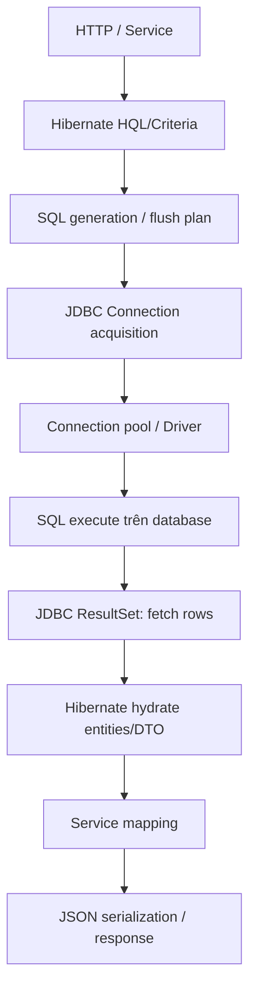
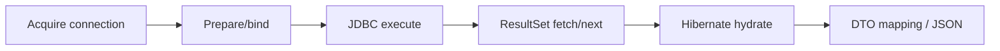
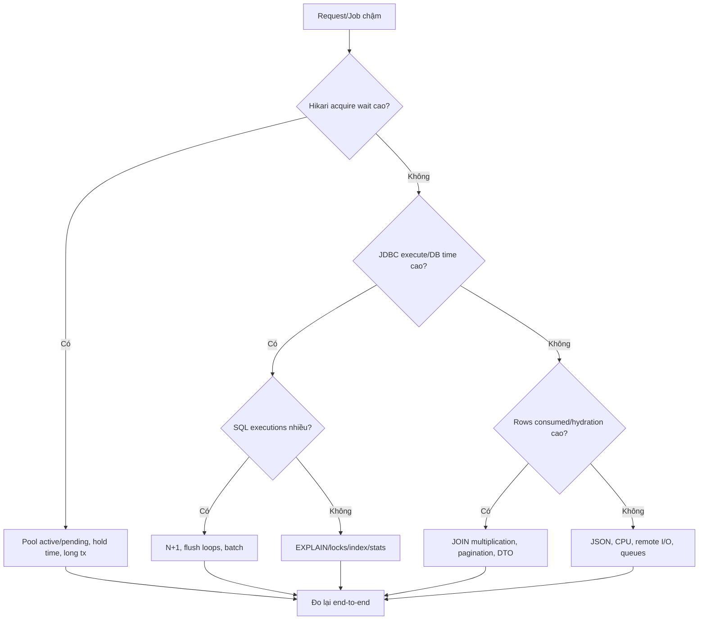
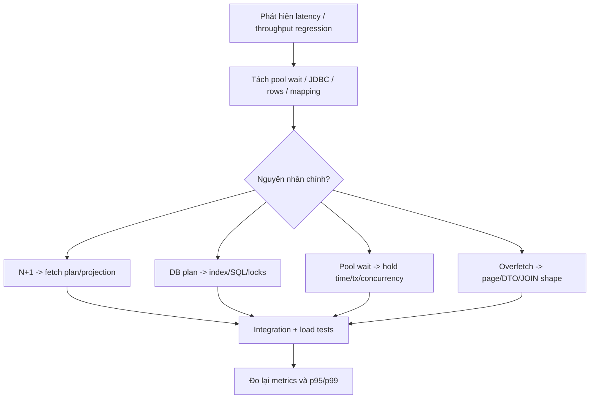

# Đếm câu lệnh, số hàng, thời gian truy vấn và thời gian chờ kết nối trong Hibernate

Một endpoint đọc 20 đơn hàng có thể mất 1,2 giây. Từ thông tin đó, đội phát triển chưa thể kết luận nguyên nhân là “Hibernate chậm”. Có thể xảy ra một trong nhiều tình huống:

- Hibernate phát **201 câu SELECT** vì N+1 queries.
- Chỉ có một SELECT nhưng JOIN tạo **150.000 hàng JDBC** để dựng 20 root entities.
- SQL chạy trong database mất 15 ms nhưng ứng dụng tốn 700 ms để đọc `ResultSet`, hydrate entities và serialize JSON.
- SQL chạy rất nhanh nhưng request phải **chờ 800 ms để lấy connection** từ HikariCP.
- Hibernate gom 500 UPDATE thành các JDBC batches, khiến số lời gọi thực thi, số rows affected và số round-trips khác nhau.
- Database quét hàng triệu rows nhưng chỉ trả 20 rows vì thiếu index, thống kê cũ hoặc execution plan không phù hợp.

Muốn chẩn đoán đúng, phải đo **đúng đơn vị và đúng ranh giới thời gian**. Bài này tập trung vào bốn nhóm quan sát:

1. **Số câu lệnh SQL/JDBC**: ORM chuẩn bị và thực thi bao nhiêu statement, có batch hay không?
2. **Số hàng**: kết quả Java có bao nhiêu phần tử, JDBC nhận bao nhiêu rows, database quét/xử lý bao nhiêu rows?
3. **Thời gian truy vấn**: đo từ đâu đến đâu, bao gồm execute, fetch, hydrate, mapping hay không?
4. **Thời gian chờ connection**: request có phải xếp hàng ở connection pool trước khi SQL được chạy?

Đây là phần quan trọng trong chủ đề **Quan sát và chẩn đoán** khi phát triển ứng dụng Java sử dụng Hibernate, JPA, Spring Boot, JDBC driver và một hệ quản trị cơ sở dữ liệu quan hệ.

---

## 1. Đừng gọi mọi con số là “số query”

Trước tiên cần phân biệt các đại lượng dễ bị trộn lẫn.

| Đại lượng | Ý nghĩa chính | Ví dụ |
|---|---|---|
| Service method invocation | Số lần Java gọi method | `findRecentOrders()` gọi một lần |
| HQL/JPQL execution | Số lần một câu query ORM được thực thi | 1 HQL có thể kéo theo nhiều SQL |
| Prepared statement creation | Số lần Hibernate/JDBC chuẩn bị statement | Một SQL template dùng nhiều lần |
| JDBC statement execution | Số lần gọi execute/executeQuery/executeUpdate | 21 SELECT riêng |
| JDBC batch execution | Số lần `executeBatch()` | 1 batch chứa 50 updates |
| SQL row returned | Số hàng được SQL trả trong result set | JOIN trả 200 hàng |
| ORM result element | Số phần tử trong Java result | `List<PurchaseOrder>` có 20 phần tử |
| Entity load | Entity instance state được Hibernate load | 20 Order + 20 Customer |
| Entity fetch | Fetch phát sinh để đáp ứng association access | Có thể chỉ ra N+1 |
| Connection acquisition wait | Thời gian xin connection từ pool | 480 ms |
| JDBC execute duration | Thời gian một lần execute JDBC mất | 35 ms |
| ResultSet consumption | Thời gian đọc và xử lý dữ liệu trả về | 240 ms |
| Transaction duration | Đơn vị nghiệp vụ giữ transaction | 700 ms |
| HTTP request duration | Toàn bộ request và response | 1.200 ms |

Một request có **1 HQL, 21 SQL statements, 200 DB rows và 20 Java root objects** là hoàn toàn có thể xảy ra.

### 1.1. Hình dung đường đi của một request



Các thành phần đo lường nằm ở những điểm khác nhau trong đường đi. Nếu dùng chỉ số ở H để kết luận về E, hoặc lấy thời gian HTTP ở J làm thời gian database ở F, chẩn đoán sẽ dễ sai.

### 1.2. Ba câu hỏi cần trả lời trước khi tối ưu

- **Có quá nhiều SQL không?** Nếu có, xem lazy loading, N+1, flush quá thường xuyên và batch.
- **Mỗi SQL quá nặng không?** Nếu có, xem query plan, số rows được quét/trả, indexes và join cardinality.
- **SQL không nặng nhưng request vẫn chậm?** Nếu có, xem connection-pool wait, hydrate/mapping, JSON, remote I/O, thread contention và queueing.

Đừng bắt đầu bằng tăng connection pool hoặc bật cache khi chưa biết request đang tốn thời gian ở đâu.

## 2. Ví dụ nhất quán: màn hình đơn hàng

Giả sử mô hình:

```java
@Entity
@Table(name = "purchase_orders")
public class PurchaseOrder {

    @Id
    private Long id;

    private String code;
    private Instant createdAt;
    private BigDecimal totalAmount;

    @ManyToOne(fetch = FetchType.LAZY)
    private Customer customer;

    @OneToMany(mappedBy = "order", fetch = FetchType.LAZY)
    private List<OrderLine> lines = new ArrayList<>();
}

@Entity
public class Customer {
    @Id
    private Long id;
    private String displayName;
}

@Entity
public class OrderLine {
    @Id
    private Long id;

    @ManyToOne(fetch = FetchType.LAZY)
    private PurchaseOrder order;

    private String sku;
    private int quantity;
}
```

Một query:

```java
List<PurchaseOrder> orders =
    entityManager.createQuery(
        """
        select o
        from PurchaseOrder o
        where o.status = :status
        order by o.createdAt desc, o.id desc
        """,
        PurchaseOrder.class
    )
    .setParameter("status", OrderStatus.CONFIRMED)
    .setMaxResults(20)
    .getResultList();
```

Tại thời điểm query trả về, `orders.size()` bằng 20. Nhưng nếu code ngay sau đó chạy:

```java
for (PurchaseOrder order : orders) {
    System.out.println(
        order.getCustomer().getDisplayName()
    );
}
```

Hibernate có thể tải tối đa 20 Customer khác nhau bằng những SELECT riêng nếu customers chưa được fetch/cached.

Nếu tiếp tục:

```java
for (PurchaseOrder order : orders) {
    for (OrderLine line : order.getLines()) {
        System.out.println(line.getSku());
    }
}
```

có thể xuất hiện thêm 20 collection SELECT.

**Một lần gọi `getResultList()` không có nghĩa toàn bộ service chỉ phát một SQL statement.**

## 3. Công cụ quan sát: mỗi tầng trả lời một câu hỏi

| Tầng | Công cụ | Thấy tốt nhất | Giới hạn |
|---|---|---|---|
| Hibernate ORM | `Statistics`/query statistics | ORM operations, entity loads/fetches, HQL executions | Không thay thế JDBC wire count hoặc DB execution plan |
| Hibernate SQL logger | `org.hibernate.SQL` | SQL templates ORM phát ra | Không chứng minh rows/latency thực tế |
| Hibernate bind logger | `org.hibernate.orm.jdbc.bind` | Bound parameters | Rủi ro lộ dữ liệu; log rất lớn |
| `StatementInspector` | Hibernate SPI | SQL text trước khi chuẩn bị | Không có thời gian thực thi/row count trực tiếp |
| JDBC instrumentation | datasource-proxy, P6Spy hoặc tracing wrapper | Execute/executeBatch, bound params và timing quanh JDBC | Có overhead; ResultSet/fetch có thể cần instrument riêng |
| HikariCP metrics | Micrometer/JMX | Connection active/idle/pending, acquisition, usage, timeout | Không tự chỉ ra query SQL chậm |
| HTTP/application tracing | Micrometer Observation, OpenTelemetry | Spans request/service/JDBC, correlation | Cần propagation và sampling |
| Database | `EXPLAIN`, query statistics, slow-query tools | Rows scanned, plan, index/lock/CPU/IO | DB-specific, nhiều chỉ số theo server |
| OS/network/pool | Thread dumps, pool diagnostics | Thread waiting, socket/queue pressure | Cần đối chiếu với traces/timestamps |

Một dashboard hữu ích nên liên kết **request → service → JDBC span → DB query fingerprint** thay vì đặt từng con số rời rạc.

## 4. Bật Hibernate Statistics

Hibernate có `org.hibernate.stat.Statistics` cấp `SessionFactory`. Để bật:

```properties
hibernate.generate_statistics=true
```

Trong Spring Boot:

```properties
spring.jpa.properties.hibernate.generate_statistics=true
```

Có thể lấy statistics:

```java
import jakarta.persistence.EntityManagerFactory;
import org.hibernate.SessionFactory;
import org.hibernate.stat.Statistics;

SessionFactory sessionFactory =
    entityManagerFactory.unwrap(SessionFactory.class);

Statistics statistics =
    sessionFactory.getStatistics();

long prepared = statistics.getPrepareStatementCount();
long hqlExecutions = statistics.getQueryExecutionCount();
long entityLoads = statistics.getEntityLoadCount();
long entityFetches = statistics.getEntityFetchCount();
long collectionFetches = statistics.getCollectionFetchCount();
long connections = statistics.getConnectCount();
```

### 4.1. Statistics không bật mặc định trong mọi cấu hình

Bật đo statistics có overhead bổ sung và có thể tích lũy nhiều thông tin theo query/region. Thường bật trong phát triển, integration tests hoặc trong production với chính sách monitoring/overhead rõ.

Không cho rằng tất cả chỉ số đều chính xác khi `generate_statistics=false` hoặc provider đang tắt một số thống kê.

### 4.2. Statistics ở cấp SessionFactory, không phải một HTTP request

`getPrepareStatementCount()` là bộ đếm hoạt động Hibernate trong phạm vi SessionFactory kể từ mốc reset/start, **không phải** số SQL riêng của request đang chạy.

Nếu 100 requests song song, đọc counter trước/sau một request có thể bao gồm SQL của requests khác.

Do đó:

- Trong unit/integration test cô lập: dùng delta trước/sau để suy luận.
- Trong production: dùng metrics/tracing gắn request hoặc JDBC spans có context.
- Không gọi `statistics.clear()` từ một request production vì reset counters cho toàn ứng dụng.
- Cẩn thận khi nhiều persistence units tạo nhiều SessionFactories.

### 4.3. Một phép đo delta đơn giản trong test

```java
Statistics stats = entityManagerFactory
    .unwrap(SessionFactory.class)
    .getStatistics();

long beforePrepared =
    stats.getPrepareStatementCount();

long beforeLoads =
    stats.getEntityLoadCount();

List<OrderSummary> result =
    queryService.findRecentSummaries();

long preparedDelta =
    stats.getPrepareStatementCount() - beforePrepared;

long loadDelta =
    stats.getEntityLoadCount() - beforeLoads;

System.out.println("Prepared delta = " + preparedDelta);
System.out.println("Entity load delta = " + loadDelta);
```

Đây là cách quan sát kỹ thuật trong **một môi trường test được cô lập**. Không dùng nó làm request profiler chính xác khi ứng dụng có nhiều threads cùng dùng SessionFactory.

## 5. Hiểu đúng từng Hibernate Statistics counter

### 5.1. getPrepareStatementCount()

```java
long count = stats.getPrepareStatementCount();
```

Cho biết số lần Hibernate **prepare JDBC statements** theo instrumentation của nó. Nó **không luôn bằng số lần driver gửi SQL qua mạng**, cũng không phải số rows bị ghi.

Với JDBC batching, một prepared SQL template có thể nhận nhiều bind sets, rồi một hoặc nhiều lần `executeBatch()`.

Với query plan reuse, một HQL text có thể được compile/cache mà vẫn thực thi nhiều lần. Chuẩn bị statement và phân tích HQL là hai việc khác nhau.

### 5.2. getQueryExecutionCount()

```java
long count = stats.getQueryExecutionCount();
```

Đếm query executions theo cơ chế Hibernate statistics. Đừng đồng nhất nó với **mọi SQL SELECT/UPDATE phát sinh**: lazy entity fetches, internal loader queries và secondary selects không nhất thiết được phản ánh theo cách một query HQL chủ động được tính.

Muốn đếm SQL thực thi tại JDBC chính xác hơn, cần instrumentation ở JDBC layer hoặc tracing.

### 5.3. getEntityLoadCount()

```java
long loads = stats.getEntityLoadCount();
```

Là số entity loads theo định nghĩa Hibernate statistics. Nó không đồng nghĩa **số hàng SQL**. Một JOIN có thể trả 200 rows nhưng chỉ khởi tạo 20 root orders và 20 customers khác nhau. Nhiều lần truy cập entity đã trong first-level cache cũng không buộc load lại entity từ DB.

### 5.4. getEntityFetchCount()

```java
long fetches = stats.getEntityFetchCount();
```

Thường hữu ích để nhận diện những fetches phát sinh do associations. Nhưng vẫn cần đối chiếu log JDBC: một fetch có thể được tối ưu bằng batching, và không phải mọi entity load là một fetch riêng.

### 5.5. getCollectionFetchCount()

```java
long count = stats.getCollectionFetchCount();
```

Có thể giúp phát hiện pattern lặp tải collections. Nếu service trả 50 orders và lazily truy cập mỗi order.lines, counter có thể tăng đáng kể.

Tuy nhiên, `@BatchSize`, subselect fetching, collection cache và persistence context có thể làm số thực thi SQL khác số collection objects được khởi tạo. Dùng các chỉ số phối hợp, không kết luận “collection fetch count = SQL SELECT count” trong mọi trường hợp.

### 5.6. getConnectCount()

```java
long count = stats.getConnectCount();
```

Đây là số sự kiện connection acquisition được Hibernate statistics ghi nhận theo semantics của bản Hibernate, **không phải connection pool size và không phải số lần mở socket TCP mới tới database**.

Khi dùng HikariCP, ứng dụng có thể mượn cùng một physical connection nhiều lần. `getConnectCount()` không cho biết **đã chờ bao nhiêu milliseconds** trước khi lấy được connection.

### 5.7. Entity insert/update/delete counters

```java
long inserts = stats.getEntityInsertCount();
long updates = stats.getEntityUpdateCount();
long deletes = stats.getEntityDeleteCount();
```

Các counters này đo ORM entity operations theo semantics của Hibernate. Một entity update có thể tạo nhiều SQL statements khi dùng secondary tables hoặc joined inheritance. HQL bulk update có thể ảnh hưởng nhiều rows mà không dirty-check từng managed entity và không làm counters tăng như entity-by-entity updates.

## 6. QueryStatistics: thời gian và số kết quả theo một HQL query

Hibernate có `org.hibernate.stat.QueryStatistics` để quan sát một query text/key theo cách Hibernate thống kê.

Ví dụ:

```java
String hql = """
    select o
    from PurchaseOrder o
    where o.status = :status
    order by o.createdAt desc
    """;

QueryStatistics qs = stats.getQueryStatistics(hql);

long executions = qs.getExecutionCount();
long resultRows = qs.getExecutionRowCount();
long maxMillis = qs.getExecutionMaxTime();
long avgMillis = qs.getExecutionAvgTime();
```

Ý nghĩa khái quát:

- `getExecutionCount()`: số lần query được thực thi theo thống kê.
- `getExecutionRowCount()`: số lượng result rows được tính theo **cơ chế thống kê query của Hibernate**.
- `getExecutionMaxTime()` / `getExecutionAvgTime()`: query execution timing theo Hibernate, thường được biểu diễn bằng milliseconds ở những API này.

**Không được suy rằng `getExecutionRowCount()` là số hàng vật lý DB đã quét hoặc số bytes trả qua mạng.** Với fetch joins, deduplication, projections, batching và fetch/result processing, số liệu Hibernate-level có thể khác số JDBC rows hoặc DB scanned rows.

### 6.1. Query key phải khớp

`stats.getQueryStatistics(hql)` cần key/query text đúng theo cách Hibernate lưu statistics. Cùng truy vấn với whitespace/naming khác có thể xuất hiện thành entry khác tùy version. Với native queries, named queries và criteria, cách khóa thống kê cũng có thể khác.

Không build dashboard có metric tag là **toàn bộ SQL text chứa literals** vì cardinality sẽ tăng vô hạn và có nguy cơ lộ thông tin.

### 6.2. Lỗi suy luận phổ biến

Ví dụ:

```text
getQueryExecutionCount() = 1
getEntityFetchCount()     = 50
getPrepareStatementCount() = 51
```

Đây là tín hiệu có thể có **một query root và nhiều lazy fetches**, không phải Hibernate chỉ chạy một SQL.

Ngược lại:

```text
getQueryExecutionCount() = 1
getPrepareStatementCount() = 1
```

vẫn không chứng minh database chỉ quét một row hay query rất nhanh.

### 6.3. Query plan cache khác query result cache

Hibernate có thể cache phân tích HQL/query plans. Điều đó không có nghĩa query results đã được cache và không có JDBC SQL.

- **Query plan cache hit**: tái sử dụng cách biên dịch/cấu trúc query.
- **Query result cache hit**: có thể tránh chạy lại một query result theo cache policy.
- **First-level/L2 cache hits**: có thể tránh load entity theo ID.

Khi giải thích counters, cần tách ba loại cache; query result cache hit có thể làm số DB statements giảm nhưng vẫn cần materialization hoặc fetch associations.

## 7. SQL logging: xem câu SQL nhưng chưa biết chi phí thật

Trong Hibernate 6:

```properties
logging.level.org.hibernate.SQL=DEBUG
```

Nếu cần quan sát bind values:

```properties
logging.level.org.hibernate.orm.jdbc.bind=TRACE
```

Một log có thể cho thấy:

```sql
select o.id, o.code, o.customer_id
from purchase_orders o
where o.status = ?
order by o.created_at desc
fetch first ? rows only
```

Các dấu `?` là bind placeholders; giá trị có thể xuất hiện trong bind TRACE logger nếu bật.

### 7.1. SQL log không có đầy đủ dữ liệu performance

SQL log theo thời điểm Hibernate sinh/chuẩn bị statement. Không nên dùng số dòng log như một metric chính xác cho:

- Số JDBC executions.
- Số batch parameter sets.
- Số rows DB quét.
- Thời gian chờ Hikari pool.
- Thời gian đọc toàn bộ ResultSet.
- Số network round-trips.

Một prepared SQL template có thể được thực thi nhiều lần với bindings khác nhau; một log line không nhất thiết bằng một database execution trên wire.

### 7.2. format_sql và show_sql

Hibernate có các setting như:

```properties
hibernate.format_sql=true
hibernate.show_sql=true
```

`show_sql` có thể ghi trực tiếp tới console thay vì dùng logging framework chính. Trong ứng dụng thật thường ưu tiên `org.hibernate.SQL` logger và cấu hình levels rõ; không bật tất cả tùy tiện trong production.

`format_sql` giúp đọc SQL nhưng không tăng độ chính xác của thống kê performance.

### 7.3. Cẩn thận dữ liệu nhạy cảm

Bind TRACE và SQL logging có thể lộ:

- Email, số điện thoại.
- Tokens và session IDs.
- Thông tin thanh toán.
- Tenant identifiers.
- Nội dung tìm kiếm hoặc dữ liệu nội bộ.

Dùng sampling, redaction, retention và phân quyền logs. Không bật TRACE toàn bộ production chỉ để điều tra một endpoint chậm nếu đã có công cụ tracing bảo mật hơn.

## 8. StatementInspector: hữu ích cho SQL text, không phải đồng hồ đo JDBC

Hibernate có SPI:

```java
import org.hibernate.resource.jdbc.spi.StatementInspector;

public class SqlTaggingInspector implements StatementInspector {

    @Override
    public String inspect(String sql) {
        // Có thể quan sát/biến đổi SQL text trước khi prepare.
        return sql;
    }
}
```

Có thể cấu hình trong Hibernate:

```properties
hibernate.session_factory.statement_inspector=com.example.SqlTaggingInspector
```

Tùy framework có thể đăng ký inspector instance qua Hibernate properties.

### 8.1. Những việc inspector làm tốt

- Quan sát/ghi nhận **SQL shape**.
- Gắn SQL comments đã được kiểm soát khi thật cần.
- Phân loại một số SQL statements trong test.
- Phát hiện patterns khi Hibernate chuẩn bị statement.

### 8.2. Những việc inspector không tự làm được

Callback `inspect(sql)` diễn ra **trước khi SQL được thực thi**. Nó không biết chính xác:

- `executeQuery()` mất bao lâu.
- Statement có fail hay không.
- Bao nhiêu JDBC rows được consume.
- Có pool wait trước khi lấy connection không.
- Driver đã gom batch thành bao nhiêu wire operations.

Vì vậy không dùng `StatementInspector` như bằng chứng đầy đủ về **JDBC executions và latency**.

### 8.3. Thread safety

Một `StatementInspector` có thể dùng chung cấp SessionFactory. Nếu lưu mutable state không đồng bộ trong inspector, instrumentation có thể race giữa requests. Với metric aggregation cần thread-safe structures; không nhét request-specific state vào field instance dùng chung.

## 9. JDBC instrumentation: nơi đếm statement executions

Muốn đo gần với thực tế JDBC, có thể dùng:

- Datasource proxy (ví dụ thư viện datasource-proxy).
- P6Spy.
- JDBC/OpenTelemetry instrumentation.
- Custom `DataSource`/`Connection`/`PreparedStatement` decorator.
- Driver-specific metrics/tracing.

Những công cụ này đặt lớp đo quanh JDBC calls.

### 9.1. Một bảng sự kiện JDBC minh họa

```text
Request req-91bc
  connection acquire: 12 ms

  prepareStatement SELECT purchase_orders ...: 1
  executeQuery: 18 ms
  consume ResultSet: 20 rows, 5 ms

  prepareStatement SELECT customers WHERE id = ?: 1
  executeQuery: 3 ms
  consume ResultSet: 1 row, 1 ms

  prepareStatement SELECT order_lines WHERE order_id = ?: 1
  executeQuery: 9 ms
  consume ResultSet: 120 rows, 14 ms
```

Các số chỉ là ví dụ và không phải output chuẩn cố định của một thư viện.

Với JDBC proxy thích hợp, có thể đếm:

- `executeQuery()`.
- `executeUpdate()`.
- `execute()`.
- `addBatch()`.
- `executeBatch()`.
- Bound parameter sets.
- Statement execution duration.
- Error/timeout count.

### 9.2. Prepared SQL template và execute calls

Một `PreparedStatement`:

```java
PreparedStatement ps = connection.prepareStatement(
    "update inventory set quantity = ? where id = ?"
);

ps.setInt(1, 7);
ps.setLong(2, 101L);
ps.executeUpdate();

ps.setInt(1, 8);
ps.setLong(2, 102L);
ps.executeUpdate();
```

Có thể chuẩn bị statement một lần nhưng thực thi hai lần. Một counter “SQL templates prepared” không thay thế “SQL executions”.

### 9.3. JDBC batch

```java
for (InventoryChange change : changes) {
    ps.setInt(1, change.quantity());
    ps.setLong(2, change.id());
    ps.addBatch();
}
ps.executeBatch();
```

Giả sử `changes.size()=50`:

- 1 prepared statement object.
- 50 parameter sets.
- 1 lời gọi `executeBatch()`.
- Có thể có 50 logical UPDATE operations.
- Driver có thể tối ưu protocol; số network round-trips phụ thuộc driver.

Đây là lý do cần có **batch size histogram** riêng thay vì chỉ một “SQL count”.

### 9.4. Overhead của proxy

JDBC proxy có thể tăng allocation và latency, đặc biệt khi intercept mọi bind/ResultSet access. Trong production, ưu tiên metrics có cardinality thấp, sampling logs/traces và đánh giá overhead trước khi bật rộng.

## 10. Đếm số hàng: ít nhất bốn khái niệm

Một câu query có thể:

1. **Quét** nhiều rows/pages trong DB.
2. **Trả** một số rows qua SQL/JDBC ResultSet.
3. **Materialize** entity/DTO objects trong Hibernate.
4. **Trả** số phần tử Java khác số raw rows vì deduplication/aggregation.

Ví dụ:

```sql
SELECT o.id, o.code, l.id, l.sku
FROM purchase_orders o
LEFT JOIN order_lines l ON l.order_id = o.id
WHERE o.id IN (10, 20, 30);
```

Giả sử:

```text
Order 10: 2 lines
Order 20: 4 lines
Order 30: 1 line
```

JDBC ResultSet có thể có **7 rows**. Hibernate trả một `List<PurchaseOrder>` với **3 root entities** khi sử dụng collection fetch join phù hợp. Ngoài ra còn 7 `OrderLine` entities được materialize.

```text
DB scanned rows: tùy query plan
JDBC returned rows: 7
Java root list size: 3
Entity instances: 3 Order + 7 Line
```

**Không lấy `list.size()` làm số hàng database đã đọc hoặc đã quét.**

### 10.1. Rows examined/scanned

Database optimizer có thể duyệt index/heap/partition rất nhiều rows trước khi lọc ra số kết quả nhỏ. Số “rows examined” thường chỉ có thể quan sát chính xác hơn qua database execution plans, runtime metrics hoặc engine-specific monitoring.

Một query `LIMIT 20` **không bảo đảm DB chỉ xem 20 rows**.

### 10.2. Rows returned qua JDBC

JDBC ResultSet có thể được consume dần, và driver có thể fetch dữ liệu từ server theo blocks. Một proxy đếm `ResultSet.next()` thành công sẽ đo **số rows ứng dụng đã consume**, không nhất thiết tổng rows server đã chuẩn bị nếu ứng dụng ngừng đọc sớm.

Khi Hibernate dùng streaming/scrolling, một số rows có thể chưa được fetch về JVM tại thời điểm method trả cursor.

### 10.3. ORM result count

`getResultList().size()` cho biết số phần tử Java list. `distinct`/root deduplication trong Hibernate có thể làm nó khác số rows SQL. DTO projection với JOIN cũng có thể tạo duplicate tuples nếu không xử lý cardinality.

### 10.4. Rows affected của UPDATE/DELETE

JDBC `executeUpdate()` thường trả update count theo driver semantics. HQL bulk:

```java
int affected = entityManager.createQuery(
    """
    update PurchaseOrder o
    set o.status = :newStatus
    where o.status = :oldStatus
    """
)
.setParameter("newStatus", OrderStatus.ARCHIVED)
.setParameter("oldStatus", OrderStatus.DONE)
.executeUpdate();
```

Giá trị `affected` cần được hiểu theo HQL/JPA provider semantics. Với entity inheritance nhiều bảng, một bulk operation có thể phát nhiều SQL statements; Hibernate có thể báo số **entity instances affected** chứ không phải tổng physical table rows đã cập nhật.

Không dùng `executeUpdate()` count để suy “database chỉ ghi đúng một SQL” hoặc “mọi listener/auditing được gọi cho mỗi row”.

## 11. JOIN FETCH: ít SQL hơn nhưng nhiều rows hơn

Giả sử 20 orders, mỗi order có 30 lines.

### 11.1. Không fetch join

```text
Query orders: 1 SELECT, 20 rows
Lazy lines: 20 SELECT, mỗi SELECT 30 rows
Tổng SQL SELECT: 21
Tổng raw returned rows: khoảng 620
```

Số liệu ví dụ bỏ qua caching/batching và các metadata khác.

### 11.2. Một collection fetch join

```java
select o
from PurchaseOrder o
left join fetch o.lines
where o.id in :ids
```

Có thể chỉ **1 SELECT**, nhưng SQL trả khoảng **600 joined rows** và lặp lại các cột Order ở mỗi row.

Kết quả Java có 20 root objects; Hibernate 6 có thể tự loại root duplicates do collection fetch join ở Java result list.

### 11.3. Hai collections fetch join

Giả sử mỗi order có 30 lines và 15 payments. Join cả hai collections có thể tạo:

```text
20 orders × 30 lines × 15 payments
= 9.000 joined rows
```

Thậm chí Hibernate có thể báo `MultipleBagFetchException` khi đồng thời fetch nhiều bag associations.

**Giảm SQL count từ 21 xuống 1 không tự chứng minh query nhanh hơn.** Cần đo row volume, payload bytes, DB plan và Hibernate hydration cost.

## 12. N+1 queries: quan sát bằng SQL count và fetch counters

Một endpoint:

```java
List<PurchaseOrder> orders = repository.findTop100ByOrderById();

for (PurchaseOrder order : orders) {
    System.out.println(
        order.getCustomer().getDisplayName()
    );
}
```

Khi 100 orders trỏ tới 100 customers chưa loaded:

```text
SELECT orders                     × 1
SELECT customer WHERE id = ?      × 100
----------------------------------------
Tổng                           101
```

Tín hiệu:

- JDBC SELECT count cao theo kích thước result.
- Hibernate `entityFetchCount` có thể tăng.
- Request latency tăng khi mỗi SELECT có network round-trip.
- Mỗi SQL riêng có thể chạy rất nhanh, không xuất hiện trong slow-query logs.

### 12.1. Vì sao slow-query threshold có thể bỏ sót N+1?

Giả sử 101 queries, mỗi query mất 3 ms:

```text
101 × 3 ms = 303 ms
```

Nếu threshold là 100 ms mỗi statement, không query nào bị đánh dấu “slow”. Nhưng tổng thời gian DB round-trips đã đáng kể.

Cần đo **SQL count per request** và **tổng JDBC time**, không chỉ các statement vượt ngưỡng.

### 12.2. Giải pháp theo use case

- `JOIN FETCH` cho to-one cần luôn ở màn hình.
- `@EntityGraph` để biểu đạt fetch requirements.
- DTO projection để chỉ tải fields thật sự cần.
- `@BatchSize`/`hibernate.default_batch_fetch_size` cho lazy collections/entities phù hợp.
- `FetchMode.SUBSELECT` khi thích hợp và đã đo.
- Aggregate `COUNT` nếu chỉ cần số lượng child rows.
- Phân trang root IDs rồi fetch associations có kiểm soát.

Sau thay đổi, **đo cả SQL count và số rows** để tránh đổi N+1 thành JOIN bùng nổ dữ liệu.

## 13. Tối ưu fetching mà không đánh đổi tính đúng

Một query có thể nhanh khi chỉ có ít data test, nhưng chậm với khách hàng có hàng triệu rows.

### 13.1. Các nhóm đo cần giữ

| Chỉ số | Trước | Sau | Mong muốn |
|---|---:|---:|---|
| SQL executions/request | 101 | 2–4 | Giảm đáng kể |
| JDBC rows consumed | 120 | 120–300 | Không bùng nổ |
| JDBC execute total | 320 ms | 60 ms | Giảm |
| Connection acquire wait | 4 ms | 3 ms | Không xấu đi |
| Hibernate entity loads | 200 | 120 | Đúng fetch needs |
| Response payload | 80 KB | 80 KB | Contract không đổi |
| p95 HTTP latency | 850 ms | 230 ms | Giảm thực tế |

Các giá trị chỉ minh họa. Không nên đặt một ngưỡng cứng như “mọi endpoint tối đa 3 SQL” nếu domain thực tế cần nhiều queries.

### 13.2. Service transaction và serialization

Nếu controller trả Hibernate entities thẳng cho Jackson và bật Open Session in View, lazy SQL có thể xuất hiện **sau khi service đã trả về**.

Nếu muốn đo toàn request, instrumentation phải bao gồm giai đoạn serialization, không chỉ method service. Nếu muốn service có SQL boundary rõ, map entities sang DTO trước khi service transaction kết thúc và cân nhắc tắt OSIV theo kiến trúc.

## 14. Thời gian truy vấn là khoảng thời gian nào?

Một SQL statement có thể trải qua:



Có thể đặt các đồng hồ:

- `T_acquire`: chờ pool cấp connection.
- `T_prepare`: JDBC prepare/bind overhead.
- `T_execute`: từ trước đến sau `executeQuery()/executeUpdate()`.
- `T_fetch`: đọc ResultSet/batches từ driver.
- `T_hydrate`: Hibernate tạo objects, xử lý identity map và associations.
- `T_map`: service chuyển DTO.
- `T_serialize`: tạo JSON/HTTP response.

Một JDBC proxy đo `executeQuery()` có thể **không bao trùm toàn bộ thời gian đọc ResultSet**. Một database execution plan đo server-side execution có thể **không bao gồm client network transfer/hydration**.

### 14.1. Một công thức khái niệm

```text
HTTP request wall time
  ≈ web queue + filters/security
    + connection acquire wait
    + JDBC execution & row fetching
    + Hibernate processing
    + service logic + remote I/O
    + JSON serialization + response
    + other scheduling overhead
```

Các thành phần có thể chồng lấp, không phải lúc nào cộng đơn giản theo từng span là đúng. Với async/concurrency, nên dựa vào trace timeline thực tế.

### 14.2. Dùng đồng hồ phù hợp

Với Java application elapsed duration, dùng `System.nanoTime()`:

```java
long startNanos = System.nanoTime();

List<OrderSummary> result =
    orderQueryService.findRecentOrders();

long elapsedNanos = System.nanoTime() - startNanos;

double elapsedMs =
    elapsedNanos / 1_000_000.0;

System.out.println("Service elapsed ms = " + elapsedMs);
```

`nanoTime()` được thiết kế để đo khoảng thời gian tương đối. `System.currentTimeMillis()` là wall-clock time có thể chịu chỉnh đồng hồ, không lý tưởng cho latency duration.

Đoạn code trên đo **toàn bộ service invocation**, không chỉ SQL. Nếu cần tách JDBC, dùng tracing/instrumentation riêng.

## 15. Slow-query logging của Hibernate

Hibernate có setting cho ngưỡng slow query trong nhiều phiên bản gần đây:

```properties
hibernate.log_slow_query=200
```

Khi dùng Spring Boot:

```properties
spring.jpa.properties.hibernate.log_slow_query=200
```

Ngưỡng thường tính theo milliseconds trong các Hibernate versions hỗ trợ property này. Cần đối chiếu với đúng release để biết logger, cách ghi và phần thời gian JDBC được đo.

### 15.1. Công dụng tốt

- Bắt những SQL statement executions vượt một threshold.
- Có SQL text để tra cứu query plan/DB logs.
- Gợi ý regression khi một query vốn nhanh bỗng chậm.

### 15.2. Điều không thể kết luận

- Query dưới threshold không chắc “miễn phí”.
- Slow log không nhất thiết gồm pool wait.
- Không chắc gồm toàn bộ ResultSet fetch/hydrate.
- Không phản ánh toàn bộ HTTP request duration.
- Không tự chỉ ra DB đã scan bao nhiêu rows.
- Không thay thế đếm N+1 và phân tích query plan.

Nên kết hợp SQL count per request, JDBC time totals, Hikari acquire wait và DB slow query statistics.

## 16. Database-side timing: EXPLAIN và execution plan

Nếu một SQL statement chậm, quan sát từ **database server** là cần thiết.

PostgreSQL minh họa:

```sql
EXPLAIN (ANALYZE, BUFFERS)
SELECT id, order_code, created_at
FROM purchase_orders
WHERE customer_id = 42
ORDER BY created_at DESC
LIMIT 20;
```

Plan có thể cho biết:

- Seq Scan, Index Scan, Bitmap Index Scan.
- Estimated rows và actual rows.
- Filtered rows.
- Sort, Hash Join, Nested Loop.
- Shared/local/temp buffer hits/reads.
- Timing per plan node.
- Planning time và execution time.

### 16.1. Actual Rows không đồng nghĩa tổng rows client nhận trong mọi node

Một plan có nhiều nodes, mỗi node có `rows` và `loops`. Cần đọc kết hợp:

```text
actual rows = 20, loops = 1
```

khác:

```text
actual rows = 20, loops = 100
```

Ở trường hợp sau, một node có thể trả 20 rows mỗi lần và thực thi 100 lần. Không lấy duy nhất một con số ở một node rồi kết luận toàn query chỉ xử lý 20 rows.

### 16.2. EXPLAIN ANALYZE chạy query thật

Với PostgreSQL, `EXPLAIN ANALYZE` **thực thi statement**. Nếu áp vào `UPDATE`/`DELETE` hoặc câu lệnh thay đổi dữ liệu, nó có thể thực hiện thay đổi thật trong transaction; cần rollback hoặc dùng environment an toàn.

Không chạy `EXPLAIN ANALYZE DELETE FROM ...` tùy tiện trên production. Với một số DBMS, syntax và execution behavior khác; xem tài liệu vendor.

### 16.3. Index là một giả thuyết cần đo

Giả sử query:

```sql
SELECT *
FROM purchase_orders
WHERE customer_id = ?
ORDER BY created_at DESC
LIMIT 20;
```

Một index có thể hữu ích:

```sql
CREATE INDEX ix_orders_customer_created
ON purchase_orders(customer_id, created_at DESC);
```

Nhưng lợi ích phụ thuộc data distribution, selectivity, index coverage, statistics và DB version. Không thêm index cho mọi column dựa trên SQL count; dùng plan và dữ liệu production-like.

### 16.4. Những chỉ số database riêng

Tùy DBMS có thể dùng:

- PostgreSQL `pg_stat_statements` (khi được cài/bật), `pg_stat_activity` và auto_explain theo chính sách.
- MySQL Performance Schema và slow query log.
- SQL Server Query Store và dynamic management views.
- Oracle SQL monitoring/AWR/ASH theo licensing và môi trường phù hợp.

Database metrics trả lời câu hỏi server-side mà Hibernate statistics không thể tự trả lời.

## 17. Số rows lớn và N+1 là hai loại vấn đề khác nhau

### 17.1. Quá nhiều queries, mỗi query nhỏ

```text
100 SQL statements
~1 row returned per statement
3 ms each
```

Chẩn đoán thường bắt đầu từ lazy loading/N+1, pool round-trips, batch fetch và DTO projection.

### 17.2. Ít queries, rows lớn

```text
1 SQL statement
800.000 rows returned
CPU DB 150 ms
JDBC fetch + hydration 1.900 ms
```

Chẩn đoán thường bắt đầu từ pagination, overfetch, collection joins, DTO/scalar selection và streaming.

### 17.3. Ít rows returned nhưng DB scan quá lớn

```text
1 SQL statement
20 rows returned
DB scans 10 million rows
Execution 2.5 sec
```

Chẩn đoán thường bắt đầu từ execution plan, index, filters, statistics, query rewrite hoặc partition pruning.

### 17.4. SQL nhanh nhưng request chậm

```text
Connection acquire wait: 800 ms
SQL execute: 10 ms
Fetch/hydrate: 20 ms
Response: 50 ms
```

Chẩn đoán không nên bắt đầu bằng sửa HQL; cần xem pool saturation, connection leaks, long transactions, DB lock waits hoặc upstream concurrency.

## 18. HikariCP: đo thời gian chờ connection ở đâu?

Trong nhiều Spring Boot applications, HikariCP là connection pool được dùng.

Khi Hibernate cần JDBC connection, pool thực hiện:

1. Kiểm tra có connection sẵn trong pool không.
2. Nếu có, cấp cho caller.
3. Nếu không, request có thể chờ connection được trả về hoặc pool tạo thêm nếu dưới giới hạn.
4. Nếu chờ quá `connectionTimeout`, ném lỗi không lấy được connection.

**Acquisition wait** là độ trễ để có một connection từ pool; nó khác thời gian JDBC SQL execution.

### 18.1. Các số đo cần theo dõi

| Metric | Ý nghĩa |
|---|---|
| Active connections | Connections đang được ứng dụng mượn |
| Idle connections | Connections đang sẵn sàng |
| Pending threads | Threads đang chờ lấy connection |
| Maximum pool size | Giới hạn số connections pool quản lý |
| Acquisition time | Mất bao lâu từ request connection tới khi được cấp |
| Usage/hold time | Connection được giữ bao lâu trước khi trả |
| Connection creation time | Chi phí tạo physical connection mới |
| Connection timeouts | Số lần không lấy được connection trong thời gian cho phép |

**Pending cao và acquisition p95 cao** thường là dấu hiệu pool bị contention/saturation. Nhưng nguyên nhân gốc có thể là queries chậm, transaction dài, JDBC connections bị leak hoặc pool quá nhỏ so với workload.

### 18.2. Đừng nhầm acquisition với connection establishment

Pool có thể cấp một connection đã mở từ lâu. Thời gian lấy connection từ pool (acquisition) **không đồng nghĩa** thời gian TCP handshake, TLS hoặc DB authentication.

Metrics tạo physical connection chỉ hữu ích khi pool phải mở thêm connection hoặc reconnect.

### 18.3. Đừng nhầm acquisition với Hibernate getConnectCount

`getConnectCount()` đếm các sự kiện acquisition theo ORM. Nó không đo thời gian một thread đã đợi trong Hikari queue. Muốn biết độ trễ pool, dùng Hikari metrics/JMX/observability integration.

## 19. Cấu hình HikariCP trong Spring Boot

Ví dụ:

```properties
spring.datasource.hikari.maximum-pool-size=20
spring.datasource.hikari.connection-timeout=3000
```

Ở đây:

- `maximum-pool-size=20` giới hạn số connections tối đa pool quản lý, theo Hikari semantics.
- `connection-timeout=3000` đặt thời gian chờ tối đa để lấy connection từ pool, tính bằng milliseconds.

Đây là các giá trị **minh họa**, không phải khuyến nghị chung. Pool size phải xét DB `max_connections`, số app instances, query latency, transaction concurrency và capacity thực tế.

### 19.1. Ví dụ pool saturation

Giả sử:

```text
HTTP requests active: 100
Pool maximum: 20 connections
Connections active: 20
Connections idle: 0
Threads pending: 70
Acquisition p95: 650 ms
```

Ngay cả nếu một câu SQL mất 5 ms, request có thể chậm nếu connections bị giữ lâu bởi transactions/other queries. Cần xác định **ai đang giữ connections** và tại sao.

### 19.2. Khi pool đã hết connection

Một exception có thể tương tự:

```text
SQLTransientConnectionException:
HikariPool - Connection is not available,
request timed out after 3000ms
```

Thông báo cụ thể khác theo Hikari version và stack. Đừng xem đó luôn là “database đã chết”; có thể DB còn sống nhưng pool không còn connection rảnh, nhiều active transactions hoặc connection leak.

### 19.3. Tăng pool size có thể làm vấn đề tệ hơn

Nếu DB đang CPU/IO saturated, tăng số concurrent queries có thể:

- Tăng lock contention.
- Tăng context switching.
- Tăng disk pressure.
- Làm p95/p99 xấu đi.
- Đẩy DB tới connection limit.
- Tăng nguy cơ deadlock.

Tăng pool size chỉ có lợi khi DB còn khả năng xử lý thêm concurrency và pool hiện đang là nút thắt thật sự.

## 20. Micrometer/Actuator metrics của HikariCP

Spring Boot có thể publish HikariCP metrics qua Micrometer khi dependencies và auto-configuration tương ứng được bật.

Một số meter names thường gặp:

| Meter | Dạng | Ý nghĩa |
|---|---|---|
| `hikaricp.connections.active` | Gauge | Connections đang được mượn |
| `hikaricp.connections.idle` | Gauge | Connections rảnh |
| `hikaricp.connections.pending` | Gauge | Threads đang đợi connection |
| `hikaricp.connections.max` | Gauge | Configured max pool size |
| `hikaricp.connections.acquire` | Timer | Thời gian acquire connection |
| `hikaricp.connections.usage` | Timer | Thời gian giữ connection |
| `hikaricp.connections.creation` | Timer | Thời gian tạo physical connections |
| `hikaricp.connections.timeout` | Counter | Acquisition timeouts |

Meter names, units/tags và export names phụ thuộc Micrometer/Hikari/Spring Boot versions và registry (Prometheus thường chuyển dots thành underscores hoặc names khác).

### 20.1. Actuator dependency

Ví dụ Gradle:

```kotlin
dependencies {
    implementation("org.springframework.boot:spring-boot-starter-actuator")
}
```

Với Micrometer registry phù hợp, có thể truy cập metrics endpoint nếu đã cấu hình exposure/security:

```text
GET /actuator/metrics/hikaricp.connections.acquire
GET /actuator/metrics/hikaricp.connections.pending
GET /actuator/metrics/hikaricp.connections.usage
```

Không expose toàn bộ Actuator endpoints công khai mà không authentication/authorization. Trong deployment thực tế, Prometheus scraping/metrics access cần network policy và security configuration riêng.

### 20.2. Histogram và percentiles

Trung bình acquisition 5 ms không loại trừ p99 1.500 ms. Đo distribution:

- Acquisition p50/p95/p99.
- Usage p50/p95/p99.
- Pending gauge peak.
- Timeout count/rate.
- Active/idle saturation trend.

Muốn percentile đáng tin cậy giữa nhiều pods, dùng histogram buckets/suitable registry aggregation theo Micrometer configuration; không cộng trực tiếp các p95 của từng instance.

### 20.3. Pool tags và cardinality

Nhiều Hikari pools có thể có tag `pool`. Không gắn mỗi request ID hoặc raw SQL text thành metric label; cardinality sẽ tăng không kiểm soát. Với database-per-tenant, hàng nghìn pools/tenant labels có thể gây tốn metric storage; cần thiết kế aggregation theo shard/tier/region và traces cho trường hợp cụ thể.

## 21. Đo thời gian giữ connection (usage time)

**Connection usage** là khoảng từ lúc ứng dụng mượn connection tới lúc trả pool, không chỉ thời gian SQL execute.

Nó có thể bao gồm:

- Nhiều SQL queries trong cùng transaction.
- Hibernate dirty checking/flush.
- Business logic xen giữa statements.
- Lock waits hoặc DB transaction commit.
- Remote HTTP I/O nếu transaction giữ connection khi gọi bên ngoài.
- Object mapping/serialization nếu connection vẫn được giữ trong đoạn đó.

### 21.1. Transaction quá rộng

Ví dụ:

```java
@Transactional
public void processPayment(Long orderId) {
    PurchaseOrder order = repository.findById(orderId)
        .orElseThrow();

    paymentGateway.charge(order.getTotalAmount()); // I/O mạng.

    order.markPaid();
}
```

Remote call có thể mất vài giây. Nếu JDBC connection đã được acquire và được giữ trong transaction, một connection bị chiếm trong khi chờ mạng.

Hướng thiết kế cần cân nhắc:

- Tách external I/O khỏi transaction DB dài.
- Dùng outbox/state machine và idempotency.
- Không giữ DB locks xuyên network call khi không cần.
- Xử lý consistency theo nghiệp vụ thanh toán.

Không đơn giản “bỏ `@Transactional`” rồi đánh đổi sự toàn vẹn dữ liệu; phải thiết kế transaction boundaries đúng.

### 21.2. OSIV và connection holding

Open Session in View có thể giữ persistence context mở xuyên request, cho phép lazy SQL lúc serialize. Tuy nhiên **mở Session không mặc nhiên giữ một JDBC connection liên tục** trên mọi Hibernate version/connection release mode.

Để xác định OSIV có góp phần giữ connection quá lâu hay không, so sánh Hikari usage metrics, JDBC spans và request timelines trên cấu hình thật.

### 21.3. Pool usage cao + SQL nhanh

Nếu Hikari usage p95 là 2 giây nhưng tổng JDBC execution chỉ 50 ms, cần tìm thời gian không chạy SQL trong transaction:

- Long-running business code.
- Thread scheduling pauses.
- Locking hoặc commit timing chưa được instrument.
- Remote requests.
- Data processing/hydration.
- Connection release behavior.

Đừng mặc định DB execution là nguyên nhân.

## 22. Các loại timeout không nên nhầm

| Timeout | Phạm vi | Ví dụ |
|---|---|---|
| Hikari `connectionTimeout` | Chờ lấy connection từ pool | Pool hết connection |
| JDBC driver connect timeout | Mở kết nối network tới DB | DB host không reachable |
| JDBC query timeout / JPA query hint | Thời gian thực hiện statement | SQL chạy quá lâu |
| JDBC socket/read timeout | Đợi phản hồi từ socket | Network/DB không phản hồi |
| Spring transaction timeout | Thời hạn transaction policy | Unit of work kéo dài |
| HTTP server/client timeout | Xử lý/gửi response | Client bỏ request |
| Database statement/lock timeout | Chính sách DBMS | Statement hoặc lock wait vượt ngưỡng |

Các timeout không bao trùm và không hủy lẫn nhau hoàn hảo. `connectionTimeout` thấp không chứng minh SQL chậm; `queryTimeout` không bảo đảm toàn bộ endpoint kết thúc trong ngưỡng đó.

### 22.1. Dấu hiệu qua error logs

- `Connection is not available`: kiểm tra pool acquisition.
- `Lock wait timeout exceeded`: kiểm tra locks/transactions.
- `QueryTimeoutException`/statement timeout: kiểm tra statement.
- Socket timeout: kiểm tra DB/network/driver.
- HTTP 504: kiểm tra end-to-end chain, không suy luôn từ Hibernate.

Correlation ID và tracing giúp liên kết lỗi đúng giai đoạn.

## 23. JDBC batching và cách đếm khi ghi hàng loạt

Ví dụ:

```properties
hibernate.jdbc.batch_size=50
hibernate.order_inserts=true
hibernate.order_updates=true
```

Ứng dụng persist 1.000 entities dùng sequence identifiers (khi SQL shapes tương thích).

Về mặt ý tưởng:

```text
Entity inserts:             1.000
JDBC batch size:               50
JDBC executeBatch calls:      ~20
Logical INSERT operations:  1.000
DB wire round-trips:        driver-dependent
```

Nếu entities dùng IDENTITY, Hibernate thường không tận dụng JDBC INSERT batching thông thường vì cần insert để nhận generated ID.

### 23.1. Statement count có thể giảm nhưng rows affected không đổi

Batch 50 updates vẫn tác động tối đa 50 logical target rows nếu mỗi update là by-ID update. Không vì `executeBatch` gọi một lần mà database chỉ cập nhật một row.

### 23.2. Driver rewrite

PostgreSQL JDBC và MySQL Connector/J có các options cho phép tối ưu một số batches thành multi-values INSERT hoặc protocol tối ưu. Không suy số network packets từ Hibernate statistics. Muốn đo wire-level cần driver/network/DB instrumentation, và tác động phụ thuộc version/query shape.

### 23.3. Khi batch thất bại

`BatchUpdateException` có thể có update counts cho một phần operations, và transaction thường cần rollback hoặc xử lý theo chính sách. Không lấy batch count làm con số business rows committed khi transaction đã rollback.

### 23.4. HQL bulk UPDATE là cơ chế khác

```java
int count = entityManager.createQuery(
    """
    update PurchaseOrder o
    set o.status = :newStatus
    where o.status = :oldStatus
    """
)
.setParameter("newStatus", OrderStatus.ARCHIVED)
.setParameter("oldStatus", OrderStatus.DONE)
.executeUpdate();
```

Đây là set-based DML, không phải 1.000 managed entity updates được JDBC batch. HQL bulk bỏ qua phần lớn entity lifecycle callbacks/dirty checking và có persistence-context consistency caveats. Đừng gộp hai loại performance counters vào một nhóm.

## 24. Query cache và ảnh hưởng đến bộ đếm SQL

Khi Hibernate query cache hit, một truy vấn có thể không chạy lại SQL gốc. Tuy nhiên:

- Cached result có thể cần materialize entities.
- Shallow query cache layout có thể dẫn tới SELECT theo ID nếu L2 miss.
- Lazy associations vẫn cần tải khi không được fetch.
- Cache invalidation có thể khiến query chạy lại.
- Hibernate version quyết định FULL/SHALLOW/AUTO behavior.

Ví dụ:

```text
Query cache hit:      1
Root SQL SELECT:      0
Secondary SELECT:    20
```

Đây là tình huống hợp lệ nếu query result cache chỉ cho biết IDs còn entities/associations cần database.

Đo cả query cache hit/miss/put, L2 hit/miss và JDBC SQL counts; không kết luận “cache hit = zero database load”.

### 24.1. Warm cache trong test có thể che N+1

Một test chạy lặp query trong cùng EntityManager có thể dùng L1 cache, làm SQL count rất nhỏ. Production requests thường dùng persistence contexts khác nhau. Hãy test cold/warm conditions với Session tách biệt và fixture đại diện.

## 25. Micrometer Observation và tracing per request

Khi chẩn đoán production, câu hỏi thường không chỉ là “trung bình JDBC time bao nhiêu” mà là:

> Request `req-91bc` chậm do query nào, có chờ pool không, và tại sao?

Distributed tracing với Micrometer Observation/OpenTelemetry có thể liên kết spans:

```text
HTTP GET /api/orders          1.200 ms
  Security/filter                8 ms
  Service listOrders()         970 ms
    Hikari acquire             720 ms
    JDBC select orders          35 ms
    JDBC select customer        10 ms
    JDBC select customer        11 ms
    ...
  JSON serialize              110 ms
```

Các số chỉ minh họa. Cần bảo đảm JDBC instrumentation tạo spans ở đúng layer và không double-count vì nhiều instrumentation agents cùng bọc một call.

### 25.1. Tại sao phân biệt metric và trace?

- **Metrics**: tổng hợp nhiều requests, có histogram/counters; phù hợp alerting.
- **Traces**: đường đi một request, timing relationships và correlation giữa services.
- **Logs**: chi tiết events/errors, SQL text khi cần.
- **DB plans**: server thực thi SQL ra sao.

Bốn loại không thay thế nhau.

### 25.2. Tracing SQL an toàn

Không gửi full SQL bind values có thông tin nhạy cảm vào span attributes mặc định. Ưu tiên normalized SQL/query name, DB operation, table/schema ở mức không lộ dữ liệu, sampling và access controls.

### 25.3. Cardinality

Không dùng raw HQL/SQL literals, requestId, userId hoặc orderId làm Micrometer metric labels. Chúng có thể tạo vô số time series. Dùng labels ít biến thể như `endpoint="/api/orders/{id}"`, `db.system="postgresql"`, `operation="SELECT"`, `pool="primary"`.

Request IDs nên nằm trong traces/logs, không phải mỗi series của metrics.

## 26. Đo latency bằng Timer trong service

Một cách quan sát **toàn bộ service method** với Micrometer:

```java
import io.micrometer.core.instrument.MeterRegistry;
import io.micrometer.core.instrument.Timer;

@Service
public class OrderQueryService {

    private final MeterRegistry meterRegistry;
    private final PurchaseOrderRepository repository;

    public OrderQueryService(
            MeterRegistry meterRegistry,
            PurchaseOrderRepository repository) {
        this.meterRegistry = meterRegistry;
        this.repository = repository;
    }

    @Transactional(readOnly = true)
    public List<OrderSummary> recent() {
        Timer.Sample sample = Timer.start(meterRegistry);

        try {
            return repository.findRecentSummaries(
                PageRequest.of(0, 20)
            );
        } finally {
            sample.stop(
                Timer.builder("app.order.query.duration")
                    .tag("operation", "recent")
                    .register(meterRegistry)
            );
        }
    }
}
```

Đồng hồ này đo **method body** (bao gồm repository call và phần code trong try), không đo chính xác connection wait hay toàn bộ transaction commit nếu transaction advice bao ngoài method và commit xảy ra sau khi method return.

Nếu muốn đo transaction end-to-end, dùng instrumentation ở **transaction boundary**, không chỉ đặt Timer trong method body.

### 26.1. Metrics tại tầng repository không có nghĩa metrics DB

Một Timer bao quanh repository method có thể bao gồm:

- Transaction interceptor/proxy.
- ORM query building.
- JDBC connection acquisition.
- SQL execution.
- ResultSet processing và entity hydration.

Không đặt tên metric là `db.execution.time` nếu thực tế nó đo nhiều thứ hơn DB execution.

### 26.2. Không gắn entity ID vào tag

Sai:

```java
.tag("orderId", orderId.toString())
```

Nó tạo metric series cho từng order ID. Dùng low-cardinality operation name/tag. Muốn tìm order cụ thể, dùng trace/log correlation với chính sách bảo mật phù hợp.

## 27. Phân rã thời gian: ví dụ một request 1.000 ms

Giả sử request latency 1.000 ms:

| Giai đoạn | Thời gian |
|---|---:|
| HTTP filter/security | 20 ms |
| Hikari acquire wait | 650 ms |
| SQL execute + fetch | 90 ms |
| Hibernate processing/DTO mapping | 65 ms |
| JSON serialization | 45 ms |
| Other network/scheduling | 130 ms |
| **Tổng minh họa** | **1.000 ms** |

Nếu developer nhìn duy nhất SQL logs và thấy mọi query đều dưới 20 ms, không biết tại sao request mất 1 giây. Hikari acquisition là yếu tố chi phối.

### 27.1. Hành động phù hợp

- Kiểm tra `active=max` và pending.
- Xem usage/hold time distribution.
- Kiểm tra query chậm ở các requests khác giữ connection.
- Tìm long transactions, remote I/O trong transaction.
- Quan sát connection leaks và errors.
- Xác định DB capacity trước khi tăng pool.

### 27.2. Số query ít nhưng DB query chậm

Một trường hợp khác:

```text
Connection acquire: 2 ms
SQL execute:       700 ms
Rows returned:      20
HTTP total:        850 ms
```

Ở đây xem DB plan/index/locks/stats trước khi thay pool size.

### 27.3. Rows returned khổng lồ

```text
Connection acquire:    1 ms
SQL execute:          40 ms
ResultSet fetch:     500 ms
Hibernate hydrate:   350 ms
HTTP total:        1.050 ms
```

Query server nhanh nhưng data transfer/hydration lớn. Cần projection, pagination hoặc tránh collection fetch join.

## 28. Diagnostic decision tree



Dùng sơ đồ như một hướng dẫn điều tra, không phải kết luận tự động. Có thể cùng lúc có N+1 và pool saturation: nhiều truy vấn nhỏ khiến connections bị giữ lâu, rồi các requests khác phải chờ.

## 29. Quy trình điều tra N+1 theo endpoint

Ví dụ endpoint `GET /orders/recent` có p95 tăng theo kích thước trang.

**Bước 1 — Chọn dữ liệu đại diện.** Tạo 100 orders, mỗi order có Customer khác nhau và nhiều lines.

**Bước 2 — Ghi SQL execution count.** Không chỉ Hibernate HQL count; đo ở JDBC layer nếu cần chính xác.

**Bước 3 — Nhóm SQL shapes.** Tìm template lặp lại:

```sql
SELECT ... FROM customers WHERE id = ?;
```

**Bước 4 — Đối chiếu ORM fetch metrics.** `entityFetchCount`/`collectionFetchCount` tăng khi loop qua associations.

**Bước 5 — Sửa fetch plan.** Dùng JOIN FETCH to-one hoặc DTO projection, batch/subselect khi tải collections.

**Bước 6 — Đo raw rows.** Tránh đổi 100 SELECT nhỏ thành một JOIN trả hàng trăm nghìn rows.

**Bước 7 — Đo latency.** So sánh connection wait, JDBC time, hydration và HTTP p95.

**Bước 8 — Bảo vệ bằng integration test.** Test query budget trong môi trường cô lập, không test chỉ một entity.

## 30. Quy trình điều tra pool saturation

Tín hiệu:

```text
hikaricp.connections.active  = max
hikaricp.connections.idle    = 0
hikaricp.connections.pending > 0
hikaricp.connections.acquire p95 tăng
```

Các bước:

1. Xác định pool nào bị nghẽn, bao nhiêu application pods/instances.
2. So sánh active/idle/pending trong cùng time window với HTTP request rate.
3. Xem `usage`/hold duration; nhiều connections có bị giữ lâu không?
4. Xem DB active queries/locks, slow queries và connection limits.
5. Tìm remote I/O hoặc CPU work trong `@Transactional`.
6. Kiểm tra connection leak detection logs nếu đã bật đúng mục đích.
7. Kiểm tra retry storms sau lỗi DB/timeout.
8. Xác định pool size so với DB capacity; không tăng mù quáng.
9. Thử load test với cùng concurrency và transaction pattern.
10. Theo dõi acquisition p95/p99 và timeout rate sau sửa.

### 30.1. Hikari leakDetectionThreshold

Hikari có setting `leakDetectionThreshold` để cảnh báo khi connection bị giữ vượt một ngưỡng. Nó hữu ích khi điều tra nhưng cảnh báo **không tự chứng minh connection leak**: transaction hợp lệ chạy lâu cũng có thể kích hoạt cảnh báo.

Không cấu hình ngưỡng quá thấp rồi coi mọi query 1 giây là leak. Xem stack trace và usage time cùng transaction behavior.

### 30.2. Waiting for a DB lock khác waiting for pool connection

Một query đã có connection nhưng đang chờ row lock sẽ làm connection ở trạng thái active và có thể làm usage time tăng. Một request khác đứng chờ Hikari thì chưa có connection. Hai loại chờ này cần công cụ khác nhau:

- DB lock wait: server-side lock views/slow SQL tracing.
- Pool wait: Hikari acquisition timer/pending gauge.

Có thể có chuỗi nhân quả: **lock wait dài → connections bị giữ → pool pending tăng**, nhưng chúng không phải cùng metric.

## 31. Nguyên tắc đo số hàng cho API phân trang

Một endpoint:

```java
Page<PurchaseOrder> page =
    repository.findByStatus(status, pageable);
```

Có thể chạy:

- Query lấy page contents.
- Query `COUNT` tổng số phần tử.
- Secondary selects cho associations.
- Một số optimizations bỏ count query trong trường hợp phù hợp.

Không mặc định `Page<T>` luôn chính xác **hai SQL statements** ở mọi Spring Data JPA release/query shape.

### 31.1. COUNT query cũng có thể chậm

```sql
SELECT COUNT(*)
FROM purchase_orders
WHERE status = ?;
```

Trên bảng lớn, COUNT có thể tốn đáng kể tùy selectivity/index/isolation. Nếu UI không cần total exact, cân nhắc `Slice<T>` hoặc keyset pagination theo use case để tránh một số count workloads.

### 31.2. OFFSET pagination ở trang sâu

```sql
SELECT ...
FROM purchase_orders
ORDER BY created_at DESC, id DESC
OFFSET 100000 ROWS FETCH NEXT 20 ROWS ONLY;
```

DB có thể phải xét rất nhiều rows trước khi bỏ đi phần offset. Một query trả 20 rows không có nghĩa database chỉ scan 20 rows. Keyset/cursor pagination có thể phù hợp cho feed lớn nếu có stable order và query design tương ứng.

### 31.3. Không phân trang collection fetch join đơn giản

```java
select o
from PurchaseOrder o
left join fetch o.lines
order by o.createdAt desc
```

kết hợp limit trên root có thể khiến Hibernate phân trang trong memory, phát warning hoặc lỗi theo settings vì JOIN nhân rows. Dùng page IDs rồi fetch associations theo nhóm hoặc DTO riêng.

## 32. Kiểm thử performance bằng integration tests

Trong test cô lập:

```java
@Test
void listOrdersDoesNotProduceNPlusOne() {
    Statistics stats = entityManagerFactory
        .unwrap(SessionFactory.class)
        .getStatistics();

    long before =
        stats.getPrepareStatementCount();

    List<OrderSummary> rows =
        orderQueryService.recentSummaries();

    long delta =
        stats.getPrepareStatementCount() - before;

    assertEquals(20, rows.size());

    // Chọn budget sau khi đã quan sát SQL shape thực.
    assertTrue(delta <= 3);
}
```

`delta <= 3` chỉ là **ví dụ về một query budget đã được xác định cho endpoint**, không phải tiêu chuẩn chung. Test chỉ có ý nghĩa nếu statistics được bật, các transactions/data fixtures chuẩn, không có các tests khác chạy đồng thời và query không bị warm cache che mất hành vi.

### 32.1. Tránh test transaction che lazy loading

Nếu method test có outer `@Transactional`, các entities có thể được giữ managed trong cùng persistence context, làm SQL behavior khác request production. Với HTTP integration tests, seed dữ liệu rồi commit, sau đó gọi endpoint ở transaction/request scope riêng.

### 32.2. Cold và warm caches

Chạy các biến thể:

- Session mới, L1 trống.
- L2 cache cold.
- L2 cache warm.
- Query cache hit/miss.
- Association cache misses.
- Một dataset kích thước nhỏ và một dataset đủ lớn.

Nếu chỉ đo lượt thứ hai ở cùng Session, performance có thể đẹp nhưng không đại diện.

### 32.3. Không chạy EXPLAIN chỉ trên DB trống

Execution plans dựa vào statistics và data distribution. Dùng dữ liệu gần production về số lượng rows, phân phối tenant/status và index selectivity. So sánh average/p95 nhiều lần, tránh kết luận từ một measurement đơn lẻ.

## 33. Benchmark trong điều kiện có concurrency

Một query độc lập chạy 10 ms ở local không có nghĩa endpoint sẽ chạy 10 ms dưới 1.000 concurrent requests.

### 33.1. Các yếu tố cần cố định

- Dataset và indexes.
- JVM warm-up, GC behavior.
- Pool size.
- DB server capacity.
- Network latency.
- Transaction isolation.
- Cache state.
- Concurrency/arrival rate.
- Driver/Hibernate versions.
- Query/result shape.
- HTTP payload size.

### 33.2. Throughput và latency

Đo throughput requests/second cùng p50/p95/p99. Khi concurrency tăng, queueing ở Hikari/DB có thể tăng đột ngột dù service CPU không thay đổi nhiều.

Một benchmark chỉ đo average latency có thể bỏ sót long-tail requests gây timeout.

### 33.3. Đừng dùng System.nanoTime trong mọi entity callback

Tự thêm timing vào từng getter/callback có thể làm thay đổi workload và log rất lớn. Ưu tiên instrumentation ở service/JDBC/pool với aggregation/sampling phù hợp.

## 34. Alerting: chỉ số nào cần cảnh báo?

| Tín hiệu | Alert phù hợp | Điều tra tiếp |
|---|---|---|
| JDBC executions/request tăng bất thường | N+1 regression | SQL shape breakdown |
| SQL p95 tăng | DB slow query trend | Plan, IO, locks |
| Rows returned/response tăng | Overfetch/payload regression | JOINs, pagination |
| Hikari acquire p95 tăng | Pool contention | Active, pending, usage |
| Hikari timeouts > 0 | Connection starvation | DB capacity, leaks, long transactions |
| Connection usage p95 cao | Transaction hold time | Remote calls, locks, long writes |
| HTTP p99 cao nhưng DB time thấp | Non-DB bottleneck | JSON, CPU, queues |
| DB rows scanned cao, result nhỏ | Index/query inefficiency | EXPLAIN ANALYZE |
| Prepared statement count tăng khi query count ổn | Fetch/load shape changed | Lazy loaders, SQL generation |
| Query cache hit tăng nhưng DB time không giảm | Cache materialization overhead | L2 misses, secondary SELECT |

Alert thresholds phải được điều chỉnh theo baseline/SLO, business hours và traffic. Một cảnh báo dựa vào số SQL cố định có thể gây false positives cho export/report endpoints.

### 34.1. Một số KPI thực tế

- `db.jdbc.executions_per_request` distribution theo endpoint (custom instrumentation).
- `db.jdbc.total_time_per_request`.
- `db.rows_consumed_per_request` khi có JDBC proxy support.
- `hikaricp.connections.acquire` p95/p99.
- `hikaricp.connections.pending` peak.
- `hikaricp.connections.timeout` rate.
- `http.server.requests` p95/p99.
- DB slow-query rate/top fingerprints.

Đây là **tên metric khái niệm** cho các metric ứng dụng tự thiết kế, ngoại trừ những tên Hikari/HTTP meters được integration tương ứng cung cấp. Không mặc định mọi bộ metric đều có sẵn nếu chưa bật instrumentation.

## 35. Các lỗi hiểu nhầm thường gặp

### 35.1. “Một HQL query bằng một SQL statement”

Không. HQL root query có thể kéo theo lazy secondary SELECT, cascade/flush, inheritance loaders hoặc nhiều statements khác.

### 35.2. “getPrepareStatementCount() là số round-trips mạng”

Không. Prepare count là ORM/JDBC preparation metric; batch/reuse và driver transport làm wire round-trips khác.

### 35.3. “getQueryExecutionCount() là toàn bộ JDBC SELECT count”

Không nên coi như vậy. Lazy entity loaders và internal SQL có thể không được tính như HQL query executions.

### 35.4. “List.size() là số database rows”

Không. JOIN có thể nhân rows, Hibernate deduplicate root objects hoặc query aggregate/projection có semantics khác.

### 35.5. “LIMIT 20 nghĩa DB chỉ quét 20 rows”

Không. DB có thể scan/sort nhiều rows để chọn 20 kết quả cuối.

### 35.6. “Một SQL JOIN chắc chắn nhanh hơn 20 SELECT”

Không. JOIN nhiều collections có thể tăng rows và payload lớn.

### 35.7. “Slow query logger không báo gì tức DB không chậm”

Không. Nhiều queries nhỏ có thể cộng thành latency lớn; pool wait cũng không nằm trong ngưỡng query slow ở mọi instrumentation.

### 35.8. “Hibernate getConnectCount() đo thời gian chờ Hikari”

Không. Cần Hikari acquisition timer hoặc instrumentation trực tiếp.

### 35.9. “Connection pool active=max thì tăng pool sẽ tốt”

Không chắc. Nếu DB đang saturated hoặc transactions giữ locks lâu, tăng pool có thể xấu hơn.

### 35.10. “Hikari usage time là thời gian SQL execute”

Không. Nó bao gồm toàn bộ khoảng connection được mượn, có thể có nhiều SQL và business code.

### 35.11. “Transaction duration bằng JDBC statement duration”

Không. Transaction gồm nhiều statements, locks, flush/commit và logic ứng dụng.

### 35.12. “OSIV luôn giữ connection từ đầu đến cuối HTTP request”

Không phải với mọi Hibernate connection acquisition/release mode. Phải đo thực tế.

### 35.13. “Hibernate Statistics có thể dùng làm metric mỗi request”

Không chính xác khi app concurrent vì Statistics ở cấp SessionFactory. Cần instrumentation theo request/span.

### 35.14. “EXPLAIN ANALYZE hoàn toàn an toàn cho mọi SQL”

Sai. Với DML, statement được thực thi. Không chạy trên production thiếu kiểm soát.

### 35.15. “Batch 50 có nghĩa chỉ một row được ghi”

Sai. Một `executeBatch()` có thể chứa 50 logical operations và cập nhật nhiều rows.

### 35.16. “Chỉ số p95 của từng instance có thể cộng hoặc lấy trung bình thành p95 toàn cluster”

Không. Cần aggregate histogram observations đúng theo registry/backend, không tính trung bình đơn giản các percentiles.

### 35.17. “Bind TRACE vô hại vì chỉ là log kỹ thuật”

Sai. Bind values có thể chứa PII/secrets, và logs có retention/access rộng hơn database.

### 35.18. “Query cache hit chắc chắn không còn SQL”

Không. Shallow cache/L2 misses và lazy associations vẫn có thể phát SQL bổ sung.

## 36. Tình huống tổng hợp: endpoint chậm do đâu?

Giả sử `GET /api/orders?page=0&size=20` có p95 = 1.450 ms.

Sau instrumentation:

```text
HTTP total p95                  1.450 ms
Hikari acquire p95               620 ms
JDBC SELECT executions/request    41
JDBC total execute time          280 ms
Hibernate DTO/serialization      120 ms
Result rows consumed             440
Connection usage p95             560 ms
Pool active                      20 / 20
Pool pending                     35
```

Từ số liệu trên có thể hình thành các giả thuyết:

1. 41 SELECT cho 20 orders có thể là 1 root + 20 Customer + 20 Lines.
2. Nhiều queries nhỏ làm tăng connection usage và DB load.
3. Pool active=max khiến request khác chờ acquire.
4. Có thể cần xử lý N+1 trước khi tăng pool size.

### 36.1. Thay đổi thử nghiệm

- Dùng projection cho order summary để không tải lines.
- JOIN to-one Customer hoặc projection từ `Customer.displayName`.
- Tách lines sang endpoint detail/pagination.
- Đo lại SQL/JDBC row count, pool metrics và HTTP p95.

Giả sử sau sửa:

```text
HTTP total p95                    310 ms
Hikari acquire p95                 12 ms
JDBC SELECT executions/request      1
JDBC total execute time            28 ms
Result rows consumed               20
Pool active                      8 / 20
Pool pending                        0
```

**Đây là ví dụ giả định**, không phải hiệu quả được bảo đảm. Bài học là một thay đổi fetch plan có thể đồng thời giảm SQL count, thời gian giữ connection và pool wait, nên cần đo nguyên nhân–kết quả thay vì chỉnh pool size trước.

### 36.2. Nhưng nếu chỉ số sau sửa khác?

Nếu SQL count giảm từ 41 xuống 1 nhưng rows consumed tăng từ 440 lên 40.000, cần điều tra JOIN multiplication. Nếu Hikari wait vẫn 600 ms, có thể các transactions khác vẫn giữ pool; đừng dừng ở cải thiện một endpoint mà bỏ qua workload tổng thể.

## 37. Một quy trình quan sát chuẩn cho dự án Hibernate

### Giai đoạn A — Xác định câu hỏi

1. Endpoint/job nào chậm?
2. P95/p99 và throughput hiện tại ra sao?
3. Có lỗi pool timeout, query timeout hay lock wait không?
4. Chậm xảy ra khi data size lớn hay concurrency cao?
5. Có thay đổi code/mapping/index/driver gần đây không?

### Giai đoạn B — Đo đúng tầng

1. Hibernate Statistics cho entity loads/fetches và ORM query counters.
2. SQL logging có kiểm soát để biết statement shapes.
3. JDBC instrumentation cho execute counts, batch counts và timings.
4. Hikari metrics cho acquire/usage/pending/timeouts.
5. Distributed tracing cho request timeline.
6. DB metrics/EXPLAIN cho query plans và actual rows.

### Giai đoạn C — Chẩn đoán

1. **Nhiều SQL nhỏ:** sửa lazy access/N+1, fetch plan.
2. **Ít SQL nhiều rows:** projection/pagination/join cardinality.
3. **Ít rows trả nhưng DB time cao:** plan/index/locks.
4. **Pool wait cao:** xem connection hold time, transaction design và DB capacity.
5. **SQL nhanh nhưng HTTP chậm:** mapping/JSON/network/CPU.
6. **Batch kém:** xem SQL shapes, IDENTITY, JDBC settings, flush boundaries.

### Giai đoạn D — Kiểm chứng

1. Tạo dữ liệu và concurrency đại diện.
2. Thay **một nhóm nguyên nhân** mỗi lượt.
3. Đo before/after với cùng môi trường/cache state.
4. Đặt regression tests cho SQL count/query plan nơi quan trọng.
5. Theo dõi p95/p99 và pool saturation sau deploy.
6. Không hy sinh correctness, transaction isolation hay bảo mật để giảm metric.



## 38. Kết luận

**Đếm câu lệnh, số hàng, thời gian truy vấn và thời gian chờ kết nối là bốn phép đo khác nhau, phải đặt ở đúng lớp của hệ thống.**

- **Hibernate Statistics** giúp biết ORM đang load/fetch entities và chuẩn bị statements như thế nào. Nhưng counters cấp SessionFactory không tự là request metrics và không thay thế JDBC/DB observability.
- **JDBC instrumentation** giúp đếm thực thi SQL/batch và đo thời gian quanh JDBC calls. Nó vẫn cần phân biệt execute với ResultSet consumption và driver-level network behavior.
- **Rows** có nhiều nghĩa: DB scanned rows, JDBC returned/consumed rows, ORM materialized entities và Java result list elements. JOIN FETCH và pagination có thể làm chúng chênh lệch lớn.
- **Query time** cần phân biệt DB server execution, JDBC execute, row fetching, Hibernate hydration và toàn HTTP request.
- **HikariCP metrics** như acquire, usage, pending, active và timeout giúp phát hiện chờ connection. Không dùng SQL slow logs để kết luận về pool wait.
- **N+1** thường có nhiều SQL nhỏ; **overfetch** thường có ít SQL nhưng rows/payload lớn; **pool starvation** có thể tạo latency cao dù câu SQL nhanh.
- **EXPLAIN/DB monitoring** cần thiết khi SQL statement thực sự chậm; **tracing** cần thiết để thấy request đi qua các giai đoạn theo thứ tự nào.

Một câu hỏi quan trọng khi xem dashboard không phải “Hibernate đang chạy bao nhiêu query?” mà là:

> **“Chúng ta đang đếm lời gọi ORM, câu lệnh JDBC, hàng SQL hay phần tử Java; đồng hồ bắt đầu và kết thúc ở ranh giới nào?”**

Khi trả lời được câu hỏi đó, nhóm phát triển mới biết nên sửa **fetch plan, index, transaction boundary, connection pool hay phần xử lý ngoài database**, thay vì tối ưu dựa trên một con số dễ gây hiểu nhầm.

### Tài liệu tham khảo

- [Hibernate ORM User Guide — Statistics](https://docs.hibernate.org/orm/6.6/userguide/html_single/#statistics) — Hibernate statistics, query/cache metrics và monitoring.
- [Hibernate ORM Javadocs — Statistics](https://docs.hibernate.org/orm/6.6/javadocs/org/hibernate/stat/Statistics.html) — API đếm query/entity loads/fetches/prepare statements.
- [Hibernate ORM Javadocs — QueryStatistics](https://docs.hibernate.org/orm/6.6/javadocs/org/hibernate/stat/QueryStatistics.html) — query-level execution count, rows và timing.
- [Hibernate ORM Javadocs — StatementInspector](https://docs.hibernate.org/orm/6.6/javadocs/org/hibernate/resource/jdbc/spi/StatementInspector.html) — SQL inspection trước preparation.
- [Hibernate ORM User Guide — Fetching](https://docs.hibernate.org/orm/6.6/userguide/html_single/#fetching) — lazy loads, N+1, join fetch và batch fetching.
- [HikariCP README và configuration](https://github.com/brettwooldridge/HikariCP) — pool size, connection timeout, metrics và leak detection.
- [Micrometer Reference](https://docs.micrometer.io/micrometer/reference/) — timers, counters, gauges, histograms và cardinality.
- [Spring Boot Actuator — Metrics](https://docs.spring.io/spring-boot/reference/actuator/metrics.html) — datasource/HikariCP metrics và observability.
- [Spring Framework Reference — Transactions](https://docs.spring.io/spring-framework/reference/data-access/transaction.html) — transaction boundaries và resource handling.
- [OpenTelemetry Java Instrumentation](https://opentelemetry.io/docs/languages/java/) — tracing JDBC, HTTP và service spans.
- [PostgreSQL EXPLAIN](https://www.postgresql.org/docs/current/using-explain.html) — đọc execution plans, actual rows và costs.
- [PostgreSQL pg_stat_statements](https://www.postgresql.org/docs/current/pgstatstatements.html) — normalized query-level server statistics.

Các counter APIs, logger names, meter names và connection handling behavior có thể thay đổi theo **Hibernate ORM, Spring Boot, Micrometer, HikariCP, JDBC driver và DBMS versions**. Đối chiếu đúng release đang dùng và đo trên database/workload thực tế trước khi rút ra kết luận hiệu năng.
